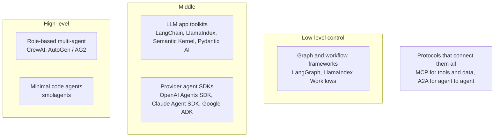

# Overview of Agentic Frameworks: The Complete Guide

> 📚 **Before you start**
>
> - [Lab: Tool-using agent from scratch](../04-tools-and-function-calling/lab-tool-using-agent-from-scratch.md), so you know what frameworks automate.
> - [What are Multi-Agent Systems?](what-are-multi-agent-systems.md), for the team patterns frameworks support.

## Introduction

By now you've built agents with nothing but Python: a loop, a tool registry, validation, approvals, a supervisor and shared state. That's deliberate. Every agent framework is a more polished, more scalable version of those same pieces.

So why use a framework at all? Because real systems need things that are tedious to build well: saving progress so a crashed run can resume, streaming output to a UI, pausing for human approval and continuing hours later, tracing every step, running agents in parallel, and connecting to hundreds of ready-made tools.

There are many frameworks, they change quickly, and their marketing pages all sound alike. This lesson gives you a **map**: the jobs a framework does, the main families, how the popular ones differ, and a practical way to choose. The rest of this platform teaches LangChain and LangGraph in depth, with MCP for tool connections, so this lesson also explains why.

> 💡 **Key Insight**
>
> Judge a framework by **which parts of the agent it controls** and **how much it hides**. High-level frameworks get a demo running in minutes but can be hard to bend; low-level ones take longer to start but let you control every step. Because you've built the core yourself, you can see through any framework's abstractions to the loop underneath.

---

## Core Explanation

### 1. What frameworks actually do

Map each part you built by hand to what a framework provides:

| What you built by hand | What a framework adds |
|---|---|
| A model function | Adapters for many model providers behind one interface |
| `@tool` decorator and registry | Ready-made tools and toolkits, MCP connections, schema generation |
| The `while` loop over `stop_reason` | Prebuilt agent loops (ReAct and others), retries, timeouts |
| A `messages` list | Memory: trimming, summarising, long-term stores |
| A `state` dictionary | Typed state, checkpointing to a database, resume after crash |
| `approve()` callback | Interrupts that pause a run and resume later with a human's answer |
| `print()` traces | Tracing and evaluation dashboards |
| Supervisor function | Multi-agent orchestration, hand-offs, parallel branches |

### 2. The families



**Graph and workflow frameworks** describe an agent as a graph: nodes (steps) connected by edges (what runs next), with an explicit state flowing through. You control exactly what happens and when. *LangGraph* is the best-known example.

**LLM application toolkits** provide the building blocks: model wrappers, prompt templates, output parsers, retrievers, tools, plus simple agent loops. *LangChain* and *LlamaIndex* are the big ones; LlamaIndex is especially strong for data ingestion and RAG.

**Provider agent SDKs** come from model companies and make agents on their models straightforward. They're usually thin, fast to learn and well integrated with that provider's features. The *Claude Agent SDK*, for example, packages the harness behind Claude Code (file and shell tools, sub-agents, permissions) as a library.

**Role-based multi-agent frameworks** let you define agents as team members ("researcher", "writer") with goals and backstories, then assign tasks. *CrewAI* and *AutoGen* (and its community fork AG2) popularised this style. Quick to prototype; less fine-grained control.

**Minimal code agents** such as Hugging Face's *smolagents* keep the framework tiny, and often let the agent act by writing and running small pieces of code instead of JSON tool calls.

**Protocols** aren't frameworks but matter just as much. **MCP** (Model Context Protocol) is a standard way to expose tools and data so that any compatible app or framework can use them; it has a full course on this platform ([Model Context Protocol (MCP)](../../model-context-protocol-mcp/course.md)). **A2A** (Agent-to-Agent) is a protocol for agents built in different frameworks to talk to each other.

### 3. How the popular frameworks compare

Frameworks evolve fast, so treat this as a description of each one's **design philosophy**, which changes slowly, rather than a feature checklist.

| Framework | Philosophy | Great for | Trade-off |
|---|---|---|---|
| **LangChain** | Composable building blocks for LLM apps | Prompts, parsers, RAG pipelines, tool integrations | Many abstractions to learn |
| **LangGraph** | Agents as explicit graphs with state, built by the LangChain team | Production agents needing control, persistence, human-in-the-loop | More code than high-level tools |
| **LlamaIndex** | Data-first: connect, index and query your data | RAG and document-heavy agents | Less focus on complex control flow |
| **CrewAI** | Role-playing teams of agents with tasks | Fast multi-agent prototypes | Harder to control precisely |
| **AutoGen / AG2** | Agents that converse to solve tasks | Research, conversational multi-agent setups | Conversations can be hard to steer |
| **Provider SDKs** (OpenAI Agents SDK, Claude Agent SDK, Google ADK) | Thin layer over one provider's models and tools | Getting the most from one provider quickly | Tighter coupling to that provider |
| **smolagents** | Small and simple; agents write code to act | Learning, lightweight agents | Fewer production features |
| **Pydantic AI** | Type-safe agents with validated inputs and outputs | Python teams who value types and validation | Smaller ecosystem |

### 4. The same agent, three levels of abstraction

To see what "level of abstraction" means, compare how much you specify at each level. (The code below is a simplified sketch of each style, not exact library syntax; the courses on each framework teach the real APIs.)

**From scratch** (what you built): you write everything.

```python
# not-run: the shape of your own agent from the lab
agent = Agent(model=claude_model, system="Track expenses in INR.")
agent.ask("I spent 450 on lunch")
```

**Graph framework** (LangGraph style): you declare nodes, edges and state; the framework runs the loop, saves checkpoints and supports interrupts.

```python
# not-run: sketch of the graph style
graph = StateGraph(State)
graph.add_node("model", call_model)
graph.add_node("tools", ToolNode(tools))
graph.add_edge(START, "model")
graph.add_conditional_edges("model", tools_condition)   # tool call? go to tools, else end
graph.add_edge("tools", "model")
app = graph.compile(checkpointer=memory)
```

**Role-based framework** (CrewAI style): you describe people and tasks; the framework decides most of the mechanics.

```python
# not-run: sketch of the role-based style
researcher = Agent(role="Researcher", goal="Find accurate facts", tools=[search])
writer = Agent(role="Writer", goal="Write a clear fact sheet")
crew = Crew(agents=[researcher, writer], tasks=[research_task, write_task])
crew.kickoff()
```

Moving down the list you write **less code** but make **fewer decisions**. Moving up you write more but **control more**.

### 5. How to choose

Ask these questions in order:

1. **Do I need an agent at all?** If the steps are fixed, a plain workflow (or a LangChain chain) is cheaper and more reliable. See [Workflows vs Agents](../03-the-agent-loop/workflows-vs-agents.md).
2. **How much control do I need?** Production systems with approvals, retries and audit trails favour graph frameworks. Quick prototypes and internal tools can use high-level ones.
3. **Do I need persistence and human-in-the-loop?** If runs must pause for hours or survive crashes, choose a framework with built-in checkpointing.
4. **Is my problem mostly about data?** Heavy document ingestion and retrieval points towards LlamaIndex or LangChain's RAG tooling.
5. **Am I committed to one model provider?** A provider SDK may be the simplest path. If you want to switch providers easily, choose a provider-neutral framework.
6. **What does my team already know, and what can I debug?** A framework you can't see inside is a liability at 2 a.m.

Here's that decision as a small function you can play with:

```python
def suggest_framework(fixed_steps, needs_persistence, data_heavy, multi_agent, quick_prototype):
    if fixed_steps:
        return "No agent framework: a workflow or LangChain chain"
    if needs_persistence:
        return "LangGraph (graph + checkpoints + human-in-the-loop)"
    if data_heavy:
        return "LlamaIndex or LangChain RAG components"
    if multi_agent and quick_prototype:
        return "CrewAI or AutoGen for a prototype; LangGraph for production"
    return "A provider SDK or LangChain's prebuilt agent"

print(suggest_framework(False, True, False, True, False))
print(suggest_framework(True, False, False, False, False))
print(suggest_framework(False, False, False, True, True))
```

Output:

```
LangGraph (graph + checkpoints + human-in-the-loop)
No agent framework: a workflow or LangChain chain
CrewAI or AutoGen for a prototype; LangGraph for production
```

### 6. Why this platform teaches LangChain, LangGraph and MCP

- **LangChain** gives you the building blocks (models, prompts, structured output, retrievers, tools) used everywhere in GenAI apps, and its ideas transfer to every other toolkit. → [LangChain Complete Guide](../../langchain-complete-guide/course.md)
- **LangGraph** is low-level enough to teach how agents really work (state, loops, checkpoints, interrupts) and robust enough for production. → [LangGraph Fundamentals](../../langgraph-complete-guide/course.md)
- **MCP** is framework-neutral: tools you expose through it work with LangGraph, provider SDKs, desktop assistants and IDEs alike. → [Model Context Protocol (MCP)](../../model-context-protocol-mcp/course.md)

Once you know these three and the from-scratch core, picking up any other framework is a matter of reading its docs for an afternoon.

---

## Try It Yourself

1. **Map the parts.** For your [tool-using agent](../04-tools-and-function-calling/lab-tool-using-agent-from-scratch.md), list which of its pieces a framework would replace (use the table in section 1).
2. **Choose.** Pick a framework family for: (a) an internal tool that drafts weekly status emails from a fixed template; (b) a loan-approval assistant that must pause for a human officer and keep an audit trail; (c) a weekend prototype where three agents brainstorm startup ideas; (d) a Q&A bot over 20,000 PDF pages.
3. **Spot lock-in.** What's one advantage and one risk of building on a single provider's agent SDK?

<details>
<summary>Show answers</summary>

**1.** Model function → provider adapters; `@tool` and `REGISTRY` → tool decorators and toolkits; `validate` → automatic schema validation; `Agent.ask` loop → prebuilt agent loop; `messages` → memory; `approve` → interrupts; `show` → tracing.

**2.** (a) No agent framework: a workflow or chain. (b) A graph framework like LangGraph, for checkpoints, interrupts and auditability. (c) A role-based framework like CrewAI or AutoGen. (d) LlamaIndex or LangChain RAG components (possibly with an agent on top later).

**3.** Advantage: fastest access to that provider's newest features, with less glue code. Risk: switching models or providers later means rewriting more code. Keeping tools behind MCP reduces that risk.

</details>

---

## Real-World Examples

- **Startups** often prototype with a high-level framework to test an idea in days, then rebuild the parts that matter in a graph framework for production.
- **Enterprises** frequently standardise on one orchestration framework plus MCP servers for internal systems, so many teams can share tools.
- **Developer tools** such as coding assistants are often built directly on a provider's agent SDK to get file, shell and sub-agent capabilities out of the box.

---

## Common Misconceptions

### "You must pick the 'best' framework"

There's no single best. There's the best fit for your control needs, data, team and providers.

### "Frameworks make agents smarter"

They make agents **easier to build and operate**. Quality still comes from the model, instructions, tools and evaluation.

### "Learning a framework is enough"

Without the from-scratch understanding, framework errors are mysterious. With it, they're just a loop, a state and some tools.

### "Frameworks are stable, so tutorials stay correct"

Agent frameworks change quickly. Check the version a tutorial uses and read the official docs for current APIs.

---

## Interview Relevance

*"Which agent frameworks have you used, and how do they compare?"* Show you understand **categories and trade-offs** rather than listing names: graph frameworks (control, persistence) vs toolkits (building blocks) vs role-based (fast multi-agent prototypes) vs provider SDKs (fast, provider-coupled), plus MCP for tool interoperability.

*"Why LangGraph over a simple agent executor?"* Explicit state and control flow, checkpointing and resume, human-in-the-loop interrupts, streaming, and easier debugging of multi-step and multi-agent systems.

---

## Key Takeaways

- Frameworks automate what you built by hand: **model adapters, tools, loops, memory, state, approvals, tracing, orchestration**.
- Families: **graph frameworks**, **LLM toolkits**, **provider SDKs**, **role-based multi-agent**, **minimal code agents**, plus **protocols** (MCP, A2A).
- Trade-off: **less code ⇄ less control**.
- Choose by: need for an agent, control, persistence, data, provider strategy and team skills.
- This platform teaches **LangChain + LangGraph + MCP** on top of the from-scratch core.

---

**Up next:** [Trends in Multi-Agent AI](trends-in-multi-agent-ai.md)
