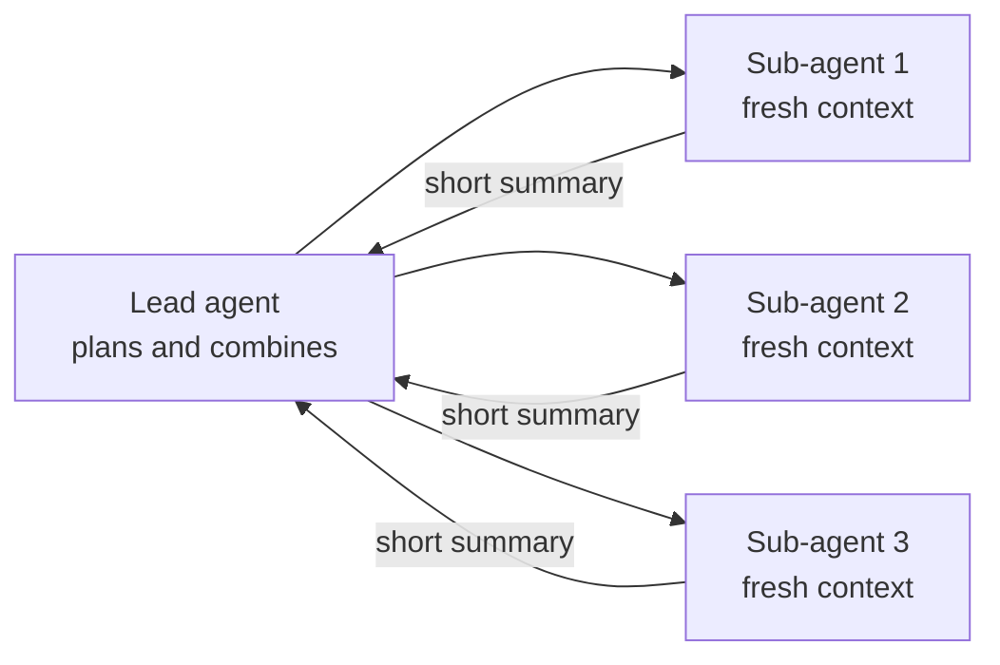

# Trends in Multi-Agent AI: The Complete Guide

> 📚 **Before you start**
>
> - [What are Multi-Agent Systems?](what-are-multi-agent-systems.md), for architectures and their costs.
> - [Overview of Agentic Frameworks](overview-of-agentic-frameworks.md), for the ecosystem map.

## Introduction

Agentic AI moves fast. Techniques that were research papers one year are product features the next. Rather than chase every headline, this lesson focuses on the **lasting directions**: the shifts in how agents are built, connected, evaluated and governed that keep showing up across companies and research groups.

For each trend you'll learn what it is, why it's happening, and what it means for you as a builder, with links to the courses on this platform where you'll practise it. Treat this as a map of where to pay attention, and expect the specific product names to change.

> 💡 **Key Insight**
>
> Most trends in agentic AI push in one direction: **from clever demos to dependable systems**. Standard protocols, long-running agents, better evaluation, human oversight and cost control are all about making agents something a business can trust with real work.

---

## Core Explanation

### 1. Standard protocols for tools and agents

**What:** Instead of writing custom glue for every tool and every app, the ecosystem is converging on shared protocols. **MCP** standardises how apps connect to tools, data and prompts. **Agent-to-agent protocols** such as A2A standardise how agents built by different teams or vendors discover each other and exchange tasks.

**Why:** The "N apps × M tools" integration problem. With a protocol, each tool is written once and works everywhere.

**For you:** Learn to build and consume MCP servers; expose your company's systems as MCP tools rather than one-off integrations. → [Model Context Protocol (MCP)](../../model-context-protocol-mcp/course.md)

### 2. Orchestrator and sub-agent designs

**What:** A lead agent breaks a big task down and delegates pieces to **sub-agents**, each with a fresh context window, then combines their results. Research assistants and coding agents increasingly work this way.

**Why:** Context windows fill up on long tasks. Sub-agents keep each piece of work focused, can run in parallel, and return only a summary to the lead.

**For you:** Design clear sub-task briefs and compact result formats; control the cost multiplier. → [Multi-Agent Research System (Capstone)](../../multi-agent-research-system-capstone/course.md)



### 3. Long-running and background agents

**What:** Agents that work for minutes or hours, survive restarts, run on a schedule, and report back when finished, rather than answering within a single chat turn.

**Why:** Real tasks (migrating code, monitoring systems, compiling research) take longer than a chat reply.

**For you:** Persistence and checkpoints become essential, along with progress reporting and safe resumption. → [Persistence and Checkpointers in LangGraph](../../langgraph-fundamentals/course.md#m5)

### 4. Agents that use computers and code

**What:** Beyond JSON tool calls, agents increasingly act by **writing and running code** in sandboxes, and by **operating graphical interfaces** (clicking, typing, reading screens) through computer-use and browser tools.

**Why:** Code is a more expressive action language than single tool calls, and much software has no API, only a screen.

**For you:** Sandboxing, permissions and approval for actions become central design concerns. → [Guardrails and Security](../../enterprise-llm-systems/course.md#m6)

### 5. Memory that lasts

**What:** Agents that remember user preferences, past decisions and lessons learned across sessions, using stores outside the model (databases, vector stores, files) and deciding what's worth remembering.

**Why:** Re-explaining context every session is frustrating and wasteful.

**For you:** Learn short-term vs long-term memory, summarisation and retrieval, and the privacy questions that come with storing user data. → [LangGraph State and Memory](../../langgraph-state-and-memory/course.md)

### 6. Agentic retrieval

**What:** RAG systems where an agent decides **whether** to retrieve, **what** to search, **whether results are good enough**, and **when to try again**, instead of a fixed retrieve-then-answer pipeline.

**Why:** Fixed pipelines fail on vague or multi-part questions; agents can reformulate and check.

**For you:** Adaptive RAG, Corrective RAG and Self-RAG. → [Agentic RAG Systems](../../agentic-rag-systems/course.md)

### 7. Evaluation and observability as first-class work

**What:** Teams treat agent quality as something to **measure**: test sets of realistic tasks, LLM-as-a-judge graders with rubrics, tracing of every step, and dashboards of cost, latency and success rate.

**Why:** Agents are non-deterministic and multi-step; you can't eyeball quality at scale or spot regressions without measurement.

**For you:** Build evaluation in from day one. → [Enterprise LLM Systems](../../enterprise-llm-systems/course.md)

### 8. Human-in-the-loop by design

**What:** Agents propose; humans approve at the right moments (before payments, deletions, external messages) and can edit the agent's state or rewind it.

**Why:** Trust and accountability. Full autonomy is rarely the goal for high-stakes actions.

**For you:** Interrupts, approvals, editing state and time travel. → [Human-in-the-Loop with LangGraph](../../human-in-the-loop-with-langgraph/course.md)

### 9. Cost, speed and model routing

**What:** Systems mix models: a strong model for planning and hard reasoning, smaller faster models for routine sub-tasks, plus caching and gateways that route requests and fall back when a provider fails.

**Why:** Multi-agent systems multiply calls; cost and latency decide whether a product is viable.

**For you:** Measure cost per completed task, not per call, and learn LLM gateways. → [LLM Gateways](../../enterprise-llm-systems/course.md#m5)

### 10. Safety, security and governance

**What:** Defences against **prompt injection** (malicious instructions hidden in web pages, emails or documents an agent reads), least-privilege tool access, audit logs, and organisational policies for what agents may do.

**Why:** An agent that reads untrusted content and holds powerful tools is an attractive target.

**For you:** Treat every tool result as untrusted data, never as instructions; restrict tools; log and review. → [Guardrails and Security](../../enterprise-llm-systems/course.md#m6)

### Summary map

| Trend | Problem it solves | Where to learn it here |
|---|---|---|
| Standard protocols | Integration sprawl | MCP |
| Orchestrator + sub-agents | Context limits, parallel work | Capstone |
| Long-running agents | Tasks longer than a chat turn | LangGraph persistence |
| Code and computer use | Limited action space | Guardrails and Security |
| Lasting memory | Re-explaining context | LangGraph State and Memory |
| Agentic retrieval | Fixed RAG fails on hard questions | Agentic RAG |
| Evaluation and observability | Can't see or measure quality | Enterprise LLM Systems |
| Human-in-the-loop | Trust for risky actions | HITL with LangGraph |
| Cost and routing | Calls multiply | LLM Gateways |
| Security and governance | Prompt injection, misuse | Guardrails and Security |

### A quick self-check

Here's a tiny "readiness score" for an agent project, based on the trends above. It's a teaching toy, but it's a useful checklist before you ship:

```python
CHECKS = {
    "tools exposed through a standard protocol (e.g. MCP)": True,
    "state is checkpointed so runs can resume": True,
    "every step is traced": False,
    "there is an evaluation set of realistic tasks": False,
    "risky actions need human approval": True,
    "tool results are treated as untrusted data": True,
    "cost per completed task is measured": False,
}

score = sum(CHECKS.values())
print(f"Readiness: {score}/{len(CHECKS)}")
for item, ok in CHECKS.items():
    if not ok:
        print("  to do:", item)
```

Output:

```
Readiness: 4/7
  to do: every step is traced
  to do: there is an evaluation set of realistic tasks
  to do: cost per completed task is measured
```

---

## Try It Yourself

1. **Match the trend.** Which trend addresses each problem? (a) Your agent forgets a user's dietary preference every session. (b) A research agent's context fills with search results. (c) A support agent was tricked by a hidden instruction in a customer email. (d) Your multi-agent system costs ₹40 per question.
2. **Plan your learning.** Pick the two trends most relevant to a project you'd like to build and find the courses for them in the catalog.
3. **Readiness.** Change `CHECKS` to describe a project of your own. What's your score, and which item would you fix first?

<details>
<summary>Show answers</summary>

**1.** (a) Lasting memory. (b) Orchestrator and sub-agents (fresh contexts returning summaries). (c) Safety and security: treat tool results as untrusted, restrict tools, add guardrails. (d) Cost, speed and model routing: cheaper models for sub-tasks, caching, fewer hand-offs.

**2.** For example, a document assistant would focus on agentic retrieval (Agentic RAG Systems) and evaluation (Enterprise LLM Systems).

**3.** Usually tracing or evaluation first, because you can't improve what you can't see or measure.

</details>

---

## Real-World Examples

- **Deep research features** in AI assistants combine orchestrator/sub-agent designs, long-running execution and citations.
- **Coding agents** combine code execution, sub-agents, long-running tasks and approval prompts for risky commands.
- **Enterprise assistants** connect to internal systems through MCP servers, with audit logs and per-tool permissions.

---

## Common Misconceptions

### "The trend is towards fully autonomous agents everywhere"

The trend is towards **useful** autonomy: agents do the work, humans approve the risky steps.

### "New frameworks make older skills obsolete"

The fundamentals (the loop, tools, state, evaluation) stay the same. New products repackage them.

### "Security is a later problem"

Prompt injection and over-powered tools are design problems. Fixing them after launch is much harder.

---

## Interview Relevance

*"What trends are you following in agentic AI?"* Pick two or three and explain the **problem each solves** and a **design implication**, for example: "MCP reduces integration work, so I'd expose internal systems as MCP servers"; "Sub-agents with fresh contexts handle long research tasks, at a higher token cost, so I'd measure cost per task"; "Prompt injection means tool outputs are untrusted, so write tools need approval."

---

## Key Takeaways

- The big direction: **from demos to dependable systems**.
- Key trends: **protocols (MCP, A2A)**, **orchestrator + sub-agents**, **long-running agents**, **code and computer use**, **lasting memory**, **agentic retrieval**, **evaluation and observability**, **human-in-the-loop**, **cost and routing**, **security and governance**.
- Each trend maps to a course on this platform where you'll build it.

---

**Up next:** You've finished Agentic AI Fundamentals. Continue with [LangGraph Fundamentals](../../langgraph-fundamentals/course.md) to build these patterns with a production framework.
