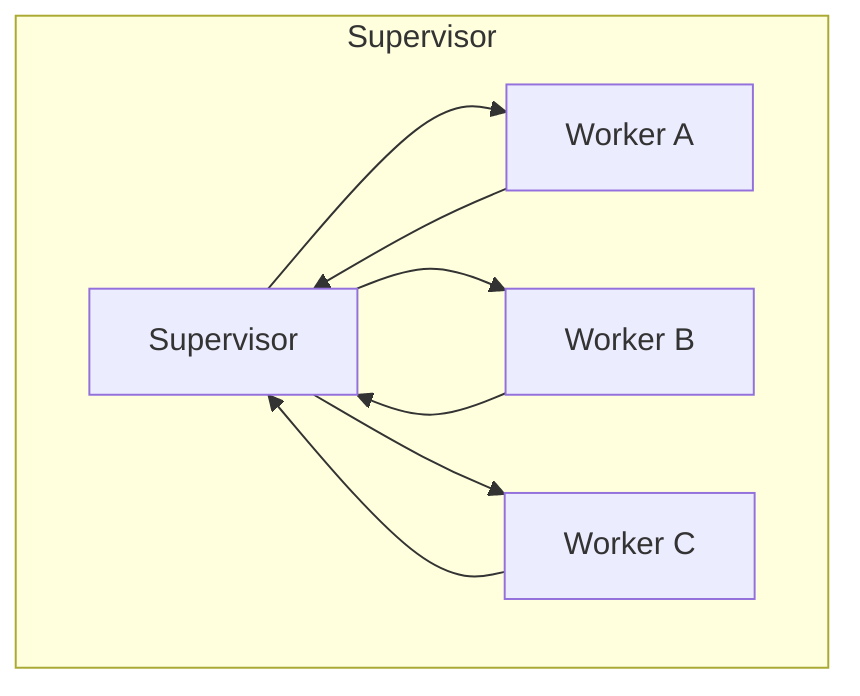
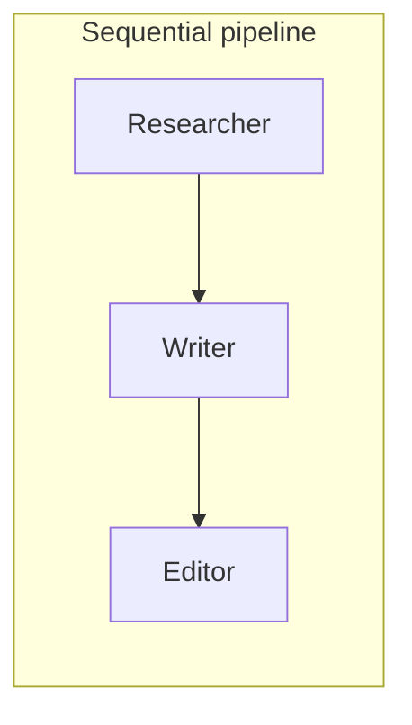
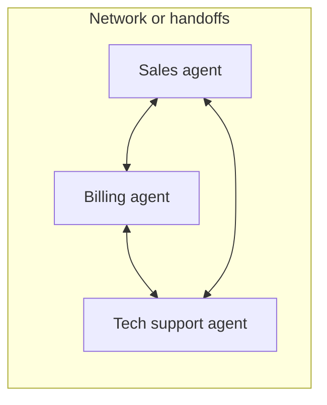

# What are Multi-Agent Systems? The Complete Guide

> 📚 **Before you start**
>
> - [Anatomy of an Agent](../03-the-agent-loop/anatomy-of-an-agent.md), for what one agent is made of.
> - [Planning and Reflection](../05-reasoning-patterns/planning-and-reflection.md), because multi-agent systems often split a plan across agents.
> - [Designing Good Tools](../04-tools-and-function-calling/designing-good-tools.md), for why one agent with too many tools struggles.

## Introduction

A newspaper isn't written by one person who reports, edits, fact-checks, designs the pages and writes the headlines. It's a team: reporters gather facts, an editor shapes the story, a fact-checker verifies claims, and a chief editor decides what runs. Each person has a focused job, the right tools for it, and a clear way to hand work to the next.

A **multi-agent system** applies the same idea to AI. Instead of one agent with a giant prompt and thirty tools, you build several smaller agents, each with a focused role, its own instructions and a few tools, and you define how they pass work between them.

This lesson explains when that's worth it (often it isn't), the main ways to organise agents, how they communicate and share state, and the problems that come with more agents. You'll build a tiny supervisor-and-workers team from scratch.

> 💡 **Key Insight**
>
> Multi-agent systems are about **separation of concerns**: each agent gets a narrow job, a short prompt and only the tools it needs, so it does that job well. The price is **coordination**: more model calls, more hand-offs, and more places for information to get lost. Use several agents only when one focused agent genuinely can't do the job.

---

## Core Explanation

### 1. When one agent stops being enough

A single agent works well until one of these happens:

- **Too many tools.** With dozens of tools, the model picks the wrong one more often and every request carries a long list of descriptions.
- **Conflicting instructions.** "Be creative and persuasive" (for a writer) fights with "be strict and sceptical" (for a reviewer) in one prompt.
- **Too much context.** A long research task fills the context window with search results, leaving little room for writing the report.
- **Different skills or models.** Planning may need a strong model; summarising a hundred pages works fine with a cheap fast one.
- **Natural parallelism.** Researching five companies can happen at the same time.

If none of these apply, stay with one agent. A well-designed single agent is simpler, cheaper and easier to debug.

### 2. The main architectures







| Architecture | How it works | Strengths | Watch out for |
|---|---|---|---|
| **Supervisor (orchestrator-workers)** | A coordinator agent decides which worker to call next, and combines their results | Flexible, central control, easy to add workers | The supervisor becomes a bottleneck; extra calls |
| **Sequential pipeline** | Agents run in a fixed order, each improving the previous output | Simple and predictable | Not adaptive; errors flow downstream |
| **Hierarchical** | Supervisors of supervisors (teams of teams) | Scales to big tasks | Complex; information lost between layers |
| **Network / handoffs** | Any agent can hand the conversation to another | Natural for customer service routing | Hard to predict; can bounce back and forth |
| **Debate / voting** | Several agents answer independently, then argue or vote | Better accuracy on hard reasoning | Costly; can converge on a shared mistake |

A sequential pipeline is really a **workflow** of agents (see [Workflows vs Agents](../03-the-agent-loop/workflows-vs-agents.md)). The supervisor pattern is the most common starting point for genuinely agentic teams.

### 3. How agents communicate

Agents need a way to pass work and results. Three common approaches:

- **Messages.** Agents send each other text, like a chat. Easy, but details can get lost in paraphrasing.
- **Shared state.** All agents read and write one structured object (for example `{"topic": ..., "sources": [...], "draft": ..., "review": ...}`). This is LangGraph's approach, covered in [LangGraph State and Memory](../../langgraph-state-and-memory/course.md).
- **Agents as tools.** The supervisor calls a worker exactly like a tool: `research_agent(question)` returns a result. This reuses everything from [function calling](../04-tools-and-function-calling/function-calling-step-by-step.md).

Whatever the channel, the golden rule is: **each hand-off should carry everything the next agent needs**, because agents don't share memory unless you give them a shared state.

### 4. Build a tiny supervisor team

Let's build a three-agent team that writes a short fact sheet. Each "agent" is a function with its own role; the supervisor decides who works next by reading the shared state. In a real system, each worker would be a model call with its own prompt and tools; here they're pretend so the example runs offline, but the **coordination logic** is real.

**Shared state** that every agent reads and writes:

```python
state = {
    "topic": "Indian Space Research Organisation (ISRO)",
    "facts": [],
    "draft": None,
    "review": None,
    "log": [],
}
```

**The workers**, each with a narrow job:

```python
def researcher(state):
    """Role: find facts. Tools (real version): web search. Never writes prose."""
    state["facts"] = [
        "ISRO was founded in 1969.",
        "Chandrayaan-3 landed near the Moon's south pole in 2023.",
        "Mangalyaan reached Mars orbit on its first attempt in 2014.",
    ]
    return f"found {len(state['facts'])} facts"

def writer(state):
    """Role: turn facts into a short fact sheet. Uses only the facts provided."""
    bullets = "\n".join(f"- {f}" for f in state["facts"])
    state["draft"] = f"Fact sheet: {state['topic']}\n{bullets}"
    return "draft written"

def reviewer(state):
    """Role: check the draft against the facts. Strict and sceptical."""
    missing = [f for f in state["facts"] if f not in state["draft"]]
    state["review"] = "approved" if not missing else f"missing: {missing}"
    return state["review"]

WORKERS = {"researcher": researcher, "writer": writer, "reviewer": reviewer}
```

**The supervisor** chooses the next worker from the state. A real supervisor is a model call ("Given this state, which worker should act next? Reply with a name or FINISH"); our rule-based one mirrors what it would decide:

```python
def supervisor(state):
    if not state["facts"]:
        return "researcher"
    if state["draft"] is None:
        return "writer"
    if state["review"] is None:
        return "reviewer"
    return "FINISH"

def run_team(state, max_turns=8):
    for turn in range(1, max_turns + 1):
        choice = supervisor(state)
        if choice == "FINISH":
            break
        result = WORKERS[choice](state)
        state["log"].append(f"turn {turn}: supervisor -> {choice}: {result}")
    return state

final = run_team(state)
print("\n".join(final["log"]))
print()
print(final["draft"])
print("review:", final["review"])
```

Output:

```
turn 1: supervisor -> researcher: found 3 facts
turn 2: supervisor -> writer: draft written
turn 3: supervisor -> reviewer: approved

Fact sheet: Indian Space Research Organisation (ISRO)
- ISRO was founded in 1969.
- Chandrayaan-3 landed near the Moon's south pole in 2023.
- Mangalyaan reached Mars orbit on its first attempt in 2014.
review: approved
```

Notice the design:

- **Each worker has one job** and a short "prompt" (its docstring). The writer is told to use only the facts it's given, which prevents it from inventing new ones.
- **The shared state is the single source of truth.** Nobody has to remember anything; they read the state.
- **The supervisor only routes.** It doesn't research or write.
- **A turn limit** stops runaway coordination, just like the step limit on a single agent.

You'll build the real version with LLM workers, LangGraph and tools in the [Multi-Agent Research System capstone](../../multi-agent-research-system-capstone/course.md).

### 5. The costs and failure modes

More agents bring new ways to fail:

- **Cost and latency multiply.** Every hand-off is at least one more model call. A five-agent system can easily cost 5 to 15 times more than one agent.
- **Lost context.** Agent B only knows what agent A passed on. A summary that drops one detail can derail everything downstream.
- **Endless loops.** Writer and reviewer can bounce a draft back and forth forever. Use turn limits and clear acceptance criteria.
- **Blame is hard to assign.** When the final answer is wrong, which agent caused it? You need **tracing** of every hand-off (see [Observability](../../enterprise-llm-systems/course.md#m3)).
- **Inconsistent behaviour.** Small changes in one agent's prompt can change the whole team's behaviour.

A practical rule: **start with one agent; split out a second only when you can name the specific problem it solves.**

### 6. Patterns that make teams work

- **Narrow roles, short prompts.** One clear responsibility per agent.
- **Least privilege.** Give each agent only the tools it needs. The writer doesn't need web search; the researcher doesn't need the "publish" tool.
- **Structured hand-offs.** Pass structured data (fields in a shared state, JSON) rather than long chatty messages.
- **Clear stopping rules.** Turn limits, acceptance criteria, and a final owner who decides "done".
- **Humans at the risky points.** Pause for approval before irreversible actions (covered in [Human-in-the-Loop with LangGraph](../../human-in-the-loop-with-langgraph/course.md)).

---

## Try It Yourself

1. **Choose an architecture.** For each, pick supervisor, sequential pipeline, network/handoffs, or "just one agent": (a) a bank chatbot that routes between cards, loans and fraud teams; (b) blog post: research, draft, edit; (c) answering "what's 15% of ₹3,400?"; (d) a research assistant that decides which of six specialist agents to consult.
2. **Add a revision loop.** Make `reviewer` reject the first draft (e.g. require a line starting with "Summary:"), make `writer` add that line when `state["review"]` contains "missing", and update `supervisor` so a rejected draft goes back to the writer. Run the team and check the log.
3. **Least privilege.** List which of these tools each agent in our team should get: `web_search`, `read_url`, `save_draft`, `publish_article`.

<details>
<summary>Show answers</summary>

**1.** (a) Network/handoffs (or a router supervisor). (b) Sequential pipeline. (c) Just one agent, or no agent at all: one tool call. (d) Supervisor.

**2.** One possible solution:

```python
def reviewer(state):
    if not state["draft"].endswith(("Summary: India's space programme punches far above its budget.",)):
        state["review"] = "missing summary line"
    else:
        state["review"] = "approved"
    return state["review"]

def writer(state):
    bullets = "\n".join(f"- {f}" for f in state["facts"])
    state["draft"] = f"Fact sheet: {state['topic']}\n{bullets}"
    if state["review"] and "missing" in state["review"]:
        state["draft"] += "\nSummary: India's space programme punches far above its budget."
    state["review"] = None
    return "draft written"

WORKERS.update(writer=writer, reviewer=reviewer)

def supervisor(state):
    if not state["facts"]:
        return "researcher"
    if state["draft"] is None or (state["review"] or "").startswith("missing"):
        return "writer"
    if state["review"] is None:
        return "reviewer"
    return "FINISH"

team = run_team({"topic": "ISRO", "facts": [], "draft": None, "review": None, "log": []})
print("\n".join(team["log"]))
```

Output:

```
turn 1: supervisor -> researcher: found 3 facts
turn 2: supervisor -> writer: draft written
turn 3: supervisor -> reviewer: missing summary line
turn 4: supervisor -> writer: draft written
turn 5: supervisor -> reviewer: approved
```

**3.** Researcher: `web_search`, `read_url`. Writer: `save_draft`. Reviewer: none (it only reads the state). `publish_article` goes to no agent, or to a final step that requires human approval.

</details>

---

## Real-World Examples

- **Deep research products** use a lead agent that plans and several sub-agents that search different angles in parallel, each with its own context window, then the lead combines their findings.
- **Coding assistants** use separate agents (or sub-agents) for exploring a codebase, writing changes and reviewing them.
- **Customer-service systems** route conversations between specialised agents (billing, technical, sales) with hand-offs.
- **Software-team simulations** like MetaGPT and ChatDev assign roles such as product manager, architect, engineer and tester.

---

## Common Misconceptions

### "More agents means a smarter system"

More agents means more coordination. Many problems are solved better by one well-designed agent.

### "Agents share a brain"

Each agent sees only its own prompt and what you pass it. Shared memory exists only if you build shared state.

### "Multi-agent systems need a special framework"

You just built one with functions and a dictionary. Frameworks add persistence, parallelism, tracing and visual graphs, which matter at scale.

### "Agents should chat freely to find a solution"

Free-form agent chats are fun demos but hard to control. Production systems use clear roles, structured hand-offs and stopping rules.

---

## Interview Relevance

*"When would you use a multi-agent system instead of a single agent?"* Answer with concrete triggers: too many tools, conflicting roles, context overflow, different models per sub-task, or parallelisable work. Then name the costs: more calls, latency, lost context at hand-offs, loops, harder debugging.

*"Describe a multi-agent architecture you'd use for X."* Pick supervisor/workers for open-ended tasks or a pipeline for fixed stages, describe the shared state, each agent's tools (least privilege), stopping rules, human approval points and tracing.

---

## Key Takeaways

- A **multi-agent system** splits work across agents with **narrow roles, short prompts and few tools**.
- Main architectures: **supervisor**, **sequential pipeline**, **hierarchical**, **network/handoffs**, **debate/voting**.
- Agents communicate through **messages**, **shared state** or **agents-as-tools**; every hand-off must carry what the next agent needs.
- Costs: **more calls, latency, lost context, loops, harder debugging**.
- **Start with one agent**; add more only for a named problem.

---

**Up next:** [Overview of Agentic Frameworks](overview-of-agentic-frameworks.md)
