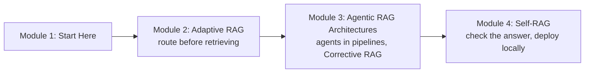

# How This Course Works

> 📚 **Before you start**
>
> - [Retrieval-Augmented Generation (RAG)](../../retrieval-augmented-generation-rag/course.md), the whole course, and especially [Implementing RAG](../../retrieval-augmented-generation-rag/course.md#m6) and [RAG Evaluation](../../retrieval-augmented-generation-rag/course.md#m9).
> - [LangGraph Complete Guide](../../langgraph-complete-guide/course.md), and above all [RAG Inside a LangGraph Agent](../../langgraph-complete-guide/05-workflows-and-agents/rag-inside-a-langgraph-agent.md), which this course continues directly.

## Introduction

Think of the enquiry counter at a big railway station. A good clerk doesn't run the same routine for everyone. "Which platform for the Shatabdi?" gets an answer from memory. "What's the refund if I cancel tomorrow?" sends them to the rule book. "My train got cancelled, I paid by UPI, when do I get my money?" makes them look up two different rules and put them together. And if the page they open turns out to be about something else, they close it and look again instead of reading out the wrong rule.

The RAG systems you built in the [RAG course](../../retrieval-augmented-generation-rag/course.md) behave like a clerk with only one routine: **retrieve, then generate, every time**. That works well when every question is the same kind of question. Real users are not like that. Some questions need no lookup, some need one, some need several, some need the live web, and sometimes the retriever simply brings back the wrong pages.

**Agentic RAG** puts decisions into the pipeline: an LLM (or a small classifier) decides *whether* to retrieve, *where* from, *how many times*, whether what came back is any good, and whether the answer it wrote is actually supported. You already saw the first taste of this at the end of the LangGraph course, where a graph graded its retrieval and rewrote a poor query. This course turns that taste into the three well-known designs (**Adaptive RAG**, **Corrective RAG** and **Self-RAG**) and the agent patterns around them.

> 💡 **Key Insight**
>
> Agentic RAG is not a new kind of retriever. It is the same retrieve-and-generate pieces you already know, with **decisions added at three points**: before retrieving (which strategy?), after retrieving (are these documents good enough?), and after generating (is this answer supported and useful?). Each module of this course teaches one of those decision points.

---

## What You Will Learn


*The grey boxes are the RAG pipeline you already know. Each coloured box is a decision this course adds.*

By the end of this course you will be able to:

- **Explain Adaptive RAG**: classify a question by how much retrieval it needs, and route it to no retrieval, single-step retrieval, multi-step retrieval or a web search.
- **Build Adaptive RAG with a hosted provider (Cohere) and fully locally** (Ollama and a local vector store), and understand what changes when you move from a large hosted model to a small local one.
- **Design agents inside RAG pipelines**: routers, query planners that split a question into parts, multi-hop retrieval that follows a trail of facts, and tool-using agents that pick between several retrievers.
- **Implement Corrective RAG (CRAG)**: grade retrieved documents, filter them down to the useful sentences, and fall back to a rewritten web search when the knowledge base fails.
- **Implement Self-RAG**: decide when retrieval is needed, then grade relevance, check the answer is supported by the documents, and check it actually answers the question, looping until it does or a budget runs out.
- **Run Self-RAG on a real vector database and deploy it locally** behind an API, with timeouts, retry caps and logs.

### The course at a glance



| Module | You learn | You build |
|---|---|---|
| **2. Adaptive RAG** | What Adaptive RAG is, the complexity classifier, routing between strategies and sources, hosted (Cohere) and local (Ollama) versions | An adaptive RAG graph that picks no retrieval, one retrieval, multi-hop retrieval or web search |
| **3. Agentic RAG Architectures** | Where agents sit in a RAG pipeline (routing, query planning, multi-hop, tool-using retrieval agents), and Corrective RAG | A query planner, a multi-hop retriever and a CRAG graph with web fallback |
| **4. Self-RAG** | How Self-RAG critiques its own retrieval and answers, using a real vector database, and deploying it as a local service | A Self-RAG graph served by FastAPI, tested end to end |

Why this order? Adaptive RAG is the simplest decision (made once, before anything is retrieved), so it comes first. Corrective RAG adds a decision in the middle, after retrieval. Self-RAG adds decisions at the end, about the answer itself, and is the most complete design, so it closes the course and is the one you deploy.

---

## What You Need Before Starting

- **RAG fundamentals** from the [RAG course](../../retrieval-augmented-generation-rag/course.md): embeddings, vector stores, retrievers, chunking, hybrid search and reranking, and how to evaluate a RAG system with metrics such as faithfulness and answer relevance.
- **LangGraph**: state, nodes, conditional edges, loops with a cap, `Send` for parallel branches, `ToolNode` and `tools_condition`, all from the [LangGraph Complete Guide](../../langgraph-complete-guide/course.md).
- **Structured output** (getting a model to return a Pydantic object instead of text) from [LangChain Complete Guide › Structured Output and Output Parsers](../../langchain-complete-guide/course.md#m5).
- **The agent loop and ReAct** from [Agentic AI Fundamentals](../../agentic-ai-fundamentals/course.md).

### Installing

The code in this course needs only two packages to run as shown:

```bash
pip install langgraph langchain-core
```

The lessons that use a real provider (Cohere, Anthropic, Ollama, Chroma, Tavily web search) say so and show the extra install line. The examples were tested with **LangGraph 1.2** and **langchain-core 1.6**.

---

## How the Code in This Course Runs Offline

Every lesson runs end to end on your laptop with no API key, so you can see exactly what each graph does and the printed output on the page is the real output. Two stand-ins make that possible.

### 1. A tiny keyword "embedding"

You met this in [RAG Inside a LangGraph Agent](../../langgraph-complete-guide/05-workflows-and-agents/rag-inside-a-langgraph-agent.md): a fake embedding model that counts a handful of keywords. It is crude, but it behaves like a real one in the way that matters here: related texts score high and unrelated texts score low. Swap in a real embedding model and nothing else in the graph changes.

### 2. A stand-in chat model with rules instead of weights

Agentic RAG is full of small LLM decisions: "which route?", "is this document relevant?", "is this answer supported?". In a real system each is a call like this:

```python
# not-run: needs `pip install langchain-anthropic` and an ANTHROPIC_API_KEY
from typing import Literal
from langchain_anthropic import ChatAnthropic
from pydantic import BaseModel, Field

class Relevance(BaseModel):
    """Whether a retrieved document helps answer the question."""
    relevant: Literal["yes", "no"] = Field(description="'yes' if the document helps answer the question")

grader = ChatAnthropic(model="claude-opus-5-5", temperature=0).with_structured_output(Relevance)
print(grader.invoke("Question: Can I take my dog?\nDocument: Pets travel only in first class cabins."))
```

Example output:

```
relevant='yes'
```

To run that offline, this course uses a **stand-in chat model**: a real LangChain chat model class whose "brain" is a small Python function you can read. Here it is, built once so you know there's no magic:

```python
import re
from typing import Callable, Literal
from langchain_core.language_models import BaseChatModel
from langchain_core.messages import AIMessage
from langchain_core.outputs import ChatGeneration, ChatResult
from pydantic import BaseModel, Field

class StandInModel(BaseChatModel):
    """A chat model whose replies come from a Python function. For offline lessons only."""
    respond: Callable

    def _generate(self, messages, stop=None, run_manager=None, **kwargs):
        return ChatResult(generations=[ChatGeneration(message=self.respond(messages))])

    @property
    def _llm_type(self):
        return "stand-in"

    def bind_tools(self, tools, **kwargs):     # lets with_structured_output() and agents use it
        return self

def structured_reply(schema_name, **fields):
    """What a real model sends back when asked for structured output: a call to a 'tool' named after the schema."""
    return AIMessage("", tool_calls=[{"name": schema_name, "args": fields, "id": "call_1"}])

class Relevance(BaseModel):
    """Whether a retrieved document helps answer the question."""
    relevant: Literal["yes", "no"] = Field(description="'yes' if the document helps answer the question")

def relevance_rules(messages):
    question, document = messages[-1].content.lower().split("document:")
    words = lambda t: {w for w in re.findall(r"[a-z]+", t) if len(w) > 3}
    shared = words(question.replace("question:", "")) & words(document)
    return structured_reply("Relevance", relevant="yes" if shared else "no")

grader = StandInModel(respond=relevance_rules).with_structured_output(Relevance)
print(grader.invoke("Question: Can I take my pets?\nDocument: Pets travel only in first class cabins."))
print(grader.invoke("Question: Can I take my pets?\nDocument: Extra luggage costs ₹30 per kg."))
```

Output:

```
relevant='yes'
relevant='no'
```

Look at what stayed the same: the `Relevance` schema, `.with_structured_output(Relevance)` and `.invoke(...)` are exactly the lines you'd write for a real model. Only the constructor differs. When a lesson says "swap in a real model", it means replacing `StandInModel(respond=...)` with `ChatAnthropic(model="claude-opus-5-5")` (or Cohere, or a local Ollama model) and deleting the rule function.

Be honest with yourself about what the stand-in hides: its rules are perfect on the handful of questions in the lesson, while a real model is good on most questions and wrong on some. That is exactly why the course spends so much time on **grading, retry caps and fallbacks**: they exist because real models make mistakes.

### The running example: the SaathiRail help centre

Most lessons search the same small knowledge base: the help centre of **SaathiRail**, a made-up train-booking app. (The rules are invented for teaching; they are not Indian Railways' real rules.) It has six short pages about cancellation fees, Tatkal tickets, refunds when the railway cancels a train, refund timelines by payment method, luggage and pets. Six pages are enough to show every failure mode an agentic RAG system must handle: questions that need no lookup, questions one page answers, questions that need two pages chained together, questions about live events that no page covers, and retrieval that returns a confidently wrong page.

---

## How Every Lesson Is Built

Lessons follow the platform template: **Before you start** links, an **Introduction**, a **Key Insight**, the **Core Explanation** with diagrams and runnable code, **Try It Yourself** exercises with hidden answers, **Real-World Examples**, **Common Misconceptions**, **Interview Relevance** and **Key Takeaways**. **Labs** are guided builds from an empty file to a working system.

Two habits will help you most in this course:

- **Print the path.** Every graph here streams which nodes ran (`stream_mode="updates"`). Agentic RAG bugs are almost always "it took the wrong branch", and the path shows you where.
- **Count the calls.** Every decision is an extra model call, so each lesson reports how many calls a question cost. Agentic RAG trades cost and latency for quality, and you should always know the price.

---

## Common Misconceptions

### "Agentic RAG replaces normal RAG"

It wraps normal RAG. The retriever, the chunks, the embeddings and the prompt are the same; the agent decides how to use them. If your retrieval is poor, adding an agent on top makes it slower, not better.

### "More decisions always mean better answers"

Each decision is a model call that can also be wrong. A router that misroutes 5% of questions adds 5% of new failures. Add a decision only when your evaluation shows the problem it fixes.

### "Self-RAG, CRAG and Adaptive RAG are competing products"

They are research ideas about *where* to put a check, and they combine well. Many production systems route first (adaptive), grade documents (corrective) and check the answer (self-reflective) in one graph, which is what you'll build by the end.

---

## Key Takeaways

- **Agentic RAG adds decisions** to the retrieve-then-generate pipeline: before retrieval, after retrieval and after generation.
- **Module 2 (Adaptive RAG)** decides how much retrieval a question needs and where to look; **Module 3** puts agents in the pipeline and corrects bad retrieval (CRAG); **Module 4 (Self-RAG)** critiques the answer and is deployed locally.
- **All code runs offline** with a keyword embedding and a `StandInModel` whose decisions are readable Python rules; real-model versions are shown in not-run blocks.
- **The SaathiRail help centre** is the small, made-up knowledge base used throughout.
- **Always watch the path and the number of calls**: agentic RAG trades cost and latency for quality.

---

**Up next:** [What is Adaptive RAG?](../02-adaptive-rag/what-is-adaptive-rag.md)
