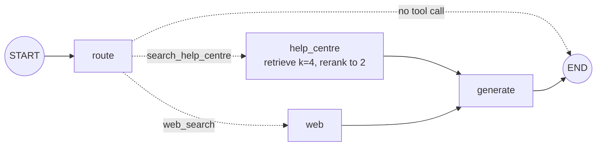

# Adaptive RAG with Cohere: The Complete Guide

> 📚 **Before you start**
>
> - [What is Adaptive RAG?](what-is-adaptive-rag.md), for the classifier, the three strategies and the SaathiRail help centre.
> - [Tools in LangGraph: ToolNode and tools_condition](../../langgraph-complete-guide/05-workflows-and-agents/tools-in-langgraph-toolnode-and-tools-condition.md), for how a model's tool calls drive a graph.
> - [Retrieval-Augmented Generation (RAG) › Implementing RAG](../../retrieval-augmented-generation-rag/course.md#m6), for embeddings in a vector store and for reranking.
> - [LangChain Complete Guide › Tools and Tool Calling](../../langchain-complete-guide/course.md#m7), for `bind_tools`.

## Introduction

Imagine the SaathiRail help desk gets three messages in the same minute: "What does PNR stand for?", "What's the fee to cancel three days early?", and "Is the Vande Bharat to Varanasi running late today?". The first needs no lookup. The second needs the help centre. The third needs something the help centre will *never* have: live information from the outside world.

In the previous lesson the classifier decided *how much* to retrieve. Here it also decides *where* to retrieve from: your own knowledge base or the web. This is the version of adaptive RAG most tutorials show, and it was popularised by a LangGraph example built on **Cohere**'s models. Cohere is a good provider to learn it with, because it sells all three model types a serious RAG system needs (embeddings, a reranker and a chat model built for grounded answers with citations) under one API key.

By the end of this lesson you will be able to:

- name the Cohere models that fill each role in a RAG system, and set them up in LangChain;
- route questions with **tool calling**, so one model call decides both *whether* and *where* to retrieve;
- retrieve wide and **rerank** narrow;
- add a web-search route for questions your knowledge base can't answer;
- build and trace the full graph offline, then swap in the real Cohere and web-search classes.

> 💡 **Key Insight**
>
> The cleanest adaptive router is a model with **tools it may or may not call**. Give it `search_help_centre` and `web_search`: calling the first means "use our docs", calling the second means "use the web", calling neither means "answer directly". One small, fast model call makes the whole routing decision, and the graph reads it straight from `response.tool_calls`.

---

## Core Explanation

### 1. The Cohere toolbox for RAG

Cohere offers three model families, each matching one stage of the pipeline you built in the RAG course. These were the current models in October 2026; check Cohere's models page for newer ones.

| Stage | Cohere family | Models to know | Role in adaptive RAG |
|---|---|---|---|
| Turn text into vectors | **Embed** | `embed-v4.0`; the newer `embed-v5.0-pro` and `embed-v5.0-fast`; older `embed-english-v3.0` | Indexing the help centre and embedding queries |
| Put the best documents first | **Rerank** | `rerank-v4.0-pro`, `rerank-v4.0-fast`, `rerank-v3.5` | Re-ordering a wide retrieval |
| Route and write answers | **Command** | `command-a-03-2025` (strong at tools and RAG), the newer `command-a-plus-05-2026`, and the small, fast `command-r7b-12-2024` | The router (small model) and the generator (large model) |

Two design choices follow from this table:

- **Use a small model for routing and a large one for answering.** The router runs on every question and makes a simple choice; `command-r7b-12-2024` is built for exactly that kind of fast tool use. The answer is where quality matters most, so it gets Command A.
- **One embedding model per index.** Vectors from different embedding models can't be compared, so if you move from `embed-v4.0` to `embed-v5.0-pro` you re-embed everything (the "one collection, one embedding model" rule from the [Vector Database Tools](../../retrieval-augmented-generation-rag/course.md#m4) module).

Setting them up in LangChain takes one package, `langchain-cohere`, and an API key from the Cohere dashboard:

```python
# not-run: needs `pip install langchain-cohere` and a COHERE_API_KEY environment variable
from langchain_cohere import ChatCohere, CohereEmbeddings, CohereRerank

router_llm = ChatCohere(model="command-r7b-12-2024", temperature=0)
answer_llm = ChatCohere(model="command-a-03-2025", temperature=0)
embeddings = CohereEmbeddings(model="embed-v4.0")
reranker = CohereRerank(model="rerank-v3.5", top_n=3)
```

The rest of this lesson builds everything offline with stand-ins of the same shape, then shows where each real class plugs in.

### 2. The setup

The same help centre and `StandInModel` as the previous lesson:

```python
import math, re
from typing import Callable, Literal
from langchain_core.documents import Document
from langchain_core.embeddings import Embeddings
from langchain_core.language_models import BaseChatModel
from langchain_core.messages import AIMessage
from langchain_core.outputs import ChatGeneration, ChatResult
from langchain_core.vectorstores import InMemoryVectorStore
from pydantic import BaseModel, Field

class KeywordEmbeddings(Embeddings):
    """Toy embedding: one dimension per keyword stem, plus a small constant. Offline stand-in only."""
    def __init__(self, stems):
        self.stems = stems

    def _embed(self, text):
        words = re.findall(r"[a-z]+", text.lower())
        vector = [float(sum(w.startswith(s) for w in words)) for s in self.stems]
        vector.append(0.1)
        norm = math.sqrt(sum(x * x for x in vector))
        return [x / norm for x in vector]

    def embed_documents(self, texts):
        return [self._embed(t) for t in texts]

    def embed_query(self, text):
        return self._embed(text)

STEMS = ["cancel", "refund", "fee", "fare", "tatkal", "upi", "wallet", "card", "payment",
         "method", "bag", "luggage", "kg", "pet", "dog", "railway"]

HELP_CENTRE = [
    ("fees", "refunds.md §1", "Cancelling a confirmed ticket more than 48 hours before departure costs a flat "
     "fee of ₹60 per passenger. Between 48 and 12 hours before departure, 25% of the fare is deducted. "
     "Less than 12 hours before departure, 50% is deducted."),
    ("tatkal", "tatkal.md §2", "Tatkal tickets are not refunded when you cancel them yourself. If the railway "
     "cancels the train, Tatkal tickets are refunded in full."),
    ("train-cancelled", "refunds.md §3", "If the railway cancels a train, every ticket on it is refunded in full "
     "automatically, with no form to fill. The money goes back to the original payment method; payments.md "
     "lists how long each method takes."),
    ("payment-times", "payments.md §2", "Refund timelines by payment method: SaathiRail Wallet is instant, UPI "
     "takes 1 to 3 working days, and credit or debit cards take 5 to 7 working days."),
    ("luggage", "luggage.md §1", "Each passenger may carry one bag of up to 15 kg free. Extra luggage costs "
     "₹30 per kg, paid at the parcel counter."),
    ("pets", "pets.md §1", "Pets such as dogs and cats travel only in a fully booked first class cabin, with "
     "a vaccination certificate."),
]
help_centre = InMemoryVectorStore(KeywordEmbeddings(STEMS))
help_centre.add_documents([Document(text, metadata={"source": src}) for _, src, text in HELP_CENTRE],
                          ids=[doc_id for doc_id, _, _ in HELP_CENTRE])

class StandInModel(BaseChatModel):
    """A chat model whose replies come from a Python function. For offline lessons only."""
    respond: Callable

    def _generate(self, messages, stop=None, run_manager=None, **kwargs):
        return ChatResult(generations=[ChatGeneration(message=self.respond(messages))])

    @property
    def _llm_type(self):
        return "stand-in"

    def bind_tools(self, tools, **kwargs):
        return self

def structured_reply(schema_name, **fields):
    return AIMessage("", tool_calls=[{"name": schema_name, "args": fields, "id": "call_1"}])
```

With Cohere, the only change in this block is the vector store's embedding: `InMemoryVectorStore(CohereEmbeddings(model="embed-v4.0"))`. Cohere's embed models are trained to embed a *query* and a *document* slightly differently (the API calls this the input type), and the LangChain class uses the document setting in `embed_documents` and the query setting in `embed_query`, so you don't have to think about it. That's one more reason to always go through `embed_query` for searches rather than embedding queries as if they were documents.

### 3. Routing with tool calling

In the previous lesson, routing was a structured-output call returning a label. Here we use a different, very common trick: describe each **route as a tool**, and let the model's tool choice be the routing decision.

```python
from langchain_core.tools import tool

@tool
def search_help_centre(query: str) -> str:
    """Search the SaathiRail help centre. Use for any question about SaathiRail's own rules:
    cancellation fees, Tatkal tickets, refunds, refund timelines, luggage and pets."""
    return ""      # never run directly: the graph does the real retrieval

@tool
def web_search(query: str) -> str:
    """Search the web. Use for live or recent information the help centre can't contain,
    such as today's train running status, delays, weather or news."""
    return ""

ROUTER_SYSTEM = """You route questions for the SaathiRail assistant.
- Questions about SaathiRail's rules: call search_help_centre.
- Questions about live or recent events: call web_search.
- Greetings and general knowledge you are sure of: answer directly without any tool.
Rewrite the user's words into a good search query when you call a tool."""
```

The tool bodies are empty on purpose. We never let a `ToolNode` run them; we only read **which** tool the router picked and **what query** it wrote, and our own graph nodes do the retrieval. (The tool's docstring is what the model reads, so that's where the routing rules live. It's the same advice as [Designing Good Tools](../../agentic-ai-fundamentals/04-tools-and-function-calling/designing-good-tools.md): describe *when* to use it, not just what it does.)

With Cohere, the router is:

```python
# not-run: needs langchain-cohere and a COHERE_API_KEY
router = ChatCohere(model="command-r7b-12-2024", temperature=0).bind_tools([search_help_centre, web_search])
```

Offline, the stand-in's rules make the same three kinds of reply: a call to one tool with a rewritten query, or a plain answer.

```python
from langchain_core.messages import HumanMessage, SystemMessage

def router_rules(messages):
    q = messages[-1].content.lower()
    if any(w in q for w in ["today", "running late", "delay", "status", "weather"]):
        return AIMessage("", tool_calls=[{"name": "web_search", "id": "r1",
                                          "args": {"query": "Vande Bharat Varanasi running status today"}}])
    if any(w in q for w in ["cancel", "refund", "fee", "tatkal", "luggage", "bag", "pet", "dog"]):
        return AIMessage("", tool_calls=[{"name": "search_help_centre", "id": "r1",
                                          "args": {"query": "cancellation fee more than 48 hours before departure"}}])
    return AIMessage("PNR stands for Passenger Name Record, the booking reference on every ticket.")

router = StandInModel(respond=router_rules).bind_tools([search_help_centre, web_search])

QUESTIONS = ["What does PNR stand for?",
             "What is the fee to cancel 3 days before departure?",
             "Is the Vande Bharat to Varanasi running late today?"]
for q in QUESTIONS:
    reply = router.invoke([SystemMessage(ROUTER_SYSTEM), HumanMessage(q)])
    if reply.tool_calls:
        call = reply.tool_calls[0]
        print(f"{call['name']:18} query={call['args']['query']!r}")
    else:
        print(f"{'(answer directly)':18} {reply.content}")
```

Output:

```
(answer directly)  PNR stands for Passenger Name Record, the booking reference on every ticket.
search_help_centre query='cancellation fee more than 48 hours before departure'
web_search         query='Vande Bharat Varanasi running status today'
```

Notice three things the single tool call gives you for free:

- **Whether to retrieve**: no tool call means no retrieval, and the reply already *is* the answer, so the easy path costs exactly one call.
- **Where to retrieve**: the tool name.
- **A rewritten query**: the router turned "the fee to cancel 3 days before departure" into the help centre's own vocabulary. That's the query rewriting you saw in [RAG Inside a LangGraph Agent](../../langgraph-complete-guide/05-workflows-and-agents/rag-inside-a-langgraph-agent.md), folded into the routing call.

Compared with the label classifier of the previous lesson, tool-call routing is more natural for models trained heavily on tool use (Command models are), and it adds new sources by adding a tool. Its weakness is that it has no explicit "multi-step" label; a model that wants several searches simply makes several tool calls, which you'll exploit in the lab.

### 4. Retrieve wide, rerank narrow

The embedding search is fast but rough: it compares one vector per page. A **reranker** is a slower, more accurate model that reads the query and each candidate *together* and scores how well the candidate answers it (the cross-encoder idea from [Reranking](../../retrieval-augmented-generation-rag/course.md#m6) in the RAG course). The standard recipe is: retrieve many candidates cheaply, rerank them, keep the top few.

```python
# not-run: needs langchain-cohere and a COHERE_API_KEY
reranker = CohereRerank(model="rerank-v3.5", top_n=3)
candidates = help_centre.similarity_search(query, k=8)
best = reranker.compress_documents(candidates, query)   # sorted, with metadata["relevance_score"]
```

Offline, here's a stand-in reranker with the same `compress_documents` interface. It scores each page by how many of the query's words it contains, a crude imitation of reading query and page together, which is enough to show the re-ordering:

```python
STOP = {"the", "a", "of", "to", "for", "is", "my", "i", "do", "what", "how", "more", "than", "before"}

class OverlapReranker:
    """Stand-in for a cross-encoder reranker: scores each document against the query."""
    def __init__(self, top_n=3):
        self.top_n = top_n

    def compress_documents(self, documents, query):
        q_words = set(re.findall(r"[a-z0-9]+", query.lower())) - STOP
        scored = []
        for doc in documents:
            d_words = set(re.findall(r"[a-z0-9]+", doc.page_content.lower()))
            score = round(len(q_words & d_words) / max(len(q_words), 1), 2)
            scored.append(Document(doc.page_content, metadata={**doc.metadata, "relevance_score": score}))
        scored.sort(key=lambda d: -d.metadata["relevance_score"])
        return scored[: self.top_n]

reranker = OverlapReranker(top_n=2)
query = "cancellation fee more than 48 hours before departure"
wide = help_centre.similarity_search(query, k=4)
print("embedding order:", [d.metadata["source"] for d in wide])
narrow = reranker.compress_documents(wide, query)
print("after rerank:   ", [(d.metadata["source"], d.metadata["relevance_score"]) for d in narrow])
```

Output:

```
embedding order: ['refunds.md §1', 'tatkal.md §2', 'refunds.md §3', 'pets.md §1']
after rerank:    [('refunds.md §1', 0.8), ('tatkal.md §2', 0.0)]
```

The embedding search put the Tatkal page second only because it shares the stem "cancel". The reranker reads the words that matter (fee, 48, hours, departure) and gives the fees page 0.8 and the Tatkal page 0.0. The order barely changed here, but the *scores* now separate a useful page from a useless one far more clearly than the embedding scores did. On a six-page help centre that's all you'll see; on a 50,000-chunk index, reranking the top 20 to 50 candidates is one of the cheapest accuracy wins in RAG. The reranker's `relevance_score` is also a useful signal for the *next* module, where we'll decide whether retrieved documents are good enough to use at all.

### 5. The web-search route

For live questions you need a web search tool. A common choice in LangGraph examples is Tavily, a search API built for LLM apps, which returns a list of results with a title, URL, text snippet and score:

```python
# not-run: needs `pip install langchain-tavily` and a TAVILY_API_KEY
from langchain_tavily import TavilySearch

web = TavilySearch(max_results=3)
results = web.invoke({"query": "Vande Bharat Varanasi running status today"})["results"]
web_docs = [Document(r["content"], metadata={"source": r["url"]}) for r in results]
```

Turning results into `Document`s with the URL as the source means the generator can cite web pages exactly as it cites help-centre pages; the rest of the graph doesn't care where a document came from. Offline, a stand-in returns a fixed, clearly fake result:

```python
def fake_web_search(query):
    return [Document("Live status (example data): the Varanasi Vande Bharat is running 25 minutes late, "
                     "expected at Prayagraj at 11:05.",
                     metadata={"source": "https://status.example/varanasi-vb"})]
```

Two cautions specific to the web route. Web text is **untrusted**: a page can contain instructions aimed at your model, so treat it as data, keep it clearly separated in the prompt, and never let it trigger actions (the [Agent Security and Safety](../../agent-security-and-safety/course.md) course goes deep on this). And web search costs money and adds a second or more of latency, which is another reason to route only live questions there.

### 6. Grounded answers with citations

Cohere's Command models accept the retrieved documents as a separate `documents` argument, rather than pasted into the prompt, and return **citations**: which spans of the answer came from which document.

```python
# not-run: needs langchain-cohere and a COHERE_API_KEY
answer = answer_llm.invoke(question, documents=docs)
print(answer.content)
print(answer.additional_kwargs.get("citations"))
```

Passing documents separately has two benefits: the model was trained to treat that field as its evidence, and the citations come back as data your UI can render, instead of `[source]` tags you parse out of text. The portable alternative, which works with any provider, is the cite-in-brackets prompt you've used so far. Offline we use that:

```python
ANSWER_PROMPT = """Answer the question using only the context. Cite sources in square brackets.
If the context doesn't contain the answer, say what is missing.

Context:
{context}

Question: {question}"""

def answer_rules(messages):
    prompt = messages[-1].content
    if "status.example" in prompt:
        return AIMessage("It's running about 25 minutes late and is expected at Prayagraj at 11:05 "
                         "[https://status.example/varanasi-vb].")
    if "refunds.md §1" in prompt:
        return AIMessage("Three days is more than 48 hours before departure, so you pay a flat ₹60 per "
                         "passenger [refunds.md §1].")
    return AIMessage("I couldn't find that.")

answer_llm = StandInModel(respond=answer_rules)

def format_docs(docs):
    return "\n".join(f"[{d.metadata['source']}] {d.page_content}" for d in docs)
```

### 7. The whole graph

Now assemble the pieces. The router runs first; a conditional edge reads its tool call; each source has its own retrieval node; both feed one generator. A direct answer goes straight to the end.



```python
from typing import TypedDict
from langgraph.graph import StateGraph, START, END

class RouteState(TypedDict):
    question: str
    route: str
    query: str
    docs: list
    answer: str

def route(state: RouteState):
    reply = router.invoke([SystemMessage(ROUTER_SYSTEM), HumanMessage(state["question"])])
    if not reply.tool_calls:
        return {"route": "direct", "answer": reply.content}
    call = reply.tool_calls[0]
    return {"route": call["name"], "query": call["args"]["query"]}

def pick_source(state: RouteState) -> Literal["help_centre", "web", "__end__"]:
    return {"search_help_centre": "help_centre", "web_search": "web"}.get(state["route"], END)

def help_centre_node(state: RouteState):
    wide = help_centre.similarity_search(state["query"], k=4)
    return {"docs": reranker.compress_documents(wide, state["query"])}

def web_node(state: RouteState):
    return {"docs": fake_web_search(state["query"])}

def generate(state: RouteState):
    prompt = ANSWER_PROMPT.format(context=format_docs(state["docs"]), question=state["question"])
    return {"answer": answer_llm.invoke(prompt).content}

g = StateGraph(RouteState)
g.add_node(route)
g.add_node("help_centre", help_centre_node)
g.add_node("web", web_node)
g.add_node(generate)
g.add_edge(START, "route")
g.add_conditional_edges("route", pick_source)
g.add_edge("help_centre", "generate")
g.add_edge("web", "generate")
g.add_edge("generate", END)
cohere_style_rag = g.compile()

for q in QUESTIONS:
    path = [next(iter(u)) for u in cohere_style_rag.stream({"question": q}, stream_mode="updates")]
    out = cohere_style_rag.invoke({"question": q})
    print(" -> ".join(path))
    print("  ", out["answer"])
```

Output:

```
route
   PNR stands for Passenger Name Record, the booking reference on every ticket.
route -> help_centre -> generate
   Three days is more than 48 hours before departure, so you pay a flat ₹60 per passenger [refunds.md §1].
route -> web -> generate
   It's running about 25 minutes late and is expected at Prayagraj at 11:05 [https://status.example/varanasi-vb].
```

Three questions, three different paths, each as short as it can be. To run this against the real services, swap five objects: `router` (ChatCohere with `bind_tools`), `answer_llm` (ChatCohere Command A), the vector store's embeddings (`CohereEmbeddings`), `reranker` (`CohereRerank`) and `fake_web_search` (a function wrapping `TavilySearch`). The graph, the state and the edges are untouched. That separation, **the graph holds the decisions and the providers are plug-ins**, is what lets the next lesson run the very same design on your own laptop.

### 8. Handling router mistakes

Tool-call routers fail in recognisable ways. Each has a cheap guard:

| Failure | Example | Guard |
|---|---|---|
| Answers directly when it should search | Makes up a cancellation fee from general knowledge | In `ROUTER_SYSTEM`: "Never answer questions about SaathiRail rules without searching"; evaluate this case specifically |
| Calls a tool that doesn't exist | `search_policies` | `pick_source` maps unknown names to a safe default (the help centre), not to `END` |
| Calls both tools at once | One `search_help_centre` and one `web_search` | Either run both and merge documents, or take the first; decide on purpose |
| Weak rewritten query | "info" | Fall back to the user's original question when the query is very short |

Here's the second guard, because the stand-in will happily demonstrate it:

```python
def pick_source_safely(state: RouteState) -> Literal["help_centre", "web", "__end__"]:
    if state["route"] == "direct":
        return END
    return {"web_search": "web"}.get(state["route"], "help_centre")   # anything unknown: our own docs

print(pick_source_safely({"route": "search_policies"}))
print(pick_source_safely({"route": "web_search"}))
print(pick_source_safely({"route": "direct"}))
```

Output:

```
help_centre
web
__end__
```

Defaulting to your own knowledge base is the same "bias toward retrieval" principle from the previous lesson: if the router is confused, the safest thing is to look in the docs you trust.

---

## Try It Yourself

1. **A third source.** SaathiRail also has a bookings database. Add a `lookup_booking(pnr: str)` tool to the router with a good docstring, and say which questions should reach it. (No need to build the node.)
2. **Count the calls.** For each of the three questions, how many model calls (router, reranker, generator) does `cohere_style_rag` make? Which question is cheapest?
3. **Rerank everything?** Run the help-centre route with `k=6` (all pages) and `OverlapReranker(top_n=2)` for "Can I take my dog?". Which two pages survive?

<details>
<summary>Show answers</summary>

**1.**

```python
@tool
def lookup_booking(pnr: str) -> str:
    """Look up ONE booking by its 10-digit PNR: passengers, train, date, payment method and status.
    Use only when the user gives a PNR or asks about their own specific booking."""
    return ""

print(lookup_booking.name, "|", lookup_booking.args)
```

Output:

```
lookup_booking | {'pnr': {'title': 'Pnr', 'type': 'string'}}
```

Questions like "Is PNR 4521873390 confirmed?" or "How did I pay for PNR 4521873390?" should reach it. Its docstring says when to use it and when not to, so general refund questions still go to the help centre. Combined with the help centre, it makes personal answers possible: "the railway cancelled your train; you paid by UPI, so expect the money in 1 to 3 working days".

**2.** The PNR question costs **1** call (the router answered directly). The fee question costs **3**: router, reranker and generator. The live-status question costs **2**: router and generator, plus one paid web search. A fixed pipeline would have spent a retrieval and a generation on all three, and still couldn't answer the live one.

**3.**

```python
wide = help_centre.similarity_search("Can I take my dog?", k=6)
print([(d.metadata["source"], d.metadata["relevance_score"])
       for d in OverlapReranker(top_n=2).compress_documents(wide, "Can I take my dog?")])
```

Output:

```
[('payments.md §2', 0.33), ('pets.md §1', 0.0)]
```

Surprise: the payments page wins, because it contains the word "take" ("cards take 5 to 7 working days"), while the pets page says "dogs", not "dog". Our word-matching stand-in is fooled where the keyword embedding (which matches the stem `dog`) was not. A real cross-encoder reranker understands that "dog" and "dogs" mean the same thing and that "take" is not the point of the question, which is exactly why you pay for one. Two lessons hide here: test your reranker on real questions before trusting it, and treat low scores like these as a strong hint that the evidence is weak; the [Corrective RAG](../../agentic-rag-systems/course.md#m3) lesson turns that hint into a rule.

</details>

---

## Real-World Examples

- **Travel and ticketing assistants** route fare rules to their own documentation and live status, weather and disruption questions to a web or partner API, because their help centre goes stale within minutes on a bad-weather day.
- **Enterprise assistants built on Cohere** commonly pair Command models with Embed and Rerank over internal documents, using the `documents` field so answers come back with citations users can click.
- **News-aware support bots** at telecoms use the web route only for "is there an outage in my area?" questions, keeping every billing and plan question on their own vetted pages.

---

## Common Misconceptions

### "Adaptive RAG needs a separate classifier model"

A tool-calling chat model *is* the classifier. Its choice of tool (or no tool) is the label, and the tool arguments carry a rewritten query as a bonus.

### "If you have a reranker, you don't need a good embedding model"

The reranker only re-orders what retrieval found. If the right page isn't among the candidates, no reranker can bring it back. Retrieve wide enough that the right page is usually in the candidate set.

### "Web search makes the knowledge base unnecessary"

The web doesn't know SaathiRail's rules, and when it seems to, it may be outdated or wrong. Route rules to your own vetted documents and only live or public facts to the web.

### "Cohere-specific code means the design is locked to Cohere"

Only the five plug-in objects are provider-specific. The graph, state and routing logic carry over to any provider, as the next lesson shows by running everything locally.

---

## Interview Relevance

*"How would you route between a vector store and web search?"* Bind both as tools to a small, fast chat model with clear docstrings saying when each applies; read `tool_calls` in a conditional edge; no tool call means answer directly. Mention the rewritten query in the tool arguments, a safe default for unknown tool names, and evaluating the router's accuracy on a labelled question set.

*"Why rerank, and where does it go?"* Bi-encoder retrieval is fast but approximate; a cross-encoder reranker reads query and document together and is more accurate but slower, so retrieve wide (20 to 50 candidates on a real index), rerank, keep the top 3 to 5. Its scores can also drive relevance thresholds.

*"Which models would you use where?"* Small and fast for routing and grading, which run on every request; the strongest model for the final answer; one embedding model per index with query and document input types used correctly.

---

## Key Takeaways

- **Cohere covers every model role in RAG**: Embed for vectors, Rerank for ordering, Command for routing and grounded answers with citations.
- **Tool-call routing** decides whether to retrieve, where from, and with what query, in one cheap call.
- **Retrieve wide, rerank narrow**: the reranker improves order and its scores tell you how good the evidence is.
- **The web route is for live facts**, and its text is untrusted data.
- **Providers are plug-ins**: the graph stays the same when you swap Cohere, Tavily or a local model in or out.

---

**Up next:** [Running Adaptive RAG Locally](running-adaptive-rag-locally.md)
