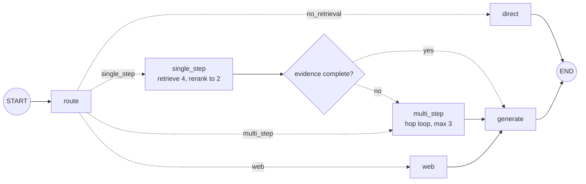

# Lab: Adaptive RAG end to end

> 📚 **Before you start**
>
> - [What is Adaptive RAG?](what-is-adaptive-rag.md), [Adaptive RAG with Cohere](adaptive-rag-with-cohere.md) and [Running Adaptive RAG Locally](running-adaptive-rag-locally.md): this lab combines all three.
> - [State Reducers](../../langgraph-complete-guide/04-state-in-depth/state-reducers.md), for the `operator.add` counter.
> - [RAG Evaluation](../../retrieval-augmented-generation-rag/course.md#m9), for why you measure answers on a labelled set.

## What You'll Build

A complete adaptive RAG assistant for the SaathiRail help centre, plus the evaluation harness that proves it's better than a fixed pipeline. It will:

- route each question to **no retrieval**, **single-step**, **multi-step** or **web search** with one structured decision, protected by repair, a safe fallback and keyword backstops;
- retrieve wide and **rerank** on the single-step path;
- check whether single-step evidence is complete and **escalate** to multi-step if not;
- record the route, sources and number of model calls for every answer;
- score itself on ten labelled questions against a fixed retrieve-then-generate baseline.



> 💡 **Key Insight**
>
> An adaptive RAG system is only "better" if you can show it on real questions. Build the **evaluation harness alongside the graph**: route accuracy tells you whether the router works, answer accuracy tells you whether users get the right answer, and calls per question tell you what it costs. Every design change in this lab is judged by those three numbers.

---

## Step 1: The knowledge base and stand-ins

Start a new file. This block is the setup you've used all module: the help centre, the keyword embedding and the `StandInModel`.

```python
import json, math, operator, re
from typing import Annotated, Callable, Literal, TypedDict
from langchain_core.documents import Document
from langchain_core.embeddings import Embeddings
from langchain_core.language_models import BaseChatModel
from langchain_core.messages import AIMessage
from langchain_core.outputs import ChatGeneration, ChatResult
from langchain_core.vectorstores import InMemoryVectorStore
from langgraph.graph import StateGraph, START, END
from pydantic import BaseModel, Field

class KeywordEmbeddings(Embeddings):
    """Toy embedding: one dimension per keyword stem, plus a small constant. Offline stand-in only."""
    def __init__(self, stems):
        self.stems = stems

    def _embed(self, text):
        words = re.findall(r"[a-z]+", text.lower())
        vector = [float(sum(w.startswith(s) for w in words)) for s in self.stems]
        vector.append(0.1)
        norm = math.sqrt(sum(x * x for x in vector))
        return [x / norm for x in vector]

    def embed_documents(self, texts):
        return [self._embed(t) for t in texts]

    def embed_query(self, text):
        return self._embed(text)

STEMS = ["cancel", "refund", "fee", "fare", "tatkal", "upi", "wallet", "card", "payment",
         "method", "bag", "luggage", "kg", "pet", "dog", "railway"]

HELP_CENTRE = [
    ("fees", "refunds.md §1", "Cancelling a confirmed ticket more than 48 hours before departure costs a flat "
     "fee of ₹60 per passenger. Between 48 and 12 hours before departure, 25% of the fare is deducted. "
     "Less than 12 hours before departure, 50% is deducted."),
    ("tatkal", "tatkal.md §2", "Tatkal tickets are not refunded when you cancel them yourself. If the railway "
     "cancels the train, Tatkal tickets are refunded in full."),
    ("train-cancelled", "refunds.md §3", "If the railway cancels a train, every ticket on it is refunded in full "
     "automatically, with no form to fill. The money goes back to the original payment method; payments.md "
     "lists how long each method takes."),
    ("payment-times", "payments.md §2", "Refund timelines by payment method: SaathiRail Wallet is instant, UPI "
     "takes 1 to 3 working days, and credit or debit cards take 5 to 7 working days."),
    ("luggage", "luggage.md §1", "Each passenger may carry one bag of up to 15 kg free. Extra luggage costs "
     "₹30 per kg, paid at the parcel counter."),
    ("pets", "pets.md §1", "Pets such as dogs and cats travel only in a fully booked first class cabin, with "
     "a vaccination certificate."),
]
help_centre = InMemoryVectorStore(KeywordEmbeddings(STEMS))
help_centre.add_documents([Document(text, metadata={"source": src}) for _, src, text in HELP_CENTRE],
                          ids=[doc_id for doc_id, _, _ in HELP_CENTRE])

class StandInModel(BaseChatModel):
    """A chat model whose replies come from a Python function. For offline lessons only."""
    respond: Callable

    def _generate(self, messages, stop=None, run_manager=None, **kwargs):
        return ChatResult(generations=[ChatGeneration(message=self.respond(messages))])

    @property
    def _llm_type(self):
        return "stand-in"

    def bind_tools(self, tools, **kwargs):
        return self

def structured_reply(schema_name, **fields):
    return AIMessage("", tool_calls=[{"name": schema_name, "args": fields, "id": "call_1"}])

print(len(help_centre.store), "pages")
```

Output:

```
6 pages
```

## Step 2: The evaluation set, first

Write the test before the system. Each case has the question, the route a careful person would choose, and a phrase the correct answer must contain. Ten questions cover every route and both kinds of multi-step question.

```python
EVAL_SET = [
    ("What does PNR stand for?",                                     "no_retrieval", "Passenger Name Record"),
    ("Good morning!",                                                "no_retrieval", "help"),
    ("What is the fee to cancel 3 days before departure?",           "single_step",  "₹60"),
    ("Can I take my dog on the train?",                              "single_step",  "first class"),
    ("How many kg of luggage can I carry free?",                     "single_step",  "15 kg"),
    ("Do I get a refund if I cancel my Tatkal ticket myself?",       "single_step",  "not refunded"),
    ("How long does the refund take when the railway cancels my train?", "multi_step", "1 to 3 working days"),
    ("The railway cancelled my Tatkal train and I paid by card. When do I get my money?", "multi_step", "5 to 7"),
    ("Is the Vande Bharat to Varanasi running late today?",          "web",          "25 minutes"),
    ("Has a rail strike been announced this week?",                  "web",          "strike"),
]
print(sorted({route for _, route, _ in EVAL_SET}))
```

Output:

```
['multi_step', 'no_retrieval', 'single_step', 'web']
```

The expected phrase is a deliberately simple check. It catches the failures that matter here (wrong page, missing hop, answering from memory) without needing an LLM judge. In the [RAG Evaluation](../../retrieval-augmented-generation-rag/course.md#m9) module you used richer metrics such as faithfulness and answer relevance; plug those in when your answers are longer than a sentence.

## Step 3: The generator and the web search stand-ins

The generator stand-in "reads" the context the way a careful model would: it uses a page only if the page is on-topic for the question, and states each fact with its citation. The topic rules are the stand-in's whole brain, kept visible so you can see why each answer comes out the way it does.

```python
FACTS = {
    "refunds.md §1": "More than 48 hours before departure, cancelling costs a flat ₹60 per passenger; "
                     "12 to 48 hours before, 25% of the fare; under 12 hours, 50% [refunds.md §1].",
    "tatkal.md §2": "Tatkal tickets you cancel yourself are not refunded, but they are refunded in full if "
                    "the railway cancels the train [tatkal.md §2].",
    "refunds.md §3": "When the railway cancels a train, the refund is automatic and goes back to your "
                     "original payment method [refunds.md §3].",
    "payments.md §2": "Refunds reach SaathiRail Wallet instantly, UPI in 1 to 3 working days and cards in "
                      "5 to 7 working days [payments.md §2].",
    "luggage.md §1": "One bag of up to 15 kg is free; extra luggage costs ₹30 per kg [luggage.md §1].",
    "pets.md §1": "Pets travel only in a fully booked first class cabin, with a vaccination certificate [pets.md §1].",
}
ON_TOPIC = {      # when would a careful reader use this page for this question?
    "refunds.md §1": lambda q: "fee" in q or "days before" in q,
    "tatkal.md §2": lambda q: "tatkal" in q,
    "refunds.md §3": lambda q: "railway cancel" in q,
    "payments.md §2": lambda q: "railway cancel" in q or any(w in q for w in ["upi", "card", "wallet"]),
    "luggage.md §1": lambda q: any(w in q for w in ["luggage", "bag", "kg"]),
    "pets.md §1": lambda q: any(w in q for w in ["pet", "dog", "cat"]),
}
WEB_PAGES = {
    "running late": Document("Live status (example data): the Varanasi Vande Bharat is running 25 minutes late.",
                             metadata={"source": "https://status.example/varanasi-vb"}),
    "strike": Document("News (example data): no nationwide rail strike has been announced for this week.",
                       metadata={"source": "https://news.example/rail-strike"}),
}

def answer_rules(messages):
    prompt = messages[-1].content
    question = prompt.split("Question:")[-1].strip().lower()
    if "Context:" not in prompt:
        if "pnr" in question:
            return AIMessage("PNR stands for Passenger Name Record, the booking reference on every ticket.")
        return AIMessage("Good morning! How can I help with your journey today?")
    sources = re.findall(r"^\[(.+?)\]", prompt, re.M)
    used = [FACTS[s] for s in sources if s in FACTS and ON_TOPIC[s](question)]
    used += [line.split("] ", 1)[1] + f" [{s}]" for s, line in zip(sources, re.findall(r"^\[.+$", prompt, re.M))
             if s.startswith("https://")]
    return AIMessage(" ".join(used) if used else "I couldn't find that in the help centre.")

def web_search(query):
    return [doc for key, doc in WEB_PAGES.items() if key in query.lower()]

answer_llm = StandInModel(respond=answer_rules)

ANSWER_PROMPT = """Answer the question using only the context. Cite sources in square brackets.
If the context doesn't contain the answer, say what is missing.

Context:
{context}

Question: {question}"""

def format_docs(docs):
    return "\n".join(f"[{d.metadata['source']}] {d.page_content}" for d in docs)

docs = help_centre.similarity_search("Can I take my dog on the train?", k=2)
print(answer_llm.invoke(ANSWER_PROMPT.format(context=format_docs(docs),
                                            question="Can I take my dog on the train?")).content)
```

Output:

```
Pets travel only in a fully booked first class cabin, with a vaccination certificate [pets.md §1].
```

With a real model you delete `FACTS`, `ON_TOPIC` and `answer_rules`; the prompt does that job.

## Step 4: The baseline to beat

A fixed pipeline: retrieve 2, generate, for every question. Run it through the harness now, so you know the number to beat. The harness reports three things per run: route accuracy (when the system has routes), answer accuracy and average model calls.

```python
def fixed_pipeline(question):
    docs = help_centre.similarity_search(question, k=2)
    answer = answer_llm.invoke(ANSWER_PROMPT.format(context=format_docs(docs), question=question)).content
    return {"route": "single_step", "answer": answer, "llm_calls": 1}

def evaluate(system, name, show=False):
    routes = answers = calls = 0
    for question, expected_route, must_contain in EVAL_SET:
        out = system(question)
        route_ok, answer_ok = out["route"] == expected_route, must_contain in out["answer"]
        routes, answers, calls = routes + route_ok, answers + answer_ok, calls + out["llm_calls"]
        if show and not answer_ok:
            print(f"  MISS [{out['route']}] {question[:55]} -> {out['answer'][:60]}")
    n = len(EVAL_SET)
    print(f"{name:10} routes {routes}/{n}  answers {answers}/{n}  avg calls {calls / n:.1f}")

evaluate(fixed_pipeline, "fixed", show=True)
```

Output:

```
  MISS [single_step] What does PNR stand for? -> I couldn't find that in the help centre.
  MISS [single_step] How long does the refund take when the railway cancels  -> When the railway cancels a train, the refund is automatic an
  MISS [single_step] The railway cancelled my Tatkal train and I paid by car -> Tatkal tickets you cancel yourself are not refunded, but the
  MISS [single_step] Is the Vande Bharat to Varanasi running late today? -> I couldn't find that in the help centre.
  MISS [single_step] Has a rail strike been announced this week? -> I couldn't find that in the help centre.
fixed      routes 4/10  answers 5/10  avg calls 1.0
```

The fixed pipeline gets half the questions right. Its misses fall exactly into the categories from the start of the module: the no-retrieval questions (it searched, found nothing relevant and refused), both multi-step questions (half the evidence) and both live questions (the help centre can't know).

## Step 5: A robust router

One structured decision with four labels, wrapped in the three layers from [Running Adaptive RAG Locally](running-adaptive-rag-locally.md). The stand-in behaves like a decent model that misjudges one multi-step question as single-step, so you can watch the escalation path save it later.

```python
class Route(BaseModel):
    """Choose how to answer a SaathiRail question."""
    level: Literal["no_retrieval", "single_step", "multi_step", "web"] = Field(
        description="no_retrieval: greetings and general knowledge; single_step: one help-centre page; "
                    "multi_step: several help-centre pages found one after another; "
                    "web: live or recent events the help centre can't contain")

ROUTER_PROMPT = """You route questions for the SaathiRail assistant. The help centre covers cancellation
fees, Tatkal tickets, refunds, refund timelines, luggage and pets. If unsure, choose single_step.

Question: {question}"""

def router_rules(messages):
    q = messages[-1].content.split("Question:")[-1].strip().lower()
    if "strike" in q or "running late" in q:
        return structured_reply("Route", level="web")
    if "railway cancel" in q and "tatkal" not in q:
        return structured_reply("Route", level="multi_step")
    if any(w in q for w in ["cancel", "refund", "fee", "tatkal", "luggage", "kg", "dog", "pet"]):
        return structured_reply("Route", level="single_step")        # also catches the Tatkal multi-step question
    return structured_reply("Route", level="no_retrieval")

router_llm = StandInModel(respond=router_rules)
VALID = {"no_retrieval", "single_step", "multi_step", "web"}
LIVE_PHRASES = ["running late", "running status", "live status", "strike"]
HELP_WORDS = ["cancel", "refund", "fee", "tatkal", "luggage", "bag", "pet", "dog", "upi", "wallet"]

def repair(raw):
    if raw.tool_calls:
        label = str(raw.tool_calls[0]["args"].get("level", ""))
    else:
        match = re.search(r"\{.*\}", raw.content, re.S)
        label = json.loads(match.group(0)).get("level", "") if match else ""
    label = label.strip().lower().replace("-", "_").replace(" ", "_")
    return label if label in VALID else None

def choose_route(question):
    q = question.lower()
    if any(p in q for p in LIVE_PHRASES):
        return "web", "backstop"
    result = router_llm.with_structured_output(Route, include_raw=True).invoke(ROUTER_PROMPT.format(question=question))
    label, how = (result["parsed"].level, "parsed") if result["parsed"] else (repair(result["raw"]), "repaired")
    if label is None:
        return "single_step", "fallback"
    if label == "no_retrieval" and any(w in q for w in HELP_WORDS):
        return "single_step", "override"
    return label, how

for question, expected, _ in EVAL_SET:
    label, how = choose_route(question)
    print(f"{'ok ' if label == expected else 'BAD'} {label:13} ({how}) {question[:50]}")
```

Output:

```
ok  no_retrieval  (parsed) What does PNR stand for?
ok  no_retrieval  (parsed) Good morning!
ok  single_step   (parsed) What is the fee to cancel 3 days before departure?
ok  single_step   (parsed) Can I take my dog on the train?
ok  single_step   (parsed) How many kg of luggage can I carry free?
ok  single_step   (parsed) Do I get a refund if I cancel my Tatkal ticket mys
ok  multi_step    (parsed) How long does the refund take when the railway can
BAD single_step   (parsed) The railway cancelled my Tatkal train and I paid b
ok  web           (backstop) Is the Vande Bharat to Varanasi running late today
ok  web           (backstop) Has a rail strike been announced this week?
```

Nine of ten routes are right. The one miss is the Tatkal-plus-card question, routed to single-step. You *could* chase it with more rules, but a better design accepts that routers miss and adds a check after retrieval, which is the next step.

## Step 6: The strategy nodes

Each strategy is a node. They all write `sources`, `answer` (or `docs` for the generator to use) and how many model calls they made. A small `OverlapReranker` from [Adaptive RAG with Cohere](adaptive-rag-with-cohere.md) re-orders the single-step candidates, and the hop planner from [What is Adaptive RAG?](what-is-adaptive-rag.md) drives the multi-step loop *and* checks single-step evidence for completeness.

```python
STOP = {"the", "a", "of", "to", "for", "is", "my", "i", "do", "what", "how", "on", "can", "when"}

class OverlapReranker:
    """Stand-in for a cross-encoder reranker."""
    def __init__(self, top_n=2):
        self.top_n = top_n

    def compress_documents(self, documents, query):
        q_words = set(re.findall(r"[a-z0-9]+", query.lower())) - STOP
        def score(doc):
            return len(q_words & set(re.findall(r"[a-z0-9]+", doc.page_content.lower())))
        return sorted(documents, key=score, reverse=True)[: self.top_n]

class NextHop(BaseModel):
    """Do the documents fully answer the question? If not, what should we search next?"""
    done: bool
    follow_up_query: str = ""

def hop_rules(messages):
    prompt = messages[-1].content
    if "payments.md lists" in prompt and "payments.md §2" not in prompt:
        return structured_reply("NextHop", done=False, follow_up_query="refund timelines by payment method")
    return structured_reply("NextHop", done=True)

reranker = OverlapReranker(top_n=2)
hop_planner = StandInModel(respond=hop_rules).with_structured_output(NextHop)
HOP_PROMPT = "Question: {question}\n\nDocuments found so far:\n{context}\n\nComplete? If not, one search query."

class LabState(TypedDict):
    question: str
    route: str
    how: str
    docs: list
    complete: bool
    answer: str
    llm_calls: Annotated[int, operator.add]

def route(state: LabState):
    label, how = choose_route(state["question"])
    return {"route": label, "how": how, "llm_calls": 0 if how == "backstop" else 1}

def direct(state: LabState):
    return {"answer": answer_llm.invoke(state["question"]).content, "llm_calls": 1}

def single_step(state: LabState):
    wide = help_centre.similarity_search(state["question"], k=4)
    docs = reranker.compress_documents(wide, state["question"])
    check = hop_planner.invoke(HOP_PROMPT.format(question=state["question"], context=format_docs(docs)))
    return {"docs": docs, "complete": check.done, "llm_calls": 1}

def multi_step(state: LabState, max_hops: int = 3):
    docs, query, calls = list(state.get("docs") or []), state["question"], 0
    for _ in range(max_hops):
        for doc in help_centre.similarity_search(query, k=2):
            if doc.page_content not in [d.page_content for d in docs]:
                docs.append(doc)
        step = hop_planner.invoke(HOP_PROMPT.format(question=state["question"], context=format_docs(docs)))
        calls += 1
        if step.done:
            break
        query = step.follow_up_query
    return {"docs": docs, "route": "multi_step", "llm_calls": calls}

def web(state: LabState):
    return {"docs": web_search(state["question"])}

def generate(state: LabState):
    prompt = ANSWER_PROMPT.format(context=format_docs(state["docs"]), question=state["question"])
    return {"answer": answer_llm.invoke(prompt).content, "llm_calls": 1}
```

Two details to notice. `multi_step` starts from any documents single-step already found (`state.get("docs")`), so an escalated question doesn't throw away work it has paid for. And `multi_step` sets `route` to `"multi_step"`, so the record shows where the question *ended up*, which is what you want when reading logs.

## Step 7: Wire the graph

```python
def after_route(state: LabState) -> Literal["direct", "single_step", "multi_step", "web"]:
    return {"no_retrieval": "direct"}.get(state["route"], state["route"])

def after_single_step(state: LabState) -> Literal["generate", "multi_step"]:
    return "generate" if state["complete"] else "multi_step"

builder = StateGraph(LabState)
for name, fn in [("route", route), ("direct", direct), ("single_step", single_step),
                 ("multi_step", multi_step), ("web", web), ("generate", generate)]:
    builder.add_node(name, fn)
builder.add_edge(START, "route")
builder.add_conditional_edges("route", after_route)
builder.add_conditional_edges("single_step", after_single_step)
builder.add_edge("multi_step", "generate")
builder.add_edge("web", "generate")
builder.add_edge("direct", END)
builder.add_edge("generate", END)
adaptive = builder.compile()

question = "The railway cancelled my Tatkal train and I paid by card. When do I get my money?"
for update in adaptive.stream({"question": question, "llm_calls": 0}, stream_mode="updates"):
    node, data = next(iter(update.items()))
    detail = data.get("answer") or [d.metadata["source"] for d in data.get("docs", [])] or data.get("route")
    print(f"{node:12} {detail}")
```

Output:

```
route        single_step
single_step  ['tatkal.md §2', 'refunds.md §3']
multi_step   ['tatkal.md §2', 'refunds.md §3', 'payments.md §2']
generate     Tatkal tickets you cancel yourself are not refunded, but they are refunded in full if the railway cancels the train [tatkal.md §2]. When the railway cancels a train, the refund is automatic and goes back to your original payment method [refunds.md §3]. Refunds reach SaathiRail Wallet instantly, UPI in 1 to 3 working days and cards in 5 to 7 working days [payments.md §2].
```

That's the escalation working: the router said single-step, single-step's evidence check saw that `refunds.md §3` points to a page we don't have, and the graph moved to multi-step, which kept the two pages it had and fetched the timeline page. The final answer covers all three facts the user needs.

## Step 8: Evaluate against the baseline

Wrap the graph in the same interface as `fixed_pipeline` and run the harness on both:

```python
def adaptive_system(question):
    out = adaptive.invoke({"question": question, "llm_calls": 0})
    return {"route": out["route"], "answer": out["answer"], "llm_calls": out["llm_calls"]}

evaluate(fixed_pipeline, "fixed")
evaluate(adaptive_system, "adaptive", show=True)
```

Output:

```
fixed      routes 4/10  answers 5/10  avg calls 1.0
adaptive   routes 9/10  answers 10/10  avg calls 2.9
```

Ten out of ten answers, against five for the fixed pipeline. The route column records where each question *ended up* (escalated questions count as multi-step), so the escalated Tatkal-and-card question now scores as a correct route.

So why 9/10 routes? Look at the per-route numbers below: three questions ended in multi-step, not two. The extra one is "Do I get a refund if I cancel my Tatkal ticket myself?". Its single-step retrieval pulled in `refunds.md §3`, the evidence check saw that page's pointer to payments.md, and it escalated a question that was already answerable. The answer was still right, but it cost five calls instead of three. That's the price of a crude completeness check: it asks "is anything referenced still missing?" rather than "is anything *this question needs* still missing?". A real model given the question usually gets this right, and the [Corrective RAG](../03-agentic-rag-architectures/corrective-rag-crag.md) lesson shows a better tool: grading each document's relevance before deciding anything.

The cost is visible too: 2.9 model calls per question on average against one. Whether that's worth it depends on your traffic, which is why the harness prints it. Here's how the calls split by route:

```python
from collections import defaultdict

by_route = defaultdict(list)
for question, _, _ in EVAL_SET:
    out = adaptive_system(question)
    by_route[out["route"]].append(out["llm_calls"])
for name, calls in sorted(by_route.items()):
    print(f"{name:13} questions={len(calls)}  calls each={calls}")
```

Output:

```
multi_step    questions=3  calls each=[5, 4, 5]
no_retrieval  questions=2  calls each=[2, 2]
single_step   questions=3  calls each=[3, 3, 3]
web           questions=2  calls each=[1, 1]
```

Easy questions are cheap, live questions skip the router call entirely thanks to the backstop, and the expensive multi-step path is used only where it's needed.

## Step 9: Swap in real models

When you're ready to leave the stand-ins, only the model and search objects change. Two configurations:

```python
# not-run: hosted configuration (needs langchain-cohere, langchain-tavily and API keys)
from langchain_cohere import ChatCohere, CohereEmbeddings, CohereRerank
from langchain_tavily import TavilySearch

router_llm = ChatCohere(model="command-r7b-12-2024", temperature=0)
hop_planner = ChatCohere(model="command-r7b-12-2024", temperature=0).with_structured_output(NextHop)
answer_llm = ChatCohere(model="command-a-03-2025", temperature=0)
help_centre = InMemoryVectorStore(CohereEmbeddings(model="embed-v4.0"))       # then add_documents again
reranker = CohereRerank(model="rerank-v3.5", top_n=2)
tavily = TavilySearch(max_results=3)

def web_search(query):
    return [Document(r["content"], metadata={"source": r["url"]})
            for r in tavily.invoke({"query": query})["results"]]
```

```python
# not-run: local configuration (needs Ollama running with these models pulled, and langchain-ollama)
from langchain_ollama import ChatOllama, OllamaEmbeddings

router_llm = ChatOllama(model="llama3.1:8b", temperature=0, num_ctx=8192, keep_alive="30m")
hop_planner = router_llm.with_structured_output(NextHop)
answer_llm = ChatOllama(model="gpt-oss:20b", temperature=0, num_ctx=8192)
help_centre = InMemoryVectorStore(OllamaEmbeddings(model="nomic-embed-text"))   # then add_documents again

def web_search(query):        # fully local: no web. The generator will say it can't find live data.
    return []
```

Then delete `FACTS`, `ON_TOPIC`, the `*_rules` functions and `WEB_PAGES`, and run `evaluate` again. Expect the numbers to change: real models are better than the stand-ins on questions the rules never anticipated and worse on a few the rules handle perfectly. That's the point of keeping the harness: it tells you which.

---

## Try It Yourself

1. **Add a question the system fails.** Add `("If I cancel 6 hours before departure, how much do I lose?", "single_step", "50%")` to `EVAL_SET` and re-run `evaluate(adaptive_system, "adaptive", show=True)`. Why does it miss, and what would fix it?
2. **Measure the router alone.** Change `route` to also store `first_route`, and report how often the *first* decision matched the expected route.
3. **A cost budget.** Add a rule: if `llm_calls` reaches 4 before generating, skip further hops. Where would you put that check?

<details>
<summary>Show answers</summary>

**1.**

```python
EVAL_SET.append(("If I cancel 6 hours before departure, how much do I lose?", "single_step", "50%"))
evaluate(adaptive_system, "adaptive", show=True)
EVAL_SET.pop()
```

Output:

```
  MISS [single_step] If I cancel 6 hours before departure, how much do I los -> I couldn't find that in the help centre.
adaptive   routes 10/11  answers 10/11  avg calls 2.9
```

Routing and retrieval were fine, but the generator's topic rule for `refunds.md §1` only looks for "fee" or "days before", so it ignored the right page. That's a stand-in limitation, and a good reminder of what evaluation is for: it finds the cases your design didn't foresee. With a real model the page would be used. With the stand-in, widen the rule to `"before departure" in q`.

**2.**

```python
first_ok = sum(choose_route(q)[0] == r for q, r, _ in EVAL_SET)
print(f"first decision correct: {first_ok}/{len(EVAL_SET)}")
```

Output:

```
first decision correct: 9/10
```

The simplest way to measure the router alone is to call `choose_route` directly, outside the graph. Inside the graph, you'd add a `first_route` field to `LabState`, set it in `route`, and never overwrite it (LangGraph nodes can't be replaced on a compiled builder, so you'd rebuild the graph with the new `route` function).

**3.** Inside the `multi_step` loop: pass the calls already used (`state["llm_calls"]`) into the node and `break` when `state["llm_calls"] + calls >= 4`. The generator still runs with whatever evidence was gathered, and the answer prompt's "say what is missing" instruction keeps it honest.

</details>

---

## What You've Learned

- **Write the evaluation set first**: route, answer and cost on labelled questions decide whether adaptive routing is worth it.
- **A fixed pipeline fails in predictable ways**: no-retrieval questions, multi-hop questions and live questions.
- **One structured router with repair, fallback and backstops** handles four routes reliably.
- **A completeness check after single-step retrieval** catches router misses by escalating to multi-step, without discarding documents already found.
- **Swapping to Cohere or a local Ollama stack changes only the plug-ins**; re-run the harness after every swap.

---

**Up next:** [Agents in RAG Pipelines](../03-agentic-rag-architectures/agents-in-rag-pipelines.md)
