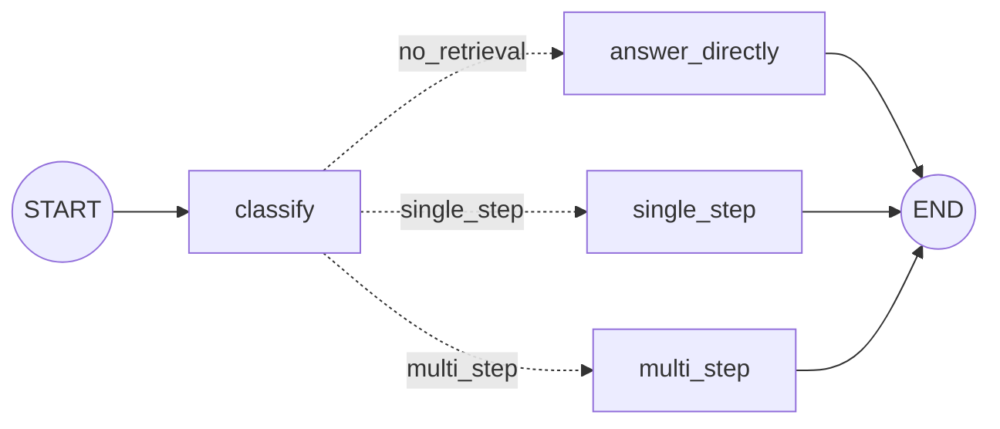

# What is Adaptive RAG?: The Complete Guide

> 📚 **Before you start**
>
> - [How This Course Works](../01-start-here/how-this-course-works.md), for the `StandInModel` and the SaathiRail help centre used below.
> - [Retrieval-Augmented Generation (RAG) › Implementing RAG](../../retrieval-augmented-generation-rag/course.md#m6), for the retrieve-then-generate pipeline this lesson makes adaptive.
> - [Conditional Workflows](../../langgraph-complete-guide/03-workflow-patterns-in-langgraph/conditional-workflows.md) and [Routers](../../langgraph-complete-guide/05-workflows-and-agents/routers.md), for conditional edges that pick the next node.
> - [Iterative (Looping) Workflows](../../langgraph-complete-guide/03-workflow-patterns-in-langgraph/iterative-looping-workflows.md), for loops with a cap.

## Introduction

Walk into a busy government hospital in the morning and the first person you meet is not a doctor. It's the triage nurse. In thirty seconds they decide: this patient needs a plaster and can go home, this one needs a blood test, this one needs a specialist and a scan. Nobody gets the full set of tests "just in case", because that would waste the lab's time, and nobody with chest pain gets sent home with a paracetamol.

A standard RAG pipeline has no triage nurse. Every question gets exactly one retrieval and one generation. That is too much for "What does PNR stand for?" (the model already knows, and the retrieved pages are noise) and too little for "My train was cancelled by the railway; how long until I get my money?" (the answer is spread across two pages, and the second page only becomes findable after reading the first).

**Adaptive RAG** adds the triage step. Before retrieving anything, it classifies the question by how much retrieval it needs, then sends it down the cheapest path that can answer it well.

By the end of this lesson you will be able to:

- explain the problem Adaptive RAG solves and where the idea comes from;
- write a complexity classifier with structured output;
- implement the three strategies (no retrieval, single-step, multi-step) as LangGraph nodes;
- wire them into one graph and trace which path each question takes and what it costs;
- add a safety net for when the classifier is wrong.

> 💡 **Key Insight**
>
> Adaptive RAG spends retrieval effort **in proportion to how hard the question is**. A cheap classifier looks at the question first and picks one of three strategies: answer directly, retrieve once, or retrieve iteratively. The pieces are ordinary RAG; the new part is the decision in front of them.

---

## Core Explanation

### 1. The setup: the help centre and a stand-in model

Everything below runs offline. This block builds the six-page SaathiRail help centre with the keyword embedding, plus the `StandInModel` from [How This Course Works](../01-start-here/how-this-course-works.md). Paste it once; every later block in this lesson uses it.

```python
import math, re
from typing import Callable, Literal
from langchain_core.documents import Document
from langchain_core.embeddings import Embeddings
from langchain_core.language_models import BaseChatModel
from langchain_core.messages import AIMessage
from langchain_core.outputs import ChatGeneration, ChatResult
from langchain_core.vectorstores import InMemoryVectorStore
from pydantic import BaseModel, Field

class KeywordEmbeddings(Embeddings):
    """Toy embedding: one dimension per keyword stem, plus a small constant. Offline stand-in only."""
    def __init__(self, stems):
        self.stems = stems

    def _embed(self, text):
        words = re.findall(r"[a-z]+", text.lower())
        vector = [float(sum(w.startswith(s) for w in words)) for s in self.stems]
        vector.append(0.1)
        norm = math.sqrt(sum(x * x for x in vector))
        return [x / norm for x in vector]

    def embed_documents(self, texts):
        return [self._embed(t) for t in texts]

    def embed_query(self, text):
        return self._embed(text)

STEMS = ["cancel", "refund", "fee", "fare", "tatkal", "upi", "wallet", "card", "payment",
         "method", "bag", "luggage", "kg", "pet", "dog", "railway"]

HELP_CENTRE = [
    ("fees", "refunds.md §1", "Cancelling a confirmed ticket more than 48 hours before departure costs a flat "
     "fee of ₹60 per passenger. Between 48 and 12 hours before departure, 25% of the fare is deducted. "
     "Less than 12 hours before departure, 50% is deducted."),
    ("tatkal", "tatkal.md §2", "Tatkal tickets are not refunded when you cancel them yourself. If the railway "
     "cancels the train, Tatkal tickets are refunded in full."),
    ("train-cancelled", "refunds.md §3", "If the railway cancels a train, every ticket on it is refunded in full "
     "automatically, with no form to fill. The money goes back to the original payment method; payments.md "
     "lists how long each method takes."),
    ("payment-times", "payments.md §2", "Refund timelines by payment method: SaathiRail Wallet is instant, UPI "
     "takes 1 to 3 working days, and credit or debit cards take 5 to 7 working days."),
    ("luggage", "luggage.md §1", "Each passenger may carry one bag of up to 15 kg free. Extra luggage costs "
     "₹30 per kg, paid at the parcel counter."),
    ("pets", "pets.md §1", "Pets such as dogs and cats travel only in a fully booked first class cabin, with "
     "a vaccination certificate."),
]
help_centre = InMemoryVectorStore(KeywordEmbeddings(STEMS))
help_centre.add_documents([Document(text, metadata={"source": src}) for _, src, text in HELP_CENTRE],
                          ids=[doc_id for doc_id, _, _ in HELP_CENTRE])

class StandInModel(BaseChatModel):
    """A chat model whose replies come from a Python function. For offline lessons only."""
    respond: Callable

    def _generate(self, messages, stop=None, run_manager=None, **kwargs):
        return ChatResult(generations=[ChatGeneration(message=self.respond(messages))])

    @property
    def _llm_type(self):
        return "stand-in"

    def bind_tools(self, tools, **kwargs):
        return self

def structured_reply(schema_name, **fields):
    return AIMessage("", tool_calls=[{"name": schema_name, "args": fields, "id": "call_1"}])

print(len(help_centre.store), "pages indexed")
```

Output:

```
6 pages indexed
```

### 2. One pipeline, three kinds of question

Here are three questions a SaathiRail user might ask, run through a plain fixed pipeline's retrieval step (top 2 pages):

```python
QUESTIONS = {
    "easy":   "What does PNR stand for?",
    "medium": "What is the fee to cancel 3 days before departure?",
    "hard":   "How long does the refund take when the railway cancels my train?",
}

def top_sources(query, k=2):
    return [(doc.metadata["source"], round(score, 2))
            for doc, score in help_centre.similarity_search_with_score(query, k=k)]

for level, question in QUESTIONS.items():
    print(f"{level:7} {top_sources(question)}")
```

Output:

```
easy    [('pets.md §1', 0.07), ('refunds.md §1', 0.06)]
medium  [('refunds.md §1', 0.82), ('tatkal.md §2', 0.39)]
hard    [('tatkal.md §2', 0.8), ('refunds.md §3', 0.52)]
```

Read each line carefully, because each one is a different story:

- **Easy.** "PNR" is general railway knowledge (it stands for Passenger Name Record), not a SaathiRail rule. The retriever still returns its top 2, the pets page and the fees page, with near-zero scores. A retriever always returns *something*. Those pages now sit in the prompt as noise, cost tokens, and may even tempt the model into a strange answer.
- **Medium.** One page, `refunds.md §1`, holds the answer and comes back first. This is the case the fixed pipeline was designed for.
- **Hard.** The retriever finds `refunds.md §3`, which says the refund is automatic and goes to the original payment method, *and then points to payments.md* for the timing. The page with the actual number of days, `payments.md §2`, isn't in the top 2. No single query finds both, because the second page's useful words ("payment method", "UPI", "card") aren't in the user's question. You only learn to search for them by reading the first page.

| Question type | What a fixed pipeline does | What it should do |
|---|---|---|
| **Easy**: the model already knows | Retrieves anyway: wasted time, tokens and possible distraction | Answer directly |
| **Medium**: one page answers it | Retrieves once: correct | Retrieve once |
| **Hard**: answer spread over pages that must be found in sequence | Retrieves once: half an answer | Retrieve, read, retrieve again |

Real traffic is a mix of all three. Tuning a fixed pipeline for one kind makes it worse for another: raise *k* to catch hard questions and you stuff more noise into every easy one.

### 3. Where the idea comes from

The name comes from a 2024 research paper, *Adaptive-RAG: Learning to Adapt Retrieval-Augmented Large Language Models through Question Complexity* (Jeong, Baek, Cho, Hwang and Park, NAACL 2024). Its observation was the one you just saw: methods that retrieve many times in a loop are accurate on hard multi-hop questions but slow and wasteful on simple ones, while single-retrieval methods are fast but fail the hard ones. Their fix:

1. Train a **small classifier** (a compact language model, far cheaper than the main LLM) to label each question with its complexity: **A** (answerable without retrieval), **B** (single-step retrieval) or **C** (multi-step retrieval).
2. Route each question to the matching strategy.
3. Create the classifier's training labels **automatically**: run the strategies on a set of questions and label each question with the *simplest* strategy that answered it correctly; where none did, fall back on what kind of dataset the question came from (single-hop or multi-hop datasets).


*Adaptive RAG is triage: the classifier decides how much work each question deserves.*

Since then, "adaptive RAG" has come to mean a family of designs rather than one paper. You'll meet two flavours, and most production systems combine them:

| Flavour | The router decides | Typical routes |
|---|---|---|
| **Complexity routing** (the paper) | *How much* retrieval | no retrieval / single-step / multi-step |
| **Source routing** (popularised by LangGraph's adaptive RAG examples) | *Where* to retrieve from | your vector store / a web search / a SQL database / no retrieval |

This lesson builds complexity routing. The next two lessons add source routing with a web search, first with Cohere's hosted models and then fully locally.

### 4. The classifier: a structured decision

The classifier is a single, small LLM call (or a fine-tuned small model) that returns a **label**, not prose. Structured output is the right tool: the graph will branch on the label, so it must be one of exactly three values. Adding a short `reason` field costs a few tokens and makes misroutes easy to debug.

```python
class QueryComplexity(BaseModel):
    """How much retrieval a question needs before it can be answered well."""
    level: Literal["no_retrieval", "single_step", "multi_step"] = Field(
        description="no_retrieval: general knowledge, no SaathiRail rule needed; "
                    "single_step: one help-centre page answers it; "
                    "multi_step: needs facts from several pages, found one after another")
    reason: str = Field(description="one short sentence explaining the choice")

CLASSIFIER_PROMPT = """You triage questions for the SaathiRail help centre, which covers cancellation fees,
Tatkal tickets, refunds, payment timelines, luggage and pets. Decide how much retrieval the question needs.

Question: {question}"""
```

In a real system, the classifier is this one line:

```python
# not-run: needs `pip install langchain-anthropic` and an ANTHROPIC_API_KEY
from langchain_anthropic import ChatAnthropic

classifier = ChatAnthropic(model="claude-opus-5-5", temperature=0).with_structured_output(QueryComplexity)
```

Offline, the stand-in's rules play the part of the model. A real model reads meaning; these rules read keywords, but they produce the same kind of object:

```python
HELP_TOPICS = ["cancel", "refund", "fee", "tatkal", "upi", "wallet", "luggage", "bag", "pet", "dog"]

def classifier_rules(messages):
    q = messages[-1].content.split("Question:")[-1].lower()
    if not any(topic in q for topic in HELP_TOPICS):
        return structured_reply("QueryComplexity", level="no_retrieval",
                                reason="General railway knowledge, not a SaathiRail rule.")
    if "railway cancel" in q and ("how long" in q or "when" in q):
        return structured_reply("QueryComplexity", level="multi_step",
                                reason="Needs the cancelled-train rule, then the payment timelines it points to.")
    return structured_reply("QueryComplexity", level="single_step", reason="One help-centre page answers it.")

classifier = StandInModel(respond=classifier_rules).with_structured_output(QueryComplexity)

for question in QUESTIONS.values():
    decision = classifier.invoke(CLASSIFIER_PROMPT.format(question=question))
    print(f"{decision.level:13} <- {decision.reason}")
```

Output:

```
no_retrieval  <- General railway knowledge, not a SaathiRail rule.
single_step   <- One help-centre page answers it.
multi_step    <- Needs the cancelled-train rule, then the payment timelines it points to.
```

A good classifier prompt tells the model **what the knowledge base covers**. Without that, it can't tell "general knowledge" from "our rule": "Can I carry 20 kg?" sounds general but depends on SaathiRail's luggage page.

### 5. The three strategies

Each strategy is an ordinary function. First, a shared generator. Its prompt is the usual grounded-answer prompt from the RAG course; the stand-in's rules return answers that match what the context actually contains.

```python
ANSWER_PROMPT = """Answer the question using only the context. Cite sources in square brackets.
If the context doesn't contain the answer, say what is missing.

Context:
{context}

Question: {question}"""

def answer_rules(messages):
    prompt = messages[-1].content
    if "Context:" not in prompt:                       # no-retrieval path: plain question
        return AIMessage("PNR stands for Passenger Name Record, the booking reference on every ticket.")
    if "payments.md §2" in prompt and "refunds.md §3" in prompt:
        return AIMessage("The refund is automatic and goes back to how you paid: instant for SaathiRail "
                         "Wallet, 1 to 3 working days for UPI, 5 to 7 working days for cards "
                         "[refunds.md §3][payments.md §2].")
    if "refunds.md §3" in prompt:
        return AIMessage("The refund is automatic and goes to your original payment method [refunds.md §3], "
                         "but these pages don't say how long it takes.")
    if "refunds.md §1" in prompt:
        return AIMessage("Three days is more than 48 hours before departure, so you pay a flat ₹60 per "
                         "passenger [refunds.md §1].")
    return AIMessage("I couldn't find that in the help centre.")

llm = StandInModel(respond=answer_rules)

def format_docs(docs):
    return "\n".join(f"[{d.metadata['source']}] {d.page_content}" for d in docs)
```

**Strategy A: no retrieval.** Just ask the model.

```python
def answer_directly(question):
    return llm.invoke(question).content

print(answer_directly(QUESTIONS["easy"]))
```

Output:

```
PNR stands for Passenger Name Record, the booking reference on every ticket.
```

**Strategy B: single-step retrieval.** The classic pipeline: one search, one grounded answer.

```python
def answer_single_step(question, k=2):
    docs = help_centre.similarity_search(question, k=k)
    return llm.invoke(ANSWER_PROMPT.format(context=format_docs(docs), question=question)).content

print(answer_single_step(QUESTIONS["medium"]))
print(answer_single_step(QUESTIONS["hard"]))
```

Output:

```
Three days is more than 48 hours before departure, so you pay a flat ₹60 per passenger [refunds.md §1].
The refund is automatic and goes to your original payment method [refunds.md §3], but these pages don't say how long it takes.
```

The second line is the failure from section 2, now visible in the answer: honest, but incomplete.

**Strategy C: multi-step retrieval.** Retrieve, read what you found, decide what's still missing, write a **follow-up query**, retrieve again, and stop when nothing is missing or a hop limit is reached. This "interleave reading and retrieving" idea is how multi-step methods such as IRCoT (interleaving retrieval with chain-of-thought) work, and it's the same loop you met in [The Iterative Search Loop](../../retrieval-augmented-generation-rag/course.md#m8) of the RAG course, applied to a vector store.

The "what's missing?" step is another structured LLM decision:

```python
class NextHop(BaseModel):
    """Decide whether the documents so far answer the question, and if not, what to search next."""
    done: bool = Field(description="true if the documents fully answer the question")
    follow_up_query: str = Field(default="", description="the next search query, if not done")

HOP_PROMPT = """Question: {question}

Documents found so far:
{context}

Do these documents fully answer the question? If not, write ONE search query for the missing fact.
Use words likely to appear in the missing page, not just words from the question."""

def hop_rules(messages):
    prompt = messages[-1].content
    if "payments.md lists" in prompt and "payments.md §2" not in prompt:
        return structured_reply("NextHop", done=False, follow_up_query="refund timelines by payment method")
    return structured_reply("NextHop", done=True)

hop_planner = StandInModel(respond=hop_rules).with_structured_output(NextHop)

def answer_multi_step(question, max_hops=3, k=2):
    docs, query = [], question
    for hop in range(1, max_hops + 1):
        for doc in help_centre.similarity_search(query, k=k):
            if doc.page_content not in [d.page_content for d in docs]:     # skip pages we already have
                docs.append(doc)
        print(f"  hop {hop}: searched {query!r} -> have {[d.metadata['source'] for d in docs]}")
        step = hop_planner.invoke(HOP_PROMPT.format(question=question, context=format_docs(docs)))
        if step.done:
            break
        query = step.follow_up_query
    return llm.invoke(ANSWER_PROMPT.format(context=format_docs(docs), question=question)).content

print(answer_multi_step(QUESTIONS["hard"]))
```

Output:

```
  hop 1: searched 'How long does the refund take when the railway cancels my train?' -> have ['tatkal.md §2', 'refunds.md §3']
  hop 2: searched 'refund timelines by payment method' -> have ['tatkal.md §2', 'refunds.md §3', 'payments.md §2']
The refund is automatic and goes back to how you paid: instant for SaathiRail Wallet, 1 to 3 working days for UPI, 5 to 7 working days for cards [refunds.md §3][payments.md §2].
```

Hop 1 found the page that *mentions* payments.md. The planner noticed the reference and wrote a query in the help centre's own vocabulary ("payment method"), which hop 2 used to fetch the timeline page. Now the answer is complete. Notice the two safety features: **de-duplication** (pages already in hand are skipped) and **`max_hops`**, so a confused planner can't loop forever.

### 6. Wiring it into a LangGraph graph

Now the triage nurse in front: a `classify` node, a conditional edge that reads the label, and one node per strategy. The state carries the question, the label, the documents and the answer, plus a counter of model calls so you can see the cost of each path.



```python
import operator
from typing import Annotated, TypedDict
from langgraph.graph import StateGraph, START, END

class AdaptiveState(TypedDict):
    question: str
    level: str
    sources: list
    answer: str
    llm_calls: Annotated[int, operator.add]      # each node adds the calls it made

def classify(state: AdaptiveState):
    decision = classifier.invoke(CLASSIFIER_PROMPT.format(question=state["question"]))
    return {"level": decision.level, "llm_calls": 1}

def route_by_level(state: AdaptiveState) -> Literal["no_retrieval", "single_step", "multi_step"]:
    return state["level"]

def no_retrieval(state: AdaptiveState):
    return {"answer": llm.invoke(state["question"]).content, "sources": [], "llm_calls": 1}

def single_step(state: AdaptiveState):
    docs = help_centre.similarity_search(state["question"], k=2)
    prompt = ANSWER_PROMPT.format(context=format_docs(docs), question=state["question"])
    return {"answer": llm.invoke(prompt).content, "llm_calls": 1,
            "sources": [d.metadata["source"] for d in docs]}

def multi_step(state: AdaptiveState, max_hops: int = 3):
    question, docs, query, calls = state["question"], [], state["question"], 0
    for _ in range(max_hops):
        for doc in help_centre.similarity_search(query, k=2):
            if doc.page_content not in [d.page_content for d in docs]:
                docs.append(doc)
        step = hop_planner.invoke(HOP_PROMPT.format(question=question, context=format_docs(docs)))
        calls += 1
        if step.done:
            break
        query = step.follow_up_query
    prompt = ANSWER_PROMPT.format(context=format_docs(docs), question=question)
    return {"answer": llm.invoke(prompt).content, "llm_calls": calls + 1,
            "sources": [d.metadata["source"] for d in docs]}

builder = StateGraph(AdaptiveState)
builder.add_node(classify)
builder.add_node(no_retrieval)
builder.add_node(single_step)
builder.add_node(multi_step)
builder.add_edge(START, "classify")
builder.add_conditional_edges("classify", route_by_level)
for node in ["no_retrieval", "single_step", "multi_step"]:
    builder.add_edge(node, END)
adaptive_rag = builder.compile()

for question in QUESTIONS.values():
    out = adaptive_rag.invoke({"question": question, "llm_calls": 0})
    print(f"{out['level']:13} calls={out['llm_calls']} sources={out['sources']}")
    print(f"   {out['answer']}")
```

Output:

```
no_retrieval  calls=2 sources=[]
   PNR stands for Passenger Name Record, the booking reference on every ticket.
single_step   calls=2 sources=['refunds.md §1', 'tatkal.md §2']
   Three days is more than 48 hours before departure, so you pay a flat ₹60 per passenger [refunds.md §1].
multi_step    calls=4 sources=['tatkal.md §2', 'refunds.md §3', 'payments.md §2']
   The refund is automatic and goes back to how you paid: instant for SaathiRail Wallet, 1 to 3 working days for UPI, 5 to 7 working days for cards [refunds.md §3][payments.md §2].
```

Every question got the right amount of work: the easy one cost two calls (classify and answer) and touched no documents; the medium one ran the classic pipeline; the hard one paid for two planner calls and got a complete answer. A fixed pipeline would have spent the same on all three and got two of them wrong in different ways.

`route_by_level` returns the label directly and the labels match the node names, so the conditional edge needs no mapping. The `Literal[...]` return type isn't decoration: LangGraph reads it to know which nodes the edge can reach, which is what lets it draw the diagram above with `adaptive_rag.get_graph().draw_mermaid()`.

### 7. When the classifier is wrong

The classifier is now a single point of failure. If it labels a hard question "single_step", the answer is incomplete; if it labels a help-centre question "no_retrieval", the model answers from memory, which is the hallucination RAG exists to prevent. The two errors are not equally bad:

| Misroute | Effect | How bad |
|---|---|---|
| Easy question sent to retrieval | Some wasted tokens, usually still correct | Mild |
| Hard question sent to single-step | Incomplete answer | Medium |
| Knowledge-base question sent to no-retrieval | Confident answer from memory, possibly wrong | **Severe** |

So adaptive systems add **safety nets**, in order of how common they are:

1. **Bias the classifier toward retrieval.** In the prompt: "If unsure, choose single_step." Wrongly retrieving is cheap; wrongly not retrieving is dangerous.
2. **Escalate on weak evidence.** If single-step retrieval's best score is low, or the answer says something is missing, hand the question to multi-step instead of returning a weak answer.
3. **Log the label with every answer**, and review misroutes in evaluation, exactly like any other classifier.

Here is safety net 2 as a graph change: `single_step` records whether its answer admits a gap, and a second conditional edge escalates. To show it working, we deliberately use a classifier that misroutes the hard question:

```python
class EscalatingState(AdaptiveState):
    escalated: bool

def single_step_checked(state: EscalatingState):
    result = single_step(state)
    result["escalated"] = "don't say" in result["answer"] or "couldn't find" in result["answer"]
    return result

def after_single_step(state: EscalatingState) -> Literal["multi_step", "__end__"]:
    return "multi_step" if state["escalated"] else END

b = StateGraph(EscalatingState)
b.add_node(classify)
b.add_node(no_retrieval)
b.add_node("single_step", single_step_checked)
b.add_node(multi_step)
b.add_edge(START, "classify")
b.add_conditional_edges("classify", route_by_level)
b.add_conditional_edges("single_step", after_single_step)
b.add_edge("no_retrieval", END)
b.add_edge("multi_step", END)
safer_rag = b.compile()

def sloppy_rules(messages):              # a weaker classifier that never picks multi_step
    reply = classifier_rules(messages)
    if reply.tool_calls[0]["args"]["level"] == "multi_step":
        return structured_reply("QueryComplexity", level="single_step", reason="Looks like a refund question.")
    return reply

classifier = StandInModel(respond=sloppy_rules).with_structured_output(QueryComplexity)
for update in safer_rag.stream({"question": QUESTIONS["hard"], "llm_calls": 0, "escalated": False},
                               stream_mode="updates"):
    node, data = next(iter(update.items()))
    print(f"{node:12} {data.get('level', '')}{data.get('answer', '')[:70]}")
classifier = StandInModel(respond=classifier_rules).with_structured_output(QueryComplexity)
```

Output:

```
classify     single_step
single_step  The refund is automatic and goes to your original payment method [refu
multi_step   The refund is automatic and goes back to how you paid: instant for Saa
```

The misrouted question still ended with the complete answer: the single-step answer admitted a gap, so the graph escalated. The price was one extra wasted answer call, which is a fair trade for not shipping a half answer. (Checking an answer by searching it for phrases is crude; [Self-RAG](../../agentic-rag-systems/course.md#m4) replaces it with proper graders.)

### 8. What adaptive routing costs and saves

From the run in section 6:

| Path | Model calls | Searches | Tokens in the final prompt |
|---|---|---|---|
| no_retrieval | 2 (classify + answer) | 0 | Just the question |
| single_step | 2 (classify + answer) | 1 | Question + 2 pages |
| multi_step | 4 (classify + 2 planner + answer) | 2 | Question + 3 pages |
| Fixed pipeline, for comparison | 1 | 1 | Question + 2 pages |

The classifier is pure overhead on every question, so adaptive RAG pays off when the classifier is **much cheaper** than the work it saves. That is why the paper used a small model for it, and why in production the classifier is often the smallest, fastest model you have, or a fine-tuned classifier that costs a fraction of a cent. If 90% of your traffic is medium and nobody asks hard questions, a fixed pipeline may simply be the better design. Measure your traffic first.

---

## Try It Yourself

1. **Route a luggage question.** Run `adaptive_rag` on "How many kg of luggage can I carry free?". Which path does it take, and what does the stand-in answer? What would you change so the answer is correct?
2. **Label questions like the paper.** The paper labelled each training question with the *simplest* strategy that answered it correctly. Write `auto_label(results)` that takes a dict like `{"no_retrieval": False, "single_step": True, "multi_step": True}` and returns the label.
3. **Cap the hops.** Call `answer_multi_step(QUESTIONS["hard"], max_hops=1)`. What happens, and why is a cap of 1 the same as single-step?

<details>
<summary>Show answers</summary>

**1.**

```python
out = adaptive_rag.invoke({"question": "How many kg of luggage can I carry free?", "llm_calls": 0})
print(out["level"], out["sources"])
print(out["answer"])
```

Output:

```
single_step ['luggage.md §1', 'pets.md §1']
I couldn't find that in the help centre.
```

The classifier routed it correctly (single_step) and retrieval found `luggage.md §1`, but our stand-in generator has no rule for luggage, so it said it couldn't find it. That's a limit of the stand-in, not of the graph: a real model would read the page and answer "one bag up to 15 kg is free". To make the stand-in correct, add a rule to `answer_rules` that checks for `"luggage.md §1"` in the prompt.

**2.**

```python
def auto_label(results):
    for strategy in ["no_retrieval", "single_step", "multi_step"]:      # cheapest first
        if results.get(strategy):
            return strategy
    return None          # nothing worked: the paper falls back on the dataset's type

print(auto_label({"no_retrieval": False, "single_step": True, "multi_step": True}))
print(auto_label({"no_retrieval": False, "single_step": False, "multi_step": True}))
print(auto_label({"no_retrieval": False, "single_step": False, "multi_step": False}))
```

Output:

```
single_step
multi_step
None
```

**3.**

```python
print(answer_multi_step(QUESTIONS["hard"], max_hops=1))
```

Output:

```
  hop 1: searched 'How long does the refund take when the railway cancels my train?' -> have ['tatkal.md §2', 'refunds.md §3']
The refund is automatic and goes to your original payment method [refunds.md §3], but these pages don't say how long it takes.
```

With one hop, the planner wants a follow-up but the loop ends before it can run, so the answer is the same incomplete one single-step gave. Multi-step's value comes entirely from the second and later hops. Caps of 2 to 4 are typical; past that, extra hops usually mean the planner is lost.

</details>

---

## Real-World Examples

- **Customer support assistants** at banks and telecoms route greetings and small talk away from retrieval, send policy questions to a single search, and reserve multi-step search for complaints that mix several policies ("my EMI bounced *and* I was charged twice").
- **Enterprise search copilots** use a cheap first-pass classifier to skip retrieval for "rewrite this email more politely", which is a large share of their traffic and needs no documents at all.
- **Research and legal assistants** route comparison questions ("how did the 2023 and 2024 versions of this clause change?") to multi-step retrieval, because each version must be found separately.

---

## Common Misconceptions

### "Adaptive RAG is a different kind of retriever"

The retriever is unchanged. Adaptive RAG decides *how many times* and *whether* to use it.

### "The classifier must be a big LLM"

It can be, and that's the easiest way to start. But the paper's point is that it should be **cheap**, since it runs on every question. A small model, or a fine-tuned classifier trained on your own logged questions, is often better value.

### "Skipping retrieval is always the risky choice, so never skip"

Skipping is risky for questions about *your* data. For general knowledge, greetings and rewriting tasks, retrieving adds noise and cost. The fix is to define the knowledge base's scope in the classifier prompt and bias toward retrieval when unsure, not to retrieve for everything.

### "Multi-step retrieval is just retrieving with a bigger k"

A bigger *k* only returns more pages that resemble the original question. Multi-step retrieval writes **new queries** based on what it has read, which is how it reaches pages whose words never appeared in the question.

---

## Interview Relevance

*"What is Adaptive RAG and why use it?"* A strong answer: a classifier inspects each query before retrieval and routes it to a strategy matched to its complexity: no retrieval, single-step or multi-step iterative retrieval (Jeong et al., 2024). It saves cost and latency on simple questions and improves accuracy on multi-hop ones. Mention that the classifier should be cheap, that its labels can be generated automatically from which strategy succeeded, and that in practice adaptive RAG also routes by *source* (vector store vs web search).

*"What happens when the router is wrong?"* Explain the asymmetric costs (wrongly skipping retrieval is the dangerous error), biasing toward retrieval when unsure, escalating from single-step to multi-step on weak evidence, and evaluating the router as a classifier with its own accuracy.

*"How would you implement multi-hop retrieval?"* A loop: retrieve, have an LLM judge whether the evidence is complete, generate a follow-up query in the corpus's vocabulary, retrieve again, de-duplicate, and stop on completion or a hop cap.

---

## Key Takeaways

- **A fixed pipeline treats every question the same**, wasting effort on easy questions and failing multi-hop ones.
- **Adaptive RAG classifies first** (no retrieval, single-step, multi-step) and runs the cheapest strategy that can answer well.
- **The classifier is a structured-output call** (or a small fine-tuned model) whose label drives a LangGraph conditional edge.
- **Multi-step retrieval writes follow-up queries** from what it has read, with de-duplication and a hop cap.
- **Guard against misroutes**: bias toward retrieval, escalate on weak evidence, and log every label.

---

**Up next:** [Adaptive RAG with Cohere](../course.md#m2)
