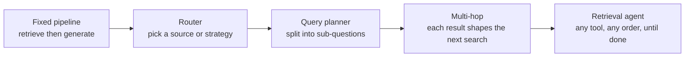
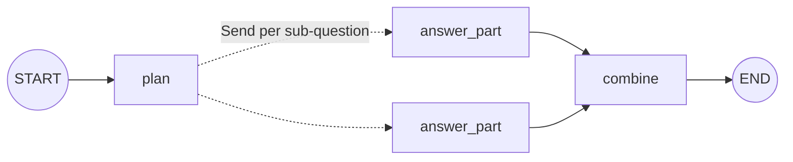

# Agents in RAG Pipelines: The Complete Guide

> 📚 **Before you start**
>
> - [Lab: Adaptive RAG end to end](../02-adaptive-rag/lab-adaptive-rag-end-to-end.md), for the router, the hop loop and the evaluation harness.
> - [ReAct](../../agentic-ai-fundamentals/05-reasoning-patterns/react.md) and [Planning and Reflection](../../agentic-ai-fundamentals/05-reasoning-patterns/planning-and-reflection.md), for the two reasoning patterns this lesson applies to retrieval.
> - [Parallel Workflows](../../langgraph-complete-guide/03-workflow-patterns-in-langgraph/parallel-workflows.md), for `Send`, and [Tools in LangGraph: ToolNode and tools_condition](../../langgraph-complete-guide/05-workflows-and-agents/tools-in-langgraph-toolnode-and-tools-condition.md).

## Introduction

Think about how a good CA (chartered accountant) answers "Can I claim my mother's medical bills, and how much tax will that save me?". They don't run one search. They split the question in two. For the first part they check the rule for medical expenses of senior-citizen parents. For the second they need *your* numbers first (your income, your tax regime) and only then can they look up the slab and do the sum. Some steps can happen in any order; some must wait for an earlier answer. And at every step they choose which source to open: the Income Tax Act, last year's return, or a client's bank statement.

That is what an **agent inside a RAG pipeline** does. In module 2 the decision was made once, up front: which strategy, which source. Here the model takes a bigger role. It **plans** (splits a question into parts), **chains** (uses one retrieved fact to decide the next search), and **chooses tools** (a vector store, a database, the web) step by step until it has enough.

By the end of this lesson you will be able to:

- place any agentic RAG design on a spectrum from fixed pipeline to fully autonomous retrieval agent;
- build a **query planner** that splits compound questions and answers the parts in parallel with `Send`;
- build **multi-hop** retrieval where later searches depend on earlier results, both plan-first and step-by-step;
- build a **tool-using retrieval agent** in LangGraph that combines a vector store, a SQL lookup and web search;
- choose between these patterns and put guardrails around the ones that loop.

> 💡 **Key Insight**
>
> Agents enter a RAG pipeline in four roles: **router** (pick the source), **planner** (split the question), **multi-hop reasoner** (let each answer shape the next search) and **retrieval agent** (pick any tool, any number of times). Each step along that list buys flexibility with predictability, cost and latency. Use the least autonomy that answers your users' real questions.

---

## Core Explanation

### 1. The spectrum of agency



| Pattern | Who decides the steps | Typical question it solves | Model calls | Predictability |
|---|---|---|---|---|
| **Fixed pipeline** | You, in code | "What's the cancellation fee?" | 1 | Highest |
| **Router** | Model, once | "Is my train late today?" (web, not docs) | 2 | High |
| **Query planner** | Model plans once; code runs the parts | "Fee to cancel early, *and* can I take my dog?" | 3 to 5 | Medium-high |
| **Multi-hop** | Model, at every hop | "My train was cancelled; when do I get my money?" | 3 to 6 | Medium |
| **Retrieval agent** | Model, at every step, over many tools | "PNR 4521873390 was cancelled; when do I get my money?" | 3 to 10 | Lowest |

You built the first two and a basic multi-hop loop in module 2. This lesson builds the planner, a richer multi-hop design and the full retrieval agent.


*The most autonomous design: one reasoning loop over several retrieval tools, fenced in by rules your code enforces.*

### 2. The setup: three sources

This lesson needs more than the help centre. SaathiRail also has a **bookings database** (SQLite here, any SQL database in production) and, as before, a **web search** stand-in.

```python
import math, operator, re, sqlite3
from typing import Annotated, Callable, Literal, TypedDict
from langchain_core.documents import Document
from langchain_core.embeddings import Embeddings
from langchain_core.language_models import BaseChatModel
from langchain_core.messages import AIMessage
from langchain_core.outputs import ChatGeneration, ChatResult
from langchain_core.vectorstores import InMemoryVectorStore
from langgraph.graph import StateGraph, START, END
from pydantic import BaseModel, Field

class KeywordEmbeddings(Embeddings):
    """Toy embedding: one dimension per keyword stem, plus a small constant. Offline stand-in only."""
    def __init__(self, stems):
        self.stems = stems

    def _embed(self, text):
        words = re.findall(r"[a-z]+", text.lower())
        vector = [float(sum(w.startswith(s) for w in words)) for s in self.stems]
        vector.append(0.1)
        norm = math.sqrt(sum(x * x for x in vector))
        return [x / norm for x in vector]

    def embed_documents(self, texts):
        return [self._embed(t) for t in texts]

    def embed_query(self, text):
        return self._embed(text)

STEMS = ["cancel", "refund", "fee", "fare", "tatkal", "upi", "wallet", "card", "payment",
         "method", "bag", "luggage", "kg", "pet", "dog", "railway"]

HELP_CENTRE = [
    ("fees", "refunds.md §1", "Cancelling a confirmed ticket more than 48 hours before departure costs a flat "
     "fee of ₹60 per passenger. Between 48 and 12 hours before departure, 25% of the fare is deducted. "
     "Less than 12 hours before departure, 50% is deducted."),
    ("tatkal", "tatkal.md §2", "Tatkal tickets are not refunded when you cancel them yourself. If the railway "
     "cancels the train, Tatkal tickets are refunded in full."),
    ("train-cancelled", "refunds.md §3", "If the railway cancels a train, every ticket on it is refunded in full "
     "automatically, with no form to fill. The money goes back to the original payment method; payments.md "
     "lists how long each method takes."),
    ("payment-times", "payments.md §2", "Refund timelines by payment method: SaathiRail Wallet is instant, UPI "
     "takes 1 to 3 working days, and credit or debit cards take 5 to 7 working days."),
    ("luggage", "luggage.md §1", "Each passenger may carry one bag of up to 15 kg free. Extra luggage costs "
     "₹30 per kg, paid at the parcel counter."),
    ("pets", "pets.md §1", "Pets such as dogs and cats travel only in a fully booked first class cabin, with "
     "a vaccination certificate."),
]
help_centre = InMemoryVectorStore(KeywordEmbeddings(STEMS))
help_centre.add_documents([Document(text, metadata={"source": src}) for _, src, text in HELP_CENTRE],
                          ids=[doc_id for doc_id, _, _ in HELP_CENTRE])

class StandInModel(BaseChatModel):
    """A chat model whose replies come from a Python function. For offline lessons only."""
    respond: Callable

    def _generate(self, messages, stop=None, run_manager=None, **kwargs):
        return ChatResult(generations=[ChatGeneration(message=self.respond(messages))])

    @property
    def _llm_type(self):
        return "stand-in"

    def bind_tools(self, tools, **kwargs):
        return self

def structured_reply(schema_name, **fields):
    return AIMessage("", tool_calls=[{"name": schema_name, "args": fields, "id": "call_1"}])

db = sqlite3.connect(":memory:", check_same_thread=False)   # ToolNode runs tools in worker threads
db.execute("CREATE TABLE bookings (pnr TEXT PRIMARY KEY, train TEXT, travel_date TEXT, status TEXT, paid_with TEXT)")
db.executemany("INSERT INTO bookings VALUES (?, ?, ?, ?, ?)", [
    ("4521873390", "12301 Howrah Rajdhani", "2026-10-20", "cancelled by railway", "UPI"),
    ("4521873391", "22436 Vande Bharat", "2026-10-22", "confirmed", "card"),
])

def search_docs(query, k=2):
    docs = help_centre.similarity_search(query, k=k)
    return "\n".join(f"[{d.metadata['source']}] {d.page_content}" for d in docs)

def lookup_booking_row(pnr):
    row = db.execute("SELECT * FROM bookings WHERE pnr = ?", (pnr,)).fetchone()
    if row is None:
        return f"No booking found for PNR {pnr}."
    return f"[bookings:{row[0]}] train {row[1]} on {row[2]}, status: {row[3]}, paid with {row[4]}"

print(lookup_booking_row("4521873390"))
```

Output:

```
[bookings:4521873390] train 12301 Howrah Rajdhani on 2026-10-20, status: cancelled by railway, paid with UPI
```

Notice that the SQL lookup returns a line in the **same citation format** as the help centre (`[bookings:4521873390] ...`). Making every source speak the same format is a small decision that pays off later: the generator, the graders and the UI don't need to care where a fact came from.

### 3. Pattern: the query planner

**Compound questions** bundle independent parts: "What's the fee to cancel 3 days before departure, and can I take my dog?" A single search for the whole sentence returns a muddle of both topics and may miss one entirely. A **query planner** asks the model to split the question into self-contained sub-questions. Because the parts don't depend on each other, they can be answered **in parallel**, then a final step combines them.

This is the "plan first" half of [Planning and Reflection](../../agentic-ai-fundamentals/05-reasoning-patterns/planning-and-reflection.md), applied to retrieval, and it's a map-reduce: `Send` fans out one branch per sub-question and a reducer collects the answers.



```python
from langgraph.types import Send

class SubQuestions(BaseModel):
    """Split a question into independent, self-contained sub-questions. Use one item if it's already simple."""
    questions: list[str] = Field(description="each sub-question must make sense on its own")

def planner_rules(messages):
    q = messages[-1].content.split("Question:")[-1].strip()
    if ", and " in q:
        first, second = q.rstrip("?").split(", and ")
        return structured_reply("SubQuestions", questions=[first + "?", second[0].upper() + second[1:] + "?"])
    return structured_reply("SubQuestions", questions=[q])

planner = StandInModel(respond=planner_rules).with_structured_output(SubQuestions)

PART_ANSWERS = {   # the stand-in generator's knowledge of what each page says, briefly
    "refunds.md §1": "More than 48 hours ahead, cancelling costs a flat ₹60 per passenger [refunds.md §1].",
    "pets.md §1": "Pets travel only in a fully booked first class cabin, with a vaccination certificate [pets.md §1].",
}
def part_rules(messages):
    prompt = messages[-1].content
    top_source = re.search(r"^\[(.+?)\]", prompt.split("Context:")[1].strip(), re.M).group(1)
    return AIMessage(PART_ANSWERS.get(top_source, "Not found in the help centre."))

part_llm = StandInModel(respond=part_rules)

class PlanState(TypedDict):
    question: str
    sub_questions: list
    partial_answers: Annotated[list, operator.add]
    answer: str

def plan(state: PlanState):
    return {"sub_questions": planner.invoke(f"Question: {state['question']}").questions}

def fan_out(state: PlanState):
    return [Send("answer_part", {"sub_question": q}) for q in state["sub_questions"]]

def answer_part(branch: dict):
    context = search_docs(branch["sub_question"])
    reply = part_llm.invoke(f"Context:\n{context}\n\nQuestion: {branch['sub_question']}")
    return {"partial_answers": [f"{branch['sub_question']} -> {reply.content}"]}

def combine(state: PlanState):
    return {"answer": " ".join(p.split(" -> ")[1] for p in sorted(state["partial_answers"]))}

g = StateGraph(PlanState)
g.add_node(plan)
g.add_node(answer_part)
g.add_node(combine)
g.add_edge(START, "plan")
g.add_conditional_edges("plan", fan_out, ["answer_part"])
g.add_edge("answer_part", "combine")
g.add_edge("combine", END)
planner_rag = g.compile()

q = "What is the fee to cancel 3 days before departure, and can I take my dog?"
print("one search for everything:", [line[:15] for line in search_docs(q).splitlines()])
out = planner_rag.invoke({"question": q})
for part in sorted(out["partial_answers"]):
    print("  ", part)
print("answer:", out["answer"])
```

Output:

```
one search for everything: ['[refunds.md §1]', '[pets.md §1] Pe']
   Can I take my dog? -> Pets travel only in a fully booked first class cabin, with a vaccination certificate [pets.md §1].
   What is the fee to cancel 3 days before departure? -> More than 48 hours ahead, cancelling costs a flat ₹60 per passenger [refunds.md §1].
answer: Pets travel only in a fully booked first class cabin, with a vaccination certificate [pets.md §1]. More than 48 hours ahead, cancelling costs a flat ₹60 per passenger [refunds.md §1].
```

Here the whole-sentence search was lucky: with *k* = 2 it caught both pages, though the generator would still have to untangle two topics from one context. Luck runs out quickly. Add a third topic and two slots can't hold three pages; and on a real index with thousands of chunks, the embedding of a two-topic sentence sits somewhere between both topics and close to neither, so both parts get weak matches. Split into sub-questions, each search is about one thing, finds exactly its page, and each part is answered from focused context. In production, `combine` is usually one more model call that writes a single fluent answer from the parts; here it simply joins them.

Planner design rules worth keeping:

- **Sub-questions must be self-contained.** "And can I take it?" is useless as a search query. The schema's field description says so.
- **Allow a plan of one.** Most questions aren't compound; the planner should return them unchanged rather than inventing parts.
- **Cap the number of parts** (three to five). A planner that returns twelve sub-questions is usually confused, and you pay for every branch.

### 4. Pattern: multi-hop with a plan (ReWOO style)

Sometimes the parts **depend on each other**: you can't search for the refund timeline until you know how the user paid, and you only know that from their booking. One family of designs plans all the steps up front and uses **placeholders** for results that don't exist yet. The pattern was introduced as ReWOO ("reasoning without observation"): a planner writes every step once, a worker executes them in order substituting `#E1`, `#E2` with earlier results, and a solver writes the answer. It costs only two model calls (plan and solve), however many steps there are.

```python
class Step(BaseModel):
    tool: Literal["lookup_booking", "search_help_centre"]
    tool_input: str = Field(description="may refer to an earlier step's result as #E1, #E2, ...")

class Plan(BaseModel):
    """A complete plan of tool calls. Later steps may use earlier results via #E<n>."""
    steps: list[Step]

def rewoo_planner_rules(messages):
    pnr = re.search(r"\b\d{10}\b", messages[-1].content).group(0)
    return structured_reply("Plan", steps=[
        {"tool": "lookup_booking", "tool_input": pnr},
        {"tool": "search_help_centre", "tool_input": "refund when the railway cancels the train"},
        {"tool": "search_help_centre", "tool_input": "refund timelines by payment method; booking: #E1"},
    ])

rewoo_planner = StandInModel(respond=rewoo_planner_rules).with_structured_output(Plan)
TOOLS = {"lookup_booking": lookup_booking_row, "search_help_centre": search_docs}

def run_plan(plan):
    evidence = {}
    for n, step in enumerate(plan.steps, start=1):
        tool_input = step.tool_input
        for ref, value in evidence.items():
            tool_input = tool_input.replace(ref, value)       # fill in earlier results
        evidence[f"#E{n}"] = TOOLS[step.tool](tool_input)
        print(f"#E{n} = {step.tool}({tool_input[:60]!r})")
    return evidence

question = "PNR 4521873390 was on a train the railway cancelled. When will I get my money?"
evidence = run_plan(rewoo_planner.invoke(question))
print(evidence["#E3"])
```

Output:

```
#E1 = lookup_booking('4521873390')
#E2 = search_help_centre('refund when the railway cancels the train')
#E3 = search_help_centre('refund timelines by payment method; booking: [bookings:45218')
[refunds.md §3] If the railway cancels a train, every ticket on it is refunded in full automatically, with no form to fill. The money goes back to the original payment method; payments.md lists how long each method takes.
[payments.md §2] Refund timelines by payment method: SaathiRail Wallet is instant, UPI takes 1 to 3 working days, and credit or debit cards take 5 to 7 working days.
```

Step 3's query included step 1's booking line ("paid with UPI"), which steered the search to the payment timelines page. The solver now has everything: the booking (cancelled by the railway, paid by UPI), the rule (automatic full refund) and the timeline (UPI: 1 to 3 working days).

The weakness is the flip side of the strength: the plan is written **before** seeing any result. If the booking had said "status: confirmed" (the user was mistaken), steps 2 and 3 would still run, searching for the wrong thing. Plan-first suits processes whose shape is known in advance; when results can change the plan, you want the next pattern.

### 5. Pattern: the retrieval agent (ReAct)

A **retrieval agent** decides **one step at a time** after reading each result, the [ReAct](../../agentic-ai-fundamentals/05-reasoning-patterns/react.md) loop with retrieval tools. In LangGraph it's the agent you built in the LangGraph course: an `assistant` node with tools bound, a `ToolNode`, and `tools_condition` to loop until the model answers without a tool call. What makes it a *retrieval* agent is only its tool set and its instructions.

```python
from langchain_core.messages import SystemMessage, ToolMessage
from langchain_core.tools import tool
from langgraph.graph import MessagesState
from langgraph.prebuilt import ToolNode, tools_condition

@tool
def search_help_centre(query: str) -> str:
    """Search SaathiRail's help centre for rules: cancellation fees, Tatkal, refunds, refund timelines,
    luggage, pets. Phrase the query in the help centre's words."""
    return search_docs(query)

@tool
def lookup_booking(pnr: str) -> str:
    """Look up one booking by its 10-digit PNR: train, date, status and how it was paid."""
    return lookup_booking_row(pnr)

@tool
def web_search(query: str) -> str:
    """Search the web for live information such as running status or delays."""
    return "[https://status.example] (example data) No delay reported."

AGENT_SYSTEM = """You answer SaathiRail customers. Use tools to find facts; never guess rules or booking
details. Look up the booking first when the user gives a PNR. Cite every fact with its [source].
When you have everything you need, answer without calling a tool."""

def agent_rules(messages):
    """Stand-in for a ReAct model: decide the next step from what the tools have returned so far."""
    question = next(m.content for m in messages if m.type == "human")
    seen = "\n".join(m.content for m in messages if isinstance(m, ToolMessage))
    pnr = re.search(r"\b\d{10}\b", question)
    def call(name, **args):
        return AIMessage("", tool_calls=[{"name": name, "args": args, "id": f"c{len(messages)}"}])
    if pnr and "[bookings:" not in seen:
        return call("lookup_booking", pnr=pnr.group(0))
    if "cancelled by railway" in seen and "refunds.md §3" not in seen:
        return call("search_help_centre", query="refund when the railway cancels a train")
    if "payments.md lists" in seen and "payments.md §2" not in seen:
        method = re.search(r"paid with (\w+)", seen).group(1)
        return call("search_help_centre", query=f"refund timelines by payment method {method}")
    if "payments.md §2" in seen:
        return AIMessage("Your train (12301 Howrah Rajdhani, 20 Oct) was cancelled by the railway, so you get "
                         "a full refund automatically [bookings:4521873390][refunds.md §3]. You paid by UPI, "
                         "so expect it within 1 to 3 working days [payments.md §2].")
    return AIMessage("Could you share your PNR so I can check your booking?")

agent_llm = StandInModel(respond=agent_rules).bind_tools([search_help_centre, lookup_booking, web_search])

def assistant(state: MessagesState):
    return {"messages": [agent_llm.invoke([SystemMessage(AGENT_SYSTEM)] + state["messages"])]}

builder = StateGraph(MessagesState)
builder.add_node(assistant)
builder.add_node("tools", ToolNode([search_help_centre, lookup_booking, web_search]))
builder.add_edge(START, "assistant")
builder.add_conditional_edges("assistant", tools_condition)
builder.add_edge("tools", "assistant")
retrieval_agent = builder.compile()

result = retrieval_agent.invoke({"messages": [("user", question)]})
for m in result["messages"][1:]:
    if m.type == "ai" and m.tool_calls:
        call = m.tool_calls[0]
        print(f"CALL   {call['name']}({list(call['args'].values())[0]!r})")
    elif m.type == "tool":
        print(f"RESULT {re.findall(r'^\[(.+?)\]', m.content, re.M)}")
    else:
        print(f"ANSWER {m.content}")
```

Output:

```
CALL   lookup_booking('4521873390')
RESULT ['bookings:4521873390']
CALL   search_help_centre('refund when the railway cancels a train')
RESULT ['tatkal.md §2', 'refunds.md §3']
CALL   search_help_centre('refund timelines by payment method UPI')
RESULT ['payments.md §2', 'refunds.md §3']
ANSWER Your train (12301 Howrah Rajdhani, 20 Oct) was cancelled by the railway, so you get a full refund automatically [bookings:4521873390][refunds.md §3]. You paid by UPI, so expect it within 1 to 3 working days [payments.md §2].
```

Read the trace as the model's reasoning made visible. It looked up the booking first (as instructed), saw "cancelled by railway" and searched for that rule, read the rule's pointer to payment timelines, and used the booking's payment method in its next query. Each search was **chosen because of what the previous result said**. That is the difference from the ReWOO plan: had the booking said "confirmed", this agent would have taken a different path.

Try a different customer to see the agent adapt:

```python
result = retrieval_agent.invoke({"messages": [("user", "When will I get my refund?")]})
print(len(result["messages"]) - 1, "message(s):", result["messages"][-1].content)
```

Output:

```
1 message(s): Could you share your PNR so I can check your booking?
```

With no PNR and no context, the right move is to ask, and the agent did, at the cost of one model call and no retrieval.

### 6. Guardrails for agents that loop

A retrieval agent can loop: searching again and again with slightly different words, or bouncing between tools. The rules from [How an Agent Decides What to Do Next](../../agentic-ai-fundamentals/03-the-agent-loop/how-an-agent-decides-what-to-do-next.md) apply directly, and LangGraph gives you the first one for free: every run has a **recursion limit** (the maximum number of steps), and exceeding it raises an error instead of looping forever.

```python
from langgraph.errors import GraphRecursionError

def stubborn_rules(messages):        # a model that never decides it has enough
    return AIMessage("", tool_calls=[{"name": "search_help_centre", "args": {"query": "refund"},
                                      "id": f"s{len(messages)}"}])

agent_llm = StandInModel(respond=stubborn_rules).bind_tools([search_help_centre, lookup_booking, web_search])
try:
    retrieval_agent.invoke({"messages": [("user", "Refund?")]}, {"recursion_limit": 8})
except GraphRecursionError:
    print("stopped: recursion limit of 8 steps reached")
agent_llm = StandInModel(respond=agent_rules).bind_tools([search_help_centre, lookup_booking, web_search])
```

Output:

```
stopped: recursion limit of 8 steps reached
```

Catching the error is the minimum. Better production behaviour is to stop *gracefully*: count tool calls in state and, when a budget is reached, route to a final node that answers from whatever evidence exists and says what's missing. Other guardrails that matter for retrieval agents:

| Guardrail | What it prevents | Where it lives |
|---|---|---|
| **Step and call budget** | Endless loops, runaway cost | Recursion limit; a counter in state |
| **Duplicate-query check** | Searching the same thing repeatedly | Compare each new query with earlier ones before running it |
| **Allowed tools per user** | A customer agent querying other customers' bookings | Tool code checks the logged-in user owns the PNR |
| **Citations required** | Facts the agent "remembered" instead of retrieved | Instructions, plus a check that every sentence has a source (module 4 grades this properly) |
| **Untrusted tool output** | Instructions hidden in web pages or documents | Treat results as data; never let them trigger new tools by themselves |

The third row deserves emphasis. The bookings tool above returns any PNR it's given. In a real app, the tool must check that the PNR belongs to the signed-in customer, in code, because a prompt cannot enforce access control.

### 7. Choosing a pattern

| If your questions are mostly... | Use | Why |
|---|---|---|
| One topic each, one source | Fixed pipeline | Cheapest and most predictable |
| One topic each, several sources | Router | One extra cheap call |
| Bundles of independent parts | Query planner | Parallel, bounded cost |
| Chains whose steps are known in advance | Plan-first multi-hop (ReWOO style) | Two model calls however many steps |
| Chains whose next step depends on what you find | Retrieval agent (ReAct) | Adapts at every step |
| A mix | Router in front of several of the above | Spend autonomy only where needed |

The last row is what most mature systems look like: a router (module 2) that sends simple questions down a fixed pipeline and only hands the hard ones to a planner or an agent. Agents are the most powerful option and the most expensive to run, test and debug, so they should handle the minority of traffic that needs them.

Multi-agent designs (a coordinator delegating to separate "help centre", "bookings" and "web" agents) are the next step up. They make sense when each source needs its own long instructions or its own team; you'll build one in [Multi-Agent Systems and Agent Protocols](../../multi-agent-systems-and-agent-protocols/course.md) and in the capstone.

---

## Try It Yourself

1. **Three-part question.** Run `planner_rag` on "What is the fee to cancel 3 days before departure, and can I take my dog?" with the planner returning a third sub-question, "How many kg of luggage can I carry free?". What does `answer_part` return for it, and why?
2. **A plan that goes wrong.** Run the ReWOO plan for PNR `4521873391` (a *confirmed* booking). What does step 3 search for, and what should a good system have done?
3. **Duplicate-query guard.** Write `is_duplicate(query, previous)` that returns `True` when a new query has the same set of lowercased words as any earlier one.

<details>
<summary>Show answers</summary>

**1.**

```python
print(answer_part({"sub_question": "How many kg of luggage can I carry free?"}))
```

Output:

```
{'partial_answers': ['How many kg of luggage can I carry free? -> Not found in the help centre.']}
```

The search found the luggage page, but the stand-in generator's `PART_ANSWERS` only knows two pages, so it says "Not found". The plumbing (planning, fan-out, retrieval) works for any number of parts; only the stand-in's knowledge is limited. A real model would read `luggage.md §1` and answer "one bag up to 15 kg".

**2.**

```python
evidence = run_plan(Plan(steps=[
    Step(tool="lookup_booking", tool_input="4521873391"),
    Step(tool="search_help_centre", tool_input="refund when the railway cancels the train"),
    Step(tool="search_help_centre", tool_input="refund timelines by payment method; booking: #E1"),
]))
print(evidence["#E1"])
```

Output:

```
#E1 = lookup_booking('4521873391')
#E2 = search_help_centre('refund when the railway cancels the train')
#E3 = search_help_centre('refund timelines by payment method; booking: [bookings:45218')
[bookings:4521873391] train 22436 Vande Bharat on 2026-10-22, status: confirmed, paid with card
```

The plan ran all three steps even though the booking is confirmed, not cancelled. The searches are wasted and could mislead the solver into talking about refunds the customer isn't owed. A good system would notice the status after step 1 and change course, which is exactly what the ReAct agent does, or the ReWOO solver must be told to check the evidence before trusting the plan's assumptions.

**3.**

```python
def is_duplicate(query, previous):
    words = set(query.lower().split())
    return any(words == set(p.lower().split()) for p in previous)

print(is_duplicate("Refund UPI timeline", ["upi refund timeline", "tatkal rules"]))
print(is_duplicate("UPI refund days", ["upi refund timeline"]))
```

Output:

```
True
False
```

Word sets catch reordered repeats. Near-duplicates ("days" vs "timeline") slip through; for those, compare query embeddings and treat a cosine similarity above a threshold (say 0.95) as a repeat.

</details>

---

## Real-World Examples

- **Banking assistants** answer "why was I charged ₹590 on 3 October?" with a retrieval agent: fetch the transaction from the core banking system, then search the fee schedule for that charge code, then the waiver policy, each step chosen from the previous result.
- **Enterprise research tools** use query planners to split comparison questions ("compare our leave policies in India and Singapore") into one sub-question per country, answered in parallel.
- **IT helpdesk bots** combine a router and an agent: password resets go down a fixed flow, while "my VPN fails only on the office Wi-Fi" goes to an agent that searches runbooks, checks the user's device record and reads recent incident notes.

---

## Common Misconceptions

### "Agentic RAG means a ReAct agent with a search tool"

That's one pattern of several. Routers, planners and plan-first multi-hop designs are also agentic RAG, and are often better choices because they are cheaper and more predictable.

### "Splitting a question always helps"

Splitting a simple question creates extra calls and can lose context ("cancel" in one sub-question, "Tatkal" in another). The planner must be allowed to return the question unchanged.

### "The agent will stop when it has enough"

Usually, not always. Models can keep searching for confirmation or loop on a failed search. Step budgets, duplicate checks and a graceful "answer with what you have" exit are required, not optional.

### "Tool descriptions control who can see what"

Descriptions guide the model's choice; they don't enforce permissions. Access checks (does this user own this PNR?) belong in the tool's code.

---

## Interview Relevance

*"What is agentic RAG, and what roles can an agent play?"* Name the spectrum: router, query planner (decomposition, often parallel via map-reduce), multi-hop reasoning (plan-first like ReWOO or interleaved like ReAct/IRCoT), and the tool-using retrieval agent over several sources. Discuss the trade-off between autonomy and predictability, cost and latency.

*"How would you answer a question that needs data from a database and a document store?"* A retrieval agent with a SQL lookup tool and a vector search tool, uniform citation format across tools, instructions on order of operations, access control inside the tools, and a step budget. Mention that if the order is always the same, a plan-first pipeline is cheaper.

*"How do you stop an agent from looping?"* Recursion or step limits, a tool-call budget in state, duplicate-query detection, and a final node that answers from available evidence and states what's missing.

---

## Key Takeaways

- **Agents play four roles in RAG**: router, query planner, multi-hop reasoner and tool-using retrieval agent, in order of increasing autonomy and cost.
- **Query planners split compound questions** into self-contained parts and answer them in parallel with `Send`.
- **Plan-first multi-hop (ReWOO style)** is cheap but blind to surprises; **ReAct-style agents** adapt after every result.
- **A retrieval agent is the familiar LangGraph agent** with retrieval tools that share one citation format.
- **Guard every loop**: step budgets, duplicate checks, access control in tool code and a graceful exit.

---

**Up next:** [Corrective RAG (CRAG)](corrective-rag-crag.md)
