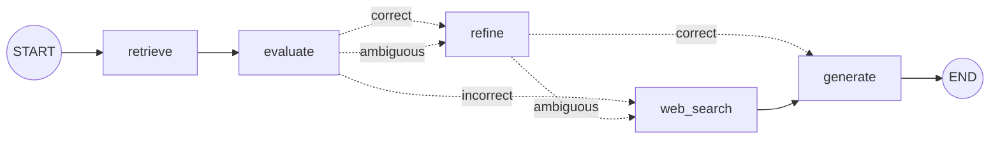

# Corrective RAG (CRAG): The Complete Guide

> 📚 **Before you start**
>
> - [Agents in RAG Pipelines](agents-in-rag-pipelines.md), for where decisions sit in a RAG pipeline.
> - [RAG Inside a LangGraph Agent](../../langgraph-complete-guide/05-workflows-and-agents/rag-inside-a-langgraph-agent.md), section 6, where you built a first grade-rewrite-retry loop.
> - [Adaptive RAG with Cohere](../02-adaptive-rag/adaptive-rag-with-cohere.md), for reranker scores and the web-search route.
> - [RAG Evaluation › LLM-as-a-Judge](../../retrieval-augmented-generation-rag/course.md#m9), for using a model to grade relevance.

## Introduction

A junior lawyer is asked, "Can the landlord keep the full deposit if the tenant leaves two months early?". They pull three files from the office library. A careless junior hands all three to the senior partner. A good one reads them first: one is exactly the clause on early exit, so they mark the two relevant paragraphs and tear off nothing else; one is about rent increases, so it goes back on the shelf; and if *none* of the files had been relevant, they wouldn't hand over the least-bad one, they'd go and check the latest court judgments online.

A plain RAG pipeline is the careless junior. The retriever always returns its top *k*, relevant or not, and the generator is asked to answer from whatever arrived. If the pages are off-topic the model either refuses or, worse, stitches together a plausible-sounding answer from the wrong rule.

**Corrective RAG (CRAG)** is the careful junior. It **grades the retrieved documents before using them**, and then takes one of three actions: use them (after trimming them down to what matters), throw them away and search the web instead, or do both when it's unsure.

By the end of this lesson you will be able to:

- explain the CRAG design: the retrieval evaluator, the three actions and knowledge refinement;
- write a relevance evaluator with structured output and thresholds;
- implement "decompose, filter, recompose" to strip documents down to their relevant sentences;
- build the full CRAG graph in LangGraph, with query rewriting and a web fallback;
- adapt CRAG for a closed knowledge base where the web isn't the right fallback.

> 💡 **Key Insight**
>
> A retriever always returns *something*; CRAG refuses to trust it blindly. An **evaluator scores each retrieved document**, and the scores decide the next move: **Correct** (refine and use), **Incorrect** (discard, rewrite the query, search elsewhere) or **Ambiguous** (both). The generator only ever sees evidence that passed inspection.

---

## Core Explanation

### 1. The CRAG design

CRAG comes from the 2024 paper *Corrective Retrieval Augmented Generation* (Yan, Gu, Zhu and Ling). Its parts:


*CRAG adds a checkpoint between retrieval and generation, and three ways out of it.*

1. **A lightweight retrieval evaluator.** In the paper, a small fine-tuned model (T5-large) reads the question and one document and outputs a relevance score. Small matters: it runs once per retrieved document on every request.
2. **Three actions from two thresholds.** If at least one document scores above an *upper* threshold, the retrieval is judged **Correct**. If every document scores below a *lower* threshold, it is **Incorrect**. Anything else is **Ambiguous**.
3. **Knowledge refinement ("decompose, then recompose").** Even a relevant document is mostly irrelevant sentences. CRAG splits documents into small **knowledge strips** (a sentence or a few), scores each strip with the evaluator, drops the low scorers, and joins the rest back together as the context.
4. **Web search as the corrective source.** On Incorrect, the original documents are discarded; the question is **rewritten into a keyword-style search query** and sent to a web search. The web results are refined the same way.
5. **Plug and play.** CRAG doesn't change the retriever or the generator. It wraps any RAG pipeline, which is why it's popular in practice.

Most implementations you'll see (including LangGraph's well-known CRAG tutorial) simplify this: an LLM grades each document "yes" or "no", irrelevant ones are dropped, and if any were dropped the system rewrites the query and adds web results. Same idea, coarser scores. You'll build the full three-action version, then see the simplification as a special case.

### 2. The setup

The help centre and stand-ins, plus a web-search stand-in with two clearly fake pages.

```python
import math, re
from typing import Callable, Literal, TypedDict
from langchain_core.documents import Document
from langchain_core.embeddings import Embeddings
from langchain_core.language_models import BaseChatModel
from langchain_core.messages import AIMessage
from langchain_core.outputs import ChatGeneration, ChatResult
from langchain_core.vectorstores import InMemoryVectorStore
from langgraph.graph import StateGraph, START, END
from pydantic import BaseModel, Field

class KeywordEmbeddings(Embeddings):
    """Toy embedding: one dimension per keyword stem, plus a small constant. Offline stand-in only."""
    def __init__(self, stems):
        self.stems = stems

    def _embed(self, text):
        words = re.findall(r"[a-z]+", text.lower())
        vector = [float(sum(w.startswith(s) for w in words)) for s in self.stems]
        vector.append(0.1)
        norm = math.sqrt(sum(x * x for x in vector))
        return [x / norm for x in vector]

    def embed_documents(self, texts):
        return [self._embed(t) for t in texts]

    def embed_query(self, text):
        return self._embed(text)

STEMS = ["cancel", "refund", "fee", "fare", "tatkal", "upi", "wallet", "card", "payment",
         "method", "bag", "luggage", "kg", "pet", "dog", "railway"]

HELP_CENTRE = [
    ("fees", "refunds.md §1", "Cancelling a confirmed ticket more than 48 hours before departure costs a flat "
     "fee of ₹60 per passenger. Between 48 and 12 hours before departure, 25% of the fare is deducted. "
     "Less than 12 hours before departure, 50% is deducted."),
    ("tatkal", "tatkal.md §2", "Tatkal tickets are not refunded when you cancel them yourself. If the railway "
     "cancels the train, Tatkal tickets are refunded in full."),
    ("train-cancelled", "refunds.md §3", "If the railway cancels a train, every ticket on it is refunded in full "
     "automatically, with no form to fill. The money goes back to the original payment method; payments.md "
     "lists how long each method takes."),
    ("payment-times", "payments.md §2", "Refund timelines by payment method: SaathiRail Wallet is instant, UPI "
     "takes 1 to 3 working days, and credit or debit cards take 5 to 7 working days."),
    ("luggage", "luggage.md §1", "Each passenger may carry one bag of up to 15 kg free. Extra luggage costs "
     "₹30 per kg, paid at the parcel counter."),
    ("pets", "pets.md §1", "Pets such as dogs and cats travel only in a fully booked first class cabin, with "
     "a vaccination certificate."),
]
help_centre = InMemoryVectorStore(KeywordEmbeddings(STEMS))
help_centre.add_documents([Document(text, metadata={"source": src}) for _, src, text in HELP_CENTRE],
                          ids=[doc_id for doc_id, _, _ in HELP_CENTRE])

class StandInModel(BaseChatModel):
    """A chat model whose replies come from a Python function. For offline lessons only."""
    respond: Callable

    def _generate(self, messages, stop=None, run_manager=None, **kwargs):
        return ChatResult(generations=[ChatGeneration(message=self.respond(messages))])

    @property
    def _llm_type(self):
        return "stand-in"

    def bind_tools(self, tools, **kwargs):
        return self

def structured_reply(schema_name, **fields):
    return AIMessage("", tool_calls=[{"name": schema_name, "args": fields, "id": "call_1"}])

WEB = [
    Document("Live status (example data): the Varanasi Vande Bharat is running 25 minutes late today.",
             metadata={"source": "https://status.example/varanasi-vb"}),
    Document("News (example data): rail unions have announced no strike for this week. Services run normally.",
             metadata={"source": "https://news.example/rail-strike"}),
]
def web_search(query):
    words = set(query.lower().split())
    return [d for d in WEB if words & set(re.findall(r"[a-z]+", d.page_content.lower())) - {"the", "for", "is"}]
```

### 3. The retrieval evaluator

The evaluator answers one narrow question: *how useful is this document for this question?* With an LLM, it's a structured-output call returning a score. Asking for a number between 0 and 1 (rather than yes/no) is what makes three actions possible.

```python
class RelevanceScore(BaseModel):
    """How useful a document is for answering a question."""
    score: float = Field(ge=0, le=1, description="0 = unrelated, 1 = directly answers the question")

EVALUATOR_PROMPT = """Rate how useful the document is for answering the question.
Score 1 if it directly answers it, around 0.5 if it covers part of it, 0 if it is unrelated.

Question: {question}
Document: {document}"""
```

The real evaluator is either a small hosted or local model with this prompt, or a reranker, whose relevance score already is exactly this number:

```python
# not-run: needs `pip install langchain-anthropic` and an ANTHROPIC_API_KEY
from langchain_anthropic import ChatAnthropic

evaluator = ChatAnthropic(model="claude-opus-5-5", temperature=0).with_structured_output(RelevanceScore)
```

Offline, the stand-in compares *topics*: it maps the question and the document onto a small topic vocabulary (with a few everyday phrases translated, the way a model understands "money back" means "refund") and scores the fraction of the question's topics the document covers.

```python
TOPICS = STEMS + ["strike", "late", "delay", "status", "today"]
PHRASES = {"money back": "refund", "doesn't run": "railway cancel", "not run": "railway cancel"}

def topics(text):
    text = text.lower()
    for phrase, meaning in PHRASES.items():
        text = text.replace(phrase, meaning)
    words = re.findall(r"[a-z]+", text)
    return {t for t in TOPICS for w in words if w.startswith(t)}

def evaluator_rules(messages):
    prompt = messages[-1].content
    question = prompt.split("Question:")[1].split("Document:")[0]
    document = prompt.split("Document:")[1]
    wanted = topics(question)
    score = len(wanted & topics(document)) / len(wanted) if wanted else 0.0
    return structured_reply("RelevanceScore", score=round(score, 2))

evaluator = StandInModel(respond=evaluator_rules).with_structured_output(RelevanceScore)

def score_docs(question, docs):
    return [evaluator.invoke(EVALUATOR_PROMPT.format(question=question, document=d.page_content)).score
            for d in docs]

question = "What is the fee to cancel 3 days before departure?"
docs = help_centre.similarity_search(question, k=3)
for doc, score in zip(docs, score_docs(question, docs)):
    print(f"{score:.2f}  {doc.metadata['source']}")
```

Output:

```
1.00  refunds.md §1
0.50  tatkal.md §2
0.50  refunds.md §3
```

The fees page covers everything the question asks about; the Tatkal and cancelled-train pages mention cancelling but not fees, so they score half.

### 4. Three actions from two thresholds

```python
UPPER, LOWER = 0.8, 0.3

def decide(scores) -> Literal["correct", "incorrect", "ambiguous"]:
    if scores and max(scores) >= UPPER:
        return "correct"
    if not scores or max(scores) < LOWER:
        return "incorrect"
    return "ambiguous"

TEST = ["What is the fee to cancel 3 days before departure?",
        "Is the Vande Bharat to Varanasi running late today?",
        "Do I get a refund if the railway cancels my train because of a strike this week?"]
for q in TEST:
    d = help_centre.similarity_search(q, k=3)
    s = score_docs(q, d)
    print(f"{decide(s):10} best={max(s):.2f}  {q}")
```

Output:

```
correct    best=1.00  What is the fee to cancel 3 days before departure?
incorrect  best=0.00  Is the Vande Bharat to Varanasi running late today?
ambiguous  best=0.75  Do I get a refund if the railway cancels my train because of a strike this week?
```

Three questions, three actions:

- The fee question has a document that fully covers it: **correct**.
- The live-status question gets the help centre's three best pages, all about refunds and pets, all scoring 0: **incorrect**. A plain pipeline would have generated from them anyway.
- The strike question is half in the help centre (refunds when the railway cancels) and half outside it (is there a strike?): **ambiguous**. The best page covers some of its topics but not all.

The thresholds are hyperparameters. Too high an upper threshold sends good retrievals to the web; too low a lower threshold lets junk through. Tune them on labelled questions, as you did with the router.

### 5. Knowledge refinement: decompose, filter, recompose

Even for the Correct action, CRAG doesn't pass whole documents to the generator. It splits them into **strips**, scores each strip, and keeps only the useful ones. That shrinks the prompt and removes sentences that could distract the generator (the 25% and 50% rules are true, but irrelevant to "3 days before").

```python
def decompose(doc):
    """Split a document into sentence strips, each keeping its source."""
    sentences = re.split(r"(?<=[.!?])\s+", doc.page_content.strip())
    return [Document(s, metadata=doc.metadata) for s in sentences if s]

def refine(question, docs, keep_at=0.6):
    strips = [strip for doc in docs for strip in decompose(doc)]
    scores = score_docs(question, strips)
    kept = [strip for strip, score in zip(strips, scores) if score >= keep_at]
    for strip, score in zip(strips, scores):
        print(f"  {'KEEP' if score >= keep_at else 'drop'} {score:.2f} [{strip.metadata['source']}] {strip.page_content[:60]}")
    return kept

question = TEST[0]
refined = refine(question, help_centre.similarity_search(question, k=3))
print(len(refined), "strip(s) kept")
```

Output:

```
  KEEP 1.00 [refunds.md §1] Cancelling a confirmed ticket more than 48 hours before depa
  drop 0.00 [refunds.md §1] Between 48 and 12 hours before departure, 25% of the fare is
  drop 0.00 [refunds.md §1] Less than 12 hours before departure, 50% is deducted.
  drop 0.50 [tatkal.md §2] Tatkal tickets are not refunded when you cancel them yoursel
  drop 0.50 [tatkal.md §2] If the railway cancels the train, Tatkal tickets are refunde
  drop 0.50 [refunds.md §3] If the railway cancels a train, every ticket on it is refund
  drop 0.00 [refunds.md §3] The money goes back to the original payment method; payments
1 strip(s) kept
```

From three documents and seven sentences, one sentence survived, and it's exactly the answer. The generator's job is now trivial, and the risk of it quoting the 50% rule by mistake is gone.

Strip size is a trade-off. Single sentences give the finest filtering but can lose context ("This applies only to..." makes no sense on its own); two or three sentences per strip is a common compromise. Refinement also costs one evaluator call per strip, which is why a cheap evaluator matters.

### 6. The Incorrect action: rewrite, then search the web

When retrieval failed, the user's own words are often the problem. CRAG rewrites the question into a short **keyword query** suited to a search engine before calling it:

```python
def rewrite_rules(messages):
    q = messages[-1].content.split("Question:")[-1].lower()
    filler = {"is", "the", "to", "do", "i", "get", "a", "if", "my", "this", "because", "of", "what", "running"}
    return AIMessage(" ".join(w for w in re.findall(r"[a-z]+", q) if w not in filler))

rewriter = StandInModel(respond=rewrite_rules)
REWRITE_PROMPT = "Rewrite the question as a short web search query of keywords.\nQuestion: {question}"

for q in TEST[1:]:
    keywords = rewriter.invoke(REWRITE_PROMPT.format(question=q)).content
    print(f"{keywords!r:60} -> {[d.metadata['source'] for d in web_search(keywords)]}")
```

Output:

```
'vande bharat varanasi late today'                           -> ['https://status.example/varanasi-vb']
'refund railway cancels train strike week'                   -> ['https://news.example/rail-strike']
```

For a real web search, swap `web_search` for the Tavily wrapper from [Adaptive RAG with Cohere](../02-adaptive-rag/adaptive-rag-with-cohere.md). The web results go through `refine` too: web pages are long and noisy, and refinement is the cheapest way to keep only what's relevant (and to leave behind any text that tries to instruct your model).

### 7. The CRAG graph



The Ambiguous action runs both branches: refine the internal documents *and* search the web, and the generator gets both. We implement it by letting `refine` hand over to `web_search` when the action is ambiguous.

```python
class CRAGState(TypedDict):
    question: str
    docs: list
    scores: list
    action: str
    knowledge: list
    answer: str

def retrieve(state: CRAGState):
    return {"docs": help_centre.similarity_search(state["question"], k=3)}

def evaluate(state: CRAGState):
    scores = score_docs(state["question"], state["docs"])
    return {"scores": scores, "action": decide(scores), "knowledge": []}

def refine_node(state: CRAGState):
    kept = [s for s in (strip for d in state["docs"] for strip in decompose(d))
            if score_docs(state["question"], [s])[0] >= 0.6]
    return {"knowledge": state["knowledge"] + kept}

def web_node(state: CRAGState):
    keywords = rewriter.invoke(REWRITE_PROMPT.format(question=state["question"])).content
    return {"knowledge": state["knowledge"] + web_search(keywords)}

def generate(state: CRAGState):
    if not state["knowledge"]:
        return {"answer": "I couldn't find reliable information for this question."}
    # Stand-in generator: restates each kept strip with its citation. A real model writes prose from them.
    return {"answer": " ".join(f"{k.page_content} [{k.metadata['source']}]" for k in state["knowledge"])}

def after_evaluate(state: CRAGState) -> Literal["refine", "web_search"]:
    return "web_search" if state["action"] == "incorrect" else "refine"

def after_refine(state: CRAGState) -> Literal["web_search", "generate"]:
    return "web_search" if state["action"] == "ambiguous" else "generate"

g = StateGraph(CRAGState)
g.add_node(retrieve)
g.add_node(evaluate)
g.add_node("refine", refine_node)
g.add_node("web_search", web_node)
g.add_node(generate)
g.add_edge(START, "retrieve")
g.add_edge("retrieve", "evaluate")
g.add_conditional_edges("evaluate", after_evaluate)
g.add_conditional_edges("refine", after_refine)
g.add_edge("web_search", "generate")
g.add_edge("generate", END)
crag = g.compile()

for q in TEST:
    path = [next(iter(u)) for u in crag.stream({"question": q}, stream_mode="updates")]
    out = crag.invoke({"question": q})
    print(f"[{out['action']}] {' -> '.join(path)}")
    print("   ", out["answer"])
```

Output:

```
[correct] retrieve -> evaluate -> refine -> generate
    Cancelling a confirmed ticket more than 48 hours before departure costs a flat fee of ₹60 per passenger. [refunds.md §1]
[incorrect] retrieve -> evaluate -> web_search -> generate
    Live status (example data): the Varanasi Vande Bharat is running 25 minutes late today. [https://status.example/varanasi-vb]
[ambiguous] retrieve -> evaluate -> refine -> web_search -> generate
    If the railway cancels the train, Tatkal tickets are refunded in full. [tatkal.md §2] If the railway cancels a train, every ticket on it is refunded in full automatically, with no form to fill. [refunds.md §3] News (example data): rail unions have announced no strike for this week. Services run normally. [https://news.example/rail-strike]
```

Each question took the path its evidence deserved:

- **Correct**: one sentence from the help centre, nothing else. The answer is precise.
- **Incorrect**: the help-centre pages never reached the generator. The rewritten query found the live-status page.
- **Ambiguous**: the generator got the help-centre rule on railway cancellations (relevant strips only) *and* the web's strike news, and the answer combines both. Notice that refinement dropped the Tatkal sentence about passengers cancelling themselves, which a whole-document pipeline would have passed along.

### 8. CRAG for a closed knowledge base

The web is the right fallback for public, changing facts. It's the *wrong* fallback for questions about your own rules: the internet doesn't know SaathiRail's refund policy, and a random blog's answer could be confidently wrong. Many production systems therefore change the Incorrect action to: **rewrite the query in the knowledge base's own vocabulary and retry the internal search once**, then go to the web (or to "I don't know") only if that also fails. That's the loop you built in [RAG Inside a LangGraph Agent](../../langgraph-complete-guide/05-workflows-and-agents/rag-inside-a-langgraph-agent.md), now with CRAG's evaluator and thresholds.

Here's a colloquial question that the embedding search fumbles:

```python
q = "Will I get my money back if my train doesn't run, and how fast?"
d = help_centre.similarity_search(q, k=3)
print([doc.metadata["source"] for doc in d], score_docs(q, d), decide(score_docs(q, d)))

internal_query = "refund when the railway cancels a train, payment method timelines"   # what a rewriter would write
d2 = help_centre.similarity_search(internal_query, k=3)
print([doc.metadata["source"] for doc in d2], score_docs(q, d2), decide(score_docs(q, d2)))
```

Output:

```
['pets.md §1', 'refunds.md §1', 'luggage.md §1'] [0.0, 0.33, 0.0] ambiguous
['refunds.md §3', 'tatkal.md §2', 'payments.md §2'] [1.0, 1.0, 0.33] correct
```

The user's words ("money back", "doesn't run") share no keywords with the help centre, so the first retrieval is ambiguous at best and the web would have been consulted for a SaathiRail-specific rule. Rewritten in the help centre's vocabulary, the same knowledge base returns the right pages and the evaluator rates them Correct. For a closed domain, **retry internally first; use the web for what's genuinely outside**.

### 9. Costs, and the simple version

CRAG's extra cost is the evaluator: one call per retrieved document, plus one per strip if you refine. For *k* = 3 documents of three sentences, that's up to twelve evaluator calls per question, which is why the paper used a small model and why production systems often:

- use a **reranker** as the evaluator (one batched call scores every document, and its score is already a relevance score);
- **skip strip-level refinement** for short chunks, which are already strip-sized;
- use **binary grades** ("yes"/"no") from a small LLM instead of scores, which is the LangGraph-tutorial simplification: keep "yes" documents, and if any were "no" (or none were "yes"), rewrite and search the web.

The binary version is the three-action version with both thresholds at the same value. It loses the Ambiguous action, so it can't combine "partly relevant internal" with "external" evidence as neatly, but it's simpler, and it's the right first step.

---

## Try It Yourself

1. **Move the thresholds.** Set `UPPER, LOWER = 0.5, 0.3` and rerun the action loop from section 4. Which question changes action, and is that better or worse?
2. **Coarser strips.** Change `decompose` to make strips of two sentences and rerun `refine` for the fee question. What survives now?
3. **Binary CRAG.** Write `binary_decide(scores, cut=0.5)` that returns `"correct"` if every document scores at least `cut`, otherwise `"incorrect"`, mimicking the "any irrelevant document triggers web search" rule. What does it decide for the fee question, and why is that a problem?

<details>
<summary>Show answers</summary>

**1.**

```python
UPPER, LOWER = 0.5, 0.3
for q in TEST:
    s = score_docs(q, help_centre.similarity_search(q, k=3))
    print(f"{decide(s):10} best={max(s):.2f}")
UPPER, LOWER = 0.8, 0.3
```

Output:

```
correct    best=1.00
incorrect  best=0.00
correct    best=0.75
```

The strike question becomes **correct**: its best page (0.75) now clears the lowered upper threshold, so the system would answer from the help centre alone and never check whether there's actually a strike. A low upper threshold makes CRAG overconfident in partial matches.

**2.**

```python
def decompose(doc, size=2):
    sentences = [s for s in re.split(r"(?<=[.!?])\s+", doc.page_content.strip()) if s]
    return [Document(" ".join(sentences[i:i + size]), metadata=doc.metadata)
            for i in range(0, len(sentences), size)]

kept = refine(TEST[0], help_centre.similarity_search(TEST[0], k=3))
print(len(kept), "strip(s) kept")
```

Output:

```
  KEEP 1.00 [refunds.md §1] Cancelling a confirmed ticket more than 48 hours before depa
  drop 0.00 [refunds.md §1] Less than 12 hours before departure, 50% is deducted.
  drop 0.50 [tatkal.md §2] Tatkal tickets are not refunded when you cancel them yoursel
  drop 0.50 [refunds.md §3] If the railway cancels a train, every ticket on it is refund
1 strip(s) kept
```

The answer sentence now travels with its neighbour (the 25% rule), so the context is larger but still correct. Bigger strips trade precision for context.

**3.**

```python
def binary_decide(scores, cut=0.5):
    return "correct" if all(s >= cut for s in scores) else "incorrect"

q = TEST[0]
print(binary_decide(score_docs(q, help_centre.similarity_search(q, k=3))))
print(binary_decide(score_docs(q, help_centre.similarity_search(q, k=3)), cut=0.6))
```

Output:

```
correct
incorrect
```

With a cut of 0.5 the two half-relevant pages sit right on the line and pass. Nudge the cut to 0.6 and the same perfectly answerable question is declared incorrect and sent to the web, just because its weaker neighbours weren't perfect. "Any irrelevant document triggers a fallback" is too strict when *k* > 1; deciding on the **best** score (as `decide` does) and filtering the rest is the better rule.

</details>

---

## Real-World Examples

- **Insurance claim assistants** grade retrieved policy clauses before answering; if no clause scores high, they escalate to a human adjuster instead of answering from a loosely related clause.
- **News and finance assistants** use CRAG-style fallbacks: internal research notes first, and when those score low (a brand-new event), a filtered web search.
- **Developer documentation bots** refine long API pages down to the few relevant paragraphs before generation, cutting prompt size substantially on every question.

---

## Common Misconceptions

### "If retrieval returns documents, the answer is grounded"

Retrieval returns the top *k* whatever their quality. Grounding requires that the documents are relevant, which is exactly what the evaluator checks.

### "CRAG means always using web search"

Web search is CRAG's corrective source for public knowledge. For private knowledge bases, a rewritten internal search (or an honest "not found") is usually the better correction.

### "Refinement is just reranking"

Reranking orders whole documents. Refinement cuts *inside* documents, keeping only the sentences that matter, which reduces distraction and prompt size even when the right document is first.

### "The evaluator must be a large model"

It sees one question and one short text, a narrow task. Small fine-tuned models and rerankers do it well and cheaply, and it runs many times per request.

---

## Interview Relevance

*"Explain Corrective RAG."* A lightweight evaluator scores retrieved documents; with an upper and lower threshold, the retrieval is Correct (refine and use), Incorrect (discard, rewrite into a keyword query, web search) or Ambiguous (both). Refinement decomposes documents into strips, filters by score and recomposes. It's plug-and-play around any RAG pipeline (Yan et al., 2024).

*"How would you implement it in LangGraph?"* Nodes for retrieve, evaluate, refine, web search and generate; conditional edges on the action; state carrying scores and the cleaned knowledge. Mention a reranker as a cheap evaluator, binary grading as a simplification, and tuning thresholds on labelled data.

*"What's the downside?"* Extra latency and cost from per-document (and per-strip) evaluation, threshold tuning, and the risk of web results being wrong or adversarial; for private domains, prefer internal query rewriting before web fallback.

---

## Key Takeaways

- **CRAG inspects retrieval before generation**: an evaluator scores every document.
- **Two thresholds give three actions**: Correct (refine), Incorrect (rewrite and search elsewhere), Ambiguous (both).
- **Refinement cuts documents into strips** and keeps only the relevant ones, shrinking and sharpening the context.
- **Choose the fallback to fit the domain**: web search for public facts, internal rewrite-and-retry for your own rules.
- **Make the evaluator cheap**: a reranker or small model, batched where possible.

---

**Up next:** [How Self-RAG Works](../course.md#m4)
