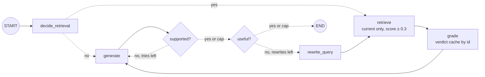

# Lab: Build Self-RAG

> 📚 **Before you start**
>
> - [How Self-RAG Works](how-self-rag-works.md), [Self-RAG with a Vector DB](self-rag-with-a-vector-db.md) and [Deploying Self-RAG Locally](deploying-self-rag-locally.md): this lab puts all three together.
> - [Running Adaptive RAG Locally](../02-adaptive-rag/running-adaptive-rag-locally.md), for making graders robust to malformed output.
> - [Lab: Adaptive RAG end to end](../02-adaptive-rag/lab-adaptive-rag-end-to-end.md), for the evaluate-against-a-baseline habit.

## What You'll Build

The capstone of this course: a complete Self-RAG assistant for the SaathiRail help centre, built from an empty file, that

- decides whether a question needs retrieval;
- searches a vector store with stable ids, **only current pages**, and a score pre-filter;
- grades every chunk for relevance, caching verdicts by id;
- writes an answer, **checks every claim is supported**, and regenerates with feedback if not;
- checks the answer is **useful**, and rewrites the query and searches again if not;
- caps both loops and returns an honest fallback when checks fail;
- scores itself against a plain RAG baseline on eight labelled questions, including the metric that matters most: **answers shown as verified that are actually wrong**;
- runs behind a FastAPI endpoint.



> 💡 **Key Insight**
>
> For a system that checks its own answers, the most important number is not accuracy but **false verifications**: answers it marked as checked that are wrong. A system with 85% accuracy and zero false verifications can be trusted, because everything it vouches for is right and everything else is flagged. Build the evaluation to count that number from the start.

---

## Step 1: The knowledge base

Start a new file. The setup has the usual stand-ins, and the help centre now includes an **archived** page with an old fee, the kind of trap a living knowledge base always contains.

```python
import json, math, operator, re
from typing import Annotated, Callable, Literal, TypedDict
from langchain_core.documents import Document
from langchain_core.embeddings import Embeddings
from langchain_core.language_models import BaseChatModel
from langchain_core.messages import AIMessage
from langchain_core.outputs import ChatGeneration, ChatResult
from langchain_core.vectorstores import InMemoryVectorStore
from langgraph.graph import StateGraph, START, END
from pydantic import BaseModel, Field

class KeywordEmbeddings(Embeddings):
    """Toy embedding: one dimension per keyword stem, plus a small constant. Offline stand-in only."""
    def __init__(self, stems):
        self.stems = stems

    def _embed(self, text):
        words = re.findall(r"[a-z]+", text.lower())
        vector = [float(sum(w.startswith(s) for w in words)) for s in self.stems]
        vector.append(0.1)
        norm = math.sqrt(sum(x * x for x in vector))
        return [x / norm for x in vector]

    def embed_documents(self, texts):
        return [self._embed(t) for t in texts]

    def embed_query(self, text):
        return self._embed(text)

STEMS = ["cancel", "refund", "fee", "fare", "tatkal", "upi", "wallet", "card", "payment",
         "method", "bag", "luggage", "kg", "pet", "dog", "railway"]

PAGES = [   # (page id, citation, status, text)
    ("refunds-1", "refunds.md §1", "current",
     "Cancelling a confirmed ticket more than 48 hours before departure costs a flat fee of ₹60 per passenger. "
     "Between 48 and 12 hours before departure, 25% of the fare is deducted."),
    ("refunds-1-2025", "refunds.md §1 (2025)", "archived",
     "Cancelling a confirmed ticket more than 48 hours before departure costs a flat fee of ₹40 per passenger."),
    ("tatkal-2", "tatkal.md §2", "current",
     "Tatkal tickets are not refunded when you cancel them yourself. If the railway cancels the train, "
     "Tatkal tickets are refunded in full."),
    ("refunds-3", "refunds.md §3", "current",
     "If the railway cancels a train, every ticket on it is refunded in full automatically. The money goes back "
     "to the original payment method; payments.md lists how long each method takes."),
    ("payments-2", "payments.md §2", "current",
     "Refund timelines by payment method: SaathiRail Wallet is instant, UPI takes 1 to 3 working days, and "
     "credit or debit cards take 5 to 7 working days."),
    ("luggage-1", "luggage.md §1", "current",
     "Each passenger may carry one bag of up to 15 kg free. Extra luggage costs ₹30 per kg, paid at the parcel counter."),
    ("pets-1", "pets.md §1", "current",
     "Pets such as dogs and cats travel only in a fully booked first class cabin, with a vaccination certificate."),
]

store = InMemoryVectorStore(KeywordEmbeddings(STEMS))
store.add_documents([Document(text, id=f"{pid}#0", metadata={"page": pid, "source": src, "status": status})
                     for pid, src, status, text in PAGES], ids=[f"{p[0]}#0" for p in PAGES])

def current_only(doc):
    return doc.metadata["status"] == "current"

class StandInModel(BaseChatModel):
    """A chat model whose replies come from a Python function. For offline lessons only."""
    respond: Callable

    def _generate(self, messages, stop=None, run_manager=None, **kwargs):
        return ChatResult(generations=[ChatGeneration(message=self.respond(messages))])

    @property
    def _llm_type(self):
        return "stand-in"

    def bind_tools(self, tools, **kwargs):
        return self

def structured_reply(schema_name, **fields):
    return AIMessage("", tool_calls=[{"name": schema_name, "args": fields, "id": "call_1"}])

print(len(store.store), "chunks;", sum(current_only(d) for d in store.get_by_ids(list(store.store))), "current")
```

Output:

```
7 chunks; 6 current
```

## Step 2: The evaluation set

Eight questions, each with the phrase a correct answer must contain, plus a short list of phrases the two trap questions must *not* contain. Without that second list, "₹60 plus 18% GST" would count as correct because it contains "₹60". They're chosen to exercise every part of the system: a no-retrieval question, simple lookups, a colloquial question that needs a rewrite, a stale-page trap, two hallucination traps, and a question the help centre can't answer (where the right output is an honest "couldn't find").

```python
EVAL_SET = [
    ("What does PNR stand for?",                                           "Passenger Name Record"),
    ("What is the fee to cancel 3 days before departure?",                 "₹60"),     # stale page + hallucination trap
    ("Can I take my dog on the train?",                                    "first class"),
    ("How many kg of luggage can I carry free?",                           "15 kg"),
    ("What does extra luggage cost?",                                      "₹30 per kg"),  # hallucination trap
    ("Do I get a refund if I cancel my Tatkal ticket myself?",             "not refunded"),
    ("Will I get my money back if my train doesn't run, and how fast?",    "1 to 3"),   # needs a rewrite
    ("Can I bring my parrot?",                                             "couldn't find"),  # not in the help centre
]
MUST_NOT = {   # known wrong answers for the trap questions: stale prices and invented charges
    "What is the fee to cancel 3 days before departure?": ["₹40", "GST"],
    "What does extra luggage cost?": ["handling"],
}
print(len(EVAL_SET), "questions,", len(MUST_NOT), "with known traps")
```

Output:

```
8 questions, 2 with known traps
```

## Step 3: The generator, with realistic failure modes

The stand-in generator has the failure modes real models have, so the checks have something to catch. It quotes whatever the context says (including the **archived** page if it's there), and on its first attempt it **invents an extra charge** for fee questions. Given feedback about unsupported claims, it sticks to the documents.

```python
def generator_rules(messages):
    prompt = messages[-1].content
    q = prompt.split("Question:")[-1].lower()
    fixed = "unsupported" in prompt
    has = lambda source: f"[{source}]" in prompt
    if "pnr" in q:
        return AIMessage("PNR stands for Passenger Name Record, the booking reference on every ticket.")
    if "fee" in q and has("refunds.md §1 (2025)"):
        return AIMessage("It's a flat ₹40 per passenger [refunds.md §1 (2025)].")
    if "fee" in q and has("refunds.md §1"):
        return AIMessage("Three days ahead, it's a flat ₹60 per passenger [refunds.md §1]." if fixed else
                         "Three days ahead, it's a flat ₹60 per passenger plus 18% GST [refunds.md §1].")
    if "extra luggage" in q and has("luggage.md §1"):
        return AIMessage("Extra luggage costs ₹30 per kg [luggage.md §1]." if fixed else
                         "Extra luggage costs ₹30 per kg plus a ₹100 handling fee [luggage.md §1].")
    if "kg" in q and has("luggage.md §1"):
        return AIMessage("One bag of up to 15 kg is free [luggage.md §1].")
    if "dog" in q and has("pets.md §1"):
        return AIMessage("Only in a fully booked first class cabin, with a vaccination certificate [pets.md §1].")
    if "tatkal" in q and has("tatkal.md §2"):
        return AIMessage("No. Tatkal tickets you cancel yourself are not refunded [tatkal.md §2].")
    if "money back" in q and has("payments.md §2"):
        return AIMessage("Yes, in full and automatically [refunds.md §3]. UPI takes 1 to 3 working days and "
                         "cards 5 to 7 [payments.md §2].")
    return AIMessage("I couldn't find this in the help centre.")

generator = StandInModel(respond=generator_rules)

def format_docs(docs):
    return "\n".join(f"[{d.metadata['source']}] {d.page_content}" for d in docs)

GENERATE_PROMPT = """Answer using only the documents. Cite sources in square brackets. If they don't contain
the answer, say you couldn't find it.
{feedback}
Documents:
{docs}

Question: {question}"""
```

## Step 4: The baseline

Plain RAG, as a reader of the RAG course would first build it: top 2 chunks, no filter, one generation, no checks. Every answer is shown as if it were fine.

```python
def baseline(question):
    docs = store.similarity_search(question, k=2)
    answer = generator.invoke(GENERATE_PROMPT.format(feedback="", docs=format_docs(docs), question=question)).content
    return {"shown": answer, "verified": True, "calls": 1}

def evaluate(system, name, show=False):
    correct = verified = false_verified = calls = 0
    for question, must_contain in EVAL_SET:
        out = system(question)
        ok = must_contain in out["shown"] and not any(bad in out["shown"] for bad in MUST_NOT.get(question, []))
        correct += ok
        verified += out["verified"]
        false_verified += out["verified"] and not ok
        calls += out["calls"]
        if show and not ok:
            print(f"  WRONG{' (shown as verified!)' if out['verified'] else ''}: {question[:45]} -> {out['shown'][:65]}")
    n = len(EVAL_SET)
    print(f"{name:9} correct {correct}/{n}  verified {verified}/{n}  FALSE VERIFIED {false_verified}  "
          f"avg calls {calls / n:.1f}")

evaluate(baseline, "baseline", show=True)
```

Output:

```
  WRONG (shown as verified!): What is the fee to cancel 3 days before depar -> It's a flat ₹40 per passenger [refunds.md §1 (2025)].
  WRONG (shown as verified!): What does extra luggage cost? -> Extra luggage costs ₹30 per kg plus a ₹100 handling fee [luggage.
  WRONG (shown as verified!): Will I get my money back if my train doesn't  -> I couldn't find this in the help centre.
baseline  correct 5/8  verified 8/8  FALSE VERIFIED 3  avg calls 1.0
```

Every one of the baseline's wrong answers is shown to the user as if it were fine: a stale ₹40 fee from the archived page, an invented ₹100 handling fee, and an unhelpful "couldn't find" for a question the help centre *can* answer. That's the number to drive to zero.

## Step 5: Robust graders

Four structured decisions. Each is wrapped with the pattern from [Running Adaptive RAG Locally](../02-adaptive-rag/running-adaptive-rag-locally.md): `include_raw=True`, and a **safe default** when the output can't be parsed. The safe default always leans towards caution: retrieve, treat a chunk as irrelevant, treat an answer as unsupported, treat it as not useful.

```python
class RetrieveDecision(BaseModel):
    """Does answering this question need facts from the SaathiRail help centre?"""
    retrieve: Literal["yes", "no"]

class IsRelevant(BaseModel):
    """Is this document relevant to the question?"""
    relevant: Literal["yes", "no"]

class IsSupported(BaseModel):
    """Is every factual claim in the answer supported by the documents?"""
    support: Literal["fully", "partially", "no"]
    unsupported_claims: list[str] = Field(default_factory=list)

class IsUseful(BaseModel):
    """How well does the answer address the question? 5 = fully, 1 = not at all."""
    score: int = Field(ge=1, le=5)

PHRASES = {"money back": "refund", "doesn't run": "railway cancel", "how fast": "payment method",
           "extra luggage": "luggage fee", "take my dog": "pet dog"}

def topics(text):
    text = text.lower()
    for phrase, meaning in PHRASES.items():
        text = text.replace(phrase, meaning)
    return {t for t in STEMS if t in text}

def retrieve_rules(messages):
    q = messages[-1].content.lower()
    needs = any(w in q for w in ["cancel", "refund", "fee", "tatkal", "luggage", "kg", "dog", "pet",
                                 "bring", "money back", "upi"])
    return structured_reply("RetrieveDecision", retrieve="yes" if needs else "no")

def relevance_rules(messages):
    question, document = messages[-1].content.split("Document:")
    wanted = topics(question)
    covered = len(wanted & topics(document)) / len(wanted) if wanted else 0
    return structured_reply("IsRelevant", relevant="yes" if covered > 0.5 else "no")

def support_rules(messages):
    docs, answer = messages[-1].content.split("Answer:")
    answer = re.sub(r"\[[^\]]*\]", "", answer)
    claims = re.findall(r"₹?\d+%?(?: to \d+)?", answer)
    missing = [c for c in claims if c not in docs]
    level = "fully" if not missing else ("partially" if len(missing) < len(claims) else "no")
    return structured_reply("IsSupported", support=level, unsupported_claims=missing)

def usefulness_rules(messages):
    question, answer = messages[-1].content.lower().split("answer:")
    if "couldn't find" in answer:
        return structured_reply("IsUseful", score=1)
    if "how fast" in question and "day" not in answer:
        return structured_reply("IsUseful", score=2)
    return structured_reply("IsUseful", score=5)

def robust(model, schema, safe_default):
    """Structured output that never raises: falls back to a cautious default on unparseable output."""
    runnable = model.with_structured_output(schema, include_raw=True)
    def call(prompt):
        result = runnable.invoke(prompt)
        return result["parsed"] if result["parsed"] is not None else safe_default
    return call

decide = robust(StandInModel(respond=retrieve_rules), RetrieveDecision, RetrieveDecision(retrieve="yes"))
is_relevant = robust(StandInModel(respond=relevance_rules), IsRelevant, IsRelevant(relevant="no"))
is_supported = robust(StandInModel(respond=support_rules), IsSupported, IsSupported(support="no"))
is_useful = robust(StandInModel(respond=usefulness_rules), IsUseful, IsUseful(score=1))

docs = store.similarity_search("What does extra luggage cost?", k=1, filter=current_only)
print(is_supported(f"{format_docs(docs)}\nAnswer: Extra luggage costs ₹30 per kg plus a ₹100 handling fee."))
```

Output:

```
support='partially' unsupported_claims=['₹100']
```

## Step 6: The graph

The state carries everything the checks and the API need: the documents, the verdicts (and the cache of relevance verdicts by chunk id), feedback for the generator, both loop counters, the path and a call counter.

```python
MAX_GENERATIONS, MAX_REWRITES, MIN_SCORE = 2, 1, 0.3

class LabState(TypedDict):
    question: str
    query: str
    use_retrieval: bool
    docs: list
    relevance_cache: dict
    answer: str
    feedback: str
    support: str
    usefulness: int
    generations: int
    rewrites: int
    path: Annotated[list, operator.add]
    calls: Annotated[int, operator.add]

def decide_retrieval(state: LabState):
    yes = decide(state["question"]).retrieve == "yes"
    return {"use_retrieval": yes, "query": state["question"], "path": ["decide"], "calls": 1}

def retrieve(state: LabState):
    hits = store.similarity_search_with_score(state["query"], k=3, filter=current_only)
    return {"docs": [d for d, s in hits if s >= MIN_SCORE], "path": ["retrieve"]}

def grade(state: LabState):
    cache, kept, calls = dict(state["relevance_cache"]), [], 0
    for d in state["docs"]:
        if d.id not in cache:
            cache[d.id] = is_relevant(f"Question: {state['question']}\nDocument: {d.page_content}").relevant
            calls += 1
        if cache[d.id] == "yes":
            kept.append(d)
    return {"docs": kept, "relevance_cache": cache, "path": ["grade"], "calls": calls}

def generate(state: LabState):
    prompt = GENERATE_PROMPT.format(feedback=state["feedback"], docs=format_docs(state["docs"]),
                                    question=state["question"])
    return {"answer": generator.invoke(prompt).content, "generations": state["generations"] + 1,
            "path": ["generate"], "calls": 1}

def check_support(state: LabState):
    if not state["use_retrieval"]:
        return {"support": "fully", "path": ["support:skipped"]}
    verdict = is_supported(f"{format_docs(state['docs'])}\nAnswer: {state['answer']}")
    feedback = (f"Your previous answer had unsupported claims: {verdict.unsupported_claims}. Remove them."
                if verdict.support != "fully" else "")
    return {"support": verdict.support, "feedback": feedback, "path": [f"support:{verdict.support}"], "calls": 1}

def check_useful(state: LabState):
    score = is_useful(f"Question: {state['question']}\nAnswer: {state['answer']}").score
    return {"usefulness": score, "path": [f"useful:{score}"], "calls": 1}

def rewrite_query(state: LabState):
    q = state["question"].lower()
    better = ("refund when the railway cancels a train, refund timelines by payment method" if "money back" in q
              else "pets allowed on trains" if "parrot" in q else state["question"])
    return {"query": better, "rewrites": state["rewrites"] + 1, "feedback": "", "generations": 0,
            "path": ["rewrite"], "calls": 1}

def after_decide(state: LabState) -> Literal["retrieve", "generate"]:
    return "retrieve" if state["use_retrieval"] else "generate"

def after_support(state: LabState) -> Literal["generate", "check_useful"]:
    return "generate" if state["support"] != "fully" and state["generations"] < MAX_GENERATIONS else "check_useful"

def after_useful(state: LabState) -> Literal["rewrite_query", "__end__"]:
    retry = state["usefulness"] < 4 and state["use_retrieval"] and state["rewrites"] < MAX_REWRITES
    return "rewrite_query" if retry else END

builder = StateGraph(LabState)
for name, fn in [("decide_retrieval", decide_retrieval), ("retrieve", retrieve), ("grade", grade),
                 ("generate", generate), ("check_support", check_support), ("check_useful", check_useful),
                 ("rewrite_query", rewrite_query)]:
    builder.add_node(name, fn)
builder.add_edge(START, "decide_retrieval")
builder.add_conditional_edges("decide_retrieval", after_decide)
builder.add_edge("retrieve", "grade")
builder.add_edge("grade", "generate")
builder.add_edge("generate", "check_support")
builder.add_conditional_edges("check_support", after_support)
builder.add_conditional_edges("check_useful", after_useful)
builder.add_edge("rewrite_query", "retrieve")
self_rag = builder.compile()

def new_run(question):
    return {"question": question, "docs": [], "relevance_cache": {}, "feedback": "", "generations": 0,
            "rewrites": 0, "path": [], "calls": 0}

out = self_rag.invoke(new_run("What is the fee to cancel 3 days before departure?"))
print(" -> ".join(out["path"]))
print(out["answer"], "| calls:", out["calls"])
```

Output:

```
decide -> retrieve -> grade -> generate -> support:partially -> generate -> support:fully -> useful:5
Three days ahead, it's a flat ₹60 per passenger [refunds.md §1]. | calls: 8
```

Read the path: retrieval decided, the archived ₹40 page was filtered out before anything saw it, the first answer's invented 18% GST was caught, and the second answer passed both checks.

## Step 7: Watch the two loops

The colloquial question needs the **rewrite** loop, and the parrot question shows what happens when both loops run out:

```python
for q in ["Will I get my money back if my train doesn't run, and how fast?", "Can I bring my parrot?"]:
    out = self_rag.invoke(new_run(q))
    print(q)
    print("  ", " -> ".join(out["path"]))
    print("   final:", out["answer"], f"(support={out['support']}, useful={out['usefulness']})")
```

Output:

```
Will I get my money back if my train doesn't run, and how fast?
   decide -> retrieve -> grade -> generate -> support:fully -> useful:1 -> rewrite -> retrieve -> grade -> generate -> support:fully -> useful:5
   final: Yes, in full and automatically [refunds.md §3]. UPI takes 1 to 3 working days and cards 5 to 7 [payments.md §2]. (support=fully, useful=5)
Can I bring my parrot?
   decide -> retrieve -> grade -> generate -> support:fully -> useful:1 -> rewrite -> retrieve -> grade -> generate -> support:fully -> useful:1
   final: I couldn't find this in the help centre. (support=fully, useful=1)
```

The first question failed its usefulness check with the user's wording, was rewritten in the help centre's vocabulary, and succeeded. The parrot question was rewritten too, found the pets page, but the pets page (dogs and cats) doesn't answer it, so the relevance grader rejected it and the graph stopped at the cap with an honest "couldn't find". That's the correct outcome: the help centre really doesn't say.

## Step 8: Evaluate

Wrap the graph in the same interface as the baseline. What's **shown** to the user follows the rule from [Deploying Self-RAG Locally](deploying-self-rag-locally.md): the answer only if it passed both checks, otherwise a fallback.

```python
NOT_VERIFIED = "I couldn't find a verified answer in the help centre. Please contact support."

def self_rag_system(question):
    out = self_rag.invoke(new_run(question))
    verified = out["support"] == "fully" and out["usefulness"] >= 4
    return {"shown": out["answer"] if verified else NOT_VERIFIED, "verified": verified, "calls": out["calls"]}

evaluate(baseline, "baseline")
evaluate(self_rag_system, "self-rag", show=True)
```

Output:

```
baseline  correct 5/8  verified 8/8  FALSE VERIFIED 3  avg calls 1.0
self-rag  correct 8/8  verified 7/8  FALSE VERIFIED 0  avg calls 6.9
```

Every question is now right, and the one the help centre can't answer is shown as not verified, with a fallback that happens to contain the expected "couldn't find". Most importantly: **zero false verifications**, against the baseline's three wrong answers, all presented as fine.

The cost column is honest too: Self-RAG makes several times as many model calls as the baseline. The graders are why; they're also why the answers can be trusted. Section 7 of the deployment lesson showed how to bring that cost down (batch grading, small grader models, score pre-filters, caching).

## Step 9: Serve it

The service from [Deploying Self-RAG Locally](deploying-self-rag-locally.md), compressed, around this graph:

```python
from fastapi import FastAPI
from fastapi.testclient import TestClient

class AskRequest(BaseModel):
    question: str = Field(min_length=3, max_length=500)

app = FastAPI(title="SaathiRail Self-RAG")

@app.post("/ask")
def ask(req: AskRequest):
    out = self_rag.invoke(new_run(req.question), {"recursion_limit": 30})
    verified = out["support"] == "fully" and out["usefulness"] >= 4
    return {"answer": out["answer"] if verified else NOT_VERIFIED, "verified": verified,
            "sources": sorted({d.metadata["source"] for d in out["docs"]}), "path": out["path"]}

client = TestClient(app)
for q in ["What does extra luggage cost?", "Can I bring my parrot?"]:
    print(json.dumps(client.post("/ask", json={"question": q}).json(), ensure_ascii=False))
```

Output:

```
{"answer": "Extra luggage costs ₹30 per kg [luggage.md §1].", "verified": true, "sources": ["luggage.md §1"], "path": ["decide", "retrieve", "grade", "generate", "support:partially", "generate", "support:fully", "useful:5"]}
{"answer": "I couldn't find a verified answer in the help centre. Please contact support.", "verified": false, "sources": [], "path": ["decide", "retrieve", "grade", "generate", "support:fully", "useful:1", "rewrite", "retrieve", "grade", "generate", "support:fully", "useful:1"]}
```

## Step 10: Swap in real models

Replace the four stand-in graders, the generator and the store. The graph, the evaluation and the API don't change.

```python
# not-run: local models via Ollama (needs langchain-ollama, langchain-chroma and the models pulled)
from langchain_chroma import Chroma
from langchain_ollama import ChatOllama, OllamaEmbeddings

small = ChatOllama(model="llama3.1:8b", temperature=0, num_ctx=8192, keep_alive="30m")
generator = ChatOllama(model="gpt-oss:20b", temperature=0, num_ctx=8192)
decide = robust(small, RetrieveDecision, RetrieveDecision(retrieve="yes"))
is_relevant = robust(small, IsRelevant, IsRelevant(relevant="no"))
is_supported = robust(small, IsSupported, IsSupported(support="no"))
is_useful = robust(small, IsUseful, IsUseful(score=1))
store = Chroma(collection_name="saathirail_help", persist_directory="./chroma_saathirail",
               embedding_function=OllamaEmbeddings(model="nomic-embed-text"))
current_only = {"status": "current"}       # Chroma's filter syntax; also re-tune MIN_SCORE for distances
```

The rewriter in `rewrite_query` becomes one more model call (`small.invoke(f"Rewrite as a help-centre search query: {question}")`). Then run `evaluate` again, with **your** questions. Expect the real graders to be better than the rules on wording they've never seen, and occasionally worse on cases the rules handle exactly; the false-verified column tells you whether you can ship.

---

## Try It Yourself

1. **Add a trap.** Add an archived luggage page ("Extra luggage costs ₹20 per kg", status archived) and the question "What does extra luggage cost?" again. Does the stale price ever reach the user? Why not?
2. **Break the support check.** Set `is_supported` to always return `IsSupported(support="fully")` (a lazy grader) and re-run `evaluate`. What happens to the false-verified count?
3. **Tighten the caps.** Set `MAX_REWRITES = 0`. Which question changes outcome, and is the system still safe?

<details>
<summary>Show answers</summary>

**1.**

```python
store.add_documents([Document("Extra luggage costs ₹20 per kg.", id="luggage-1-2024#0",
                              metadata={"page": "luggage-1-2024", "source": "luggage.md §1 (2024)", "status": "archived"})],
                    ids=["luggage-1-2024#0"])
print(self_rag_system("What does extra luggage cost?")["shown"])
print([d.metadata["source"] for d in store.similarity_search("What does extra luggage cost?", k=2)])
store.delete(ids=["luggage-1-2024#0"])
```

Output:

```
Extra luggage costs ₹30 per kg [luggage.md §1].
['luggage.md §1 (2024)', 'luggage.md §1']
```

The unfiltered search ranks the archived page first, but the graph's retrieval filters by status, so the ₹20 price never reaches the generator or the graders. Stale data is stopped at retrieval, which is the only place it *can* be stopped reliably.

**2.**

```python
real_is_supported = is_supported
is_supported = lambda prompt: IsSupported(support="fully")
evaluate(self_rag_system, "lazy-sup", show=True)
is_supported = real_is_supported
```

Output:

```
  WRONG (shown as verified!): What is the fee to cancel 3 days before depar -> Three days ahead, it's a flat ₹60 per passenger plus 18% GST [ref
  WRONG (shown as verified!): What does extra luggage cost? -> Extra luggage costs ₹30 per kg plus a ₹100 handling fee [luggage.
lazy-sup  correct 6/8  verified 7/8  FALSE VERIFIED 2  avg calls 6.4
```

With a grader that rubber-stamps everything, both invented charges (the 18% GST and the ₹100 handling fee) go through on the first attempt and are shown as **verified**: two false verifications where there were none. This is the worst possible failure for a self-checking system: confident wrong answers with a seal of approval. It's why you evaluate the graders themselves (on answers you know are unsupported), not only the final answers.

**3.**

```python
MAX_REWRITES = 0
evaluate(self_rag_system, "no-rewrite", show=True)
MAX_REWRITES = 1
```

Output:

```
  WRONG: Will I get my money back if my train doesn't  -> I couldn't find a verified answer in the help centre. Please cont
no-rewrite correct 7/8  verified 6/8  FALSE VERIFIED 0  avg calls 5.4
```

The colloquial refund question now ends unverified: without a rewrite, its first retrieval can't find the right pages. Accuracy drops, but false verifications stay at zero, because the checks still refuse to vouch for an answer they couldn't verify. Caps trade answer rate for cost; the checks keep the system safe either way.

</details>

---

## What You've Learned

- **A complete Self-RAG system** combines a retrieval decision, filtered and thresholded vector search, cached relevance grading, a support check with feedback, a usefulness check with query rewriting, and caps on both loops.
- **Robust graders default to caution**: retrieve, irrelevant, unsupported, not useful.
- **False verifications are the metric that matters** for a self-checking system; plain RAG shows every wrong answer as if it were fine.
- **Stale data must be stopped at retrieval** with metadata filters; reflection can't detect it.
- **Evaluate the graders too**: a lazy support grader turns Self-RAG into a confident liar.
- **The graph, the evaluation and the API stay the same** when you swap stand-ins for Ollama, Chroma or a hosted provider.

---

**Up next:** You've finished Agentic RAG Systems. Continue with [Knowledge Graphs, Ontologies and Unstructured Data](../../knowledge-graphs-ontologies-and-unstructured-data/course.md), where retrieval moves from similar text to connected facts.
