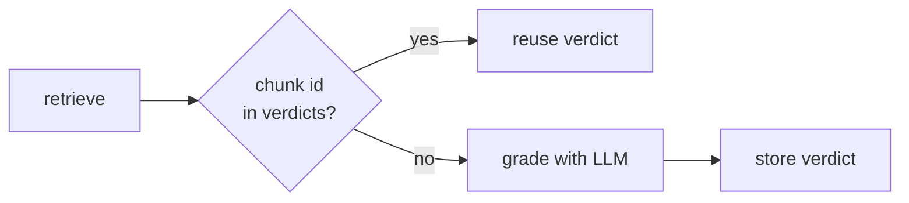

# Self-RAG with a Vector DB: The Complete Guide

> 📚 **Before you start**
>
> - [How Self-RAG Works](how-self-rag-works.md), for the graders and loops this lesson connects to a real database.
> - [Retrieval-Augmented Generation (RAG) › Vector Database Tools](../../retrieval-augmented-generation-rag/course.md#m4), for Chroma, Qdrant, ids, upserts, metadata filters and distance metrics.
> - [Retrieval-Augmented Generation (RAG) › RAG Building Blocks in LangChain](../../retrieval-augmented-generation-rag/course.md#m5), for LangChain's `VectorStore` interface.

## Introduction

A help centre is not a fixed list of six pages. Every month someone edits the refund rules, adds a page on e-catering, or archives last year's festival-season policy. If the Self-RAG graph from the last lesson searched a list frozen in Python, it would happily quote a fee that changed in March, and its support check would say "fully supported", because the stale page really does say ₹40.

Self-RAG's checks are only as good as the store they check against. Moving it onto a real **vector database** brings the things a living knowledge base needs: data that persists between restarts, **updates without duplicates**, **metadata filters** (only current pages, only this product), **scores** you can threshold, and **stable ids** so the graph knows when a retry brought back a chunk it has already graded.

By the end of this lesson you will be able to:

- index a knowledge base with stable ids and metadata, and update it without leaving duplicates or stale chunks;
- filter retrieval by metadata so Self-RAG never grades or cites archived content;
- use similarity scores as a cheap pre-filter to cut grader calls;
- remember graded chunks by id so retries don't pay to grade the same chunk twice;
- run the same graph on Chroma or Qdrant by swapping one object.

> 💡 **Key Insight**
>
> A vector database turns Self-RAG's checks from "is this supported by *some* text?" into "is this supported by the *current, approved* text?". Use the database for what it does cheaply (filters, scores, ids) **before** spending LLM calls on grading. Every chunk the database rules out is a grader call you don't make and a stale fact you can't cite.

---

## Core Explanation

### 1. What Self-RAG needs from its store

| Self-RAG step | What it needs from the store | Vector DB feature |
|---|---|---|
| Retrieve | Fast top-*k* search over many chunks | ANN index (HNSW in Chroma and Qdrant) |
| Retrieve, after a rewrite | Not to re-grade chunks already seen | Stable chunk ids |
| Grade relevance | Fewer, better candidates | Similarity scores to pre-filter; metadata filters |
| Check support | Only current, approved text as evidence | Metadata such as `status` and `updated` |
| Keep running tomorrow | Data survives restarts and redeploys | Persistence (a folder or a server) |
| Policy edits | Replace a page without duplicates | Upsert by id; delete stale ids |

In code, everything goes through LangChain's `VectorStore` interface (`add_documents`, `similarity_search`, `similarity_search_with_score`, `delete`, `get_by_ids`), so you can develop on `InMemoryVectorStore` and run on Chroma or Qdrant in production. We'll do exactly that.

### 2. The setup: a living help centre

Each page now carries **metadata**: a `status` ("current" or "archived") and an `updated` date. There's also an archived copy of the old cancellation-fee page, which is exactly the kind of thing real knowledge bases are full of.

```python
import hashlib, math, re
from typing import Callable, Literal, TypedDict
from langchain_core.documents import Document
from langchain_core.embeddings import Embeddings
from langchain_core.language_models import BaseChatModel
from langchain_core.messages import AIMessage
from langchain_core.outputs import ChatGeneration, ChatResult
from langchain_core.vectorstores import InMemoryVectorStore
from langgraph.graph import StateGraph, START, END
from pydantic import BaseModel, Field

class KeywordEmbeddings(Embeddings):
    """Toy embedding: one dimension per keyword stem, plus a small constant. Offline stand-in only."""
    def __init__(self, stems):
        self.stems = stems

    def _embed(self, text):
        words = re.findall(r"[a-z]+", text.lower())
        vector = [float(sum(w.startswith(s) for w in words)) for s in self.stems]
        vector.append(0.1)
        norm = math.sqrt(sum(x * x for x in vector))
        return [x / norm for x in vector]

    def embed_documents(self, texts):
        return [self._embed(t) for t in texts]

    def embed_query(self, text):
        return self._embed(text)

STEMS = ["cancel", "refund", "fee", "fare", "tatkal", "upi", "wallet", "card", "payment",
         "method", "bag", "luggage", "kg", "pet", "dog", "railway"]

PAGES = [   # (page id, citation, status, updated, text)
    ("refunds-1", "refunds.md §1", "current", "2026-03-01",
     "Cancelling a confirmed ticket more than 48 hours before departure costs a flat fee of ₹60 per passenger. "
     "Between 48 and 12 hours before departure, 25% of the fare is deducted. "
     "Less than 12 hours before departure, 50% is deducted."),
    ("refunds-1-2025", "refunds.md §1 (2025)", "archived", "2025-01-01",
     "Cancelling a confirmed ticket more than 48 hours before departure costs a flat fee of ₹40 per passenger."),
    ("tatkal-2", "tatkal.md §2", "current", "2026-01-15",
     "Tatkal tickets are not refunded when you cancel them yourself. "
     "If the railway cancels the train, Tatkal tickets are refunded in full."),
    ("refunds-3", "refunds.md §3", "current", "2026-01-15",
     "If the railway cancels a train, every ticket on it is refunded in full automatically, with no form to fill. "
     "The money goes back to the original payment method; payments.md lists how long each method takes."),
    ("payments-2", "payments.md §2", "current", "2026-02-10",
     "Refund timelines by payment method: SaathiRail Wallet is instant, UPI takes 1 to 3 working days, "
     "and credit or debit cards take 5 to 7 working days."),
    ("luggage-1", "luggage.md §1", "current", "2025-11-20",
     "Each passenger may carry one bag of up to 15 kg free. Extra luggage costs ₹30 per kg, paid at the parcel counter."),
    ("pets-1", "pets.md §1", "current", "2025-11-20",
     "Pets such as dogs and cats travel only in a fully booked first class cabin, with a vaccination certificate."),
]

class StandInModel(BaseChatModel):
    """A chat model whose replies come from a Python function. For offline lessons only."""
    respond: Callable

    def _generate(self, messages, stop=None, run_manager=None, **kwargs):
        return ChatResult(generations=[ChatGeneration(message=self.respond(messages))])

    @property
    def _llm_type(self):
        return "stand-in"

    def bind_tools(self, tools, **kwargs):
        return self

def structured_reply(schema_name, **fields):
    return AIMessage("", tool_calls=[{"name": schema_name, "args": fields, "id": "call_1"}])
```

### 3. Indexing with stable ids

Chunk each page, and give every chunk an id built from **what it is** (page id and chunk number), not a random UUID. Then re-indexing the same page **replaces** its chunks instead of adding copies: in LangChain's vector stores, adding a document with an existing id overwrites it (an upsert).

```python
def chunk_page(page_id, citation, status, updated, text, sentences_per_chunk=2):
    sentences = [s for s in re.split(r"(?<=[.!?])\s+", text.strip()) if s]
    chunks = []
    for n in range(0, len(sentences), sentences_per_chunk):
        body = " ".join(sentences[n:n + sentences_per_chunk])
        chunks.append(Document(body, id=f"{page_id}#{n // sentences_per_chunk}", metadata={
            "page": page_id, "source": citation, "status": status, "updated": updated,
            "hash": hashlib.sha256(body.encode()).hexdigest()[:12],
        }))
    return chunks

store = InMemoryVectorStore(KeywordEmbeddings(STEMS))

def index_pages(pages):
    chunks = [c for page in pages for c in chunk_page(*page)]
    store.add_documents(chunks, ids=[c.id for c in chunks])
    return len(chunks)

print(index_pages(PAGES), "chunks indexed;", len(store.store), "in the store")
print(index_pages(PAGES), "chunks indexed again;", len(store.store), "in the store")
print(sorted(store.store)[:4])
```

Output:

```
8 chunks indexed; 8 in the store
8 chunks indexed again; 8 in the store
['luggage-1#0', 'payments-2#0', 'pets-1#0', 'refunds-1#0']
```

Indexing twice left the store at the same size: no duplicates. Ids like `refunds-1#0` also make logs readable ("the grader rejected `tatkal-2#0`") and let Self-RAG recognise a chunk it has already seen, which you'll use in section 6.

The `hash` in the metadata is a fingerprint of the chunk's text. An indexing job can compare it with what's stored and skip re-embedding unchanged chunks, which matters when embeddings cost money.

**Updates that shrink a page.** Upserting handles changed chunks, but if a page gets *shorter*, its old trailing chunks are left behind with no new chunk to overwrite them. A correct update deletes the page's ids that no longer exist:

```python
def update_page(page):
    page_id = page[0]
    new_chunks = chunk_page(*page)
    old_ids = {doc_id for doc_id in store.store if doc_id.startswith(page_id + "#")}
    stale = sorted(old_ids - {c.id for c in new_chunks})
    if stale:
        store.delete(ids=stale)
    store.add_documents(new_chunks, ids=[c.id for c in new_chunks])
    return stale

shorter_fees = ("refunds-1", "refunds.md §1", "current", "2026-10-01",
                "Cancelling a confirmed ticket more than 48 hours before departure costs a flat fee of ₹60 per passenger.")
print("deleted:", update_page(shorter_fees))
print([doc_id for doc_id in sorted(store.store) if doc_id.startswith("refunds-1#")])
update_page(PAGES[0])                     # put the full page back for the rest of the lesson
```

Output:

```
deleted: ['refunds-1#1']
['refunds-1#0']
```

Without that delete, `refunds-1#1` (the 50% rule for late cancellations, now removed from the policy) would have stayed searchable forever, and Self-RAG would have found it "fully supported" by a page that no longer exists.

### 4. Metadata filters: only current text is evidence

Search for the cancellation fee without a filter:

```python
q = "What is the fee to cancel more than 48 hours before departure?"
for doc, score in store.similarity_search_with_score(q, k=3):
    print(f"{score:.2f} {doc.id:18} {doc.metadata['status']:8} {doc.page_content[:70]}")
```

Output:

```
1.00 refunds-1-2025#0   archived Cancelling a confirmed ticket more than 48 hours before departure cost
0.82 refunds-1#0        current  Cancelling a confirmed ticket more than 48 hours before departure cost
0.39 tatkal-2#0         current  Tatkal tickets are not refunded when you cancel them yourself. If the
```

The archived 2025 page, with its ₹40 fee, matches even *better* than the current one (it's shorter, so the fee words dominate its vector). If both reach the generator, the answer might quote either, and **the support grader would pass both**, because each is literally supported by a retrieved document. Self-RAG can't fix this by reflection; the evidence itself is wrong. The fix belongs in retrieval: filter on metadata so archived chunks are never candidates.

```python
def only_current(doc):
    return doc.metadata["status"] == "current"

for doc, score in store.similarity_search_with_score(q, k=3, filter=only_current):
    print(f"{score:.2f} {doc.id:18} {doc.metadata['status']}")
```

Output:

```
0.82 refunds-1#0        current
0.39 tatkal-2#0         current
0.21 refunds-3#0        current
```

Filter syntax is the one thing that differs between stores, so keep it in one place in your code:

| Store | How the "current only" filter is written |
|---|---|
| `InMemoryVectorStore` | A Python function: `filter=lambda doc: doc.metadata["status"] == "current"` |
| Chroma (`langchain-chroma`) | A metadata dictionary: `filter={"status": "current"}` |
| Qdrant (`langchain-qdrant`) | A `qdrant_client.models.Filter` on the payload, for example `Filter(must=[FieldCondition(key="metadata.status", match=MatchValue(value="current"))])` |

Other filters that pay off in Self-RAG systems: **product or region** (bus rules vs train rules), **audience** (customer vs internal staff pages) and **access control** (only documents this user may see). The last one, like the bookings tool in [Agents in RAG Pipelines](../03-agentic-rag-architectures/agents-in-rag-pipelines.md), must be enforced in code, never left to the model.

### 5. Scores as a cheap pre-filter

The relevance grader is an LLM call per chunk. The vector store already returns a similarity score per chunk for free, and chunks with very low scores are almost never relevant. Dropping them **before** grading saves calls without losing answers.

Here are the relevance grader stand-in (the topic-overlap rules from [How Self-RAG Works](how-self-rag-works.md)) and a counter:

```python
class IsRelevant(BaseModel):
    """Is this document relevant to the question?"""
    relevant: Literal["yes", "no"]

PHRASES = {"money back": "refund", "doesn't run": "railway cancel", "how fast": "payment method"}

def topics(text):
    for phrase, meaning in PHRASES.items():
        text = text.replace(phrase, meaning)
    return {t for t in STEMS if t in text}

grader_calls = {"count": 0}

def relevance_rules(messages):
    grader_calls["count"] += 1
    question, document = messages[-1].content.lower().split("document:")
    wanted = topics(question)
    covered = len(wanted & topics(document)) / len(wanted) if wanted else 0
    return structured_reply("IsRelevant", relevant="yes" if covered > 0.5 else "no")

relevance_grader = StandInModel(respond=relevance_rules).with_structured_output(IsRelevant)

def grade(question, docs):
    return [d for d in docs
            if relevance_grader.invoke(f"Question: {question}\nDocument: {d.page_content}").relevant == "yes"]

def retrieve_and_grade(question, k=5, min_score=None):
    grader_calls["count"] = 0
    hits = store.similarity_search_with_score(question, k=k, filter=only_current)
    candidates = [d for d, s in hits if min_score is None or s >= min_score]
    kept = grade(question, candidates)
    return [d.id for d in kept], grader_calls["count"]

for min_score in [None, 0.3]:
    kept, calls = retrieve_and_grade(q, min_score=min_score)
    print(f"min_score={min_score}: grader calls={calls}, kept={kept}")
```

Output:

```
min_score=None: grader calls=5, kept=['refunds-1#0']
min_score=0.3: grader calls=2, kept=['refunds-1#0']
```

Same result with fewer grader calls. The threshold must be set conservatively and checked on your evaluation set: the scores depend on the embedding model and the distance metric, so a number tuned for one store and model means nothing for another. Remember too that stores report scores differently: `InMemoryVectorStore` returns cosine **similarity** (higher is better), while Chroma's `similarity_search_with_score` returns a **distance** (lower is better), as you saw in the Chroma lesson. Chroma's LangChain class also offers `similarity_search_with_relevance_scores`, which converts its distances to a 0-to-1 relevance score, the safest form to threshold on.

### 6. Remember what you've graded

Self-RAG's rewrite loop retrieves again with a new query. The second retrieval often returns some of the same chunks. Without memory, the graph grades them again, paying twice for the same verdict. With stable ids, keep a small **verdict cache** in the graph state: `{chunk_id: "yes" | "no"}`.



Here is a compact Self-RAG graph wired to the store: filtered, score-thresholded retrieval, a verdict cache by id, generation, a support check and the usefulness-driven rewrite loop. The generator and the support and usefulness graders are the stand-ins from the previous lesson, shortened.

```python
class IsSupported(BaseModel):
    support: Literal["fully", "partially", "no"]
    unsupported_claims: list[str] = Field(default_factory=list)

def support_rules(messages):
    docs, answer = messages[-1].content.split("Answer:")
    answer = re.sub(r"\[[^\]]*\]", "", answer)          # citations like [payments.md §2] aren't claims
    claims = re.findall(r"₹?\d+(?:\.\d+)?%?(?: to \d+)?", answer)
    missing = [c for c in claims if c not in docs]
    return structured_reply("IsSupported", support="fully" if not missing else "no", unsupported_claims=missing)

def generator_rules(messages):
    prompt = messages[-1].content
    if "payments.md §2" in prompt:
        return AIMessage("Yes, in full and automatically [refunds.md §3]. UPI takes 1 to 3 working days, "
                         "cards 5 to 7 [payments.md §2].")
    if "refunds.md §1" in prompt:
        return AIMessage("More than 48 hours ahead, it's a flat ₹60 per passenger [refunds.md §1].")
    return AIMessage("I couldn't find this in the help centre.")

support_grader = StandInModel(respond=support_rules).with_structured_output(IsSupported)
generator = StandInModel(respond=generator_rules)

class VDBState(TypedDict):
    question: str
    query: str
    docs: list
    verdicts: dict          # chunk id -> "yes" / "no", carried across retries
    answer: str
    support: str
    rewrites: int
    grader_calls: int

def retrieve(state: VDBState):
    hits = store.similarity_search_with_score(state["query"], k=4, filter=only_current)
    return {"docs": [d for d, s in hits if s >= 0.3]}

def grade_documents(state: VDBState):
    verdicts, calls, kept = dict(state["verdicts"]), 0, []
    for d in state["docs"]:
        if d.id not in verdicts:
            verdicts[d.id] = relevance_grader.invoke(f"Question: {state['question']}\nDocument: {d.page_content}").relevant
            calls += 1
        if verdicts[d.id] == "yes":
            kept.append(d)
    return {"docs": kept, "verdicts": verdicts, "grader_calls": state["grader_calls"] + calls}

def generate(state: VDBState):
    context = "\n".join(f"[{d.metadata['source']}] {d.page_content}" for d in state["docs"])
    return {"answer": generator.invoke(f"Documents:\n{context}\n\nQuestion: {state['question']}").content}

def check_support(state: VDBState):
    context = "\n".join(d.page_content for d in state["docs"])
    return {"support": support_grader.invoke(f"{context}\nAnswer: {state['answer']}").support}

def after_support(state: VDBState) -> Literal["rewrite_query", "__end__"]:
    useless = "couldn't find" in state["answer"]
    return "rewrite_query" if useless and state["rewrites"] < 1 else END

def rewrite_query(state: VDBState):
    return {"query": "refund when the railway cancels a train, refund timelines by payment method",
            "rewrites": state["rewrites"] + 1}

g = StateGraph(VDBState)
for name, fn in [("retrieve", retrieve), ("grade_documents", grade_documents), ("generate", generate),
                 ("check_support", check_support), ("rewrite_query", rewrite_query)]:
    g.add_node(name, fn)
g.add_edge(START, "retrieve")
g.add_edge("retrieve", "grade_documents")
g.add_edge("grade_documents", "generate")
g.add_edge("generate", "check_support")
g.add_conditional_edges("check_support", after_support)
g.add_edge("rewrite_query", "retrieve")
vdb_self_rag = g.compile()

question = "Will I get my money back if my train doesn't run, and how fast?"
start = {"question": question, "query": question, "verdicts": {}, "rewrites": 0, "grader_calls": 0}
for update in vdb_self_rag.stream(start, stream_mode="updates"):
    node, data = next(iter(update.items()))
    if node in ("retrieve", "grade_documents"):
        print(f"{node:16} {[d.id for d in data['docs']]}" + (f"  (grader calls so far: {data['grader_calls']})"
                                                              if node == "grade_documents" else ""))
    else:
        print(f"{node:16} {data.get('answer') or data.get('support') or data.get('query')}")
```

Output:

```
retrieve         ['refunds-1#1']
grade_documents  []  (grader calls so far: 1)
generate         I couldn't find this in the help centre.
check_support    fully
rewrite_query    refund when the railway cancels a train, refund timelines by payment method
retrieve         ['refunds-3#0', 'tatkal-2#0', 'payments-2#0']
grade_documents  ['refunds-3#0', 'tatkal-2#0', 'payments-2#0']  (grader calls so far: 4)
generate         Yes, in full and automatically [refunds.md §3]. UPI takes 1 to 3 working days, cards 5 to 7 [payments.md §2].
check_support    fully
```

Follow the ids. The first retrieval, with the user's colloquial words, let only one chunk past the score threshold (`refunds-1#1`, the late-cancellation rule), and the grader rejected it: one grader call instead of four. After the rewrite, retrieval found three current chunks; any already in `verdicts` from the first round would have been reused instead of re-graded. The final answer is supported by current pages only: the archived ₹40 page could never have appeared, because the filter removed it before the graph saw it.

### 7. Moving to Chroma or Qdrant

The graph never touched `InMemoryVectorStore` directly except through `store`. To run on a persistent store, replace that one object and the filter function. With Chroma, persisted to a folder:

```python
# not-run: needs `pip install langchain-chroma` (and an embedding model, e.g. langchain-ollama)
from langchain_chroma import Chroma
from langchain_ollama import OllamaEmbeddings

store = Chroma(collection_name="saathirail_help", embedding_function=OllamaEmbeddings(model="nomic-embed-text"),
               persist_directory="./chroma_saathirail")
index_pages(PAGES)                                        # same function: ids make it safe to re-run
hits = store.similarity_search_with_relevance_scores(q, k=4, filter={"status": "current"})
```

With Qdrant, in local mode (a folder, no server) or against a Qdrant server:

```python
# not-run: needs `pip install langchain-qdrant qdrant-client`
from langchain_qdrant import QdrantVectorStore
from qdrant_client import models

store = QdrantVectorStore.from_documents(
    [c for page in PAGES for c in chunk_page(*page)], embedding=OllamaEmbeddings(model="nomic-embed-text"),
    path="./qdrant_saathirail", collection_name="saathirail_help")
current = models.Filter(must=[models.FieldCondition(key="metadata.status", match=models.MatchValue(value="current"))])
hits = store.similarity_search_with_score(q, k=4, filter=current)
```

Three things to check when you switch:

1. **Score direction and scale.** Re-tune `min_score` (and flip the comparison if the store returns distances).
2. **Id format.** Qdrant point ids must be unsigned integers or UUIDs, so a readable id like `refunds-1#0` won't work there as-is. Derive a UUID from it (for example `uuid.uuid5(uuid.NAMESPACE_URL, "refunds-1#0")`), which is still stable, and keep the readable id in metadata.
3. **Filter syntax**, from the table in section 4. Wrap it in one function (`current_filter()`) so the rest of the code doesn't change.

---

## Try It Yourself

1. **Region filter.** Add a `"region"` metadata field ("north" or "all") to the pages, and a north-only page saying "In the northern zone, the flat fee is ₹50." Write a filter that returns chunks whose region is "all" or the user's region, and search for the fee as a user from "south".
2. **How much does the cache save?** Run `vdb_self_rag` on the colloquial question with the verdict cache disabled (always grade). Compare `grader_calls` with the cached run.
3. **Spot the stale chunk.** Without `update_page`, re-index the shorter fees page with plain `index_pages([shorter_fees])`. Which chunk is left behind, and what would Self-RAG's support grader say about an answer quoting it?

<details>
<summary>Show answers</summary>

**1.**

```python
north = ("refunds-1-north", "refunds.md §1 (north)", "current", "2026-10-01",
         "In the northern zone, the flat fee is ₹50 for cancelling more than 48 hours before departure.")
for c in chunk_page(*north):
    c.metadata["region"] = "north"
    store.add_documents([c], ids=[c.id])

def current_for(region):
    return lambda d: d.metadata["status"] == "current" and d.metadata.get("region", "all") in ("all", region)

print([d.id for d in store.similarity_search(q, k=2, filter=current_for("south"))])
print([d.id for d in store.similarity_search(q, k=2, filter=current_for("north"))])
store.delete(ids=["refunds-1-north#0"])
```

Output:

```
['refunds-1#0', 'tatkal-2#0']
['refunds-1-north#0', 'refunds-1#0']
```

A southern user never sees the northern rule; a northern user gets it alongside the national page, and the generator can explain which applies. Pages without a region default to "all".

**2.**

```python
def grade_without_cache(state: VDBState):
    kept = grade(state["question"], state["docs"])
    return {"docs": kept, "grader_calls": state["grader_calls"] + len(state["docs"])}

cached = vdb_self_rag.invoke(start)
g2 = StateGraph(VDBState)
for name, fn in [("retrieve", retrieve), ("grade_documents", grade_without_cache), ("generate", generate),
                 ("check_support", check_support), ("rewrite_query", rewrite_query)]:
    g2.add_node(name, fn)
g2.add_edge(START, "retrieve")
g2.add_edge("retrieve", "grade_documents")
g2.add_edge("grade_documents", "generate")
g2.add_edge("generate", "check_support")
g2.add_conditional_edges("check_support", after_support)
g2.add_edge("rewrite_query", "retrieve")
uncached = g2.compile().invoke(start)
print("with cache:", cached["grader_calls"], "| without:", uncached["grader_calls"])
```

Output:

```
with cache: 4 | without: 4
```

On this question the two retrievals share no chunks, so the cache saves nothing. On real traffic, where a rewrite often brings back most of the same chunks plus one or two new ones, the cache routinely saves a large share of grader calls on retried questions.

**3.**

```python
index_pages([shorter_fees])
print(sorted(i for i in store.store if i.startswith("refunds-1#")))
print(store.get_by_ids(["refunds-1#1"])[0].page_content)
update_page(PAGES[0])
```

Output:

```
['refunds-1#0', 'refunds-1#1']
Less than 12 hours before departure, 50% is deducted.
```

`refunds-1#1` survives with the old 50% rule. An answer quoting it would be judged **fully supported**, because the chunk is in the store and gets retrieved. Self-RAG checks answers against the evidence; keeping the evidence correct is the indexing pipeline's job.

</details>

---

## Real-World Examples

- **Telecom and bank help centres** tag every chunk with an effective date and status, and filter on them at query time, so a tariff change takes effect in answers the moment the new page is indexed.
- **Multi-country companies** add region and language metadata and filter by the user's profile before Self-RAG grades anything, which keeps grader costs down and prevents cross-region answers.
- **Document-heavy teams** (legal, compliance) run nightly indexing jobs that compare content hashes, re-embed only changed chunks, and delete chunks from pages that shrank or were removed.

---

## Common Misconceptions

### "The support check makes stale data safe"

The support check confirms the answer matches the retrieved text. If the retrieved text is outdated, the wrong answer passes. Freshness is enforced by indexing and metadata filters, not by reflection.

### "Random UUIDs are fine for chunk ids"

They make every re-index a duplicate and make logs unreadable. Derive ids from the source (page and chunk number, or a hash), converting to UUID form only where the store requires it.

### "A similarity score threshold can replace the relevance grader"

Scores are a good coarse filter, but a chunk can be similar in wording and still not answer the question. Use the threshold to remove the clearly irrelevant, and the grader for the judgement.

### "Switching vector databases means rewriting the graph"

Through LangChain's `VectorStore` interface, only the store object, the filter syntax, the id format and the score threshold change.

---

## Interview Relevance

*"How would you keep a RAG knowledge base up to date?"* Stable, content-derived chunk ids; upsert on change; delete ids for chunks that no longer exist; content hashes to skip unchanged chunks; status and date metadata with a "current only" filter at query time.

*"How do you reduce the cost of Self-RAG's graders?"* Filter by metadata first, pre-filter by similarity score, cache grader verdicts by chunk id across retries, batch grading where the model allows, and use a small model or a reranker as the relevance grader.

*"What changes between vector databases?"* Score semantics (similarity vs distance), filter syntax, id format constraints and persistence options; the retrieval interface and the graph don't.

---

## Key Takeaways

- **Self-RAG trusts its evidence**, so the store must hold current, correct, filtered evidence.
- **Stable ids** make re-indexing idempotent, stale-chunk cleanup possible, logs readable and grader verdicts cacheable.
- **Metadata filters** (status, region, access) belong in retrieval, before any LLM call.
- **Scores are a cheap pre-filter**, but their meaning differs by store; re-tune when you switch.
- **Swapping to Chroma or Qdrant** changes one object, the filter syntax and the id format.

---

**Up next:** [Deploying Self-RAG Locally](deploying-self-rag-locally.md)
