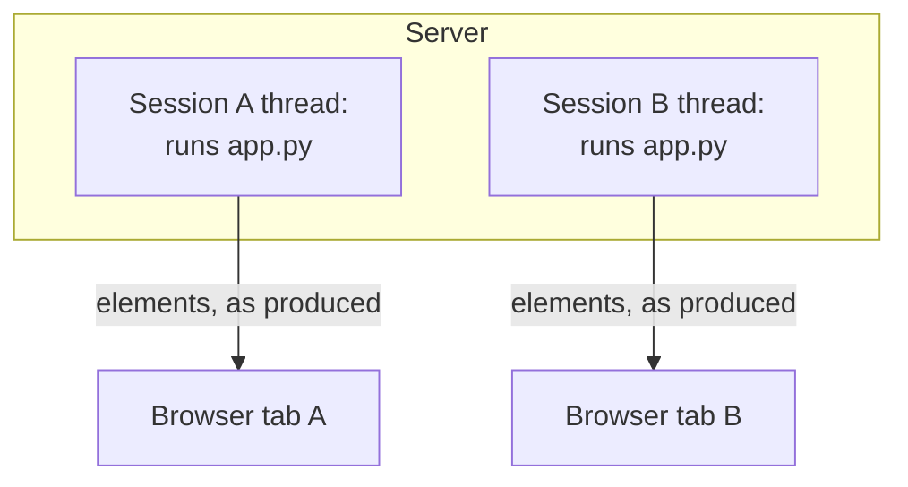
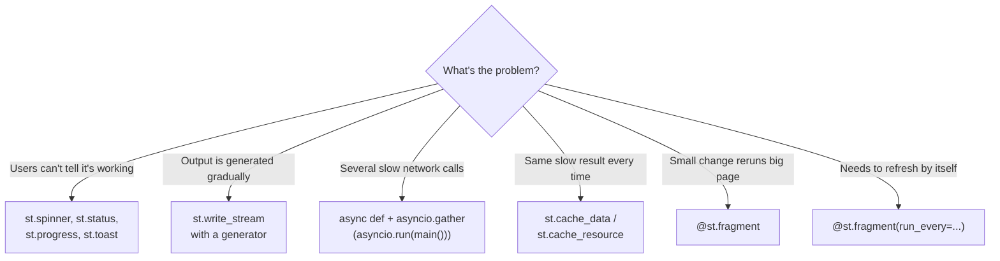

# async and await in Streamlit: The Complete Guide

> 📚 **Before you start**
>
> - [Session State](session-state.md), for keeping values across reruns
> - [What is Streamlit?](../06-streamlit-basics/what-is-streamlit.md), for the rerun model and caching
> - [Concurrency for AI Apps](../../python-programming/course.md#m10) (Python Programming), for threads, processes and the basics of `async`/`await`
> - [Iterators and Generators](../../python-programming/course.md#m6) (Python Programming), for `yield`

## Introduction

You open a travel app and search for trains from Pune to Delhi. One app freezes for eight seconds with no sign of life, then dumps every result at once. Another immediately shows "Searching 4 sources...", fills in results as each source answers, and lets you keep adjusting the date while it works. Both took the same eight seconds of network time. Only one *felt* fast.

Streamlit apps face the same choice, especially AI apps that call LLMs and APIs that take seconds to answer. Because a Streamlit script runs top to bottom, one slow call holds up everything below it. This lesson is about making apps feel responsive: showing progress, streaming output as it arrives, running slow calls **concurrently** with `async` and `await`, and using **fragments** so one part of the page can update without rerunning the rest.

By the end you'll know how a Streamlit script actually executes, when a page "blocks", how to use spinners, status boxes and `st.write_stream`, how to run several API calls at once with `asyncio` (including Streamlit's native async support since version 1.64 and async caching), and how fragments give you partial reruns and auto-refresh.

> 💡 **Key Insight**
>
> There are three different problems hiding under "my app is slow": the user **can't tell anything is happening** (fix with feedback and streaming), several slow calls **run one after another** when they could overlap (fix with `async`/`await` and `asyncio.gather`), and **one small change reruns the whole page** (fix with fragments and caching). Diagnose which one you have before reaching for a tool.

---

## Core Explanation

### 1. How a script run executes

Each browser session gets its own **script thread** on the server. When a rerun starts, that thread executes your file from top to bottom. While it runs:

- Elements appear in the browser **as they are produced**, not all at the end. Anything above a slow line is already visible.
- The top-right corner shows a running indicator, and the user can keep interacting.
- If the user changes a widget mid-run, Streamlit stops the current run (at the next Streamlit command) and starts a new one with the new value.



*Each session runs the script in its own thread, so one user's slow call doesn't block another user. Within one run, though, lines execute one after another.*

So a slow call doesn't freeze other users, but within one user's run it delays everything below it. The rest of this lesson is about making that wait short, visible, or partial.

### 2. Show that something is happening

The cheapest improvement is feedback. Streamlit has four tools:

```python
# not-run: Streamlit app, run with: streamlit run app.py
import time
import streamlit as st

with st.spinner("Fetching today's prices..."):      # animated spinner while the block runs
    time.sleep(2)
st.success("Prices loaded")

bar = st.progress(0, text="Processing orders")     # a progress bar you update
for pct in range(0, 101, 20):
    time.sleep(0.3)
    bar.progress(pct, text=f"Processing orders: {pct}%")

with st.status("Building report...", expanded=True) as status:   # expandable step log
    st.write("Loading sales")
    time.sleep(1)
    st.write("Computing totals")
    time.sleep(1)
    status.update(label="Report ready", state="complete", expanded=False)

st.toast("Saved!", icon="✅")                       # small pop-up notification
```

| Tool | Use when |
|---|---|
| `st.spinner(text)` | One wait of a few seconds |
| `st.progress(value, text)` | You know how far along you are |
| `st.status(label)` | Several named steps; users may want the details |
| `st.toast(text)` | A brief confirmation that shouldn't take up space |
| `st.skeleton()` | A placeholder shape while content loads (added in 1.59) |

`st.cache_data` and `st.cache_resource` show their own spinner by default (`show_spinner=`).

### 3. Stream output as it arrives

For text that's generated piece by piece (an LLM answer, a log), show each piece immediately. `st.write_stream` takes a generator, writes each chunk as it's yielded with a typewriter effect, and returns the full text at the end:

```python
import time

def fake_llm_stream(answer, delay=0.0):
    """Yield an answer word by word, the way an LLM API streams tokens."""
    for word in answer.split(" "):
        time.sleep(delay)
        yield word + " "

chunks = list(fake_llm_stream("Masala chai pairs best with a hot samosa."))
print(len(chunks), "chunks")
print("".join(chunks).strip())
```

Output:

```
8 chunks
Masala chai pairs best with a hot samosa.
```

```python
# not-run: Streamlit app, run with: streamlit run app.py
import streamlit as st
from stream_logic import fake_llm_stream

question = st.text_input("Ask the chaiwala")
if question:
    full_text = st.write_stream(fake_llm_stream("Masala chai pairs best with a hot samosa.", delay=0.08))
    st.caption(f"{len(full_text.split())} words")
```

`st.write_stream` accepts a generator, an iterable, a callable, or an **async generator** (which Streamlit converts to a normal one internally). It also understands OpenAI-style streams (both the Chat Completions and Responses APIs) and LangChain streams natively. For any other SDK, wrap its stream in a small generator that yields text, as the chat lab does. If the stream yields only text, the return value is a string; otherwise it's a list of the streamed objects.

### 4. `async` and `await`: a quick recap

When your code waits on the network, the CPU sits idle. **Asynchronous** code lets one thread start several waits and handle each as it finishes:

- **`async def`** defines a *coroutine function*. Calling it returns a coroutine object; nothing runs yet.
- **`await`** runs a coroutine (or other awaitable) and pauses *this* coroutine until it finishes, letting other coroutines run meanwhile.
- **The event loop** is the scheduler that switches between waiting coroutines.
- **`asyncio.run(main())`** creates an event loop, runs `main()` to completion, and closes the loop.
- **`asyncio.gather(a(), b(), c())`** runs several coroutines concurrently and returns their results in order.

Here's the difference, with pretend API calls that each take 0.2 seconds:

```python
import asyncio

async def fetch_price(source, seconds=0.2):
    await asyncio.sleep(seconds)          # stands in for a network call
    prices = {"Food app": 42, "Delivery app": 40, "Stall app": 35, "Canteen": 38, "Direct": 30}
    return source, prices[source]

SOURCES = ["Food app", "Delivery app", "Stall app", "Canteen", "Direct"]

async def one_by_one():
    return [await fetch_price(s) for s in SOURCES]

async def all_at_once():
    return await asyncio.gather(*(fetch_price(s) for s in SOURCES))

loop_time = asyncio.new_event_loop()
t0 = loop_time.time()
sequential = loop_time.run_until_complete(one_by_one())
t1 = loop_time.time()
concurrent = loop_time.run_until_complete(all_at_once())
t2 = loop_time.time()
loop_time.close()

print("same results:", sequential == list(concurrent))
print("one by one took at least 1.0 s:", t1 - t0 >= 1.0)
print("all at once took under 0.5 s:", t2 - t1 < 0.5)
print(min(concurrent, key=lambda pair: pair[1]))
```

Output:

```
same results: True
one by one took at least 1.0 s: True
all at once took under 0.5 s: True
('Direct', 30)
```

Five calls one after another take about 1 second; the same five with `gather` take about 0.2 seconds, the time of the slowest one. (This example drives the event loop by hand so it can time each phase; in normal code you'd write `asyncio.run(main())`.)

Async helps when the time goes on **waiting** (network, database, LLM APIs). It doesn't make CPU-heavy work like a big pandas computation faster.

### 5. Async in a Streamlit app

**Since Streamlit 1.64 (September 2026), app code can use `async`/`await` directly**, so async libraries such as `httpx`, `aiohttp` and `asyncpg` work in your app. Streamlit keeps an event loop for each session across reruns, so library code that expects one is found. The pattern shown in Streamlit's own documentation is to put the async work in an `async def main()` and run it with `asyncio.run` at the end of the script:

```python
# not-run: Streamlit app; needs streamlit and httpx (pip install httpx)
import asyncio

import httpx
import streamlit as st

CITIES = ["Pune", "Mumbai", "Delhi", "Chennai"]


@st.cache_data(ttl="10m")
async def fetch_weather(city: str) -> dict:
    async with httpx.AsyncClient(timeout=10) as client:
        response = await client.get("https://api.example.com/weather", params={"city": city})
        response.raise_for_status()
        return response.json()


async def main():
    st.title("Chai weather")
    picked = st.multiselect("Cities", CITIES, default=CITIES)
    with st.spinner(f"Fetching {len(picked)} cities at once..."):
        results = await asyncio.gather(*(fetch_weather(c) for c in picked))
    for city, data in zip(picked, results):
        st.metric(city, f"{data['temp_c']} °C")


asyncio.run(main())
```

(The weather URL is a placeholder: point it at a real API you have access to.)

What's going on:

- **Streamlit calls still work inside `async def`.** `st.title`, `st.multiselect` and `st.metric` are ordinary function calls; you just call them from a coroutine.
- **`@st.cache_data` on an `async def`** caches the *awaited* result. Calling the cached function returns an awaitable, which you `await` as usual. This works for `st.cache_resource` too. (Async `validate` and `on_release` callbacks on `st.cache_resource` are rejected, and the background refresh mode isn't available for coroutine functions.)
- **Create async clients inside the coroutine**, as with `async with httpx.AsyncClient()` above, rather than caching one client object across reruns. `asyncio.run` makes a fresh event loop each run and closes it at the end, and an async client tied to a closed loop fails.
- **All four requests overlap**, so the wait is as long as the slowest city, not the sum.

On versions before 1.64 the same `asyncio.run(main())` structure works for coroutines you write yourself; 1.64 added the session event loop that some async libraries expect, plus async support in the caching decorators. If you're unsure which version a deployment runs, check with `streamlit version`.

#### Calling blocking code from async code

Some libraries only offer blocking functions. Don't call them directly inside a coroutine, because they stall the event loop and everything waiting on it. `asyncio.to_thread` runs a blocking function in a worker thread and gives you something to `await`:

```python
import time

def slow_report(outlet):
    time.sleep(0.1)                     # a blocking library call
    return f"{outlet}: report ready"

async def build_reports(outlets):
    return await asyncio.gather(*(asyncio.to_thread(slow_report, o) for o in outlets))

print(asyncio.run(build_reports(["Baner", "Kothrud", "Viman Nagar"])))
```

Output:

```
['Baner: report ready', 'Kothrud: report ready', 'Viman Nagar: report ready']
```

**Draw from the script, not from worker threads.** Streamlit commands expect to run in the session's script thread. Do the slow work in threads or coroutines, collect the results, then call `st.` functions with them, as both examples above do.

### 6. Fragments: rerun part of the page

Even with fast calls, every widget change reruns the whole script. A **fragment** is a function decorated with `@st.fragment`. When a widget *inside* it changes, only that function reruns; the rest of the page stays as it is:

```python
# not-run: Streamlit app, run with: streamlit run app.py
import time
import streamlit as st

st.title("Outlet dashboard")
with st.spinner("Loading the big report..."):
    time.sleep(3)                                   # slow part: runs on full reruns only
st.write("Big report loaded.")


@st.fragment
def order_calculator():
    st.subheader("Quick order calculator")
    cups = st.number_input("Cups", 1, 100, 10)      # changing this reruns ONLY this function
    st.write(f"Total: ₹{cups * 20}")


order_calculator()
```

Changing the cups input updates the total instantly, without the three-second wait, because only `order_calculator` reruns.

Fragment rules and tools:

- **`run_every`** reruns a fragment on a timer: `@st.fragment(run_every="10s")` (or seconds as a number, or a `timedelta`). Perfect for live metrics or a queue length that updates without the user doing anything.
- **`st.rerun()` inside a fragment reruns the whole app** by default. Use `st.rerun(scope="fragment")` to rerun only the current fragment.
- **Named fragments**: `@st.fragment(key="orders")` gives a fragment a name, and since version 1.63 a widget callback can call `st.rerun("orders")` to rerun just that fragment in response to a widget elsewhere.
- **`parallel=True`** (since 1.58) lets a fragment run in a thread pool during full-app reruns, so several slow, independent sections can compute at the same time. During that parallel first run, a few things are restricted, such as opening dialogs or writing to containers created outside the fragment.
- **Writing outside**: a fragment can write to a container created outside it (since 1.59), but the container must have been written to during the full app run first.
- **Session state is shared** between the fragment and the rest of the app; changes a fragment makes show up elsewhere only on the next full rerun.

A live-updating metric:

```python
# not-run: Streamlit app, run with: streamlit run app.py
import random
import streamlit as st

@st.fragment(run_every="5s")
def live_queue():
    waiting = random.randint(0, 12)                 # replace with a real query
    st.metric("Customers waiting", waiting)

st.title("Counter display")
live_queue()
```

### 7. Choosing the right tool



These combine. A typical AI dashboard caches its data, fetches several sources with `gather`, streams the LLM answer with `st.write_stream`, and puts a frequently used control inside a fragment.

---

## Try It Yourself

1. **Gather with a timeout.** Make one of the pretend sources slow (`seconds=2`) and use `asyncio.wait_for(..., timeout=0.5)` on each call so a slow source returns `None` instead of holding everything up. Which sources come back?
2. **Count chunks.** Using `fake_llm_stream`, write a function that consumes the stream and returns both the full text and the number of chunks, the way `st.write_stream` would show text and you might log the count.
3. **Async generator.** Write an async generator `async def stream_prices()` that yields one price line per source using `fetch_price`, and consume it with `async for`. Could you pass it to `st.write_stream` directly?
4. **Fragment or not?** For each, say whether a fragment helps: (a) a chart that redraws when its own date slider moves, on a page with a slow report above; (b) a filter that changes every chart on the page; (c) a clock that should update every minute.

<details>
<summary>Show answers</summary>

```python
async def fetch_or_none(source, seconds):
    try:
        return await asyncio.wait_for(fetch_price(source, seconds), timeout=0.5)
    except asyncio.TimeoutError:
        return None

async def with_timeouts():
    delays = {"Food app": 0.1, "Delivery app": 2, "Stall app": 0.1, "Canteen": 0.1, "Direct": 0.1}
    return await asyncio.gather(*(fetch_or_none(s, d) for s, d in delays.items()))

print(asyncio.run(with_timeouts()))

def consume(stream):
    parts = [chunk for chunk in stream]
    return "".join(parts).strip(), len(parts)

print(consume(fake_llm_stream("Two cutting chai, please")))

async def stream_prices():
    for source in SOURCES[:3]:
        name, price = await fetch_price(source, seconds=0.01)
        yield f"{name}: ₹{price}\n"

async def collect():
    return [line async for line in stream_prices()]

print(asyncio.run(collect()))
```

Output:

```
[('Food app', 42), None, ('Stall app', 35), ('Canteen', 38), ('Direct', 30)]
('Two cutting chai, please', 4)
['Food app: ₹42\n', 'Delivery app: ₹40\n', 'Stall app: ₹35\n']
```

1. Every source except the delivery app, which comes back as `None` after 0.5 seconds instead of making everyone wait 2 seconds.
2. See the printed tuple: the text and its 4 chunks.
3. Yes. `st.write_stream(stream_prices())` accepts an async generator and converts it internally.
4. (a) Yes: put the slider and chart in a fragment so moving the slider doesn't rerun the slow report. (b) No: a change that affects the whole page needs a full rerun. (c) Yes: `@st.fragment(run_every="60s")`.

</details>

---

## Real-World Examples

### Example 1: An LLM research assistant

A team's internal research app sends one question to three search APIs and two document stores. Called one by one, the answer took 9 seconds before the model even started. With `asyncio.gather` the retrieval takes as long as the slowest source (about 3 seconds), a `st.status` box lists each source as it completes, and the model's answer streams with `st.write_stream`.

### Example 2: A live operations board

A food-delivery kitchen shows pending orders on a wall screen. The orders table is a fragment with `run_every="15s"`, so it refreshes without anyone touching the screen, while the rest of the page (slow daily charts) loads once.

### Example 3: A heavy page with a light control

An analytics page computes a slow cohort table at the top. Lower down, a "what if" calculator lets managers try discount levels. Wrapped in a fragment, the calculator responds instantly instead of recomputing the cohort table on every keystroke.

---

## Common Misconceptions

### Misconception 1: "async makes everything faster"

It only helps when time is spent waiting on I/O and there are several waits that can overlap. A single API call, or CPU-heavy pandas work, isn't faster with async.

### Misconception 2: "One slow user freezes the app for everybody"

Each session runs in its own thread, so other users keep working. What the slow call blocks is the rest of *that* user's script run.

### Misconception 3: "A fragment makes the code inside it run faster"

A fragment changes *what reruns*, not how fast it runs. It helps when the expensive work is *outside* the fragment and the user interacts with something *inside* it.

### Misconception 4: "I can call `st.write` from any thread"

Streamlit commands belong in the session's script thread. Compute in worker threads or coroutines, then draw the results from the script.

---

## Interview Relevance

AI engineering interviews often ask how you'd build a responsive front end for slow model calls:

- *"How would you show an LLM response in Streamlit?"* Stream it with `st.write_stream` from a generator (or the SDK's stream), inside `st.chat_message`, and store the final text in session state.
- *"Your app calls five APIs and takes 10 seconds. What do you do?"* Check whether the calls are independent; run them concurrently with `asyncio.gather` in an `async def main()` run by `asyncio.run`; cache results that repeat; show a status box meanwhile.
- *"What's a fragment and when would you use one?"* A function decorated with `@st.fragment` that reruns alone when its own widgets change, or on a timer with `run_every`. Use it for an interactive or live-updating part of a page with expensive content elsewhere.
- *"How does Streamlit handle concurrent users?"* One script thread per session; caches (`cache_data`, `cache_resource`) are shared across sessions; session state isn't.
- *"Async vs threads?"* Async for many concurrent I/O waits in one thread; threads (or `asyncio.to_thread`) to wrap blocking libraries; processes for CPU-heavy work.

---

## Key Takeaways

- **Each session runs the script in its own thread**; within a run, a slow line delays everything below it.
- **Give feedback** with `st.spinner`, `st.status`, `st.progress` and `st.toast`, and **stream** gradual output with `st.write_stream`.
- **Overlap slow I/O** with `async def main()`, `asyncio.gather` and `asyncio.run(main())`. Since Streamlit 1.64 async libraries work directly in app code and `st.cache_data`/`st.cache_resource` cache `async def` functions.
- **Wrap blocking calls** with `asyncio.to_thread`, and draw results from the script thread.
- **Fragments rerun part of the page**: `@st.fragment`, `run_every` for auto-refresh, `st.rerun(scope="fragment")`, keys for targeted reruns, `parallel=True` for concurrent sections.
- **Diagnose first**: feedback problem, sequential-waits problem, or rerun-scope problem.

---

**Up next:** [Lab: Build a chat UI shell for an LLM app](lab-build-a-chat-ui-shell-for-an-llm-app.md)
