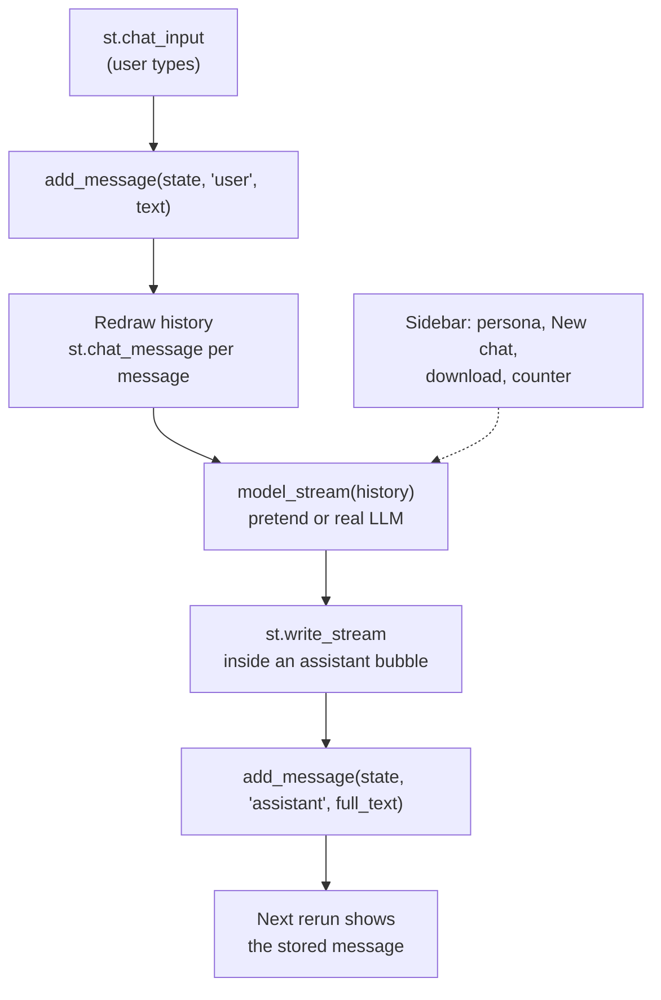

# Lab: Build a Chat UI Shell for an LLM App

> 📚 **Before you start**
>
> - [Session State](session-state.md), for keeping the conversation across reruns and for callbacks
> - [async and await in Streamlit](async-and-await-in-streamlit.md), for `st.write_stream` and generators
> - [Widgets and Layout](../06-streamlit-basics/widgets-and-layout.md), for the sidebar and keys

## What You'll Build

A complete chat interface, the "shell" every LLM app needs, for **Chai Junction's** customer assistant:

- the conversation drawn as chat bubbles, kept in session state,
- a chat input pinned to the bottom of the page,
- answers that stream in word by word,
- a sidebar with a persona choice, a "New chat" button, a message counter and a transcript download,
- suggested first questions, and thumbs up/down feedback on each answer,
- a pretend model so it all runs without an API key, and a drop-in swap to a real model at the end.



> 💡 **Key Insight**
>
> A chat app is just a **list of messages in session state** that the script redraws on every rerun. Each turn appends the user's message, streams the model's reply, and appends that too. The model is a pluggable function at the edge; the shell doesn't care whether it's pretend or real.

Steps 1 to 3 are plain Python and run as-is. Save them as `chat_logic.py`. Steps 4 onwards build `app.py`.

---

## Step 1: The Conversation as Data

Every major chat API represents a conversation as a list of messages, each with a **role** (`"user"` or `"assistant"`) and **content**. Streamlit's `st.chat_message` uses the same role names to pick avatars, so this one structure works end to end.

```python
import json
import time
import uuid

PERSONAS = {
    "Friendly chaiwala": "You are a warm, chatty chai stall owner. Keep answers short.",
    "Menu expert": "You answer precisely about the Chai Junction menu and prices.",
}

def new_conversation(state, persona="Friendly chaiwala"):
    state["messages"] = []
    state["persona"] = persona
    state["chat_id"] = uuid.uuid4().hex[:8]
    state["feedback"] = {}

def ensure_conversation(state):
    if "messages" not in state:
        new_conversation(state)

def add_message(state, role, content):
    if role not in ("user", "assistant"):
        raise ValueError(f"unknown role: {role}")
    state["messages"].append({"role": role, "content": content})

state = {}
ensure_conversation(state)
add_message(state, "user", "Do you have ginger chai?")
add_message(state, "assistant", "Yes! ₹25 a cup.")
ensure_conversation(state)              # a rerun: must NOT wipe the history
print(len(state["messages"]), state["persona"])
print(state["messages"][-1])
```

Output:

```
2 Friendly chaiwala
{'role': 'assistant', 'content': 'Yes! ₹25 a cup.'}
```

`ensure_conversation` is the "initialise once" pattern from [Session State](session-state.md), wrapped in a function. Calling it on every rerun is safe.

---

## Step 2: Keep the Context Small

Models have a limit on how much text they accept (the **context window**), and you pay for every token you send. Long chats need trimming. A simple, common policy: always send the persona instructions, plus only the last few messages:

```python
def history_for_model(messages, max_messages=6):
    """The most recent messages, starting with a user message so roles alternate cleanly."""
    recent = messages[-max_messages:]
    while recent and recent[0]["role"] != "user":
        recent = recent[1:]
    return recent

long_chat = []
for i in range(1, 6):
    long_chat.append({"role": "user", "content": f"question {i}"})
    long_chat.append({"role": "assistant", "content": f"answer {i}"})

trimmed = history_for_model(long_chat, max_messages=5)
print([m["content"] for m in trimmed])
```

Output:

```
['question 4', 'answer 4', 'question 5', 'answer 5']
```

Five recent messages would start with "answer 3", an assistant message, so the function drops it. Most chat APIs expect the conversation to begin with a user turn.

---

## Step 3: A Pretend Model That Streams

To build the interface without an API key, write a function with the same shape a real model call will have: it takes the system prompt and history, and **yields text in chunks**. A few rules make its answers look sensible:

```python
MENU = {"masala chai": 20, "ginger chai": 25, "elaichi chai": 25, "cold coffee": 60, "samosa": 15}

def pretend_reply(system, history):
    question = history[-1]["content"].lower()
    friendly = system.startswith("You are a warm")
    for item, price in MENU.items():
        if item in question:
            answer = f"{item.title()} is ₹{price}."
            return f"Arre, of course! {answer} Shall I make you one?" if friendly else answer
    if "menu" in question:
        return "We serve " + ", ".join(f"{k} (₹{v})" for k, v in MENU.items()) + "."
    if "time" in question or "open" in question:
        return "We're open 6 am to 11 pm, every day."
    return "Hmm, I only know about our chai, snacks and timings. Try asking about the menu!"

def pretend_model_stream(system, history, delay=0.0):
    """Yields the reply word by word, like a streaming LLM API."""
    for word in pretend_reply(system, history).split(" "):
        time.sleep(delay)
        yield word + " "

history = [{"role": "user", "content": "How much is ginger chai?"}]
print("".join(pretend_model_stream(PERSONAS["Friendly chaiwala"], history)).strip())
print("".join(pretend_model_stream(PERSONAS["Menu expert"], history)).strip())
```

Output:

```
Arre, of course! Ginger Chai is ₹25. Shall I make you one?
Ginger Chai is ₹25.
```

Finally, a transcript export for the download button, and a short title for the chat from its first question:

```python
def transcript_json(state):
    return json.dumps({"chat_id": state["chat_id"], "persona": state["persona"],
                       "messages": state["messages"]}, ensure_ascii=False, indent=2)

def chat_title(messages, max_words=6):
    first = next((m["content"] for m in messages if m["role"] == "user"), "New chat")
    words = first.split()
    return " ".join(words[:max_words]) + ("…" if len(words) > max_words else "")

state["chat_id"] = "demo1234"             # fixed so the output below is repeatable
print(transcript_json(state))
print(chat_title(state["messages"]))
print(chat_title([{"role": "user", "content": "What is the best snack to have with masala chai today"}]))
```

Output:

```
{
  "chat_id": "demo1234",
  "persona": "Friendly chaiwala",
  "messages": [
    {
      "role": "user",
      "content": "Do you have ginger chai?"
    },
    {
      "role": "assistant",
      "content": "Yes! ₹25 a cup."
    }
  ]
}
Do you have ginger chai?
What is the best snack to…
```

Save Steps 1 to 3, without the test lines, as **`chat_logic.py`**.

---

## Step 4: The Smallest Chat App

Install Streamlit if you haven't (`python -m pip install streamlit`) and create `app.py`:

```python
# not-run: Streamlit app, run with: streamlit run app.py
import streamlit as st
from chat_logic import PERSONAS, add_message, ensure_conversation, history_for_model, pretend_model_stream

st.set_page_config(page_title="Chai Junction assistant", page_icon="☕")
st.title("☕ Chai Junction assistant")

ensure_conversation(st.session_state)

# 1. Redraw the whole conversation on every rerun
for message in st.session_state.messages:
    with st.chat_message(message["role"]):
        st.markdown(message["content"])

# 2. Handle a new message
if prompt := st.chat_input("Ask about chai, snacks or timings"):
    add_message(st.session_state, "user", prompt)
    with st.chat_message("user"):
        st.markdown(prompt)

    with st.chat_message("assistant"):
        system = PERSONAS[st.session_state.persona]
        stream = pretend_model_stream(system, history_for_model(st.session_state.messages), delay=0.05)
        reply = st.write_stream(stream)
    add_message(st.session_state, "assistant", reply.strip())
```

Run `streamlit run app.py` and chat. Read the code against the rerun model:

- **`st.chat_input`** draws an input box. In the main area of the page it's pinned to the bottom. It returns `None` on most runs, and the submitted text on the run right after the user presses Enter, much like a button. `if prompt := ...` assigns and tests in one step.
- **`st.chat_message(role)`** is a container that draws a chat bubble with an avatar. `"user"`/`"human"` and `"assistant"`/`"ai"` get default avatars; any other name gets its first letter. Use it with `with` and put any elements inside: text, tables, charts, images.
- **The new user message is drawn immediately** (in its own bubble) because the history loop above it already ran on this rerun with the old list.
- **`st.write_stream`** writes the chunks as they arrive and returns the full text, which we store. On the next rerun, the history loop draws it like any other message.

---

## Step 5: Sidebar Controls

Add the persona choice, a "New chat" button, a counter and a transcript download. Put this block just after `ensure_conversation(st.session_state)`:

```python
# not-run: Streamlit app fragment, goes into app.py after ensure_conversation(...)
from chat_logic import chat_title, new_conversation, transcript_json

def start_new_chat():
    new_conversation(st.session_state, persona=st.session_state.persona_choice)

with st.sidebar:
    st.header("Settings")
    st.selectbox("Assistant persona", list(PERSONAS), key="persona_choice",
                 on_change=start_new_chat,
                 help="Changing the persona starts a new chat.")
    st.button("New chat", on_click=start_new_chat, icon=":material/add:")
    st.divider()
    st.caption(f"Chat {st.session_state.chat_id}: {chat_title(st.session_state.messages)}")
    st.metric("Messages", len(st.session_state.messages))
    st.download_button("Download transcript", transcript_json(st.session_state),
                       file_name=f"chat-{st.session_state.chat_id}.json",
                       mime="application/json",
                       disabled=not st.session_state.messages)
```

Why it's built this way:

- **Callbacks** (`on_click`, `on_change`) reset the conversation *before* the rerun, so the history loop draws an empty chat on that same click. Without callbacks you'd see the old messages for one extra run.
- **The persona selectbox has a key** (`persona_choice`), so the callback can read the newly chosen value from `st.session_state`.
- **The download button is disabled** while there's nothing to download.

---

## Step 6: Polish

Three improvements that make the shell feel like a real product.

**Stop double submissions.** While an answer streams, a user might send another message and interrupt it. `submit_mode="disable"` greys out the input until the run finishes:

```python
# not-run: Streamlit app fragment, replaces the st.chat_input line in app.py
prompt = st.chat_input("Ask about chai, snacks or timings", submit_mode="disable")
```

(`submit_mode="stop"` instead turns the send button into a stop button that halts the run, useful for long answers.)

**Suggested first questions.** An empty chat is intimidating. Offer starter questions as pills. Store the choice in session state with a callback, then treat it exactly like typed input:

```python
# not-run: Streamlit app fragment, goes before the "Handle a new message" block
SUGGESTIONS = ["What's on the menu?", "How much is masala chai?", "When are you open?"]

def use_suggestion():
    st.session_state.pending = st.session_state.suggestion

if not st.session_state.messages:
    st.pills("Try asking", SUGGESTIONS, key="suggestion", on_change=use_suggestion)

typed = st.chat_input("Ask about chai, snacks or timings", submit_mode="disable")
prompt = typed or st.session_state.pop("pending", None)
if prompt:
    ...   # same handling as in Step 4
```

`st.session_state.pop("pending", None)` reads the suggestion once and removes it, so it isn't sent again on the next rerun.

**Feedback on answers.** Add a thumbs widget under each assistant message in the history loop. Each needs a unique key, and the values are collected in session state so you could log them later:

```python
# not-run: Streamlit app fragment, replaces the history loop from Step 4
for i, message in enumerate(st.session_state.messages):
    with st.chat_message(message["role"]):
        st.markdown(message["content"])
        if message["role"] == "assistant":
            st.feedback("thumbs", key=f"fb_{st.session_state.chat_id}_{i}")

st.session_state.feedback = {
    key: value for key, value in st.session_state.items()
    if str(key).startswith("fb_") and value is not None
}
```

`st.feedback("thumbs")` returns `None` until clicked, then `0` (thumbs down) or `1` (thumbs up). Including the chat id in the key means a new chat starts with fresh feedback widgets.

**Optional: attachments.** `st.chat_input(..., accept_file=True, file_type=["pdf", "png", "jpg"])` lets users attach files. The return value then becomes an object with `.text` and `.files` (a list of uploaded files) instead of a plain string, so update the handling code if you turn it on. `accept_audio=True` similarly adds a microphone and an `.audio` attribute.

---

## Step 7: Swap in a Real Model

The shell calls one function, `pretend_model_stream(system, history)`. To use a real LLM, write another function with the same signature that yields text. With Anthropic's Python SDK (`pip install anthropic`):

```python
# not-run: needs the anthropic package, an API key and network access
import anthropic
import streamlit as st

@st.cache_resource
def get_client():
    return anthropic.Anthropic(api_key=st.secrets["ANTHROPIC_API_KEY"])

def claude_stream(system, history):
    with get_client().messages.stream(
        model="claude-opus-5-5",
        max_tokens=1024,
        system=system,
        messages=history,
    ) as stream:
        yield from stream.text_stream
```

Then in `app.py` replace `pretend_model_stream(system, history_for_model(...), delay=0.05)` with `claude_stream(system, history_for_model(...))`. Nothing else changes: the history format, the streaming, the storage and the sidebar all stay as they are.

Notes for production:

- **The key lives in `.streamlit/secrets.toml`** locally (`ANTHROPIC_API_KEY = "..."`) and in the hosting platform's secrets settings when deployed. Never in the code.
- **`@st.cache_resource`** creates one client for the whole server; the SDK client is designed to be reused.
- **Handle errors in the UI.** Wrap the streaming call in `try`/`except` and show `st.error("The assistant is unavailable, please try again.")` rather than a stack trace.
- **Every visitor's messages cost you tokens.** Keep `history_for_model` trimming, set a sensible `max_tokens`, and consider a per-session message limit stored in session state.
- **Session state is lost on reload.** To keep conversations, save `messages` to a database keyed by `chat_id` after each turn.

---

## Try It Yourself

1. **Message limit.** Write `can_send(state, limit=20)` that returns `False` once a conversation has `limit` user messages. Test it, then use it in the app to disable `st.chat_input` (`disabled=not can_send(st.session_state)`).
2. **A new rule.** Make the pretend model answer "Yes, we do home delivery within 3 km." when the question mentions "deliver". Which function changes?
3. **Regenerate.** Write `drop_last_answer(state)` that removes the final assistant message (if there is one) so the app can stream a new answer to the same question. What should the app do after calling it?
4. **Second persona check.** Using `pretend_reply`, what does the "Menu expert" persona answer to "Is cold coffee available?"

<details>
<summary>Show answers</summary>

```python
def can_send(state, limit=20):
    return sum(m["role"] == "user" for m in state["messages"]) < limit

s = {}
new_conversation(s)
for i in range(3):
    add_message(s, "user", f"q{i}")
    add_message(s, "assistant", f"a{i}")
print(can_send(s, limit=3), can_send(s, limit=4))

def drop_last_answer(state):
    if state["messages"] and state["messages"][-1]["role"] == "assistant":
        return state["messages"].pop()
    return None

print(drop_last_answer(s), len(s["messages"]))
print(drop_last_answer(s), len(s["messages"]))

print(pretend_reply(PERSONAS["Menu expert"], [{"role": "user", "content": "Is cold coffee available?"}]))
```

Output:

```
False True
{'role': 'assistant', 'content': 'a2'} 5
None 5
Cold Coffee is ₹60.
```

1. With three user messages, a limit of 3 blocks sending and a limit of 4 allows it. In the app, also show `st.info("Message limit reached. Start a new chat.")` when it's `False`.
2. `pretend_reply`: add `if "deliver" in question: return "Yes, we do home delivery within 3 km."` before the final fallback. The streaming function and the app don't change, which is the point of keeping the model at the edge.
3. The first call removes the last assistant message; the second returns `None` because the last message is now a user message. After dropping, the app streams a fresh answer for the last user message (the same code as in Step 4, without adding a new user message), typically from a "Regenerate" button's callback that sets a flag in session state.
4. "Cold Coffee is ₹60." The menu expert gives the bare fact without the friendly wrapper.

</details>

---

## What You've Learned

- **A chat app is a message list in session state**, redrawn with `st.chat_message` on every rerun.
- **`st.chat_input`** returns text once per submission and pins itself to the bottom; `submit_mode` controls what happens during a running answer; `accept_file`/`accept_audio` add attachments.
- **`st.write_stream`** shows a streamed reply and returns the full text to store.
- **Callbacks** reset or change the conversation before the rerun so the page is never one step behind.
- **Keep the model at the edge**: a function that takes a system prompt and history and yields text, so a pretend model and a real one are interchangeable.
- **Production basics**: secrets for keys, a cached client, trimmed history, error messages and persistence in a database.

That completes the Streamlit lessons. You can now build dashboards, stateful tools and chat front ends for AI apps. To build the agent behind a chat UI like this one, continue with [Agentic AI Fundamentals](../../agentic-ai-fundamentals/course.md).

---

**Up next:** [Agentic AI Fundamentals](../../agentic-ai-fundamentals/course.md)
