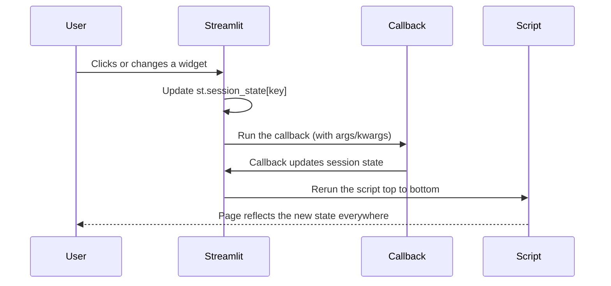

# Session State: The Complete Guide

> 📚 **Before you start**
>
> - [What is Streamlit?](../06-streamlit-basics/what-is-streamlit.md), for the rerun model
> - [Widgets and Layout](../06-streamlit-basics/widgets-and-layout.md), for widget keys and forms
> - [Dictionaries and Dictionary Views](../../python-programming/course.md#m5) (Python Programming), because session state behaves like a dictionary
> - [Concurrency for AI Apps](../../python-programming/course.md#m10) (Python Programming), used in the next lesson

## Introduction

You walk into a chai stall, order two masala chai, then add a samosa. The person at the counter keeps a running tab: "two chai, one samosa, ₹70." If they forgot your order every time you spoke, you'd have to repeat the whole list with every addition. That's exactly how a plain Streamlit script behaves: every click reruns the script from the top, and every ordinary variable starts again from scratch.

**Session state** is the counter-person's notepad. It's a dictionary that Streamlit keeps for each user's browser session and hands back unchanged on every rerun. Anything you put in it (a counter, a shopping cart, the step of a wizard, a chat history) survives the reruns until the user closes or reloads the tab.

By the end of this article you'll know how to read and write session state, the "initialise once" pattern, how widget keys and session state are linked, how callbacks run and why they fix the "one step behind" bug, the standard patterns (toggles, carts, wizards, undo), and how session state compares with caching, query parameters and a database.

> 💡 **Key Insight**
>
> The script forgets; `st.session_state` remembers. Use it for **things this particular user has done** (clicks, choices, history). Use caching for **things that are the same for everyone** (data, models). Mixing them up is the source of most Streamlit state bugs.

---

## Core Explanation

### 1. The problem: everything resets

```python
# not-run: Streamlit app, run with: streamlit run app.py
import streamlit as st

count = 0
if st.button("Add a cup"):
    count += 1
st.write("Cups ordered:", count)
```

Click "Add a cup" as often as you like; it shows 1 and never more. Each click reruns the script, `count = 0` runs again, and the button adds 1. The previous value is gone.

Here is the same thing as a plain Python simulation, where each call to `run_script` is one rerun and a dictionary plays the role of `st.session_state`:

```python
session_state = {}              # Streamlit keeps one of these per browser tab

def run_script(button_clicked):
    count = 0                   # ordinary variable: reset every rerun
    if "count" not in session_state:
        session_state["count"] = 0          # initialise once
    if button_clicked:
        count += 1
        session_state["count"] += 1
    return count, session_state["count"]

for click in [True, True, False, True]:
    print(run_script(click))
```

Output:

```
(1, 1)
(1, 2)
(0, 2)
(1, 3)
```

The ordinary variable never gets past 1. The session-state value keeps counting, because the dictionary lives outside the rerun.

### 2. Reading and writing `st.session_state`

`st.session_state` works like a dictionary, and also allows attribute access:

```python
# not-run: Streamlit app, run with: streamlit run app.py
import streamlit as st

if "count" not in st.session_state:      # initialise ONCE per session
    st.session_state.count = 0

if st.button("Add a cup"):
    st.session_state.count += 1

if st.button("Reset"):
    st.session_state.count = 0

st.write("Cups ordered:", st.session_state.count)
```

| Operation | Code |
|---|---|
| Set | `st.session_state["count"] = 0` or `st.session_state.count = 0` |
| Read | `st.session_state["count"]` or `st.session_state.count` |
| Check | `"count" in st.session_state` |
| Read with default | `st.session_state.get("count", 0)` |
| Delete | `del st.session_state["count"]` |
| Everything | `st.session_state.to_dict()`, or `st.write(st.session_state)` while debugging |
| Clear all | `st.session_state.clear()` |

The `if "count" not in st.session_state` check is the essential pattern. Without it, `st.session_state.count = 0` would run on every rerun and reset the counter, exactly the bug we started with.

**Lifetime.** Session state belongs to one browser tab's session. It survives reruns and page switches in a multipage app. It's lost when the user reloads the page or opens the app in a new tab (each is a new session), and when the server restarts. Values are kept in the server's memory, so don't store huge objects per user.

### 3. Widgets and session state are connected

Give a widget a `key` and its value is stored in `st.session_state` under that key:

```python
# not-run: Streamlit app, run with: streamlit run app.py
import streamlit as st

st.slider("Sugar (spoons)", 0, 3, 1, key="sugar")
st.write("From session state:", st.session_state.sugar)
```

That connection works in both directions:

- **Reading**: any code, anywhere in the script (including callbacks), can read `st.session_state.sugar` instead of keeping the widget's return value around.
- **Setting**: you can set a widget's value by writing to its key *before* the widget is drawn in this run. For example, a "Reset filters" button whose callback sets `st.session_state.sugar = 1`.

Rules to remember:

- **Don't modify a widget's key after the widget has been drawn in the same run.** Streamlit raises a `StreamlitAPIException`, because the page would show one value while your code holds another. Change it in a callback, or before the widget call.
- **Don't pass both a `value`/`default` and a session-state value** for the same keyed widget. Streamlit warns, because it can't tell which should win. Initialise through session state *or* the widget's default, not both.
- **Buttons and file uploaders can't be set** through session state. Their values only come from the user.
- **A widget not drawn in a run has its key deleted** at the end of that run. If you need the value to outlive the widget (for example across pages), copy it to a separate key that isn't attached to any widget.

### 4. Callbacks: run code *before* the rerun

Every input widget accepts `on_change` (buttons use `on_click`), plus `args` and `kwargs` for the callback. When the user changes the widget, Streamlit does three things in order:



Why it matters: without a callback, the button's effect happens partway through the rerun. Anything drawn *above* the button in the script was already drawn with the old value, so the page looks "one step behind":

```python
# not-run: Streamlit app, run with: streamlit run app.py
import streamlit as st

if "cart" not in st.session_state:
    st.session_state.cart = []

st.write("Items in cart:", len(st.session_state.cart))   # drawn BEFORE the button logic

# Version A (one step behind): the count above won't include this click until the next rerun
if st.button("Add masala chai (inline)"):
    st.session_state.cart.append("Masala chai")

# Version B (correct): the callback runs before the rerun, so the count above is up to date
def add_item(item):
    st.session_state.cart.append(item)

st.button("Add ginger chai (callback)", on_click=add_item, args=("Ginger chai",))
```

Use callbacks whenever a click or change should update state that's shown elsewhere on the page.

Two callback cautions:

- **Pass values through `args`/`kwargs`, or read them from `st.session_state` inside the callback.** Arguments are evaluated when the widget is drawn, so to use a widget's *new* value in its own callback, read `st.session_state[key]`.
- **Don't draw elements inside callbacks.** Anything a callback writes appears at the top of the page and vanishes on the next interaction. Update state in the callback; draw in the script.

Since version 1.63, `st.rerun()` and `st.switch_page()` called inside a callback take effect. Most callbacks don't need them, because a rerun follows automatically.

### 5. Pattern: logic as plain functions on a state dictionary

The neatest way to manage non-trivial state is to write small functions that take a state dictionary and change it. They know nothing about Streamlit, so you can test them directly. In the app you pass `st.session_state` itself, which behaves like a dictionary.

A shopping cart for the stall:

```python
MENU = {"Masala chai": 20, "Ginger chai": 25, "Samosa": 15, "Vada pav": 20}

def init_cart(state):
    state.setdefault("cart", {})          # item -> quantity

def add(state, item, qty=1):
    state["cart"][item] = state["cart"].get(item, 0) + qty

def remove(state, item):
    if state["cart"].get(item, 0) > 1:
        state["cart"][item] -= 1
    else:
        state["cart"].pop(item, None)

def total(state):
    return sum(MENU[item] * qty for item, qty in state["cart"].items())

state = {}
init_cart(state)
add(state, "Masala chai", 2)
add(state, "Samosa")
add(state, "Masala chai")
remove(state, "Samosa")
print(state["cart"], f"total ₹{total(state)}")
```

Output:

```
{'Masala chai': 3} total ₹60
```

And the app that uses them:

```python
# not-run: Streamlit app, run with: streamlit run app.py
import streamlit as st
from cart_logic import MENU, add, init_cart, remove, total

init_cart(st.session_state)

st.title("Chai stall order")
for item, price in MENU.items():
    c1, c2, c3 = st.columns([3, 1, 1], vertical_alignment="center")
    c1.write(f"{item} · ₹{price}")
    c2.button("➕", key=f"add_{item}", on_click=add, args=(st.session_state, item))
    c3.button("➖", key=f"rm_{item}", on_click=remove, args=(st.session_state, item))

st.divider()
for item, qty in st.session_state.cart.items():
    st.write(f"{qty} × {item}")
st.subheader(f"Total: ₹{total(st.session_state)}")
```

Every button has a unique `key` (they're created in a loop), and each uses a callback with `args`, so the total updates on the same click.

### 6. Pattern: a multi-step wizard

Session state holds which step the user is on, plus their answers:

```python
STEPS = ["Details", "Choose plan", "Confirm"]

def init_wizard(state):
    state.setdefault("step", 0)
    state.setdefault("answers", {})

def next_step(state, **answers):
    state["answers"].update(answers)
    state["step"] = min(state["step"] + 1, len(STEPS) - 1)

def back(state):
    state["step"] = max(state["step"] - 1, 0)

w = {}
init_wizard(w)
next_step(w, name="Asha", city="Pune")
next_step(w, plan="Monthly chai pass")
back(w)
print(STEPS[w["step"]], w["answers"])
```

Output:

```
Choose plan {'name': 'Asha', 'city': 'Pune', 'plan': 'Monthly chai pass'}
```

```python
# not-run: Streamlit app, run with: streamlit run app.py
import streamlit as st
from wizard_logic import STEPS, back, init_wizard, next_step

init_wizard(st.session_state)
step = st.session_state.step
st.progress((step + 1) / len(STEPS), text=f"Step {step + 1} of {len(STEPS)}: {STEPS[step]}")

if step == 0:
    name = st.text_input("Name", value=st.session_state.answers.get("name", ""))
    city = st.selectbox("City", ["Pune", "Mumbai", "Nagpur"])
    st.button("Next", on_click=next_step, args=(st.session_state,),
              kwargs={"name": name, "city": city}, disabled=not name)
elif step == 1:
    plan = st.radio("Plan", ["Daily cup", "Monthly chai pass"])
    c1, c2 = st.columns(2)
    c1.button("Back", on_click=back, args=(st.session_state,))
    c2.button("Next", on_click=next_step, args=(st.session_state,), kwargs={"plan": plan})
else:
    st.json(st.session_state.answers)
    st.button("Back", on_click=back, args=(st.session_state,))
```

Answers are copied into `answers` when the user moves on, so they survive even though each step's widgets disappear (and are cleaned up) when the step changes.

### 7. Pattern: remember a button click

Recall from [Widgets and Layout](../06-streamlit-basics/widgets-and-layout.md) that buttons are `True` for one run only. To make a click "stick", store it:

```python
# not-run: Streamlit app, run with: streamlit run app.py
import streamlit as st

st.session_state.setdefault("show_special", False)

def toggle_special():
    st.session_state.show_special = not st.session_state.show_special

st.button("Show / hide the special", on_click=toggle_special)
if st.session_state.show_special:
    st.write("Today: kesar chai, ₹40")
    st.number_input("How many?", 1, 10, 1, key="special_qty")   # no longer disappears
```

### 8. Where should this value live?

| Storage | Scope | Survives reload? | Use for |
|---|---|---|---|
| Ordinary variable | One run | No | Intermediate results |
| `st.session_state` | One user's tab | No | Clicks, carts, wizard steps, chat history |
| `st.cache_data` / `st.cache_resource` | All users | Yes (until expiry or restart) | Loaded data, models, connections |
| `st.query_params` / `bind="query-params"` | The URL | Yes, and shareable | Filters someone should be able to bookmark or send |
| A database or file | Everyone, permanently | Yes | Orders, saved chats, anything that must last |

**Query parameters** deserve a mention. `st.query_params` is a dictionary-like view of the URL's `?key=value` part. And since version 1.55, most widgets accept `bind="query-params"` together with a `key`, which keeps the widget's value in the URL automatically:

```python
# not-run: Streamlit app, run with: streamlit run app.py
import streamlit as st

city = st.selectbox("City", ["Pune", "Mumbai", "Nagpur"], key="city", bind="query-params")
st.write("Share this link to open the dashboard on", city)
# URL becomes ...?city=Mumbai when Mumbai is picked
```

Now a colleague opening the link sees the same city, and the browser's back button restores the previous choice.

### 9. Testing state with `AppTest`

`AppTest` lets you click buttons and inspect `session_state` in a normal test:

```python
# not-run: needs streamlit installed; run with pytest
from streamlit.testing.v1 import AppTest

def test_cart_adds_items():
    at = AppTest.from_file("cart_app.py").run()
    at.button(key="add_Masala chai").click().run()
    at.button(key="add_Masala chai").click().run()
    assert at.session_state.cart == {"Masala chai": 2}
```

Combined with plain tests of the state functions (as in sections 5 and 6), this covers state logic thoroughly.

---

## Try It Yourself

1. **Order history.** Extend the cart functions with `checkout(state)`, which moves the current cart into a list `state["orders"]` (as a dict with the items and total) and empties the cart. Test it with two checkouts.
2. **One step behind.** In the "Version A" cart example, the count shows 0 after the first click on the inline button. Explain exactly which line ran when.
3. **Undo.** Add an `undo(state)` that restores the cart to what it was before the last `add`. What extra state do you need?
4. **Reset filters.** A dashboard has `st.multiselect("Outlets", OUTLETS, key="outlets")`. Write the callback for a "Reset" button that clears it.

<details>
<summary>Show answers</summary>

```python
def checkout(state):
    state.setdefault("orders", [])
    if state["cart"]:
        state["orders"].append({"items": dict(state["cart"]), "total": total(state)})
        state["cart"] = {}

s = {}
init_cart(s)
add(s, "Vada pav", 2)
checkout(s)
add(s, "Ginger chai")
add(s, "Samosa", 2)
checkout(s)
print(s["orders"])
print("cart now:", s["cart"])

def add_with_history(state, item, qty=1):
    state.setdefault("history", [])
    state["history"].append(dict(state["cart"]))      # snapshot before changing
    add(state, item, qty)

def undo(state):
    if state.get("history"):
        state["cart"] = state["history"].pop()

u = {}
init_cart(u)
add_with_history(u, "Samosa")
add_with_history(u, "Masala chai", 3)
undo(u)
print(u["cart"])
```

Output:

```
[{'items': {'Vada pav': 2}, 'total': 40}, {'items': {'Ginger chai': 1, 'Samosa': 2}, 'total': 55}]
cart now: {}
{'Samosa': 1}
```

1. Copy the cart with `dict(...)` before storing it, otherwise both the order and the new cart could end up pointing to the same dictionary.
2. On the click's rerun, `st.write("Items in cart:", ...)` ran first and showed 0, then `st.button(...)` returned `True` and the item was appended. The page only shows 1 on the *next* rerun.
3. A history list of cart snapshots (a stack). `undo` pops the last snapshot. Limit its length if carts can get large.
4. `def reset_outlets(): st.session_state.outlets = []`, then `st.button("Reset", on_click=reset_outlets)`. It works because the callback runs before the multiselect is drawn in the next run.

</details>

---

## Real-World Examples

### Example 1: Chat apps

Every Streamlit chat app keeps the conversation in `st.session_state.messages`, a list of role-and-content dictionaries, and redraws the whole history on each rerun. You'll build one in [Lab: Build a chat UI shell for an LLM app](lab-build-a-chat-ui-shell-for-an-llm-app.md).

### Example 2: Data-cleaning tools

An internal tool lets analysts upload a CSV, then apply cleaning steps one by one. The working DataFrame and the list of applied steps live in session state, so the analyst can undo a step or download the result at any point.

### Example 3: Shareable dashboard views

A sales team binds its region and date filters to query parameters. A manager sets up the view they want and pastes the URL in a team chat; everyone opens the same view.

---

## Common Misconceptions

### Misconception 1: "Session state is shared between users"

Each browser tab has its own session state. Two people (or two tabs) never see each other's values. For shared data, use caching or a database.

### Misconception 2: "Session state is permanent"

It's lost on reload and server restart. Anything that must last (orders, saved conversations) belongs in a database or file.

### Misconception 3: "I need session state for widget values"

Widgets already remember their own values across reruns as long as they're drawn every run. You need session state when you want to *set* them from code, read them in callbacks, keep values after the widget disappears, or remember things that aren't widgets at all.

### Misconception 4: "Callbacks are optional decoration"

They change *when* your code runs: before the rerun instead of during it. That's the difference between a page that's up to date and one that's one click behind.

---

## Interview Relevance

Session state is the most common Streamlit topic in interviews for data and AI roles, because every non-trivial app needs it:

- *"How do you keep a value across reruns?"* `st.session_state`, initialised once with an `if key not in st.session_state` check.
- *"Why does my counter show the previous value?"* The update happens after the display line in the same run. Use an `on_click` callback, or move the display below the update.
- *"Session state vs `st.cache_data`?"* Per-user, per-tab, mutable state vs shared, computed data. Never put per-user data in `cache_resource`.
- *"How do widget keys relate to session state?"* A keyed widget stores its value in `st.session_state[key]`; you can set it before the widget is drawn, typically in a callback.
- *"How would you persist a user's work?"* Session state during the visit; a database for anything that must survive reloads; query parameters for shareable views.

---

## Key Takeaways

- **The script forgets on every rerun; `st.session_state` remembers** for one user's browser tab.
- **Initialise once** with `if "key" not in st.session_state` (or `setdefault`).
- **Keyed widgets live in session state**; set them before they're drawn, never after.
- **Callbacks run before the rerun**, which keeps the whole page consistent; update state in callbacks, draw in the script.
- **Write state changes as plain functions** on a dictionary and pass `st.session_state` in; test them without Streamlit.
- **Choose the right home** for each value: session state, cache, query parameters or a database.

---

**Up next:** [async and await in Streamlit](async-and-await-in-streamlit.md)
