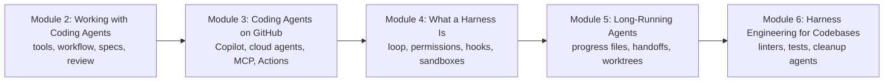

# How This Course Works

## Introduction

Think of a good tailor's shop in Chandni Chowk. The master tailor is skilled, but the shop's output does not depend on skill alone. There is a measuring tape on every table, chalk to mark the cloth, a pattern book on the shelf, a rule that every garment is tried on before it is handed over, and an assistant who checks the stitching. Hand the same master tailor a pair of blunt scissors in an empty room and the work gets worse. The **shop** around the tailor matters as much as the tailor.

Coding agents are the same. The model (Claude, GPT, Gemini) is the skilled tailor. Everything around it decides how good the work actually is: which tools it can call, what it reads before it starts, which actions need a human's approval, where its commands run, how it checks its own work, how it picks up a job it left half done yesterday, and how the codebase pushes back when it makes a mistake. That surrounding layer is called the **harness**, and designing it well is now a discipline with its own name: **harness engineering**.

This course teaches both halves. First, how to **use** today's coding agents (Claude Code, OpenAI Codex, Gemini CLI and its successor Antigravity CLI, GitHub Copilot and Cursor) the way strong engineers do. Then, how to **build and tune the harness**: the loop, permissions, hooks, subagents, sandboxes, long-running sessions, and the linters, tests and cleanup agents that keep an agent-written codebase healthy.

> 💡 **Key Insight**
>
> An agent is a **model plus a harness**. You rarely get to change the model, but you control almost everything in the harness. Most of the difference between an agent that ships good code and one that makes a mess comes from the harness: the instructions it reads, the checks it can run, the permissions it has, and the environment it works in.

---

## What You Will Learn

By the end of this course you will be able to:

- **Choose and compare coding agents**: what Claude Code, Codex, Gemini CLI, Copilot and Cursor share, where they differ, and which one fits a task.
- **Work with an agent in a disciplined loop**: explore, plan, code, commit; write specs an agent can implement; and review AI-written code without rubber-stamping it.
- **Run agents on GitHub**: Copilot in the editor, cloud agents that open pull requests, repository instructions, the GitHub MCP server, and agents in GitHub Actions.
- **Take a harness apart**: the agent loop, tools, context, permission modes, hooks, subagents, slash commands, plugins and sandboxes, with the real configuration formats of current tools.
- **Build a minimal coding-agent harness** in plain Python, so none of it feels like magic.
- **Run agents for hours, not minutes**: initializer agents, feature lists, progress files, handoff notes, git checkpoints, and parallel agents in separate worktrees.
- **Make a codebase agent-ready**: linters whose error messages teach the fix, structural tests that guard the architecture, and background agents that clean up drift.

### The course at a glance

*Modules 2 and 3 are about using agents well. Modules 4 to 6 are about engineering the harness around them.*

| Module | The question it answers |
|---|---|
| **2. Working with Coding Agents** | Which agent, and how do I work with it day to day? |
| **3. Coding Agents on GitHub** | How do agents fit into pull requests, review and CI? |
| **4. What a Harness Is** | What is actually running around the model, and how do I control it? |
| **5. Long-Running Agents** | How does an agent keep going across many context windows without losing the thread? |
| **6. Harness Engineering for Codebases** | How do I make the repository itself steer the agent and catch its mistakes? |

---

## How Every Lesson Is Built

| Section | What it gives you |
|---|---|
| **Before you start** | Links to the earlier lessons this one depends on. |
| **Introduction** | Why the topic matters, with an everyday example. |
| **Key Insight** | The one idea to remember. |
| **Core Explanation** | The topic step by step, with diagrams, tables, real configuration files and runnable code. |
| **Try It Yourself** | Exercises, with answers hidden in a fold. |
| **Real-World Examples** | How teams use the idea today. |
| **Common Misconceptions** | Mistakes almost everyone makes, corrected. |
| **Interview Relevance** | What interviewers ask and what a strong answer covers. |
| **Key Takeaways** | A one-minute summary for revision. |

There are two **labs**: in Module 4 you build a small coding-agent harness from scratch, and in Module 6 you take a real-looking repository and make it agent-ready.

---

## What You Need Before Starting

This is the last course in the Agentic AI track, so it builds on several earlier ones:

- **Git and GitHub.** Branches, commits, pull requests, review, Actions and worktrees all appear constantly. [Git and GitHub: Zero to Pro](../../git-and-github-zero-to-pro/course.md) covers them; the most important lessons are [Pull Requests End to End](../../git-and-github-zero-to-pro/06-collaborating-on-github/pull-requests-end-to-end.md) and [Stash, Worktrees and bisect](../../git-and-github-zero-to-pro/04-branching-and-merging/stash-worktrees-and-bisect.md).
- **The agent loop and tool calling.** [The Agent Loop: Decide, Act, Observe](../../agentic-ai-fundamentals/03-the-agent-loop/the-agent-loop-decide-act-observe.md) and [How an Agent Decides What to Do Next](../../agentic-ai-fundamentals/03-the-agent-loop/how-an-agent-decides-what-to-do-next.md), which already introduced the word "harness".
- **Context engineering.** Compaction, offloading to files and memory files such as `CLAUDE.md` and `AGENTS.md` are taught in [Context Engineering and Agent Memory](../../context-engineering-and-agent-memory/course.md). This course uses them and links back rather than repeating them.
- **Tools, skills and sandboxes.** [Tools, Agent Skills and Code Execution](../../tools-agent-skills-and-code-execution/course.md) covers writing tools, Agent Skills (`SKILL.md`) and the basics of sandboxing agent code. Here we apply them to coding agents.
- **MCP.** [Model Context Protocol (MCP)](../../model-context-protocol-mcp/course.md) explains how agents connect to outside tools.
- **Python 3.10 or newer** and a terminal. [The Command Line and Linux Basics](../../the-command-line-and-linux-basics/course.md) covers the shell.

### Do I need a paid coding agent?

No. Every runnable example in this course is plain Python that runs offline, with a **pretend model** where a model would normally be called, so it prints exactly what the lesson shows. Real tool commands (`claude`, `codex`, `copilot`, `gemini`) and configuration files are shown as they appear in current official documentation, in blocks that aren't executed. If you have access to one of the agents, try those commands too; the course points out where they differ.

### A note on how fast this field moves

Coding agents change monthly. Names change (Copilot "coding agent" became "cloud agent"; Cursor's "background agents" became "cloud agents"; Google is moving Gemini CLI users to Antigravity CLI), defaults change, and flags get retired. Every product detail in this course was checked against official documentation in October 2026. When you read this later, trust the **ideas** (loops, permissions, hooks, sandboxes, progress files, sensors) more than any single flag, and check the docs for the current spelling.

---

## How to Get the Most Out of It

1. **Read the agent's transcript.** Every coding agent can show you what it read, what it ran and why. Most surprises are explained there.
2. **Give the agent a way to check itself.** Tests, a build, a linter. You will see this idea in almost every lesson, because it is the single biggest lever you have.
3. **Change one harness piece at a time.** When you add a hook, a rule or a subagent, run the same task before and after, so you know what the change bought you.
4. **Keep humans on the merge button.** The course shows how to let agents do more on their own. It never suggests letting unreviewed code reach production.

---

## Common Misconceptions

### "A better model makes the harness unnecessary"

Better models need less scaffolding for some things and enable more ambitious harnesses for others. Anthropic's engineers found that each new model let them remove some harness pieces and add new ones. The harness shifts; it doesn't disappear.

### "Harness engineering is only for people building agent products"

Everyone who uses a coding agent builds a harness, whether they notice or not: an `AGENTS.md` file, an allowlist of commands, a CI pipeline the agent must pass. This course makes that work deliberate.

### "Coding agents replace the need to understand the code"

The opposite. The faster an agent writes code, the more your value lies in specifying what's needed, reviewing what came back, and designing the checks that catch what you'd miss.

---

## Key Takeaways

- **Agent = model + harness**; the harness is everything around the model that you control.
- **Modules 2 and 3** teach you to use coding agents well, locally and on GitHub.
- **Modules 4 to 6** teach you to engineer the harness: runtime controls, long-running sessions and codebase-level guides and checks.
- **All runnable code works offline** with pretend models; real tool commands are shown from current documentation.
- **Trust the ideas over the flags**: product names and defaults change fast, so check official docs.

---

**Up next:** [The Coding Agent Landscape: Claude Code, Codex, Gemini CLI, Copilot and Cursor](../02-working-with-coding-agents/the-coding-agent-landscape-claude-code-codex-gemini-cli-copilot-and-cursor.md)
