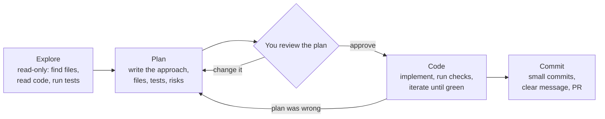

# Explore, Plan, Code, Commit: The Complete Guide

> 📚 **Before you start**
>
> - [The Coding Agent Landscape](the-coding-agent-landscape-claude-code-codex-gemini-cli-copilot-and-cursor.md), for the tools and their modes
> - [Planning and Reflection](../../agentic-ai-fundamentals/05-reasoning-patterns/planning-and-reflection.md), for why planning before acting helps an agent
> - [Writing Good Commit Messages](../../git-and-github-zero-to-pro/02-version-control-from-scratch/writing-good-commit-messages.md)
> - [Compaction and Summarisation](../../context-engineering-and-agent-memory/03-just-in-time-context/compaction-and-summarisation.md), for what happens when a long session fills the context window

## Introduction

A good electrician called to fix a tripping circuit breaker in a Pune flat doesn't start ripping out wires. First they look: which rooms lose power, what's plugged in, how old the wiring is. Then they say what they'll do: "the geyser circuit is overloaded; I'll move the geyser to its own breaker and check the earthing." Only then do they work, and afterwards they switch everything on and test it before writing the bill.

Coding agents do much better with exactly that rhythm. Left alone with "add Google login", a capable agent will happily start editing within seconds and may produce a lot of plausible code that solves the wrong problem, touches the wrong files or quietly breaks something. The fix is a simple four-step workflow that Anthropic recommends in its Claude Code best practices and that experienced users of every agent converge on: **explore, plan, code, commit**.

By the end of this lesson you'll be able to run that loop with any agent, use plan modes, write prompts that give the agent a way to check its own work, manage the context window across a session, decide when to skip the plan, and finish with clean commits and a pull request a reviewer can trust.

> 💡 **Key Insight**
>
> Separate **understanding** from **changing**. An agent that explores and writes a plan you can read before it edits anything fails cheaply (you fix a paragraph) instead of expensively (you untangle 600 lines). And give it a **check it can run**, because an agent stops when the work *looks* done unless something tells it otherwise.

---

## Core Explanation

### 1. The loop at a glance



| Phase | Agent does | You do | Tool support |
|---|---|---|---|
| **Explore** | Searches, reads, runs existing tests, answers questions; **edits nothing** | Point it at the right area; ask questions | Plan mode (Claude Code, Copilot CLI, Gemini CLI), read-only sandbox (Codex), Explore subagents |
| **Plan** | Writes the approach: files to change, steps, tests, risks | Read it, correct it, approve it | Plan mode approval step; a `PLAN.md` file |
| **Code** | Implements against the plan, runs tests and linters, fixes failures | Watch or step away; interrupt if it drifts | Accept-edits or auto modes, allowlisted test commands |
| **Commit** | Commits with a descriptive message, opens a PR | Review the diff and the PR | Git, `gh pr create` |

### 2. Explore: understanding before touching

In the explore phase the agent should be **unable** to change anything. Every major tool has a way to do that:

```bash
# Claude Code: start in plan mode (or press Shift+Tab until "plan mode on")
claude --permission-mode plan

# Codex: a read-only sandbox
codex --sandbox read-only

# Gemini CLI: the plan approval mode is read-only research
# Copilot CLI: Shift+Tab switches to plan mode
```

Good exploration prompts are specific about **where** to look and **what** to find out:

```text
Read src/billing/ and tests/test_billing.py. Explain how a bill is split today,
where rounding happens, and which other modules call split_bill(). Don't change anything.
Also run the existing tests and tell me which ones fail.
```

A few habits make exploration much better:

- **Ask questions you'd ask a colleague**: "Where do we validate GST numbers?", "Why does `retry()` sleep twice?" Agents are excellent codebase guides.
- **Scope it.** "Investigate the payments code" with no boundary makes the agent read hundreds of files and fill its context. Name folders, or ask it to use a subagent for wide searches so only the summary returns (Claude Code's built-in `Explore` subagent exists for exactly this).
- **Let it run things.** Running the tests or the app during exploration often reveals more than reading.

Here is what exploration does underneath, in miniature: search the repository for every place a function is used, so the plan covers them all.

```python
import re

REPO = {
    "src/billing/split.py": "def split_bill(total, people):\n    share = round(total / people, 2)\n    return [share] * people\n",
    "src/api/routes.py": "from billing.split import split_bill\n\ndef split_endpoint(req):\n    return split_bill(req['total'], req['people'])\n",
    "src/reports/daily.py": "from billing.split import split_bill\n# uses split_bill for the owner's summary\n",
    "tests/test_split.py": "from billing.split import split_bill\n\ndef test_even():\n    assert split_bill(90, 3) == [30.0, 30.0, 30.0]\n",
    "README.md": "Chai stall billing helpers.\n",
}

def grep(pattern, repo):
    """The agent's search tool: (file, line number, line) for every match."""
    hits = []
    for path, text in sorted(repo.items()):
        for n, line in enumerate(text.splitlines(), 1):
            if re.search(pattern, line):
                hits.append((path, n, line.strip()))
    return hits

for path, n, line in grep(r"split_bill\(", REPO):
    print(f"{path}:{n}: {line}")
```

Output:

```
src/api/routes.py:4: return split_bill(req['total'], req['people'])
src/billing/split.py:1: def split_bill(total, people):
tests/test_split.py:4: assert split_bill(90, 3) == [30.0, 30.0, 30.0]
```

Notice what a plain regex missed: `src/reports/daily.py` imports `split_bill` without calling it on that line. A good agent searches more than one way (imports, call sites, string references) before deciding what to change, and you should expect its exploration summary to say how it searched.

### 3. Plan: a short document you can argue with

The plan is the cheapest place to catch a mistake. Ask for one when the change touches several files, when you're unsure of the approach, or when you don't know this code well. A useful plan names **files, steps, tests and risks**:

```markdown
# Plan: shares must add up exactly to the bill

## Approach
Work in whole paise (integers). Give the leftover paise one each to the first people.

## Files
- src/billing/split.py: rewrite split_bill(); keep the signature
- tests/test_split.py: add cases 100/3, 0.05/2, 1 person, 0 people (raises ValueError)
- src/api/routes.py: no change (same signature); add a 400 response for people <= 0

## Verification
- python -m pytest -q passes
- sum(split_bill(t, n)) == t for 1,000 random totals (property test)

## Out of scope
- Currency other than INR; changing the report format
```

In Claude Code's plan mode you approve the plan before any edits happen, and `Ctrl+G` opens it in your editor so you can change it directly. In any tool you can simply ask the agent to write `PLAN.md` and stop. Then **read it like a code review**: is the approach right? Did it find all callers? Are the tests meaningful? Is anything in scope that shouldn't be?

A plan is also a **contract** you can check the result against later. Here's a small checker that compares the files an agent actually changed with the files its plan promised:

```python
PLAN_FILES = {"src/billing/split.py", "tests/test_split.py", "src/api/routes.py"}

def check_against_plan(changed, planned):
    unplanned = sorted(changed - planned)
    untouched = sorted(planned - changed)
    return {"unplanned changes": unplanned, "planned but untouched": untouched}

changed_by_agent = {"src/billing/split.py", "tests/test_split.py", "src/billing/money.py"}
for key, files in check_against_plan(changed_by_agent, PLAN_FILES).items():
    print(f"{key}: {files}")
```

Output:

```
unplanned changes: ['src/billing/money.py']
planned but untouched: ['src/api/routes.py']
```

Both lines deserve a question. The new `money.py` might be a sensible helper, or scope creep. The untouched `routes.py` means the promised 400 response is missing.

**When to skip the plan.** Planning has a cost. Anthropic's guidance is a good rule: *if you could describe the diff in one sentence, skip the plan*. Fixing a typo, adding a log line or renaming a variable doesn't need one.

### 4. Code: give the agent a way to verify

The single most effective thing you can do in the code phase is make "done" **checkable**. An agent stops when the work looks finished; if nothing can tell it otherwise, *you* become the test suite. Compare:

| Weak prompt | Strong prompt |
|---|---|
| "Implement the plan." | "Implement the plan. Run `python -m pytest -q` after each change and keep going until it passes. Don't edit the tests to make them pass." |
| "Make the dashboard look better." | "Match this screenshot. Take a screenshot of the result, list the differences and fix them." |
| "The build is failing." | "The build fails with this error: (pasted). Fix the root cause, not the symptom, and show me the passing build output." |

Checks can be enforced at different strengths, and you'll build the stronger ones later in the course:

| Strength | How | Where taught |
|---|---|---|
| In the prompt | "Run the tests and iterate until they pass" | This lesson |
| As a gate on stopping | A `Stop` hook runs the tests and blocks the agent from finishing while they fail | [Permissions, Hooks and Approval Modes](../course.md#m4) |
| By a second opinion | A reviewer subagent or fresh session checks the diff against the plan | [Reviewing AI-Written Code](reviewing-ai-written-code.md) |
| In the codebase | Linters and structural tests whose messages teach the fix | [Linters and Tests that Teach the Agent](../course.md#m6) |

Here's the verification loop in miniature, with a pretend agent whose first attempt is the classic paisa-losing bug from [Copilot in the Editor and on GitHub](../03-coding-agents-on-github/copilot-in-the-editor-and-on-github.md):

```python
ATTEMPTS = [
    # attempt 1: plausible, wrong
    "def split_bill(total, people):\n    share = round(total / people, 2)\n    return [share] * people\n",
    # attempt 2: works in paise and hands out the remainder
    "def split_bill(total, people):\n"
    "    if people <= 0:\n        raise ValueError('people must be positive')\n"
    "    paise = round(total * 100)\n    base, extra = divmod(paise, people)\n"
    "    return [(base + (1 if i < extra else 0)) / 100 for i in range(people)]\n",
]

def run_tests(source):
    ns = {}
    exec(source, ns)
    split = ns["split_bill"]
    failures = []
    for total, people in [(100, 3), (0.05, 2), (90, 3), (999.99, 7)]:
        got = round(sum(split(total, people)), 2)
        if got != round(total, 2):
            failures.append(f"split_bill({total}, {people}) sums to {got}")
    try:
        split(10, 0)
        failures.append("split_bill(10, 0) did not raise ValueError")
    except ValueError:
        pass
    except Exception as e:
        failures.append(f"split_bill(10, 0) crashed with {type(e).__name__}")
    return failures

for n, source in enumerate(ATTEMPTS, 1):
    failures = run_tests(source)
    print(f"attempt {n}: {'PASS' if not failures else 'FAIL'}")
    for f in failures:
        print("   -", f)
    if not failures:
        break
```

Output:

```
attempt 1: FAIL
   - split_bill(100, 3) sums to 99.99
   - split_bill(0.05, 2) sums to 0.06
   - split_bill(999.99, 7) sums to 1000.02
   - split_bill(10, 0) crashed with ZeroDivisionError
attempt 2: PASS
```

Without `run_tests`, attempt 1 would have been "done". With it, the failures go straight back into the agent's context and it fixes them itself.

### 5. Steering during the session

You are part of the loop. Agents let you interrupt (`Esc` in Claude Code stops the current step) or type a correction that it reads before its next step. Good steering habits:

- **Course-correct early.** The first few tool calls tell you whether it understood. Stopping after 30 seconds is far cheaper than after 30 minutes.
- **Two strikes, then restart.** If you've corrected the same thing twice and it's still wrong, the context is now full of failed attempts. Clear the session (`/clear` in Claude Code), and write a better first prompt that includes what you learned.
- **One task per session.** Mixing an unrelated question into a feature session ("kitchen-sink sessions") fills the context with noise. Start a fresh session for a new task.
- **Push investigation into subagents.** "Use a subagent to find every place we parse dates" keeps the hundreds of file reads out of your main context; only the answer comes back.
- **Mind compaction.** When a session grows long, the agent compacts older history into a summary ([Compaction and Summarisation](../../context-engineering-and-agent-memory/03-just-in-time-context/compaction-and-summarisation.md)). Rules you said once in chat can fade; put rules that must survive in the instructions file.

Here's a small model of why repeated corrections hurt. Each failed attempt adds its code, test output and your correction to the context:

```python
CONTEXT_LIMIT = 200_000
base = 30_000             # instructions, files read during exploration, the plan
per_failed_attempt = 18_000  # diff + test output + your correction

for attempts in range(0, 9, 2):
    used = base + attempts * per_failed_attempt
    note = "  <- a fresh session would be cleaner" if attempts >= 2 else ""
    print(f"{attempts} failed attempts -> {used:>7,} tokens ({used / CONTEXT_LIMIT:.0%}){note}")
```

Output:

```
0 failed attempts ->  30,000 tokens (15%)
2 failed attempts ->  66,000 tokens (33%)  <- a fresh session would be cleaner
4 failed attempts -> 102,000 tokens (51%)  <- a fresh session would be cleaner
6 failed attempts -> 138,000 tokens (69%)  <- a fresh session would be cleaner
8 failed attempts -> 174,000 tokens (87%)  <- a fresh session would be cleaner
```

The tokens aren't the main cost. The failed approaches stay visible to the model and keep pulling it back towards them.

### 6. Commit: small, described, reviewable

Ask the agent to commit when a coherent step is done and checks pass, not at the very end of a long session. Good agent commits look like good human commits:

```text
Make split_bill shares add up to the total

Work in whole paise and hand out the remainder one paisa at a time,
so 100/3 gives 33.34, 33.33, 33.33 instead of losing a paisa.
Raise ValueError for zero or negative people.

Tests: added cases for 100/3, 0.05/2, 999.99/7 and people=0.
```

A tiny helper can build such a message from the plan, which is a nice way to keep commit history tied to intent:

```python
def commit_message(title, plan_points, tests):
    body = "\n".join(f"- {p}" for p in plan_points)
    return f"{title}\n\n{body}\n\nTests: {tests}"

print(commit_message(
    "Make split_bill shares add up to the total",
    ["Work in whole paise; hand out the remainder one paisa at a time",
     "Raise ValueError when people <= 0"],
    "python -m pytest -q (14 passed)",
))
```

Output:

```
Make split_bill shares add up to the total

- Work in whole paise; hand out the remainder one paisa at a time
- Raise ValueError when people <= 0

Tests: python -m pytest -q (14 passed)
```

Then: `commit with a descriptive message and open a PR`. Coding agents use `git` and `gh` like you do. The pull request is where the work meets your normal team process: CI, review and branch protection, exactly as in Module 3.

Commit habits that matter even more with agents:

- **Commit on green.** Each commit should pass the tests, so you can roll back to any of them ([Git as a Safety Net and Checkpoints](../course.md#m5) builds on this).
- **Review before committing**, not after: `git diff` is the agent's work in its rawest form.
- **Keep the agent's attribution** if your tool adds one (Claude Code adds a `Co-Authored-By` trailer by default), so reviewers know where code came from.

### 7. Variations on the loop

| Variation | How it differs | When it helps |
|---|---|---|
| **Test first** | Ask for failing tests, confirm they fail, commit them, then ask for the implementation without changing the tests | Behaviour you can pin down with examples |
| **Interview first** | "Interview me about this feature, then write SPEC.md"; implement in a fresh session | Larger features with open questions (the next lesson) |
| **Screenshot loop** | Give a design image; the agent screenshots its result and compares | UI work |
| **Writer and reviewer** | One session implements, a second fresh session reviews | Anything important (two lessons from now) |

---

## Try It Yourself

1. **Find what grep missed.** Write a second search in the explore example that also finds files that **import** `split_bill`, and list files the first search missed.
2. **Plan or not?** Which need a plan? (a) Fix a typo in an error message; (b) switch from `requests` to `httpx` across the service; (c) add a `--dry-run` flag to one CLI command; (d) add rate limiting to every API endpoint.
3. **Make it checkable.** Rewrite "Clean up the date handling" into a prompt with a verification step.
4. **Read the contract.** The agent changed `{"src/billing/split.py", "tests/test_split.py", "src/api/routes.py", ".github/workflows/ci.yml"}`. Run `check_against_plan` and say what you'd ask.

<details>
<summary>Show answers</summary>

**1.**

```python
callers = {p for p, _, _ in grep(r"split_bill\(", REPO)}
importers = {p for p, _, _ in grep(r"import split_bill", REPO)}
print(sorted(importers - callers))
```

Output:

```
['src/reports/daily.py']
```

**2.** (a) No plan; one-sentence diff. (b) Plan: many files, behaviour differences (timeouts, exceptions) to think through. (c) Probably no plan if you know the command; a quick one if you don't. (d) Plan: design decisions (limits per user or per IP, storage, error format) and many files.

**3.** For example: "In `src/dates/`, replace the three different date parsers with `parse_date()` from `src/dates/core.py`. Keep behaviour identical: first add tests that capture current outputs for the 20 sample strings in `tests/fixtures/dates.txt`, run them, then refactor and rerun until they pass. Show me the test output."

**4.**

```python
print(check_against_plan({"src/billing/split.py", "tests/test_split.py", "src/api/routes.py",
                          ".github/workflows/ci.yml"}, PLAN_FILES))
```

Output:

```
{'unplanned changes': ['.github/workflows/ci.yml'], 'planned but untouched': []}
```

Ask why the CI workflow changed. Changes to CI are high risk (they can weaken checks or expose secrets) and weren't in the plan, so they need a clear reason or a revert.

</details>

---

## Real-World Examples

- **A payments team** requires a `PLAN.md` in every agent PR that touches more than three files. Reviewers read the plan first; most problems are caught there in two minutes.
- **A mobile team** uses the screenshot loop for UI tickets: the agent compares its screenshot to the Figma export and iterates before anyone looks.
- **A data team** runs exploration in plan mode against unfamiliar dbt projects just to get a written tour, without any intention of changing code that day.

---

## Common Misconceptions

### "Planning slows the agent down"

It adds minutes and saves hours on anything non-trivial. For tiny changes, skip it; that's part of the method.

### "If the agent says the tests pass, they pass"

Ask for evidence: the command and its output. Agents have been known to edit tests, skip them or misread output. Evidence is faster to review than re-running everything yourself.

### "A long session means the agent knows more"

A long session means a fuller context with more stale material. Fresh sessions with a good written plan or spec often do better.

### "Commit at the end"

Commit at each green step. Small commits make review easier and give you safe points to return to.

---

## Interview Relevance

*"How do you work with a coding agent on a non-trivial change?"* A strong answer describes explore (read-only, scoped, often in plan mode or a subagent), plan (files, steps, tests, risks; reviewed by you), code (with a runnable check and evidence, iterating to green), commit (small, descriptive, PR through normal review). Mention when to skip planning, how you steer (interrupt early, two-strikes-then-restart, one task per session), and that rules which must survive go in instruction files, not chat.

*"What's the biggest mistake people make with agents?"* No verification. Without tests or another check, "looks done" is the only stopping signal.

---

## Key Takeaways

- **Explore, plan, code, commit** separates understanding from changing, so mistakes are caught when they're cheap.
- **Explore read-only** (plan mode, read-only sandbox, subagents), scoped to the right area.
- **A plan names files, steps, tests and risks**, and becomes a contract you check the diff against; skip it for one-sentence changes.
- **Give the agent a check it can run** and ask for evidence; that turns "looks done" into "is done".
- **Steer early, restart after two failed corrections, keep one task per session, and commit on green.**

---

**Up next:** [Spec-Driven Development](spec-driven-development.md)
