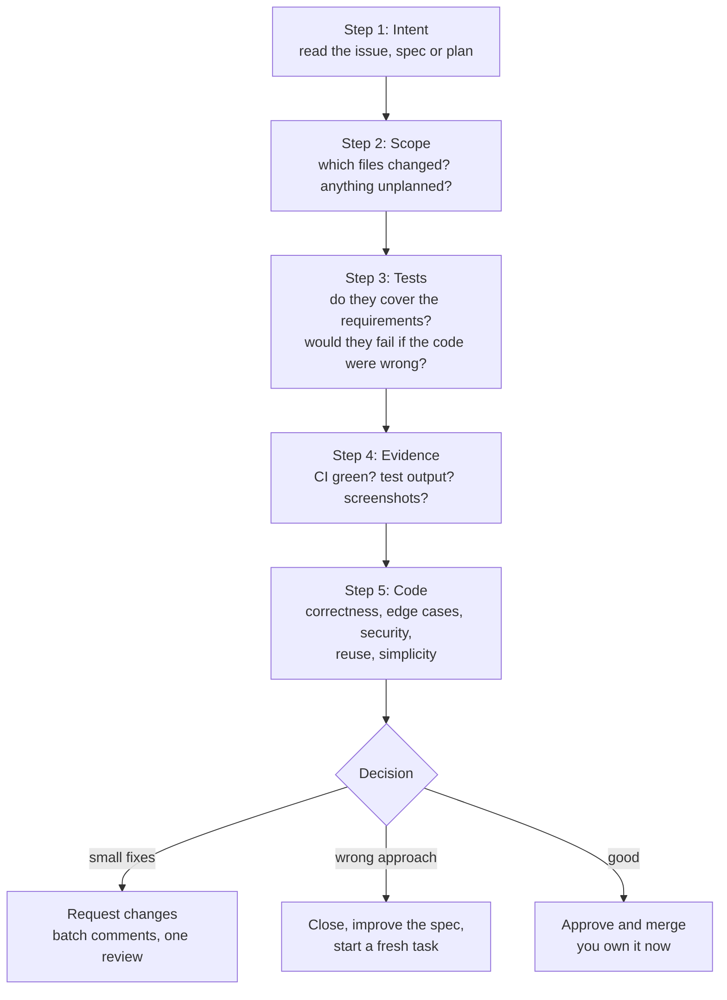

# Reviewing AI-Written Code: The Complete Guide

> 📚 **Before you start**
>
> - [Code Review that Helps](../../git-and-github-zero-to-pro/06-collaborating-on-github/code-review-that-helps.md), for the basics of reviewing a pull request
> - [Explore, Plan, Code, Commit](explore-plan-code-commit.md) and [Spec-Driven Development](spec-driven-development.md), because the plan and spec are what you review the code against
> - [Code Scanning and Secret Scanning](../../git-and-github-zero-to-pro/09-security-and-supply-chain/code-scanning-and-secret-scanning.md), for the automated security checks that sit alongside review

## Introduction

At a busy Mumbai wholesale market, a trader buys rice sacks from a supplier he has used for years. The sacks look perfect: right weight on the label, neatly stitched. A careful trader still opens a few, runs the grains through his fingers, and weighs one on his own scale. Not because the supplier is dishonest, but because "looks right" and "is right" are different things, and his name is on the shop.

AI-written code is the neatly stitched sack. It is usually well formatted, confidently commented and plausible at a glance, and that is exactly the danger. Coding agents also produce far more code than people do, so reviewers face more diffs with less time each. Reviewing AI-written code well is now one of the most valuable engineering skills, and it's different from reviewing a colleague's code in a few important ways.

By the end of this lesson you'll know where AI-written code typically goes wrong, a review order that catches problems fastest, how to check that tests actually test something, how to scan a diff automatically for red flags, how to use a second AI as a reviewer without trusting it blindly, and how to keep the human responsible for what gets merged.

> 💡 **Key Insight**
>
> Review AI-written code against **intent and evidence**, not against how it looks. Read the spec or plan first, then the tests, then the code. Ask "would these tests fail if the code were wrong?" and "what changed that nobody asked for?" Plausibility is free for an LLM; correctness has to be shown.

---

## Core Explanation

### 1. Why AI-written code needs a different review

| Human-written PR | AI-written PR |
|---|---|
| The author understood the code as they typed it | Nobody may have read every line yet |
| Mistakes often look like mistakes (typos, half-finished code) | Mistakes look polished: confident names, tidy comments |
| Size limited by typing speed | Size limited only by the prompt; 2,000-line diffs are easy |
| Uses the libraries the author knows | May invent functions, flags or whole packages |
| Rarely edits tests to make them pass | Will sometimes weaken or delete a failing test to reach "green" |
| Reviewer can ask "why?" and get the reasoning | The reasoning is in a transcript, if anyone kept it |

Two human biases make it worse. **Automation bias**: people trust output from a machine that's usually right. **Review fatigue**: after the tenth clean-looking agent PR, attention drops. The process below is designed to keep attention where problems actually are.

### 2. Where AI-written code goes wrong

| Failure | What it looks like | How to catch it |
|---|---|---|
| **Wrong problem** | Solves a nearby problem neatly | Read the spec or plan first |
| **Edge cases missing** | Happy path perfect; zero, empty, `None`, time zones, rounding wrong | Ask which edge cases the tests cover |
| **Weak or rigged tests** | Tests with no real assertions, tests that mock the function under test, a test edited to expect the wrong value | Read tests before code; mutation check (section 5) |
| **Invented APIs and packages** | `requests.get(url, retries=3)`; an import of a package that doesn't exist | Check imports and calls against real docs; CI that installs from a lockfile |
| **Security holes** | SQL built with f-strings, missing auth checks, secrets in code, shell commands built from input | Security checklist; code scanning; secret scanning |
| **Scope creep** | "While I was there I also refactored..." | Compare changed files with the plan |
| **Duplication** | A new helper that already exists elsewhere in the repo | Search for similar functions; ask the agent to look for existing utilities |
| **Over-engineering** | Abstractions, config options and defensive checks nobody needs | Ask "what breaks if we delete this?" |
| **Swallowed errors** | `except Exception: pass`, broad retries that hide failures | Grep the diff for broad exception handling |
| **Silent harness changes** | Edits to CI workflows, lint config, `# noqa`, skipped tests | Flag any change to checks themselves |

A note on invented packages: if an agent imports a package name that doesn't exist on PyPI or npm, an attacker can later register that name with malicious code, hoping someone installs it. This "slopsquatting" risk is why you should never install a dependency an agent suggests without checking it's real, maintained and the one you meant.

### 3. A review order that finds problems fast



The order matters. Reading intent first means you judge the code against what was needed, not against itself. Checking scope before reading code tells you where to spend attention. Reading tests before code tells you whether you can trust "CI is green". By the time you read the implementation, you already know what it has to do and which parts are protected by tests.

When a PR has gone wrong from the start, **don't coach it line by line**. Close it, sharpen the spec or task, and start again. Agents are cheap to rerun; your review time isn't.

### 4. Scan the diff for red flags automatically

Many red flags are textual and can be found by a script before a human looks. Here's a small scanner over a unified diff (the format `git diff` prints), run on a realistic agent PR:

```python
import re

DIFF = '''diff --git a/src/orders/api.py b/src/orders/api.py
+++ b/src/orders/api.py
@@ -10,6 +10,14 @@
+import requests_retry_plus
+API_KEY = "sk_live_51HqLmN0pQrStUvWx"
+def find_orders(db, phone):
+    query = f"SELECT * FROM orders WHERE phone = '{phone}'"
+    try:
+        return db.execute(query).fetchall()
+    except Exception:
+        pass
diff --git a/tests/test_orders.py b/tests/test_orders.py
+++ b/tests/test_orders.py
@@ -3,7 +3,8 @@
-    assert total == 105.0
+    assert total == 104.99
+@pytest.mark.skip(reason="flaky")
+def test_refund_after_cutoff():
diff --git a/.github/workflows/ci.yml b/.github/workflows/ci.yml
+++ b/.github/workflows/ci.yml
@@ -20,3 +20,3 @@
-      - run: ruff check .
+      - run: ruff check . || true
'''

RULES = [
    (r"^\+.*(sk_live_|AKIA[0-9A-Z]{12}|-----BEGIN .*PRIVATE KEY)", "possible secret"),
    (r'^\+.*f"(SELECT|INSERT|UPDATE|DELETE) ', "SQL built with an f-string"),
    (r"^\+\s*except Exception:\s*$|^\+\s*except:\s*$", "broad exception handler"),
    (r"^\+\s*pass\s*$", "'pass' added (check it isn't swallowing an error)"),
    (r"^\+.*pytest\.mark\.skip|^\+.*@unittest\.skip", "test skipped"),
    (r"^-\s*assert ", "assertion removed or changed"),
    (r"^\+.*(\|\| true|continue-on-error: true)", "a check is made non-blocking"),
    (r"^\+(import|from) \w+", "new import (is the package real and approved?)"),
]

def scan(diff):
    findings, current = [], None
    for line in diff.splitlines():
        if line.startswith("+++ b/"):
            current = line[6:]
            continue
        for pattern, message in RULES:
            if re.search(pattern, line):
                findings.append((current, message, line[1:].strip()))
    if any(f and f.startswith(".github/workflows/") for f, _, _ in findings):
        findings.append((".github/workflows/", "CI configuration changed", "review before running workflows"))
    return findings

for path, message, code in scan(DIFF):
    print(f"[{path}] {message}: {code[:48]}")
```

Output:

```
[src/orders/api.py] new import (is the package real and approved?): import requests_retry_plus
[src/orders/api.py] possible secret: API_KEY = "sk_live_51HqLmN0pQrStUvWx"
[src/orders/api.py] SQL built with an f-string: query = f"SELECT * FROM orders WHERE phone = '{p
[src/orders/api.py] broad exception handler: except Exception:
[src/orders/api.py] 'pass' added (check it isn't swallowing an error): pass
[tests/test_orders.py] assertion removed or changed: assert total == 105.0
[tests/test_orders.py] test skipped: @pytest.mark.skip(reason="flaky")
[.github/workflows/ci.yml] a check is made non-blocking: - run: ruff check . || true
[.github/workflows/] CI configuration changed: review before running workflows
```

Nine findings, in a diff of about twenty lines that would look tidy in a PR view. Every one is a real pattern seen in agent PRs: a hallucinated retry library, a hard-coded key, SQL injection, a swallowed error, a test changed to match a wrong total, a skipped test, and a lint step made non-blocking so CI goes green. Production teams get the same effect from proper tools (secret scanning, CodeQL, linters, required checks that can't be edited in the same PR), but the lesson is the same: **let machines find textual red flags, and spend human attention on meaning**.

### 5. Do the tests actually test anything?

"All tests pass" means nothing if the tests can't fail. A quick, powerful check is **mutation testing**: deliberately break the code in small ways and see whether the tests notice. If a mutant survives, the tests didn't check that behaviour.

Here is the GST calculation an agent wrote, and the test it wrote alongside:

```python
def gst_total(amount, rate=18):
    """Price including GST, rounded to paise."""
    return round(amount * (1 + rate / 100), 2)

def agent_tests(fn):
    assert fn(100) > 100          # "adds tax"
    assert isinstance(fn(50), float)

MUTANTS = {
    "rate ignored": lambda amount, rate=18: round(amount * 1.01, 2),
    "tax doubled": lambda amount, rate=18: round(amount * (1 + 2 * rate / 100), 2),
    "no rounding": lambda amount, rate=18: amount * (1 + rate / 100),
    "uses 12% always": lambda amount, rate=18: round(amount * 1.12, 2),
}

def mutation_report(tests, mutants):
    survived = []
    for name, mutant in mutants.items():
        try:
            tests(mutant)
            survived.append(name)        # tests passed on broken code
        except AssertionError:
            pass
    return survived

agent_tests(gst_total)
print("original passes the agent's tests")
print("mutants that survive:", mutation_report(agent_tests, MUTANTS))
```

Output:

```
original passes the agent's tests
mutants that survive: ['rate ignored', 'tax doubled', 'no rounding', 'uses 12% always']
```

Every broken version passes. The agent's tests prove only that "some tax was added". Stronger tests pin exact values, including the rounding and the rate parameter:

```python
def better_tests(fn):
    assert fn(100) == 118.0
    assert fn(100, rate=5) == 105.0
    assert fn(33.33) == 39.33           # 39.3294 rounds to 39.33
    assert fn(0) == 0

better_tests(gst_total)
print("mutants that survive:", mutation_report(better_tests, MUTANTS))
```

Output:

```
mutants that survive: []
```

You won't hand-write mutants for every review. Tools such as `mutmut` (Python) or Stryker (JavaScript) automate this. But the *question* belongs in every review of agent code: **would these tests fail if the code were wrong?** Concrete expected values, edge cases (zero, empty, boundaries) and error paths are the signs of tests that can.

Other test smells to look for in agent PRs:

- Tests that **mock the thing being tested**, so they only test the mock.
- Assertions that **mirror the implementation** (computing the expected value with the same formula as the code).
- Tests changed in the **same commit** as the code they test, with expected values adjusted to whatever the code now returns.
- New `skip` markers or deleted test files with a vague reason.

### 6. A second AI as a reviewer

AI reviewers are genuinely useful as a **first pass**: they catch missing null checks, inconsistent error handling and obvious bugs in seconds. Options include Claude Code's bundled `/code-review` skill (which reviews the current diff in a fresh subagent), Copilot code review (you'll set it up in [Copilot in the Editor and on GitHub](../03-coding-agents-on-github/copilot-in-the-editor-and-on-github.md)), and the **writer/reviewer pattern**: one session writes the code; a fresh session with no memory of writing it reviews the diff against the plan.

```text
Review the diff on this branch against PLAN.md. Check that every requirement is
implemented and tested, that edge cases in the plan have tests, and that nothing
outside the plan changed. Report only issues that affect correctness or the stated
requirements. For each issue, give the file, line and a concrete failing input.
```

Why a **fresh** context matters: a model reviewing code it just wrote tends to approve it, much as people do. Anthropic's engineers found the same with agents grading their own work, and got better results from a separate, deliberately skeptical evaluator. But a reviewer *asked to find problems* will usually find some, even in sound code, and chasing every suggestion leads to over-engineered code full of defensive checks. Two rules keep AI review healthy:

1. **Ask for correctness issues with evidence** (a failing input, a line number), not style opinions.
2. **AI review comments are input to a human**, never the approval. Copilot code review, for example, leaves comments and doesn't count as an approving review by default.

### 7. Size, ownership and the merge button

- **Keep PRs reviewable.** Ask agents for small, focused PRs. A useful team rule: if a human can't review it properly in about 30 minutes, it should be split.
- **The person who merges owns the code.** "The AI wrote it" is not an answer in an incident review. If you can't explain a line, don't approve it.
- **Require evidence in the PR description**: commands run and their output, screenshots for UI, which requirements are covered.
- **Protect the checks themselves.** Changes to CI workflows, lint config and test infrastructure should need a code owner's review ([Branch Protection, Rulesets and CODEOWNERS](../../git-and-github-zero-to-pro/06-collaborating-on-github/branch-protection-rulesets-and-codeowners.md)), so an agent can't make its own PR pass by loosening the rules.

A compact checklist you can paste into a PR template:

```markdown
## Review checklist (AI-assisted change)
- [ ] I read the spec/plan/issue before the code
- [ ] Changed files match the plan; unplanned changes are explained
- [ ] Tests pin exact behaviour and edge cases; none were weakened or skipped
- [ ] Every new dependency is real, maintained and approved
- [ ] No secrets, no string-built SQL or shell, auth checks in place
- [ ] Existing utilities reused; no unnecessary abstraction
- [ ] CI/lint/test config unchanged, or changed with a reason and code-owner review
- [ ] I can explain every line I'm approving
```

---

## Try It Yourself

1. **Extend the scanner.** Add a rule that flags `# noqa` and `# type: ignore` being added, and run it on a diff line `+    x = eval(data)  # noqa`.
2. **Kill a mutant.** Add a mutant `"rounds to rupees": lambda amount, rate=18: round(amount * (1 + rate / 100))` and check whether `better_tests` catches it.
3. **Order the review.** You get a 900-line agent PR with no description. What do you do before reading any code?
4. **Judge the reviewer.** An AI reviewer leaves 14 comments on a 60-line PR, mostly "consider adding a null check" on values that can't be null. What do you change?

<details>
<summary>Show answers</summary>

**1.**

```python
RULES.append((r"^\+.*#\s*(noqa|type:\s*ignore)", "lint or type check silenced"))
RULES.append((r"^\+.*\beval\(", "eval on data"))
for path, message, code in scan("+++ b/src/x.py\n+    x = eval(data)  # noqa\n"):
    print(f"[{path}] {message}: {code}")
```

Output:

```
[src/x.py] lint or type check silenced: x = eval(data)  # noqa
[src/x.py] eval on data: x = eval(data)  # noqa
```

**2.**

```python
MUTANTS["rounds to rupees"] = lambda amount, rate=18: round(amount * (1 + rate / 100))
print(mutation_report(better_tests, MUTANTS))
```

Output:

```
[]
```

`fn(33.33) == 39.33` catches it, because rounding to whole rupees gives 39.

**3.** Ask for (or have the agent write) a description with the goal, the plan and evidence; check which files changed and whether it should be split; read the tests first. If there's no clear intent, send it back. Better still, close it and rerun with a spec.

**4.** Change the review prompt to report only correctness issues with a concrete failing input, give it the plan to review against, and treat its output as suggestions. Don't add defensive checks for impossible states; they add noise and hide real logic.

</details>

---

## Real-World Examples

- **A banking team** runs a diff scanner like the one above as a required check on every PR labelled `ai-generated`; anything it flags needs a second human reviewer.
- **An e-commerce company** adopted mutation testing in CI for its pricing module after an agent-written discount function passed all tests while applying discounts twice.
- **An open source maintainer** closes agent PRs without a linked issue and a test-output section in the description, and says so in `CONTRIBUTING.md`.

---

## Common Misconceptions

### "CI is green, so it's fine"

CI checks what the tests cover, and agents can change the tests and the CI. Green is necessary, not sufficient.

### "AI review means humans can skim"

AI review is a first pass that frees human attention for intent, design and risk. It doesn't replace the human approval.

### "Clean-looking code is probably correct"

For AI-written code, formatting and naming quality tell you almost nothing about correctness.

### "Rejecting the PR wastes the agent's work"

The agent's time is cheap. Coaching a wrong approach through many review rounds wastes yours. Close, improve the spec, rerun.

---

## Interview Relevance

*"How do you review code generated by AI?"* A strong answer gives an order (intent, scope, tests, evidence, then code), names the typical failures (wrong problem, missing edge cases, weak or rigged tests, invented APIs and packages, security holes, scope creep, duplication, silenced checks), and shows how to verify tests (mutation testing, exact expected values). Mention automated red-flag scanning, AI reviewers as a first pass in a fresh context with evidence-based prompts, small PRs, protected CI config through CODEOWNERS, and that the merging human owns the code.

---

## Key Takeaways

- **AI-written code is plausible by default**; review it against intent and evidence, not appearance.
- **Review in order**: intent, scope, tests, evidence, then code; close and respecify PRs that went wrong from the start.
- **Ask whether the tests could fail**: mutation checks and exact expected values expose tests that prove nothing.
- **Automate the textual red flags** (secrets, string-built SQL, swallowed errors, skipped tests, silenced checks) and protect CI config with code owners.
- **Use AI reviewers as a fresh-context first pass** with correctness-only, evidence-backed prompts; a human approves and owns the merge.

---

**Up next:** [Copilot in the Editor and on GitHub](../03-coding-agents-on-github/copilot-in-the-editor-and-on-github.md)
