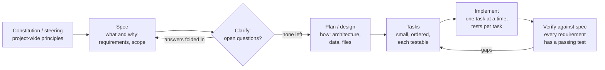

# Spec-Driven Development: The Complete Guide

> 📚 **Before you start**
>
> - [Explore, Plan, Code, Commit](explore-plan-code-commit.md), whose plan step this lesson grows into a full specification
> - [System Prompts at the Right Altitude](../../context-engineering-and-agent-memory/02-the-context-window-as-a-budget/system-prompts-at-the-right-altitude.md), for writing instructions that are specific without being brittle

## Introduction

Before a house is built in Kerala, the family and the architect agree on a plan: three bedrooms, one with an attached bathroom, a kitchen facing east, a sit-out in front. The plan doesn't say which brand of cement to use; it says what the house must be. Masons, electricians and plumbers each work from it, and when the electrician asks "where does the geyser go?", the answer is in the plan, not in someone's memory.

With coding agents, the "masons" are fast and tireless, but they build exactly what they understood, and they understood only what was written down. **Spec-driven development (SDD)** is the practice of writing that plan, a **specification** of what to build and how you'll know it works, before an agent writes code, and keeping it as the reference the agent, the tests and the reviewers all work from. Tools such as GitHub's **Spec Kit** and Amazon's **Kiro** turned this into a formal workflow in 2025, and DeepLearning.AI now teaches it as a course of its own.

By the end of this lesson you'll know what a good spec contains, how to write acceptance criteria an agent can't misread (including the EARS format), how the spec, plan and tasks fit together, how Spec Kit and Kiro run that workflow, how to tie requirements to tests, and when SDD is worth its overhead and when it's a sledgehammer for a nut.

> 💡 **Key Insight**
>
> A spec turns **intent** into something **checkable**. Its value isn't the document; it's the acceptance criteria that become tests, the out-of-scope list that stops the agent wandering, and the single source of truth that a fresh session can pick up. Write specs as small as the problem allows, and make every requirement traceable to a test.

---

## Core Explanation

### 1. From vibe coding to specs

Three ways people give work to coding agents:

| Style | What you give the agent | Works for | Breaks on |
|---|---|---|---|
| **Vibe coding** | A sentence; you react to what comes back | Prototypes, throwaway scripts | Anything you'll maintain; hidden edge cases |
| **Plan-first** | A plan the agent writes and you approve (previous lesson) | Most day-to-day changes | Larger features with real product decisions |
| **Spec-driven** | A written spec of behaviour and acceptance criteria, then a plan, then tasks | Features with many cases, several sessions or several agents | Tiny fixes (too heavy) |

SDD isn't new; it's requirements engineering with a fast, literal-minded implementer. What changed is the cost balance: when code is cheap to generate, the scarce thing is a clear statement of **what** to generate.

Birgitta Böckeler, writing on martinfowler.com in October 2025, described three levels of SDD that are useful vocabulary:

| Level | What happens to the spec | Example |
|---|---|---|
| **Spec-first** | Written before the task, used for that task, then may be dropped | A `SPEC.md` for one feature |
| **Spec-anchored** | Kept and updated as the feature evolves | `specs/` folder maintained alongside code |
| **Spec-as-source** | The spec is the main artefact; humans edit only the spec, code is regenerated | An aspiration; rarely practical today |

Most teams that succeed with SDD today work at the first two levels.

### 2. What a good spec contains

Here is a spec for a small feature: lunch pre-orders for an office canteen in Hyderabad.

```markdown
# Spec: Lunch pre-orders

## Problem
The canteen cooks too much on some days and runs out on others. Employees should
pre-order lunch so the kitchen knows quantities by late morning.

## Users
- Employee: places, changes or cancels today's order
- Canteen manager: sees totals per dish at the cut-off

## Requirements
R1. WHEN an employee places an order before 11:00 IST THE SYSTEM SHALL save it and show "Order confirmed".
R2. WHEN an employee places an order at or after 11:00 IST THE SYSTEM SHALL reject it with "Ordering closed for today".
R3. WHILE ordering is open THE SYSTEM SHALL let an employee change or cancel their order.
R4. IF a dish is sold out THEN THE SYSTEM SHALL reject the order with "Sold out" and suggest the other dishes.
R5. WHEN the manager opens the summary THE SYSTEM SHALL show the count per dish for today.

## Constraints
- Times are Asia/Kolkata; store UTC.
- One order per employee per day.
- Existing auth (employee_id from the session) is reused; no new login.

## Out of scope
- Payments, delivery, dinner, weekly menus.

## Verification
- Unit tests for R1-R5 with fixed clocks (10:59, 11:00, 11:01 IST).
- One end-to-end test: place, change, cancel, summary.
```

The parts that do the work:

| Section | Why the agent needs it |
|---|---|
| **Problem and users** | Lets the agent make sensible small decisions you didn't spell out |
| **Numbered requirements** | Each one can be implemented, tested and referred to ("R4 is failing") |
| **Constraints** | Rules it would otherwise guess (time zones, reuse existing auth) |
| **Out of scope** | Stops scope creep: agents love adding "helpful" extras |
| **Verification** | Says how "done" will be proven, so the agent can prove it |

Notice what the spec does *not* say: no framework choices, no file names, no class design. Those belong in the **plan**, which the agent writes from the spec and you review. Keeping the "what" (spec) separate from the "how" (plan) lets you change the implementation without rewriting the requirements.

### 3. EARS: requirements an agent can't misread

The requirements above follow **EARS** (Easy Approach to Requirements Syntax), a pattern from systems engineering that Kiro uses for acceptance criteria. Each requirement has a fixed shape, so the trigger and the expected behaviour are always explicit:

| Pattern | Template | Example |
|---|---|---|
| Ubiquitous | THE SYSTEM SHALL ... | THE SYSTEM SHALL store times in UTC |
| Event-driven | WHEN *trigger* THE SYSTEM SHALL ... | WHEN an order arrives after 11:00 IST THE SYSTEM SHALL reject it |
| State-driven | WHILE *state* THE SYSTEM SHALL ... | WHILE ordering is open THE SYSTEM SHALL allow changes |
| Unwanted behaviour | IF *condition* THEN THE SYSTEM SHALL ... | IF a dish is sold out THEN THE SYSTEM SHALL reject the order |

Because the shape is fixed, a few lines of code can check a spec for the most common problems: requirements that aren't in EARS form, and vague words that can't be tested.

```python
import re

SPEC_REQUIREMENTS = """
R1. WHEN an employee places an order before 11:00 IST THE SYSTEM SHALL save it and show "Order confirmed".
R2. WHEN an employee places an order at or after 11:00 IST THE SYSTEM SHALL reject it with "Ordering closed for today".
R3. WHILE ordering is open THE SYSTEM SHALL let an employee change or cancel their order.
R4. IF a dish is sold out THEN THE SYSTEM SHALL reject the order with "Sold out" and suggest the other dishes.
R5. WHEN the manager opens the summary THE SYSTEM SHALL show the count per dish for today.
R6. The summary page should load fast and be user-friendly.
"""

EARS = re.compile(r"^(WHEN .+ |WHILE .+ |IF .+ THEN |)THE SYSTEM SHALL .+")
VAGUE = ["fast", "user-friendly", "easy", "appropriate", "etc", "robust", "as needed"]

def lint_requirements(text):
    problems = []
    for line in text.strip().splitlines():
        rid, body = line.split(". ", 1)
        if not EARS.match(body):
            problems.append(f"{rid}: not in EARS form")
        words = [w for w in VAGUE if re.search(rf"\b{re.escape(w)}\b", body, re.I)]
        if words:
            problems.append(f"{rid}: untestable words {words}")
    return problems or ["all requirements look testable"]

for p in lint_requirements(SPEC_REQUIREMENTS):
    print(p)
```

Output:

```
R6: not in EARS form
R6: untestable words ['fast', 'user-friendly']
```

R6 is the kind of line agents can't satisfy and you can't verify. A testable rewrite: *"WHEN the manager opens the summary THE SYSTEM SHALL respond within 300 ms for up to 2,000 orders."* EARS isn't compulsory, but **every requirement must be checkable**, and a fixed form makes that much easier.

### 4. Spec, plan, tasks: the SDD pipeline

Both Spec Kit and Kiro break the work into the same stages. Each produces a file the next stage reads:



| Stage | Spec Kit (GitHub) | Kiro (AWS) |
|---|---|---|
| Project principles | `/speckit-constitution` | Steering files |
| What to build | `/speckit-specify` (then `/speckit-clarify` for open questions) | `requirements.md` with user stories and EARS acceptance criteria (or `bugfix.md` for bug specs) |
| How to build | `/speckit-plan` writes `plan.md` and design artefacts | `design.md`: architecture, sequence diagrams, error handling, testing strategy |
| Work breakdown | `/speckit-tasks` writes `tasks.md` | `tasks.md`: discrete, trackable tasks you can run one by one or all at once |
| Consistency check | `/speckit-analyze` (read-only), `/speckit-checklist` | Approval gates between phases |
| Build | `/speckit-implement`, then `/speckit-converge` until it reports converged | Run tasks from `tasks.md` |

**Spec Kit** is an open source toolkit that installs commands into the agent you already use:

```bash
uv tool install specify-cli
specify init lunch-preorders --integration copilot   # or another agent's integration key
```

You then run the `/speckit-*` commands inside your agent's chat (the hyphenated form is the default skills mode for Copilot; other agents may show a different invocation style). **Kiro** is an agentic IDE where specs are a built-in mode, with a "Quick Spec" variant that writes all three files in one pass without approval gates for well-understood features. Both write plain Markdown into your repository, so the spec is versioned and reviewed like code.

You don't need either tool to practise SDD. With any agent you can ask: *"Interview me about this feature, then write SPEC.md"*, then *"Write PLAN.md from SPEC.md"*, then *"Break PLAN.md into TASKS.md, each task small enough to finish and test in one go"*, and implement task by task, ideally in a **fresh session** that starts from the files rather than from the long conversation that produced them.

### 5. Tasks an agent can finish

Good tasks are small, ordered and each ends in a check. A task list for the spec above:

```markdown
- [ ] T1 (R1, R2) Order model + `place_order()` with cut-off at 11:00 IST; tests at 10:59/11:00/11:01
- [ ] T2 (R3) `change_order()` and `cancel_order()` while open; tests before and after cut-off
- [ ] T3 (R4) Sold-out check and suggestions; tests with one dish sold out
- [ ] T4 (R5) Manager summary endpoint; test counts per dish
- [ ] T5 (all) End-to-end test: place, change, cancel, summary
```

Each task names the **requirements it serves**. That link is what lets you check, mechanically, that nothing was forgotten.

### 6. Traceability: every requirement has a test

The strongest habit in SDD is a **traceability check**: every requirement maps to at least one test, and every test maps to a requirement. Tag tests with requirement IDs (in the name, a docstring or a pytest marker), and a few lines of code find gaps:

```python
import re

TESTS = {
    "test_order_before_cutoff_is_saved": "R1",
    "test_order_at_cutoff_is_rejected": "R2",
    "test_order_after_cutoff_is_rejected": "R2",
    "test_change_while_open": "R3",
    "test_summary_counts_per_dish": "R5",
    "test_order_accepts_emoji_notes": None,       # no requirement: scope creep or missing spec?
}

def trace(requirements_text, tests):
    req_ids = re.findall(r"^(R\d+)\.", requirements_text.strip(), re.M)
    covered = {r for r in tests.values() if r}
    return {
        "requirements without tests": [r for r in req_ids if r not in covered],
        "tests without requirements": sorted(t for t, r in tests.items() if r is None),
    }

for k, v in trace(SPEC_REQUIREMENTS, TESTS).items():
    print(f"{k}: {v}")
```

Output:

```
requirements without tests: ['R4', 'R6']
tests without requirements: ['test_order_accepts_emoji_notes']
```

R4 (sold out) has no test, so it may not be implemented at all. The emoji test points at work nobody asked for. You can run this check in CI, ask the agent to run it before finishing, or put it in a [Stop hook](../04-what-a-harness-is/permissions-hooks-and-approval-modes.md) so the agent can't declare victory with uncovered requirements.

### 7. Keeping the spec and code in sync

A spec that drifts from the code is worse than none, because agents and humans will trust it. Ways teams keep them aligned:

- **Change the spec first.** A behaviour change starts as a spec edit in the same pull request as the code.
- **Reviewers read the spec diff** before the code diff.
- **Run the traceability check in CI**, so a requirement without a test fails the build.
- **Ask the agent to compare.** "Read SPEC.md and the code in `orders/`; list any behaviour the code has that the spec doesn't mention, and any requirement the code doesn't meet." This is exactly what Spec Kit's analyze step and a reviewer subagent do.

### 8. When SDD is worth it, and when it isn't

SDD has real costs. Böckeler's experiments found Kiro turning a small bug into four user stories with sixteen acceptance criteria, Spec Kit producing many repetitive Markdown files that were tedious to review, and agents sometimes ignoring parts of the spec anyway. A practical rule of thumb:

```python
def ceremony_for(files_touched, open_product_questions, sessions_expected, agents_involved):
    score = (files_touched >= 5) + (open_product_questions >= 2) + (sessions_expected > 1) + (agents_involved > 1)
    return ["just ask", "plan first", "short spec", "full SDD", "full SDD"][score]

cases = {
    "typo in error message": (1, 0, 1, 1),
    "add --dry-run to one command": (2, 0, 1, 1),
    "lunch pre-orders feature": (8, 3, 2, 1),
    "migrate auth across 3 services, 2 agents": (40, 4, 5, 2),
}
for name, args in cases.items():
    print(f"{name:<42} -> {ceremony_for(*args)}")
```

Output:

```
typo in error message                      -> just ask
add --dry-run to one command               -> just ask
lunch pre-orders feature                   -> full SDD
migrate auth across 3 services, 2 agents   -> full SDD
```

The thresholds are a judgement call, but the shape is right: the more files, open questions, sessions and agents involved, the more a written spec pays for itself. A spec also shines when work is **handed off**: to a cloud agent that will open a PR overnight, to a second agent, or to tomorrow's fresh session (Module 5 builds on exactly this).

---

## Try It Yourself

1. **Fix R6.** Rewrite R6 as a testable EARS requirement and rerun `lint_requirements` on the corrected text.
2. **Close the gap.** Add a test for R4 to `TESTS` and rerun `trace`. What's left?
3. **Write a spec.** Write a five-requirement spec (with out-of-scope and verification sections) for: "Send an SMS reminder to customers whose gas cylinder booking is pending for more than 3 days."
4. **Choose the ceremony.** Use `ceremony_for` on a change touching 3 files, with 2 open product questions, in one session, by one agent. Do you agree with the result?

<details>
<summary>Show answers</summary>

**1.**

```python
fixed = SPEC_REQUIREMENTS.replace(
    "R6. The summary page should load fast and be user-friendly.",
    "R6. WHEN the manager opens the summary THE SYSTEM SHALL respond within 300 ms for up to 2,000 orders.")
print(lint_requirements(fixed))
```

Output:

```
['all requirements look testable']
```

**2.**

```python
TESTS["test_sold_out_dish_is_rejected_with_suggestions"] = "R4"
print(trace(SPEC_REQUIREMENTS, TESTS))
```

Output:

```
{'requirements without tests': ['R6'], 'tests without requirements': ['test_order_accepts_emoji_notes']}
```

R6 still needs a test (a performance test with 2,000 orders), and the emoji test still needs a requirement or should be removed.

**3.** For example:
R1. WHEN a booking has been pending for more than 72 hours THE SYSTEM SHALL send one SMS reminder to the customer's registered number.
R2. IF a reminder was already sent for this booking THEN THE SYSTEM SHALL NOT send another within 24 hours.
R3. WHILE the customer has opted out of SMS THE SYSTEM SHALL not send reminders.
R4. WHEN an SMS fails to send THE SYSTEM SHALL retry once after 10 minutes and log the failure.
R5. THE SYSTEM SHALL send reminders only between 09:00 and 20:00 IST.
Out of scope: WhatsApp, email, rescheduling bookings. Verification: unit tests with a fake clock and a fake SMS gateway for R1-R5.

**4.**

```python
print(ceremony_for(3, 2, 1, 1))
```

Output:

```
plan first
```

A plan is a reasonable minimum, but two open product questions mean someone has to make decisions the agent can't. A short interview that settles them (and writes them into the plan) is worth it. A rule of thumb is a starting point; open questions are often the strongest signal that a spec is needed.

</details>

---

## Real-World Examples

- **An insurance product team** keeps a `specs/` folder (spec-anchored). Every behaviour change starts as a spec PR; agents implement from the merged spec, and the traceability check runs in CI.
- **A startup** uses the interview-then-spec pattern for every feature larger than a day: the agent asks twenty questions, writes `SPEC.md`, and a fresh session implements it task by task.
- **A consultancy** found full SDD tooling too heavy for bug fixes and kept it for new features only, using plan-first for everything else.

---

## Common Misconceptions

### "A spec is a long document"

A good spec is as short as the problem allows. The lunch pre-order spec fits on one screen. Length isn't rigour; testable requirements are.

### "With a spec, the agent will do exactly what's written"

Agents still skip, misread or over-apply parts of a spec. The spec makes deviations **detectable** (through tests and traceability), not impossible.

### "SDD replaces code review"

You now review two things: the spec (is this what we want?) and the code (does it do what the spec says, and nothing else?).

### "Spec-as-source is where everyone is heading"

It's an interesting direction, but regenerating code from specs inherits the problems model-driven development had, plus the non-determinism of LLMs. Spec-first and spec-anchored are what work reliably today.

---

## Interview Relevance

*"What is spec-driven development and when would you use it?"* A strong answer: a written spec of behaviour and acceptance criteria (often EARS) drives a plan and small tasks, which an agent implements one by one with tests; the spec stays as the source of truth (spec-first or spec-anchored). Name Spec Kit and Kiro as tooling, and explain the trade-off: worth it for multi-file features, open product questions, multi-session or multi-agent work and handoffs to cloud agents; overkill for small fixes. Mention traceability (every requirement has a test) and keeping the spec in sync through spec-first PRs and CI checks.

---

## Key Takeaways

- **SDD writes down what to build and how to prove it** before an agent codes, and keeps that as the shared reference.
- **A good spec has numbered, testable requirements, constraints, out-of-scope and verification**; EARS makes requirements unambiguous.
- **Spec → plan → tasks → implement → verify** is the pipeline in Spec Kit (`/speckit-*` commands) and Kiro (`requirements.md`, `design.md`, `tasks.md`).
- **Traceability** (every requirement has a test, every test has a requirement) is the check that catches forgotten and invented work.
- **Match ceremony to the problem**: full SDD for big, uncertain or handed-off work; a plan or a direct ask for small changes.

---

**Up next:** [Reviewing AI-Written Code](reviewing-ai-written-code.md)
