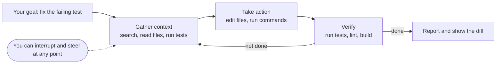

# The Coding Agent Landscape: Claude Code, Codex, Gemini CLI, Copilot and Cursor: The Complete Guide

> 📚 **Before you start**
>
> - [How This Course Works](../01-start-here/how-this-course-works.md)
> - [The Agent Loop: Decide, Act, Observe](../../agentic-ai-fundamentals/03-the-agent-loop/the-agent-loop-decide-act-observe.md) and [How an Agent Decides What to Do Next](../../agentic-ai-fundamentals/03-the-agent-loop/how-an-agent-decides-what-to-do-next.md), for the loop and the idea of a harness that checks each step
> - [Memory Files: CLAUDE.md and AGENTS.md](../../context-engineering-and-agent-memory/04-memory-systems/memory-files-claude-md-and-agents-md.md), for the instruction files every agent reads
> - [Agent Skills](../../tools-agent-skills-and-code-execution/course.md#m4) (Tools, Agent Skills and Code Execution), since every tool here loads `SKILL.md` folders

## Introduction

Walk into any Indian railway station and you can buy a ticket at the counter, at a machine, on the IRCTC app, or through an agent. They look different, but underneath they all talk to the same reservation system, follow the same rules (quota, fare class, waiting list) and print the same kind of ticket. Once you understand the system underneath, switching between them is easy.

Coding agents are like that in 2026. There are many of them: **Claude Code** from Anthropic, **Codex** from OpenAI, **Gemini CLI** from Google (now being replaced by **Antigravity CLI**), **GitHub Copilot**, **Cursor**, and more. Their screens and commands differ, but underneath they share the same machinery: an agent loop that reads your repository, edits files and runs commands; an instructions file it reads at the start; a permission system that decides what needs your approval; hooks that run your scripts at fixed moments; subagents; skills; MCP for outside tools; and some kind of sandbox.

This lesson is the map. By the end you'll know what a coding agent actually is, the parts every one of them has, where each major tool keeps its configuration, the three ways you can run any of them (interactive, headless, cloud), and how to choose between them for a task.

> 💡 **Key Insight**
>
> Learn the **shared anatomy**, not the brand. Every serious coding agent is the same loop (gather context, act, verify) wrapped in the same kinds of controls: instruction files, permission rules, hooks, subagents, skills, MCP and sandboxes. Once you can find those seven things in one tool, you can find them in any tool in an afternoon.

---

## Core Explanation

### 1. From autocomplete to agent

Three generations of AI coding help now sit side by side:

| Generation | What it does | You | Example |
|---|---|---|---|
| **Completion** | Predicts the next few lines as you type | Accept or reject each suggestion | Inline suggestions in an editor |
| **Chat** | Answers questions and writes code you paste in | Copy, paste, run, fix | A chat panel next to your code |
| **Agent** | Reads the repo, edits many files, runs commands and tests, iterates until done | Give a goal, approve risky steps, review the diff | Claude Code, Codex, Copilot agent mode |

A **coding agent** is the third kind: an LLM running in a loop inside your project, with tools for reading, searching, editing and executing. Anthropic's docs describe Claude Code's loop as three blended phases, **gather context, take action, verify results**, and call the layer around the model that provides tools and manages context the **agentic harness**. That's the same loop you built in [The Agent Loop: Decide, Act, Observe](../../agentic-ai-fundamentals/03-the-agent-loop/the-agent-loop-decide-act-observe.md), pointed at a code repository.



### 2. The shared anatomy


*The parts in the ring around the loop are what the rest of this course teaches you to control.*

| Part | What it is | Taught in |
|---|---|---|
| **Agent loop + built-in tools** | Read, search (glob and grep), edit, write, shell, web fetch | [Model plus Harness](../04-what-a-harness-is/model-plus-harness-the-parts-of-an-agent-runtime.md) |
| **Instruction file** | Markdown loaded at the start of every session: `CLAUDE.md`, `AGENTS.md`, `GEMINI.md` | [Memory Files](../../context-engineering-and-agent-memory/04-memory-systems/memory-files-claude-md-and-agents-md.md), [Repository Instructions](../03-coding-agents-on-github/repository-instructions-agents-md-and-custom-instructions.md) |
| **Permissions and modes** | Which actions run freely, which ask you, which are refused | [Permissions, Hooks and Approval Modes](../04-what-a-harness-is/permissions-hooks-and-approval-modes.md) |
| **Hooks** | Your scripts, run at fixed points such as "before a tool runs" | Same lesson |
| **Subagents, commands, plugins** | Helpers with their own context, saved prompts, installable bundles | [Subagents, Slash Commands and Plugins](../04-what-a-harness-is/subagents-slash-commands-and-plugins.md) |
| **Skills** | `SKILL.md` folders loaded on demand | [Agent Skills](../../tools-agent-skills-and-code-execution/course.md#m4) |
| **MCP servers** | Outside tools: GitHub, issue trackers, browsers, databases | [The GitHub MCP Server](../03-coding-agents-on-github/the-github-mcp-server.md) |
| **Sandbox** | An OS or container boundary around what commands can touch | [Sandboxes](../04-what-a-harness-is/sandboxes-containers-microvms-and-hosted-sandboxes.md) |

The **Agent Skills** format and **AGENTS.md** are open standards shared across vendors: the same skill folder or instruction file works in Claude Code, Codex, Gemini CLI, Copilot and Cursor, which is a big reason the tools feel more alike every month.

### 3. Claude Code

**Claude Code** is Anthropic's coding agent. The same loop runs in the terminal (`claude`), the VS Code and JetBrains extensions, a desktop app, the browser at claude.ai/code (cloud sessions on Anthropic-managed machines), Slack, and CI (the GitHub Action you met in [Running Coding Agents in GitHub Actions](../03-coding-agents-on-github/running-coding-agents-in-github-actions.md)). The **Claude Agent SDK** exposes the same loop as a Python and TypeScript library.

| Piece | Where it lives in Claude Code |
|---|---|
| Instructions | `CLAUDE.md` (project, user, nested folders); can read `AGENTS.md`; plus "auto memory" Claude writes itself |
| Settings and permissions | `.claude/settings.json` (shared), `.claude/settings.local.json` (personal), `~/.claude/settings.json` (user), managed settings for organizations |
| Permission modes | `default` (labelled Manual), `acceptEdits`, `plan`, `auto` (a classifier reviews actions), `dontAsk`, `bypassPermissions`; `Shift+Tab` cycles in the terminal |
| Hooks | `hooks` section of settings files; events such as `PreToolUse`, `PostToolUse`, `Stop`, `SessionStart` |
| Subagents | `.claude/agents/<name>.md` with YAML front matter; built-ins `Explore` and `Plan` |
| Skills and commands | `.claude/skills/<name>/SKILL.md`; older `.claude/commands/<name>.md` files still work and create `/name` |
| Plugins | Bundles of skills, agents, hooks and MCP servers, installed with `/plugin` from a marketplace |
| Sandbox | Built-in Bash sandbox (`/sandbox`; Seatbelt on macOS, bubblewrap on Linux and WSL2), dev containers, cloud sessions |
| Undo | Checkpoints (`Esc Esc` or `/rewind`), plus git |
| Headless | `claude -p "task"` with `--output-format json` or `stream-json` |

### 4. OpenAI Codex

**Codex** is OpenAI's coding agent, available as a CLI (`codex`), IDE extension, desktop app and **Codex Cloud**, where each task runs in its own cloud workspace that can keep going while your laptop sleeps (start one from the web or with `codex cloud` in the terminal).

| Piece | Where it lives in Codex |
|---|---|
| Instructions | `AGENTS.md` (OpenAI started the format). Codex reads `~/.codex/AGENTS.md`, then walks from the repo root down to your folder, taking `AGENTS.override.md` or `AGENTS.md` in each, up to 32 KiB combined by default (`project_doc_max_bytes`) |
| Config | `~/.codex/config.toml` and a project `.codex/` layer that only loads once you trust the project |
| Sandbox modes | `sandbox_mode`: `read-only`, `workspace-write` (the everyday default for local work), `danger-full-access` |
| Approvals | `approval_policy`: `on-request` (ask when going beyond the sandbox) or `never`; `approvals_reviewer` can send eligible prompts to a reviewer agent (`auto_review`) |
| Command rules | Starlark `.rules` files in a `rules/` folder (for example `~/.codex/rules/default.rules`) with `prefix_rule(...)` decisions `allow`, `prompt` or `forbidden` |
| Hooks | `hooks.json` or `[hooks]` tables in `config.toml`; events include `PreToolUse`, `PostToolUse`, `UserPromptSubmit`, `Stop` |
| Subagents | One TOML file per agent in `.codex/agents/`; built-ins `default`, `worker`, `explorer` |
| Headless | `codex exec "task"` (read-only sandbox by default; add `--sandbox workspace-write` to let it edit) |

The sandbox is OS-level: Seatbelt on macOS, bubblewrap on Linux and WSL2, and a native Windows sandbox in PowerShell.

### 5. Gemini CLI and Antigravity CLI

**Gemini CLI** was Google's open source terminal agent and grew a large community. On 19 May 2026 Google announced it is transitioning Gemini CLI to the new **Antigravity CLI**, part of its Antigravity agent platform. For individual users (free, AI Pro and AI Ultra), Gemini CLI stopped serving requests on **18 June 2026**; enterprise Gemini Code Assist customers and paid API keys keep access. Google says skills, hooks, subagents and extensions (now called Antigravity plugins) carry over, though not with full parity on day one.

You'll still meet Gemini CLI in companies, and its design is worth knowing because it is fully documented:

| Piece | Where it lives in Gemini CLI |
|---|---|
| Instructions | `GEMINI.md` files in a hierarchy (global, project, folders) |
| Settings | `.gemini/settings.json` (project), `~/.gemini/settings.json` (user), system settings |
| Approval modes | `default`, `autoEdit`, `plan` (read-only research), `yolo` (everything auto-approved) |
| Policy engine | TOML rules in `~/.gemini/policies/` with `decision = "allow" | "deny" | "ask_user"` and a priority |
| Hooks | `BeforeTool`, `AfterTool`, `BeforeModel`, `AfterAgent`, `SessionStart` and more, configured in `settings.json` |
| Subagents | `.gemini/agents/*.md`; built-ins such as `codebase_investigator` |
| Sandbox | `--sandbox` with macOS Seatbelt profiles, Docker, Podman, gVisor or LXC |
| Undo | Checkpointing (off by default) into a shadow git repository; `/restore` |

### 6. GitHub Copilot

You'll study Copilot in depth in Module 3, so here is only its place on the map: inline suggestions and chat in many editors, **agent mode** in the IDE, **Copilot CLI** in the terminal (`copilot`, with `--allow-tool` and `--deny-tool` for permissions), and **Copilot cloud agent**, which works in a GitHub Actions-powered environment and opens draft pull requests. GitHub's **Agent HQ** also lets you assign issues to Anthropic's Claude and OpenAI's Codex agents with the same protections. Copilot reads `.github/copilot-instructions.md`, path-specific `.instructions.md` files, `AGENTS.md`, and also `CLAUDE.md` or `GEMINI.md`.

### 7. Cursor

**Cursor** is an AI-first code editor (a fork of VS Code) whose Agent edits across files and runs terminal commands. Its harness pieces:

| Piece | Where it lives in Cursor |
|---|---|
| Instructions | Project rules as `.mdc` files in `.cursor/rules/` with `description`, `globs` and `alwaysApply`; also `AGENTS.md` (nested files combine) |
| Rule types | Always Apply, Auto Attached (by glob), Agent Requested (by description), Manual (by @-mention) |
| Hooks | `.cursor/hooks.json` (project) or `~/.cursor/hooks.json`; events such as `beforeShellExecution`, `afterFileEdit`, `preToolUse`, `stop` |
| Cloud agents | Formerly "background agents": isolated cloud VMs that clone your repo, work on a branch and open a PR; started from the editor, web, Slack, GitHub (`@cursor`), Linear or the API |

### 8. The same idea in every tool's words

Here is one team policy, "read anything, run tests freely, ask before other shell commands, never push or delete recursively", written for three tools. A small Python script generates each file so you can see the formats side by side:

```python
import json

POLICY = {
    "always_allow": ["pytest", "ruff check"],
    "never": ["git push", "rm -rf"],
}

def claude_settings(policy):
    """.claude/settings.json: rules are Tool(specifier); deny beats ask beats allow."""
    return json.dumps({"permissions": {
        "allow": [f"Bash({cmd} *)" for cmd in policy["always_allow"]],
        "deny": [f"Bash({cmd} *)" for cmd in policy["never"]],
    }}, indent=2)

def codex_rules(policy):
    """~/.codex/rules/default.rules: Starlark prefix rules; the strictest match wins."""
    lines = []
    for cmd in policy["always_allow"]:
        lines.append(f'prefix_rule(pattern={cmd.split()!r}, decision="allow")')
    for cmd in policy["never"]:
        lines.append(f'prefix_rule(pattern={cmd.split()!r}, decision="forbidden", '
                     f'justification="team policy")')
    return "\n".join(lines).replace("'", '"')

def gemini_policy(policy):
    """~/.gemini/policies/team.toml: higher priority wins within a tier."""
    blocks = []
    for cmd in policy["always_allow"]:
        blocks.append(f'[[rule]]\ntoolName = "run_shell_command"\ncommandPrefix = "{cmd}"\n'
                      f'decision = "allow"\npriority = 100')
    for cmd in policy["never"]:
        blocks.append(f'[[rule]]\ntoolName = "run_shell_command"\ncommandPrefix = "{cmd}"\n'
                      f'decision = "deny"\npriority = 200')
    return "\n\n".join(blocks)

print("# Claude Code\n" + claude_settings(POLICY))
print("\n# Codex\n" + codex_rules(POLICY))
print("\n# Gemini CLI (first two rules)\n" + "\n\n".join(gemini_policy(POLICY).split("\n\n")[:2]))
```

Output:

```
# Claude Code
{
  "permissions": {
    "allow": [
      "Bash(pytest *)",
      "Bash(ruff check *)"
    ],
    "deny": [
      "Bash(git push *)",
      "Bash(rm -rf *)"
    ]
  }
}

# Codex
prefix_rule(pattern=["pytest"], decision="allow")
prefix_rule(pattern=["ruff", "check"], decision="allow")
prefix_rule(pattern=["git", "push"], decision="forbidden", justification="team policy")
prefix_rule(pattern=["rm", "-rf"], decision="forbidden", justification="team policy")

# Gemini CLI (first two rules)
[[rule]]
toolName = "run_shell_command"
commandPrefix = "pytest"
decision = "allow"
priority = 100

[[rule]]
toolName = "run_shell_command"
commandPrefix = "ruff check"
decision = "allow"
priority = 100
```

Different syntax, identical idea: **allow, ask, deny**, matched on the command, enforced by the harness and not by the model. Notice also what none of them can promise. A rule that matches the *text* `rm -rf` won't catch `find . -delete`. That's why the course pairs permission rules with sandboxes in Module 4.

### 9. Three ways to run any agent

Every tool on this page can run in three modes:

| Mode | You | Typical command | Good for |
|---|---|---|---|
| **Interactive** | Watch, approve, steer | `claude`, `codex`, `copilot`, Cursor's Agent panel | Exploratory work, unfamiliar code, anything risky |
| **Headless** | Script it; read JSON output | `claude -p "..."`, `codex exec "..."`, `copilot -p "..."`, `gemini -p "..."` | CI jobs, pre-commit checks, batch migrations |
| **Cloud / async** | Hand off, review a PR later | Claude Code on the web, Codex Cloud, Copilot cloud agent, Cursor cloud agents | Well-specified tasks, many in parallel |

```bash
# Headless examples (not executed here)
claude -p "List the API endpoints in src/" --output-format json
codex exec --sandbox workspace-write "Fix the failing test in tests/test_billing.py"
copilot -p "Summarise the test failures" --allow-tool='shell(pytest)'
```

Headless runs have no human to answer a prompt, so permission settings matter even more there: Claude Code's `dontAsk` mode denies anything not pre-approved, Codex's `exec` starts read-only, and Gemini's policy engine treats `ask_user` as `deny` in non-interactive mode.

### 10. Choosing an agent

There is no single best agent; there is a best fit for a team and a task. Questions that actually decide it:

| Question | Why it matters |
|---|---|
| **Where does your code live?** | Copilot cloud agent and Agent HQ are tightly tied to GitHub; others work with any git host locally |
| **Which models are you allowed to use?** | Company policy often fixes the provider (Anthropic, OpenAI, Google, or via a cloud like Bedrock or Vertex) |
| **Terminal or editor?** | Terminal agents (Claude Code, Codex, Copilot CLI) script well; editor agents (Cursor, Copilot agent mode) are smoother for visual review |
| **Do you need async cloud runs?** | Cloud agents let you run ten tasks while you sleep, but each needs a prepared environment |
| **What controls does your security team require?** | Managed settings, audit logs, sandboxes and network allowlists differ by tool and plan |
| **What's already in the repo?** | `AGENTS.md` and Agent Skills work everywhere; a pile of tool-specific config ties you to one |

A good habit for teams: keep shared knowledge in **portable** files (`AGENTS.md`, `SKILL.md` folders, tests, linters) and keep tool-specific files thin. A two-line `CLAUDE.md` that imports `@AGENTS.md`, or Codex's fallback filenames, let one source of truth serve every agent.

```python
PORTABLE = {"AGENTS.md", ".agents/skills/", "tests/", "pyproject.toml (ruff, pytest config)"}
TOOL_SPECIFIC = {".claude/settings.json", ".codex/config.toml", ".gemini/settings.json",
                 ".cursor/rules/", ".github/copilot-instructions.md"}

def lock_in_score(files):
    tool = sum(1 for f in files if f in TOOL_SPECIFIC)
    return f"{tool}/{len(files)} files are tool-specific"

repo = ["AGENTS.md", "tests/", ".claude/settings.json", ".cursor/rules/", ".github/copilot-instructions.md"]
print(lock_in_score(repo))
```

Output:

```
3/5 files are tool-specific
```

Tool-specific files aren't bad (permissions and hooks are necessarily per tool), but **knowledge** (how to build, test and what the conventions are) should live in the portable layer.

---

## Try It Yourself

1. **Find the seven parts.** For the agent you use most, write down where each of these lives: instructions, permissions, hooks, subagents, skills, MCP config, sandbox.
2. **Translate a policy.** Extend `POLICY` with `"always_allow": [..., "npm test"]` and regenerate all three files. What does the Codex rule for `npm test` look like?
3. **Pick the mode.** Interactive, headless or cloud? (a) Rename a function in 400 files overnight; (b) investigate a memory leak you don't understand yet; (c) a pre-commit check that comments on risky SQL; (d) twelve small, well-specified bug issues.
4. **Spot the gap.** Your Claude Code settings deny `Bash(rm -rf *)`. Name two commands that delete files and aren't caught, and say what would stop them.

<details>
<summary>Show answers</summary>

**1.** For Claude Code, for example: `CLAUDE.md`; `.claude/settings.json` `permissions`; `hooks` in the same file; `.claude/agents/`; `.claude/skills/`; `.mcp.json` or `claude mcp add`; `/sandbox` or a dev container.

**2.**

```python
POLICY["always_allow"].append("npm test")
print(codex_rules(POLICY).splitlines()[2])
```

Output:

```
prefix_rule(pattern=["npm", "test"], decision="allow")
```

**3.** (a) Headless (a loop of `claude -p` or `codex exec` runs, or a cloud agent per batch), because the change is mechanical and checkable. (b) Interactive: you don't know the answer yet and need to steer. (c) Headless in a hook or CI job. (d) Cloud agents, one issue each, reviewed as pull requests.

**4.** For example `find . -name '*.py' -delete` and `python -c "import shutil; shutil.rmtree('src')"`. Text-matching rules can't anticipate every spelling; a sandbox that only allows writes inside the project (plus git and backups) limits the damage, and a `PreToolUse` hook can add smarter checks.

</details>

---

## Real-World Examples

- **A fintech team in Bengaluru** standardised on `AGENTS.md` plus a shared skills folder because developers used three different agents. Each tool's own config shrank to permission rules and hooks.
- **An open source maintainer** runs Codex Cloud tasks for small issues overnight and keeps Claude Code open locally for design work, comparing PRs from both.
- **A platform team** uses headless agents in CI only, with exact allowlists, so nothing interactive runs on shared infrastructure.

---

## Common Misconceptions

### "The tools are fundamentally different products"

Their surfaces differ; their anatomy is converging fast. Open standards (AGENTS.md, Agent Skills, MCP) and copied good ideas (hooks, subagents, plan mode, sandboxes) mean skills transfer between tools.

### "Choosing the agent with the best benchmark score is enough"

Benchmarks measure a model in someone else's harness. In your repo, instructions, tests, permissions and environment setup decide most of the outcome.

### "Permission rules make the agent safe"

They are text-pattern checks on what the agent asks to do. They cut risk but can be bypassed by an unexpected spelling. Combine them with sandboxes and review.

### "Gemini CLI skills are wasted now"

Skills, hooks, subagents and extensions carry over to Antigravity CLI, and `SKILL.md` folders work across most agents anyway.

---

## Interview Relevance

*"Compare two coding agents you've used."* A strong answer avoids brand loyalty and walks the anatomy: the loop and built-in tools, instruction files (`CLAUDE.md`, `AGENTS.md`), permission model (Claude Code's modes and allow/ask/deny rules versus Codex's sandbox modes, approval policy and `.rules`), hooks, subagents, sandboxing, and the three run modes (interactive, headless, cloud). Mention open standards for portability and the practical selection criteria: model policy, git host, terminal versus editor, async needs and security controls.

*"How would you roll out coding agents to a team using different tools?"* Portable knowledge in `AGENTS.md` and skills; thin tool-specific configs for permissions and hooks; tests and linters as the shared verification layer; PR review unchanged.

---

## Key Takeaways

- **A coding agent is an LLM in a loop inside your repo**, with tools to read, search, edit and run; the layer around the model is the harness.
- **Every tool has the same seven parts**: instructions, permissions, hooks, subagents and commands, skills, MCP, and a sandbox.
- **Claude Code, Codex, Gemini CLI (now moving to Antigravity CLI), Copilot and Cursor** differ in syntax and surfaces, not in these ideas.
- **Every agent runs interactive, headless or in the cloud**; headless and cloud runs need tighter permissions and better task specs.
- **Keep knowledge portable** (AGENTS.md, skills, tests) and tool-specific config thin.

---

**Up next:** [Explore, Plan, Code, Commit](explore-plan-code-commit.md)
