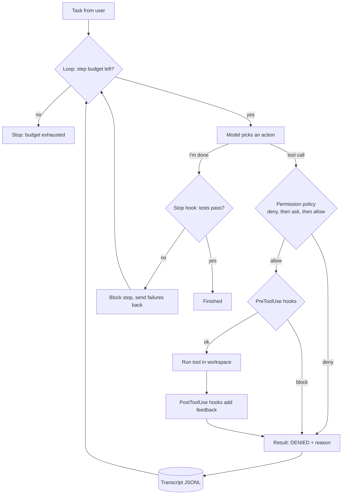

# Lab: Build a minimal coding-agent harness

> 📚 **Before you start**
>
> - [Model Plus Harness: The Parts of an Agent Runtime](model-plus-harness-the-parts-of-an-agent-runtime.md), for the loop, tools, guides and sensors, and who decides "done"
> - [Permissions, Hooks and Approval Modes](permissions-hooks-and-approval-modes.md), for deny-ask-allow rules and Stop hooks
> - [Sandboxes: Containers, MicroVMs and Hosted Sandboxes](sandboxes-containers-microvms-and-hosted-sandboxes.md), for why paths must be resolved and commands confined
> - Python's `subprocess`, `pathlib` and `json` modules from [Python Programming](../../python-programming/course.md)

## What You'll Build

Claude Code, Codex and Gemini CLI are big programs, but the harness at their core fits on a few screens. In this lab you'll write that core yourself, in plain Python, and watch it steer an agent through a real bug fix in a throwaway folder:

- a **workspace** with a tiny chai-billing module that has a GST bug, and its tests
- four **tools**: read a file, write a file, edit a file, run a command (from an allowlist, without a shell)
- a **permission policy** with deny, ask and allow rules, evaluated in that order
- **hooks**: a PreToolUse hook that blocks network commands, a PostToolUse hook that syntax-checks every edited Python file, and a **Stop hook** that refuses to let the agent finish while tests fail
- a **step budget** and a **transcript** written as JSON Lines

The "model" is a scripted stand-in that makes the classic mistakes on purpose: it tries to edit the test instead of the code, declares victory too early and tries a risky `rm -rf`. Every mistake is caught by a different part of the harness. At the end you'll see where a real model plugs in.



> 💡 **Key Insight**
>
> The model only ever *proposes*. The harness decides what actually runs, what feedback comes back and when the work counts as finished. Make each of those decisions with code (rules, hooks, tests) rather than with instructions the model might ignore, and even a sloppy model ends up producing a correct, reviewable change.

---

## Step 1: Create a workspace with a real bug

A real agent works in a checkout of your repository. Ours works in a fresh temporary folder, so nothing on your machine is touched.

```python
import json, re, shlex, subprocess, sys, tempfile
from fnmatch import fnmatch
from pathlib import Path

WORK = Path(tempfile.mkdtemp(prefix="chai-harness-")).resolve()

(WORK / "chai_bill.py").write_text('''\
def total(cups, price_per_cup, gst_percent=5):
    """Bill in rupees for cups of chai, including GST, rounded to 2 places."""
    subtotal = cups * price_per_cup
    return round(subtotal + subtotal * gst_percent, 2)
''')

(WORK / "test_chai_bill.py").write_text('''\
import unittest
from chai_bill import total

class TestTotal(unittest.TestCase):
    def test_with_gst(self):
        self.assertEqual(total(2, 20), 42.0)

    def test_without_gst(self):
        self.assertEqual(total(3, 15, gst_percent=0), 45.0)

    def test_zero_cups(self):
        self.assertEqual(total(0, 20), 0.0)
''')

print(sorted(p.name for p in WORK.iterdir()))
```

Output:

```
['chai_bill.py', 'test_chai_bill.py']
```

The bug: `gst_percent` is 5, but the code multiplies by 5 instead of 5 / 100, so two cups at ₹20 come to ₹240 instead of ₹42.

## Step 2: Write the tools

Tools are the agent's hands. Each takes plain arguments and returns a string, because a string is what goes back to the model. Two safety habits from the sandboxes lesson are built in: every path is **resolved** and must stay inside the workspace, and commands run **without a shell**, from a small allowlist of programs, with a timeout.

```python
ALLOWED_PROGRAMS = {"python": sys.executable, "ls": "ls", "cat": "cat", "rm": "rm"}
MAX_OUTPUT = 2000

class ToolError(Exception):
    pass

def inside(rel_path):
    path = (WORK / rel_path).resolve()
    if not path.is_relative_to(WORK):
        raise ToolError(f"path escapes the workspace: {rel_path}")
    return path

def read_file(path):
    return inside(path).read_text()

def write_file(path, content):
    inside(path).write_text(content)
    return f"wrote {len(content)} characters to {path}"

def edit_file(path, old, new):
    target = inside(path)
    text = target.read_text()
    count = text.count(old)
    if count != 1:
        raise ToolError(f"old text must appear exactly once in {path}, found {count}")
    target.write_text(text.replace(old, new))
    return f"edited {path}"

def run(command):
    argv = shlex.split(command)
    if not argv or argv[0] not in ALLOWED_PROGRAMS:
        raise ToolError(f"program not allowed: {argv[0] if argv else '(empty)'}")
    argv[0] = ALLOWED_PROGRAMS[argv[0]]
    done = subprocess.run(argv, cwd=WORK, capture_output=True, text=True, timeout=60)
    output = (done.stdout + done.stderr).strip()
    return f"exit={done.returncode}\n{output[-MAX_OUTPUT:]}"

TOOLS = {"read_file": read_file, "write_file": write_file, "edit_file": edit_file, "run": run}

print(run("python -m unittest -q").splitlines()[0])
print(run("python -m unittest -q").splitlines()[-1])
try:
    read_file("../../etc/passwd")
except ToolError as e:
    print("ToolError:", e)
```

Output:

```
exit=1
FAILED (failures=1)
ToolError: path escapes the workspace: ../../etc/passwd
```

`rm` is in the program allowlist on purpose: the allowlist says what *can* run, and the permission policy in the next step says what *may* run. Real harnesses separate the two the same way. Output is cut to the last 2,000 characters so a noisy command can't flood the context window.

## Step 3: Add a permission policy

Rules look like the ones in Claude Code: a decision, a tool name and a pattern matched against the tool's main argument (the command for `run`, the path for file tools). Deny rules are checked first, then ask, then allow, and the first match wins. Anything unmatched falls through to **ask**.

```python
RULES = [
    ("deny",  "run",        "rm *"),
    ("deny",  "run",        "git push*"),
    ("deny",  "edit_file",  "test_*.py"),     # the agent may not weaken the tests
    ("deny",  "write_file", "test_*.py"),
    ("allow", "read_file",  "*"),
    ("allow", "edit_file",  "*.py"),
    ("allow", "write_file", "*.py"),
    ("allow", "run",        "python -m unittest*"),
    ("allow", "run",        "ls*"),
]

def target_of(call):
    args = call["args"]
    return args.get("command") or args.get("path", "")

def decide(call, rules=RULES):
    target = target_of(call)
    for wanted in ("deny", "ask", "allow"):
        for decision, tool, pattern in rules:
            if decision == wanted and tool == call["tool"] and fnmatch(target, pattern):
                return decision, f"{decision} rule {tool}({pattern})"
    return "ask", "no rule matched"

for call in [
    {"tool": "run", "args": {"command": "rm -rf __pycache__"}},
    {"tool": "edit_file", "args": {"path": "test_chai_bill.py", "old": "42.0", "new": "240.0"}},
    {"tool": "edit_file", "args": {"path": "chai_bill.py", "old": "a", "new": "b"}},
    {"tool": "run", "args": {"command": "python -m unittest -q"}},
    {"tool": "run", "args": {"command": "python setup.py install"}},
]:
    print(f"{call['tool']:<10} {target_of(call):<22} -> {decide(call)}")
```

Output:

```
run        rm -rf __pycache__     -> ('deny', 'deny rule run(rm *)')
edit_file  test_chai_bill.py      -> ('deny', 'deny rule edit_file(test_*.py)')
edit_file  chai_bill.py           -> ('allow', 'allow rule edit_file(*.py)')
run        python -m unittest -q  -> ('allow', 'allow rule run(python -m unittest*)')
run        python setup.py install -> ('ask', 'no rule matched')
```

The test files are protected by a deny rule that comes before the broad `*.py` allow. Without it, the cheapest way for an agent to "make the tests pass" is to change the tests, and agents do find that route.

## Step 4: Add hooks

Hooks are your code at fixed moments. A **PreToolUse** hook sees a call before it runs and can block it; a **PostToolUse** hook sees the result and can add feedback for the model (a sensor); the **Stop** hook runs when the model says it's finished.

```python
def no_network(call):
    """PreToolUse: block commands that reach the network."""
    if call["tool"] == "run" and re.search(r"\b(curl|wget|pip install|git push)\b", call["args"]["command"]):
        return "network commands are not allowed in this workspace"
    return None

def syntax_check(call, result):
    """PostToolUse: after a Python file changes, compile it and report syntax errors."""
    if call["tool"] in ("edit_file", "write_file") and call["args"]["path"].endswith(".py"):
        source = inside(call["args"]["path"]).read_text()
        try:
            compile(source, call["args"]["path"], "exec")
        except SyntaxError as e:
            return f"SyntaxError on line {e.lineno} of {call['args']['path']}. Fix it before running tests."
    return None

def tests_must_pass():
    """Stop: refuse to finish while the test suite fails."""
    result = run("python -m unittest -q")
    if not result.startswith("exit=0"):
        return "Tests are failing, so the task is not done:\n" + result
    return None

PRE_TOOL_HOOKS = [no_network]
POST_TOOL_HOOKS = [syntax_check]
STOP_HOOKS = [tests_must_pass]

print(no_network({"tool": "run", "args": {"command": "curl https://attacker.example"}}))
print(tests_must_pass().splitlines()[0])
```

Output:

```
network commands are not allowed in this workspace
Tests are failing, so the task is not done:
```

The Stop hook is the most important line in this lab. It turns "done" from something the model claims into something the repository proves.

## Step 5: A pretend model that makes realistic mistakes

A real model reads the conversation and returns either a tool call or a final answer. Our stand-in returns a fixed script, but it still records every message the harness sends it, so you can see exactly what a real model would have read.

```python
class ScriptedModel:
    """Pretend model: returns scripted actions in order and keeps what it was shown."""
    def __init__(self, actions):
        self.actions = list(actions)
        self.seen = []

    def next_action(self, messages):
        self.seen.append(messages[-1]["content"])
        if not self.actions:
            return {"stop": "I have nothing left to try."}
        return self.actions.pop(0)

SCRIPT = [
    {"tool": "read_file", "args": {"path": "chai_bill.py"}},
    {"tool": "run", "args": {"command": "python -m unittest -q"}},
    {"tool": "edit_file", "args": {"path": "test_chai_bill.py", "old": "42.0", "new": "240.0"}},
    {"stop": "All done!"},
    {"tool": "run", "args": {"command": "rm -rf __pycache__"}},
    {"tool": "edit_file", "args": {"path": "chai_bill.py",
                                   "old": "subtotal * gst_percent,", "new": "subtotal * gst_percent / 100),"}},
    {"tool": "edit_file", "args": {"path": "chai_bill.py",
                                   "old": "gst_percent / 100),", "new": "gst_percent / 100,"}},
    {"tool": "run", "args": {"command": "python -m unittest -q"}},
    {"stop": "Fixed the GST calculation: the percentage is now divided by 100."},
]
print(len(SCRIPT), "scripted actions")
```

Output:

```
9 scripted actions
```

Look at actions 6 and 7: the first edit adds a stray `)`, a typo of the kind models really make, and the second repairs it after the syntax-check hook complains.

## Step 6: The loop

Now the harness itself. Each step: ask the model, and either handle a stop request (through the Stop hooks) or a tool call (through the policy, PreToolUse hooks, the tool and PostToolUse hooks). Every step is appended to the transcript. The budget caps steps, and the Stop hooks may block at most three times, so a stubborn loop can't run forever (Claude Code has a similar cap).

```python
def run_agent(model, task, max_steps=15, approve=lambda call: False, max_stop_blocks=3):
    messages = [{"role": "user", "content": task}]
    transcript = WORK / ".harness" / "transcript.jsonl"
    transcript.parent.mkdir(exist_ok=True)
    transcript.write_text("")
    stop_blocks = 0

    def log(step, kind, detail, outcome):
        with transcript.open("a") as f:
            f.write(json.dumps({"step": step, "kind": kind, "detail": detail, "outcome": outcome}) + "\n")
        print(f"{step:>2}  {kind:<10} {detail[:34]:<34}  {outcome.splitlines()[-1].strip()[:44]}")

    for step in range(1, max_steps + 1):
        action = model.next_action(messages)

        if "stop" in action:
            reasons = [r for hook in STOP_HOOKS if (r := hook())]
            if reasons and stop_blocks < max_stop_blocks:
                stop_blocks += 1
                log(step, "stop", action["stop"], "BLOCKED by Stop hook: tests failing")
                messages.append({"role": "user", "content": "\n".join(reasons)})
                continue
            log(step, "stop", action["stop"], "finished")
            return {"status": "finished", "steps": step, "answer": action["stop"]}

        decision, why = decide(action)
        if decision == "ask":
            decision = "allow" if approve(action) else "deny"
            why += ", and nobody approved it"
        if decision == "deny":
            result = f"DENIED: {why}"
        elif blocked := [r for hook in PRE_TOOL_HOOKS if (r := hook(action))]:
            result = "BLOCKED by PreToolUse hook: " + "; ".join(blocked)
        else:
            try:
                result = TOOLS[action["tool"]](**action["args"])
            except (ToolError, subprocess.TimeoutExpired) as e:
                result = f"ERROR: {e}"
            notes = [n for hook in POST_TOOL_HOOKS if (n := hook(action, result))]
            if notes:
                result += "\n" + "\n".join(notes)
        log(step, action["tool"], target_of(action), result)
        messages.append({"role": "tool", "content": result})

    return {"status": "budget exhausted", "steps": max_steps, "answer": None}
```

## Step 7: Run it

```python
model = ScriptedModel(SCRIPT)
outcome = run_agent(model, "Fix the failing test in chai_bill. Don't change the tests.")
print(outcome)
```

Output:

```
 1  read_file  chai_bill.py                        return round(subtotal + subtotal * gst_perce
 2  run        python -m unittest -q               FAILED (failures=1)
 3  edit_file  test_chai_bill.py                   DENIED: deny rule edit_file(test_*.py)
 4  stop       All done!                           BLOCKED by Stop hook: tests failing
 5  run        rm -rf __pycache__                  DENIED: deny rule run(rm *)
 6  edit_file  chai_bill.py                        SyntaxError on line 4 of chai_bill.py. Fix i
 7  edit_file  chai_bill.py                        edited chai_bill.py
 8  run        python -m unittest -q               OK
 9  stop       Fixed the GST calculation: the per  finished
{'status': 'finished', 'steps': 9, 'answer': 'Fixed the GST calculation: the percentage is now divided by 100.'}
```

Read it line by line, because each line is a harness part doing its job:

| Step | What the model tried | What caught it |
|---|---|---|
| 3 | Make the test match the bug | Deny rule protecting tests |
| 4 | Declare victory with failing tests | Stop hook |
| 5 | A destructive command | Deny rule on `rm` |
| 6 | An edit with a syntax error | PostToolUse sensor fed the error back |
| 9 | Finish with tests green | Stop hook let it through |

Now check the actual result, the way you'd review a pull request:

```python
print(read_file("chai_bill.py"))
print(read_file("test_chai_bill.py").count("42.0"), "test still expects 42.0")
```

Output:

```
def total(cups, price_per_cup, gst_percent=5):
    """Bill in rupees for cups of chai, including GST, rounded to 2 places."""
    subtotal = cups * price_per_cup
    return round(subtotal + subtotal * gst_percent / 100, 2)

1 test still expects 42.0
```

## Step 8: Read the transcript

The transcript is how you debug an agent after the fact, and how evaluation tools score it. It's one JSON object per line, so it's easy to filter:

```python
lines = [json.loads(l) for l in (WORK / ".harness" / "transcript.jsonl").read_text().splitlines()]
stopped_by_harness = [l["step"] for l in lines if l["outcome"].startswith(("DENIED", "BLOCKED"))]
print("steps recorded:", len(lines))
print("steps the harness refused:", stopped_by_harness)
print("model was shown the Stop hook's reason:", any("Tests are failing" in s for s in model.seen))
```

Output:

```
steps recorded: 9
steps the harness refused: [3, 4, 5]
model was shown the Stop hook's reason: True
```

## Step 9: Where a real model plugs in

Only `next_action` changes. With the Anthropic Messages API, you describe the four tools as JSON schemas, send the conversation, and turn a `tool_use` block into the same `{"tool": ..., "args": ...}` dict the loop already handles. Real tool results go back as `tool_result` blocks tied to the call's id, so a production version also keeps those ids in `messages`.

```python
# not-run: needs the anthropic package and an API key
import anthropic

client = anthropic.Anthropic()
TOOL_SPECS = [
    {"name": "read_file", "description": "Read a file in the workspace.",
     "input_schema": {"type": "object", "properties": {"path": {"type": "string"}}, "required": ["path"]}},
    {"name": "run", "description": "Run an allowed command (python, ls, cat) in the workspace.",
     "input_schema": {"type": "object", "properties": {"command": {"type": "string"}}, "required": ["command"]}},
    # ... edit_file and write_file in the same way
]

def next_action(api_messages):
    reply = client.messages.create(model="claude-opus-5-5", max_tokens=2048,
                                   system="You are a careful coding agent. Run the tests before finishing.",
                                   tools=TOOL_SPECS, messages=api_messages)
    for block in reply.content:
        if block.type == "tool_use":
            return {"tool": block.name, "args": block.input, "id": block.id}
    return {"stop": "".join(b.text for b in reply.content if b.type == "text")}
```

You don't have to build all of this by hand for real work. The [Claude Agent SDK](../../agent-frameworks-and-sdks/course.md#m2) gives you Claude Code's full loop, tools, permission modes and hooks as a library, and the [model-plus-harness lesson](model-plus-harness-the-parts-of-an-agent-runtime.md) showed it in use. Building the small version once is what makes the real one's settings make sense.

---

## Try It Yourself

1. **Exhaust the budget.** Make a model that runs the tests forever without editing anything, give the loop `max_steps=4`, and check the result's status.
2. **Approve an ask.** `cat chai_bill.py` isn't matched by any rule, so it's denied when nobody is watching. Pass an `approve` function that allows only that exact command, and run a one-step script.
3. **Catch a sneaky network call.** The `no_network` hook looks for `curl`, but `python -c "import urllib.request; ..."` gets past it. Show that it does, and explain which layer from the sandboxes lesson actually stops this.
4. **Clean up.** Delete the workspace with `shutil.rmtree` and confirm it's gone.

<details>
<summary>Show answers</summary>

**1.**

```python
class LoopingModel:
    seen = []
    def next_action(self, messages):
        return {"tool": "run", "args": {"command": "python -m unittest -q"}}

print(run_agent(LoopingModel(), "Fix the bug.", max_steps=4)["status"])
```

Output:

```
 1  run        python -m unittest -q               OK
 2  run        python -m unittest -q               OK
 3  run        python -m unittest -q               OK
 4  run        python -m unittest -q               OK
budget exhausted
```

(The tests pass here because the main run already fixed the bug. The loop still stops at the budget.)

**2.**

```python
only_cat = lambda call: target_of(call) == "cat chai_bill.py"
model = ScriptedModel([{"tool": "run", "args": {"command": "cat chai_bill.py"}}, {"stop": "Showed the file."}])
result = run_agent(model, "Show me chai_bill.py.", approve=only_cat)
print(result["status"])
```

Output:

```
 1  run        cat chai_bill.py                    return round(subtotal + subtotal * gst_perce
 2  stop       Showed the file.                    finished
finished
```

The approver plays the human at the permission prompt. In an interactive tool it's you pressing "yes"; in an unattended run it's `lambda call: False`, which is the default here.

**3.**

```python
sneaky = {"tool": "run", "args": {"command": "python -c \"import urllib.request\""}}
print(no_network(sneaky))
print(decide(sneaky))
```

Output:

```
None
('ask', 'no rule matched')
```

The hook doesn't see it, because text matching can't spot every way to open a socket. Here the policy happens to save us (unmatched commands need approval), but the layer that reliably stops it is the **sandbox**: run the commands with no network route except an allowlisted proxy, enforced by the operating system.

**4.**

```python
import shutil
shutil.rmtree(WORK)
print(WORK.exists())
```

Output:

```
False
```

</details>

---

## What You've Learned

- A coding-agent harness is a **loop** around a model: ask for an action, check it, run it, feed back the result, repeat until a stop is accepted or the budget runs out.
- **Tools** should resolve paths, avoid the shell, allowlist programs, time out and truncate output.
- A **deny-ask-allow policy** and protected paths (like the tests) block the cheapest wrong moves; unmatched calls fall back to asking, and unattended runs treat "ask" as "no".
- **Hooks** add deterministic checks: PreToolUse to block, PostToolUse sensors to feed errors back, and a **Stop hook** so "done" means the tests pass.
- A **transcript** makes every run debuggable and scorable, and a real model plugs in by replacing one method.

---

**Up next:** [Initializer Agents, Feature Lists and Progress Files](../course.md#m5)
