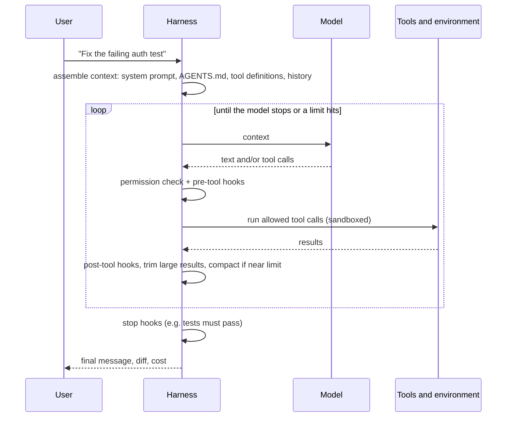

# Model plus Harness: the Parts of an Agent Runtime: The Complete Guide

> 📚 **Before you start**
>
> - [The Coding Agent Landscape](../02-working-with-coding-agents/the-coding-agent-landscape-claude-code-codex-gemini-cli-copilot-and-cursor.md), for the shared anatomy of coding agents
> - [Running Coding Agents in GitHub Actions](../03-coding-agents-on-github/running-coding-agents-in-github-actions.md), where you already ran a harness headless with restricted tools
> - [Anatomy of an Agent](../../agentic-ai-fundamentals/03-the-agent-loop/anatomy-of-an-agent.md) and [Function Calling Step by Step](../../agentic-ai-fundamentals/04-tools-and-function-calling/function-calling-step-by-step.md), for the loop and `stop_reason`
> - [Tool Results that Don't Flood the Window](../../context-engineering-and-agent-memory/03-just-in-time-context/tool-results-that-don-t-flood-the-window.md) and [Compaction and Summarisation](../../context-engineering-and-agent-memory/03-just-in-time-context/compaction-and-summarisation.md)
> - [Claude Agent SDK](../../agent-frameworks-and-sdks/course.md#m2) (Agent Frameworks and SDKs), helpful but not required

## Introduction

A Formula 1 driver is extraordinary, but nobody wins a race with a driver alone. The car's steering, brakes and traction control decide what the driver's inputs actually do. The pit wall watches telemetry and radios advice. The rule book limits speed in the pit lane. Tyre data from the last lap shapes the next one. Change the car and the same driver gets very different results.

In agent engineering, the model is the driver and the **harness** is everything else. The term spread through 2025 and 2026: Anthropic's Claude Code documentation calls the layer that provides tools and manages what the model sees "the agentic harness"; OpenAI titled a February 2026 report on building a million-line product with Codex "Harness engineering"; and Birgitta Böckeler's April 2026 article on martinfowler.com summed it up as **agent = model + harness**.

Module 2 used harnesses. This module opens one up. By the end of this lesson you'll be able to name every part of an agent runtime, explain what each does on every turn, map those parts onto Claude Code, Codex and the Claude Agent SDK, classify any harness control as a **guide** or a **sensor**, and judge which parts of a harness are worth changing for your situation.

> 💡 **Key Insight**
>
> The model only ever does one thing: read a context and write the next message. **Everything else is harness**: what goes into that context, which tools exist, which requested actions are allowed to run, where they run, what is checked afterwards, what is remembered, and when to stop. That's why the same model can be brilliant in one tool and clumsy in another.

---

## Core Explanation

### 1. What exactly is "the harness"?


*Every box except the model's single call inside "the loop" is harness, and almost all of it is configurable.*

There are two harnesses in play when you use a coding agent:

| Layer | Who builds it | Examples |
|---|---|---|
| **Builder harness** | The tool vendor | Claude Code's loop, built-in tools, compaction, permission system; Codex's sandbox and approval engine |
| **Outer harness** | You and your team | `AGENTS.md`, permission rules, hooks, custom subagents, skills, sandboxes, the tests and linters in your repo, CI |

Böckeler's framing focuses on the second: as a user you can't rewrite Claude Code's loop, but the outer harness you add decides how much you can trust the agent to work without supervision. If you build agents with an SDK, you own both layers.

### 2. The loop: the beating heart

Strip any agent runtime down and you find this loop. You built a version in [Function Calling Step by Step](../../agentic-ai-fundamentals/04-tools-and-function-calling/function-calling-step-by-step.md); here it is annotated with the harness's jobs:



The model appears in exactly one arrow per turn. Every other arrow is the harness working.

### 3. The parts, one by one

| Part | Job on every turn | In Claude Code | In Codex |
|---|---|---|---|
| **Loop and limits** | Call the model, run tools, decide when to stop | Agent loop; `max_turns`, `max_budget_usd` in the SDK | Agent loop; `codex exec` for one-shot runs |
| **Context assembly** | Build the request: system prompt, instructions, tools, history, reminders | System prompt + `CLAUDE.md` + git status + system reminders | System prompt + `AGENTS.md` chain (32 KiB default cap) |
| **Tools** | The actions available: read, search, edit, shell, web, subagents | `Read`, `Edit`, `Write`, `Glob`, `Grep`, `Bash`, `WebFetch`, `Agent` and more | Shell, `apply_patch`-style editing, web, MCP |
| **Context management** | Keep the window useful: trim, clear old results, compact, defer tool schemas | Clears old tool outputs first, then summarises; MCP schemas deferred by default | Compaction (hooks `PreCompact`/`PostCompact` exist) |
| **Permissions** | Decide allow, ask or deny for each requested action | Modes + allow/ask/deny rules | Approval policy + `.rules` |
| **Hooks** | Run your code at lifecycle points | `PreToolUse`, `PostToolUse`, `Stop` and many more | Same core events |
| **Execution environment** | Where commands actually run, and what they can touch | Local, Bash sandbox, dev container, cloud VM | `read-only` / `workspace-write` / `danger-full-access` sandbox, Codex Cloud |
| **State** | What survives between turns and sessions | JSONL session files (resume, fork), checkpoints, auto memory | Session files (`codex exec resume`), cloud task history |
| **Extensions** | Add capabilities without changing the core | Skills, MCP servers, subagents, plugins | Skills, MCP, subagents, plugins |
| **Interfaces** | How humans and programs drive it | Terminal, IDE, desktop, web, `claude -p`, Agent SDK | Terminal, IDE, app, cloud, `codex exec` |

The rest of this module zooms in: permissions and hooks next, then subagents, commands and plugins, then sandboxes, and finally a lab where you build every part yourself in a few hundred lines of Python.

### 4. Context assembly: what the model actually reads

People underestimate how much the harness writes into the context before your prompt even arrives. A rough picture of turn one in a coding agent:

```python
CHARS_PER_TOKEN = 4   # the rough English approximation used in Context Engineering

def tokens(text_or_chars):
    n = text_or_chars if isinstance(text_or_chars, int) else len(text_or_chars)
    return n // CHARS_PER_TOKEN

turn_one = {
    "harness system prompt (role, tool rules, git rules, safety)": 11_000 * 4,
    "built-in tool definitions (12 tools, JSON schemas)": 9_500 * 4,
    "MCP tool names only (schemas deferred until needed)": 400 * 4,
    "skill names + descriptions (6 skills)": 600 * 4,
    "CLAUDE.md / AGENTS.md": 1_800 * 4,
    "environment: cwd, OS, date, git branch and status": 350 * 4,
    "your prompt": "Fix the failing test in tests/test_auth.py and run the suite.",
}

total = sum(tokens(v) for v in turn_one.values())
for part, value in turn_one.items():
    t = tokens(value)
    print(f"{t:>7,}  {t / total:>4.0%}  {part}")
print(f"{total:>7,}  total before the model has done anything")
```

Output:

```
 11,000   46%  harness system prompt (role, tool rules, git rules, safety)
  9,500   40%  built-in tool definitions (12 tools, JSON schemas)
    400    2%  MCP tool names only (schemas deferred until needed)
    600    3%  skill names + descriptions (6 skills)
  1,800    8%  CLAUDE.md / AGENTS.md
    350    1%  environment: cwd, OS, date, git branch and status
     15    0%  your prompt
 23,665  total before the model has done anything
```

The numbers here are illustrative (they're characters divided by four, and real sizes vary by tool and version; run `/context` in Claude Code to see your own), but the shape is real: **your prompt is a tiny fraction of what the model reads**. That's why harness choices dominate behaviour. It also explains several design decisions you'll meet:

- **Stable content goes first** so it can be prompt-cached across turns ([Prompt Caching](../../context-engineering-and-agent-memory/02-the-context-window-as-a-budget/prompt-caching.md)).
- **MCP tool schemas and skill bodies are deferred**: only names and descriptions load until needed ([Tool Search and Deferred Loading](../../tools-agent-skills-and-code-execution/course.md#m3)).
- **Instruction files must be short**, because every line is paid on every request.

### 5. Tools: the agent's hands

A coding agent's built-in tools are deliberately few and general. Each was designed around a failure the vendors saw:

| Tool | Design choice | The failure it prevents |
|---|---|---|
| **Read** with line numbers, offsets and limits | Read part of a big file | Flooding the context with a 10,000-line file |
| **Edit** by exact string replacement (Claude Code) or patches (Codex's `apply_patch`) | The model must quote what it replaces | Rewriting a whole file and silently dropping code |
| **Glob / Grep** as dedicated tools | Structured, bounded search results | `find /` dumping thousands of lines |
| **Bash** with a timeout and background option | Long commands don't hang the loop | A dev server that never returns |
| **Agent / subagent** | Delegated work in a fresh context | Exploration filling the main context |
| **Ask the user** | A structured question tool | The model guessing when it should ask |

Here is why exact-string editing is such a good harness design, in miniature:

```python
def edit_file(text, old, new):
    """Claude Code-style edit: old must appear exactly once, or the edit is refused."""
    count = text.count(old)
    if count == 0:
        return text, "error: old_string not found; read the file again"
    if count > 1:
        return text, f"error: old_string appears {count} times; include more context"
    return text.replace(old, new), "ok"

source = "def area(r):\n    return 3.14 * r * r\n\ndef circ(r):\n    return 2 * 3.14 * r\n"
for old, new in [("3.14", "math.pi"),
                 ("return 3.14 * r * r", "return math.pi * r * r"),
                 ("return 3.142 * r", "return 2 * math.pi * r")]:
    source, status = edit_file(source, old, new)
    print(f"{old!r:<26} -> {status}")
```

Output:

```
'3.14'                     -> error: old_string appears 2 times; include more context
'return 3.14 * r * r'      -> ok
'return 3.142 * r'         -> error: old_string not found; read the file again
```

The tool turns two classic model mistakes (ambiguous edits and edits based on a misremembered file) into **clear errors the model can recover from**, instead of silent corruption. That pattern, *make wrong actions fail loudly with a helpful message*, recurs everywhere in harness engineering (see [Error Messages that Help the Agent Recover](../../tools-agent-skills-and-code-execution/course.md#m2)).

### 6. Guides and sensors

Böckeler's article gives a vocabulary that makes any harness easier to reason about:

| | **Computational** (deterministic, cheap, fast) | **Inferential** (an LLM judges; slower, fuzzier) |
|---|---|---|
| **Guides** (feedforward: shape the action *before* it happens) | Code templates, codemods, type signatures, a pre-tool hook that rewrites a command | `AGENTS.md`, skills, specs, plans, coding-convention docs |
| **Sensors** (feedback: observe *after* and let the agent self-correct) | Tests, linters, type checkers, structural tests, a post-edit hook that runs the formatter | AI code review, LLM-as-judge, a reviewer subagent |

Good harnesses use all four quadrants. Two rules of thumb from practice:

- **Prefer computational sensors where possible.** A test that fails is unambiguous; an LLM reviewer can be talked round.
- **Write sensor output for the model to read.** A linter message that says *what to do* ("move this import to `providers/`; UI may not import `repo/` directly") fixes the problem in one turn. OpenAI's harness engineering team made this a core practice. You'll build such linters in [Linters and Tests that Teach the Agent](../06-harness-engineering-for-codebases/linters-and-tests-that-teach-the-agent.md).

And one rule about *where*: **keep quality left**. Cheap checks (format, lint, type check) belong right after every edit; expensive ones (full test suite, reviewer agent) belong before a commit or a stop.

### 7. Stopping: who decides "done"?

The loop ends in one of a few ways, and each is a harness decision:

```python
def run_loop(model_steps, max_turns=6, budget_usd=0.50, stop_check=None):
    """A tiny loop that shows every way a harness can end a run."""
    spent = 0.0
    for turn, step in enumerate(model_steps, 1):
        spent += step["cost"]
        if step["kind"] == "final":
            if stop_check and not stop_check():
                print(f"turn {turn}: model wants to stop -> stop hook says no: tests failing")
                continue                     # the harness sends the model back to work
            return f"success after {turn} turns (${spent:.2f})"
        if turn >= max_turns:
            return f"error_max_turns after {turn} turns (${spent:.2f})"
        if spent >= budget_usd:
            return f"error_max_budget after {turn} turns (${spent:.2f})"
        print(f"turn {turn}: tool call {step['tool']}")
    return "model stopped responding"

tests_pass = iter([False, True])
steps = [{"kind": "tool", "tool": "Bash(pytest)", "cost": 0.05},
         {"kind": "tool", "tool": "Edit(auth.py)", "cost": 0.07},
         {"kind": "final", "cost": 0.03},                  # "Done!" (but tests still fail)
         {"kind": "tool", "tool": "Edit(auth.py)", "cost": 0.06},
         {"kind": "final", "cost": 0.03}]
print(run_loop(steps, stop_check=lambda: next(tests_pass)))
```

Output:

```
turn 1: tool call Bash(pytest)
turn 2: tool call Edit(auth.py)
turn 3: model wants to stop -> stop hook says no: tests failing
turn 4: tool call Edit(auth.py)
success after 5 turns ($0.24)
```

| Ending | Who decides | Real-world equivalent |
|---|---|---|
| Model replies without tool calls | The model | `stop_reason: "end_turn"`; SDK result subtype `success` |
| A stop check refuses | Your hook | Claude Code and Codex `Stop` hooks returning `decision: "block"` with a reason |
| Turn limit | Your config | `max_turns` → `error_max_turns` in the Claude Agent SDK |
| Budget limit | Your config | `max_budget_usd` → `error_max_budget_usd` |
| Human interrupt | You | `Esc`, Ctrl+C, cancelling a cloud task |

The stop check is one of the most powerful harness pieces you can add, because it closes the "declares victory too early" failure that Anthropic saw in long-running agents. Next lesson shows the real configuration.

### 8. The same harness as a library: the Claude Agent SDK

The **Claude Agent SDK** packages Claude Code's harness (loop, built-in tools, context management, permissions, hooks, subagents, sessions) as a Python and TypeScript library. A minimal agent that fixes failing tests, with the harness choices made explicit:

```python
# not-run: needs `pip install claude-agent-sdk` and an Anthropic API key
import asyncio
from claude_agent_sdk import query, ClaudeAgentOptions, ResultMessage

async def main():
    options = ClaudeAgentOptions(
        allowed_tools=["Read", "Edit", "Glob", "Grep", "Bash"],  # auto-approved tools
        setting_sources=["project"],    # load CLAUDE.md, skills and hooks from this repo
        max_turns=30,                   # loop limit
        max_budget_usd=2.0,             # spend limit
        model="claude-opus-5-5",
    )
    async for message in query(prompt="Make the tests in tests/test_auth.py pass", options=options):
        if isinstance(message, ResultMessage):
            print(message.subtype, message.session_id)   # success, error_max_turns, ...
            if message.subtype == "success":
                print(message.result)

asyncio.run(main())
```

Example output:

```
success 3f6c1a2e-...
Fixed the token expiry comparison in auth/session.py; all 14 tests in tests/test_auth.py pass.
```

Every keyword argument is a harness decision you'd otherwise make in settings files. Other vendors offer the same idea: OpenAI's Agents SDK added a "model-native harness" with sandbox agents in April 2026, and LangChain's **Deep Agents** builds a harness (planning, a virtual filesystem, subagents, `AGENTS.md` memory, skills) on top of LangGraph.

### 9. Harnesses encode assumptions about the model

The most important strategic idea in harness engineering comes from Anthropic's March 2026 write-up on long-running application development: **every harness component encodes an assumption about something the model can't do on its own**. A planner exists because the model under-scopes; a separate evaluator exists because models grade their own work too kindly; context resets exist because some models wrap up early as the window fills.

Those assumptions go stale. With one model, the team needed context resets and sprint-by-sprint contracts; with a newer model they removed both and kept the planner and a final evaluator. Their advice:

1. **Stress-test each component**: remove one at a time and measure on realistic tasks.
2. **Re-examine the harness when the model changes**: strip what's no longer load-bearing, add what new capabilities make possible.
3. **Read the traces.** The transcript shows which harness pieces actually changed behaviour.

```python
harness = {
    "planner agent": "model under-scopes big prompts",
    "context resets": "model wraps up early near the context limit",
    "sprint contracts": "model loses coherence over multi-hour builds",
    "separate evaluator": "model grades its own work too kindly",
    "test-gated Stop hook": "model declares victory early",
}
still_true_for_new_model = {"model under-scopes big prompts", "model grades its own work too kindly",
                            "model declares victory early"}

for component, assumption in harness.items():
    verdict = "keep" if assumption in still_true_for_new_model else "try removing"
    print(f"{verdict:<13} {component:<22} (assumes: {assumption})")
```

Output:

```
keep          planner agent          (assumes: model under-scopes big prompts)
try removing  context resets         (assumes: model wraps up early near the context limit)
try removing  sprint contracts       (assumes: model loses coherence over multi-hour builds)
keep          separate evaluator     (assumes: model grades its own work too kindly)
keep          test-gated Stop hook   (assumes: model declares victory early)
```

This mirrors what Anthropic's team actually did: the planner and an evaluator stayed, while context resets and sprint contracts went. The point isn't these particular verdicts; it's the habit of writing down **why** each component exists, so that when the model changes you know exactly which assumptions to re-test.

---

## Try It Yourself

1. **Re-test an assumption.** After a model upgrade your traces show the agent still loses coherence on multi-hour builds. Update `still_true_for_new_model` and rerun the verdicts. Which components does that bring back?
2. **Your own context budget.** Change `turn_one` to model a repository with a 6,000-token `AGENTS.md` and 40 skills. What share does the instructions file take now?
3. **Classify the controls.** Guide or sensor, computational or inferential? (a) `ruff check` after every edit; (b) a skill describing your API conventions; (c) a reviewer subagent; (d) a pre-tool hook that rewrites `pip install` to `uv pip install`; (e) a type checker.
4. **Add a stopping rule.** Extend `run_loop` so the run also stops with `error_repeated_failure` if the same tool call appears three times in a row.

<details>
<summary>Show answers</summary>

**1.**

```python
still_true_for_new_model.add("model loses coherence over multi-hour builds")
for component, assumption in harness.items():
    if assumption in still_true_for_new_model:
        print("keep", component)
```

Output:

```
keep planner agent
keep sprint contracts
keep separate evaluator
keep test-gated Stop hook
```

Sprint contracts come back. Context resets stay out unless the early-wrap-up behaviour returns too.

**2.**

```python
turn_one["CLAUDE.md / AGENTS.md"] = 6_000 * 4
turn_one["skill names + descriptions (6 skills)"] = 4_000 * 4   # about 100 tokens per skill x 40
total = sum(tokens(v) for v in turn_one.values())
print(f"instructions share: {tokens(turn_one['CLAUDE.md / AGENTS.md']) / total:.0%}")
```

Output:

```
instructions share: 19%
```

**3.** (a) Computational sensor. (b) Inferential guide. (c) Inferential sensor. (d) Computational guide (it shapes the action before it runs). (e) Computational sensor.

**4.**

```python
def run_loop_v2(model_steps, max_repeats=3):
    recent = []
    for turn, step in enumerate(model_steps, 1):
        if step["kind"] == "final":
            return f"success after {turn} turns"
        recent = (recent + [step["tool"]])[-max_repeats:]
        if len(recent) == max_repeats and len(set(recent)) == 1:
            return f"error_repeated_failure: {step['tool']} x{max_repeats}"
    return "model stopped responding"

stuck = [{"kind": "tool", "tool": "Bash(npm test)"}] * 5
print(run_loop_v2(stuck))
```

Output:

```
error_repeated_failure: Bash(npm test) x3
```

</details>

---

## Real-World Examples

- **OpenAI's harness engineering team** built a product of about a million lines with Codex writing all the code. Their effort went into the harness: a short `AGENTS.md` as a map, docs as the system of record, per-worktree app instances agents can boot, custom linters with fix-it messages, and background cleanup agents.
- **Anthropic's Labs team** wrapped Claude in a planner, generator and evaluator harness for multi-hour app builds, then removed pieces as newer models made them unnecessary.
- **A platform team** built an internal "PR fixer" on the Claude Agent SDK: same loop and tools as Claude Code, but with `max_turns`, a budget cap, a fixed tool list and a stop hook that runs the repo's test command.

---

## Common Misconceptions

### "The harness is just the system prompt"

The system prompt is one guide among many. Tools, permissions, hooks, sandboxes, context management, state and stopping rules are all harness, and most of them aren't text at all.

### "If it's in AGENTS.md, the agent will do it"

Instruction files are inferential guides: strong suggestions. Anything that must always happen belongs in a computational control (a hook, a permission rule, a test).

### "More harness is always better"

Every component costs tokens, time or attention, and some encode assumptions newer models no longer need. Measure and remove.

### "You can't change a vendor's harness"

You can't rewrite its loop, but most of what matters (instructions, tools via MCP and skills, permissions, hooks, sandbox, tests) is the outer harness, and that's yours.

---

## Interview Relevance

*"What is an agent harness?"* A strong answer: everything around the model's single call per turn: the loop and stopping rules, context assembly (system prompt, instruction files, tool definitions, environment), tools and their design, context management (trimming, compaction, deferred loading, subagents), permissions and hooks, the execution environment and sandbox, state (sessions, checkpoints, progress files) and interfaces (CLI, SDK). Distinguish the vendor's builder harness from the outer harness a team adds. Use the guides/sensors and computational/inferential vocabulary, and mention that harness components encode assumptions about model limits that should be re-tested when models change.

*"How would you build a coding agent product?"* Start from an SDK that provides the loop and tools (Claude Agent SDK, OpenAI Agents SDK, Deep Agents), then design permissions, sandboxing, stop conditions, observability and evaluation around your use case.

---

## Key Takeaways

- **Agent = model + harness**; the model writes the next message, the harness does everything else.
- **The parts**: loop and limits, context assembly, tools, context management, permissions, hooks, execution environment, state, extensions and interfaces.
- **Most of the context is harness-written**, so harness choices dominate behaviour; your prompt is a tiny fraction.
- **Guides shape actions before they happen; sensors give feedback after**; prefer computational sensors and write their messages for the model.
- **Harness pieces encode assumptions about model limits**; test them, and remove what newer models no longer need.

---

**Up next:** [Permissions, Hooks and Approval Modes](permissions-hooks-and-approval-modes.md)
