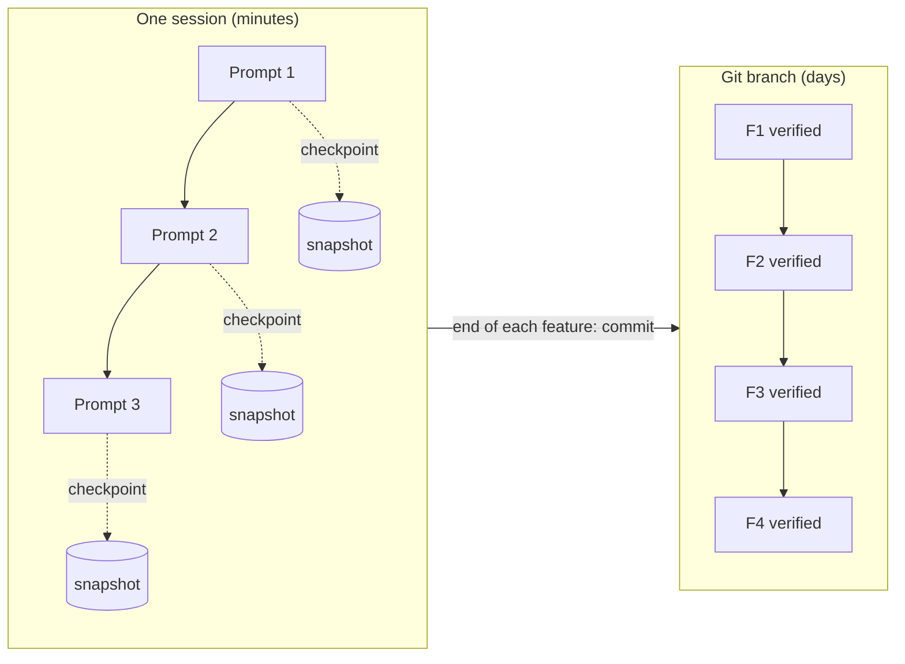

# Git as a Safety Net and Checkpoints: The Complete Guide

> 📚 **Before you start**
>
> - [Handing Off across Context Windows](handing-off-across-context-windows.md) and [Initializer Agents, Feature Lists and Progress Files](initializer-agents-feature-lists-and-progress-files.md)
> - From [Git and GitHub: Zero to Pro](../../git-and-github-zero-to-pro/course.md): [Undoing Things: restore, reset, revert and cherry-pick](../../git-and-github-zero-to-pro/04-branching-and-merging/undoing-things-restore-reset-revert-and-cherry-pick.md) and [Stash, Worktrees and Bisect](../../git-and-github-zero-to-pro/04-branching-and-merging/stash-worktrees-and-bisect.md). This lesson assumes you know those commands and shows how a harness uses them
> - [Permissions, Hooks and Approval Modes](../04-what-a-harness-is/permissions-hooks-and-approval-modes.md), for deny rules

## Introduction

A cricket scorer writes down every ball. If the umpire later changes a decision (a no-ball that wasn't, a four that was a six), the scorer doesn't re-watch the match; they go back to that ball in the book, fix it, and the total follows. The book is valuable because it's complete, written in small entries, and never erased, only corrected.

An agent working for hours makes hundreds of changes. Some will be wrong, and you often won't notice until much later, when a test that passed at noon fails at 6 p.m. Two tools let you go back: the **checkpoints** that coding agents take automatically during a session, and **git**, which the harness should use as the agent's scorebook. They work at different scales and catch different mistakes, and long-running agents need both.

By the end of this lesson you'll know what agent checkpoints do and don't capture, a commit discipline for agents (one verified feature per commit, on a branch), how to find a bad agent commit automatically with `git bisect run`, how to undo it safely with `git revert`, how to take your own lightweight checkpoints that don't disturb the branch, and which git commands to deny an agent.

> 💡 **Key Insight**
>
> Checkpoints undo the last few minutes; git undoes the last few days. Make the agent commit small, verified steps on its own branch, and you can find and reverse any mistake mechanically, without trusting anyone's memory of what happened.

---

## Core Explanation

### 1. Two undo systems

| | **Agent checkpoints** | **Git** |
|---|---|---|
| Created | Automatically, by the harness | When someone commits |
| Scope | One session | The whole project history |
| Captures | Edits made by the agent's own file tools | Everything in the working tree you `git add` |
| Typical undo | "Go back three prompts" | "Undo the commit from yesterday afternoon" |
| Shared with others | No | Yes, once pushed |

**Claude Code** takes a checkpoint before each prompt that starts a turn and keeps the last 100 in a session. `/rewind` (or `Esc` `Esc` with an empty prompt) opens a menu where you can restore code, the conversation, or both, to any of those points. The docs list what it **doesn't** capture:

- Files changed by **shell commands** (`rm`, `mv`, `cp`, `sed -i`, a code generator, a formatter run through Bash)
- Most **subagent** edits
- Edits made **outside** the session (by you, or by another concurrent session)
- Symlinked or hard-linked files

**Gemini CLI**'s checkpointing (when enabled) snapshots the project into a shadow git repository before file-modifying tools run, and `/restore` rolls back. Both tools say the same thing in their docs: checkpoints are for quick, session-level recovery and **not a replacement for version control**.



### 2. Commit discipline for agents

The rules that make git a safety net are the ones from the initializer pattern, made explicit:

1. **Work on a branch**, never on `main`. The agent's whole run is one branch, merged only after review. Branch protection on `main` (from [Branch Protection, Rulesets and CODEOWNERS](../../git-and-github-zero-to-pro/06-collaborating-on-github/branch-protection-rulesets-and-codeowners.md)) makes that a server-side rule, not a hope.
2. **One verified feature per commit.** Commit only after the checks pass, so every commit on the branch is a known-good state.
3. **Descriptive messages** that name the feature id and how it was verified, so `git log` doubles as a progress log.
4. **Commit before anything risky**: a large refactor, a dependency upgrade, a schema migration.
5. **Let pre-commit hooks run.** Formatters, linters and secret scanners from [Git Hooks and pre-commit](../../git-and-github-zero-to-pro/10-open-source-and-advanced-git/git-hooks-and-pre-commit.md) check every agent commit too. Deny `--no-verify` so the agent can't skip them.

### 3. A repository an agent has been working in

Let's build a real git repository in a temporary folder. An agent works through four features, one commit each. The third commit has a silent bug: it adds a menu item but also changes the price of masala chai, breaking the bill. Its own check (the new item exists) passed, so it was committed.

```python
import os, subprocess, tempfile
from pathlib import Path

REPO = Path(tempfile.mkdtemp(prefix="chai-git-")).resolve()
ENV = {**os.environ, "GIT_AUTHOR_NAME": "Agent", "GIT_AUTHOR_EMAIL": "agent@example.com",
       "GIT_COMMITTER_NAME": "Agent", "GIT_COMMITTER_EMAIL": "agent@example.com",
       "GIT_AUTHOR_DATE": "2026-10-01T09:00:00+05:30", "GIT_COMMITTER_DATE": "2026-10-01T09:00:00+05:30",
       "GIT_CONFIG_GLOBAL": os.devnull, "GIT_CONFIG_NOSYSTEM": "1"}

def git(*args, check=True):
    done = subprocess.run(["git", *args], cwd=REPO, env=ENV, capture_output=True, text=True)
    if check and done.returncode != 0:
        raise RuntimeError(done.stderr)
    return done.stdout.strip()

def run_check():
    return subprocess.run(["python3", "check.py"], cwd=REPO, capture_output=True).returncode

def commit(message, files):
    for name, text in files.items():
        (REPO / name).write_text(text)
    git("add", "-A")
    git("commit", "-q", "-m", message)

git("init", "-q", "-b", "main")
commit("Initial: app skeleton and end-to-end check", {
    "check.py": "import sys, app\n"
                "ok = app.MENU['masala chai'] == 20 and app.total({'masala chai': 2}) == 42.0\n"
                "sys.exit(0 if ok else 1)\n",
    "app.py": "from menu import MENU\nfrom billing import total\n",
    ".gitignore": "__pycache__/\n",
    "menu.py": "MENU = {'masala chai': 20}\n",
    "billing.py": "from menu import MENU\n\ndef total(order, gst=5):\n"
                  "    return round(sum(MENU[i] * n for i, n in order.items()) * (1 + gst / 100), 2)\n",
})
git("switch", "-q", "-c", "agent/chai-features")

commit("F5: add order history (verified: history test)", {"history.py": "ORDERS = []\n"})
commit("F6: add receipts (verified: receipt test)", {"receipt.py": "def receipt(total):\n    return f'Rs {total:.2f}'\n"})
commit("F7: add ginger chai to menu (verified: menu test)",
       {"menu.py": "MENU = {'masala chai': 22, 'ginger chai': 25}\n"})       # oops: masala chai price changed
commit("F8: add loyalty points (verified: points test)", {"loyalty.py": "def points(total):\n    return int(total // 10)\n"})

print(git("log", "--format=%s"))
print("check.py exit code now:", run_check())
```

Output:

```
F8: add loyalty points (verified: points test)
F7: add ginger chai to menu (verified: menu test)
F6: add receipts (verified: receipt test)
F5: add order history (verified: history test)
Initial: app skeleton and end-to-end check
check.py exit code now: 1
```

The end-to-end check fails. Which commit broke it? With four commits you could guess. With four hundred, after an overnight run, you can't.

### 4. Find the bad commit automatically: `git bisect run`

`git bisect` does a binary search through history. With `run`, it executes a command at each step and treats exit code 0 as good and 1 to 127 (except 125, which means "skip") as bad. The check script is exactly such a command, so the search needs no human at all:

```python
git("bisect", "start", "HEAD", "main")          # bad = HEAD, good = main
result = git("bisect", "run", "python3", "check.py")
git("bisect", "reset")

first_bad = next(line.split()[0] for line in result.splitlines() if "is the first bad commit" in line)
print("first bad commit:", git("log", "-1", "--format=%s", first_bad))
print("what it changed:")
print(git("show", "--format=", "--unified=0", first_bad, "--", "menu.py").splitlines()[-2:])
```

Output:

```
first bad commit: F7: add ginger chai to menu (verified: menu test)
what it changed:
["-MENU = {'masala chai': 20}", "+MENU = {'masala chai': 22, 'ginger chai': 25}"]
```

Binary search needs about log₂(n) checks: 9 for 400 commits. This only works because of the commit discipline: each commit is a complete, runnable state, so the check means something at every point in history. An agent that commits half-finished work every few minutes makes bisect useless.

A harness can run this itself: when the smoke test at the start of a session fails, bisect between the last known-good tag and `HEAD`, and put the culprit in the handoff.

### 5. Undo it safely: `git revert`

`git revert` adds a **new commit** that undoes an old one. History isn't rewritten, so it's safe on a shared branch, and the mistake stays visible in the log, like a correction in the scorebook:

```python
git("revert", "--no-edit", first_bad)
print(git("log", "-2", "--format=%s"))
print("check.py exit code after revert:", run_check())
```

Output:

```
Revert "F7: add ginger chai to menu (verified: menu test)"
F8: add loyalty points (verified: points test)
check.py exit code after revert: 0
```

The revert also removed ginger chai, so F7 goes back to "failing" in the feature list and a later session redoes it properly. Compare the alternatives: `git reset --hard` would throw away F8 as well, and rewriting history on a pushed branch breaks everyone else's copy. For agents, **revert is the default undo**; reset is for your own unpushed local work.

### 6. Your own checkpoints, without touching the branch

Sometimes the harness wants a snapshot mid-feature, before a risky step, without making a commit on the branch. Git can store a snapshot of the working tree as a commit object that no branch points to, and keep it under a private ref:

```python
def checkpoint(name):
    """Snapshot tracked files' current state without changing the branch or working tree."""
    snap = git("stash", "create") or git("rev-parse", "HEAD")   # empty output means no changes
    git("update-ref", f"refs/checkpoints/{name}", snap)
    return name

def restore(name):
    git("restore", f"--source=refs/checkpoints/{name}", "--worktree", "--", ".")

(REPO / "billing.py").write_text((REPO / "billing.py").read_text().replace("gst=5", "gst=5, discount=0"))
checkpoint("before-refactor")

(REPO / "billing.py").write_text("def total(order):\n    raise NotImplementedError  # half-done refactor\n")
print("during refactor, check exit code:", run_check())

restore("before-refactor")
print("after restore:", "discount=0" in (REPO / "billing.py").read_text(),
      "| check exit code:", run_check())
print("branch unchanged:", git("log", "-1", "--format=%s"))
print(git("for-each-ref", "--format=%(refname)", "refs/checkpoints"))
```

Output:

```
during refactor, check exit code: 1
after restore: True | check exit code: 0
branch unchanged: Revert "F7: add ginger chai to menu (verified: menu test)"
refs/checkpoints/before-refactor
```

This is roughly how "shadow" checkpoint systems work. Two limits to know: `git stash create` only snapshots **tracked** files (new untracked files aren't included unless you add them first), and restoring doesn't delete files created after the checkpoint. Real tools handle both; for a harness of your own, commit to a scratch branch or use the tool's built-in checkpoints.

### 7. Git commands an agent shouldn't run

The safety net only works if the agent can't cut it. In Claude Code, deny rules like these go in the project's `.claude/settings.json`:

```json
{
  "permissions": {
    "deny": [
      "Bash(git push --force*)",
      "Bash(git push -f*)",
      "Bash(git push origin main*)",
      "Bash(git reset --hard*)",
      "Bash(git clean -f*)",
      "Bash(git checkout -- *)",
      "Bash(git commit --no-verify*)",
      "Bash(git branch -D*)",
      "Bash(git filter-branch*)",
      "Bash(git rebase*)"
    ]
  }
}
```

As the permissions lesson warned, text rules can be dodged (`git -c x=y push --force`), so back them with things the agent can't edit: **branch protection** that blocks force-pushes and direct pushes to `main` on the server, and pushes only through a credential proxy scoped to the agent's branch (from the sandboxes lesson).

### 8. Everything together

| Mistake | Caught by | Undone with |
|---|---|---|
| The last edit went wrong | You, watching | `/rewind` (Claude Code) or `/restore` (Gemini CLI) |
| A shell command deleted or rewrote files | Tests, review | Git: `git restore` from the last commit |
| A feature broke something hours ago | Start-of-session smoke test | `git bisect run`, then `git revert` |
| The whole approach was wrong | Review | Close the branch; `main` was never touched |
| The agent tried to rewrite history | Deny rules, branch protection | Nothing to undo |

---

## Try It Yourself

1. **Bisect for a different bug.** Add a commit that breaks `billing.py` (say, GST of 50), then add one more harmless commit. Use `git bisect run` to find it.
2. **Explain the gap.** An agent ran `sed -i 's/20/22/' menu.py` through Bash, then you pressed `Esc` `Esc` and restored code to the previous prompt. Is the price back to 20? What would get it back?
3. **Pick the undo.** For each, choose `revert`, `reset --hard` or "close the branch": (a) yesterday's pushed agent commit broke search; (b) the agent's last two local, unpushed commits went down a wrong path; (c) after a day of work you decide the whole feature design was wrong.

<details>
<summary>Show answers</summary>

**1.**

```python
commit("F9: tweak GST (verified: none)", {"billing.py": (REPO / "billing.py").read_text().replace("gst=5", "gst=50")})
commit("F10: add tea-of-the-day banner (verified: banner test)", {"banner.py": "BANNER = 'Cutting chai Rs 10'\n"})
git("bisect", "start", "HEAD", "HEAD~3")
out = git("bisect", "run", "python3", "check.py")
git("bisect", "reset")
bad = next(l.split()[0] for l in out.splitlines() if "is the first bad commit" in l)
print(git("log", "-1", "--format=%s", bad))
```

Output:

```
F9: tweak GST (verified: none)
```

(The good end is `HEAD~3`, the revert commit, which passes. Note the commit message even admits it wasn't verified.)

**2.** No. Checkpoints don't capture files changed by shell commands, so the rewind leaves `menu.py` at 22. `git restore menu.py` (or `git diff` and an edit) gets it back, because the last commit still has 20.

**3.** (a) `git revert`, because it's pushed and shared. (b) `git reset --hard HEAD~2` is fine on your own unpushed work. (c) Close the branch and start a new one from `main`; nothing needs undoing on `main`.

</details>

---

## Real-World Examples

- **Anthropic's long-running harness** has the coding agent commit after each verified feature with a descriptive message, and use git to revert bad changes and recover working states.
- **Teams running agents overnight** tag the last known-good commit at the start of each session, so the next session's smoke test can bisect between the tag and `HEAD` when something breaks.
- **Claude Code users** rely on `/rewind` for "that last edit was wrong" and on git for everything older; the docs say plainly that checkpoints don't replace version control.

---

## Common Misconceptions

### "Checkpoints mean I don't need to commit"

Checkpoints miss shell-command changes, most subagent edits and outside edits, and they live only with the session. Commit verified work.

### "Small commits are noise"

Small, verified commits are what make `bisect` and `revert` precise. You can squash on merge if you want a tidy `main`.

### "Reset is the normal way to undo"

Reset rewrites history and throws work away. On anything shared, revert.

### "Deny rules on git commands are enough"

They're a first layer. Branch protection on the server and scoped credentials are what an agent can't talk its way around.

---

## Interview Relevance

*"How do you recover when a coding agent breaks something you don't notice for hours?"* A strong answer: the agent works on its own branch with one verified feature per commit and descriptive messages; a start-of-session smoke test detects the break; `git bisect run` with the check script finds the culprit automatically; `git revert` undoes it without rewriting history; the feature goes back to failing. Mention that agent checkpoints (`/rewind`, `/restore`) are for recent edits and miss shell-command changes; deny destructive git commands and back them with branch protection and scoped credentials.

---

## Key Takeaways

- **Checkpoints are short-term undo** for the agent's own file edits in one session; they miss shell-command, subagent and outside changes.
- **Git is the long-term safety net**: a branch per run, one verified feature per commit, messages that say how it was verified.
- **`git bisect run` + a check script** finds a bad commit among hundreds with no human effort, if every commit is runnable.
- **Revert, don't reset**, on shared branches; the mistake stays visible and nothing else is lost.
- **Protect the net**: deny destructive git commands, keep pre-commit hooks on, and enforce branch protection on the server.

---

**Up next:** [Parallel Agents with Worktrees](parallel-agents-with-worktrees.md)
