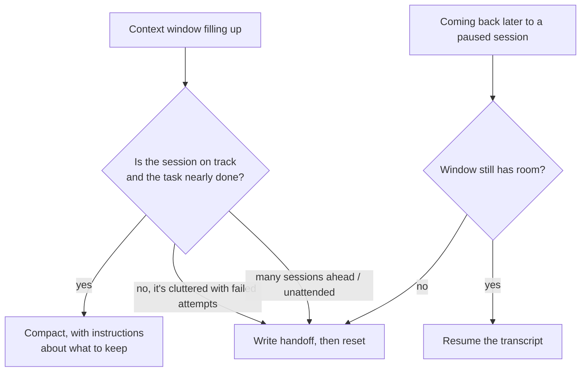
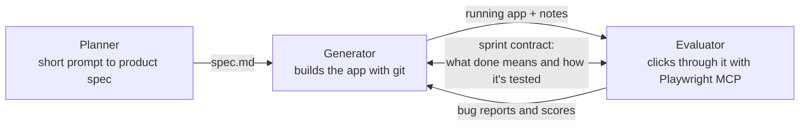

# Handing Off across Context Windows: The Complete Guide

> 📚 **Before you start**
>
> - [Initializer Agents, Feature Lists and Progress Files](initializer-agents-feature-lists-and-progress-files.md)
> - [Compaction and Summarisation](../../context-engineering-and-agent-memory/03-just-in-time-context/compaction-and-summarisation.md) (Context Engineering), which covers trimming, summarising and testing summaries for recall. This lesson applies those ideas to coding sessions and doesn't repeat them
> - [Permissions, Hooks and Approval Modes](../04-what-a-harness-is/permissions-hooks-and-approval-modes.md), for the hook events used in section 5

## Introduction

Long-distance trains in India change locomotive crews several times on a journey. The incoming loco pilot doesn't get the outgoing pilot's memories; they get a short, standard handover: speed restrictions ahead, the state of the brakes, anything odd about this engine, and the next signal to watch for. The train keeps moving, and the new crew is safe because the handover covers exactly what they need and nothing else.

A coding agent's context window is its crew shift. When the window fills, something has to carry the work across: an automatic summary, a fresh session that reads notes, or a reload of the old transcript. Each choice keeps different things and loses different things, and getting it wrong is how agents "forget" that a test was flaky, re-try an approach that already failed, or undo a decision a human made an hour ago.

By the end of this lesson you'll know the three ways work crosses a context boundary (compaction, reset with a handoff, and resume), how to choose between them, what a good handoff note contains and how to test one, how to steer Claude Code's compaction with instructions and hooks, and how multi-agent harnesses (planner, generator, evaluator) use file handoffs between agents.

> 💡 **Key Insight**
>
> A handoff is only as good as what the next session can *act on* without asking. Write it for a capable stranger: the goal, what's verified, what's broken, what was decided and why, and the very next step. Then check it, the way you'd test any other output.

---

## Core Explanation

### 1. Three ways to cross a context boundary

| | **Compaction** | **Reset + handoff** | **Resume** |
|---|---|---|---|
| What happens | The old conversation is replaced in place by a summary; the session continues | The session ends; a new one starts with an empty window and reads a structured handoff (files, notes, git) | The old transcript is loaded again (`claude --continue`, `claude --resume`, `codex resume`) |
| Keeps | Continuity, the general thread | Exactly what was written down | Everything, including the clutter |
| Loses | Details the summariser didn't think mattered | Anything not written down | Nothing, but doesn't free space either |
| Good for | One long task that's going well | Many sessions, unattended loops, a clean slate after a messy stretch | Coming back to a paused session that still has room |
| Who controls it | The harness, with your instructions | You (the harness designer) | You |

Claude Code compacts automatically as the window fills, and you can compact by hand with `/compact` (optionally with focus instructions). `/clear` starts a fresh conversation while keeping project memory such as `CLAUDE.md`. `/branch` and `--fork-session` copy a conversation so you can try another direction without losing the original.



### 2. Why resets sometimes beat compaction

Anthropic's harness work for long app builds (published March 2026) reported a behaviour they called **context anxiety**: one model (Claude Sonnet 4.5) started wrapping up work prematurely as it believed it was nearing its context limit. Compaction didn't cure it, because the session still *felt* long. A **reset**, a fresh agent with a structured handoff, did: it gave a clean slate, at the cost of extra orchestration, tokens and time.

With the next model (Claude Opus 4.5) the behaviour largely went away, so the team dropped resets and ran one continuous session with automatic compaction. That's the general lesson from Module 4 in miniature: **every harness component encodes an assumption about what the model can't do**, and the right handoff strategy depends on the model you're running today. Test it again when the model changes.

There's also a simpler reason to reset that has nothing to do with model quirks: after two or three failed attempts at the same fix, the window is full of wrong ideas. Claude Code's own best-practice guide suggests `/clear` and a better prompt that includes what you learned. A handoff note is that better prompt.

### 3. What a good handoff contains

A handoff is a small document with a fixed shape. Using a schema makes it checkable:

```python
from pydantic import BaseModel, Field

class Handoff(BaseModel):
    goal: str = Field(min_length=10)
    done_and_verified: list[str]
    in_progress: str
    broken_or_unknown: list[str]
    decisions: list[str]          # "chose X over Y because Z"
    dead_ends: list[str]          # tried and failed, so don't repeat
    next_step: str = Field(min_length=10)
    how_to_verify: str
    files_touched: list[str]

note = Handoff(
    goal="Add UPI payment to the chai-stall ordering app (feature F7)",
    done_and_verified=["Order total endpoint returns GST-inclusive amount (tests pass)"],
    in_progress="UPI deep link builder in payments/upi.py; amount formatting done, payee name not yet escaped",
    broken_or_unknown=["test_upi_link_special_chars fails: '&' in shop name breaks the link"],
    decisions=["Use upi:// deep links, not a payment gateway SDK, because the owner wants no fees"],
    dead_ends=["urllib.parse.quote on the whole URL double-encodes ':' and '/'; quote only parameter values"],
    next_step="Escape pn and tn parameters with urllib.parse.quote, then run tests/test_upi.py",
    how_to_verify="python -m pytest tests/test_upi.py -q",
    files_touched=["payments/upi.py", "tests/test_upi.py"],
)
print(note.model_dump_json(indent=1)[:300])
```

Output:

```
{
 "goal": "Add UPI payment to the chai-stall ordering app (feature F7)",
 "done_and_verified": [
  "Order total endpoint returns GST-inclusive amount (tests pass)"
 ],
 "in_progress": "UPI deep link builder in payments/upi.py; amount formatting done, payee name not yet escaped",
 "broken_or_unknown
```

The two fields people forget are the most valuable:

- **Dead ends.** Without them, the next session cheerfully re-tries the approach that already failed, because it looks like the obvious fix.
- **Decisions with reasons.** Without the "because", the next session may "improve" the code by undoing a choice the user made.

### 4. Test the handoff before you trust it

The context-engineering course showed how to test summaries for recall. The same works for handoffs: list the questions the next session must be able to answer, and check the note answers them. A crude keyword check catches the worst gaps:

```python
QUESTIONS = {
    "Which test is failing?": ["test_upi_link_special_chars"],
    "What should I NOT try again?": ["double-encodes"],
    "Why no payment gateway?": ["no fees"],
    "How do I check my work?": ["pytest tests/test_upi.py"],
    "What do I do first?": ["Escape pn and tn"],
}

def recall_report(handoff_text, questions=QUESTIONS):
    return {q: all(k in handoff_text for k in keys) for q, keys in questions.items()}

good = note.model_dump_json()
lazy = Handoff(
    goal="Add UPI payment to the app", done_and_verified=["totals work"],
    in_progress="UPI links mostly done", broken_or_unknown=["one test failing"],
    decisions=[], dead_ends=[], next_step="Fix the failing test and finish UPI",
    how_to_verify="run the tests", files_touched=["payments/upi.py"],
).model_dump_json()

for name, text in [("good", good), ("lazy", lazy)]:
    report = recall_report(text)
    print(f"{name}: {sum(report.values())}/{len(report)} answered;",
          "missing:", [q for q, ok in report.items() if not ok])
```

Output:

```
good: 5/5 answered; missing: []
lazy: 0/5 answered; missing: ['Which test is failing?', 'What should I NOT try again?', 'Why no payment gateway?', 'How do I check my work?', 'What do I do first?']
```

Both notes pass the schema. Only one is useful. In a real harness, an inferential check (a cheap model asked "could you continue from this note alone? what's missing?") does this job more flexibly than keywords.

### 5. Steering compaction in Claude Code

When you do let the harness compact, you can shape what survives:

- **Focus instructions**: `/compact Focus on the payment changes and the failing test`.
- **Standing instructions in `CLAUDE.md`**: the compactor reads it like any other context, so a line such as "When compacting, always keep the list of modified files, the test commands and any failing test names" applies every time.
- **Partial compaction**: in the rewind menu (`Esc` `Esc` or `/rewind`), choose **Summarize from here** to condense only the later messages, or **Summarize up to here** to condense only the earlier ones.
- **Hooks around compaction**: a `PreCompact` hook runs before compaction (for example, to archive the full transcript, or exit 2 to block it), and a `SessionStart` hook with the `compact` matcher runs after, so its output is re-injected into the fresh context:

```json
{
  "hooks": {
    "SessionStart": [
      {
        "matcher": "compact",
        "hooks": [
          { "type": "command", "command": "tail -n 15 claude-progress.txt; git log --oneline -5" }
        ]
      }
    ]
  }
}
```

This is the cleanest way to combine the two approaches: let compaction keep the thread, and let files re-anchor the facts that must never be summarised away.

### 6. Writing the handoff automatically

You don't want to rely on remembering to write a note. Make it part of the session's end. The pretend session below collects its state as it works, and the harness writes the handoff whether the session ends normally or runs out of budget:

```python
import json

class Session:
    def __init__(self, goal, budget):
        self.goal, self.budget = goal, budget
        self.state = {"verified": [], "failed_attempts": [], "decisions": [], "files": set()}

    def step(self, kind, detail, files=()):
        if self.budget == 0:
            raise RuntimeError("budget exhausted")
        self.budget -= 1
        self.state["files"].update(files)
        {"verified": self.state["verified"], "dead_end": self.state["failed_attempts"],
         "decision": self.state["decisions"]}[kind].append(detail)

    def handoff(self, next_step):
        return {
            "goal": self.goal,
            "done_and_verified": self.state["verified"],
            "dead_ends": self.state["failed_attempts"],
            "decisions": self.state["decisions"],
            "files_touched": sorted(self.state["files"]),
            "next_step": next_step,
        }

s = Session("Add UPI payment (F7)", budget=3)
plan = [
    ("decision", "upi:// deep links, no gateway (owner: no fees)", ["payments/upi.py"]),
    ("dead_end", "quote() on whole URL double-encodes ':'", ["payments/upi.py"]),
    ("verified", "amount formats as 42.00", ["tests/test_upi.py"]),
    ("verified", "special characters escaped", ["payments/upi.py"]),
]
try:
    for kind, detail, files in plan:
        s.step(kind, detail, files)
    next_step = "Open a PR"
except RuntimeError:
    next_step = f"Continue from: {plan[len(s.state['verified']) + len(s.state['failed_attempts']) + len(s.state['decisions'])][1]}"
finally:
    print(json.dumps(s.handoff(next_step), indent=1))
```

Output:

```
{
 "goal": "Add UPI payment (F7)",
 "done_and_verified": [
  "amount formats as 42.00"
 ],
 "dead_ends": [
  "quote() on whole URL double-encodes ':'"
 ],
 "decisions": [
  "upi:// deep links, no gateway (owner: no fees)"
 ],
 "files_touched": [
  "payments/upi.py",
  "tests/test_upi.py"
 ],
 "next_step": "Continue from: special characters escaped"
}
```

In Claude Code the same idea is a Stop hook or a `SessionEnd` hook that asks for (or checks) the progress-log entry, plus a commit. In a headless loop, the driver script can refuse to start the next session if the last one didn't append to the log.

### 7. Handoffs between agents: planner, generator, evaluator

Handoffs aren't only between sessions of one agent. Anthropic's March 2026 harness for building full applications used three agents that **communicated through files**:



- The **planner** expands a one-to-four-sentence prompt into a product spec, staying at the level of product and design rather than implementation details.
- The **generator** builds; before each chunk of work ("sprint") it and the evaluator agree a **sprint contract**: what will be built and how it will be checked.
- The **evaluator** uses the Playwright MCP server to use the running app like a person, grades against criteria with hard thresholds, and files bugs back.

Why a separate evaluator? Because **agents grade their own work generously**, especially on subjective things like design. A separate agent tuned to be sceptical is easier to calibrate than a generator asked to criticise itself. The cost is real: a solo run of one game-maker app took about 20 minutes and $9; the full harness took about 6 hours and $200 but produced an app whose core feature actually worked. With a newer model (Opus 4.6) the team removed sprints, kept the planner (without it the generator under-scoped the app) and moved the evaluator to a single pass at the end.

The [Multi-Agent Systems](../../multi-agent-systems-and-agent-protocols/course.md#m2) course covers orchestration patterns in general; the point here is that every arrow in that diagram is a **handoff document**, and everything in this lesson about writing and testing handoffs applies to each one.

### 8. Handoffs to humans

The last handoff of any agent run goes to a person: a pull request description, a progress log entry, a message in chat. The same fields apply. A PR description from an agent should say what changed, how it was verified, what wasn't verified, any decisions a reviewer should check, and anything left undone, which is what [Reviewing AI-Written Code](../02-working-with-coding-agents/reviewing-ai-written-code.md) asked reviewers to look for.

---

## Try It Yourself

1. **Spot the missing fields.** A session ends with this note: "Worked on login. Some tests fail. Next: finish it." List which `Handoff` fields are missing or useless.
2. **Add a question.** Add a recall question "Which files should I open first?" to `QUESTIONS` that the good note answers and the lazy note doesn't, and rerun the report.
3. **Choose a strategy.** For each case, pick compaction, reset with handoff, or resume: (a) a refactor going well, 80% done, window nearly full; (b) three failed attempts at a flaky-test fix; (c) you closed the laptop mid-task yesterday and the session was a quarter full; (d) an overnight loop over 40 features.

<details>
<summary>Show answers</summary>

**1.** Goal is vague ("worked on login" isn't a goal), nothing is marked verified, the failing tests aren't named, no decisions, no dead ends, no files, no verification command, and "finish it" isn't an actionable next step.

**2.**

```python
QUESTIONS["Which files should I open first?"] = ["payments/upi.py"]
for name, text in [("good", good), ("lazy", lazy)]:
    report = recall_report(text)
    print(name, f"{sum(report.values())}/{len(report)}")
```

Output:

```
good 6/6
lazy 1/6
```

The lazy note does list `payments/upi.py`, so it gets that one question right. Keyword checks reward mentions, not usefulness; that's why an inferential "could you continue from this?" check is worth adding.

**3.** (a) Compaction, with focus instructions. (b) Reset with a handoff that lists the three dead ends. (c) Resume. (d) Reset with handoff every session (the initializer pattern), with a `SessionStart` hook re-anchoring the progress log.

</details>

---

## Real-World Examples

- **Anthropic's app-building harness** used file-based handoffs between planner, generator and evaluator, and context resets for a model that showed context anxiety, then dropped resets when a newer model didn't need them.
- **Teams running nightly agent loops** start every session from the progress log and `git log`, injected by a `SessionStart` hook, and make the driver refuse to continue if a session ends without a log entry.
- **Developers in interactive sessions** use `/compact` with focus instructions on good days and `/clear` plus a pasted handoff after a run of failed attempts.

---

## Common Misconceptions

### "Compaction is always better because it keeps more"

It keeps more *of everything*, including dead ends and wrong assumptions. After a messy stretch, a clean reset with a good handoff often works better.

### "Resuming is free"

Resuming reloads the whole transcript into the window. It's great for a paused session with room left, and pointless for a full one.

### "If it passes the schema, the handoff is good"

Shape isn't content. Test that the note answers the questions the next session will have.

### "The agent can judge its own work at the handoff"

Self-assessment is generous. Put "verified" only next to things a check confirmed, and use a separate evaluator for subjective quality.

---

## Interview Relevance

*"Your agent loses track of work in long sessions. What do you do?"* A strong answer distinguishes compaction (in-place summary, keeps continuity, loses details), reset with a structured handoff (clean slate, keeps only what's written) and resume (reloads everything, frees nothing), and picks by situation. It describes a handoff schema (goal, verified work, broken things, decisions with reasons, dead ends, next step, verification command, files), tests handoffs for recall, steers compaction with instructions, `PreCompact` and `SessionStart` (compact) hooks, and mentions file-based handoffs in planner-generator-evaluator harnesses and why a separate evaluator beats self-evaluation.

---

## Key Takeaways

- **Three ways across a boundary**: compaction (summary in place), reset with handoff (fresh window plus notes), resume (reload transcript); each keeps and loses different things.
- **The right choice depends on the model and the moment**: resets fixed "context anxiety" in one model and became unnecessary in the next.
- **Good handoffs have a fixed shape** and always include dead ends and decisions with reasons.
- **Test handoffs** for the questions the next session must answer; a schema alone isn't enough.
- **Agents hand off to agents and humans too**: planner-generator-evaluator harnesses and pull requests are handoffs, and a separate evaluator is more honest than self-review.

---

**Up next:** [Git as a Safety Net and Checkpoints](git-as-a-safety-net-and-checkpoints.md)
