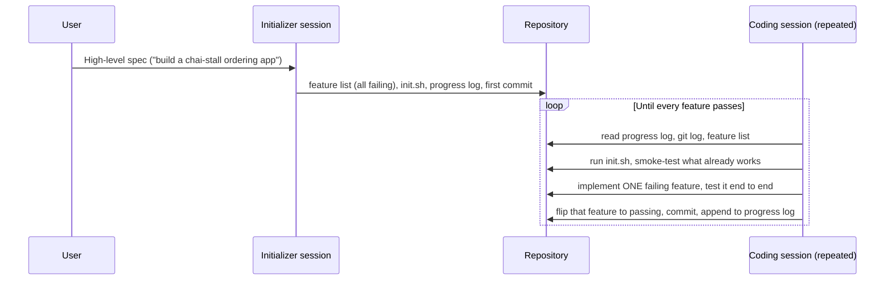

# Initializer Agents, Feature Lists and Progress Files: The Complete Guide

> 📚 **Before you start**
>
> - [Lab: Build a minimal coding-agent harness](../04-what-a-harness-is/lab-build-a-minimal-coding-agent-harness.md), for the loop, Stop hooks and transcripts
> - [Offloading Context to Files and Scratchpads](../../context-engineering-and-agent-memory/03-just-in-time-context/offloading-context-to-files-and-scratchpads.md) (Context Engineering), whose section on progress files introduces the idea this lesson turns into a full coding workflow
> - [Context Rot and Lost in the Middle](../../context-engineering-and-agent-memory/02-the-context-window-as-a-budget/context-rot-and-lost-in-the-middle.md), for why one endless session degrades
> - [Explore, Plan, Code, Commit](../02-working-with-coding-agents/explore-plan-code-commit.md)

## Introduction

In a hospital ward, the nurse on the night shift never met the patients' day-shift nurse at the moment things happened. Yet at 8 p.m. the night nurse knows who had a fever, which drip runs out at midnight and what the doctor wants checked. The handover sheet carries it: a fixed format, written by the person leaving, read first by the person arriving. Nobody relies on memory, and the sheet is never "mostly right"; each line is something someone checked.

A coding agent that works for hours or days is a ward with a shift change every time its context window fills. Each new session starts with **no memory** of the last. Without a handover, it either re-explores the whole project (wasting the session), guesses (breaking things), or looks around, sees lots of code and announces "the app is done" (the most common failure of all).

Anthropic's engineering team published a pattern for this in late 2025: an **initializer agent** that sets up the project and a **coding agent** that, in every later session, reads the handover, does **one feature**, proves it works, commits and writes the handover for the next shift. By the end of this lesson you'll be able to build the three files that make this work (a JSON feature list, a progress log and a start-up script), write the start-of-session routine, protect the feature list from the agent, and run the pattern with today's tools.

> 💡 **Key Insight**
>
> A long-running agent's memory isn't in the model; it's in the repository. Give every session the same three questions with file-based answers (What's the goal? What's done? How do I run it?), and make "done" a checked fact in a file, not the agent's opinion.

---

## Core Explanation

### 1. Why one long session fails

Two failure modes show up as soon as a task is bigger than one context window:

| Failure | What it looks like |
|---|---|
| **Doing too much at once** | The agent tries to build the whole app in one go, runs out of context halfway through a feature, and leaves half-written code with no notes. The next session has to guess what happened. |
| **Declaring victory early** | A later session sees plenty of code, assumes the work is finished, and stops, with half the features missing or broken. |

Compaction (summarising the old conversation, covered in [Compaction and Summarisation](../../context-engineering-and-agent-memory/03-just-in-time-context/compaction-and-summarisation.md)) helps, but a summary is lossy and the agent can't tell what it lost. Anthropic reported that compaction alone wasn't enough to get a production-quality web app from a one-line prompt, even with a frontier model running in a loop. The fix is structure on disk.

### 2. Two prompts, one harness

The pattern uses the **same agent, tools and harness** with two different first prompts:



- The **initializer** runs once. It turns a short spec into a detailed list of features, writes a script that starts the app, starts a progress log and makes the first git commit. It builds no features.
- The **coding agent** runs in every later session, each one in a fresh context window. It follows a fixed routine and finishes each session with the repository in a **clean state**: code that runs, committed, with notes.


*The whole pattern: one setup session, then many short sessions that communicate only through files in the repository.*

### 3. The feature list

The feature list is the **definition of done**, written up front, in a format that's easy to check. Anthropic's example had over 200 entries for a clone of a chat app, all starting as failing. Each entry has a category, a description, the steps a human tester would take, and a `passes` flag:

```python
import json, tempfile
from pathlib import Path

PROJECT = Path(tempfile.mkdtemp(prefix="chai-stall-")).resolve()

def initializer(spec_features):
    """The initializer session: turn a spec into files. Builds no features."""
    features = [
        {"id": f"F{i}", "category": "functional", "description": desc, "steps": steps, "passes": False}
        for i, (desc, steps) in enumerate(spec_features, start=1)
    ]
    (PROJECT / "feature_list.json").write_text(json.dumps(features, indent=2))
    (PROJECT / "init.sh").write_text("#!/usr/bin/env bash\n# Start the app the same way every session\npython -m chai_stall.server --port 8000 &\n")
    (PROJECT / "claude-progress.txt").write_text("Session 0 (initializer): wrote feature list, init.sh. No features built yet.\n")
    (PROJECT / "app.py").write_text("")
    return features

SPEC = [
    ("Menu lists every chai with its price", ["Open the menu", "See masala chai at Rs 20", "See ginger chai at Rs 25"]),
    ("Order subtotal adds up cups times price", ["Add 2 masala, 1 ginger", "Subtotal shows Rs 65"]),
    ("Bill adds 5% GST and rounds to paise", ["Add 2 masala", "Total shows Rs 42.00"]),
    ("An order can be cancelled before payment", ["Create an order", "Cancel it", "Order list is empty"]),
]
features = initializer(SPEC)
print(sorted(p.name for p in PROJECT.iterdir()))
print(json.dumps(features[1], indent=2))
```

Output:

```
['app.py', 'claude-progress.txt', 'feature_list.json', 'init.sh']
{
  "id": "F2",
  "category": "functional",
  "description": "Order subtotal adds up cups times price",
  "steps": [
    "Add 2 masala, 1 ginger",
    "Subtotal shows Rs 65"
  ],
  "passes": false
}
```

Three design choices matter:

- **Everything starts as failing.** A later session can't mistake "not yet checked" for "done".
- **JSON, not Markdown.** Anthropic found the model was less likely to rewrite or reorganise a JSON file than a Markdown checklist. Structure also lets code check the file.
- **The agent may only flip `passes`.** The coding prompt says, in strong words, that removing or editing feature entries is unacceptable, because deleting a hard feature is the easiest way to "finish".

### 4. Don't just ask: enforce the feature-list rule

A prompt is a guide; the previous module showed that code beats text. A tiny validator, run from a hook or at the end of each session, turns "only flip `passes`" into a hard rule:

```python
def feature_list_violations(old, new):
    """Return problems if 'new' changes anything except the passes flags."""
    problems = []
    old_by_id = {f["id"]: f for f in old}
    new_by_id = {f["id"]: f for f in new}
    for fid in old_by_id.keys() - new_by_id.keys():
        problems.append(f"{fid} was deleted")
    for fid in new_by_id.keys() - old_by_id.keys():
        problems.append(f"{fid} was added (only the initializer adds features)")
    for fid in sorted(old_by_id.keys() & new_by_id.keys()):
        for key in ("category", "description", "steps"):
            if old_by_id[fid][key] != new_by_id[fid][key]:
                problems.append(f"{fid}: '{key}' was edited")
    return problems

honest = json.loads(json.dumps(features))
honest[0]["passes"] = True

sneaky = json.loads(json.dumps(features))
sneaky = [f for f in sneaky if f["id"] != "F4"]                 # drop the hard one
sneaky[2]["steps"] = ["Add 2 masala", "Total shows something"]  # weaken a check

print("honest:", feature_list_violations(features, honest))
print("sneaky:", feature_list_violations(features, sneaky))
```

Output:

```
honest: []
sneaky: ['F4 was deleted', "F3: 'steps' was edited"]
```

In Claude Code you'd call this from a `PreToolUse` hook on `Edit|Write` to `feature_list.json` (exit code 2 blocks the edit and tells Claude why), or from the Stop hook. It's the same idea as protecting the test files in the Module 4 lab.

### 5. The progress log and init.sh

The **progress log** (Anthropic's example names it `claude-progress.txt`) is the handover sheet: a few lines per session saying what was done, what was found broken, and what should come next. It complements `git log`, which records *what changed* but not *why* or *what's still wrong*.

**init.sh** answers "how do I run this?" once, so no session wastes time rediscovering the start command, the port or the seed data. Here is a realistic one for a web app:

```bash
#!/usr/bin/env bash
# init.sh: start the app exactly the same way in every session
set -euo pipefail
python -m pip install -q -r requirements.txt
python manage.py migrate --noinput
python manage.py loaddata demo_menu.json
python manage.py runserver 127.0.0.1:8000 &
sleep 2 && curl -sf http://127.0.0.1:8000/health && echo "app is up"
```

Example output:

```
{"status": "ok"}app is up
```

### 6. The start-of-session routine

Every coding session begins with the same steps, in this order:

1. **Where am I?** Run `pwd`; only edit files under this folder.
2. **What happened before?** Read the progress log and the recent `git log`.
3. **What's next?** Read the feature list and pick the highest-priority feature that's still failing.
4. **Does it still work?** Run `init.sh` and a basic end-to-end check of features already marked passing, and **fix anything broken before starting new work**.

Step 4 is the one people skip, and it's the one that stops damage from piling up. Here is the routine running across four sessions with a pretend coding agent. Session 2 implements its feature but sloppily adds a misspelt menu entry, breaking feature F1 without noticing, because it only tested its own feature. Watch session 3:

```python
import runpy
from types import SimpleNamespace

CODE = {
    "F1": 'MENU = {"masala chai": 20, "ginger chai": 25}\n',
    "F2": 'def subtotal(order):\n    return sum(MENU[item] * cups for item, cups in order.items())\n',
    "F3": 'def total(order, gst_percent=5):\n    return round(subtotal(order) * (1 + gst_percent / 100), 2)\n',
    "F4": 'ORDERS = []\ndef cancel(order_id):\n    ORDERS[:] = [o for o in ORDERS if o["id"] != order_id]\n',
}
SLOPPY_F2 = 'MENU["masla chai"] = 20\n' + CODE["F2"]   # a stray, misspelt menu entry

def e2e_check(fid):
    """Stand-in for an end-to-end test of one feature against the running app."""
    try:
        app = SimpleNamespace(**runpy.run_path(str(PROJECT / "app.py")))
        return {
            "F1": lambda: app.MENU == {"masala chai": 20, "ginger chai": 25},
            "F2": lambda: app.subtotal({"masala chai": 2, "ginger chai": 1}) == 65,
            "F3": lambda: app.total({"masala chai": 2}) == 42.0,
            "F4": lambda: (app.ORDERS.append({"id": 7}), app.cancel(7), app.ORDERS == [])[-1],
        }[fid]()
    except Exception:
        return False

def log(line):
    with (PROJECT / "claude-progress.txt").open("a") as f:
        f.write(line + "\n")

def coding_session(n, sloppy=False):
    feats = json.loads((PROJECT / "feature_list.json").read_text())
    before = json.loads(json.dumps(feats))
    # Step 4 first: smoke-test what already claims to pass
    broken = [f["id"] for f in feats if f["passes"] and not e2e_check(f["id"])]
    if broken:
        app_code = "".join(CODE[f["id"]] for f in feats if f["passes"])   # repair: rebuild passing features
        (PROJECT / "app.py").write_text(app_code)
        log(f"Session {n}: smoke test found {broken} broken; repaired before new work")
    todo = [f for f in feats if not f["passes"]]
    if not todo:
        log(f"Session {n}: all features pass; nothing to do")
        return "done"
    feature = todo[0]                                                   # ONE feature per session
    snippet = SLOPPY_F2 if (sloppy and feature["id"] == "F2") else CODE[feature["id"]]
    with (PROJECT / "app.py").open("a") as f:
        f.write(snippet)
    if e2e_check(feature["id"]):
        feature["passes"] = True
    assert not feature_list_violations(before, feats)
    (PROJECT / "feature_list.json").write_text(json.dumps(feats, indent=2))
    log(f"Session {n}: {feature['id']} {'passes' if feature['passes'] else 'still failing'}; next: "
        f"{next((f['id'] for f in feats if not f['passes']), 'none')}")
    return "continue"

n = 0
while True:
    n += 1
    if coding_session(n, sloppy=(n == 2)) == "done":
        break
print((PROJECT / "claude-progress.txt").read_text())
```

Output:

```
Session 0 (initializer): wrote feature list, init.sh. No features built yet.
Session 1: F1 passes; next: F2
Session 2: F2 passes; next: F3
Session 3: smoke test found ['F1'] broken; repaired before new work
Session 3: F3 passes; next: F4
Session 4: F4 passes; next: none
Session 5: all features pass; nothing to do
```

Session 2 believed it had succeeded, and from its narrow view it had. Without step 4, sessions 3 and 4 would have built on a broken menu, and the final app would have shipped with "all features passing" in the file and a bug in production. In the real pattern each session also commits to git, so the repair could be a revert; the next lesson but one covers that.

### 7. Verification has to look like a user

The weakest link is the moment the agent sets `passes` to true. Anthropic found that Claude marked features done after unit tests or a `curl` call even when the feature didn't work end to end, and that results improved a lot once it was told to test like a human user with **browser automation** (they used the Puppeteer MCP server). Practical rules:

- Each feature's `steps` are written as **user actions and visible results**, so they can be executed by a browser-driving tool or a test.
- Prefer checks the **harness** runs (a test command per feature, a Playwright suite) over the agent's judgement. Then flipping `passes` can be done by the harness itself after the check exits 0.
- Some things automation can't see well (Anthropic mentions browser-native alert dialogs), so features that depend on them need a human look.

### 8. The failure-mode table

| Problem | What the initializer does about it | What each coding session does about it |
|---|---|---|
| Declares the project finished too early | Writes a complete feature list, all failing | Reads the list; works on one failing feature |
| Leaves bugs or unexplained half-work | Creates the git repo and progress log | Reads log and git history, smoke-tests first, ends with a commit and a log entry |
| Marks features done without real testing | Writes user-level test steps per feature | Flips `passes` only after an end-to-end check |
| Wastes time working out how to run the app | Writes `init.sh` | Runs `init.sh` at the start |

### 9. Running the pattern with today's tools

You don't need a custom framework. A shell loop around a headless agent is enough:

```bash
# Initializer: one session that only sets things up
claude -p "$(cat prompts/initializer.md)" --permission-mode acceptEdits --max-turns 80

# Coding sessions: each starts with a fresh context window
while jq -e 'any(.[]; .passes == false)' feature_list.json > /dev/null; do
  claude -p "$(cat prompts/coding-session.md)" \
    --permission-mode acceptEdits --max-turns 150 --max-budget-usd 10 || break
done
```

Example output:

```
Implemented F12 (cart badge shows item count). Verified in the browser, committed 3f2a9c1, updated claude-progress.txt.
Implemented F13 (empty cart shows a hint). Verified in the browser, committed 81d0b4e, updated claude-progress.txt.
...
```

- `--max-turns` and `--max-budget-usd` (print mode) cap each session, so one stuck session can't burn the night.
- The coding prompt contains the routine from section 6. Put the stable parts (how to run tests, the rule about `feature_list.json`) in `CLAUDE.md` or `AGENTS.md` instead, as in [Memory Files: CLAUDE.md and AGENTS.md](../../context-engineering-and-agent-memory/04-memory-systems/memory-files-claude-md-and-agents-md.md).
- A `SessionStart` hook can print the tail of the progress log and the next failing feature, so every session (including one restarted after compaction, with the `compact` matcher) starts oriented.
- The same loop works with `codex exec` or any headless agent; the files are tool-neutral. Run it inside a container or VM from the [sandboxes lesson](../04-what-a-harness-is/sandboxes-containers-microvms-and-hosted-sandboxes.md), since nobody is watching.

### 10. When this is overkill

The pattern pays off for work that spans many sessions: building an app from a spec, a large migration, porting a library. For a bug fix or a feature that fits in one context window, the [explore-plan-code-commit](../02-working-with-coding-agents/explore-plan-code-commit.md) workflow is enough. Anthropic also notes that it's still an open question whether one general agent or several specialised ones (testers, reviewers, cleaners) do better; the next lesson looks at one multi-agent variant.

---

## Try It Yourself

1. **Flags going backwards.** Should a feature flipped from `true` back to `false` count as a violation? Think about session 3, then write a function that reports flag changes between two versions of the list.
2. **Write the session prompt.** Draft a 6 to 10 line coding-session prompt that encodes the routine from section 6 and the feature-list rule.
3. **Let the harness flip the flag.** Change `coding_session` so the agent never writes `passes`; instead a separate function runs `e2e_check` for every feature after the session and sets the flags. What problem from section 7 does this remove?

<details>
<summary>Show answers</summary>

**1.** Flipping back to `false` is legitimate when a smoke test finds a regression; the honest move is to record it. So report it as information, not as a violation:

```python
def flag_changes(old, new):
    old_by_id = {f["id"]: f["passes"] for f in old}
    return [f"{f['id']}: {old_by_id[f['id']]} -> {f['passes']}" for f in new
            if f["id"] in old_by_id and old_by_id[f["id"]] != f["passes"]]

regressed = json.loads(json.dumps(honest))
regressed[0]["passes"] = False
print(flag_changes(honest, regressed), feature_list_violations(honest, regressed))
```

Output:

```
['F1: True -> False'] []
```

**2.** For example:

```text
You are continuing work on this project in a fresh session.
1. Run pwd. Only edit files under this folder.
2. Read claude-progress.txt and `git log --oneline -20`.
3. Run ./init.sh, then check every feature marked passing still works. Fix regressions first.
4. Pick the highest-priority feature in feature_list.json with "passes": false. Work on that one only.
5. Test it end to end as a user would. Only then set its "passes" to true.
6. Never delete or edit features in feature_list.json; you may only change "passes".
7. Commit with a descriptive message and append 2-3 lines to claude-progress.txt: what you did, what's broken, what's next.
```

**3.**

```python
def harness_sets_flags():
    feats = json.loads((PROJECT / "feature_list.json").read_text())
    for f in feats:
        f["passes"] = e2e_check(f["id"])
    (PROJECT / "feature_list.json").write_text(json.dumps(feats, indent=2))
    return {f["id"]: f["passes"] for f in feats}

print(harness_sets_flags())
```

Output:

```
{'F1': True, 'F2': True, 'F3': True, 'F4': True}
```

It removes "marking features done without real testing": the agent can't claim a pass, only the check can. The catch is that you need a reliable automated check per feature.

</details>

---

## Real-World Examples

- **Anthropic's demo** built a clone of a chat web app over many sessions from a high-level spec, with 200+ features, a progress log, `init.sh`, and Puppeteer-driven end-to-end checks.
- **Migration teams** generate a list of every file or endpoint to port, each with a `migrated` flag and a test command, and run one item per session overnight in a container.
- **Spec Kit and Kiro** (from [Spec-Driven Development](../02-working-with-coding-agents/spec-driven-development.md)) produce task lists that play the same role as the feature list, generated from an agreed spec.

---

## Common Misconceptions

### "A bigger context window removes the need for this"

Bigger windows delay the problem and add context rot. Real projects outgrow any window, and sessions end for other reasons too (crashes, budgets, overnight runs).

### "The agent will keep good notes if I ask"

It will keep *some* notes. Structure (fixed files, fixed routine, validators) is what makes them reliable.

### "Passing unit tests means the feature works"

Anthropic saw exactly this gap. User-level checks catch what unit tests miss.

### "The initializer should start building to save time"

Mixing setup and building recreates the "too much at once" failure. A setup-only first session leaves a clean, committed baseline.

---

## Interview Relevance

*"How would you get a coding agent to build something that takes many context windows?"* A strong answer: split into an initializer session (spec to JSON feature list, all failing; start script; progress log; first commit) and repeated coding sessions with a fixed routine (orient with pwd, progress log and git log; run the app and smoke-test passing features; fix regressions; do one failing feature; verify end to end like a user; flip only that flag; commit; log). Mention enforcing the feature-list rule with code, harness-run checks over self-reported success, per-session turn and budget caps, and running unattended loops in a sandbox.

---

## Key Takeaways

- **Long-running memory lives in files**: a feature list (goal), a progress log (history and next steps), `init.sh` (how to run) and git (what changed).
- **The initializer only sets up**; every coding session does **one feature** and leaves a clean, committed state.
- **Every feature starts failing**, and the agent may only flip `passes`; enforce that with a validator, not just a prompt.
- **Smoke-test before new work**, so a previous session's silent damage is fixed instead of built on.
- **Verify like a user** with browser automation or harness-run checks; unit tests and the agent's opinion aren't enough.

---

**Up next:** [Handing Off across Context Windows](handing-off-across-context-windows.md)
