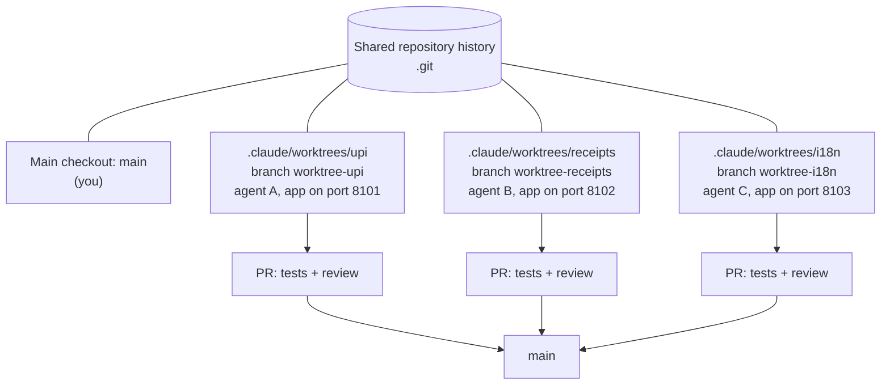

# Parallel Agents with Worktrees: The Complete Guide

> 📚 **Before you start**
>
> - [Git as a Safety Net and Checkpoints](git-as-a-safety-net-and-checkpoints.md)
> - [Stash, Worktrees and Bisect](../../git-and-github-zero-to-pro/04-branching-and-merging/stash-worktrees-and-bisect.md) (Git and GitHub: Zero to Pro), for what `git worktree` is
> - [Subagents, Slash Commands and Plugins](../04-what-a-harness-is/subagents-slash-commands-and-plugins.md), for subagent definitions and the `isolation` field
> - [Sandboxes: Containers, MicroVMs and Hosted Sandboxes](../04-what-a-harness-is/sandboxes-containers-microvms-and-hosted-sandboxes.md), for cloud agent environments

## Introduction

A busy restaurant kitchen in Mumbai doesn't have five cooks crowding one stove. Each cook has a station with their own burner, board and ingredients; the head chef decides who makes what, and dishes meet only at the pass, where someone checks them before they go out. If two cooks needed the same pan at the same moment, the kitchen would stall.

One agent works at the speed of one context window. To go faster you run several, and the moment you do, they need separate stations: if two agents edit the same folder, one's half-finished change breaks the other's test run, and their commits tangle. **Git worktrees** give each agent its own checkout of the same repository, on its own branch, sharing history. Cloud agents go further and give each task its own machine.

By the end of this lesson you'll know how to run parallel agents in worktrees with Claude Code (`--worktree`, subagents with `isolation: worktree`, `/batch`), how to split work so the agents don't collide, what else besides files needs separating (ports, databases, caches), how to merge their branches back and catch conflicts early, and when parallelism isn't worth it.

> 💡 **Key Insight**
>
> Parallel agents are only faster if they're independent. Give each one its own worktree, its own branch, its own running app, and a task that touches different files, then integrate through the same gate a human change would pass: tests, review and merge.

---

## Core Explanation

### 1. What a worktree gives an agent

A **worktree** is an extra working directory attached to the same repository. Each worktree has its own files and its own checked-out branch, but they all share one `.git` history, so creating one is fast and cheap compared with a full clone.



Isolation of **files** is what worktrees provide. They don't isolate anything else: two agents can still both try to start a server on port 8000, write to the same local database, or fill the same cache. Section 5 deals with that.

### 2. Worktrees in Claude Code

**Parallel sessions.** `claude --worktree upi` (or `-w upi`) creates `.claude/worktrees/upi/` on a new branch `worktree-upi` and starts Claude there. Run it again with another name in another terminal for a second agent. Useful details from the docs:

- New worktrees branch from the repository's default branch on the remote by default; set `worktree.baseRef` to `"head"` to branch from your current local work instead.
- A worktree is a fresh checkout, so gitignored files like `.env` aren't there. List the ones to copy in a `.worktreeinclude` file (gitignore syntax).
- Add `.claude/worktrees/` to `.gitignore`.
- On exit, a clean worktree is removed; one with changes or commits prompts you to keep or remove it. Headless `-p` runs don't clean up, so remove those with `git worktree remove`.
- While a session is in a worktree, Claude Code blocks file edits and git commands aimed at the main checkout.

**Subagents in worktrees.** Add `isolation: worktree` to a subagent's front matter, and each run gets its own temporary worktree:

```markdown
---
name: refactorer
description: Applies a mechanical refactor across many files, then runs the tests
isolation: worktree
---
Apply the requested refactor to every affected file, run the test suite, and
report which files changed and whether the tests pass.
```

**Fan-out commands.** The bundled `/batch` skill plans a large change, splits it into independent units, and runs them as background subagents (from 5 up to 30), each in its own worktree, each opening a pull request. Agent view (`claude agents`, and `claude --bg` to start a background session) lets you watch and steer many sessions at once.

**Other tools.** Cloud agents get the same isolation by giving each task a fresh machine: Claude Code on the web, Codex cloud tasks, Copilot cloud agent and Cursor's cloud agents each work on their own branch in their own environment and come back as a pull request. Codex's CLI can also fork a session (`codex fork`) to try another direction.

### 3. Real worktrees, real parallel agents

Let's do it with plain git. A repository has three independent tasks. Three pretend agents run **at the same time** in threads, each in its own worktree, each committing to its own branch:

```python
import os, subprocess, tempfile, time
from concurrent.futures import ThreadPoolExecutor
from pathlib import Path

ROOT = Path(tempfile.mkdtemp(prefix="chai-par-")).resolve()
REPO = ROOT / "repo"
ENV = {**os.environ, "GIT_AUTHOR_NAME": "Agent", "GIT_AUTHOR_EMAIL": "agent@example.com",
       "GIT_COMMITTER_NAME": "Agent", "GIT_COMMITTER_EMAIL": "agent@example.com",
       "GIT_CONFIG_GLOBAL": os.devnull, "GIT_CONFIG_NOSYSTEM": "1"}

def git(*args, cwd=REPO, check=True):
    done = subprocess.run(["git", *args], cwd=cwd, env=ENV, capture_output=True, text=True)
    if check and done.returncode != 0:
        raise RuntimeError(done.stderr)
    return done.stdout.strip()

REPO.mkdir()
git("init", "-q", "-b", "main")
for name, text in {"menu.py": "MENU = {'masala chai': 20}\n",
                   "billing.py": "GST = 5\n",
                   "messages.py": "WELCOME = 'Welcome'\n",
                   ".gitignore": ".worktrees/\n"}.items():
    (REPO / name).write_text(text)
git("add", "-A"); git("commit", "-q", "-m", "Initial")

TASKS = {
    "ginger":   {"file": "menu.py",     "old": "20}", "new": "20, 'ginger chai': 25}"},
    "gst":      {"file": "billing.py",  "old": "GST = 5", "new": "GST = 5\nROUND_TO = 2"},
    "hindi":    {"file": "messages.py", "old": "'Welcome'", "new": "'Welcome / Swagat hai'"},
}

def agent(name, task):
    wt = REPO / ".worktrees" / name
    git("worktree", "add", "-q", "-b", f"agent/{name}", str(wt))   # its own station
    path = wt / task["file"]
    time.sleep(0.05)                                                 # "thinking"
    path.write_text(path.read_text().replace(task["old"], task["new"]))
    git("commit", "-q", "-am", f"{name}: edit {task['file']}", cwd=wt)
    return name, git("log", "-1", "--format=%s", cwd=wt)

with ThreadPoolExecutor(max_workers=3) as pool:
    results = sorted(pool.map(lambda kv: agent(*kv), TASKS.items()))
for name, msg in results:
    print(f"{name:<7} committed: {msg}")
print(len(git("worktree", "list").splitlines()), "worktrees, main checkout untouched:",
      git("status", "--porcelain") == "")
```

Output:

```
ginger  committed: ginger: edit menu.py
gst     committed: gst: edit billing.py
hindi   committed: hindi: edit messages.py
4 worktrees, main checkout untouched: True
```

All three ran at once and nobody saw anybody else's half-written file. Now integrate, one branch at a time, testing after each merge, exactly as a merge queue would:

```python
def merge(branch):
    try:
        git("merge", "-q", "--no-ff", "-m", f"Merge {branch}", branch)
        return "merged"
    except RuntimeError:
        git("merge", "--abort")
        return "CONFLICT, aborted"

for name in sorted(TASKS):
    print(f"agent/{name:<7} -> {merge(f'agent/{name}')}")
print((REPO / "menu.py").read_text().strip())
print((REPO / "messages.py").read_text().strip())
```

Output:

```
agent/ginger  -> merged
agent/gst     -> merged
agent/hindi   -> merged
MENU = {'masala chai': 20, 'ginger chai': 25}
WELCOME = 'Welcome / Swagat hai'
```

### 4. Split the work so agents don't collide

That went smoothly because each task touched a different file. Here's what happens when two agents are given overlapping work:

```python
TASKS2 = {
    "cutting": {"file": "menu.py", "old": "25}", "new": "25, 'cutting chai': 10}"},
    "prices":  {"file": "menu.py", "old": "'masala chai': 20, 'ginger chai': 25", "new": "'masala chai': 22, 'ginger chai': 27"},
}
with ThreadPoolExecutor(max_workers=2) as pool:
    list(pool.map(lambda kv: agent(*kv), TASKS2.items()))
for name in sorted(TASKS2):
    print(f"agent/{name:<7} -> {merge(f'agent/{name}')}")
```

Output:

```
agent/cutting -> merged
agent/prices  -> CONFLICT, aborted
```

Both agents did their jobs correctly; their changes just can't be combined automatically, because they rewrote the same line. Someone (you, or another agent) now has to resolve it, and the second agent's work may need redoing on top of the first. Conflicts like this are cheap to prevent and expensive to fix, so check **before** dispatching:

```python
from itertools import combinations

def overlaps(plan):
    """plan: task name -> set of files it is expected to touch."""
    return [(a, b, sorted(plan[a] & plan[b])) for a, b in combinations(sorted(plan), 2) if plan[a] & plan[b]]

plan = {
    "upi-payments":   {"payments/upi.py", "tests/test_upi.py", "settings.py"},
    "receipt-pdf":    {"receipts/pdf.py", "tests/test_pdf.py"},
    "loyalty-points": {"loyalty/points.py", "settings.py", "tests/test_points.py"},
    "hindi-messages": {"messages/hi.py"},
}
for a, b, files in overlaps(plan):
    print(f"{a} and {b} both touch {files}: run them one after another, or give settings.py to one of them")
```

Output:

```
loyalty-points and upi-payments both touch ['settings.py']: run them one after another, or give settings.py to one of them
```

Practical rules for splitting:

- **Partition by area** (module, package, service), not by layer, so each agent owns its files.
- **Shared hot spots** (settings, routing tables, dependency lists, generated files) go to one agent, or get edited last by a single integrator.
- **Ask a planner to list the files** each task will touch before fanning out; that's what `/batch` does in its planning step.
- **Keep tasks small**, so a conflict costs minutes, not a day.

### 5. Isolate more than files

Files are only one shared resource. Each agent that runs the app or its tests also needs:

| Resource | Collision | Fix |
|---|---|---|
| Ports | Two dev servers on 8000 | A port per worktree, from a fixed range |
| Databases | Two agents migrate the same local DB | A database (or SQLite file) per worktree |
| Caches and build dirs | Builds overwrite each other | Keep them inside the worktree |
| Rate limits and API keys | Ten agents hit an API's quota | Shared limits; mock services in tests |
| Your attention | Ten PRs land at once | Fewer, smaller tasks; a reviewer agent first |

OpenAI's harness engineering write-up describes making the app **bootable per worktree**, so each Codex task launches and drives its own instance, with its own logs and metrics. A deterministic port and database name per worktree is a simple start:

```python
import hashlib

def resources_for(worktree_name, base_port=8100, slots=100):
    slot = int(hashlib.sha256(worktree_name.encode()).hexdigest(), 16) % slots
    return {"port": base_port + slot, "database": f".worktrees/{worktree_name}/dev.sqlite3"}

for name in ["upi-payments", "receipt-pdf", "hindi-messages"]:
    print(name, resources_for(name))
```

Output:

```
upi-payments {'port': 8164, 'database': '.worktrees/upi-payments/dev.sqlite3'}
receipt-pdf {'port': 8100, 'database': '.worktrees/receipt-pdf/dev.sqlite3'}
hindi-messages {'port': 8108, 'database': '.worktrees/hindi-messages/dev.sqlite3'}
```

(Hashing can still put two names in one slot. A real harness records assignments in a small file and picks a free slot.)

### 6. Integrating the results

Parallel work comes back as branches, and the merge is where quality is decided:

1. Each branch passes **its own** tests and checks before it asks to merge.
2. A **reviewer** (human, or a reviewer agent first) looks at each pull request, using the habits from [Reviewing AI-Written Code](../02-working-with-coding-agents/reviewing-ai-written-code.md).
3. Branches merge **one at a time**, with tests run on the combined result after each, which is what GitHub's merge queue automates.
4. Losers of a conflict **rebase and re-verify**, rather than having someone hand-merge two agents' guesses.
5. **Clean up** worktrees and branches when done (`git worktree remove`, `git branch -d`).

### 7. When parallel agents aren't worth it

- The tasks **depend on each other** (the API before the UI that calls it). Run them in order.
- Everything touches the **same few files**. You'll spend the saved time resolving conflicts.
- You **can't review** the output as fast as it arrives. The bottleneck has moved to you, and quality drops.
- The task is **exploratory**. One agent thinking carefully beats five guessing. Use parallelism instead for **alternatives**: three agents try three approaches in three worktrees, you keep the best and delete the rest.

---

## Try It Yourself

1. **Clean up.** List the worktrees in the repository, then remove every agent worktree with `git worktree remove` and confirm only the main checkout remains.
2. **Plan a fan-out.** You need to rename a function used in 40 files across `billing/`, `orders/` and `reports/`. How would you split it across agents, and what would you check before merging?
3. **Fix the plan.** In the `plan` from section 4, change it so no two tasks overlap, without dropping any work.

<details>
<summary>Show answers</summary>

**1.**

```python
for line in git("worktree", "list", "--porcelain").splitlines():
    if line.startswith("worktree ") and ".worktrees" in line:
        git("worktree", "remove", "--force", line.split(" ", 1)[1])
print(git("worktree", "list").count("\n") + 1, "worktree left")
```

Output:

```
1 worktree left
```

**2.** One agent per directory (three agents), each in its own worktree, each told to touch only its directory; the function's definition and any shared imports go to one of them (or are changed first, on `main`, with a temporary alias so old and new names both work). Before merging: each branch's tests pass, a search for the old name returns nothing on the combined result, and the merges happen one at a time with the full suite after each.

**3.**

```python
fixed = {
    "upi-payments":   {"payments/upi.py", "tests/test_upi.py", "settings.py"},
    "receipt-pdf":    {"receipts/pdf.py", "tests/test_pdf.py"},
    "loyalty-points": {"loyalty/points.py", "tests/test_points.py"},   # settings change handed to upi-payments
    "hindi-messages": {"messages/hi.py"},
}
print(overlaps(fixed))
```

Output:

```
[]
```

The loyalty task's one-line settings change moves to the agent that already owns `settings.py` (or runs after both merge).

</details>

---

## Real-World Examples

- **Claude Code's `/batch`** turns a large mechanical change into many worktree-isolated background agents, each opening its own pull request.
- **OpenAI's Codex team** made their app bootable per worktree, so each agent task runs and inspects its own instance of the product, with its own logs and metrics.
- **Developers comparing approaches** start two `claude --worktree` sessions on the same bug with different hints, then keep the cleaner fix.

---

## Common Misconceptions

### "Worktrees isolate everything"

They isolate files and branches. Ports, databases, caches, API quotas and your review time are still shared until you separate them.

### "More agents means proportionally faster"

Only for independent tasks. Overlapping work turns saved time into conflict resolution, and review becomes the bottleneck.

### "Conflicts mean an agent made a mistake"

Often both agents were right and the split was wrong. Fix the planning step.

### "A clone per agent is the same thing"

It works, but costs more disk and network, and branches don't appear in your main repository until pushed. Worktrees share one history instantly.

---

## Interview Relevance

*"How would you run several coding agents on one repository at the same time?"* A strong answer: one git worktree and branch per agent (or a cloud environment per task); split work by area so file sets don't overlap, with shared hot spots owned by one agent, checked before dispatch; separate runtime resources (ports, databases, caches) per worktree; integrate through tests, review and one-at-a-time merges (merge queue); rebase and re-verify on conflict; clean up worktrees. Name the tools: `claude --worktree`, subagents with `isolation: worktree`, `/batch`, and cloud agents. Mention when not to parallelise.

---

## Key Takeaways

- **A worktree is a separate checkout on its own branch** sharing one history: a cheap, private station for each agent.
- **Claude Code supports it directly**: `--worktree`, `isolation: worktree` subagents, `/batch` and background sessions; cloud agents give each task its own machine.
- **Split by area and check file overlap before dispatching**; conflicts are cheap to prevent and expensive to fix.
- **Isolate runtime resources too**: a port, database and cache per worktree.
- **Integrate like human work**: tests per branch, review, one merge at a time, then clean up.

---

**Up next:** [Linters and Tests that Teach the Agent](../course.md#m6)
