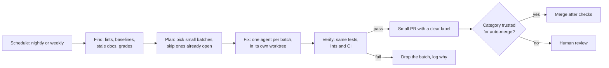

# Background Cleanup Agents: The Complete Guide

> 📚 **Before you start**
>
> - [Linters and Tests that Teach the Agent](linters-and-tests-that-teach-the-agent.md), for rules, remediation messages and the ratchet baseline
> - [Running Coding Agents in GitHub Actions](../03-coding-agents-on-github/running-coding-agents-in-github-actions.md), for scheduled agent workflows and how to lock them down
> - [Parallel Agents with Worktrees](../05-long-running-agents/parallel-agents-with-worktrees.md), for splitting work into independent pull requests
> - [Reviewing AI-Written Code](../02-working-with-coding-agents/reviewing-ai-written-code.md)

## Introduction

Indian Railways doesn't wait for a track to fail before fixing it. Gangs of trackmen walk their section every day, tightening a bolt here, replacing a sleeper there. No single fix is dramatic, and that's the point: small, constant maintenance keeps the line safe at full speed. A railway that only repaired after derailments would be both slower and more dangerous.

A codebase where agents write most of the code drifts the same way, only faster. Agents copy whatever patterns they find, so one awkward helper becomes ten; a doc goes stale and then misleads every session that reads it; a rule from the previous lesson accumulates a baseline that nobody shrinks. OpenAI's team, writing about a product built almost entirely by Codex, said they first spent every Friday, about 20% of the week, cleaning up "AI slop", and that it didn't scale. What did scale was treating cleanup like **garbage collection**: write the standards down as rules, then run **background agents** on a schedule that find deviations, grade quality, and open small refactoring pull requests, most of which could be reviewed in under a minute.

By the end of this lesson you'll know which cleanup jobs suit background agents, how to compute quality grades that steer them, how to detect stale documentation automatically, how to turn findings into small, safe pull requests, how to schedule and lock down the agents, and which guardrails keep a fleet of cleanup bots from becoming noise.

> 💡 **Key Insight**
>
> Pay technical debt continuously, in small instalments, by machine. A good cleanup agent picks one mechanical, verifiable problem, fixes a small batch of it, proves the fix with the same checks humans rely on, and opens a pull request so small that reviewing it is quicker than ignoring it.

---

## Core Explanation

### 1. Why agent-written codebases need gardening

| Source of drift | Example | Why agents make it worse |
|---|---|---|
| **Pattern copying** | A one-off `retry()` helper gets reimplemented in five modules | Agents imitate nearby code, good or bad |
| **Stale docs** | `docs/billing.md` names a function that was renamed last week | Every future session reads the wrong instructions |
| **Baselines that never shrink** | 300 old `print` calls exempted by the ratchet | New code is clean, old code stays as an example to copy |
| **Dead code** | Unused feature flags, orphaned files | More to read, more context spent, more confusion |
| **Dependency rot** | Outdated packages, deprecated APIs | Agents learn the old API from the code around them |

These are exactly the jobs humans hate and postpone, and the jobs agents are good at: mechanical, repetitive, checkable.



### 2. Good and bad cleanup tasks

Not every improvement belongs to a background agent. The test is: **could a reviewer confirm it's correct in under a minute?**

| Good background tasks | Keep for humans or foreground sessions |
|---|---|
| Replace `print` with the logger in one package | Redesigning a module's API |
| Swap a hand-rolled helper for the shared utility | Changing behaviour users can see |
| Fix doc references to renamed functions or files | Rewriting docs' explanations |
| Remove a feature flag that's been 100% on for 90 days | Deleting a feature |
| Upgrade a dependency's minor version with passing tests | Major framework migrations |
| Add missing type hints in one file | Large cross-cutting refactors |

OpenAI's write-up describes the rules behind its cleanup as **golden principles**: opinionated, mechanical statements encoded in the repository, such as "prefer the shared utility package to a hand-rolled helper" and "validate data at boundaries or use typed SDKs rather than guessing its shape". Mechanical principles are what make mechanical cleanup possible.

### 3. Quality grades: where to clean first

A cleanup agent needs a target. A simple **quality score** per area of the codebase, kept in the repository and updated by the agents themselves, works as both a dashboard for people and a priority list for bots:

```python
import json
from collections import Counter

FINDINGS = [   # from the linters and baseline of the previous lesson, gathered across the codebase
    {"path": "billing/tax.py", "rule": "LOG001"}, {"path": "billing/tax.py", "rule": "LOG001"},
    {"path": "billing/invoice.py", "rule": "NET001"}, {"path": "orders/cart.py", "rule": "LOG001"},
    {"path": "orders/api.py", "rule": "LAYER002"}, {"path": "orders/api.py", "rule": "LAYER002"},
    {"path": "orders/api.py", "rule": "NET001"}, {"path": "reports/daily.py", "rule": "LOG001"},
]
FILES_PER_AREA = {"billing": 12, "orders": 10, "reports": 8, "loyalty": 6}
COVERAGE = {"billing": 0.91, "orders": 0.64, "reports": 0.78, "loyalty": 0.88}
WEIGHT = {"LAYER002": 3, "NET001": 2, "LOG001": 1}           # architecture breaks cost more than log style

def grade(area):
    debt = sum(WEIGHT[f["rule"]] for f in FINDINGS if f["path"].startswith(area + "/"))
    debt_per_file = debt / FILES_PER_AREA[area]
    score = 100 - 60 * min(debt_per_file, 1) - 40 * (1 - COVERAGE[area])
    letter = "A" if score >= 90 else "B" if score >= 80 else "C" if score >= 70 else "D"
    return round(score, 1), letter

rows = sorted(((area, *grade(area)) for area in FILES_PER_AREA), key=lambda r: r[1])
print(f"{'area':<9}{'score':>6}  grade")
for area, score, letter in rows:
    print(f"{area:<9}{score:>6}  {letter}")
print("most common rule overall:", Counter(f["rule"] for f in FINDINGS).most_common(1)[0])
```

Output:

```
area      score  grade
orders     31.6  D
billing    76.4  C
reports    83.7  B
loyalty    95.2  A
most common rule overall: ('LOG001', 4)
```

The exact formula matters less than three properties: it's **computed, not judged** (so it's stable and can't be argued with), it's **written to a file in the repo** (for example a `QUALITY_SCORE.md` table that a scheduled job updates), and it's **visible**, so people notice when an area slides. Cleanup agents start with the lowest-graded area and the heaviest-weighted rule.

### 4. Doc gardening: catching stale documentation

Docs are context. A doc that names a function that no longer exists sends every future session in the wrong direction. Much of this is checkable without a model: collect the code references in each doc and confirm they still exist.

```python
import ast, re, tempfile, textwrap
from pathlib import Path

REPO = Path(tempfile.mkdtemp(prefix="chai-docs-")).resolve()
(REPO / "billing").mkdir()
(REPO / "docs").mkdir()
(REPO / "billing/tax.py").write_text("def compute_gst(amount, percent=5):\n    return amount * percent / 100\n")
(REPO / "billing/invoice.py").write_text("def build_invoice(order):\n    return {'order': order}\n")
(REPO / "docs/billing.md").write_text(textwrap.dedent("""\
    # Billing
    GST is calculated by `compute_gst` in `billing/tax.py`.
    Invoices are made by `make_invoice` in `billing/invoice.py`.
    Discounts live in `billing/discounts.py`.
    """))

def defined_names(repo):
    names = set()
    for path in repo.rglob("*.py"):
        names |= {n.name for n in ast.walk(ast.parse(path.read_text()))
                  if isinstance(n, (ast.FunctionDef, ast.ClassDef))}
    return names

def stale_references(repo):
    names = defined_names(repo)
    problems = []
    for doc in sorted(repo.glob("docs/*.md")):
        for lineno, line in enumerate(doc.read_text().splitlines(), start=1):
            for ref in re.findall(r"`([^`]+)`", line):
                if "/" in ref and ref.endswith(".py") and not (repo / ref).exists():
                    problems.append(f"{doc.relative_to(repo)}:{lineno}: file `{ref}` does not exist")
                elif re.fullmatch(r"[a-z_][a-z0-9_]*", ref) and ref not in names:
                    problems.append(f"{doc.relative_to(repo)}:{lineno}: name `{ref}` is not defined anywhere")
    return problems

for p in stale_references(REPO):
    print(p)
```

Output:

```
docs/billing.md:3: name `make_invoice` is not defined anywhere
docs/billing.md:4: file `billing/discounts.py` does not exist
```

A doc-gardening agent takes each finding, works out what the doc *should* say (here, `build_invoice`; and either discounts were removed or moved), edits the doc and opens a pull request. OpenAI describes running exactly such a recurring doc-gardening agent, alongside CI jobs that check the knowledge base is up to date, cross-linked and well structured. The deterministic check finds the problems cheaply; the model only does the part that needs judgement.

### 5. From findings to small pull requests

The planner decides what each agent run will fix. Its job is to keep pull requests **small, single-purpose and non-overlapping**, and not to pile on more while earlier ones wait for review:

```python
def plan_batches(findings, open_prs, max_files=3, max_open=4):
    """Group findings by (rule, area) into batches of at most max_files files."""
    if len(open_prs) >= max_open:
        return [], f"{len(open_prs)} cleanup PRs already open; waiting for review"
    groups = {}
    for f in findings:
        area = f["path"].split("/")[0]
        groups.setdefault((f["rule"], area), set()).add(f["path"])
    batches, taken = [], set()
    for (rule, area), paths in sorted(groups.items(), key=lambda kv: (-WEIGHT[kv[0][0]], kv[0])):
        key = f"cleanup/{rule.lower()}-{area}"
        files = sorted(paths)[:max_files]
        if key in open_prs or taken & set(files):
            continue                                   # no duplicates, no two batches on one file
        taken |= set(files)
        batches.append({"branch": key, "rule": rule, "files": files})
        if len(open_prs) + len(batches) >= max_open:
            break
    return batches, "ok"

batches, status = plan_batches(FINDINGS, open_prs={"cleanup/log001-billing"})
print(status)
for b in batches:
    print(b)
```

Output:

```
ok
{'branch': 'cleanup/layer002-orders', 'rule': 'LAYER002', 'files': ['orders/api.py']}
{'branch': 'cleanup/net001-billing', 'rule': 'NET001', 'files': ['billing/invoice.py']}
{'branch': 'cleanup/log001-orders', 'rule': 'LOG001', 'files': ['orders/cart.py']}
```

Each batch then becomes one agent run, in its own worktree, with a prompt like: "Fix rule NET001 in these files only. Follow the remediation in the lint message. Run the linters and tests. If anything else needs changing, stop and report instead." If checks fail, the batch is dropped and logged, not forced through.

### 6. Scheduling the agents

The simplest runner is a scheduled GitHub Actions workflow with the Claude Code action in automation mode (the `prompt` input), set up and locked down as in [Running Coding Agents in GitHub Actions](../03-coding-agents-on-github/running-coding-agents-in-github-actions.md):

```yaml
# .github/workflows/nightly-cleanup.yml
name: Nightly cleanup
on:
  schedule:
    - cron: "30 21 * * 1-5"      # 21:30 UTC = 03:00 IST
  workflow_dispatch:

concurrency: nightly-cleanup

jobs:
  cleanup:
    runs-on: ubuntu-latest
    timeout-minutes: 30
    permissions:
      contents: write
      pull-requests: write
      id-token: write
    steps:
      - uses: actions/checkout@v7
      - uses: anthropics/claude-code-action@v1
        with:
          anthropic_api_key: ${{ secrets.ANTHROPIC_API_KEY }}
          prompt: |
            Run `python tools/plan_cleanup.py` and take the FIRST batch it prints.
            Fix only that rule in only those files, following each lint message's fix.
            Run `python tools/agent_lint.py` and `python -m pytest -q`. If either fails, stop.
            Open one pull request on the batch's branch, labelled `cleanup`, explaining
            the rule, the files changed and how it was verified.
          claude_args: |
            --max-turns 40
            --allowedTools "Read,Edit,Bash(python tools/*),Bash(python -m pytest*),Bash(git *),Bash(gh pr create*)"
```

Other runners work the same way: `codex exec` in a scheduled job or the Codex GitHub Action, Copilot cloud agent assigned to issues that a scheduled job files, or a cron job on your own machine running `claude -p` in a container. The cleanup agent's inputs (rules, baselines, grades) live in the repository, so the runner is interchangeable.

### 7. Guardrails for a fleet of bots

- **One concern per PR.** One rule, one area. Mixed PRs are slow to review and hard to revert.
- **Size caps.** A few files and a few hundred lines at most. Split anything bigger.
- **A cap on open PRs.** If reviews fall behind, the bots wait (the planner above stops at four).
- **Labels and owners.** Label every bot PR (`cleanup`, `docs-gardening`) so people can filter, and let CODEOWNERS route them.
- **Auto-merge only where checks are decisive.** Doc link fixes and formatter-only changes with green CI are good candidates; behaviour-touching refactors need a person. OpenAI reports automerging many of its small cleanup PRs; earn that trust per category.
- **Budgets and timeouts.** `--max-turns`, job timeouts and a monthly spend cap.
- **A kill switch and a feedback loop.** A repository variable that disables the schedule, and a metric of how many bot PRs were closed without merging. If people keep rejecting a category, stop running it and fix the rule or the prompt.
- **The usual security.** Least-privilege token, no secrets beyond the model key, no untrusted input in the prompt, network restricted, as covered in Module 3 and the [sandboxes lesson](../04-what-a-harness-is/sandboxes-containers-microvms-and-hosted-sandboxes.md).

---

## Try It Yourself

1. **Grade change.** The orders team fixes both `LAYER002` findings in `orders/api.py`. Remove them from `FINDINGS` and print the new grade for `orders`.
2. **Back-pressure.** Call `plan_batches` with four PRs already open. What happens, and why is that the right behaviour?
3. **Another doc check.** Extend `stale_references` so it also reports Markdown links to files in the repo (like `[tax](../billing/tax_rates.py)`) that don't exist. Test it.

<details>
<summary>Show answers</summary>

**1.**

```python
FINDINGS = [f for f in FINDINGS if not (f["path"] == "orders/api.py" and f["rule"] == "LAYER002")]
print("orders:", grade("orders"))
```

Output:

```
orders: (67.6, 'D')
```

**2.**

```python
print(plan_batches(FINDINGS, open_prs={"a", "b", "c", "d"}))
```

Output:

```
([], '4 cleanup PRs already open; waiting for review')
```

The planner opens nothing. If reviewers can't keep up, more bot PRs just become noise that people learn to ignore, so the bots wait.

**3.**

```python
def broken_links(repo):
    problems = []
    for doc in sorted(repo.glob("docs/*.md")):
        for lineno, line in enumerate(doc.read_text().splitlines(), start=1):
            for target in re.findall(r"\]\(([^)#]+)\)", line):
                if not target.startswith("http") and not (doc.parent / target).resolve().exists():
                    problems.append(f"{doc.relative_to(repo)}:{lineno}: link to `{target}` is broken")
    return problems

with (REPO / "docs/billing.md").open("a") as f:
    f.write("See [tax rates](../billing/tax_rates.py) and [tax code](../billing/tax.py).\n")
print(broken_links(REPO))
```

Output:

```
['docs/billing.md:5: link to `../billing/tax_rates.py` is broken']
```

</details>

---

## Real-World Examples

- **OpenAI's Codex-built product** replaced a weekly cleanup day with background Codex tasks that scan for deviations from golden principles, update quality grades and open targeted refactoring PRs, plus a recurring doc-gardening agent.
- **Dependency bots** (Dependabot, Renovate) are the original background maintainers; teams now pair them with an agent that fixes the code when an upgrade's tests fail.
- **Teams with ratcheted lint rules** run a nightly agent that shrinks the baseline by one small batch per night, with a weekly summary of what changed.

---

## Common Misconceptions

### "Cleanup agents can run unsupervised"

They run unattended, not unsupervised. Small PRs, decisive checks, labels, caps and a rejection metric keep people in control.

### "Bigger cleanup PRs are more efficient"

They're slower to review, riskier to merge and harder to revert. Many tiny PRs win.

### "A model should find the problems"

Let deterministic checks find problems cheaply and reliably; use the model to fix them and for the judgement parts (what a stale doc should say).

### "Once the codebase is clean, the bots can stop"

Drift is continuous, especially with agents writing code daily. Garbage collection is a permanent process, like trackmen walking the line.

---

## Interview Relevance

*"How do you stop quality decaying in a codebase where agents write most of the code?"* A strong answer: encode standards as mechanical golden principles and checks; compute per-area quality grades kept in the repo; run scheduled background agents that pick small, single-concern batches, fix them in isolated worktrees, verify with the normal checks and open small labelled PRs; detect stale docs deterministically and let an agent fix them; apply back-pressure (cap open PRs), budgets, least privilege and auto-merge only for decisive categories; watch rejection rates. Citing OpenAI's move from a manual Friday cleanup to continuous background tasks shows you know where the practice comes from.

---

## Key Takeaways

- **Agent-written code drifts fast** because agents copy what they see; cleanup must be continuous, not a weekly chore.
- **Good background tasks are mechanical and verifiable**, reviewable in under a minute.
- **Compute quality grades and keep them in the repo**, so bots and people know where to work next.
- **Find problems with deterministic checks** (lints, baselines, stale doc references); use the model to fix them.
- **Guard the fleet**: one concern per PR, size and open-PR caps, labels, budgets, least privilege, auto-merge only where checks are decisive.

---

**Up next:** [Lab: Make a repository agent-ready](lab-make-a-repository-agent-ready.md)
