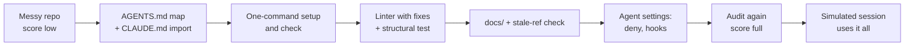

# Lab: Make a repository agent-ready

> 📚 **Before you start**
>
> - [Linters and Tests that Teach the Agent](linters-and-tests-that-teach-the-agent.md) and [Background Cleanup Agents](background-cleanup-agents.md)
> - [Repository Instructions: AGENTS.md and Custom Instructions](../03-coding-agents-on-github/repository-instructions-agents-md-and-custom-instructions.md) and [Memory Files: CLAUDE.md and AGENTS.md](../../context-engineering-and-agent-memory/04-memory-systems/memory-files-claude-md-and-agents-md.md)
> - [Permissions, Hooks and Approval Modes](../04-what-a-harness-is/permissions-hooks-and-approval-modes.md) and [Lab: Build a minimal coding-agent harness](../04-what-a-harness-is/lab-build-a-minimal-coding-agent-harness.md)
> - [Initializer Agents, Feature Lists and Progress Files](../05-long-running-agents/initializer-agents-feature-lists-and-progress-files.md)

## What You'll Build

You'll take a small but realistic Python repository that works fine for its one human author and is confusing for anyone else, human or agent, and turn it into one where a coding agent can be productive from its first minute. Everything happens in a temporary git repository, and every step is checked by a script, so you can see the repository's **agent-readiness score** go up as you work:

- an **audit script** that scores the repository against a checklist
- an `AGENTS.md` written as a **map**, plus a `CLAUDE.md` that imports it
- **one command** to set up and **one command** to check everything
- a **custom linter** with remediation messages, and a **structural test**
- a **docs/** folder as the system of record, with a **stale-reference check**
- **agent settings**: protected paths, a post-edit lint hook and a stop gate
- a final **simulated agent session** that uses all of it


*What "agent-ready" means: guides tell the agent how this repository works before it acts; sensors tell it, fast and specifically, when it got something wrong.*



> 💡 **Key Insight**
>
> An agent-ready repository answers, in files, the questions a new teammate asks on day one: what is this, how do I run it, how do I know I broke something, what are the rules, and what must I never touch. Answer them with checks wherever you can, so the answers stay true.

---

## Step 1: The starting repository

A chai-stall ordering service. It works, but the test command is unusual, conventions live in the author's head, and nothing protects anything.

```python
import json, os, subprocess, sys, tempfile, textwrap
from pathlib import Path

REPO = Path(tempfile.mkdtemp(prefix="chai-ready-")).resolve()
ENV = {**os.environ, "GIT_AUTHOR_NAME": "Asha", "GIT_AUTHOR_EMAIL": "asha@example.com",
       "GIT_COMMITTER_NAME": "Asha", "GIT_COMMITTER_EMAIL": "asha@example.com",
       "GIT_CONFIG_GLOBAL": os.devnull, "GIT_CONFIG_NOSYSTEM": "1", "PYTHONDONTWRITEBYTECODE": "1"}

def write(rel, text):
    path = REPO / rel
    path.parent.mkdir(parents=True, exist_ok=True)
    path.write_text(textwrap.dedent(text).lstrip())

def sh(*cmd, input=None):
    return subprocess.run(cmd, cwd=REPO, env=ENV, capture_output=True, text=True, input=input)

write("README.md", """
    # chai-stall
    Order service for the stall. Ask Asha how to run it.
""")
write("chai/__init__.py", "")
write("chai/menu.py", """
    MENU = {"masala chai": 20, "ginger chai": 25, "cutting chai": 10}
""")
write("chai/billing.py", """
    from chai.menu import MENU

    def total(order, gst_percent=5):
        subtotal = sum(MENU[item] * cups for item, cups in order.items())
        return round(subtotal * (1 + gst_percent / 100), 2)
""")
write("chai/api.py", """
    from chai.menu import MENU
    from chai.billing import total

    def quote(order):
        prices = {item: MENU[item] for item in order}
        return {"items": order, "prices": prices, "total": total(order)}
""")
write("checks/__init__.py", "")
write("checks/billing_check.py", """
    import unittest
    from chai.billing import total

    class BillingCheck(unittest.TestCase):
        def test_gst(self):
            self.assertEqual(total({"masala chai": 2}), 42.0)
""")
sh("git", "init", "-q", "-b", "main")
sh("git", "add", "-A")
sh("git", "commit", "-q", "-m", "Initial")
print(sh("git", "ls-files").stdout)
```

Output:

```
README.md
chai/__init__.py
chai/api.py
chai/billing.py
chai/menu.py
checks/__init__.py
checks/billing_check.py
```

The tests live in `checks/` with a `_check.py` suffix, so neither `pytest` nor `python -m unittest` finds them by default. A new agent would run the usual command, see "no tests", and carry on believing everything passes.

## Step 2: Write the audit

Each check answers one day-one question. The audit is code, so you can run it in CI and watch it stay green:

```python
def audit():
    agents = REPO / "AGENTS.md"
    text = agents.read_text() if agents.exists() else ""
    settings = json.loads((REPO / ".claude/settings.json").read_text()) if (REPO / ".claude/settings.json").exists() else {}
    checks = {
        "AGENTS.md exists and is a short map (<= 120 lines)": agents.exists() and len(text.splitlines()) <= 120,
        "AGENTS.md names the check command": "python tools/check.py" in text,
        "CLAUDE.md imports AGENTS.md": (REPO / "CLAUDE.md").exists() and "@AGENTS.md" in (REPO / "CLAUDE.md").read_text(),
        "one-command setup script": (REPO / "tools/setup.sh").exists(),
        "one-command check passes": (REPO / "tools/check.py").exists() and sh(sys.executable, "tools/check.py").returncode == 0,
        "linter messages include a fix": (REPO / "tools/agent_lint.py").exists() and "fix:" in (REPO / "tools/agent_lint.py").read_text(),
        "docs/ has an architecture doc": (REPO / "docs/architecture.md").exists(),
        "agent may not edit tools/ or tests' expectations": any("tools/**" in r for r in settings.get("permissions", {}).get("deny", [])),
        "post-edit lint hook configured": "PostToolUse" in settings.get("hooks", {}),
        "stop gate runs the checks": "Stop" in settings.get("hooks", {}),
        "worktrees ignored by git": ".claude/worktrees/" in ((REPO / ".gitignore").read_text() if (REPO / ".gitignore").exists() else ""),
    }
    return checks

def report():
    checks = audit()
    for name, ok in checks.items():
        print(("  [x] " if ok else "  [ ] ") + name)
    print(f"agent-readiness: {sum(checks.values())}/{len(checks)}")

report()
```

Output:

```
  [ ] AGENTS.md exists and is a short map (<= 120 lines)
  [ ] AGENTS.md names the check command
  [ ] CLAUDE.md imports AGENTS.md
  [ ] one-command setup script
  [ ] one-command check passes
  [ ] linter messages include a fix
  [ ] docs/ has an architecture doc
  [ ] agent may not edit tools/ or tests' expectations
  [ ] post-edit lint hook configured
  [ ] stop gate runs the checks
  [ ] worktrees ignored by git
agent-readiness: 0/11
```

## Step 3: AGENTS.md as a map, CLAUDE.md as a pointer

`AGENTS.md` is read by Codex, Copilot, Cursor, Gemini CLI (when configured) and others; Claude Code reads `CLAUDE.md`, which can import it with a line `@AGENTS.md`, so both tools get the same instructions from one file. Following OpenAI's experience, keep it a short **table of contents**: commands, layout, the few rules that matter, and links to `docs/` for everything else. A 1,000-line manual crowds out the task and goes stale.

```python
write("AGENTS.md", """
    # chai-stall: agent guide

    Order and billing service for a chai stall. Python 3.11+, standard library only.

    ## Commands
    - Set up: `bash tools/setup.sh`
    - Check everything (lint + structural + tests), run before every commit: `python tools/check.py`
    - Lint one file: `python tools/agent_lint.py chai/billing.py`

    ## Layout
    - `chai/menu.py`: prices (data only)
    - `chai/billing.py`: totals and GST. Money is rupees, rounded to 2 places
    - `chai/api.py`: request handlers. Must call billing, never compute prices itself
    - `checks/*_check.py`: tests (note the unusual name; `tools/check.py` finds them)
    - `docs/`: the system of record. Start with `docs/architecture.md`

    ## Rules (enforced by tools/agent_lint.py; messages tell you the fix)
    - api -> billing -> menu. Never import upwards.
    - No print() in chai/; use logging.
    - Never edit files in tools/ or change expected values in checks/ to make a check pass.

    ## Done means
    `python tools/check.py` passes and docs/ still matches the code.
""")
write("CLAUDE.md", """
    @AGENTS.md

    When compacting, keep the list of files changed and the last output of tools/check.py.
""")
report()
```

Output:

```
  [x] AGENTS.md exists and is a short map (<= 120 lines)
  [x] AGENTS.md names the check command
  [x] CLAUDE.md imports AGENTS.md
  [ ] one-command setup script
  [ ] one-command check passes
  [ ] linter messages include a fix
  [ ] docs/ has an architecture doc
  [ ] agent may not edit tools/ or tests' expectations
  [ ] post-edit lint hook configured
  [ ] stop gate runs the checks
  [ ] worktrees ignored by git
agent-readiness: 3/11
```

The check-command line already counts; the command itself doesn't exist yet. That's the next step, and the audit will hold you to it.

## Step 4: One command to set up, one command to check

Every session (and every worktree) should be able to get going with one command and know the truth with another. `tools/check.py` is the single source of "did I break anything", and it knows about the odd test file names so no agent has to.

```python
write("tools/setup.sh", """
    #!/usr/bin/env bash
    # Set up a fresh checkout or worktree. Standard library only, so just check the Python version.
    set -euo pipefail
    python -c 'import sys; assert sys.version_info >= (3, 11), "Python 3.11+ required"'
    echo "ready"
""")
write("tools/check.py", """
    \"\"\"Run every check an agent or human must pass before committing.\"\"\"
    import subprocess, sys

    STEPS = [
        ("lint", [sys.executable, "tools/agent_lint.py"]),
        ("tests", [sys.executable, "-m", "unittest", "discover", "-s", "checks", "-p", "*_check.py", "-t", "."]),
    ]
    failed = []
    for name, cmd in STEPS:
        done = subprocess.run(cmd, capture_output=True, text=True)
        status = "ok" if done.returncode == 0 else "FAILED"
        print(f"{name:<6} {status}")
        if done.returncode:
            failed.append(name)
            print((done.stdout + done.stderr).strip()[-1500:])
    sys.exit(1 if failed else 0)
""")
write("tools/agent_lint.py", """
    \"\"\"Placeholder: real rules arrive in step 5.\"\"\"
""")
print(sh(sys.executable, "tools/check.py").stdout)
report()
```

Output:

```
lint   ok
tests  ok

  [x] AGENTS.md exists and is a short map (<= 120 lines)
  [x] AGENTS.md names the check command
  [x] CLAUDE.md imports AGENTS.md
  [x] one-command setup script
  [x] one-command check passes
  [ ] linter messages include a fix
  [ ] docs/ has an architecture doc
  [ ] agent may not edit tools/ or tests' expectations
  [ ] post-edit lint hook configured
  [ ] stop gate runs the checks
  [ ] worktrees ignored by git
agent-readiness: 5/11
```

## Step 5: A linter that teaches, and a structural test

Now encode the rules from `AGENTS.md` as checks, with the remediation in every message (the pattern from [Linters and Tests that Teach the Agent](linters-and-tests-that-teach-the-agent.md)). The linter takes optional file arguments so a hook can lint just the edited file.

```python
write("tools/agent_lint.py", """
    \"\"\"Project rules for chai/. Every message says how to fix it. Usage: agent_lint.py [files...]\"\"\"
    import ast, sys
    from pathlib import Path

    ORDER = ["menu", "billing", "api"]          # each module may import only those before it

    def findings(path):
        tree = ast.parse(Path(path).read_text())
        me = Path(path).stem
        for node in ast.walk(tree):
            if isinstance(node, ast.ImportFrom) and (node.module or "").startswith("chai.") and me in ORDER:
                other = node.module.split(".")[1]
                if other in ORDER and ORDER.index(other) >= ORDER.index(me):
                    yield (node.lineno, "LAYER001", f"'{me}' may not import '{other}'.",
                           f"dependencies flow api -> billing -> menu; move the code into '{other}' or below.")
            if isinstance(node, ast.Call) and getattr(node.func, "id", None) == "print":
                yield (node.lineno, "LOG001", "print() in chai/.",
                       "use log = logging.getLogger(__name__); log.info('event', extra={...}).")
            if me == "api" and isinstance(node, ast.Name) and node.id == "MENU":
                yield (node.lineno, "API001", "api reads MENU directly.",
                       "call a function in chai.billing instead, so GST and rounding are applied in one place.")

    paths = sys.argv[1:] or [str(p) for p in sorted(Path("chai").glob("*.py"))]
    problems = [f"{p}:{line}: {rule} {msg}\\n  fix: {fix}\\n  see: docs/architecture.md"
                for p in paths if p.endswith(".py") for line, rule, msg, fix in findings(p)]
    print("\\n".join(problems))
    sys.exit(1 if problems else 0)
""")
write("checks/structure_check.py", """
    import unittest
    from pathlib import Path

    class StructureCheck(unittest.TestCase):
        def test_modules_stay_small(self):
            big = [str(p) for p in Path("chai").glob("*.py") if len(p.read_text().splitlines()) > 200]
            if big:
                self.fail(f"{big} are over 200 lines. Split by responsibility; see docs/architecture.md")
""")
print(sh(sys.executable, "tools/check.py").stdout)
```

Output:

```
lint   FAILED
chai/api.py:5: API001 api reads MENU directly.
  fix: call a function in chai.billing instead, so GST and rounding are applied in one place.
  see: docs/architecture.md
tests  ok
```

The very first run caught a real problem: `api.py` reads `MENU` itself to show prices, which invites the next agent to compute money in the API too (and get GST wrong). Fix it the way the message says. For this lab we simply drop the prices field; in a real project you'd add a `prices(order)` function to `billing`:

```python
write("chai/api.py", """
    from chai.billing import total

    def quote(order):
        return {"items": order, "total": total(order)}
""")
print(sh(sys.executable, "tools/check.py").stdout)
report()
```

Output:

```
lint   ok
tests  ok

  [x] AGENTS.md exists and is a short map (<= 120 lines)
  [x] AGENTS.md names the check command
  [x] CLAUDE.md imports AGENTS.md
  [x] one-command setup script
  [x] one-command check passes
  [x] linter messages include a fix
  [ ] docs/ has an architecture doc
  [ ] agent may not edit tools/ or tests' expectations
  [ ] post-edit lint hook configured
  [ ] stop gate runs the checks
  [ ] worktrees ignored by git
agent-readiness: 6/11
```

## Step 6: docs/ as the system of record, kept honest

`AGENTS.md` points to `docs/architecture.md` for the "why". Write it, and add a check that every code name it mentions still exists, so the doc can't silently rot (the doc-gardening idea from the previous lesson, as a check):

```python
write("docs/architecture.md", """
    # Architecture

    Three modules, dependencies flowing one way: `api` -> `billing` -> `menu`.

    - `MENU` in `chai/menu.py` holds prices in rupees.
    - `total` in `chai/billing.py` applies GST (5% by default) and rounds to 2 places. All money goes through it.
    - `quote` in `chai/api.py` is the only request handler today.

    Rules and their reasons: see the rules section of AGENTS.md; tools/agent_lint.py enforces them.
""")
write("checks/docs_check.py", """
    import ast, re, unittest
    from pathlib import Path

    class DocsCheck(unittest.TestCase):
        def test_docs_name_real_code(self):
            names = set()
            for p in Path("chai").glob("*.py"):
                for n in ast.walk(ast.parse(p.read_text())):
                    if isinstance(n, (ast.FunctionDef, ast.ClassDef)):
                        names.add(n.name)
                    if isinstance(n, ast.Assign):
                        names |= {t.id for t in n.targets if isinstance(t, ast.Name)}
            stale = []
            for doc in Path("docs").glob("*.md"):
                for ref in re.findall(r"`([^`]+)`", doc.read_text()):
                    if ref.endswith(".py") and not Path(ref).exists():
                        stale.append(f"{doc}: `{ref}` missing")
                    elif re.fullmatch(r"[A-Za-z_]\\w*", ref) and ref not in names and ref not in {"api", "billing", "menu"}:
                        stale.append(f"{doc}: `{ref}` is not defined in chai/")
            if stale:
                self.fail("Docs mention code that no longer exists; update the doc in the same change: " + "; ".join(stale))
""")
print(sh(sys.executable, "tools/check.py").stdout)
```

Output:

```
lint   ok
tests  ok
```

## Step 7: Agent settings: protect, sense, gate

Now the harness configuration. For Claude Code this lives in `.claude/settings.json`, committed so the whole team (and every cloud session) gets it:

- **Deny** edits to `tools/**` (the rules and the checker), so a failing check can't be "fixed" by editing the check.
- A **PostToolUse** hook on `Edit|Write` runs the linter on just the edited file; exit code 2 shows its findings to Claude.
- A **Stop** hook runs `tools/check.py`; if it fails, Claude is told why and keeps working.

```python
HOOK = """
    \"\"\"PostToolUse hook: lint the file Claude just edited; exit 2 shows findings to Claude.\"\"\"
    import json, subprocess, sys
    payload = json.load(sys.stdin)
    path = payload.get("tool_input", {}).get("file_path", "")
    if path.endswith(".py"):
        done = subprocess.run([sys.executable, "tools/agent_lint.py", path], capture_output=True, text=True)
        if done.returncode:
            print(done.stdout, file=sys.stderr)
            sys.exit(2)
"""
write("tools/hooks/lint_edited_file.py", HOOK)
write(".claude/settings.json", json.dumps({
    "permissions": {
        "deny": ["Edit(tools/**)", "Bash(git push --force*)", "Bash(git commit --no-verify*)"],
    },
    "hooks": {
        "PostToolUse": [{"matcher": "Edit|Write", "hooks": [
            {"type": "command", "command": "python3 \"$CLAUDE_PROJECT_DIR\"/tools/hooks/lint_edited_file.py"}]}],
        "Stop": [{"hooks": [
            {"type": "command", "command": "cd \"$CLAUDE_PROJECT_DIR\" && python3 tools/check.py >&2 || exit 2"}]}],
    },
}, indent=2))
write(".gitignore", """
    .claude/worktrees/
    .claude/settings.local.json
    __pycache__/
""")
report()
```

Output:

```
  [x] AGENTS.md exists and is a short map (<= 120 lines)
  [x] AGENTS.md names the check command
  [x] CLAUDE.md imports AGENTS.md
  [x] one-command setup script
  [x] one-command check passes
  [x] linter messages include a fix
  [x] docs/ has an architecture doc
  [x] agent may not edit tools/ or tests' expectations
  [x] post-edit lint hook configured
  [x] stop gate runs the checks
  [x] worktrees ignored by git
agent-readiness: 11/11
```

A real Stop hook should also guard against looping forever (check the `stop_hook_active` field in its input, as in the permissions lesson); this one is kept short. For Codex, the equivalent settings go in `.codex/` (sandbox and approval policy in `config.toml`, rules in `.rules` files, hooks in `hooks.json`), and `AGENTS.md` already serves it directly.

## Step 8: A new agent session, start to finish

Let's play a fresh agent that has never seen this repository. It reads the map, adds a feature (a discount for orders of five or more cups) and, like real agents sometimes do, takes a shortcut first. Watch the sensors respond:

```python
def agent_edits(rel, text):
    """Write a file the way an agent's Write tool would, then fire the PostToolUse hook."""
    write(rel, text)
    payload = json.dumps({"hook_event_name": "PostToolUse", "tool_name": "Write",
                          "tool_input": {"file_path": rel}})
    hook = sh(sys.executable, "tools/hooks/lint_edited_file.py", input=payload)
    print(f"[edit {rel}] hook exit {hook.returncode}")
    if hook.stderr.strip():
        print(hook.stderr.strip())

def agent_tries_to_stop():
    done = sh(sys.executable, "tools/check.py")
    print("[stop]", "allowed" if done.returncode == 0 else "BLOCKED: checks failing")
    return done.returncode == 0

# Orient: what the agent reads first
print("[read AGENTS.md]", [l for l in (REPO / "AGENTS.md").read_text().splitlines() if "check" in l.lower()][0])

# Shortcut: compute the discount in the API, reading MENU directly
agent_edits("chai/api.py", """
    from chai.billing import total
    from chai.menu import MENU

    def quote(order):
        cups = sum(order.values())
        subtotal = sum(MENU[i] * n for i, n in order.items())
        print("quote", cups)
        return {"items": order, "total": total(order) - (subtotal * 0.1 if cups >= 5 else 0)}
""")
agent_tries_to_stop()

# Following the fix hints: the rule belongs in billing, with a test
agent_edits("chai/billing.py", """
    import logging
    from chai.menu import MENU

    log = logging.getLogger(__name__)
    BULK_CUPS, BULK_DISCOUNT = 5, 0.10

    def total(order, gst_percent=5):
        subtotal = sum(MENU[item] * cups for item, cups in order.items())
        if sum(order.values()) >= BULK_CUPS:
            subtotal *= 1 - BULK_DISCOUNT
            log.info("bulk_discount", extra={"cups": sum(order.values())})
        return round(subtotal * (1 + gst_percent / 100), 2)
""")
agent_edits("chai/api.py", """
    from chai.billing import total

    def quote(order):
        return {"items": order, "total": total(order)}
""")
agent_edits("checks/discount_check.py", """
    import unittest
    from chai.billing import total

    class DiscountCheck(unittest.TestCase):
        def test_five_cups_get_ten_percent_off(self):
            self.assertEqual(total({"masala chai": 5}), 94.5,
                             "5 x Rs 20 = 100, minus 10% = 90, plus 5% GST = 94.5")
""")
agent_tries_to_stop()
```

Output:

```
[read AGENTS.md] - Check everything (lint + structural + tests), run before every commit: `python tools/check.py`
[edit chai/api.py] hook exit 2
chai/api.py:7: LOG001 print() in chai/.
  fix: use log = logging.getLogger(__name__); log.info('event', extra={...}).
  see: docs/architecture.md
chai/api.py:6: API001 api reads MENU directly.
  fix: call a function in chai.billing instead, so GST and rounding are applied in one place.
  see: docs/architecture.md
[stop] BLOCKED: checks failing
[edit chai/billing.py] hook exit 0
[edit chai/api.py] hook exit 0
[edit checks/discount_check.py] hook exit 0
[stop] allowed
```

Every correction came from the repository, not from a human: the hook told the agent what was wrong and how to fix it, the stop gate refused "done" until the checks passed, and the feature ended up where the architecture says it belongs, with a test whose failure message explains the arithmetic.

## Step 9: Final audit and commit

```python
report()
sh("git", "add", "-A")
sh("git", "commit", "-q", "-m", "Make the repository agent-ready: AGENTS.md map, checks, linter, docs, agent settings")
print(sh("git", "log", "--format=%s").stdout.strip())
print(sh("git", "show", "--stat", "--format=", "HEAD").stdout.strip().splitlines()[-1])
```

Output:

```
  [x] AGENTS.md exists and is a short map (<= 120 lines)
  [x] AGENTS.md names the check command
  [x] CLAUDE.md imports AGENTS.md
  [x] one-command setup script
  [x] one-command check passes
  [x] linter messages include a fix
  [x] docs/ has an architecture doc
  [x] agent may not edit tools/ or tests' expectations
  [x] post-edit lint hook configured
  [x] stop gate runs the checks
  [x] worktrees ignored by git
agent-readiness: 11/11
Make the repository agent-ready: AGENTS.md map, checks, linter, docs, agent settings
Initial
 14 files changed, 171 insertions(+), 3 deletions(-)
```

(The discount feature rode along in the same commit to keep the lab short. In real work it would be its own commit or pull request, as the git lesson recommended.)

---

## Try It Yourself

1. **Add a rule and its doc.** Add a lint rule `MONEY001` that flags any `float(` call in `chai/billing.py`, with the fix "use round(value, 2) on rupee amounts, or Decimal for sums". Add one line about it to `AGENTS.md`, then run `tools/check.py`.
2. **Make worktrees work.** A worktree is a fresh checkout. What needs to be true of `tools/setup.sh` and `.worktreeinclude` for a parallel agent to run `tools/check.py` in one? Add a check for it to `audit()`.
3. **Initialize for a long run.** Using the previous module, write a `feature_list.json` with three future features for this repository (all failing) and add an audit check that the file exists and that every feature has `passes: false` or a matching test file.

<details>
<summary>Show answers</summary>

**1.**

```python
lint_src = (REPO / "tools/agent_lint.py").read_text()
lint_src = lint_src.replace(
    '            if me == "api"',
    '            if me == "billing" and isinstance(node, ast.Call) and getattr(node.func, "id", None) == "float":\n'
    '                yield (node.lineno, "MONEY001", "float() on money in billing.",\n'
    '                       "use round(value, 2) on rupee amounts, or Decimal for sums.")\n'
    '            if me == "api"', 1)
(REPO / "tools/agent_lint.py").write_text(lint_src)
with (REPO / "AGENTS.md").open("a") as f:
    f.write("- No float() on money in billing; round to 2 places or use Decimal (MONEY001).\n")
print(sh(sys.executable, "tools/check.py").stdout)
```

Output:

```
lint   ok
tests  ok
```

(You, the human, can edit `tools/`; the deny rule only stops the agent. The checks still pass because `billing.py` has no `float(` call yet.)

**2.** `tools/setup.sh` must work from any checkout (no absolute paths, no reliance on files outside the repo), and any gitignored files the checks need (here none; in real projects often `.env`) must be listed in `.worktreeinclude`. A check:

```python
def worktree_ready():
    setup = (REPO / "tools/setup.sh").read_text()
    return str(REPO) not in setup and "/home/" not in setup

print("setup script is checkout-independent:", worktree_ready())
```

Output:

```
setup script is checkout-independent: True
```

**3.**

```python
features = [
    {"id": "F1", "description": "Cutting chai offered at Rs 10 after 9 p.m.", "passes": False},
    {"id": "F2", "description": "Quote shows GST as a separate line", "passes": False},
    {"id": "F3", "description": "Orders can be cancelled before payment", "passes": False},
]
(REPO / "feature_list.json").write_text(json.dumps(features, indent=2))

def features_ok():
    feats = json.loads((REPO / "feature_list.json").read_text())
    return all(not f["passes"] or (REPO / f"checks/{f['id'].lower()}_check.py").exists() for f in feats)

print("feature list consistent:", features_ok())
```

Output:

```
feature list consistent: True
```

</details>

---

## What You've Learned

- **Agent-readiness is checkable**: an audit script turns "is this repo ready?" into a score you can keep green in CI.
- **AGENTS.md is a short map** (commands, layout, key rules, done-means), with `docs/` as the system of record and `CLAUDE.md` importing `AGENTS.md` so every tool reads one source.
- **One command to set up and one to check** remove the most common way agents go wrong: not knowing how to run or verify the project.
- **Linters with fixes, structural tests and doc checks** let the repository correct the agent; a post-edit hook delivers that feedback in seconds and a stop gate makes "done" mean "checks pass".
- **Protect the sensors**: deny agent edits to the rules and checks, so failures are fixed in the code, not in the tests.

---

**Up next:** You've finished the course. Revisit [How This Course Works](../01-start-here/how-this-course-works.md) for where to go next, or continue with [Agent Security and Safety](../../agent-security-and-safety/course.md) to go deeper on locking agents down.
