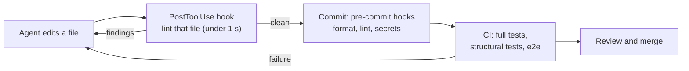

# Linters and Tests that Teach the Agent: The Complete Guide

> 📚 **Before you start**
>
> - [Model Plus Harness: The Parts of an Agent Runtime](../04-what-a-harness-is/model-plus-harness-the-parts-of-an-agent-runtime.md), especially the section on guides and sensors and "keep quality left"
> - [Permissions, Hooks and Approval Modes](../04-what-a-harness-is/permissions-hooks-and-approval-modes.md), for PostToolUse hooks and exit code 2
> - [Repository Instructions: AGENTS.md and Custom Instructions](../03-coding-agents-on-github/repository-instructions-agents-md-and-custom-instructions.md)
> - [Git Hooks and pre-commit](../../git-and-github-zero-to-pro/10-open-source-and-advanced-git/git-hooks-and-pre-commit.md) and [Lab: CI that tests and lints a Python project](../../git-and-github-zero-to-pro/07-github-actions/lab-ci-that-tests-and-lints-a-python-project.md)
> - Python's `ast` module is used in the code; you only need to know it parses code into a tree you can walk

## Introduction

A good cricket coach in the nets doesn't just shout "wrong!" when a young batter plays across the line. They say: "Your front foot is going towards square leg; point it at the bowler, and the bat will come straight." The batter fixes it on the next ball. A coach who only says "wrong" gets the same mistake again, and again.

Linters and tests are the nets for a coding agent, and most of them only say "wrong". A human developer fills the gap from experience or a quick search. An agent works from what's in front of it: if the error says `E501 line too long` or `AssertionError`, it guesses. If the error says *what the rule is, why it exists and how to fix it*, the agent fixes it in one turn, every time, in every session, without anyone having to remember to explain.

OpenAI's team that built a product with roughly a million lines of agent-written code (described in their February 2026 "Harness engineering" post) leaned hard on this: custom linters and structural tests enforce their architecture and "taste", and because the linters are their own, **the error messages carry remediation instructions straight into the agent's context**. By the end of this lesson you'll be able to write such linters in Python, enforce an architecture with structural tests, add new rules to an old codebase with a ratchet, write test failures that explain themselves, and wire all of it into the agent's loop so feedback arrives seconds after an edit.

> 💡 **Key Insight**
>
> Every recurring review comment is a rule waiting to be automated. Turn it into a check that runs right after the agent's edit, and write the failure message as instructions for the agent: what's wrong, how to fix it, and where the rule is explained.

---

## Core Explanation

### 1. Error messages are prompts

When a check fails inside an agent's loop, its output is pasted into the model's context, so it works exactly like a prompt. Compare:

| Message | What the agent learns |
|---|---|
| `ui/menu_page.py:3: forbidden import` | Something about imports is wrong. Which? Why? Guess. |
| `ui/menu_page.py:3: LAYER001 'ui' may not import 'repo'. Fix: call a function in 'service' instead (service.menu.get_menu). Why: UI must go through service so caching and auth apply. See docs/architecture.md#layers` | The rule, the exact fix, the reason, and where to read more. |

The second message costs nothing extra at runtime and saves a turn (or three) every time the rule fires. It also teaches the *next* session, which never saw the first.

A good agent-facing message has four parts: **location**, **rule id and statement**, **fix** (concrete, ideally naming the right function or file), and **why plus a doc link**. Keep it short; it's going into a context window.

### 2. A small codebase with layers

To have something to lint, here's a tiny package laid out in layers, in a temporary folder. Dependencies should only flow **forward**, the way OpenAI's write-up describes for each business domain (types, then config, then repository, service, runtime and UI, with cross-cutting concerns entering through providers). Ours uses five layers:

```python
import ast, tempfile, textwrap
from pathlib import Path

ROOT = Path(tempfile.mkdtemp(prefix="chai-lint-")).resolve()
FILES = {
    "chai/types/order.py": """
        from dataclasses import dataclass

        @dataclass
        class Order:
            item: str
            cups: int
    """,
    "chai/config/settings.py": """
        GST_PERCENT = 5
    """,
    "chai/repo/menu_repo.py": """
        import httpx
        from chai.types.order import Order

        def load_menu():
            return httpx.get("https://menu.example/api").json()
    """,
    "chai/service/billing.py": """
        from chai.config.settings import GST_PERCENT
        from chai.repo.menu_repo import load_menu

        def total(order):
            price = load_menu()[order.item]
            print("computing total", order)
            return round(price * order.cups * (1 + GST_PERCENT / 100), 2)
    """,
    "chai/ui/menu_page.py": """
        from chai.repo.menu_repo import load_menu
        from chai.service.billing import total

        def render():
            return "\\n".join(f"{name}: Rs {price}" for name, price in load_menu().items())
    """,
}
for rel, src in FILES.items():
    path = ROOT / rel
    path.parent.mkdir(parents=True, exist_ok=True)
    path.write_text(textwrap.dedent(src).lstrip())

LAYERS = ["types", "config", "repo", "service", "ui"]          # each may import only those before it
print(sorted(str(p.relative_to(ROOT)) for p in ROOT.rglob("*.py")))
```

Output:

```
['chai/config/settings.py', 'chai/repo/menu_repo.py', 'chai/service/billing.py', 'chai/types/order.py', 'chai/ui/menu_page.py']
```

It has three problems a reviewer would flag: the UI reaches into the repository layer directly, the service uses `print` instead of logging, and the repository calls `httpx` itself instead of going through a shared HTTP provider (where timeouts, retries and auth live).

### 3. Writing linters that teach

Each rule is a small function over the parsed file. The message format is the point:

```python
from dataclasses import dataclass

@dataclass
class Finding:
    path: str
    line: int
    rule: str
    message: str
    fix: str
    doc: str

    def __str__(self):
        return f"{self.path}:{self.line}: {self.rule} {self.message}\n  fix: {self.fix}\n  why: {self.doc}"

def layer_of(rel_path):
    parts = Path(rel_path).parts
    return parts[1] if len(parts) > 2 and parts[1] in LAYERS else None

def check_layers(rel, tree):
    mine = layer_of(rel)
    for node in ast.walk(tree):
        if isinstance(node, ast.ImportFrom) and node.module and node.module.startswith("chai."):
            theirs = node.module.split(".")[1]
            if theirs in LAYERS and LAYERS.index(theirs) > LAYERS.index(mine):
                yield Finding(rel, node.lineno, "LAYER001", f"'{mine}' may not import '{theirs}' (dependencies flow {' -> '.join(LAYERS)}).",
                              f"move the shared code down into '{mine}' or an earlier layer, or invert the dependency.",
                              "docs/architecture.md#layers")
            if mine == "ui" and theirs == "repo":
                yield Finding(rel, node.lineno, "LAYER002", "'ui' may not use 'repo' directly.",
                              "call a function in 'service' instead (add one if it doesn't exist, e.g. service.menu.get_menu).",
                              "UI must go through service so caching and permissions apply. docs/architecture.md#layers")

def check_print(rel, tree):
    if layer_of(rel) == "ui":
        return
    for node in ast.walk(tree):
        if isinstance(node, ast.Call) and getattr(node.func, "id", None) == "print":
            yield Finding(rel, node.lineno, "LOG001", "print() in library code.",
                          "use log = logging.getLogger(__name__) and log.info('event_name', extra={...}).",
                          "structured logs are searchable by the agent and by on-call. docs/logging.md")

def check_http(rel, tree):
    for node in ast.walk(tree):
        names = [a.name for a in node.names] if isinstance(node, ast.Import) else \
                [node.module] if isinstance(node, ast.ImportFrom) and node.module else []
        if any(n.split(".")[0] in {"httpx", "requests", "urllib3"} for n in names):
            yield Finding(rel, node.lineno, "NET001", "direct HTTP client import.",
                          "use chai.providers.http.client(), which adds timeouts, retries and auth.",
                          "one place for network policy. docs/architecture.md#providers")

RULES = [check_layers, check_print, check_http]

def lint(root=ROOT):
    findings = []
    for path in sorted(root.rglob("*.py")):
        rel = str(path.relative_to(root))
        tree = ast.parse(path.read_text())
        for rule in RULES:
            findings.extend(rule(rel, tree) or [])
    return findings

for f in lint():
    print(f)
```

Output:

```
chai/repo/menu_repo.py:1: NET001 direct HTTP client import.
  fix: use chai.providers.http.client(), which adds timeouts, retries and auth.
  why: one place for network policy. docs/architecture.md#providers
chai/service/billing.py:6: LOG001 print() in library code.
  fix: use log = logging.getLogger(__name__) and log.info('event_name', extra={...}).
  why: structured logs are searchable by the agent and by on-call. docs/logging.md
chai/ui/menu_page.py:1: LAYER002 'ui' may not use 'repo' directly.
  fix: call a function in 'service' instead (add one if it doesn't exist, e.g. service.menu.get_menu).
  why: UI must go through service so caching and permissions apply. docs/architecture.md#layers
```

Notice LAYER002 is a more specific version of the general rule: a special case common enough to deserve its own exact fix. That's the pattern to follow: when the same review comment comes up repeatedly, give it a rule id and a precise remediation.

In a real project you'd often write these as plugins for an existing linter (Ruff rules can't be added by plugin, but `flake8` plugins, `pylint` checkers, Semgrep rules and ESLint custom rules all can) or as plain scripts like this one run by pre-commit and CI. What matters is the message.

### 4. Structural tests: architecture as a unit test

Some rules are about the shape of the whole codebase rather than one line. They fit naturally as ordinary tests that run with the rest of the suite. Here are three, written with `unittest` and, importantly, with **assertion messages written for the agent**:

```python
import io, unittest

def import_graph(root=ROOT):
    graph = {}
    for path in root.rglob("*.py"):
        rel = str(path.relative_to(root))
        mods = {n.module for n in ast.walk(ast.parse(path.read_text()))
                if isinstance(n, ast.ImportFrom) and n.module and n.module.startswith("chai.")}
        graph[rel] = sorted(mods)
    return graph

class ArchitectureTests(unittest.TestCase):
    MAX_LINES = 300

    def test_no_backwards_layer_imports(self):
        bad = [f"{rel} imports {m}" for rel, mods in import_graph().items() for m in mods
               if LAYERS.index(m.split(".")[1]) > LAYERS.index(layer_of(rel))]
        if bad:
            self.fail(f"{bad}: dependencies must flow types -> config -> repo -> service -> ui. "
                      "Move the shared code to an earlier layer. See docs/architecture.md#layers")

    def test_ui_never_touches_repo(self):
        bad = [rel for rel, mods in import_graph().items()
               if layer_of(rel) == "ui" and any(m.startswith("chai.repo") for m in mods)]
        if bad:
            self.fail(f"{bad} import the repo layer directly. Add or reuse a service function and call that instead.")

    def test_files_stay_small(self):
        big = [str(p.relative_to(ROOT)) for p in ROOT.rglob("*.py") if len(p.read_text().splitlines()) > self.MAX_LINES]
        if big:
            self.fail(f"{big} are over {self.MAX_LINES} lines, too long to read in one go. Split by responsibility.")

result = unittest.TextTestRunner(stream=io.StringIO(), verbosity=0).run(
    unittest.defaultTestLoader.loadTestsFromTestCase(ArchitectureTests))
failed = {t.id(): tr.strip().splitlines()[-1] for t, tr in result.failures}
for name in sorted(unittest.defaultTestLoader.getTestCaseNames(ArchitectureTests)):
    key = f"__main__.ArchitectureTests.{name}"
    print(f"{name:<32} {'FAIL: ' + failed[key] if key in failed else 'ok'}")
```

Output:

```
test_files_stay_small            ok
test_no_backwards_layer_imports  ok
test_ui_never_touches_repo       FAIL: AssertionError: ['chai/ui/menu_page.py'] import the repo layer directly. Add or reuse a service function and call that instead.
```

Each failure names the offending files and tells the agent what to do. A bare `assertEqual(bad, [])` would print only a list diff and leave the agent to work out the rule.

The same idea applies to **ordinary feature tests**: `self.assertEqual(total(order), 42.0, "2 masala chai at Rs 20 with 5% GST should be 42.0; check GST is divided by 100")` turns a failing number into a hint.

### 5. Adding rules to an old codebase: the ratchet

A new rule on a large, old codebase will find hundreds of existing violations. Blocking all work until they're fixed isn't realistic; ignoring the rule means agents keep copying the bad pattern (they imitate what they see). The fix is a **ratchet**: record today's violations in a baseline file, fail only on **new** ones, and let the baseline shrink as code is cleaned up.

```python
import json

def fingerprint(f):
    return f"{f.path}:{f.rule}"                    # ignore line numbers so unrelated edits don't churn it

baseline = sorted({fingerprint(f) for f in lint()})
(ROOT / "lint-baseline.json").write_text(json.dumps(baseline, indent=1))

def new_findings():
    known = set(json.loads((ROOT / "lint-baseline.json").read_text()))
    return [f for f in lint() if fingerprint(f) not in known]

print("baseline entries:", len(baseline), "| new findings now:", len(new_findings()))

# An agent adds a new file that copies the old pattern
(ROOT / "chai/service/receipts.py").write_text("import requests\n\ndef send(r):\n    print('sending', r)\n")
for f in new_findings():
    print(f)
```

Output:

```
baseline entries: 3 | new findings now: 0
chai/service/receipts.py:4: LOG001 print() in library code.
  fix: use log = logging.getLogger(__name__) and log.info('event_name', extra={...}).
  why: structured logs are searchable by the agent and by on-call. docs/logging.md
chai/service/receipts.py:1: NET001 direct HTTP client import.
  fix: use chai.providers.http.client(), which adds timeouts, retries and auth.
  why: one place for network policy. docs/architecture.md#providers
```

Old violations are tolerated; the agent's **new** file is held to the standard. In OpenAI's description, background agents then work the baseline down over time, which is the subject of the next lesson.

### 6. Wiring it into the loop

Where a check runs decides how fast the agent hears about it. "Keep quality left" means running the cheap checks as close to the edit as possible:



In Claude Code, a `PostToolUse` hook on `Edit|Write` receives JSON describing the edit on stdin. If it exits with code 2, its stderr is shown to Claude (the edit already happened, so this is feedback, not a block):

```json
{
  "hooks": {
    "PostToolUse": [
      {
        "matcher": "Edit|Write",
        "hooks": [{ "type": "command", "command": "python3 \"$CLAUDE_PROJECT_DIR\"/tools/agent_lint.py" }]
      }
    ]
  }
}
```

The hook script reuses the same rules. Here it's a function so you can run it on a sample payload:

```python
def agent_lint_hook(payload_json, root=ROOT):
    """Return (exit_code, stderr) the way a PostToolUse command hook would."""
    payload = json.loads(payload_json)
    path = Path(payload["tool_input"]["file_path"])
    if path.suffix != ".py":
        return 0, ""
    rel = str(path.relative_to(root))
    tree = ast.parse(path.read_text())
    findings = [f for rule in RULES for f in (rule(rel, tree) or [])]
    if not findings:
        return 0, ""
    return 2, "Lint findings in the file you just edited. Fix them before continuing:\n" + "\n".join(map(str, findings))

sample = json.dumps({"hook_event_name": "PostToolUse", "tool_name": "Write",
                     "tool_input": {"file_path": str(ROOT / "chai/service/receipts.py")}})
code, stderr = agent_lint_hook(sample)
print("exit code:", code)
print(stderr)
```

Output:

```
exit code: 2
Lint findings in the file you just edited. Fix them before continuing:
chai/service/receipts.py:4: LOG001 print() in library code.
  fix: use log = logging.getLogger(__name__) and log.info('event_name', extra={...}).
  why: structured logs are searchable by the agent and by on-call. docs/logging.md
chai/service/receipts.py:1: NET001 direct HTTP client import.
  fix: use chai.providers.http.client(), which adds timeouts, retries and auth.
  why: one place for network policy. docs/architecture.md#providers
```

Codex and Gemini CLI have equivalent post-tool hooks (`PostToolUse` in Codex, `AfterTool` in Gemini CLI), and every agent runs pre-commit hooks and CI the same way a person does. The same message reaches the agent whichever path it takes.

### 7. Rules for rules

- **Fast.** In-loop checks should finish in about a second. Save the slow ones for commit and CI.
- **Deterministic and quiet.** A rule that's sometimes wrong teaches the agent to ignore or work around rules. Prefer fewer, reliable rules.
- **Protected.** The agent must not edit the linter, its config, the baseline or the tests to make a failure go away. Deny edits to those paths (as in the Module 4 lab) and make CI the final judge.
- **Discoverable.** Mention the important rules in `AGENTS.md` in one line each, with a link to the doc, so the agent avoids them before tripping them. Guides and sensors should agree.
- **Owned.** Each rule names its doc. When a rule stops making sense, delete it; stale rules cost every session.
- **Use judgement where code can't.** Things like "is this name misleading?" or "does this duplicate an existing helper?" are better checked by a reviewer agent, as in [Reviewing AI-Written Code](../02-working-with-coding-agents/reviewing-ai-written-code.md). Computational checks first, inferential ones after.

---

## Try It Yourself

1. **Write a rule.** Add a rule `NAME001` that flags any function in `service/` whose name doesn't start with a verb from `{"get", "create", "update", "delete", "compute", "send", "total"}`, with a message that teaches the convention. Run it.
2. **Improve a message.** Rewrite this message to be agent-friendly: `bad import in billing.py`.
3. **Shrink the baseline.** Fix the `print` in `chai/service/billing.py` (replace it with a logger call), then write a function that removes baseline entries that no longer occur, and show the baseline shrinking.

<details>
<summary>Show answers</summary>

**1.**

```python
VERBS = {"get", "create", "update", "delete", "compute", "send", "total"}

def check_names(rel, tree):
    if layer_of(rel) != "service":
        return
    for node in ast.walk(tree):
        if isinstance(node, ast.FunctionDef) and node.name.split("_")[0] not in VERBS:
            yield Finding(rel, node.lineno, "NAME001", f"service function '{node.name}' should start with a verb.",
                          f"rename to e.g. 'get_{node.name}' or 'compute_{node.name}'; allowed first words: {', '.join(sorted(VERBS))}.",
                          "service functions read as actions. docs/naming.md")

(ROOT / "chai/service/loyalty.py").write_text("def points(total):\n    return int(total // 10)\n")
for f in check_names("chai/service/loyalty.py", ast.parse((ROOT / "chai/service/loyalty.py").read_text())):
    print(f)
```

Output:

```
chai/service/loyalty.py:1: NAME001 service function 'points' should start with a verb.
  fix: rename to e.g. 'get_points' or 'compute_points'; allowed first words: compute, create, delete, get, send, total, update.
  why: service functions read as actions. docs/naming.md
```

**2.** For example: `chai/service/billing.py:2: NET001 direct HTTP client import ('requests'). fix: use chai.providers.http.client(), which sets timeouts, retries and auth. why: one place for network policy; see docs/architecture.md#providers`. It has location, rule id, the exact fix and the reason.

**3.**

```python
src = (ROOT / "chai/service/billing.py").read_text()
src = src.replace('print("computing total", order)', 'log.info("computing_total", extra={"item": order.item})')
src = "import logging\nlog = logging.getLogger(__name__)\n" + src
(ROOT / "chai/service/billing.py").write_text(src)

def tighten_baseline():
    current = {fingerprint(f) for f in lint()}
    old = json.loads((ROOT / "lint-baseline.json").read_text())
    kept = [entry for entry in old if entry in current]
    (ROOT / "lint-baseline.json").write_text(json.dumps(kept, indent=1))
    return len(old), len(kept)

print("baseline: %d -> %d entries" % tighten_baseline())
```

Output:

```
baseline: 3 -> 2 entries
```

Running `tighten_baseline` in CI on `main` makes the ratchet click: once a violation is fixed, it can't come back.

</details>

---

## Real-World Examples

- **OpenAI's Codex-built product** enforces layer direction, structured logging, naming conventions for schemas and types, file size limits and reliability requirements with custom linters and structural tests, with remediation text in every message.
- **Teams adopting agents on legacy code** add a ratcheted rule set: existing violations are baselined, new code must be clean, and a weekly job reports how much the baseline shrank.
- **Claude Code users** wire a formatter and a fast linter into a `PostToolUse` hook, so style problems are fixed within the same turn and never reach review.

---

## Common Misconceptions

### "Instructions in AGENTS.md are enough"

Instructions are guides; the agent may forget or misapply them, especially late in a long session. A check that fires on violation is a sensor that never forgets. Use both, and keep them consistent.

### "More rules make better code"

Noisy or wrong rules teach agents to game the checks. A few fast, accurate rules with great messages beat a hundred vague ones.

### "Error messages are for humans; agents can figure it out"

Agents work from what's in their context. A message with the fix saves turns in every session, forever.

### "Agents can fix lint failures however they like"

If they can edit the rules, the tests or the baseline, they will sometimes "fix" a failure there. Protect those paths.

---

## Interview Relevance

*"How do you make a large codebase work well with coding agents?"* A strong answer talks about turning recurring review comments into deterministic checks; custom linters and structural tests that encode architecture (layer direction, provider boundaries, logging, file size) with remediation in every message; ratchets for legacy code; running cheap checks in a post-edit hook, then pre-commit, then CI; protecting rules and tests from agent edits; and keeping AGENTS.md and the checks consistent. Citing OpenAI's harness engineering experience (custom lints whose messages feed the agent) and the guides-versus-sensors framing shows you know current practice.

---

## Key Takeaways

- **Check output is a prompt**: give every failure a location, rule id, concrete fix and a why-plus-doc link.
- **Encode architecture as code**: layer-direction and boundary rules as linters and structural tests, not just diagrams.
- **Ratchet new rules into old code**: baseline existing violations, block new ones, shrink the baseline over time.
- **Keep quality left**: lint the edited file in a post-edit hook within seconds; full tests at commit and in CI.
- **Protect and prune**: agents can't edit the rules, tests or baseline, and rules that stop earning their keep get deleted.

---

**Up next:** [Background Cleanup Agents](background-cleanup-agents.md)
