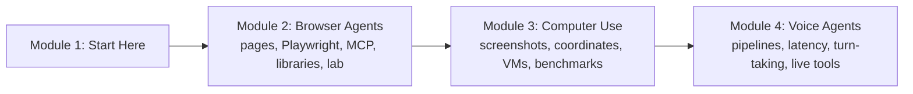

# How This Course Works

## Introduction

Think about how you book a Tatkal ticket on the IRCTC website at 10 a.m. sharp. Nobody gave you an API. You look at the page, find the "From" box, type "Pune", pick the date, wait for the train list to load, click the class you want, fill in passenger names, and stop before paying to check everything once more. Now think about calling your bank's helpline: you speak, the voice on the other end listens, answers, sometimes says "one moment, let me check your account", and you can cut in mid-sentence when it goes off track.

Most software in the world was built for **people**: screens, buttons, forms, and voices on the phone. Everything you have built in this track so far talked to software through **tools with clean schemas**: a function, an API, an MCP server. This course is about agents that use the same interfaces people use:

- **Browser agents** that read and operate web pages.
- **Computer-use agents** that look at screenshots of a whole desktop and move the mouse and keyboard.
- **Voice agents** that hold a live spoken conversation and call tools while they talk.

These agents are powerful because they reach systems that have no API at all. They are also the riskiest agents you will build, because a web page or a phone caller can say anything, and the agent is clicking real buttons in the real world. So safety and human approval are not a final chapter here; they are part of every lesson.

> 💡 **Key Insight**
>
> A browser, computer-use or voice agent is the same agent loop you already know: **observe, decide, act**, plus a **verify** step. What changes is the shape of the observation (a page, a screenshot, an audio stream), the shape of the action (a click, a keystroke, a spoken sentence) and the clock (a voice agent has under a second). The model proposes; your harness executes, checks and, for anything consequential, asks a human.

---

## What You Will Learn

By the end of this course you will be able to:

- **Choose how an agent should see a web page**: raw HTML, the accessibility tree, a screenshot, or a mix, and explain the cost and accuracy trade-offs.
- **Drive a real browser with Playwright** from Python, and expose it to any agent through the Playwright MCP server or Anthropic's browser use toolset.
- **Compare browser agent libraries** such as Browser Use and Stagehand, and know when plain Playwright is the better choice.
- **Handle logins, CAPTCHAs, pop-ups and flaky pages** without leaking passwords or fighting anti-bot systems.
- **Build a browser agent that fills a form**, in a lab, with a pretend model, a real Chromium, and an approval gate before submit.
- **Explain the screenshot-action loop** of computer use, including coordinate scaling, batched actions and zoom, and read the current Anthropic, OpenAI and Google computer-use APIs.
- **Run desktop agents safely** inside virtual machines and containers with no secrets, an allowlisted network, and a human in the loop.
- **Read benchmark claims** about OSWorld and WebArena with a critical eye.
- **Design voice agents**: cascaded speech-to-text, LLM and text-to-speech pipelines versus speech-to-speech models, latency budgets, turn-taking, interruptions, and tool calls in the middle of a live call.

### The course at a glance

*Three kinds of agent, one loop, one safety layer. Each module zooms into one card.*

The order is deliberate. **Browser agents** come first because a web page has structure (elements with names and roles) that makes the ideas easy to see and test. **Computer use** removes that structure: the agent gets only pixels, which is harder and more general. **Voice agents** then change the clock: instead of taking seconds per step, the agent has to respond within about a second while a person is waiting on the line.

---

## How Every Lesson Is Built

| Section | What it gives you |
|---|---|
| **Before you start** | Links to the earlier lessons this one depends on. |
| **Introduction** | Why the topic matters, with an everyday example. |
| **Key Insight** | The one idea to remember. |
| **Core Explanation** | The topic step by step, with diagrams, tables and code. |
| **Try It Yourself** | Exercises, with answers hidden in a fold. |
| **Real-World Examples** | How shipping products use the idea. |
| **Common Misconceptions** | Mistakes almost everyone makes, corrected. |
| **Interview Relevance** | What interviewers ask and what a strong answer covers. |
| **Key Takeaways** | A one-minute summary for revision. |

The **lab** in Module 2 is a guided build: a browser agent that reads a local HTML form, fills it from a request, and stops for your approval before submitting.

---

## What You Need Before Starting

This is the last course of the Agentic AI track, so it builds on a lot. The pieces you will actually use:

- **The agent loop and tool calling.** [The Agent Loop: Decide, Act, Observe](../../agentic-ai-fundamentals/03-the-agent-loop/the-agent-loop-decide-act-observe.md), [How an Agent Decides What to Do Next](../../agentic-ai-fundamentals/03-the-agent-loop/how-an-agent-decides-what-to-do-next.md) and [Function Calling Step by Step](../../agentic-ai-fundamentals/04-tools-and-function-calling/function-calling-step-by-step.md). Computer use is tool calling where the tools are "click" and "type".
- **MCP.** [What is MCP?](../../model-context-protocol-mcp/course.md#m2) and [Hosts, Clients and Servers](../../model-context-protocol-mcp/course.md#m2). Module 2 plugs a browser into an agent through an MCP server.
- **Context budgets.** [Tool Results that Don't Flood the Window](../../context-engineering-and-agent-memory/03-just-in-time-context/tool-results-that-don-t-flood-the-window.md). A web page or a screenshot is a very large tool result.
- **Sandboxes.** [Sandboxes for Running Agent Code](../../tools-agent-skills-and-code-execution/course.md#m3) and [Sandboxes: Containers, MicroVMs and Hosted Sandboxes](../../coding-agents-and-harness-engineering/course.md#m4). Module 3 puts a whole desktop inside one.
- **Agent SDKs.** [Claude Agent SDK](../../agent-frameworks-and-sdks/course.md#m2) and [OpenAI Agents SDK](../../agent-frameworks-and-sdks/course.md#m2), because both ship computer-use and voice features.
- **Python async.** Browsers and audio streams are asynchronous; you should be able to read `async def` and `await`. [Python Programming](../../python-programming/course.md) covers it.

Security gets a whole course of its own right after this one, [Agent Security and Safety](../../agent-security-and-safety/course.md). Here you will meet the parts that are specific to agents that click and talk, especially **prompt injection**: instructions hidden in a web page, a screenshot or a caller's words that try to take over the agent.

### Do I need an API key, a browser or a microphone?

No API key is needed. Every runnable example uses plain Python and a **pretend model**, so it runs offline and prints exactly what the lesson shows. Real API calls (Anthropic's computer use and browser use toolsets, OpenAI's computer tool and Realtime API, Google's Gemini computer use) are shown in blocks marked `# not-run`, written for the current versions as of October 2026, with the model name `claude-opus-5-5` for Anthropic.

Playwright is not part of the site's lesson packages, so browser code that launches Chromium is also marked `# not-run`. Those examples were run against local HTML pages while writing the course; the outputs shown are from those runs. To run them yourself: `pip install playwright` and then `playwright install chromium`.

No microphone is needed for Module 4. Voice pipelines are simulated with timed events so you can see exactly where the milliseconds go.

---

## How to Get the Most Out of It

1. **Look at what the model sees.** For every example, print the observation: the accessibility tree, the screenshot size, the transcript. Most failures of these agents are perception failures.
2. **Never point a learning agent at a real account.** Use local HTML pages, test sites and throwaway profiles. The labs are designed that way.
3. **Put the approval gate in code, not the prompt.** Each time an example asks a human before a risky step, notice that it is your code that stops, not a polite request to the model.
4. **Measure time in Module 4.** Voice quality is mostly a latency problem. Add up the milliseconds before you change anything.

---

## Common Misconceptions

### "Computer use replaces APIs"

When an API or MCP server exists, use it: it is faster, cheaper and far more reliable than clicking. Screen-driving agents are for the long tail of software that has no API, or for checking a user interface the way a person would.

### "The model clicks the button"

The model only writes a request such as `left_click` at `[512, 742]`. Your code performs the click, can refuse it, and decides when to ask a human, exactly as with any other tool call.

### "Voice agents are a chatbot with text-to-speech bolted on"

A spoken conversation has rules a text chat doesn't: people pause mid-sentence, interrupt, say "hmm" without wanting a reply, and give up after a second of silence. Handling those well is most of the work in Module 4.

---

## Key Takeaways

- **These agents use human interfaces**: web pages, desktops and voices, which reach systems that have no API.
- **The loop is the one you know**, with a new kind of observation, a new kind of action, and a verify step.
- **Module 2** covers browser agents, **Module 3** computer use, **Module 4** real-time voice.
- **Safety is built in**: isolated browsers and VMs, allowlisted sites, untrusted screen text, and human approval in code.
- **No API key is needed**: runnable code uses pretend models; real API and Playwright code is shown in clearly marked blocks.

---

**Up next:** [DOM, Accessibility Tree or Screenshots?](../course.md#m2)
