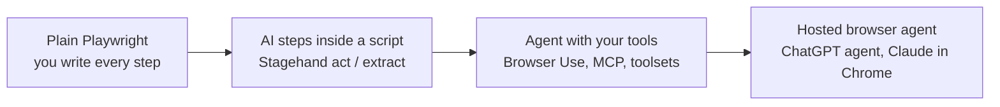
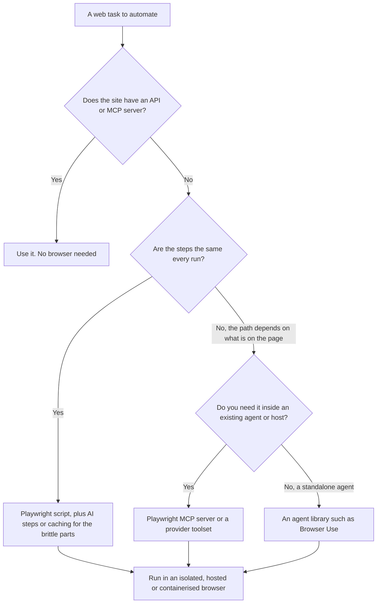

# Browser Agent Libraries: The Complete Guide

> 📚 **Before you start**
>
> - [Driving a Browser with Playwright and MCP](driving-a-browser-with-playwright-and-mcp.md), for Playwright, refs, and the three routes to give an agent a browser.
> - [DOM, Accessibility Tree or Screenshots?](dom-accessibility-tree-or-screenshots.md), for the views an agent can read.
> - [Workflows vs Agents](../../agentic-ai-fundamentals/03-the-agent-loop/workflows-vs-agents.md), because the libraries differ mainly in how much they let the model decide.

## Introduction

There are two ways to get from Pune to Mumbai. You can drive yourself: you choose every lane change, you know exactly what happens, and you can repeat the journey identically tomorrow. Or you can book a cab and say "Take me to Dadar": far less effort, but you are trusting the driver's choices, and tomorrow's route may differ. Most people mix the two: they drive the roads they know and hand over in unfamiliar parts of the city.

Browser automation has the same spectrum. At one end is **plain Playwright**: you write every step, it's fast and repeatable, and it breaks when the website changes. At the other end is a **fully autonomous browser agent**: you give a goal in English and a model works out every click. In between sit libraries that let you choose, step by step, how much to hand to the model.

This lesson maps that landscape: the open-source libraries people actually use (**Browser Use**, **Stagehand** and a few others), hosted browser infrastructure, and the consumer browser agents built into products. You'll see what each library adds on top of Playwright, try two of their core ideas in runnable code, and learn a simple way to choose.

> 💡 **Key Insight**
>
> Every browser agent library answers one question differently: **who decides the next step, your code or the model?** Use code for the steps that never change and the model for the steps that do. The best production systems cache what the model figured out once, so the next run is as cheap and repeatable as a script.

---

## Core Explanation

### 1. The spectrum from script to agent



| Point on the spectrum | Who decides each step | Repeatable? | Cost per run | Breaks when the site changes? |
|---|---|---|---|---|
| **Plain Playwright script** | Your code | Fully | Tiny (no model calls) | Yes, when selectors change |
| **AI steps inside a script** | Your code, with the model resolving "which element" | Mostly, especially with caching | Low | Usually self-heals |
| **Autonomous agent loop** | The model | No: paths vary run to run | High: a model call per step | Rarely, but may wander |
| **Consumer browser agent** | The model, inside a product | No | Paid by subscription | Rarely |

None of these is "best". A nightly job that downloads the same GST report from the same portal wants a script. A request like "find me three 2BHK flats near Baner under ₹30,000 on any listing site" needs an agent.

### 2. Browser Use: an open-source agent loop around a browser

**Browser Use** is a popular open-source Python library that wraps a browser in a complete agent loop. You give it a task and a model; it observes the page, asks the model for actions, executes them and repeats until the model declares the task done.

```python
# not-run: needs `pip install browser-use`, a browser install and an Anthropic API key
import asyncio
from browser_use import Agent, Browser, ChatAnthropic

async def main():
    browser = Browser(allowed_domains=["127.0.0.1"])     # navigation restricted to our test server
    agent = Agent(
        task="Open http://127.0.0.1:8765/kirana.html, search for butter and add Amul Butter to the cart.",
        llm=ChatAnthropic(model="claude-opus-5-5"),
        browser=browser,
        use_vision=False,                                # read the page structure, no screenshots
    )
    history = await agent.run()
    print(history.final_result())

asyncio.run(main())
```

Example output:

```
Added Amul Butter 100 g to the cart. The cart now shows Cart (1).
```

What the library does for you each step:

1. **Builds an observation**: it extracts the interactive elements from the page and gives each an index number (the same idea as refs), and adds a screenshot when vision is on. `use_vision` accepts `True`, `False` or `"auto"`.
2. **Asks the model for one or more actions.** A single step can contain several actions, such as typing into four form fields at once; `max_actions_per_step` (default 5) caps this.
3. **Executes, retries and records.** It retries failed steps up to `max_failures` (default 5), keeps a history, and can save a GIF of the run.
4. **Lets you add your own tools**: decorate a Python function with `@tools.action(description=...)` and pass `tools=` to the agent, so the agent can, for example, look up an order in your database instead of scraping it.

Two safety features matter from day one:

- **`allowed_domains`** on the browser restricts where it may navigate.
- **`sensitive_data`** keeps real secrets out of the prompt. You pass a dictionary such as `{"x_user": "...", "x_pass": "..."}`; the model only ever sees and writes the placeholder names, and the library substitutes the real values when it types. Its documentation pairs this with `use_vision=False`, because a screenshot of a filled password field could otherwise show the secret to the model. You'll go deeper on this in the next lesson.

### 3. Stagehand: AI steps inside a normal script

**Stagehand**, from the team behind the Browserbase browser cloud, takes the opposite starting point. You write a normal automation script, and at the steps where you don't want to hard-code a selector you call one of three AI primitives:

| Primitive | What you write | What it does |
|---|---|---|
| **`act`** | `await stagehand.act("click the login button")` | Finds the element that matches the instruction and performs the action |
| **`extract`** | An instruction plus a schema, such as "extract the price" with a schema `{price: number}` | Returns structured data validated against your schema |
| **`observe`** | `await stagehand.observe("find submit buttons")` | Lists candidate actions on the page without performing them, so your code can inspect or cache them |

It also offers a higher-level agent for multi-step goals. Stagehand has SDKs for TypeScript, Python and Go. Its central promise is that AI steps are **self-healing**: if the page changes, the instruction "click the login button" still finds the button. With hosted browsers it can also **cache** what each instruction resolved to, so repeated runs skip the model.

Here is that idea, caching plus self-healing, in plain Python with a pretend model. The cache maps an instruction to the selector the model chose last time. A hit replays the selector with no model call; if the selector no longer exists, the model resolves the instruction again and the cache is updated.

```python
import re

class FakePage:
    """A page as a dict of selector -> (role, accessible name)."""
    def __init__(self, elements):
        self.elements = elements
        self.clicked = []

    def click(self, selector):
        if selector not in self.elements:
            raise LookupError(f"no element matches {selector}")
        self.clicked.append(self.elements[selector][1])

LLM_CALLS = 0

def pretend_llm_resolve(instruction, page):
    """Stand-in for a model call: pick the element whose name shares the most words with the instruction."""
    global LLM_CALLS
    LLM_CALLS += 1
    wanted = set(re.findall(r"[a-z]+", instruction.lower()))
    def score(item):
        role, name = item[1]
        return len(wanted & set(re.findall(r"[a-z]+", f"{role} {name}".lower())))
    return max(page.elements.items(), key=score)[0]

class CachedActor:
    """act(): replay a cached selector when it still works; ask the model only on a miss or a break."""
    def __init__(self):
        self.cache = {}

    def act(self, page, instruction):
        selector = self.cache.get(instruction)
        if selector is not None:
            try:
                page.click(selector)
                return "cache hit"
            except LookupError:
                pass                                   # the site changed: fall through and re-resolve
        was_cached = instruction in self.cache
        selector = pretend_llm_resolve(instruction, page)
        page.click(selector)
        self.cache[instruction] = selector
        return "healed by model" if was_cached else "resolved by model"

STEPS = ["click the search button", "click the add button for amul butter"]
v1 = {"#search-btn": ("button", "Search"), "li:nth-child(3) button": ("button", "Add Amul Butter 100 g"),
      "li:nth-child(1) button": ("button", "Add Tata Tea Gold 500 g")}
v2 = {"button[data-test=search]": ("button", "Search"), "[data-sku=AMUL100] button": ("button", "Add Amul Butter 100 g"),
      "[data-sku=TATA500] button": ("button", "Add Tata Tea Gold 500 g")}

actor = CachedActor()
for run, elements in [("run 1 (first time)", v1), ("run 2 (same site)", v1), ("run 3 (after redesign)", v2)]:
    LLM_CALLS = 0
    page = FakePage(elements)
    outcomes = [actor.act(page, step) for step in STEPS]
    print(f"{run:<24} model calls: {LLM_CALLS}  clicked: {page.clicked}  {outcomes}")
```

Output:

```
run 1 (first time)       model calls: 2  clicked: ['Search', 'Add Amul Butter 100 g']  ['resolved by model', 'resolved by model']
run 2 (same site)        model calls: 0  clicked: ['Search', 'Add Amul Butter 100 g']  ['cache hit', 'cache hit']
run 3 (after redesign)   model calls: 2  clicked: ['Search', 'Add Amul Butter 100 g']  ['healed by model', 'healed by model']
```

Run 2 costs nothing and behaves exactly like a script. Run 3 survives a redesign that would have broken a hard-coded script, paying for model calls only on the steps that broke. This **"resolve once, replay many times"** pattern is the most important cost idea in browser automation, whichever library you use.

There is a catch the toy also reveals: a cache hit is only safe if the cached selector still points at the *same meaning*. If a redesign moved a different button into the old selector's place, a blind replay would click the wrong thing. Production caches also check that the element's role and name still match before replaying.

### 4. The rest of the landscape

| Category | Examples | What it gives you |
|---|---|---|
| **Agent loop libraries** | Browser Use; Skyvern (vision-first, aimed at business workflows); Stagehand's agent mode | Observation, action schema, retries, history; you bring the model |
| **AI-assisted scripting** | Stagehand `act`, `extract`, `observe` | Natural-language steps inside deterministic code, with caching |
| **Protocol adapters** | Playwright MCP server; the Playwright CLI; Anthropic's browser use toolset | A standard tool interface over a browser, for any agent or host |
| **Hosted browser infrastructure** | Browserbase, Steel, Browser Use Cloud, and partner sandboxes such as E2B | Remote Chromium instances at scale, with session recording, proxies, isolation and "live view" so a human can watch or take over |
| **Consumer browser agents** | Claude in Chrome (generally available to paid Claude plans since August 2026), OpenAI's ChatGPT agent and the ChatGPT Atlas browser, Perplexity Comet | A finished product that browses on a person's behalf, often in their own logged-in browser |

The consumer products are worth understanding even if you never build one, because they show the hardest version of the problem: the agent works inside a **real person's browser with their real logins**. Their makers lean heavily on safety layers, for example classifiers that check each proposed action against the user's instructions and scan page content for injected instructions, plus asking the user before high-risk actions. When you build your own agent, you usually avoid this hardest case by using a separate, isolated browser with no personal sessions.

### 5. How to choose



A few practical rules:

- **Start with the cheapest thing that works.** A script with two AI steps is easier to test and cheaper to run than a full agent.
- **Measure success over many runs**, not one demo. Browser agents vary run to run; a task that works 7 times in 10 is not ready for unattended use. (You'll build proper evals in [Agent Evals, Observability and Reliability](../../agent-evals-observability-and-reliability/course.md#m2).)
- **Keep the model's view small.** Libraries differ a lot in how many tokens they spend per step. Check by logging one full step's prompt.
- **Pick a library whose safety knobs you can see**: domain allowlists, secret handling, step limits and a way to pause for a human.

### 6. What all of them still leave to you

No library removes these responsibilities:

| Responsibility | Why the library can't own it |
|---|---|
| **Which actions need a human** | Only you know that "Place order" costs money and "Search" doesn't |
| **Where the browser runs** | Isolation (container, VM, hosted sandbox) is an infrastructure choice |
| **Which accounts it can use** | Credentials belong to your organisation's identity and secrets systems |
| **What "done" means** | Checking the real outcome (an order ID exists, a file downloaded) instead of trusting the model's final message |

---

## Try It Yourself

1. **Safer cache hits.** Change `CachedActor.act` so that a cache hit is used only if the element's accessible name still contains a word from the instruction; otherwise heal. Test it with a page where `#search-btn` now names a button "Delete account".
2. **Pick a tool.** For each task, choose a point on the spectrum and justify it in one line: (a) download the same monthly electricity bill PDF from one site; (b) compare prices for a Pune to Goa bus on three booking sites; (c) let an internal support agent check an order status in an old admin panel with no API.
3. **Count the savings.** A 12-step flow runs 500 times a month. Each model call costs ₹0.60. With caching, 95% of steps are cache hits. What is the monthly model cost with and without caching?

<details>
<summary>Show answers</summary>

**1.**

```python
class SaferActor(CachedActor):
    def act(self, page, instruction):
        selector = self.cache.get(instruction)
        if selector in page.elements:
            name = page.elements[selector][1].lower()
            if any(word in name for word in re.findall(r"[a-z]+", instruction.lower()) if len(word) > 3):
                page.click(selector)
                return "cache hit"
        selector = pretend_llm_resolve(instruction, page)
        page.click(selector)
        self.cache[instruction] = selector
        return "re-resolved"

safer = SaferActor()
safer.cache["click the search button"] = "#search-btn"
trap = FakePage({"#search-btn": ("button", "Delete account"), "#find": ("button", "Search")})
print(safer.act(trap, "click the search button"), trap.clicked)
```

Output:

```
re-resolved ['Search']
```

The plain cache would have clicked "Delete account". Checking meaning before replaying prevents it.

**2.** (a) A Playwright script, perhaps with one `act` step for a login button that keeps moving: the path never changes. (b) An agent loop (Browser Use or MCP-driven): each site has a different flow and the agent must read results. (c) The Playwright MCP server or a provider toolset inside the existing support agent, with an isolated browser session and read-only credentials.

**3.**

```python
calls_per_month = 12 * 500
print("without cache: ₹", round(calls_per_month * 0.60))
print("with cache:    ₹", round(calls_per_month * 0.05 * 0.60))
```

Output:

```
without cache: ₹ 3600
with cache:    ₹ 180
```

</details>

---

## Real-World Examples

- **Recruitment and procurement teams** use agent libraries to fill the same details into many different vendor or job portals, where every site's form is different.
- **Data teams** use AI extraction steps to pull structured fields (price, stock, delivery date) from pages whose layouts change often, validating the output against a schema.
- **QA teams** write tests with natural-language steps and cached resolutions, so a renamed CSS class no longer fails the nightly test run.
- **Consumer assistants** in the browser book appointments, compare products and fill forms for individual users, guarded by action classifiers and confirmations before purchases.

---

## Common Misconceptions

### "An agent library replaces Playwright"

Most of them run on Playwright or the same browser protocol underneath. They add an observation format, an action schema, a loop and conveniences; the browser control is the same.

### "Self-healing means it can't click the wrong thing"

Self-healing finds *an* element matching the words. If the page changed meaning, or contains a misleading element, it can confidently pick the wrong one. Verify outcomes.

### "Autonomous is always better"

Autonomy costs money per step, varies between runs and is harder to test. Use the model only where the path really depends on the page.

### "Hosted browser services make my agent safe"

They give you isolation and scale. They don't know which actions in your business need approval, and they don't stop a page from injecting instructions into your model's context.

---

## Interview Relevance

*"Compare Browser Use and Stagehand."* A strong answer places them on the script-to-agent spectrum: Browser Use is an autonomous agent loop (indexed elements, optional vision, multi-action steps, retries, custom tools, `allowed_domains` and `sensitive_data`); Stagehand adds AI primitives (`act`, `extract`, `observe`) inside deterministic scripts, with caching and self-healing, plus an agent mode. It then says when to use each, mentions Playwright MCP and provider toolsets as the protocol route, hosted browser infrastructure for scale and isolation, and stresses caching resolved actions, verifying outcomes and keeping approval decisions in your code.

*"How do you make a browser automation cheaper and more reliable?"* Replace model steps with code wherever the path is fixed, cache model resolutions and validate them before replay, keep observations small, cap steps, and measure success rates across many runs.

---

## Key Takeaways

- **One question separates the libraries**: who decides each step, your code or the model.
- **Browser Use** is an open-source agent loop with domain allowlists and placeholder-based secrets.
- **Stagehand** puts `act`, `extract` and `observe` inside normal scripts, with self-healing and caching.
- **Resolve once, replay many times**, and check meaning before replaying a cached action.
- **Libraries don't own your safety**: approvals, isolation, credentials and outcome checks stay with you.

---

**Up next:** [Logins, Flaky Pages and Safety](logins-flaky-pages-and-safety.md)
