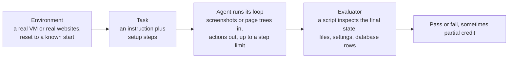

# Benchmarks: OSWorld and WebArena: The Complete Guide

> 📚 **Before you start**
>
> - [The Screenshot-Action Loop](the-screenshot-action-loop.md) and [Running Desktop Agents Safely in VMs](running-desktop-agents-safely-in-vms.md), because benchmarks run exactly that loop inside exactly those VMs.
> - [DOM, Accessibility Tree or Screenshots?](../02-browser-agents/dom-accessibility-tree-or-screenshots.md), because benchmark results depend on which observation the agent gets.

## Introduction

Every year lakhs of students sit the same board exam, on the same day, marked against the same scheme. That's what makes a 92% in Pune comparable with a 92% in Patna. But everyone also knows the exam's limits: it measures how well you answer *those* questions under *those* conditions, not how well you'll do in a real job.

Benchmarks for computer-use and browser agents play the same role. **OSWorld** puts agents in real desktop operating systems and asks them to finish real tasks. **WebArena** puts them in realistic, self-hosted websites. Every model announcement quotes them, and every buying decision is tempted by them. To read those numbers well you need to know how the tasks are built, how success is checked, and what the scores can and can't tell you.

By the end of this lesson you'll know what OSWorld, OSWorld-Verified, OSWorld 2.0 and WebArena measure, how execution-based evaluation works, how much noise a benchmark score carries, and how to use these ideas to test your own agent.

> 💡 **Key Insight**
>
> A good agent benchmark checks the **final state of the environment** ("is the total in cell C12?"), not the agent's description of what it did. And every score is a sample: a few points of difference on a few hundred tasks is often within noise. Read the setup (observation type, step limit, harness) as carefully as the number.

---

## Core Explanation

### 1. Why agent benchmarks are different

Classic language-model benchmarks compare an answer with a reference answer. Agent benchmarks can't: there are many valid ways to rename a file or post a comment, and the agent's final message proves nothing. So they need three things:



This is called **execution-based evaluation**: the benchmark checks what actually happened, by running a script against the environment after the agent stops.

### 2. OSWorld: real desktops

**OSWorld** was published in 2024 by researchers at the University of Hong Kong's XLang lab and collaborators. Its key facts, from the project site:

| Fact | Detail |
|---|---|
| Environment | Real operating systems in virtual machines: Ubuntu, with Windows and macOS support |
| Tasks | 369 tasks (361 if you exclude 8 that need Google Drive), plus 43 extra Windows tasks for analysis |
| Apps | Everyday software such as Chrome, LibreOffice Calc, Writer and Impress, VS Code, GIMP, Thunderbird, VLC, the file manager and the terminal, including tasks that span several apps |
| Evaluation | A custom execution-based evaluation script per task, built from 134 evaluation functions |
| Observations studied | Screenshot, accessibility tree, both together, and set-of-marks |
| Human baseline | Humans completed about 72% of tasks |
| Best model in the original paper | About 12% |

Each task is a small JSON file: an instruction, setup steps that prepare the VM (download a file, open an app), and an evaluator that says which function checks the result and with what expected values. Here is a task in that spirit, with three agents' final states:

```python
import json

task = {   # the shape of an execution-based task, in the spirit of OSWorld's task files
    "id": "calc-gst-total-017",
    "instruction": "In invoices.xlsx, put the total of column C (amounts in ₹) into cell C12 and save the file.",
    "setup": [{"type": "download", "file": "invoices.xlsx"}, {"type": "open", "file": "invoices.xlsx"}],
    "evaluator": {"func": "cell_equals", "file": "invoices.xlsx", "cell": "C12", "expected": 48250},
}
print(json.dumps(task["evaluator"]))

def cell_equals(final_state, file, cell, expected):
    """Look at the machine's final state, never at what the agent claims."""
    saved = final_state["saved_files"].get(file, {})
    return saved.get(cell) == expected

runs = {
    "agent A": {"saved_files": {"invoices.xlsx": {"C12": 48250}}, "final_message": "Done!"},
    "agent B": {"saved_files": {"invoices.xlsx": {}}, "final_message": "Done! The total 48,250 is in C12."},
    "agent C": {"saved_files": {"invoices.xlsx": {"C12": "=SUM(C2:C11)"}}, "final_message": "Added a SUM formula."},
}
spec = {k: v for k, v in task["evaluator"].items() if k != "func"}
for agent, final_state in runs.items():
    print(agent, "PASS" if cell_equals(final_state, **spec) else "FAIL", "| said:", final_state["final_message"])
```

Output:

```
{"func": "cell_equals", "file": "invoices.xlsx", "cell": "C12", "expected": 48250}
agent A PASS | said: Done!
agent B FAIL | said: Done! The total 48,250 is in C12.
agent C FAIL | said: Added a SUM formula.
```

Look carefully at each line:

- **Agent A** passed with a two-word final message. The evaluator doesn't care what agents say.
- **Agent B** claimed success and did nothing. Only an execution-based check catches this.
- **Agent C** put a formula that *does* compute 48,250, and still failed, because this toy evaluator compares the raw cell content instead of the computed value. That is an **evaluator bug**, a false negative. Real benchmarks have had exactly this kind of problem, which is why OSWorld released **OSWorld-Verified** in July 2025: it fixed task and evaluator issues reported by the community and moved evaluation onto cloud infrastructure so a full run finishes in about an hour.

### 3. OSWorld 2.0: longer, harder, partially credited

As models improved, the original task set became easier to saturate. By early 2026, model vendors were reporting OSWorld-Verified scores in the low 70s, roughly the human figure from the original paper. In June 2026 the team released **OSWorld 2.0**, built around long, realistic workflows:

| | OSWorld (v1, Verified) | OSWorld 2.0 |
|---|---|---|
| Tasks | 369 | 108 long-horizon tasks across 7 domains and 21 sub-categories |
| Environment | Desktop apps in a VM | Desktop work plus 31 self-hosted websites, with authentic input files and stateful user profiles |
| Length | Tens of tool calls | Agents average over 250 steps; median human time about 1.6 hours |
| Scoring | Pass or fail | Binary completion within 500 steps, plus a partial score over about 27 checkpoints per task |
| Safety | Not a focus | Separate safety reports audit risky behaviour during runs |
| Reported top results | Low 70s (vendor reports) | Around 21% binary completion and 55% partial score for the best reported model |

Partial credit tells you how *close* an agent got. Binary completion tells you whether a user would actually have been helped:

```python
def scores(checkpoints_passed, total_checkpoints):
    """OSWorld 2.0 style: a strict binary score plus partial credit over checkpoints."""
    binary = 1 if checkpoints_passed == total_checkpoints else 0
    return binary, round(checkpoints_passed / total_checkpoints, 2)

for passed in [27, 26, 14, 0]:
    print(f"{passed:>2}/27 checkpoints -> binary {scores(passed, 27)[0]}, partial {scores(passed, 27)[1]}")
```

Output:

```
27/27 checkpoints -> binary 1, partial 1.0
26/27 checkpoints -> binary 0, partial 0.96
14/27 checkpoints -> binary 0, partial 0.52
 0/27 checkpoints -> binary 0, partial 0.0
```

Missing one checkpoint out of 27 scores 0.96 partial and 0 binary. For a user who needed the whole workflow done, it's the binary number that matters; for researchers tracking progress, the partial number is more informative.

### 4. WebArena: realistic, self-hosted websites

**WebArena**, from Carnegie Mellon University (2023, published at NeurIPS 2024), does for the web what OSWorld does for desktops. It ships fully working, self-hosted copies of the kinds of sites people use:

| Site in WebArena | Real-world equivalent |
|---|---|
| An e-commerce store | Online shopping |
| A store admin panel (content management) | Back-office tools |
| A Reddit-style forum | Social discussion sites |
| A GitLab instance | Collaborative software development |
| A map (OpenStreetMap-based) | Directions and places |
| Supporting tools such as an offline Wikipedia | Reference lookup |

It contains 812 tasks such as "How many reviews mention the delivery being late?" or "Create a merge request from branch X and assign it to Y". Success is checked by **functional correctness**: querying the site's database or page after the run, or comparing an extracted answer, rather than matching the agent's click path. In the original paper the best GPT-4-based agent succeeded on 14.41% of tasks, against a human success rate of 78.24%.

Because the sites are self-hosted, every run starts from the same data and nothing the agent does touches the real internet. Its family has grown: **VisualWebArena** adds tasks where images matter, **WebArena-Infinity** aims at continuously refreshed environments, and **TheAgentCompany** simulates a whole company's internal tools.

### 5. Other benchmarks you'll see quoted

| Benchmark | What it measures |
|---|---|
| **Mind2Web** and **Online-Mind2Web** | Following instructions across many real websites |
| **WebVoyager** | End-to-end tasks on live websites, judged by a model |
| **BrowseComp** | Hard information-finding by browsing (research, not form filling) |
| **AndroidWorld** | Agents operating Android apps |

Live-website benchmarks are realistic but drift as sites change; self-hosted ones are reproducible but age. Both kinds are useful, for different questions.

### 6. How much is a score worth?

A benchmark score is a measured success rate on a fixed set of tasks, so it carries **sampling noise**. The Wilson interval is a standard way to put error bars on a success rate:

```python
import math

def wilson_interval(successes, n, z=1.96):
    """95% confidence interval for a success rate measured on n tasks."""
    p = successes / n
    centre = (p + z * z / (2 * n)) / (1 + z * z / n)
    half = z * math.sqrt(p * (1 - p) / n + z * z / (4 * n * n)) / (1 + z * z / n)
    return round(100 * (centre - half), 1), round(100 * (centre + half), 1)

for name, successes, n in [("agent X on 369 tasks", 251, 369), ("agent Y on 369 tasks", 262, 369),
                           ("agent X on 108 tasks", 22, 108), ("agent Y on 108 tasks", 26, 108)]:
    low, high = wilson_interval(successes, n)
    print(f"{name}: {100 * successes / n:.1f}%  (95% CI {low}% to {high}%)")
```

Output:

```
agent X on 369 tasks: 68.0%  (95% CI 63.1% to 72.6%)
agent Y on 369 tasks: 71.0%  (95% CI 66.2% to 75.4%)
agent X on 108 tasks: 20.4%  (95% CI 13.9% to 28.9%)
agent Y on 108 tasks: 24.1%  (95% CI 17.0% to 32.9%)
```

On 369 tasks, a 3-point gap between agents X and Y sits well inside overlapping 95% intervals. On 108 tasks the intervals are wider still. Add run-to-run randomness (the same agent may pass a task on one run and fail it on the next) and you see why careful reports run each task several times. The ideas of **pass@k** (succeeds at least once in k tries) and **pass^k** (succeeds in all k tries) capture this, and you'll study them in [pass@k, pass^k and Noise](../../agent-evals-observability-and-reliability/course.md#m2).

### 7. Reading a benchmark claim like an engineer

When a vendor or paper says "our agent scores N% on OSWorld", ask:

| Question | Why it changes the number |
|---|---|
| **Which version?** Original, Verified, or 2.0? | Different tasks, different fixes, very different difficulty |
| **Which observation?** Screenshot only, accessibility tree, both? | Structure can make some tasks much easier |
| **What step limit?** | More steps allow more recovery from mistakes |
| **Which harness?** Plain loop, or extra tools, planners, retries, multiple attempts? | The harness can matter as much as the model |
| **How many runs?** One, or averaged over several? | Single runs are noisy |
| **Any contamination risk?** | Public tasks can leak into training data |
| **Cost and time?** | An agent that needs 300 steps and an hour per task may not suit your use |

And remember the board exam: OSWorld doesn't contain *your* billing app or *your* government portal. A model's rank on public benchmarks is a reasonable first filter; your own task suite decides.

### 8. Building a mini-benchmark for your own agent

The same recipe works for your product, at small scale:

1. **Collect 20 to 50 real tasks** from your users or your team, especially ones that failed.
2. **Write setup steps** that create a known starting state (a VM snapshot, seeded test data, a fresh browser profile).
3. **Write an execution-based check** for each task: a file, a database row, a confirmation number, a setting, never the agent's own message.
4. **Run each task several times** and report success rates with intervals, plus cost and time per task.
5. **Rerun on every change** to the model, the prompt, the tools or the harness.

The lab in Module 2 already had a small version of step 3: it read the confirmation from the page, not from the model.

---

## Try It Yourself

1. **Fix the evaluator.** Agent C put `=SUM(C2:C11)` in C12. Write `cell_value_equals` that evaluates a simple `=SUM` formula over a column using a `values` dictionary of the other cells before comparing. Does agent C pass now?
2. **How many tasks?** Using `wilson_interval`, find roughly how many tasks you'd need for the 95% interval around a 70% success rate to be no wider than ±3 points.
3. **Read a claim.** A blog says: "Agent Z hits 75% on OSWorld, beating the human baseline!" List three questions you'd ask before believing it matters for your use case.

<details>
<summary>Show answers</summary>

**1.**

```python
import re

def cell_value_equals(final_state, file, cell, expected, values):
    raw = final_state["saved_files"].get(file, {}).get(cell)
    m = re.fullmatch(r"=SUM\(([A-Z])(\d+):\1(\d+)\)", str(raw))
    if m:
        col, start, end = m.group(1), int(m.group(2)), int(m.group(3))
        raw = sum(values.get(f"{col}{row}", 0) for row in range(start, end + 1))
    return raw == expected

column_c = {f"C{row}": amount for row, amount in zip(range(2, 12), [4500, 3200, 7800, 2600, 9100, 5400, 3900, 6150, 2800, 2800])}
print("sum of C2:C11 =", sum(column_c.values()))
for agent, final_state in runs.items():
    ok = cell_value_equals(final_state, "invoices.xlsx", "C12", 48250, column_c)
    print(agent, "PASS" if ok else "FAIL")
```

Output:

```
sum of C2:C11 = 48250
agent A PASS
agent B FAIL
agent C PASS
```

Agent C now passes, and agent B still fails. Real evaluators open the saved file with a spreadsheet library and read the computed value, which handles every formula, not just `SUM`.

**2.**

```python
for n in [300, 500, 900, 1000]:
    low, high = wilson_interval(round(0.7 * n), n)
    print(n, "tasks:", low, "to", high, f"(width ±{(high - low) / 2:.1f})")
```

Output:

```
300 tasks: 64.6 to 74.9 (width ±5.2)
500 tasks: 65.8 to 73.9 (width ±4.1)
900 tasks: 66.9 to 72.9 (width ±3.0)
1000 tasks: 67.1 to 72.8 (width ±2.9)
```

Roughly 900 tasks. That is why small differences on benchmarks with a few hundred tasks deserve caution.

**3.** Which OSWorld version and how many runs? (The 72% human figure comes from the original paper; Verified and 2.0 are different tests.) What harness, step limit and observation did agent Z use, and at what cost per task? And how does it do on tasks like ours, in our apps, with our safety rules?

</details>

---

## Real-World Examples

- **Model launches** from Anthropic, OpenAI and Google routinely report OSWorld-Verified and web-agent benchmark results, often with notes on harness settings and thinking budgets.
- **Agent startups** publish WebArena-family results to show progress, and increasingly report cost and steps per task alongside success.
- **Enterprise teams** build private benchmarks on top of their own VM images and test data, using the same execution-based checks before letting an agent near production.
- **Safety researchers** use benchmark environments to measure how often agents take risky actions or fall for injected instructions, not just how often they succeed.

---

## Common Misconceptions

### "A higher OSWorld score means it will work on my software"

It means the agent does well on those tasks, in that harness. Your apps, data and safety rules are different. Use public scores to shortlist, then test on your own tasks.

### "The agent said it finished, so it passed"

Benchmarks deliberately ignore the agent's claims and inspect the environment. Your own tests should too.

### "One run on a benchmark is a precise measurement"

A few hundred tasks and random variation between runs give error bars of several points. Small gaps are often noise.

### "Beating the human baseline means agents are better than people at computers"

The human figure was measured on a particular task set with particular people and time limits. Newer, longer benchmarks such as OSWorld 2.0 show agents still completing only a minority of hour-long workflows.

---

## Interview Relevance

*"How are computer-use agents evaluated?"* A strong answer describes execution-based evaluation (reset environment, setup steps, agent loop with a step limit, a script checking the final state), names OSWorld (369 tasks in real OS VMs, per-task evaluators, about 72% human baseline; OSWorld-Verified fixed tasks in 2025; OSWorld 2.0 adds 108 long-horizon tasks with binary and partial scores) and WebArena (812 tasks on self-hosted e-commerce, admin, forum, GitLab and map sites, functional correctness, 78% human versus 14% for the original GPT-4 agent). It then covers noise and confidence intervals, harness and observation effects, contamination, and building a private, execution-based suite from real tasks.

---

## Key Takeaways

- **Execution-based evaluation** checks the environment's final state, never the agent's own claims.
- **OSWorld** tests real desktop apps in VMs; **Verified** fixed its tasks; **2.0** adds hour-long workflows with partial credit.
- **WebArena** tests realistic self-hosted websites with functional correctness checks.
- **Scores are samples**: put error bars on them and ask about version, harness, observation, steps and runs.
- **Your own task suite decides**: public benchmarks shortlist, private ones approve.

---

**Up next:** [Speech-to-Speech vs Cascaded Pipelines](../course.md#m4)
