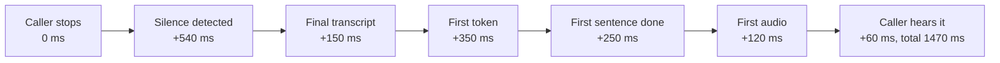

# Latency Budgets and Turn-Taking: The Complete Guide

> 📚 **Before you start**
>
> - [Speech-to-Speech vs Cascaded Pipelines](speech-to-speech-vs-cascaded-pipelines.md), for VAD, streaming STT, LLM and TTS, realtime models and the sentence chunker.
> - [Prompt Caching](../../context-engineering-and-agent-memory/02-the-context-window-as-a-budget/prompt-caching.md), one of the cheapest ways to cut time to first token.

## Introduction

Watch two friends chatting over cutting chai. One finishes a sentence and the other replies almost instantly; researchers who study conversation across many languages have found that the typical gap between turns is around 200 milliseconds. People also overlap a little, say "haan, haan" while the other is talking without wanting the floor, pause mid-sentence to remember a number, and stop at once when the other person says "wait, wait".

Now call a badly built voice bot. You finish speaking, and there are two full seconds of silence. You say "my PNR is..." and pause to read the number, and it jumps in: "Sorry, I didn't get that." You say "hmm" to show you're listening, and it stops mid-sentence and starts again.

Two engineering problems cause almost all of this: **latency** (how long between the caller finishing and the agent starting to speak) and **turn-taking** (deciding when the caller has finished, when they are only pausing, and when they are interrupting). This lesson gives you a way to budget the milliseconds and the techniques that make turn-taking feel human.

> 💡 **Key Insight**
>
> Measure **voice-to-voice latency**, from the caller's last word to the agent's first sound, and break it into stages. In most pipelines the biggest single item is not the LLM but **endpointing**: the silence the system waits for before deciding the caller is done. Smarter turn detection fixes latency and interruptions at the same time.

---

## Core Explanation

### 1. The budget, stage by stage

People start to feel a pause as awkward somewhere around a second, and much longer silences make callers repeat themselves or hang up. Many teams aim for **under about 800 ms voice-to-voice** for a natural feel, and treat 1.5 seconds as a ceiling. Here is a cascade, with illustrative stage timings (yours will differ by provider, model and region, so measure them):

```python
# Illustrative stage timings in milliseconds; measure your own stack, these vary by provider and region.
STAGES = {
    "audio to server (network)":         40,
    "endpointing: wait for silence":    500,
    "STT final transcript":              150,
    "LLM time to first token":           350,
    "LLM until first sentence ends":     250,
    "LLM rest of the reply":            1200,
    "TTS first audio for a sentence":    120,
    "TTS rest of the audio":             800,
    "audio to caller (network + buffer)": 60,
}

def voice_to_voice(stages, streaming):
    """Time from the caller's last word to the first sound of the reply."""
    steps = ["audio to server (network)", "endpointing: wait for silence", "STT final transcript",
             "LLM time to first token", "LLM until first sentence ends"]
    if not streaming:
        steps += ["LLM rest of the reply", "TTS first audio for a sentence", "TTS rest of the audio"]
    else:
        steps += ["TTS first audio for a sentence"]
    steps += ["audio to caller (network + buffer)"]
    return sum(stages[s] for s in steps), steps

for streaming in (False, True):
    total, steps = voice_to_voice(STAGES, streaming)
    print(f"{'streaming' if streaming else 'wait for each stage':<20} {total:>5} ms")

total, steps = voice_to_voice(STAGES, streaming=True)
print("\nwhere the streaming budget goes:")
for s in sorted(steps, key=lambda s: -STAGES[s]):
    print(f"  {s:<36} {STAGES[s]:>4} ms  {'#' * (STAGES[s] // 25)}")
```

Output:

```
wait for each stage   3470 ms
streaming             1470 ms

where the streaming budget goes:
  endpointing: wait for silence         500 ms  ####################
  LLM time to first token               350 ms  ##############
  LLM until first sentence ends         250 ms  ##########
  STT final transcript                  150 ms  ######
  TTS first audio for a sentence        120 ms  ####
  audio to caller (network + buffer)     60 ms  ##
  audio to server (network)              40 ms  #
```



Two lessons jump out:

1. **Streaming saves seconds.** Waiting for each stage to finish costs 3.5 seconds; streaming partial results through every stage brings it to under 1.5.
2. **The biggest item is waiting for silence.** Before anything else can happen, the system waits half a second to be sure the caller has stopped.

Here is what targeted tuning does:

```python
improved = dict(STAGES)
improved["endpointing: wait for silence"] = 200      # semantic turn detection on a finished sentence
improved["LLM until first sentence ends"] = 100      # prompt for a short first clause: "Sure, checking."
improved["STT final transcript"] = 80                # streaming STT already has most words
print("after tuning:", voice_to_voice(improved, streaming=True)[0], "ms")
```

Output:

```
after tuning: 950 ms
```

Every one of those changes is a technique you'll see below. A speech-to-speech model removes the STT and TTS hand-offs entirely, which is why realtime models usually sit at the fast end.

### 2. Techniques for each stage

| Stage | Techniques |
|---|---|
| **Network** | Run the voice server in the same region as the caller and the model APIs; use WebRTC for clients; keep connections warm |
| **Endpointing** | Semantic turn detection instead of a fixed silence; shorter waits after complete sentences |
| **STT** | Streaming recognition with partial results; a model tuned for your accents and vocabulary (PNR, train names, product codes) |
| **LLM** | A fast model for conversation; short system prompts and **prompt caching**; ask for a brief first clause ("Sure, checking that now."); keep tool schemas small |
| **TTS** | Streaming synthesis; sentence or clause chunking; pre-recorded audio for fixed phrases like greetings and disclosures |
| **Perceived latency** | Speak a short acknowledgement immediately while a slow step runs (next lesson), and never leave dead air longer than a second or two without a filler |

A useful trick is **speculative generation**: start the LLM on the partial transcript while the caller seems to be finishing, and throw the result away if they keep talking. It spends tokens to save hundreds of milliseconds.

### 3. Turn-taking: when has the caller finished?

**Endpointing** is deciding that a turn has ended. The simplest method uses VAD: when the caller has been silent for a fixed time (300 to 800 ms is typical), the turn is over. It has a built-in dilemma:

- **Short silence threshold**: fast replies, but callers who pause to think get cut off.
- **Long silence threshold**: fewer cut-offs, but every reply feels slow.

**Semantic turn detection** breaks the dilemma by looking at *what* was said, not just the silence. A phrase that sounds finished ("...is running late?") gets a short wait; one that obviously isn't ("my PNR number is...") gets a long one. OpenAI's Realtime API offers this as `semantic_vad` alongside the silence-based `server_vad`; LiveKit Agents ships a turn detector model; Pipecat has an open "smart turn" model. Here's the idea in a toy, on a caller who pauses for 700 ms to read their PNR:

```python
# What the caller said, as (word, start_ms, end_ms). Note the thinking pause after "is".
utterance = [("my", 0, 150), ("PNR", 180, 500), ("number", 520, 850), ("is", 870, 1000),
             ("four", 1700, 1950), ("five", 2000, 2250), ("two", 2300, 2500), ("one", 2550, 2750)]

def silence_endpoint(words, silence_ms):
    """Plain VAD endpointing: the turn ends at the first gap longer than silence_ms."""
    for (w1, _, end), (w2, start, _) in zip(words, words[1:]):
        if start - end > silence_ms:
            return end + silence_ms, " ".join(w for w, _, e in words if e <= end)
    return words[-1][2] + silence_ms, " ".join(w for w, _, _ in words)

INCOMPLETE_ENDINGS = {"is", "my", "the", "and", "to", "number", "was", "of"}

def semantic_endpoint(words, short_ms=200, long_ms=1200):
    """Wait briefly after a complete-sounding phrase, much longer after an obviously unfinished one."""
    for i, (word, _, end) in enumerate(words):
        wait = long_ms if word.lower() in INCOMPLETE_ENDINGS else short_ms
        next_start = words[i + 1][1] if i + 1 < len(words) else None
        if next_start is None or next_start - end > wait:
            return end + wait, " ".join(w for w, _, _ in words[: i + 1])

for name, (at, heard) in [("silence 500 ms", silence_endpoint(utterance, 500)),
                          ("silence 900 ms", silence_endpoint(utterance, 900)),
                          ("semantic", semantic_endpoint(utterance))]:
    print(f"{name:<15} turn ends at {at:>4} ms with: {heard!r}")
```

Output:

```
silence 500 ms  turn ends at 1500 ms with: 'my PNR number is'
silence 900 ms  turn ends at 3650 ms with: 'my PNR number is four five two one'
semantic        turn ends at 2950 ms with: 'my PNR number is four five two one'
```

- A 500 ms silence rule cut the caller off after "is". The agent would answer a question that was never asked.
- A 900 ms rule avoided the cut-off but makes **every** reply 400 ms slower.
- The semantic rule waited through the thinking pause (the phrase ended on "is") and still replied quickly at the end.

Real detectors use small models trained on conversation, not a word list, and the best ones also consider the domain: an Indian Railways PNR has 10 digits, so "four five two one" is probably not the end. That kind of knowledge can also come from the agent itself, which can say "Go on, I've got four, five, two, one so far."

The realtime APIs expose these knobs directly. For OpenAI's `server_vad` the main settings are a `threshold` for how loud speech must be, `prefix_padding_ms` for how much audio before speech to keep, and `silence_duration_ms`; `semantic_vad` has an `eagerness` setting (low, medium, high, or auto). You can also turn automatic turn detection off for **push-to-talk** interfaces, where the user presses a button while speaking and your client commits the audio explicitly.

### 4. Barge-in: when the caller interrupts

**Barge-in** means the caller starts speaking while the agent is talking. A good agent stops within a few hundred milliseconds. Doing it properly takes three steps:

1. **Detect** caller speech during playback (with echo cancellation, so the agent doesn't hear its own voice through the caller's speaker and interrupt itself).
2. **Stop**: cancel the response being generated and flush the audio already queued for playback.
3. **Fix the history**: the conversation record must contain only what the caller actually **heard**, not the full reply the model wrote.

The third step is the one people forget. If the history says the agent announced "platform 3" but the caller cut in before hearing it, the model will later assume the caller knows the platform.

```python
reply = "Your train is running 25 minutes late and will reach Pune at 9:40 on platform 3."
# TTS reports when each word starts in the audio it produced (milliseconds from the start of playback).
word_starts = [0, 260, 520, 610, 990, 1250, 1720, 2040, 2300, 2650, 2900, 3150, 3480, 3800, 4150, 4400]
words = reply.split()

def handle_barge_in(words, word_starts, interrupted_at_ms):
    """Stop playback and keep in history only what the caller actually heard."""
    heard = [w for w, start in zip(words, word_starts) if start < interrupted_at_ms]
    return " ".join(heard) + " —"

history_naive = reply
history_truncated = handle_barge_in(words, word_starts, interrupted_at_ms=2400)
print("caller interrupted at 2400 ms")
print("naive history:     ", history_naive)
print("truncated history: ", history_truncated)
```

Output:

```
caller interrupted at 2400 ms
naive history:      Your train is running 25 minutes late and will reach Pune at 9:40 on platform 3.
truncated history:  Your train is running 25 minutes late and will —
```

Realtime APIs provide events for each step. In OpenAI's Realtime API, `input_audio_buffer.speech_started` signals the caller started talking, `response.cancel` stops generation, `output_audio_buffer.clear` stops queued audio on WebRTC and SIP connections, and `conversation.item.truncate` cuts the assistant's message at `audio_end_ms`, the point playback actually reached. Gemini's Live API sends an `interrupted` signal, and the client empties its playback queue.

### 5. Backchannels are not interruptions

Listeners constantly make small sounds: "haan", "hmm", "achha", "okay", "ji". They mean "I'm following, carry on". An agent that stops for each one is exhausting. A simple filter treats short speech made only of backchannel words as listening, not interrupting:

```python
BACKCHANNELS = {"haan", "hmm", "ok", "okay", "achha", "ji", "right", "uh-huh", "yes"}

def is_real_interruption(transcript, speech_ms, min_speech_ms=400):
    """Ignore short acknowledgements while the agent talks; stop for anything substantial."""
    words = transcript.lower().replace(",", "").split()
    if speech_ms < min_speech_ms and all(w in BACKCHANNELS for w in words):
        return False
    return bool(words)

for transcript, ms in [("haan", 250), ("hmm okay", 380), ("wait, which platform?", 900), ("no no", 300), ("", 120)]:
    print(f"{transcript!r:<26} {ms:>4} ms -> {'stop and listen' if is_real_interruption(transcript, ms) else 'keep talking'}")
```

Output:

```
'haan'                      250 ms -> keep talking
'hmm okay'                  380 ms -> keep talking
'wait, which platform?'     900 ms -> stop and listen
'no no'                     300 ms -> stop and listen
''                          120 ms -> keep talking
```

Note "no no": short, but not a backchannel, so the agent stops. Real systems combine duration, a word list, and increasingly a model that classifies the caller's intent. Agents can also *produce* backchannels while the caller speaks at length, but use that carefully: badly timed "mm-hmm"s sound robotic.

### 6. Measuring in production

| Metric | What it tells you |
|---|---|
| **Voice-to-voice latency** (median and 95th percentile) | How fast replies feel; the tail matters, because one slow reply is remembered |
| **Per-stage timings** | Where to optimise; log timestamps at every hand-off |
| **Cut-off rate** | How often the agent spoke while the caller was mid-thought (look for "no, I wasn't finished") |
| **False barge-in rate** | How often the agent stopped for noise or a backchannel |
| **Dead-air incidents** | Silences longer than about two seconds, often from slow tools |
| **Talk-over time** | Seconds where both sides spoke at once |

Record calls (with consent), and replay the worst ones regularly. Turn-taking problems are obvious to the ear and invisible in averages.

---

## Try It Yourself

1. **Find the bottleneck.** Your measured stages are: network 80, endpointing 300, STT 100, LLM first token 900, first sentence 200, TTS first audio 150, network out 80. Compute the streaming total and name the stage to attack first.
2. **Tune the threshold.** Using `silence_endpoint`, find the smallest silence threshold (in steps of 100 ms) that doesn't cut off the PNR caller.
3. **Interruption timing.** If the caller interrupts at 3,500 ms instead, what does the truncated history contain? Does the caller know the platform?

<details>
<summary>Show answers</summary>

**1.**

```python
measured = dict(STAGES, **{"audio to server (network)": 80, "endpointing: wait for silence": 300,
                           "STT final transcript": 100, "LLM time to first token": 900,
                           "LLM until first sentence ends": 200, "TTS first audio for a sentence": 150,
                           "audio to caller (network + buffer)": 80})
total, steps = voice_to_voice(measured, streaming=True)
print(total, "ms; biggest stage:", max(steps, key=lambda s: measured[s]))
```

Output:

```
1810 ms; biggest stage: LLM time to first token
```

The LLM's time to first token dominates: try a faster model, a shorter prompt, prompt caching, or fewer tool schemas.

**2.**

```python
for threshold in range(100, 1100, 100):
    at, heard = silence_endpoint(utterance, threshold)
    if heard.endswith("one"):
        print("smallest safe threshold:", threshold, "ms")
        break
```

Output:

```
smallest safe threshold: 700 ms
```

The pause was 700 ms, so the threshold must be at least that long (the rule ends a turn only on a gap longer than the threshold), and every turn then pays that wait.

**3.**

```python
print(handle_barge_in(words, word_starts, interrupted_at_ms=3500))
```

Output:

```
Your train is running 25 minutes late and will reach Pune at 9:40 —
```

The caller heard the arrival time but not the platform. With correct truncation, the model knows that, and can mention the platform again when it answers the caller's interruption.

</details>

---

## Real-World Examples

- **Contact-centre voice agents** track median and tail voice-to-voice latency per call and per stage, and alert when a provider's region slows down.
- **Realtime model APIs** ship semantic turn detection and interruption handling because silence-only endpointing caused the most common complaints: being cut off and slow replies.
- **Voice frameworks** such as Pipecat and LiveKit Agents provide VAD, turn-detection models, interruption handling and per-stage metrics out of the box, so teams start from good defaults.
- **Phone banking bots** play pre-recorded audio for greetings and legal disclosures, which removes TTS time for the parts every caller hears.

---

## Common Misconceptions

### "The LLM is always the slow part"

Often the biggest chunk is endpointing: the fixed wait for silence before anything starts. Measure before optimising.

### "A longer silence threshold is the safe choice"

It reduces cut-offs but slows every single reply. Semantic turn detection gives you both speed and patience.

### "If the agent stopped talking when interrupted, barge-in works"

Only if the history was truncated to what the caller heard. Otherwise the model believes it said things the caller never heard.

### "Every sound from the caller is an interruption"

Backchannels like "haan" and "hmm" mean "carry on". Treating them as interruptions makes the agent stop and restart constantly.

---

## Interview Relevance

*"How do you make a voice agent feel responsive?"* A strong answer defines voice-to-voice latency, breaks it into stages (network, endpointing, STT, LLM time to first token and first sentence, TTS first audio, playback), streams every stage, and cites a target around 800 ms with a ceiling near 1.5 s. It identifies endpointing as a major cost and explains semantic turn detection versus silence thresholds. It covers barge-in (detect with echo cancellation, cancel generation, flush audio, truncate history to what was heard, with events such as `conversation.item.truncate`), backchannel filtering, fillers and pre-recorded audio, co-location, prompt caching, speculative generation, and measuring p50 and p95 latency, cut-offs and false barge-ins.

---

## Key Takeaways

- **Budget voice-to-voice latency by stage**, aim for under about 800 ms, and stream everything.
- **Endpointing is often the biggest cost**; semantic turn detection is faster and cuts people off less.
- **Barge-in has three steps**: stop generating, flush audio, and truncate history to what was heard.
- **Backchannels aren't interruptions**: filter short "haan" and "hmm" sounds.
- **Measure p50 and p95 latency, cut-offs and false barge-ins**, and listen to the worst calls.

---

**Up next:** [Tool Calls in a Live Conversation](tool-calls-in-a-live-conversation.md)
