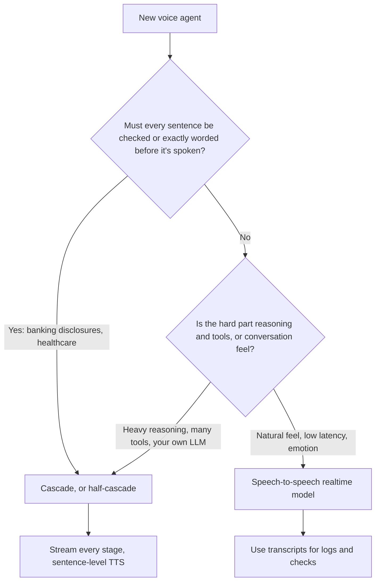

# Speech-to-Speech vs Cascaded Pipelines: The Complete Guide

> 📚 **Before you start**
>
> - [How This Course Works](../01-start-here/how-this-course-works.md), for where voice agents fit beside browser and computer-use agents.
> - [Function Calling Step by Step](../../agentic-ai-fundamentals/04-tools-and-function-calling/function-calling-step-by-step.md), because voice agents call tools too.
> - [OpenAI Agents SDK](../../agent-frameworks-and-sdks/course.md#m2), which includes realtime voice agents.
> - Streaming output from an LLM, covered in [Generative AI and LLM Foundations](../../generative-ai-and-llm-foundations/course.md).

## Introduction

Ring your bank's helpline and you meet one of two kinds of system. The old kind says "Press 1 for balance, press 2 for cards", and every option is a fixed recording. The new kind says "Hi, how can I help?" and actually understands "my card got blocked at the petrol pump, I'm in Nashik". If it's well built, it answers within a second, lets you cut in, and sounds like it's listening. If it's badly built, it pauses awkwardly, talks over you, and repeats itself when you say "hmm".

The difference between the good and the bad version is mostly **architecture and timing**, not model intelligence. There are two main ways to build the voice part:

- A **cascaded pipeline**: speech-to-text turns your voice into words, an LLM writes a reply, and text-to-speech turns the reply into audio. Three models in a row.
- A **speech-to-speech** model: one model listens to audio and speaks audio directly, with understanding, tool calls and turn-taking inside it.

This lesson explains both, what audio actually looks like as data, how audio travels (WebRTC, WebSockets, phone lines), and how to choose. The next two lessons go deep on latency and turn-taking, then on tool calls mid-conversation.

> 💡 **Key Insight**
>
> A cascade gives you **control** (any LLM, readable text you can check before it's spoken, mature tool calling); speech-to-speech gives you **naturalness** (lower latency, tone of voice, smooth interruptions). Whichever you pick, **stream every stage**: nothing should wait for the previous stage to finish completely.

---

## Core Explanation

### 1. What audio looks like to a program

A microphone produces a stream of numbers: the air pressure, measured many times a second. Three settings describe the stream:

| Term | Meaning | Common values |
|---|---|---|
| **Sample rate** | Measurements per second | 8 kHz (phone lines), 16 kHz (speech recognition), 24 kHz or 48 kHz (high-quality speech and WebRTC) |
| **Sample width** | Bytes per measurement | 2 bytes for 16-bit PCM |
| **Encoding** | How samples are stored | Raw PCM, G.711 mu-law (phone networks), Opus (compressed, used by WebRTC) |

**PCM** (pulse-code modulation) is just the raw numbers. Real-time systems send audio in small **frames**, often 20 milliseconds each, so the other side can start working before you stop talking. Here's how much data that is:

```python
FORMATS = {   # name: (samples per second, bytes per sample)
    "PCM16 16 kHz mono (typical speech-to-text input)": (16_000, 2),
    "PCM16 24 kHz mono (typical speech model output)": (24_000, 2),
    "G.711 mu-law 8 kHz (phone line)": (8_000, 1),
}
for name, (rate, width) in FORMATS.items():
    per_second = rate * width
    per_frame = per_second * 20 // 1000          # audio is streamed in small frames, often 20 ms
    print(f"{name:<50} {per_second / 1000:>5.0f} KB/s, {per_frame:>4} bytes per 20 ms frame")
```

Output:

```
PCM16 16 kHz mono (typical speech-to-text input)      32 KB/s,  640 bytes per 20 ms frame
PCM16 24 kHz mono (typical speech model output)       48 KB/s,  960 bytes per 20 ms frame
G.711 mu-law 8 kHz (phone line)                        8 KB/s,  160 bytes per 20 ms frame
```

Small numbers: voice is cheap to move. The hard part is not bandwidth; it is **time**. Every stage that waits for a complete sentence adds hundreds of milliseconds the caller can feel.

### 2. The cascaded pipeline

![Two horizontal pipelines. The cascaded one runs caller, voice activity detection, speech-to-text, LLM, text-to-speech, caller, with text passing between the middle stages; its strengths are choosing each part and inspecting text, its weaknesses are added latency and lost tone of voice. The speech-to-speech one runs caller, one realtime model that hears and speaks audio and calls tools, caller; its strengths are speed, natural prosody and interruptions, its weaknesses are fewer models and less control](/img/diagrams/computer-use-browser-and-voice-agents/voice-pipelines.svg)
*Same caller, same job, two architectures.*

The stages of a cascade:

| Stage | Job | Streaming behaviour to look for |
|---|---|---|
| **VAD** (voice activity detection) | Decide, frame by frame, whether someone is speaking. A small model such as Silero VAD is common | Runs on every 20 ms frame |
| **Speech-to-text (STT)**, also called ASR | Turn audio into words | Emits **partial** transcripts while you talk, then a **final** one |
| **LLM** | Decide what to say or which tool to call | Streams tokens as it writes |
| **Text-to-speech (TTS)** | Turn words into audio in a chosen voice | Starts speaking from the first sentence or clause, not the whole reply |

The single most useful trick is the hand-off between LLM and TTS: don't wait for the full reply, send each finished sentence or clause to TTS as soon as it exists.

```python
import re

def sentence_chunks(token_stream, min_chars=12):
    """Send text to TTS as soon as a sentence or clause is complete, instead of waiting for the full reply."""
    buffer = ""
    for token in token_stream:
        buffer += token
        match = re.search(r"[.!?,;:](\s|$)", buffer)
        if match and match.end() >= min_chars:
            yield buffer[:match.end()].strip()
            buffer = buffer[match.end():]
    if buffer.strip():
        yield buffer.strip()

llm_tokens = ["Your", " train", " 12127", " Intercity", " is", " running", " 25", " minutes", " late", ".",
              " It", " should", " reach", " Pune", " at", " 9:40", ",", " platform", " 3", "."]
for n, chunk in enumerate(sentence_chunks(llm_tokens), start=1):
    print(f"to TTS #{n}: {chunk!r}")
```

Output:

```
to TTS #1: 'Your train 12127 Intercity is running 25 minutes late.'
to TTS #2: 'It should reach Pune at 9:40,'
to TTS #3: 'platform 3.'
```

The caller starts hearing "Your train 12127 Intercity is running 25 minutes late." while the LLM is still writing the rest. In the next lesson you'll measure how much this saves.

**Why teams choose a cascade:**

- **Any LLM, any voice.** You can use your best reasoning model, a specialised speech recogniser for Indian English or Hinglish, and a TTS voice that suits your brand.
- **Text in the middle.** Every sentence exists as text before it's spoken, so you can log it, check it, and fix it:

```python
import re

def before_tts(sentence):
    """Text in the middle of a cascade lets you check every sentence before anyone hears it."""
    sentence = re.sub(r"\b(\d{4})\d{8}(\d{4})\b", r"\1 XXXX XXXX \2", sentence)    # never speak full card numbers
    if re.search(r"\bguarantee(d)?\b", sentence, re.I):
        return "I can't promise that, but I'll raise it with the team."
    return sentence

for s in ["The card on file is 4111222233334444.", "Your refund is guaranteed by tomorrow.", "Anything else?"]:
    print(f"{s!r:<45} -> {before_tts(s)!r}")
```

Output:

```
'The card on file is 4111222233334444.'       -> 'The card on file is 4111 XXXX XXXX 4444.'
'Your refund is guaranteed by tomorrow.'      -> "I can't promise that, but I'll raise it with the team."
'Anything else?'                              -> 'Anything else?'
```

- **Mature tool calling and agents.** The LLM is a normal text model, so everything from the earlier courses (tools, MCP, LangGraph, guardrails) works unchanged.

**What a cascade loses:** each stage adds delay, and the LLM never hears *how* something was said. "Fine." said cheerfully and "Fine." said through gritted teeth produce the same transcript.

### 3. Speech-to-speech models

A **speech-to-speech** (also called native audio or realtime) model takes audio tokens in and produces audio tokens out. Understanding, reasoning, tool calling and speaking happen inside one model, and the provider usually runs turn detection and interruption handling too. You still get text transcripts of both sides, delivered alongside the audio, for logs and display.

The best-known APIs in October 2026:

| | OpenAI Realtime API | Google Gemini Live API |
|---|---|---|
| Models | The `gpt-realtime` family (for example `gpt-realtime-2.1`), plus realtime transcription models | Gemini models with native audio |
| Connections | WebRTC (browsers and mobile), WebSocket (servers), SIP (phone calls) | WebSocket, server-to-server or directly from the client |
| Browser security | Your server mints a short-lived client secret; the browser never sees your API key | Ephemeral tokens for client-side connections |
| Audio | PCM and telephony formats; output voices selected per session | 16-bit PCM at 16 kHz in, 24 kHz out |
| Turn detection | `server_vad` (silence-based) or `semantic_vad` (judges whether you've finished), configurable or off | Built-in voice activity detection with interruption signals |
| Tools | Function calling and MCP inside the session | Function calling, including non-blocking calls on some models |

A session is configured by sending JSON events over the connection. A `session.update` for an OpenAI realtime session looks like this (shown as data, with a hypothetical railway tool):

```json
{
  "type": "session.update",
  "session": {
    "type": "realtime",
    "instructions": "You are Sahayak, a railway enquiry assistant. Speak briefly. Confirm train numbers digit by digit.",
    "audio": {
      "input": {"turn_detection": {"type": "semantic_vad", "eagerness": "auto"}},
      "output": {"voice": "marin"}
    },
    "tools": [{
      "type": "function",
      "name": "get_train_status",
      "description": "Live running status for an Indian Railways train number.",
      "parameters": {"type": "object", "properties": {"train_number": {"type": "string"}}, "required": ["train_number"]}
    }]
  }
}
```

After that, the client streams microphone audio in and receives events such as `input_audio_buffer.speech_started`, `response.output_audio.delta` (chunks of reply audio), `response.output_audio_transcript.delta` (the reply as text) and `response.done`. A minimal server-side connection:

```python
# not-run: needs `pip install websocket-client`, an OpenAI API key, and audio capture/playback code
import json, os
import websocket

URL = "wss://api.openai.com/v1/realtime?model=gpt-realtime-2.1"

def on_open(ws):
    ws.send(json.dumps({"type": "session.update",
                        "session": {"type": "realtime", "instructions": "You are Sahayak, a railway enquiry assistant."}}))

def on_message(ws, message):
    event = json.loads(message)
    if event["type"] == "response.output_audio_transcript.delta":
        print(event["delta"], end="", flush=True)      # the spoken reply, as text

ws = websocket.WebSocketApp(URL, header=["Authorization: Bearer " + os.environ["OPENAI_API_KEY"]],
                            on_open=on_open, on_message=on_message)
ws.run_forever()
```

**Why teams choose speech-to-speech:** the lowest latency (no hand-offs between three models), natural prosody and emotion in the voice, understanding of tone in the caller's voice, and interruptions handled well out of the box.

**What it costs you:** fewer model choices, and usually not your strongest reasoning model; audio tokens that can cost more than text; less control over exact wording (hard when a regulator requires a precise disclosure); and guardrails that must work on transcripts arriving alongside audio that is already playing.

A middle path, sometimes called **half-cascade**, uses a model that understands audio natively but produces text, which a separate TTS then speaks. You keep the audio understanding and get back a text checkpoint before speech.

### 4. How audio travels

| Transport | Used for | Notes |
|---|---|---|
| **WebRTC** | Browsers and mobile apps | Built for real-time media: Opus compression, jitter buffers, echo cancellation, works over unreliable networks |
| **WebSocket** | Server-to-server, or simple prototypes | Easy to code; you handle audio formats and buffering yourself; TCP can stall on poor networks |
| **SIP and the phone network** | Real phone calls | Audio is often 8 kHz G.711; providers such as Twilio, Plivo or Exotel connect phone numbers to your agent; SIP trunks can also connect directly to realtime APIs |

A common production shape: the caller dials a number; the telephony provider streams the call over SIP or a media WebSocket to your voice server; your server runs either a cascade or a realtime model session; replies stream back the same way. Frameworks such as **Pipecat** (open source, from Daily) and **LiveKit Agents** handle this plumbing: transports, VAD, turn detection, interruption, and plugging in STT, LLM, TTS or realtime models from many providers.

### 5. Choosing



| Need | Lean towards |
|---|---|
| Hinglish or regional accents where a specialised recogniser does better | Cascade (pick the best STT) |
| A strict script ("This call is recorded for quality purposes...") | Cascade, or play fixed recordings for scripted parts |
| A companion, tutor or sales call where warmth matters | Speech-to-speech |
| Many complex tools and a large existing text agent | Cascade (reuse the agent) |
| Lowest possible latency | Speech-to-speech |

Many production systems mix both: a realtime model handles the conversation, and hands hard questions to a stronger text agent through a tool call.

---

## Try It Yourself

1. **Bandwidth for a call centre.** How many kilobytes per second does a call centre need to stream 200 simultaneous phone calls in G.711 (one direction)?
2. **Chunk earlier.** Change `min_chars` in `sentence_chunks` to 40. What happens to the first chunk, and why might that be worse for the caller?
3. **One more guardrail.** Extend `before_tts` so that any sentence containing a 10-digit Indian mobile number speaks only its last four digits.

<details>
<summary>Show answers</summary>

**1.**

```python
rate, width = FORMATS["G.711 mu-law 8 kHz (phone line)"]
print(200 * rate * width / 1000, "KB/s")
```

Output:

```
1600.0 KB/s
```

About 1.6 MB per second: easily handled. Voice infrastructure is limited by latency and concurrency of model sessions, not bandwidth.

**2.**

```python
for chunk in sentence_chunks(llm_tokens, min_chars=40):
    print(repr(chunk))
```

Output:

```
'Your train 12127 Intercity is running 25 minutes late.'
'It should reach Pune at 9:40, platform 3.'
```

The first chunk is the same here because the first sentence is already longer than 40 characters, but the second and third merge. With short first sentences ("Sure."), a large minimum would hold back the first audio, which is exactly what the caller notices most.

**3.**

```python
def before_tts_with_mobile(sentence):
    sentence = re.sub(r"\b[6-9]\d{5}(\d{4})\b", r"the number ending \1", sentence)
    return before_tts(sentence)

print(before_tts_with_mobile("I'll send the ticket to 9822012345."))
```

Output:

```
I'll send the ticket to the number ending 2345.
```

</details>

---

## Real-World Examples

- **Banks and insurers** in India run Hindi, English and Hinglish voice bots for card blocking and claim status, often as cascades with specialised speech recognition and strict scripted disclosures.
- **Railway, airline and food-delivery helplines** use voice agents for status queries, where a quick tool call ("train 12127 is 25 minutes late") answers most calls.
- **Language tutors and companions** favour speech-to-speech models, because tone, pacing and interruptions make or break the experience.
- **Developer frameworks** such as Pipecat and LiveKit Agents let teams switch between cascaded and realtime models with a configuration change, which is how many teams compare them on their own calls.

---

## Common Misconceptions

### "Speech-to-speech is always better"

It is faster and more natural, but you trade away model choice, exact wording and an easy text checkpoint. Regulated or tool-heavy use cases often prefer a cascade.

### "A cascade has to be slow"

A naive one is: wait for the full transcript, the full reply, then the full audio. A streaming cascade with partial transcripts, streamed tokens and sentence-level TTS can feel quick.

### "Voice is just text with audio at both ends"

Spoken conversation has pauses, interruptions, backchannels like "haan" and "hmm", accents and background noise. Handling those is most of the engineering, as the next lesson shows.

### "The browser can hold my API key for a realtime session"

Never. Your server mints a short-lived client secret or ephemeral token for each session; the browser uses that.

---

## Interview Relevance

*"Design a voice agent. Cascade or speech-to-speech?"* A strong answer defines both (VAD, streaming STT, LLM, streaming TTS versus one realtime audio model), compares latency, naturalness, model choice, controllability, tool calling and cost, and chooses by requirement (strict wording and heavy tools favour a cascade; natural feel and lowest latency favour speech-to-speech; half-cascade sits between). It mentions streaming every stage with sentence-level TTS, transports (WebRTC for clients, WebSocket server-side, SIP for phones, 8 kHz G.711 on phone lines), ephemeral credentials for browsers, and frameworks such as Pipecat and LiveKit Agents.

---

## Key Takeaways

- **Audio is small but time is tight**: streams of 20 ms frames at 8 to 24 kHz.
- **Cascades** (VAD, STT, LLM, TTS) give control and choice; stream every stage and chunk text into TTS by sentence.
- **Speech-to-speech** models give the lowest latency and most natural voice, with less control.
- **Transports matter**: WebRTC for apps, WebSocket for servers, SIP for phone calls; never expose API keys to clients.
- **Choose by requirement**, and consider mixing: a realtime front end that calls a stronger text agent as a tool.

---

**Up next:** [Latency Budgets and Turn-Taking](latency-budgets-and-turn-taking.md)
