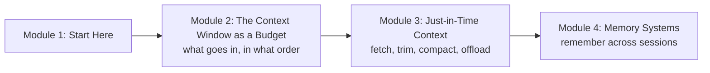

# How This Course Works

## Introduction

Think of a good railway enquiry clerk at a busy station. Hundreds of people come to the window. The clerk can't keep every timetable, every rule and every past passenger in their head. What they actually do is smarter: they keep a short list of rules pinned above the desk, they pull the right timetable *when* a passenger asks about a train, they jot notes on a pad when a case gets long, and they remember the regulars ("Sharma ji always wants a lower berth"). A large language model working as an agent faces the same problem, and this course teaches you how to solve it.

Every agent you build has one hard limit: the model only knows what is in its **context window** at the moment it writes its next token. Instructions, tool definitions, retrieved documents, earlier messages, tool results and memories all compete for that space. Put in too little and the agent guesses. Put in too much and it gets slower, more expensive and, surprisingly, *less accurate*. Doing this well has a name now: **context engineering**. The second half of the problem, carrying useful knowledge from one session to the next, is **agent memory**.

This first article tells you what you will learn, how the course is organised, what you need before starting, and how to get the most out of it.

> 💡 **Key Insight**
>
> The context window is a **budget**, not a bucket. Every token you add costs money, adds delay and competes for the model's attention. Good agents decide, on every turn, what deserves a place in the window, what can be fetched later, what can be summarised and what should be written down somewhere else.

---

## What You Will Learn

By the end of this course you will be able to:

- **Read a real context window item by item**: system prompt, tool definitions, memory, examples, retrieved chunks, history, tool results, the new message, and the space reserved for the answer, each with its token count.
- **Explain context rot and "lost in the middle"**, and design prompts that keep the most important facts where the model actually uses them.
- **Write system prompts at the right altitude**: specific enough to guide, general enough to cope with cases you didn't foresee.
- **Choose between examples and rules**, and pick examples dynamically.
- **Cut cost and latency with prompt caching**, and spot the silent mistakes that break a cache.
- **Load context just in time** with agentic search, keep tool results small, compact long histories and offload notes to files.
- **Keep a 200-step agent inside a fixed token budget**, in a lab you build from scratch.
- **Design memory systems**: short-term and long-term memory, semantic, episodic and procedural memory, memory files such as `CLAUDE.md` and `AGENTS.md`, and policies for writing, updating and forgetting.
- **Use a knowledge graph as memory**, and build an assistant that remembers your preferences across sessions.

### The course at a glance

Module 2 is about **one model call**: what a context window contains, why more is not better, and how to spend the budget wisely. Module 3 is about **long runs**: agents that take dozens or hundreds of steps and would overflow any window if you did nothing. Module 4 is about **many sessions**: agents that remember people, projects and lessons learned after the conversation ends.

---

## How Every Lesson Is Built

Every article follows the same shape, so you always know where to look:

| Section | What it gives you |
|---|---|
| **Before you start** | Links to the earlier lessons this one depends on. |
| **Introduction** | Why the topic matters, with an everyday example. |
| **Key Insight** | The one idea to remember. |
| **Core Explanation** | The topic step by step, with diagrams, tables and runnable code. |
| **Try It Yourself** | Exercises, with answers hidden in a fold. |
| **Real-World Examples** | How shipping products use the idea. |
| **Common Misconceptions** | Mistakes almost everyone makes, corrected. |
| **Interview Relevance** | What interviewers ask and what a strong answer covers. |
| **Key Takeaways** | A one-minute summary for revision. |

**Labs** are guided builds. In this course you will build two: a long-running agent that never breaks its token budget, and a personal assistant with long-term memory.

---

## What You Need Before Starting

- **The agent loop.** You should be comfortable with the decide, act, observe loop and with tool calling. [Agentic AI Fundamentals](../../agentic-ai-fundamentals/course.md) covers both; the most useful lessons are [The Agent Loop](../../agentic-ai-fundamentals/03-the-agent-loop/the-agent-loop-decide-act-observe.md) and [Function Calling Step by Step](../../agentic-ai-fundamentals/04-tools-and-function-calling/function-calling-step-by-step.md).
- **LangGraph state.** Module 4 uses LangGraph checkpointers and stores. [LangGraph Fundamentals](../../langgraph-fundamentals/course.md) and [LangGraph State and Memory](../../langgraph-state-and-memory/course.md) introduce them.
- **Tokens.** You should know that models read text as tokens and that a context window has a maximum size. [Tokens and Context Windows](../../generative-ai-and-llm-foundations/course.md#m3) explains this.
- **Python 3.10 or newer** with the packages in the site's `requirements-lessons.txt` (LangGraph, LangChain Core, NumPy and a few others).

### Do I need an API key?

No. Every runnable example uses a pretend model, LangChain's `FakeListChatModel`, or plain Python, so it runs offline and prints exactly what the lesson shows. Where a real API call matters (prompt caching, token counting, compaction, the memory tool), the lesson shows the real code in a block marked `# not-run`, written for the current Anthropic Python SDK with the model `claude-opus-5-5`, along with example output.

### A note on token counts

Exact token counts depend on the model's tokenizer. In runnable code this course uses a simple, well-known approximation: about **4 characters per token** for English text. It is close enough to reason about budgets. For exact numbers in production, ask the provider: the Anthropic API has a `count_tokens` endpoint, shown in the first lesson of Module 2.

---

## How to Get the Most Out of It

1. **Print the context.** Whenever an example builds a request, print it and read it the way the model will. Most context bugs are obvious once you look.
2. **Count before you guess.** Before saying "the prompt is too long", count each part. The biggest item is rarely the one you expect.
3. **Run the labs end to end.** The budget lab and the memory lab tie every idea in the course together.
4. **Change one thing at a time.** Context changes interact. When you trim, cache or compact, measure what happened before changing the next thing.

---

## Common Misconceptions

### "Bigger context windows make context engineering unnecessary"

Windows of a million tokens are now common, yet accuracy still falls as inputs grow, and every token is paid for on every call. A bigger window gives you more room to make mistakes in. Module 2 shows the evidence.

### "Memory means the model learns"

The model's weights don't change when an agent "remembers". Memory is text your code stores and later puts back into the context window. That makes it something you can inspect, edit and delete.

### "This is just prompt engineering with a new name"

Prompt engineering is about writing one good instruction. Context engineering is about managing *everything* the model sees across a whole run: tools, retrieval, history, results, notes and memory, turn after turn.

---

## Key Takeaways

- **The model only knows what is in its context window**, so deciding what goes there is the core skill of agent building.
- **Module 2** treats one call as a budget, **Module 3** keeps long runs inside that budget, and **Module 4** carries knowledge across sessions.
- **No API key is needed**: runnable code uses pretend models; real API code is shown in clearly marked blocks.
- **Token counts in runnable code are approximate** (about 4 characters per token); use the provider's counter for exact numbers.

---

**Up next:** [From Prompt Engineering to Context Engineering](../02-the-context-window-as-a-budget/from-prompt-engineering-to-context-engineering.md)
