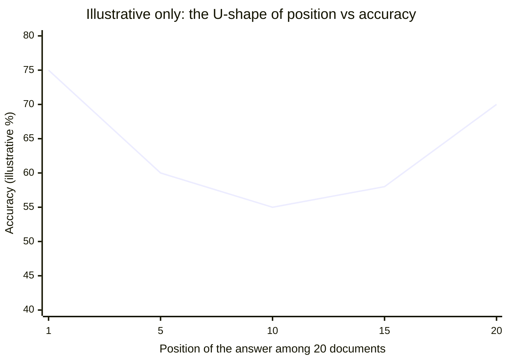
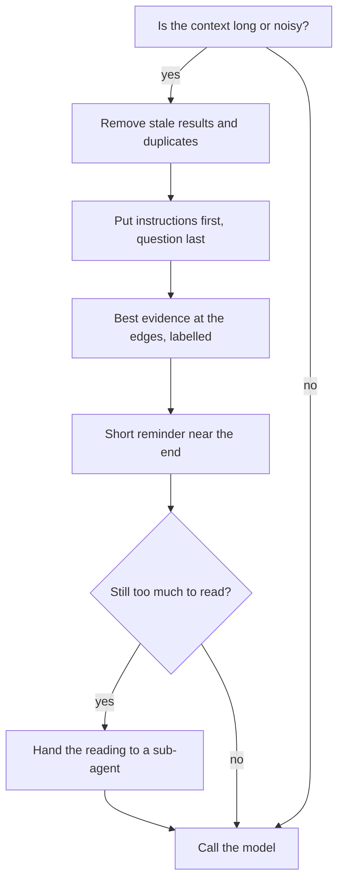

# Context Rot and Lost in the Middle: The Complete Guide

> 📚 **Before you start**
>
> - [From Prompt Engineering to Context Engineering](from-prompt-engineering-to-context-engineering.md), for what a context window contains and how to count it.
> - [What is a Large Language Model?](../../generative-ai-and-llm-foundations/course.md#m3), for the idea that a model reads all its input before predicting the next token.
> - It helps to know what attention is. [Sequence Models, Attention and Transformers](../../sequence-models-attention-and-transformers/course.md) covers it in depth, but this lesson explains what you need.

## Introduction

You come back from a week-long holiday to a family WhatsApp group with 1,400 unread messages. Somewhere in there, your cousin mentioned the date of a wedding you must attend. You scroll to the top, read a bit, jump to the bottom, read the latest, and skim the middle. If the date was posted on day four, there's a good chance you miss it, even though it was "in front of you" the whole time.

Language models have a surprisingly similar weakness. Being able to *accept* a million tokens is not the same as being able to *use* a million tokens equally well. Two well-documented effects describe how they fall short:

- **Context rot**: as the input gets longer, the model's ability to find and use any particular piece of information in it gets worse.
- **Lost in the middle**: information placed in the middle of a long input is used less reliably than information near the beginning or the end.

This lesson explains why these effects happen, what the research actually found, how they show up in agents (often as "the agent forgot my instruction"), and the concrete habits that protect you from them.

> 💡 **Key Insight**
>
> Every token you add draws down a limited **attention budget**. More context is not free information: past a point, it dilutes the signal you care about. Keep the window short, put what matters where the model looks hardest (the start and the end), and remove what is stale.

---

## Core Explanation

### 1. The attention budget

Inside a transformer, every token can "look at" every other token through **attention**. That is what lets the model connect "it" in sentence 40 to "the refund" in sentence 3. But the number of token-to-token relationships grows with the **square** of the input length:

```python
for n in [1_000, 10_000, 100_000, 1_000_000]:
    print(f"{n:>9,} tokens -> {n * n:>22,} token pairs")
```

Output:

```
    1,000 tokens ->              1,000,000 token pairs
   10,000 tokens ->            100,000,000 token pairs
  100,000 tokens ->         10,000,000,000 token pairs
1,000,000 tokens ->      1,000,000,000,000 token pairs
```

Ten times more tokens means a hundred times more pairs. The model has a fixed amount of capacity per layer to spread across all of them, so as the input grows, each individual relationship gets a thinner slice. Anthropic's engineering team calls this the model's **attention budget**: every new token draws it down a little.

There's a second reason. Models see far more short texts than very long ones during training, so they have had much less practice at using relationships that span hundreds of thousands of tokens. Techniques that stretch a model to longer inputs work, but performance across the full length is rarely as sharp as it is over shorter spans.

The result is not a cliff where the model suddenly fails at token 200,001. It is a **gradient**: performance degrades gradually and unevenly as the input grows.

### 2. Lost in the middle: what the research found

In 2023, Nelson Liu and colleagues published *Lost in the Middle: How Language Models Use Long Contexts*. The setup was simple and clever:

1. Give the model a question and a set of documents (for example, 20 search results).
2. Exactly one document contains the answer; the rest are relevant-looking distractors.
3. Move the answer document to different positions (first, fifth, tenth, last) and measure accuracy.

The finding: accuracy was highest when the answer document was **at the very beginning or the very end**, and lowest when it was **in the middle**. Plotted against position, accuracy made a **U-shape**. In some settings, a model given the answer buried in the middle did worse than the same model given no documents at all.

The chart below is an **illustration of that shape**, not the paper's data:



Why the edges? Two effects people usually point to:

- **Primacy**: the start of the input is attended to strongly (it sets up everything that follows).
- **Recency**: the end of the input sits right next to where the model is generating, so it is used heavily.

Newer models are much better at long-context tasks than the 2023 models in that paper, but position effects have not vanished. Treat the U-shape as a risk to design around, not a law with fixed numbers.

### 3. Context rot: what the research found

In July 2025, Chroma published a technical report titled *Context Rot: How Increasing Input Tokens Impacts LLM Performance*, testing 18 models from several vendors. Its headline finding is the one this lesson opened with: models don't use their context uniformly, and performance becomes increasingly unreliable as input length grows, even on simple tasks.

A few of its findings are especially useful for builders:

| Finding | What it means for you |
|---|---|
| Performance drops faster with length when the question and the relevant passage use **different words** | Simple "needle in a haystack" tests, where the needle repeats the question's words, overstate real-world ability |
| **Distractors** (passages that look relevant but aren't) hurt, and several distractors hurt more than one | Old, similar-looking tool results and near-duplicate documents are actively harmful, not just wasteful |
| On a long-conversation memory benchmark, every model did much better with a **focused** prompt (about 300 tokens of relevant history) than with the **full** history (about 113,000 tokens) | Selecting the relevant part of history beats sending all of it |
| Even trivial tasks, like repeating a long list of words, degraded with length | Long outputs and long inputs both carry risk |

The practical summary: **a shorter, cleaner context beats a longer, noisier one**, even when the longer one technically contains more of the right information.

### 4. Why "needle in a haystack" scores look perfect

Many model launches show a heatmap where the model finds a hidden sentence ("the needle") anywhere in a huge document ("the haystack") almost perfectly. That's real, but it measures an easy case: the needle usually shares words with the question, and nothing else in the haystack resembles it.

Real agent contexts are the hard case. Let's measure how "findable" a fact is with simple word overlap:

```python
import re

def words(text):
    return set(re.findall(r"[a-z0-9]+", text.lower()))

def overlap(question, passage):
    q, p = words(question), words(passage)
    return round(len(q & p) / len(q), 2)

question = "What is the cancellation fee for an AC 3-tier ticket?"
easy_needle = "The cancellation fee for an AC 3-tier ticket is Rs 180 plus GST."
real_needle = "Third AC berths surrendered two or more days ahead attract a flat charge of Rs 180 plus GST."
distractor = "The cancellation fee for a Sleeper ticket is Rs 120 plus GST."

for name, passage in [("easy needle", easy_needle), ("realistic needle", real_needle), ("distractor", distractor)]:
    print(f"{name:<17} word overlap with question: {overlap(question, passage)}")
```

Output:

```
easy needle       word overlap with question: 0.91
realistic needle  word overlap with question: 0.09
distractor        word overlap with question: 0.55
```

The realistic needle says the same thing in different words and scores lower than a **wrong** passage (the Sleeper fee). A model has to do real reasoning to pick the right one, and that reasoning is exactly what gets harder as the context grows and fills with distractors.

### 5. How context rot shows up in agents

You rarely see "accuracy fell from 80% to 60%". You see behaviour like this:

| Symptom | What's happening |
|---|---|
| **Instruction drift**: the agent follows a rule early in the chat and ignores it by turn 25 | The system prompt is now a small, distant part of a huge context |
| **Stale facts**: the agent quotes a result from an old tool call instead of the new one | Two similar tool results compete; the wrong one wins |
| **Repetition**: the agent repeats a search it already did | It no longer "notices" the earlier result buried in the middle |
| **Missed detail**: a constraint given in the middle of a long brief is ignored | Lost in the middle |
| **Slower, pricier turns** | Every turn re-reads the whole history |

When you see these, the first question should be "how long and how noisy is the context now?", not "do I need a bigger model?".

### 6. Defence 1: keep it short and clean

The most effective fix is the least glamorous: send fewer, better tokens.

- **Drop what is stale.** A tool result that has already been used (the PNR was looked up, the answer given) rarely needs its full text 20 turns later. Module 3 shows how to clear it.
- **Remove near-duplicates.** Two policy chunks that say almost the same thing are distractors for each other.
- **Select, don't dump.** Retrieve the 3 most relevant chunks, not the top 20 "to be safe".

### 7. Defence 2: put important things at the edges

Use the U-shape to your advantage.

- **Stable instructions at the top** (the system prompt), where they benefit from primacy and from caching.
- **The question at the end.** When you give a model a long document, put the document first and your question after it. Anthropic's long-context guidance recommends exactly this layout.
- **Best evidence at the edges.** When you must include several retrieved chunks, place the most relevant ones first and last, and the weakest in the middle.

Here's a small function that does the last one. It takes chunks sorted from most to least relevant and arranges them so the strongest sit at both ends:

```python
def edges_first(chunks_by_relevance):
    """Place the most relevant chunks at the start and end, the least relevant in the middle."""
    front, back = [], []
    for i, chunk in enumerate(chunks_by_relevance):
        (front if i % 2 == 0 else back).append(chunk)
    return front + back[::-1]

ranked = ["A (best)", "B", "C", "D", "E", "F (worst)"]
print(edges_first(ranked))
```

Output:

```
['A (best)', 'C', 'E', 'F (worst)', 'D', 'B']
```

`A` is first and `B` is last; the weakest chunks (`E`, `F`) sit in the middle, where a miss costs the least.

### 8. Defence 3: restate what matters near the end

For long-running agents, the system prompt drifts further from the point of generation every turn. A common pattern is a short **reminder** appended near the end of the context: the current goal, the key constraints, and what was decided so far. It costs a few dozen tokens and puts the essentials where recency helps.

```python
def with_reminder(messages, goal, constraints):
    reminder = "Reminder before you answer:\n- Goal: " + goal + "\n" + \
               "\n".join(f"- {c}" for c in constraints)
    return messages + [{"role": "user", "content": reminder}]

msgs = [{"role": "user", "content": f"(turn {i}) ..."} for i in range(1, 4)]
final = with_reminder(msgs, "cancel PNR 4521873390 and tell Priya her refund",
                      ["Quote refunds only from calculate_refund", "Reply in under 60 words"])
print(final[-1]["content"])
```

Output:

```
Reminder before you answer:
- Goal: cancel PNR 4521873390 and tell Priya her refund
- Quote refunds only from calculate_refund
- Reply in under 60 words
```

Two cautions. Keep reminders short, or they become clutter themselves. And don't keep **editing** earlier messages or the system prompt to refresh them: that breaks prompt caching (covered later in this module). Append instead. Some APIs support this directly: on recent Claude models you can append a message with `"role": "system"` to the `messages` array mid-conversation, which carries operator authority without touching the cached prefix.

### 9. Defence 4: label everything

Models handle long inputs better when each block says what it is. Wrap retrieved documents, memory and tool output in clear tags, with sources and dates:

```text
<document source="refund-policy.pdf" section="4.2" updated="2026-08-01">
Confirmed tickets cancelled 48 hours or more before departure ...
</document>
<memory about="user" saved="2026-09-12">
Priya prefers short replies.
</memory>
```

Labels help the model resolve conflicts ("the policy updated in August wins over the one from March") and help you debug.

### 10. Defence 5: isolate big jobs

When a sub-task needs to read a lot (search 40 web pages, scan a codebase), give it to a **sub-agent** with its own fresh window, and have it return a short summary. The main agent's context stays small and focused. Anthropic reports that a sub-agent may use tens of thousands of tokens exploring and return a condensed summary of roughly 1,000 to 2,000 tokens. You will build this pattern in Module 3.



---

## Try It Yourself

1. **Reorder seven chunks.** Run `edges_first` on seven chunks `["c1", ..., "c7"]` (best first). Where do `c6` and `c7` end up?
2. **Make the realistic needle findable.** Rewrite `real_needle` so it keeps its meaning but scores higher overlap than `distractor`. What did you change, and what does that tell you about writing policy documents for agents?
3. **Count the cost of history.** An agent re-sends its whole history each turn, and each turn adds 1,500 tokens. Starting from a 3,000-token fixed prefix, how many input tokens has it been billed in total after 30 turns?

<details>
<summary>Show answers</summary>

**1.**

```python
print(edges_first([f"c{i}" for i in range(1, 8)]))
```

Output:

```
['c1', 'c3', 'c5', 'c7', 'c6', 'c4', 'c2']
```

The two weakest chunks land in the middle.

**2.**

```python
better_needle = ("Cancellation fee for an AC 3-tier (Third AC) ticket cancelled two or more days ahead: "
                 "a flat charge of Rs 180 plus GST.")
print(overlap(question, better_needle), "vs distractor", overlap(question, distractor))
```

Output:

```
0.73 vs distractor 0.55
```

Using the same words people will search for ("cancellation fee", "AC 3-tier") makes the passage easier to find, for keyword search, for embedding search and for the model. Documents written for agents should use the vocabulary of the questions they answer.

**3.**

```python
total = sum(3_000 + 1_500 * turn for turn in range(1, 31))
print(f"{total:,} input tokens billed over 30 turns")
```

Output:

```
787,500 input tokens billed over 30 turns
```

The last turn alone is 48,000 tokens. Growth like this is why Module 3 exists.

</details>

---

## Real-World Examples

- **Coding agents** compact their history automatically as they approach their limit and let you clear the conversation between unrelated tasks, because old file contents and test output crowd out what matters for the next task.
- **Retrieval systems** usually return a handful of reranked chunks rather than dozens, trading a little recall for a much cleaner context.
- **Long-document Q&A tools** put the document first and the user's question last, following the long-context layouts that model providers recommend.

---

## Common Misconceptions

### "A 1M-token window means the model reads all 1M tokens equally well"

The window is how much it can accept. How well it uses each part varies with length, position and how similar the distractors are.

### "Needle-in-a-haystack results prove long context is solved"

Those tests are the easy case: the needle matches the question's words and has no look-alikes. Real contexts are full of look-alikes.

### "If the agent forgets an instruction, the instruction must be badly written"

Sometimes. Often the instruction is fine and has simply been buried under thousands of tokens of history. Shorten the context or restate the instruction near the end before rewriting it.

### "More retrieved chunks always improve answers"

Past a small number, extra chunks add distractors and cost. Fewer, better-ranked chunks usually win.

---

## Interview Relevance

*"What is context rot, and how do you design around it?"* A strong answer explains that model performance degrades gradually as input grows (attention is spread over a number of relationships that grows with the square of the length, and models get less training on very long inputs), cites lost-in-the-middle (U-shaped accuracy by position, Liu et al. 2023) and long-context evaluations such as Chroma's 2025 report (degradation with length, worse with distractors and low question-passage similarity, focused prompts beating full histories). Then it lists defences: keep context short by removing stale and duplicate material, put instructions first and the question last, place the best evidence at the edges, label blocks, append short reminders rather than editing earlier context, and isolate heavy reading in sub-agents.

---

## Key Takeaways

- **Context rot**: performance degrades gradually as input grows; it is a gradient, not a cliff.
- **Lost in the middle**: facts at the start and end are used more reliably than facts in the middle.
- **Distractors are harmful**, especially near-duplicates and stale tool results.
- **Defend with structure**: short and clean, instructions first, question last, best evidence at the edges, clear labels, brief reminders.
- **Isolate heavy reading** in sub-agents that return short summaries.

---

**Up next:** [System Prompts at the Right Altitude](system-prompts-at-the-right-altitude.md)
