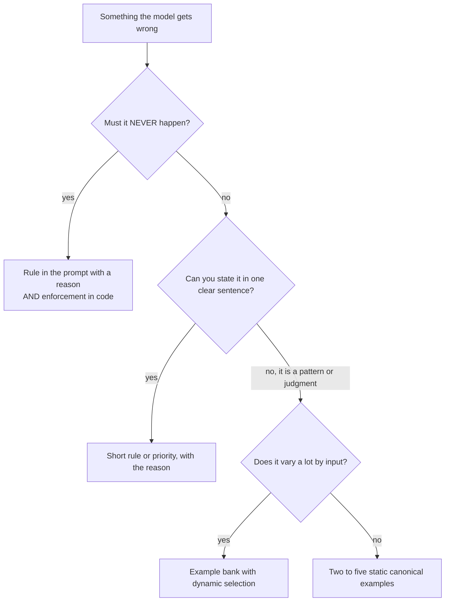

# Examples vs Rules: The Complete Guide

> 📚 **Before you start**
>
> - [System Prompts at the Right Altitude](system-prompts-at-the-right-altitude.md), for priorities, reasons and what belongs in a system prompt.
> - [Context Rot and Lost in the Middle](context-rot-and-lost-in-the-middle.md), for why every extra token must earn its place.
> - [Prompting Fundamentals](../../generative-ai-and-llm-foundations/course.md#m4), for zero-shot and few-shot prompting.

## Introduction

Teaching someone to make phulkas from a written rulebook goes badly. "Roll to 15 cm. Thickness 2 mm. Flip after 20 to 30 seconds, when small bubbles appear, unless the tawa is very hot, in which case…" Teaching by showing goes well: make three phulkas in front of them, one perfect, one slightly thick, one that didn't puff, and explain what you noticed each time. Within a few tries they have a feel for it that no list of rules could give.

Language models learn from what you show them in the context window in a similar way. A handful of well-chosen **examples** (input and ideal output pairs, often called **few-shot** examples) can teach format, tone, judgment and the shape of a good answer far more efficiently than a page of rules. But examples cost tokens on every call, can be over-copied, and can't express everything. Some things really are rules.

This lesson teaches you when to use examples, when to use rules, how to pick examples that teach the right lesson, and how to choose them dynamically so you pay only for the ones that help.

> 💡 **Key Insight**
>
> **Examples teach patterns; rules state limits.** Use a few **diverse, canonical** examples to show what good looks like, and use short rules (with reasons) for the hard boundaries examples can't express. Don't try to cover every edge case with either: a laundry list of rules or examples costs tokens, adds distractors and still misses the next new case.

---

## Core Explanation

### 1. What each one is good at

| | Examples | Rules |
|---|---|---|
| **Teach** | Format, tone, length, judgment calls, the shape of a good answer, how to use tools in sequence | Hard limits, numeric thresholds, priorities, things that must never happen |
| **Strength** | Show many details at once ("a picture is worth a thousand words") | Precise, short, easy to audit |
| **Weakness** | Cost tokens; model may copy surface details; can't state a hard limit | Brittle for fuzzy judgments; long lists contradict and get ignored |
| **Typical size** | 100 to 500 tokens each | 10 to 40 tokens each |
| **Best for RailSathi** | "Here's how a good refund reply reads" | "Cancellations above Rs 10,000 need human approval" (and enforce it in code) |

A useful test: **could you explain it to a new colleague in one sentence?** If yes ("never cancel without confirming the PNR"), it's a rule. If you'd rather say "here, let me show you a couple", it's an example.

### 2. Why "cover every edge case" fails

Anthropic's guidance on context engineering warns specifically against stuffing a prompt with a long list of edge cases. Three reasons:

1. **It never ends.** Every new failure adds an item, and real users produce new cases forever.
2. **It distracts.** Twenty special cases are twenty chances for the model to apply the wrong one to the case in front of it (distracting context, from the previous lessons).
3. **It costs on every call.** A 3,000-token edge-case section is paid for even when the question is "What's my PNR status?".

The alternative is a small set of **canonical** examples: typical cases that, between them, show the full range of behaviour you want.

### 3. What a good example set looks like

Here's RailSathi's task of classifying an incoming message into an intent, with a short example set:

```text
<example>
<message>Mera ticket cancel karna hai, PNR 4521873390</message>
<intent>cancel</intent>
</example>
<example>
<message>Cancelled yesterday, still no money in my account!!</message>
<intent>refund_status</intent>
</example>
<example>
<message>Is my waitlisted ticket confirmed yet? 8812345670</message>
<intent>pnr_status</intent>
</example>
<example>
<message>The AC in coach B2 wasn't working the whole night.</message>
<intent>complaint</intent>
</example>
```

What makes this set good:

- **Diverse inputs**: Hinglish and English, calm and angry, with and without a PNR.
- **Covers the confusable boundary**: "cancel" versus "refund_status" is the pair the model is most likely to mix up, and both are shown.
- **Canonical**: each example is a typical message for its class, not a weird edge case.
- **Clearly labelled**: tags separate examples from instructions and from the real input.

### 4. Pitfalls: when examples teach the wrong lesson

Models learn *everything* an example shows, including things you didn't mean to teach:

| Pitfall | What happens | Fix |
|---|---|---|
| **Surface copying** | Every example reply starts "Dear Passenger," so every real reply does too | Vary surface details you don't care about |
| **Narrow coverage** | All examples are about AC 3-tier, so the model assumes AC 3-tier | Vary class, route, language and length |
| **Imbalance** | 5 complaint examples and 1 cancel example; the model over-predicts complaint | Balance across the classes you care about |
| **Hidden errors** | One example has a wrong refund amount; the model learns the wrong rule | Review examples as carefully as code |
| **Edge-case overload** | Ten weird examples; the model treats ordinary messages as weird | Keep examples canonical; handle rare cases with a rule or a tool |

### 5. Static examples cost tokens on every call

Suppose RailSathi has a bank of 40 good examples, about 300 tokens each. Putting all of them in the prompt costs 12,000 tokens per call. Choosing the 3 most relevant ones for the current message costs about 900. Over a day of traffic, the difference is large:

```python
calls_per_day = 50_000
all_examples = 40 * 300
three_examples = 3 * 300
saved = (all_examples - three_examples) * calls_per_day
print(f"all 40 examples: {all_examples:,} tokens per call")
print(f"3 chosen examples: {three_examples:,} tokens per call")
print(f"tokens saved per day: {saved:,}")
```

Output:

```
all 40 examples: 12,000 tokens per call
3 chosen examples: 900 tokens per call
tokens saved per day: 555,000,000
```

Caching can make static examples cheap (they are a stable prefix), but it doesn't fix the distraction problem: 40 examples in front of a simple question are still 40 chances to pattern-match the wrong one. That's why **dynamic example selection** is popular.

### 6. Dynamic examples: choose per request

The idea: keep a bank of examples outside the context window, and for each request, pull in the few that are most similar to the new input. This is a form of retrieval, and a preview of **episodic memory** from Module 4 (remembering past experiences to guide new ones).

We'll build it with NumPy and a simple bag-of-words vector. Real systems use embedding models, but the logic is identical.

```python
import re
import numpy as np

BANK = [
    ("Mera ticket cancel karna hai, PNR 4521873390", "cancel"),
    ("Please cancel both tickets on PNR 6610023345", "cancel"),
    ("Cancelled yesterday, still no money in my account!!", "refund_status"),
    ("When will my refund for the cancelled Tatkal come?", "refund_status"),
    ("Is my waitlisted ticket confirmed yet? 8812345670", "pnr_status"),
    ("What is the current status of PNR 2203345566", "pnr_status"),
    ("The AC in coach B2 wasn't working the whole night.", "complaint"),
    ("Food was stale and the pantry staff were rude", "complaint"),
    ("Can I carry my cat on the train?", "other"),
]

def tokenize(text):
    return re.findall(r"[a-z]+", text.lower())

VOCAB = sorted({w for text, _ in BANK for w in tokenize(text)})

def vectorize(text):
    v = np.zeros(len(VOCAB))
    for w in tokenize(text):
        if w in VOCAB:
            v[VOCAB.index(w)] += 1
    norm = np.linalg.norm(v)
    return v / norm if norm else v

BANK_VECTORS = np.array([vectorize(text) for text, _ in BANK])

def pick_examples(message, k=3):
    scores = BANK_VECTORS @ vectorize(message)
    best = np.argsort(-scores, kind="stable")[:k]
    return [(BANK[i][0], BANK[i][1], round(float(scores[i]), 2)) for i in best]

for ex in pick_examples("My refund still hasn't come after I cancelled"):
    print(ex)
```

Output:

```
('When will my refund for the cancelled Tatkal come?', 'refund_status', 0.5)
('Cancelled yesterday, still no money in my account!!', 'refund_status', 0.4)
('Can I carry my cat on the train?', 'other', 0.27)
```

The two `refund_status` examples come out on top, which is what we want. The third pick is a weak match (`other`, score 0.27): our bag-of-words vectors treat "cancelled" and "cancel" as different words, so the `cancel` examples were missed. Real embedding models handle word forms and meaning much better. Either way, it's wise to drop picks below a minimum score rather than always filling all `k` slots with something.

### 7. Add diversity so examples don't repeat each other

Pure similarity can pick three near-identical examples, which teach one thing three times. A simple fix is to skip a candidate that is too similar to an example already chosen (a light version of maximal marginal relevance, or MMR):

```python
def pick_diverse(message, k=3, max_overlap=0.3):
    scores = BANK_VECTORS @ vectorize(message)
    chosen = []
    for i in np.argsort(-scores, kind="stable"):
        if all(float(BANK_VECTORS[i] @ BANK_VECTORS[j]) < max_overlap for j in chosen):
            chosen.append(int(i))
        if len(chosen) == k:
            break
    return [BANK[i] for i in chosen]

for text, label in pick_diverse("Please cancel my ticket PNR 4521873390"):
    print(f"{label:<14} {text}")
```

Output:

```
cancel         Mera ticket cancel karna hai, PNR 4521873390
pnr_status     Is my waitlisted ticket confirmed yet? 8812345670
pnr_status     What is the current status of PNR 2203345566
```

### 8. Render examples into the prompt

Finally, format the chosen examples with tags and put them in the stable part of the prompt or just before the new input:

```python
import math

def render_examples(examples):
    blocks = [f"<example>\n<message>{t}</message>\n<intent>{l}</intent>\n</example>" for t, l in examples]
    return "<examples>\n" + "\n".join(blocks) + "\n</examples>"

block = render_examples(pick_diverse("Please cancel my ticket PNR 4521873390"))
print(block)
print("approx tokens:", math.ceil(len(block) / 4))
```

Output:

```
<examples>
<example>
<message>Mera ticket cancel karna hai, PNR 4521873390</message>
<intent>cancel</intent>
</example>
<example>
<message>Is my waitlisted ticket confirmed yet? 8812345670</message>
<intent>pnr_status</intent>
</example>
<example>
<message>What is the current status of PNR 2203345566</message>
<intent>pnr_status</intent>
</example>
</examples>
approx tokens: 91
```

> A note on caching: dynamically chosen examples change per request, so place them **after** the cached prefix (after the system prompt and tools), not inside it. Static examples can live inside the cached prefix.

### 9. Examples for agents: show trajectories

For agents, the most useful examples are often **trajectories**: a short worked run showing the sequence of tool calls and the final answer. They teach workflow in a way rules struggle to:

```text
<example>
User: Cancel my ticket, PNR 4521873390.
Assistant -> get_pnr(pnr="4521873390")
Tool: 12677 ERS-SBC, 14 Oct, 1 passenger: Priya Nair, CNF B2 34, fare Rs 1245
Assistant: Priya, that's 12677 to Bengaluru on 14 October, seat B2 34. Shall I cancel it?
User: Yes.
Assistant -> calculate_refund(pnr="4521873390")
Tool: refund Rs 1,032.60 (fee Rs 180 + GST)
Assistant -> cancel_ticket(pnr="4521873390")
Tool: cancelled, refund ref RF-88123
Assistant: Done. Rs 1,032.60 will reach your account in 5 to 7 days (ref RF-88123).
</example>
```

This one example teaches: look up first, confirm before an irreversible step, compute the refund with the tool, then act, then report with a reference. As a list of rules that would be five lines, and the model would still have to work out the order.

### 10. Decision guide



---

## Try It Yourself

1. **Check balance.** Count how many examples per intent are in `BANK`. Which intent is under-represented, and what would you add?
2. **Watch diversity work.** Call `pick_examples` and `pick_diverse` on `"cancel cancel cancel ticket"`. How do the two lists differ?
3. **Turn a rule into an example.** The rule "Use the passenger's name and give the refund reference" keeps being ignored. Write a two-line example reply that teaches it instead.

<details>
<summary>Show answers</summary>

**1.**

```python
from collections import Counter
print(sorted(Counter(label for _, label in BANK).items()))
```

Output:

```
[('cancel', 2), ('complaint', 2), ('other', 1), ('pnr_status', 2), ('refund_status', 2)]
```

`other` has only one example. Add a couple more varied "other" messages (luggage rules, senior citizen concessions) so the model learns that "other" is a real, common outcome.

**2.**

```python
print([label for _, label, _ in pick_examples("cancel cancel cancel ticket")])
print([label for _, label in pick_diverse("cancel cancel cancel ticket")])
```

Output:

```
['cancel', 'cancel', 'pnr_status']
['cancel', 'pnr_status', 'refund_status']
```

Pure similarity returns the two cancel examples plus whatever scores next. The diverse picker refuses near-duplicates of what it already chose, so the examples it returns teach more than one thing.

**3.** For example: "Priya, your ticket on 12677 is cancelled. Rs 1,032.60 will reach your account in 5 to 7 days (refund ref RF-88123)." Seeing the name at the start and the reference at the end in one or two examples is usually more effective than the rule alone.

</details>

---

## Real-World Examples

- **Classification and extraction pipelines** commonly keep a labelled example bank and retrieve the nearest few per input, because the right examples differ between, say, a refund email and a complaint.
- **Agent frameworks** let you supply example conversations or trajectories alongside the system prompt so the model learns a workflow, such as "search, read, then answer with a citation".
- **Coding agents** learn a repository's conventions mostly from the existing code they read (examples) plus a short instruction file (rules), rather than from long style guides.

---

## Common Misconceptions

### "More examples are always better"

Past a few good ones, extra examples add cost and distraction and can over-fit the model to their surface details.

### "Examples can replace rules entirely"

Examples can't express hard limits ("never above Rs 10,000 without approval"). Those need a rule, and important ones need code.

### "Edge cases deserve examples"

Usually not. Examples should be canonical. Rare cases are better handled by a short rule, a tool, or escalation to a human.

### "Example order doesn't matter"

Models can be influenced by order (the last example sits closest to the new input). Keep order deliberate, and avoid ending with an unusual example.

---

## Interview Relevance

*"When do you use few-shot examples versus instructions?"* A strong answer says examples teach patterns (format, tone, judgment, tool sequences) and rules state limits and priorities; recommends a small set of diverse, canonical examples instead of an exhaustive edge-case list; names the pitfalls (surface copying, narrow coverage, imbalance, hidden errors); explains dynamic example selection from a bank by similarity, with a diversity check; notes that dynamic examples go after the cached prefix; and stresses that hard limits must also be enforced in code.

---

## Key Takeaways

- **Examples teach patterns, rules state limits**; most prompts need a few of each.
- **Prefer a few diverse, canonical examples** over an exhaustive list of edge cases.
- **Examples teach everything they show**, so vary irrelevant surface details and balance the classes.
- **Choose examples dynamically** from a bank for varied inputs, with a diversity check, and place them after the cached prefix.
- **For agents, show trajectories**: a worked sequence of tool calls teaches workflow better than rules.

---

**Up next:** [Prompt Caching](prompt-caching.md)
