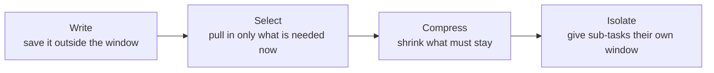

# From Prompt Engineering to Context Engineering: The Complete Guide

> 📚 **Before you start**
>
> - [How This Course Works](../01-start-here/how-this-course-works.md), for the course map and the note on token counts.
> - [Anatomy of an Agent](../../agentic-ai-fundamentals/03-the-agent-loop/anatomy-of-an-agent.md), for the parts of an agent that all end up in the context window.
> - [Function Calling Step by Step](../../agentic-ai-fundamentals/04-tools-and-function-calling/function-calling-step-by-step.md), for what tool definitions, tool calls and tool results look like on the wire.
> - [Tokens and Context Windows](../../generative-ai-and-llm-foundations/course.md#m3), for what a token is.

## Introduction

Imagine packing a single cabin bag for a two-week trip to Delhi in December. The airline allows 7 kg. You could stuff in everything "just in case", but then the zip won't close, you can't find your charger, and you pay excess baggage. A seasoned traveller packs differently: the essentials go in first, a few things are bought on arrival, and bulky items are left at home with a note on where to find them if needed.

For the first couple of years of building with LLMs, the main skill people talked about was **prompt engineering**: finding the right words for one instruction. That still matters. But an agent that runs for twenty turns, calls tools, reads documents and remembers the user is not driven by one prompt. It is driven by **everything** that ends up in the model's context window on each call, and most of that wasn't written by you at all. It came from tool results, retrieved documents, earlier turns and memory.

**Context engineering** is the practice of deciding what goes into that window, in what form, in what order, and what stays out, on every single call. Anthropic's engineering team describes the goal as finding the smallest set of high-signal tokens that makes the outcome you want likely. That is the cabin bag again: not everything, the right things.

By the end of this lesson you will be able to open up a real agent request, list every item in it with its token count, explain why each item is there, and set a budget that keeps the agent fast, cheap and accurate.

> 💡 **Key Insight**
>
> The model knows **only** what is in its context window at the moment it generates. Prompt engineering optimises one piece of that window (your instruction). Context engineering optimises **the whole window, every turn**: instructions, tools, examples, retrieved facts, history, tool results and memory, each competing for a fixed budget of tokens and attention.

---

## Core Explanation

### 1. What is "context", exactly?

A model call is stateless. The model doesn't remember your last request. Each time your agent loop calls the model, it sends a complete package, and the model reads that package from the first token to the last before writing its reply. That package is the **context**. The maximum size of the package is the **context window**, measured in tokens.

When people say "the prompt", they usually mean the instruction they typed. When the model says "the prompt" (if it could), it means everything:

| Item | What it is | Who writes it |
|---|---|---|
| **System prompt** | Role, rules, workflow, tone | You, once |
| **Tool definitions** | Name, description and input schema of each tool | You, once |
| **Examples** | Sample inputs and ideal outputs | You, or selected per request |
| **Memory** | Facts about the user or project from earlier sessions | Your memory system |
| **Retrieved context** | Document chunks, search results, files | Your retrieval step or the agent's own searches |
| **Conversation history** | Earlier user and assistant messages | The user and the model |
| **Tool calls and results** | What the agent asked tools to do, and what came back | The model and your tools |
| **The new message** | The thing the user just asked | The user |
| **Reserved output** | Space for the reply (`max_tokens`) | You, as a setting |

Only one row in that table is "the prompt" in the old sense. In a typical agent, it is also one of the smallest.

### 2. A real context window, item by item

Let's open one up. RailSathi is a pretend support agent for an Indian train-booking app. A passenger, Priya, is on turn 9 of a chat about cancelling her ticket. Here is what one production-sized request on that turn contains, with representative token counts:


*One turn of an agent, laid out as a budget. The user's actual question is 70 tokens out of 25,140.*

| # | Item | Tokens | Share of input | Changes how often? |
|---|---|---:|---:|---|
| 1 | System prompt | 1,850 | 7.4% | Never (per deployment) |
| 2 | Tool definitions (12 tools) | 3,400 | 13.5% | Never (per deployment) |
| 3 | User memory | 420 | 1.7% | Per session |
| 4 | Examples (3 worked conversations) | 1,100 | 4.4% | Never, or per request if chosen dynamically |
| 5 | Retrieved policy chunks (4) | 2,600 | 10.3% | Every turn |
| 6 | Conversation history (8 turns) | 5,900 | 23.5% | Grows every turn |
| 7 | Tool calls and results so far | 9,800 | 39.0% | Grows every turn |
| 8 | New user message | 70 | 0.3% | Every turn |
| | **Input total** | **25,140** | **100%** | |
| 9 | Reserved for the answer (`max_tokens`) | 8,000 | | Setting |

Three things jump out, and they are true of almost every agent:

- **The user's question is tiny.** 70 tokens out of 25,140. Everything else is scaffolding you are responsible for.
- **The biggest items grow on their own.** History and tool results are 62% of the input on turn 9. By turn 30 they will dwarf everything else unless you do something.
- **The fixed items are expensive but stable.** System prompt, tools and examples never change between turns, which makes them perfect for prompt caching (a later lesson in this module).

### 3. What that request looks like on the wire

Diagrams are nice, but the model sees JSON. Here is a miniature version of the same request, built in Python the way an agent loop builds it. We'll count it with the 4-characters-per-token rule of thumb.

```python
import json, math

def approx_tokens(text):
    """Rough rule of thumb for English: about 4 characters per token."""
    return math.ceil(len(text) / 4)

system_prompt = """You are RailSathi, the support assistant for an Indian train-booking app.
## Your job
Help passengers with bookings, cancellations, refunds and PNR status.
## How to work
- Look up the PNR with get_pnr before answering any booking question.
- Quote refund amounts only from calculate_refund, never from memory.
- If a rule is unclear, search the policy with search_policy.
## Tone
Warm, short sentences. Use the passenger's name. Amounts in rupees (Rs)."""

tools = [
    {"name": "get_pnr", "description": "Fetch booking details for a 10-digit PNR: train, date, passengers, status.",
     "input_schema": {"type": "object", "properties": {"pnr": {"type": "string"}}, "required": ["pnr"]}},
    {"name": "calculate_refund", "description": "Compute the refund for cancelling a booking now, per current rules.",
     "input_schema": {"type": "object", "properties": {"pnr": {"type": "string"}}, "required": ["pnr"]}},
    {"name": "search_policy", "description": "Search refund and cancellation policy text. Returns the best 3 passages.",
     "input_schema": {"type": "object", "properties": {"query": {"type": "string"}}, "required": ["query"]}},
]

memory = "Known about this user: name Priya Nair; prefers short replies; travels Kochi-Bengaluru monthly."

retrieved = ("[policy 4.2] Confirmed tickets cancelled 48 hours or more before departure: flat fee per passenger "
             "(AC 3-tier Rs 180 plus GST). [policy 4.3] Between 48 and 12 hours: 25% of fare, minimum the flat fee.")

history = [
    {"role": "user", "content": "Hi, I need to cancel my ticket. PNR 4521873390."},
    {"role": "assistant", "content": [{"type": "tool_use", "id": "t1", "name": "get_pnr",
                                       "input": {"pnr": "4521873390"}}]},
    {"role": "user", "content": [{"type": "tool_result", "tool_use_id": "t1", "content": json.dumps(
        {"train": "12677 Ernakulam-KSR Bengaluru Express", "date": "2026-10-14", "class": "3A",
         "passengers": [{"name": "Priya Nair", "status": "CNF B2 34"}], "fare": 1245})}]},
    {"role": "assistant", "content": "Found it, Priya: 12677 to Bengaluru on 14 October, B2 34 confirmed."},
]

new_message = {"role": "user", "content": "How much will I get back if I cancel today?"}

request = {
    "model": "claude-opus-5-5",
    "max_tokens": 1024,
    "system": system_prompt + "\n\n<memory>" + memory + "</memory>\n\n<policy>" + retrieved + "</policy>",
    "tools": tools,
    "messages": history + [new_message],
}
print(json.dumps(request)[:240], "...")
```

Output:

```
{"model": "claude-opus-5-5", "max_tokens": 1024, "system": "You are RailSathi, the support assistant for an Indian train-booking app.\n## Your job\nHelp passengers with bookings, cancellations, refunds and PNR status.\n## How to work\n- Loo ...
```

Notice how the memory and the retrieved policy were *put inside the system field* with XML-style tags. That is a common, readable choice: tags tell the model what each block is. Another common choice is to put retrieved text in the user turn. Either works; what matters is that each block is clearly labelled.

Now break the request into its items and count each:

```python
def breakdown(request, parts):
    rows = [(name, approx_tokens(text)) for name, text in parts]
    total = sum(t for _, t in rows)
    for name, t in rows:
        print(f"{name:<22}{t:>6} tokens  {t / total:>6.1%}")
    print(f"{'TOTAL INPUT':<22}{total:>6} tokens")
    print(f"{'reserved for answer':<22}{request['max_tokens']:>6} tokens")
    return total

parts = [
    ("system prompt", system_prompt),
    ("tool definitions", json.dumps(tools)),
    ("memory", memory),
    ("retrieved policy", retrieved),
    ("history", json.dumps(history)),
    ("new message", json.dumps(new_message)),
]
total = breakdown(request, parts)
```

Output:

```
system prompt            114 tokens   22.1%
tool definitions         163 tokens   31.5%
memory                    24 tokens    4.6%
retrieved policy          50 tokens    9.7%
history                  147 tokens   28.4%
new message               19 tokens    3.7%
TOTAL INPUT              517 tokens
reserved for answer     1024 tokens
```

Even in this toy, the user's new question is the smallest item and the tool definitions are among the largest. Real agents usually have more tools, longer histories and much bigger tool results, so the imbalance only grows.

### 4. Counting tokens properly

The 4-characters rule is fine for budgeting in your head. Two better options exist:

1. **The provider's counter.** It uses the model's real tokenizer, including the hidden formatting the API adds around tools and messages. With the Anthropic SDK:

```python
# not-run: needs the anthropic package and an API key
import anthropic

client = anthropic.Anthropic()
count = client.messages.count_tokens(
    model="claude-opus-5-5",
    system=request["system"],
    tools=request["tools"],
    messages=request["messages"],
)
print(count.input_tokens)
```

Example output:

```
1187
```

Your exact number will differ, but expect it to be noticeably higher than the 4-characters estimate, because the API wraps tool definitions and messages in its own formatting (tool use also adds a short built-in system instruction). Token counts are **model-specific**: count with the same model you will call. Don't use another vendor's tokenizer library to count for a different vendor's model; the numbers can be well off, especially for code and non-English text.

2. **A framework helper.** LangChain Core ships an approximate counter that works on message objects and adds a small per-message overhead. It is handy inside trimming logic (Module 3):

```python
from langchain_core.messages import AIMessage, HumanMessage, SystemMessage
from langchain_core.messages.utils import count_tokens_approximately

msgs = [
    SystemMessage(system_prompt),
    HumanMessage("Hi, I need to cancel my ticket. PNR 4521873390."),
    AIMessage("Found it, Priya: 12677 to Bengaluru on 14 October, B2 34 confirmed."),
    HumanMessage("How much will I get back if I cancel today?"),
]
print("approximate tokens:", count_tokens_approximately(msgs))
```

Output:

```
approximate tokens: 171
```

### 5. The window is not the budget

Current frontier models accept very large inputs: Claude Opus 5.5, for example, has a 1,000,000-token context window. So why did the RailSathi diagram use a 40,000-token budget?

Because the window is the **maximum**, and the budget is what you **choose to spend**. Three costs grow with every token you send:

| Cost | Why it grows | What it means for RailSathi |
|---|---|---|
| **Money** | Input tokens are billed on every call, and an agent makes many calls | 25,140 input tokens × 9 turns is already about 226,000 billed input tokens for one chat, before caching |
| **Latency** | The model must read every input token before it writes the first output token | Long contexts mean a longer pause before the reply starts |
| **Accuracy** | Models use long contexts less reliably than short ones (next lesson: context rot) | Burying the refund rule under 30 old tool results makes the model more likely to miss it |

So a good habit is to set an **operating budget** per call, well below the window, and design your agent to stay inside it. Here is a small budget checker:

```python
def budget_report(items, budget, reserve):
    used = sum(items.values())
    left = budget - reserve - used
    print(f"input {used:,} + reserve {reserve:,} = {used + reserve:,} of {budget:,}")
    print("OK" if left >= 0 else "OVER BUDGET", f"(headroom {left:,})")
    biggest = max(items, key=items.get)
    print(f"biggest item: {biggest} ({items[biggest]:,})")

turn_9 = {"system": 1850, "tools": 3400, "memory": 420, "examples": 1100,
          "retrieved": 2600, "history": 5900, "tool_results": 9800, "new_message": 70}
budget_report(turn_9, budget=40_000, reserve=8_000)

# Ten turns later, nothing has been trimmed:
turn_19 = dict(turn_9, history=13_200, tool_results=24_500)
print()
budget_report(turn_19, budget=40_000, reserve=8_000)
```

Output:

```
input 25,140 + reserve 8,000 = 33,140 of 40,000
OK (headroom 6,860)
biggest item: tool_results (9,800)

input 47,140 + reserve 8,000 = 55,140 of 40,000
OVER BUDGET (headroom -15,140)
biggest item: tool_results (24,500)
```

On turn 19 the agent is over budget, and the cause is obvious: tool results. That one number tells you which technique to reach for first (clearing or shrinking tool results, Module 3), long before you think about rewriting the system prompt.

### 6. Prompt engineering vs context engineering

| | Prompt engineering | Context engineering |
|---|---|---|
| **Unit of work** | One instruction | Everything the model sees, every call |
| **When it happens** | Before deployment | Continuously, while the agent runs |
| **Main question** | "How do I phrase this?" | "What should be in the window right now, and what should not?" |
| **Main tools** | Wording, examples, format instructions | Retrieval, tool design, trimming, caching, compaction, note files, sub-agents, memory |
| **Failure it fixes** | Model misunderstands the task | Model loses track, gets distracted, runs out of room, or costs too much |
| **Who writes the tokens** | You | You, the user, the tools, the retriever and the model itself |

Prompt engineering doesn't go away. It becomes one part of a bigger job.

### 7. The four moves of context engineering

Practitioners group the techniques into four moves. Each later lesson in this course teaches one or more of them in depth:



| Move | What it means | Examples | Taught in |
|---|---|---|---|
| **Write** | Store information outside the window so it can be recalled later | Scratchpad files, to-do lists, memory stores | [Module 3](../../context-engineering-and-agent-memory/course.md#m3), [Module 4](../../context-engineering-and-agent-memory/course.md#m4) |
| **Select** | Bring in only the relevant pieces, at the moment they are needed | Retrieval, agentic search, choosing examples, loading memories | [Module 3](../../context-engineering-and-agent-memory/course.md#m3) |
| **Compress** | Reduce the tokens used by what stays | Trimming history, clearing old tool results, summarising, compaction | [Module 3](../../context-engineering-and-agent-memory/course.md#m3) |
| **Isolate** | Split work so each part has a clean, small window | Sub-agents that return short summaries, sandboxes that hold big data | [Module 3](../../context-engineering-and-agent-memory/course.md#m3) |

And one rule sits above all four: **order and stability matter**. Items that never change go first and stay byte-for-byte identical, so they can be cached. Items that change every turn go last.

### 8. Where context goes wrong

Most agent failures that look like "the model is dumb" are context failures. Four patterns cover most of them:

| Failure | What happens | Example in RailSathi |
|---|---|---|
| **Missing context** | The fact the model needs isn't in the window, so it guesses | The refund rule wasn't retrieved, so the model invents "full refund" |
| **Distracting context** | Irrelevant material pulls the model off course | Ten old PNR lookups from other trips make it quote the wrong train |
| **Conflicting context** | Two items disagree and the model picks one | An outdated policy chunk says Rs 120 fee; the current one says Rs 180 |
| **Poisoned context** | Wrong or malicious text gets in and is then treated as truth | A hallucinated fare from turn 3 is repeated as fact on turn 12 |

Each of these is fixed by changing what goes into the window, not by changing the model.

---

## Try It Yourself

1. **Find the biggest item.** Add a fourth tool to `tools` with a long description (about 400 characters) and rerun `breakdown`. Which item is now the biggest, and what share is the new message?
2. **Plan a budget.** RailSathi's operating budget is 40,000 with an 8,000 reserve. On turn 19, by how many tokens must tool results shrink to get back to at least 2,000 tokens of headroom, if nothing else changes?
3. **Spot the failure.** A user asks about a Mumbai-Pune ticket, but the agent answers about the Kochi-Bengaluru ticket from earlier in the chat. Which of the four failure patterns is this, and which move (write, select, compress, isolate) would you try first?

<details>
<summary>Show answers</summary>

**1.**

```python
tools_plus = tools + [{"name": "find_alternative_trains",
    "description": ("Find other trains between two stations on a date when the passenger's train is full, "
                    "cancelled or delayed. Returns up to 5 trains with departure time, arrival time, classes "
                    "with seats available and fare per class. Use station codes like ERS or SBC. Only call "
                    "this after get_pnr shows a problem with the booked train, or when asked for options."),
    "input_schema": {"type": "object", "properties": {"from": {"type": "string"}, "to": {"type": "string"},
                     "date": {"type": "string"}}, "required": ["from", "to", "date"]}}]
parts_plus = [(n, json.dumps(tools_plus) if n == "tool definitions" else t) for n, t in parts]
_ = breakdown(request, parts_plus)
```

Output:

```
system prompt            114 tokens   17.3%
tool definitions         306 tokens   46.4%
memory                    24 tokens    3.6%
retrieved policy          50 tokens    7.6%
history                  147 tokens   22.3%
new message               19 tokens    2.9%
TOTAL INPUT              660 tokens
reserved for answer     1024 tokens
```

Tool definitions are now well ahead of everything else, and the user's question is a very small share. Every tool you add is paid for on every call, whether or not it is used.

**2.**

```python
used_19 = sum(turn_19.values())
target_used = 40_000 - 8_000 - 2_000
print("tool results must shrink by", used_19 - target_used, "tokens")
```

Output:

```
tool results must shrink by 17140 tokens
```

**3.** This is **distracting context**: an old, irrelevant booking is still in the window and pulls the answer. Try **compress** first (clear old tool results once they have been used) and **select** (look up the new PNR fresh and keep only it). Module 3 covers both.

</details>

---

## Real-World Examples

- **Coding agents** such as Claude Code show you the context breakdown directly: the `/context` command lists how many tokens go to the system prompt, tool definitions, memory files such as `CLAUDE.md`, skills and the conversation. Their documentation walks through a representative session where the system prompt is about 4,200 tokens and a project `CLAUDE.md` about 1,800 before you type anything.
- **Customer support agents** keep policies outside the prompt and retrieve the relevant clauses per question, because policy manuals are far larger than any sensible budget.
- **Research agents** split work across sub-agents, each exploring with its own window and returning a short summary to the lead agent, so the lead's window holds conclusions instead of raw web pages.

---

## Common Misconceptions

### "Context engineering means writing longer prompts"

Usually the opposite. Most improvements come from *removing* tokens: fewer tools, shorter tool results, cleared history, and only the relevant retrieved text.

### "If it fits in the window, it's fine"

Fitting is necessary, not sufficient. Cost, latency and accuracy all get worse as the window fills, long before it is full.

### "The user's message is what drives the answer"

It is what starts the turn, but it is often less than 1% of the input. The other 99% (instructions, tools, history, results) shapes the answer at least as much.

### "Token counts are the same for every model"

Each model family has its own tokenizer. Count with the provider's tool for the model you actually call.

---

## Interview Relevance

*"What is context engineering, and how is it different from prompt engineering?"* A strong answer defines context as everything the model reads on a call (system prompt, tool definitions, examples, memory, retrieved data, history, tool results, the new message), notes that the model is stateless so the agent loop rebuilds this every turn, and explains that context engineering is choosing and maintaining the smallest high-signal set of tokens across a whole run. Mention the four moves (write, select, compress, isolate), that history and tool results grow until something trims them, that stable items should come first for caching, and that bigger windows don't remove the need because cost, latency and accuracy all degrade with length.

A common follow-up: *"Walk me through what's in your agent's context on turn 10."* Answer with an item-by-item breakdown and token counts, name the biggest item, and say what you do about it.

---

## Key Takeaways

- **Context is everything the model reads on a call**, and the agent rebuilds it on every turn.
- **The user's question is usually a tiny share**; tools, history and tool results dominate.
- **Set an operating budget well below the window**, because money, latency and accuracy all suffer as context grows.
- **Count each item**, ideally with the provider's token counter, and fix the biggest one first.
- **Four moves**: write, select, compress and isolate, with stable content first and changing content last.

---

**Up next:** [Context Rot and Lost in the Middle](context-rot-and-lost-in-the-middle.md)
