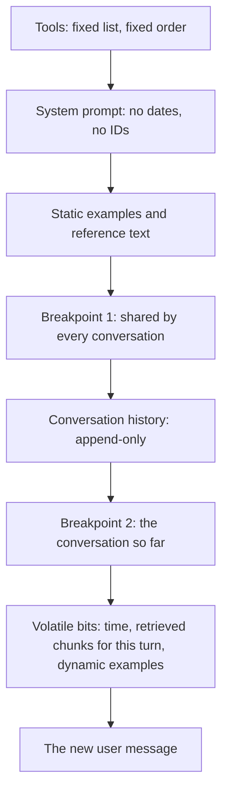

# Prompt Caching: The Complete Guide

> 📚 **Before you start**
>
> - [From Prompt Engineering to Context Engineering](from-prompt-engineering-to-context-engineering.md), for the stable and growing parts of a context window.
> - [System Prompts at the Right Altitude](system-prompts-at-the-right-altitude.md), for why volatile data doesn't belong in the system prompt.
> - [Examples vs Rules](examples-vs-rules.md), for static versus dynamically chosen examples.

## Introduction

A Mumbai dabbawala doesn't re-learn the route to every office each morning. The route is fixed; only the lunchboxes change. Imagine if every morning someone shuffled the street names. The dabbawala would have to work out the whole route from scratch, every day, and lunch would be late and expensive.

An agent loop has the same structure. On every call it sends the same tool definitions, the same system prompt and the same examples, followed by a conversation that only ever grows at the end. Without caching, the provider processes all of that from scratch on every call. With **prompt caching**, the provider keeps the already-processed prefix around for a few minutes, and the next request that starts with exactly the same bytes reuses it: much cheaper and noticeably faster.

The catch is in the word *exactly*. One changed byte early in the prompt, such as a timestamp, a reordered tool list or a JSON object with keys in a different order, and the cache silently misses. This lesson shows you how caching works, how to structure an agent's context so it caches well, what it saves in rupees and dollars, and how to catch the silent mistakes.

> 💡 **Key Insight**
>
> Prompt caching is a **prefix match**: the provider reuses work only for the part of your request that is byte-for-byte identical to an earlier one, from the very first token up to a cache breakpoint. So order your context from **most stable to most volatile**, and **append** to the conversation instead of editing it.

---

## Core Explanation

### 1. What gets cached, and in what order

With the Anthropic Messages API, a request is rendered in a fixed order: **tools**, then **system**, then **messages**. The cache works on that rendered sequence.


*The prefix grows turn by turn. Everything before the newest part is read from the cache, as long as the bytes are identical.*

You mark where cacheable prefixes end with **cache breakpoints**: a `cache_control` field on a content block. Everything from the start of the request up to that block becomes a cache entry. Key facts for the Anthropic API:

| Fact | Detail |
|---|---|
| Marker | `"cache_control": {"type": "ephemeral"}` on a content block (system text, tool definition, message content) |
| Automatic mode | A top-level `cache_control` on the request places the breakpoint on the last cacheable block for you |
| Breakpoints per request | Up to 4 |
| Lifetime | 5 minutes by default; `"ttl": "1h"` for one hour. Each cache read refreshes the timer at no extra cost |
| Minimum size | A model-dependent minimum prefix length (for current Claude models, between 512 and 4,096 tokens). Shorter prefixes simply don't cache, with no error |
| Scope | Caches are isolated per workspace (per organisation on some cloud platforms) and never shared across organisations |
| Model | Caches are per model; switching models mid-session starts from scratch |

Other providers have their own versions, some fully automatic above a minimum length. The principle (an identical prefix gets reused) is the same everywhere.

### 2. The price difference

Caching changes how input tokens are billed. On Claude Opus 5.5:

| Input token type | Price per million tokens | Multiple of base |
|---|---:|---:|
| Regular input | $4.00 | 1× |
| Cache write, 5-minute lifetime | $5.00 | 1.25× |
| Cache write, 1-hour lifetime | $8.00 | 2× |
| Cache read | $0.20 | 0.05× |

On most other current Claude models a cache read costs about 0.1× the base price. Either way: writing costs a little extra once, reading costs a small fraction, so a prefix that gets reused even once or twice pays for itself.

Let's see what that means for a 20-turn RailSathi conversation. The stable prefix (tools, system prompt, examples) is 6,770 tokens; each turn adds about 1,500 tokens of new messages and tool results; turns happen within a few minutes of each other.

```python
PRICE = {"input": 4.00, "write_5m": 5.00, "read": 0.20}   # USD per million tokens, Claude Opus 5.5
PREFIX, PER_TURN, TURNS = 6_770, 1_500, 20

def cost_without_cache():
    return sum((PREFIX + PER_TURN * t) * PRICE["input"] for t in range(1, TURNS + 1)) / 1e6

def cost_with_cache():
    total = 0.0
    for t in range(1, TURNS + 1):
        if t == 1:
            total += (PREFIX + PER_TURN) * PRICE["write_5m"]          # first call writes everything
        else:
            total += (PREFIX + PER_TURN * (t - 1)) * PRICE["read"]   # earlier prefix read from cache
            total += PER_TURN * PRICE["write_5m"]                      # the new turn is written
    return total / 1e6

plain, cached = cost_without_cache(), cost_with_cache()
print(f"input tokens billed over {TURNS} turns: {sum(PREFIX + PER_TURN * t for t in range(1, TURNS + 1)):,}")
print(f"without caching: ${plain:.4f}")
print(f"with caching:    ${cached:.4f}")
print(f"saving:          {1 - cached / plain:.0%}")
```

Output:

```
input tokens billed over 20 turns: 450,400
without caching: $1.8016
with caching:    $0.2666
saving:          85%
```

At the scale of thousands of conversations a day, that difference decides whether an agent is affordable. There is also a latency benefit: the cached part doesn't have to be processed again, so the model starts answering sooner. And on the Claude API, cache reads don't count towards input-token rate limits on most models, so caching can raise your effective throughput too.

### 3. Where to put the breakpoints in an agent

A pattern that works for most agent loops:

1. **One breakpoint at the end of the stable prefix**: on the last system block (which covers tools and system together). This entry is shared by *every* conversation that uses the same prompt.
2. **One breakpoint at the end of the conversation so far** (or use automatic mode, which does this for you). Each new turn reads the previous turn's entry and writes only the new part.

```python
# not-run: needs the anthropic package and an API key
import anthropic

client = anthropic.Anthropic()

response = client.messages.create(
    model="claude-opus-5-5",
    max_tokens=2048,
    cache_control={"type": "ephemeral"},          # automatic breakpoint on the conversation tail
    tools=TOOLS,                                   # same list, same order, every call
    system=[{
        "type": "text",
        "text": SYSTEM_PROMPT + "\n\n" + STATIC_EXAMPLES,
        "cache_control": {"type": "ephemeral"},    # explicit breakpoint: tools + system
    }],
    messages=messages,                             # append-only history
)
u = response.usage
print("written to cache:", u.cache_creation_input_tokens)
print("read from cache: ", u.cache_read_input_tokens)
print("uncached input:  ", u.input_tokens)
```

Example output (turn 5 of a conversation):

```
written to cache: 1512
read from cache:  12801
uncached input:   43
```

The `usage` fields are how you **verify** caching. On a healthy loop, `cache_read_input_tokens` dominates after the first turn, and `cache_creation_input_tokens` is roughly one turn's worth. If reads stay at zero across repeated calls, something is breaking the prefix.

### 4. The silent cache breakers

Caching fails without an error. These are the usual suspects:

| Breaker | Example | Fix |
|---|---|---|
| **Timestamp or ID early in the prompt** | `"Today is 14 Oct 2026, 10:45"` at the top of the system prompt | Move it after the last breakpoint (in the user turn), and round it to the day if possible |
| **Non-deterministic serialisation** | `json.dumps(policy)` where the dict's key order varies between runs | `json.dumps(..., sort_keys=True)`; build tool lists in a fixed order |
| **Changing the tool set** | Adding a tool only on some turns | Keep the tool list fixed per session; use tool search or deferred loading that appends rather than replaces |
| **Editing earlier messages** | Trimming old tool results by rewriting history each turn | Prefer append-only history; when you must trim, do it rarely in one big step (Module 3) |
| **Editing the system prompt mid-session** | Swapping in a "terse mode" paragraph | Append a mid-conversation instruction instead (previous lessons) |
| **Switching models or top-level settings** | Falling back to a cheaper model for one turn | Keep one model per conversation; use a separate sub-agent for cheaper sub-tasks |
| **Prefix below the minimum** | A 300-token system prompt | It won't cache; that's fine if it's small, or combine it with static examples |
| **Gaps longer than the lifetime** | A user replies after 20 minutes | Consider the 1-hour lifetime for human-paced chats |

### 5. Catch a breaker before it costs you

Since the cache is a prefix match, you can test your own prompt builder offline: render two consecutive requests and see where they first differ. Everything before that point can be cached; everything after can't.

```python
import json
from datetime import datetime, timedelta

TOOLS = [{"name": "get_pnr", "description": "Fetch a booking by PNR."},
         {"name": "calculate_refund", "description": "Compute the refund for cancelling now."}]
SYSTEM = "You are RailSathi, the support assistant inside an Indian train-booking app."

def render(system, tools, messages):
    """Render in the same order the API uses: tools, then system, then messages."""
    return json.dumps(tools) + system + json.dumps(messages)

def shared_prefix(a, b):
    n = 0
    while n < min(len(a), len(b)) and a[n] == b[n]:
        n += 1
    return n

history = [{"role": "user", "content": "Cancel PNR 4521873390"}]
next_history = history + [{"role": "assistant", "content": "Confirm: Priya Nair, B2 34?"},
                          {"role": "user", "content": "Yes"}]

# Builder A: timestamp at the top of the system prompt
t0 = datetime(2026, 10, 11, 10, 45)
a1 = render(f"Now: {t0:%H:%M}. " + SYSTEM, TOOLS, history)
a2 = render(f"Now: {t0 + timedelta(minutes=1):%H:%M}. " + SYSTEM, TOOLS, next_history)

# Builder B: stable system prompt; the time goes in the newest user turn instead
b1 = render(SYSTEM, TOOLS, history)
b2 = render(SYSTEM, TOOLS, next_history)

for name, x, y in [("timestamp in system", a1, a2), ("stable system", b1, b2)]:
    n = shared_prefix(x, y)
    print(f"{name:<20} shared prefix {n:>4} of {len(x):>4} chars ({n / len(x):.0%} of the previous request)")
```

Output:

```
timestamp in system  shared prefix  159 of  292 chars (54% of the previous request)
stable system        shared prefix  279 of  280 chars (100% of the previous request)
```

With the timestamp at the top, the two requests stop matching shortly after the tool list, so the system prompt and the whole history are re-processed at full price on every call. With a stable system prompt, the entire previous request (all but the closing bracket of our toy JSON rendering) is a prefix of the next one, which is exactly what you want.

Here's the serialisation trap, which is easy to miss in code review:

```python
policy_a = {"class": "3A", "fee": 180, "gst": True}
policy_b = {"fee": 180, "gst": True, "class": "3A"}      # same data, built in a different order

print(json.dumps(policy_a) == json.dumps(policy_b))
print(json.dumps(policy_a, sort_keys=True) == json.dumps(policy_b, sort_keys=True))
```

Output:

```
False
True
```

Same data, different bytes, a silent cache miss. `sort_keys=True` (and building lists in a fixed order) removes the problem.

### 6. Choosing the lifetime

The 5-minute lifetime is measured from the start of the request that writes or reads the entry, and every read refreshes it. Choose by the **gap between requests that share the prefix**:

| Gap between requests | Choose | Why |
|---|---|---|
| Under 5 minutes (agent loops, active chats) | 5 minutes (default) | Every call refreshes it; cheaper writes |
| 5 to 60 minutes (a user who replies after a tea break) | 1 hour | The doubled write price pays for itself by avoiding misses |
| Over an hour | Neither helps much | Accept the miss, or re-warm on a schedule |

Remember that generation time counts against the lifetime: a 4-minute agent turn leaves only about a minute for the next request to start before a 5-minute entry expires.

### 7. Designing context for caching

Put everything together and a cache-friendly agent context looks like this, from top to bottom:



Two consequences for the rest of this course:

- **Retrieved context and dynamic examples go late**, after the conversation breakpoint, because they change every turn.
- **Trimming history fights caching.** Every time you rewrite older messages, the cache from that point on is lost. Module 3 shows how to trim in a cache-aware way: rarely, in big steps, at natural boundaries.

### 8. A quick estimate: is it worth it?

```python
def break_even_reads(write_multiple, read_multiple):
    """How many reuses before caching beats sending the prefix uncached each time."""
    reads = 0
    while write_multiple + read_multiple * reads >= 1 + reads:
        reads += 1
    return reads

print("5-minute cache, reads at 0.05x:", break_even_reads(1.25, 0.05), "reuse(s) to break even")
print("1-hour cache,   reads at 0.05x:", break_even_reads(2.00, 0.05), "reuse(s) to break even")
print("5-minute cache, reads at 0.10x:", break_even_reads(1.25, 0.10), "reuse(s) to break even")
```

Output:

```
5-minute cache, reads at 0.05x: 1 reuse(s) to break even
1-hour cache,   reads at 0.05x: 2 reuse(s) to break even
5-minute cache, reads at 0.10x: 1 reuse(s) to break even
```

If a prefix will be reused even once within a 5-minute lifetime (twice for the 1-hour lifetime), caching it pays off.

---

## Try It Yourself

1. **Change the traffic pattern.** In the cost simulation, users now reply every 20 minutes, so a 5-minute cache always expires. Model the 1-hour lifetime instead (writes at $8.00 per million) and compare it with no caching for 20 turns.
2. **Find the breaker.** A teammate's request builder does `tools = list(set(enabled_tools))`. Why might caching be flaky, and what's the fix?
3. **Where does it go?** For each item, say whether it belongs before breakpoint 1, between the breakpoints, or after breakpoint 2: (a) the user's preferred language from memory, loaded once per session; (b) four policy chunks retrieved for this question; (c) the 12 tool definitions.

<details>
<summary>Show answers</summary>

**1.**

```python
def cost_with_1h_cache():
    total = (PREFIX + PER_TURN) * 8.00
    for t in range(2, TURNS + 1):
        total += (PREFIX + PER_TURN * (t - 1)) * PRICE["read"] + PER_TURN * 8.00
    return total / 1e6

print(f"no cache: ${cost_without_cache():.4f}   1-hour cache: ${cost_with_1h_cache():.4f}")
```

Output:

```
no cache: $1.8016   1-hour cache: $0.3769
```

The 1-hour cache costs more per write but still wins clearly, because the long, growing prefix is read at a twentieth of the price.

**2.** Iterating a `set` doesn't guarantee a stable order across processes (string hashing is randomised per Python process), so the tool list can come out in a different order on different servers or restarts. Different order means different bytes, which means the tools block, and everything after it, misses the cache. Fix: `tools = sorted(enabled_tools, key=lambda t: t["name"])`, or keep a fixed list.

**3.** (a) Per-session memory goes **between the breakpoints**: after the shared stable prefix (it differs per user) but early in the conversation so it stays cached for the session. Many teams put it in the first user turn. (b) Retrieved chunks change per question, so they go **after breakpoint 2**. (c) Tool definitions go **before breakpoint 1**; they are shared by every conversation.

</details>

---

## Real-World Examples

- **Coding agents** keep the system prompt, tool definitions and project memory files as a stable prefix and append the session after them; their documentation explains that changing the model or the tool set mid-session forces the whole prefix to be re-processed.
- **Document Q&A apps** put a large document (a contract, a manual) in a cached prefix and answer many questions about it. Anthropic's contextual retrieval write-up even suggests that for knowledge bases under about 200,000 tokens you can skip retrieval entirely and send the whole thing, with caching keeping it affordable.
- **Batch pipelines** that classify thousands of items with the same long instructions cache the instructions once and pay full price only for each item.

---

## Common Misconceptions

### "Caching changes the model's answers"

It doesn't. The cached prefix is processed exactly as it would be otherwise; only the bill and the latency change.

### "Adding cache_control guarantees a hit"

It marks where an entry *can* be made. A hit needs a byte-identical prefix, above the minimum length, within the lifetime, in the same workspace, on the same model.

### "Caching only helps chatbots"

Agent loops benefit the most, because every step re-sends a long, growing prefix.

### "Trimming history always saves money"

Trimming reduces tokens but rewrites the prefix, which turns cheap cache reads into expensive writes. Trim rarely, in large steps.

---

## Interview Relevance

*"How does prompt caching work and how do you design for it?"* A strong answer explains the prefix-match rule and the rendering order (tools, system, messages), breakpoints (`cache_control`, up to four, or automatic placement), lifetimes (5 minutes refreshed on each read, or 1 hour), pricing (writes slightly above base, reads a small fraction of base), how to verify with `cache_read_input_tokens` and `cache_creation_input_tokens`, and the silent breakers: timestamps or IDs early in the prompt, unsorted JSON, changing tools, editing history or the system prompt, switching models. Design rule: stable first, volatile last, append instead of edit, trim rarely.

---

## Key Takeaways

- **Caching is a byte-exact prefix match** over tools, then system, then messages.
- **Order context from stable to volatile**: tools and system first, conversation next, per-turn retrieval and the new message last.
- **Verify with the usage fields**; reads should dominate after the first turn.
- **Watch for silent breakers**: timestamps, unsorted JSON, changing tools, edited history, model switches.
- **It pays off fast**: one reuse within the lifetime usually covers the write premium, and long agent loops can cut input cost by most of the bill.

---

**Up next:** [Retrieval vs Agentic Search](../course.md#m3)
