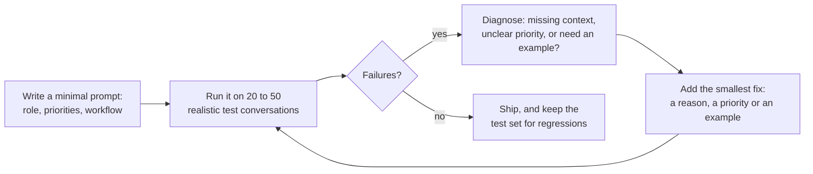

# System Prompts at the Right Altitude: The Complete Guide

> 📚 **Before you start**
>
> - [From Prompt Engineering to Context Engineering](from-prompt-engineering-to-context-engineering.md), for where the system prompt sits in the context window.
> - [Context Rot and Lost in the Middle](context-rot-and-lost-in-the-middle.md), for why every extra token has a cost.
> - [System Prompts and Roles](../../generative-ai-and-llm-foundations/course.md#m4), for the basics of what a system prompt is.

## Introduction

Think about how you would brief a new manager for your family's chai stall at Pune station. One way is a thick rulebook: "If a customer asks for less sugar, use half a spoon. If a customer asks for no sugar, use zero spoons. If a customer asks for jaggery…" The rulebook is never complete, and the first time someone asks for something new ("Can you make it with oat milk?"), the manager freezes. The opposite way is one line: "Run the stall well." That's useless; they don't know your prices, your regulars or what "well" means to you.

The brief that actually works sits in between: what the stall is for, who the customers are, what matters most (fresh tea, fast service, honest change), a few firm rules (never reuse leaves from the morning), and how to decide when something unusual happens. That is a system prompt at the **right altitude**.

The system prompt is the one part of the context window you fully control, and it is read on every single call. This lesson shows you how to write it so it guides the model reliably without wasting tokens, without brittle rules, and without breaking caching.

> 💡 **Key Insight**
>
> Write the system prompt at the **altitude of a good brief to a capable new colleague**: the goal, the context, the principles and priorities, a few hard limits with the reasons behind them, and how to handle uncertainty. Too low (hard-coded if-else rules) and it breaks on cases you didn't foresee. Too high (vague slogans) and the model fills the gaps with guesses.

---

## Core Explanation

### 1. The altitude problem

Anthropic's engineering team describes two failure modes for system prompts, and the "altitude" metaphor comes from them:

| | Too low | Right altitude | Too high |
|---|---|---|---|
| **Looks like** | A long list of if-then rules for specific cases | Goal, context, principles, priorities, firm limits, examples | A few slogans |
| **Example line** | "If the user says 'cancel', call `cancel_ticket`." | "Cancelling is irreversible, so confirm the PNR and passenger names before calling `cancel_ticket`." | "Be helpful and accurate." |
| **What goes wrong** | Brittle: every unforeseen case is unhandled; rules contradict each other; it grows forever | Rarely breaks; model generalises from reasons | Model guesses what you want; behaviour varies |
| **Maintenance** | Every bug adds a rule | Bugs refine a principle or add an example | Bugs reveal missing context |

The core idea: models are good at **applying principles to new situations** when they know the reason. They are bad at following a rulebook that doesn't cover the situation in front of them.

### 2. Three versions of the same prompt

Let's write RailSathi's system prompt three ways.

**Too low:**

```text
If the user says "cancel", call cancel_ticket.
If the user says "refund", call calculate_refund.
If the user says "PNR", call get_pnr.
If the user is angry, say "I understand your frustration."
If the train is 12677, the class is 3A.
NEVER say "sorry" more than once. ALWAYS end with "Happy journey!"
If the user asks about Tatkal, say Tatkal tickets are not refundable.
```

This looks precise, but "Please don't cancel, I changed my mind" calls `cancel_ticket`. "My PNR is wrong" triggers a lookup instead of a correction. The Tatkal line is true for confirmed Tatkal tickets but not for every case. Each rule fixes one example and creates two new bugs.

**Too high:**

```text
You are a helpful railway assistant. Be accurate and polite.
```

The model doesn't know refund amounts must come from a tool, that cancellations are irreversible, or how short replies should be. It will improvise, and improvisation about money is exactly what you don't want.

**Right altitude:**

```text
You are RailSathi, the support assistant inside an Indian train-booking app.
Passengers come to you to check bookings, cancel tickets and understand refunds.

## What matters most, in order
1. Never cost a passenger money by mistake. Cancellation cannot be undone, so before
   calling cancel_ticket, confirm the PNR and the passenger names with the user.
2. Be exact about money. Refund amounts change with timing and class, so quote them
   only from calculate_refund, never from memory or from policy text alone.
3. Be quick and warm. Passengers are often at a station or in a queue.

## How to work
- Look up the booking with get_pnr before answering anything about a specific ticket.
- When a rule is unclear, search the policy with search_policy and cite the section.
- If something is outside what your tools can do (for example a TDR claim), say so
  and tell the passenger where to go next.

## Style
Short sentences, plain English, amounts in rupees (Rs). Use the passenger's name.
```

Notice what it contains: **who** the model is and **who** it serves, **priorities in order** with **reasons**, a **workflow** that refers to tools by name, how to handle **what it can't do**, and a **style** section. It doesn't try to list every case.

### 3. Measure the three versions

Let's count them and run a simple "lint" that flags common problems. This is not a quality score; it's a checklist you would want a reviewer to apply.

```python
import math, re

TOO_LOW = """If the user says "cancel", call cancel_ticket.
If the user says "refund", call calculate_refund.
If the user says "PNR", call get_pnr.
If the user is angry, say "I understand your frustration."
If the train is 12677, the class is 3A.
NEVER say "sorry" more than once. ALWAYS end with "Happy journey!"
If the user asks about Tatkal, say Tatkal tickets are not refundable."""

TOO_HIGH = "You are a helpful railway assistant. Be accurate and polite."

RIGHT = """You are RailSathi, the support assistant inside an Indian train-booking app.
Passengers come to you to check bookings, cancel tickets and understand refunds.

## What matters most, in order
1. Never cost a passenger money by mistake. Cancellation cannot be undone, so before
   calling cancel_ticket, confirm the PNR and the passenger names with the user.
2. Be exact about money. Refund amounts change with timing and class, so quote them
   only from calculate_refund, never from memory or from policy text alone.
3. Be quick and warm. Passengers are often at a station or in a queue.

## How to work
- Look up the booking with get_pnr before answering anything about a specific ticket.
- When a rule is unclear, search the policy with search_policy and cite the section.
- If something is outside what your tools can do (for example a TDR claim), say so
  and tell the passenger where to go next.

## Style
Short sentences, plain English, amounts in rupees (Rs). Use the passenger's name."""

def lint(prompt):
    lines = [l for l in prompt.splitlines() if l.strip()]
    return {
        "tokens": math.ceil(len(prompt) / 4),
        "if_rules": sum(l.lower().startswith("if ") for l in lines),
        "shouting": len(re.findall(r"\b[A-Z]{4,}\b", prompt)),
        "reasons": len(re.findall(r"\b(because|so |since)\b", prompt.lower())),
        "sections": sum(l.startswith("#") for l in lines),
        "mentions_tools": len(set(re.findall(r"\b(get_pnr|calculate_refund|search_policy|cancel_ticket)\b", prompt))),
    }

for name, p in [("too low", TOO_LOW), ("too high", TOO_HIGH), ("right altitude", RIGHT)]:
    print(f"{name:<15}", lint(p))
```

Output:

```
too low         {'tokens': 93, 'if_rules': 6, 'shouting': 2, 'reasons': 0, 'sections': 0, 'mentions_tools': 3}
too high        {'tokens': 15, 'if_rules': 0, 'shouting': 0, 'reasons': 0, 'sections': 0, 'mentions_tools': 0}
right altitude  {'tokens': 248, 'if_rules': 0, 'shouting': 0, 'reasons': 2, 'sections': 3, 'mentions_tools': 4}
```

The right-altitude version is the longest of the three, and that's fine. **Minimal does not mean short.** It means every line earns its place: there are no special cases, no shouting, and every important rule comes with its reason.

### 4. Why reasons beat rules

Compare two ways of saying the same thing:

- "NEVER quote a refund amount from the policy."
- "Refund amounts change with timing and class, so quote them only from `calculate_refund`."

The second lets the model **generalise**. Faced with a new question ("What would I get back if I cancel tomorrow instead?"), it understands why the policy text alone isn't enough and calls the tool with the right intent. The first only forbids one action and leaves the model to guess what to do instead.

Two more practical notes from current model behaviour:

- **Don't shout.** Older models sometimes needed "CRITICAL" and "YOU MUST". Recent models follow instructions closely and can **overreact** to aggressive wording, applying a rule too broadly. State it calmly with the reason.
- **Say what to do, not only what not to do.** "Reply in two or three short sentences" is easier to follow than "Don't write long replies".

### 5. A structure that works

Most good system prompts have the same few sections. Use Markdown headers or XML-style tags so the model (and your teammates) can see the parts:

| Section | Contains | Typical size |
|---|---|---|
| **Role and situation** | Who the model is, who it serves, what the product does | 2 to 4 sentences |
| **Priorities** | What matters most, in order, with reasons | 3 to 6 points |
| **Workflow and tools** | The usual order of steps and when to use which tool | 3 to 8 points |
| **Boundaries** | What it must not do or can't do, and what to do instead | 2 to 5 points |
| **Output style** | Length, tone, format, language | 2 to 4 sentences |
| **Examples** (optional) | A few canonical examples (next lesson) | As needed |

Here's a tiny builder that assembles a prompt from named sections, so each section can be reviewed and tested on its own:

```python
def build_system_prompt(sections):
    parts = []
    for title, body in sections.items():
        parts.append(f"<{title}>\n{body.strip()}\n</{title}>")
    return "\n\n".join(parts)

prompt = build_system_prompt({
    "role": "You are RailSathi, the support assistant inside an Indian train-booking app.",
    "priorities": "1. Never cost a passenger money by mistake: confirm before cancelling, because it is irreversible.\n"
                  "2. Quote refunds only from calculate_refund, because amounts depend on timing and class.",
    "style": "Short sentences, amounts in rupees (Rs), use the passenger's name.",
})
print(prompt)
print("approx tokens:", math.ceil(len(prompt) / 4))
```

Output:

```
<role>
You are RailSathi, the support assistant inside an Indian train-booking app.
</role>

<priorities>
1. Never cost a passenger money by mistake: confirm before cancelling, because it is irreversible.
2. Quote refunds only from calculate_refund, because amounts depend on timing and class.
</priorities>

<style>
Short sentences, amounts in rupees (Rs), use the passenger's name.
</style>
approx tokens: 98
```

### 6. How to write one: start minimal, add from failures

The recommended process is iterative and evidence-driven:



1. **Start minimal**, with the best model you have, so you learn what the model already does well without being told.
2. **Test on realistic cases**, including awkward ones (angry users, mixed Hindi-English, missing PNR, two passengers on one ticket).
3. **Fix the cause, not the symptom.** If the model quoted a wrong fee, ask *why*: was the policy missing (a retrieval problem), was the priority unclear (a prompt problem), or did it not know the tool existed (a tool description problem)?
4. **Add the smallest fix**: a reason, a reordered priority or one example. Avoid adding a special-case rule unless it is truly a hard limit.
5. **Keep the tests.** Every fixed failure becomes a regression test for the next prompt change.

### 7. What does not belong in the system prompt

The system prompt is read on every call and is the anchor of your cache. Keep these out:

| Don't put in the system prompt | Why | Put it here instead |
|---|---|---|
| The current time, a request ID, the user's name | Changes every request, so it breaks the cache for everything after it | The user turn, or a short block after the cached prefix |
| Long policy manuals | Huge and mostly irrelevant to any one question | Retrieval or a search tool (Module 3) |
| Every tool's detailed usage manual | Duplicates the tool descriptions | The tool descriptions themselves |
| Hard security rules that must never break | A prompt is guidance, not enforcement | Your harness: permissions, validation, approvals |
| Facts that change weekly | Easy to forget to update; becomes conflicting context | A retrieved document with a date |

The last-but-one row deserves emphasis: if a cancellation above Rs 10,000 must always get human approval, enforce it **in code**. The prompt can explain it so the model behaves sensibly, but only the harness can guarantee it.

### 8. Changing instructions mid-conversation

Sometimes you need to change the model's behaviour during a session: switch to "terse mode", or tell it a payment system is down. Editing the system prompt would invalidate the cached prefix and, on models that check their earlier reasoning, invalidate that too. The better pattern is to **append** an instruction. Recent Claude models (including Claude Opus 5.5) accept a message with `"role": "system"` inside the `messages` array for exactly this:

```python
# not-run: needs the anthropic package and an API key
import anthropic

client = anthropic.Anthropic()
response = client.messages.create(
    model="claude-opus-5-5",
    max_tokens=1024,
    system=[{"type": "text", "text": RIGHT, "cache_control": {"type": "ephemeral"}}],
    messages=history + [
        {"role": "user", "content": "How much will I get back?"},
        {"role": "system", "content": "The refund service is down until 18:00. Explain this and offer to remind the passenger."},
    ],
)
print(response.content[-1].text)
```

Example output:

```
Priya, our refund calculator is down until 6 pm, so I can't give you an exact amount right now. Shall I remind you here at 6?
```

A mid-conversation system message must follow a user message, and must be the last item or be followed by an assistant turn. On models without this feature, put a clearly labelled note in the user turn instead.

---

## Try It Yourself

1. **Lift a rule.** Rewrite "If the user is angry, say 'I understand your frustration.'" at the right altitude. Keep it to one or two sentences.
2. **Find the cache breaker.** A teammate's prompt starts with `f"Today is {datetime.now():%d %b %Y %H:%M}. You are RailSathi..."`. What goes wrong, and what is the fix?
3. **Extend the lint.** Add a check `has_dates` that counts things that look like a date or time (for example `14 Oct 2026` or `10:45`) and run it on a prompt that contains one.

<details>
<summary>Show answers</summary>

**1.** For example: "Passengers are often stressed about travel. When someone is upset, acknowledge the specific problem in one sentence, then move straight to what you can do about it." This tells the model *why* and *what to do*, and works for any kind of upset, not one phrase.

**2.** The timestamp changes on every request (down to the minute), and it is the very first thing in the prompt. Prompt caching is a prefix match, so nothing after it can ever be cached: every call pays full price for the whole prompt. Move the date out of the system prompt into the user turn (or a short block after the cached prefix), and round it to the day if minute precision isn't needed.

**3.**

```python
def has_dates(prompt):
    pattern = r"\b\d{1,2} (?:Jan|Feb|Mar|Apr|May|Jun|Jul|Aug|Sep|Oct|Nov|Dec)[a-z]* \d{4}\b|\b\d{1,2}:\d{2}\b"
    return len(re.findall(pattern, prompt))

print(has_dates("Today is 14 Oct 2026, 10:45. You are RailSathi."))
print(has_dates(RIGHT))
```

Output:

```
2
0
```

</details>

---

## Real-World Examples

- **Coding agents** ship long system prompts written as principles and workflows ("read before you edit", "run the tests", "ask before destructive actions") rather than case lists, and push project-specific facts into separate memory files such as `CLAUDE.md`.
- **Customer support platforms** separate a stable brand-and-behaviour prompt from per-request context (the customer's account, the retrieved policy), so the stable part can be cached and reviewed by non-engineers.
- **Teams with evaluation suites** treat the system prompt like code: every change runs against a fixed set of test conversations before it ships.

---

## Common Misconceptions

### "A good system prompt is a short one"

A good system prompt is a *minimal* one: nothing unnecessary. That can still be a few hundred tokens if the task needs priorities, workflow and style.

### "Writing NEVER and ALWAYS in capitals makes rules stick"

With current models it tends to make them over-apply the rule. Calm, specific instructions with reasons work better.

### "Every bug needs a new rule"

Most bugs are better fixed by clarifying a priority, adding the reason behind an existing rule, improving a tool description, or adding one example.

### "If it's in the system prompt, the model will always obey"

The prompt strongly guides behaviour but doesn't enforce it. Anything that must never happen belongs in code.

---

## Interview Relevance

*"How do you write and maintain a system prompt for an agent?"* A strong answer describes the altitude trade-off (brittle if-else rules versus vague guidance), recommends a sectioned structure (role, priorities with reasons, workflow and tools, boundaries, style, optional examples), explains why reasons help the model generalise, and describes an iterative process: start minimal on a strong model, test on realistic cases, fix root causes with the smallest change, keep a regression set. Bonus points for mentioning that volatile data (timestamps, IDs) shouldn't be in the system prompt because it breaks caching, that hard limits belong in the harness, and that mid-conversation changes should be appended rather than edited in.

---

## Key Takeaways

- **Right altitude**: specific enough to guide, general enough to handle the unforeseen.
- **Give reasons and priorities**, not long lists of special cases; models generalise from the why.
- **Minimal means no waste, not short**; structure it into clear sections.
- **Iterate from real failures**, fixing causes with the smallest change and keeping tests.
- **Keep volatile data and hard guarantees out**: dates and IDs break caching; enforcement belongs in code.

---

**Up next:** [Examples vs Rules](examples-vs-rules.md)
