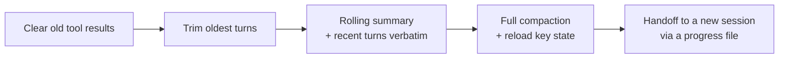

# Compaction and Summarisation: The Complete Guide

> 📚 **Before you start**
>
> - [Tool Results that Don't Flood the Window](tool-results-that-don-t-flood-the-window.md), for tool-result clearing, the lightest form of compaction.
> - [Prompt Caching](../02-the-context-window-as-a-budget/prompt-caching.md), for why rewriting history has a cost.
> - [Trimming and Filtering Messages](../../langgraph-state-and-memory/course.md#m4) and [Summarising Long Conversations](../../langgraph-state-and-memory/course.md#m4), for the LangGraph view of the same problem.

## Introduction

Your housing society's annual general meeting ran for three hours. Twenty people spoke, three proposals were debated, two were dropped, one was passed with an amendment, and the secretary promised to get quotes for the lift repair by the 15th. Nobody expects next year's committee to watch the full three-hour recording. They read the **minutes**: what was decided, why, what is still open, and who must do what by when.

A long-running agent needs minutes too. Every step adds to its history: the user's messages, its own reasoning, tool calls and results. Eventually the history gets too long for the budget, too expensive to re-send and too noisy to reason over well. **Compaction** replaces old history with a compact summary that keeps what matters and drops what doesn't, so the agent can keep working in a fresh, focused window.

This lesson covers the whole family of techniques, from simple trimming to full compaction; what a good summary must keep; when to trigger it; how coding agents and the Anthropic API do it today; and how to build and test your own.

> 💡 **Key Insight**
>
> A good compaction is like good meeting minutes: it keeps the **goal, decisions and their reasons, open problems, current state, and next steps**, plus the exact identifiers needed to continue, and drops redundant tool output and dead ends. Design the summary for **recall first** (never lose something needed later), then trim for precision.

---

## Core Explanation

### 1. The family of techniques

From lightest to heaviest:

| Technique | What it does | Keeps detail? | Cost |
|---|---|---|---|
| **Clear tool results** | Replace old, used tool outputs with a placeholder | Keeps every message, drops bulky outputs | No model call |
| **Trim** | Drop the oldest messages to fit a budget | Loses old turns completely | No model call |
| **Rolling summary** | Replace older turns with a summary; keep the last few turns verbatim | Older turns compressed, recent ones exact | One model call each time |
| **Full compaction** | Replace the whole history with a structured summary, then re-load key files or state | Everything compressed | One model call; fresh window |
| **Handoff** | End the session, write a progress file, start a new session that reads it | Whatever the file records | New session |



Use the lightest technique that keeps the agent inside its budget. Clearing tool results often buys a lot of room before you need a summary at all.

### 2. Trimming: simple and lossy

Trimming keeps the system message and the most recent messages that fit a token budget. LangChain Core has a helper for it. First, let's build a long chat:

```python
from langchain_core.messages import AIMessage, HumanMessage, SystemMessage, trim_messages
from langchain_core.messages.utils import count_tokens_approximately

chat = [SystemMessage("You are RailSathi, a train-booking assistant.")]
turns = [
    ("I want to go from Pune to Kochi on 20 Oct, 2 adults.", "Found 3 trains. The best is 16381 Kanyakumari Exp, 3A available."),
    ("My mother is 68 and needs a lower berth.", "Noted: lower berth preference for passenger 2, Lata Menon, 68."),
    ("What does 3A cost?", "Rs 2,140 per person, Rs 4,280 total."),
    ("Is there a pantry?", "Yes, 16381 has a pantry car."),
    ("Ok book it. Pay with UPI.", "Booked. PNR 8812345670, B1 12 (lower) and B1 15. Paid via UPI."),
    ("Can you also check return on 28 Oct?", "16382 on 28 Oct has 3A WL 14, likely to confirm. Sleeper is available."),
    ("Hmm, what about 2A?", "2A on 28 Oct: 6 seats available, Rs 3,150 per person."),
    ("Book 2A for the return.", "Booked. PNR 8819901122, A1 3 (lower) and A1 5. Paid via UPI."),
]
for user, assistant in turns:
    chat += [HumanMessage(user), AIMessage(assistant)]
chat.append(HumanMessage("Remind me which seat my mother has on the way there?"))

print(len(chat), "messages,", count_tokens_approximately(chat), "approx tokens")

trimmed = trim_messages(chat, max_tokens=120, strategy="last", token_counter=count_tokens_approximately,
                        include_system=True, start_on="human")
for m in trimmed:
    print(f"{m.type:>6}: {m.content[:70]}")
```

Output:

```
18 messages, 280 approx tokens
system: You are RailSathi, a train-booking assistant.
 human: Hmm, what about 2A?
    ai: 2A on 28 Oct: 6 seats available, Rs 3,150 per person.
 human: Book 2A for the return.
    ai: Booked. PNR 8819901122, A1 3 (lower) and A1 5. Paid via UPI.
 human: Remind me which seat my mother has on the way there?
```

The trimmed chat fits the budget, but the onward booking (PNR 8812345670, seat B1 12 for Lata) was in the dropped turns. Ask "which seat does my mother have on the way there?" and the agent can no longer answer correctly. **Trimming forgets by position, not by importance.** It's fine for casual chat; it's dangerous for tasks.

### 3. Summarisation: forget the words, keep the facts

A summary keeps what matters regardless of where it appeared. The key design decision is **what the summary must contain**. For agent tasks, a structured template works far better than "summarise the conversation":

```python
SUMMARY_TEMPLATE = """Summarise the conversation so far for your future self, who will NOT see it.
Use exactly these sections:
GOAL: what the user is trying to achieve overall
DECISIONS: what was decided, with the reason if one was given
STATE: bookings, IDs, amounts, files and anything created or changed (copy identifiers exactly)
USER PREFERENCES: preferences or constraints the user stated
OPEN ITEMS: questions or tasks not finished yet
NEXT STEP: the very next thing to do"""
```

Now let's compact the older part of the chat, keeping the last two exchanges verbatim. We use LangChain's `FakeListChatModel` as a stand-in so the example runs offline; it returns the summary a good model would write.

```python
from langchain_core.language_models.fake_chat_models import FakeListChatModel

summariser = FakeListChatModel(responses=["""GOAL: Round trip Pune-Kochi for 2 adults (user and mother Lata Menon, 68).
DECISIONS: Onward 3A on 16381 (pantry available). Return 2A on 16382, chosen because 3A was WL 14.
STATE: Onward PNR 8812345670, 20 Oct, B1 12 (lower, Lata) and B1 15, Rs 4,280, paid UPI. Return PNR 8819901122, 28 Oct, A1 3 (lower) and A1 5, paid UPI.
USER PREFERENCES: Lower berth for Lata. Pays with UPI.
OPEN ITEMS: None.
NEXT STEP: Answer the user's latest question."""])

def compact(messages, model, keep_last=4):
    system, body = messages[0], messages[1:]
    old, recent = body[:-keep_last], body[-keep_last:]
    transcript = "\n".join(f"{m.type}: {m.content}" for m in old)
    summary = model.invoke(SUMMARY_TEMPLATE + "\n\n<conversation>\n" + transcript + "\n</conversation>").content
    return [system, HumanMessage("<summary of earlier conversation>\n" + summary + "\n</summary>")] + recent

compacted = compact(chat, summariser)
print(f"{len(compacted)} messages, {count_tokens_approximately(compacted)} approx tokens "
      f"(was {count_tokens_approximately(chat)})")
print(compacted[1].content)
```

Output:

```
6 messages, 210 approx tokens (was 280)
<summary of earlier conversation>
GOAL: Round trip Pune-Kochi for 2 adults (user and mother Lata Menon, 68).
DECISIONS: Onward 3A on 16381 (pantry available). Return 2A on 16382, chosen because 3A was WL 14.
STATE: Onward PNR 8812345670, 20 Oct, B1 12 (lower, Lata) and B1 15, Rs 4,280, paid UPI. Return PNR 8819901122, 28 Oct, A1 3 (lower) and A1 5, paid UPI.
USER PREFERENCES: Lower berth for Lata. Pays with UPI.
OPEN ITEMS: None.
NEXT STEP: Answer the user's latest question.
</summary>
```

The compacted history is smaller *and* still contains the answer to the user's question (B1 12, lower, for Lata). The identifiers were copied exactly because the template asked for them.

### 4. Test your summaries for recall

A summary that drops a PNR, a promised deadline or a user's constraint causes a bug many turns later, which is very hard to trace. So test compaction like any other component: write down the facts a correct summary **must** keep, and check them.

```python
MUST_KEEP = ["8812345670", "8819901122", "B1 12", "Lata", "lower", "UPI", "2A"]

def recall_check(summary, facts):
    missing = [f for f in facts if f.lower() not in summary.lower()]
    print(f"kept {len(facts) - len(missing)}/{len(facts)} facts", "| missing:", missing or "none")

recall_check(compacted[1].content, MUST_KEEP)
recall_check("The user booked a round trip to Kochi with their mother and paid online.", MUST_KEEP)
```

Output:

```
kept 7/7 facts | missing: none
kept 0/7 facts | missing: ['8812345670', '8819901122', 'B1 12', 'Lata', 'lower', 'UPI', '2A']
```

The second "summary" reads fine to a human and would pass a casual review, but it has lost every identifier. This is the most common compaction failure: summaries that are **fluent but unusable**. Anthropic's advice for tuning compaction prompts follows directly: maximise recall first, so nothing needed is lost, then improve precision by cutting what's superfluous.

### 5. What to keep and what to drop

| Keep | Drop |
|---|---|
| The goal and success criteria | Pleasantries and acknowledgements |
| Decisions and the reasons for them | Raw tool output that has been used (keep the extracted facts) |
| Exact identifiers: IDs, PNRs, file paths, URLs, amounts | Superseded attempts and dead ends (keep one line on *why* they failed) |
| User preferences and constraints | Repeated information |
| Unresolved problems and errors | Intermediate reasoning that led nowhere |
| Current state and the next step | Long quotes from documents (keep the reference) |

Anthropic's description of compaction in Claude Code follows the same idea: keep architectural decisions, unresolved bugs and implementation details, discard redundant tool outputs and messages, and then continue with the most recently accessed files re-loaded.

### 6. When to compact

| Trigger | How | Good for |
|---|---|---|
| **Threshold** | When input tokens pass, say, 70 to 80% of the budget | Unattended agents; guarantees you never overflow |
| **Natural boundary** | When a sub-task finishes ("booking done", "tests pass") | Cleaner summaries; old details really are finished |
| **On demand** | The user or orchestrator asks, optionally with a focus | Interactive tools before a new task |
| **Never (start fresh)** | Clear the context between unrelated tasks | When the old history is irrelevant |

Compacting at natural boundaries tends to produce better summaries than compacting mid-task, because nothing is half-finished. Combining both works well: compact at boundaries, with a threshold as a safety net.

### 7. How Claude Code does it

Claude Code is a useful real-world reference because its behaviour is documented:

- It **compacts automatically** as the context approaches its limit, and you can run `/compact` yourself, optionally with a focus such as `/compact focus on the auth bug fix`. `/clear` starts fresh between unrelated tasks.
- Compaction replaces the conversation with a **structured summary**. Content that lives outside the message history is **re-loaded from disk** afterwards: the system prompt, the project-root `CLAUDE.md`, auto memory, and a fresh git status.
- It **re-reads up to five of the most recently modified files** the session touched (a file over 5,000 tokens comes back as a path reference instead).
- Skills that were invoked are re-injected, capped at 5,000 tokens each and 25,000 in total.
- Instructions given **only in conversation** can be lost in compaction, which is why the documentation recommends putting lasting instructions in `CLAUDE.md`.

That last point is a general lesson: **anything that must survive compaction should live outside the conversation**, in a file or a memory store that is re-loaded. You'll build on it in the next lesson and in Module 4.

### 8. Server-side compaction with the Anthropic API

The Anthropic API can compact for you. In the **threshold** form (a beta feature), you add a context-management edit; when the input passes the trigger, the API summarises earlier context and returns a `compaction` block at the start of its response:

```python
# not-run: needs the anthropic package and an API key
import anthropic

client = anthropic.Anthropic()
messages = [{"role": "user", "content": "Plan and book my Pune-Kochi round trip."}]

response = client.beta.messages.create(
    betas=["compact-2026-01-12"],
    model="claude-opus-5-5",
    max_tokens=4096,
    messages=messages,
    context_management={"edits": [{
        "type": "compact_20260112",
        "trigger": {"type": "input_tokens", "value": 150000},   # default 150,000; minimum 50,000
        # "instructions": "...",  # optional: REPLACES the default summary prompt entirely
    }]},
)
# Append the full content, not just the text: the compaction block must be sent back.
messages.append({"role": "assistant", "content": response.content})
print([block.type for block in response.content])
```

Example output (on the turn where compaction triggers):

```
['compaction', 'text']
```

Rules that matter:

- **Append `response.content`, not just its text.** On later requests the API ignores everything before the last `compaction` block, so that block must be in the history you send.
- **Custom `instructions` replace the default prompt**, so if you write your own, include everything the default would have kept (use a template like the one above).
- `pause_after_compaction: true` stops the response right after the summary, so you can re-insert recent turns or files before continuing.

The API also offers **compaction on demand** (a newer beta, where your code asks for the summary at a moment of its choosing and can keep recent turns verbatim). Anthropic's documentation recommends it where available; check the compaction docs for its current parameters and platform support.

### 9. The costs and risks of compaction

| Risk | What happens | Mitigation |
|---|---|---|
| **Lost detail** | An ID or constraint is dropped | Structured template, recall tests, keep recent turns verbatim |
| **Summary drift** | Repeated summaries of summaries lose nuance | Re-load ground truth (files, memory) after each compaction rather than relying only on the summary |
| **Hallucinated summary** | The summariser "remembers" something that didn't happen | Copy identifiers from tool results; keep a progress file written from real events |
| **Cache cost** | The summary rewrites the prefix; the next call is a cache miss | Compact rarely, at boundaries, in one step |
| **Broken reasoning continuity** | On newer models that check earlier thinking, client-side rewrites of history invalidate it | Prefer server-side compaction or a compaction that replaces the whole history with one summary |
| **Extra model call** | Summarising costs tokens and time | Use the lightest technique that works; trigger well before the limit so it isn't urgent |

---

## Try It Yourself

1. **Find the trimming bug.** Using `trimmed` from section 2, write a one-line check that shows the onward PNR `8812345670` is no longer in the context.
2. **Keep more verbatim.** Call `compact(chat, summariser, keep_last=6)` with a fresh `FakeListChatModel` that returns the same summary. How many messages and tokens do you get?
3. **Write MUST_KEEP for a coding agent.** A coding agent has spent 40 turns fixing a failing payment test. List six facts its compaction summary must keep.

<details>
<summary>Show answers</summary>

**1.**

```python
print(any("8812345670" in m.content for m in trimmed))
```

Output:

```
False
```

**2.**

```python
summariser2 = FakeListChatModel(responses=[summariser.responses[0]])
c6 = compact(chat, summariser2, keep_last=6)
print(len(c6), "messages,", count_tokens_approximately(c6), "approx tokens")
```

Output:

```
8 messages, 242 approx tokens
```

More verbatim turns means better short-term continuity but less saving. A common default is to keep the last few exchanges exact.

**3.** For example: the failing test's name and file path; the error message; the root cause found so far (or hypotheses ruled out, with why); the files changed and what was changed; the command used to run the tests; what remains (for example "add a regression test, then run the full suite"). Every item is an exact identifier or a decision, not a narrative.

</details>

---

## Real-World Examples

- **Coding agents** compact automatically near the limit, allow focused manual compaction, and re-load project memory files and recently edited files afterwards.
- **Chat products** keep a rolling summary of older turns plus the last few messages verbatim, so long chats stay responsive.
- **Long-horizon research agents** compact at milestones (after each research question is answered) and write their findings to files, so the next phase starts clean.

---

## Common Misconceptions

### "Bigger context windows mean you never need compaction"

Long contexts cost more per call and degrade in accuracy. Compaction keeps long runs fast, cheap and focused even when the window could technically hold more.

### "Any summary will do"

Generic summaries are fluent and lose identifiers. Use a structured template and test for recall.

### "Compaction is a one-off rescue when you hit the limit"

It works best as a routine at natural boundaries, with a threshold as a safety net.

### "After compaction the agent has everything it needs"

Only what the summary kept. Anything that must survive should live in files or memory that are re-loaded after compaction.

---

## Interview Relevance

*"How would you handle an agent conversation that exceeds the context window?"* A strong answer walks the ladder: clear old tool results first, then trim or summarise older turns while keeping recent ones verbatim, then full compaction with a structured summary (goal, decisions with reasons, exact identifiers and state, preferences, open items, next step), and finally a handoff via a progress file for very long work. It covers triggers (threshold plus natural boundaries), testing summaries for recall of must-keep facts, re-loading ground truth (memory files, recent files) after compaction, and costs (an extra model call, a cache miss, risk of drift). Mention that managed options exist, such as server-side compaction in the Anthropic API and automatic compaction in coding agents.

---

## Key Takeaways

- **Pick the lightest technique** that fits: clear results, trim, rolling summary, full compaction, handoff.
- **Trimming forgets by position**; summarisation can keep what matters wherever it appeared.
- **Use a structured summary template** that keeps goals, decisions, exact identifiers, preferences, open items and the next step.
- **Test summaries for recall**, and re-load ground truth from files or memory after compacting.
- **Compact at natural boundaries** with a threshold as a safety net, and append the API's compaction block exactly as returned.

---

**Up next:** [Offloading Context to Files and Scratchpads](offloading-context-to-files-and-scratchpads.md)
