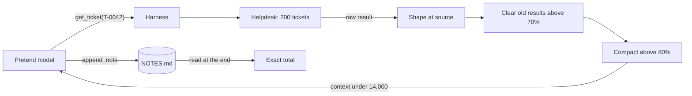

# Lab: Keep a 200-Step Agent Inside Its Budget

> 📚 **Before you start**
>
> - [From Prompt Engineering to Context Engineering](../02-the-context-window-as-a-budget/from-prompt-engineering-to-context-engineering.md), for the operating budget and the reserve for the answer.
> - [Prompt Caching](../02-the-context-window-as-a-budget/prompt-caching.md), for why every rewrite of old history costs a cache miss.
> - [Tool Results that Don't Flood the Window](tool-results-that-don-t-flood-the-window.md), for shaping results and clearing old ones.
> - [Compaction and Summarisation](compaction-and-summarisation.md), for summaries and the recall problem.
> - [Offloading Context to Files and Scratchpads](offloading-context-to-files-and-scratchpads.md), for notes that live outside the window.

## What You'll Build

It's the first week of November and RailSathi's finance team has a question: *"How much did we promise to refund in October?"* The answer is buried in 200 support tickets, each with a long chat transcript between a customer and a support agent. You will build an **auditing agent** that reads every ticket, one tool call at a time, and reports the exact total.

The catch is the budget. The agent gets **16,000 tokens per call**, of which 2,000 are reserved for the model's reply, leaving **14,000 usable**. A single raw ticket is over 1,100 tokens. Two hundred of them would need more than 220,000 tokens if nothing were ever removed.

You'll start with a naive loop and watch it break, then add one layer at a time from the last four lessons, measuring each:

1. **Naive loop**: every result stays in full.
2. **Clear old results**: the lightest fix.
3. **Shape results at the source**: a concise ticket with a pointer to the transcript.
4. **Compaction**: a summary replaces old history when the window gets full.
5. **A notes file**: findings written to disk, so the final answer doesn't depend on the summary.

![The agent loop on the left: the model records the last finding and calls get_ticket on a helpdesk of 200 tickets; the context window holds a 16,000-token budget split into 14,000 usable and 2,000 reserve. On the right, the budget manager in your harness code: shape each result at the source, clear old results above 70 percent, write one line per finding to NOTES.md, and compact above 80 percent with a summary that points to the notes. The final answer is computed from NOTES.md and checked against the ground truth](/img/diagrams/context-engineering-and-agent-memory/budget-managed-agent.svg)
*The lab in one picture: every tool result passes through the budget manager before the next model call.*



> 💡 **Key Insight**
>
> No single technique keeps a long run inside its budget. **Shaping** slows the growth, **clearing** removes what has been used, **compaction** resets the history when it gets full, and **notes on disk** keep the facts that the summary would lose. Measure each layer: the number of steps it survives, its peak size, how often it rewrites history (each rewrite is a cache miss), and whether the final answer is right.

---

## Step 1: The Helpdesk

First, a pretend helpdesk with 200 tickets. Each ticket has the fields a real ticketing system returns (IDs, timestamps, tags) and a transcript of 40 to 60 lines, where the final line says whether a refund was approved. We seed the random generator, so you get exactly the same tickets every run, and we compute the **ground truth** total directly from the data. The agent's answer will be checked against it.

```python
import json, math, os, random, re, tempfile

def approx_tokens(text):
    return math.ceil(len(text) / 4)

random.seed(7)
ISSUES = [("Tatkal cancelled, wants refund", "refund_rejected"),
          ("Money debited, ticket not booked", "refund_approved"),
          ("Train cancelled by railways", "refund_approved"),
          ("Wrong name on ticket", "no_refund"),
          ("Seat changed without notice", "no_refund"),
          ("Cancelled 2 days before travel", "refund_approved")]
NAMES = ["Priya Nair", "Arjun Rao", "Meera Iyer", "Kabir Shah", "Ananya Das",
         "Rohit Verma", "Fatima Khan", "Vikram Singh", "Lata Menon", "Sanjay Gupta"]
CHATTER = ["Agent: I understand, let me check the booking details for you.",
           "Customer: I have been waiting for a long time, please help quickly.",
           "Agent: Thank you for your patience, I am looking at the payment logs now.",
           "Customer: The money was taken from my account through UPI.",
           "Agent: I can see the transaction in our records, one moment please."]

TICKETS = {}
for n in range(1, 201):
    issue, outcome = random.choice(ISSUES)
    fare = random.randrange(400, 3001, 10)
    if outcome != "refund_approved":
        refund = 0
    elif issue.startswith("Cancelled"):
        refund = fare - 240                      # cancellation charge kept
    else:
        refund = fare                            # full refund
    transcript = [f"Customer: Hello, my PNR is 88{random.randrange(10**7, 10**8)}. {issue}."]
    transcript += [random.choice(CHATTER) for _ in range(random.randint(40, 60))]
    transcript.append({
        "refund_approved": f"Agent: Your refund of Rs {refund} is approved and will reach you in 5 to 7 days.",
        "refund_rejected": "Agent: Sorry, confirmed Tatkal tickets are not refunded on cancellation.",
        "no_refund": "Agent: This issue does not qualify for a refund, but I have noted your feedback.",
    }[outcome])
    tid = f"T-{n:04d}"
    TICKETS[tid] = {
        "ticket_id": tid, "uuid": f"{random.getrandbits(64):016x}", "customer": random.choice(NAMES),
        "subject": issue, "fare": fare, "channel": random.choice(["app", "email", "phone"]),
        "created": f"2026-10-{1 + n % 28:02d}T{n % 24:02d}:{n % 60:02d}:00Z", "sla_breached": n % 9 == 0,
        "assignee_id": 7000 + n % 13, "tags": ["refund", "october", "auto-triage"], "transcript": transcript,
    }

TRUE_TOTAL = sum(int(m.group(1)) for t in TICKETS.values()
                 for m in [re.search(r"refund of Rs (\d+) is approved", t["transcript"][-1])] if m)
print(f"{len(TICKETS)} tickets; true total of approved refunds: Rs {TRUE_TOTAL:,}")

def get_ticket_raw(ticket_id):
    return json.dumps(TICKETS[ticket_id])

print("one raw ticket:", approx_tokens(get_ticket_raw("T-0001")), "tokens")
```

Output:

```
200 tickets; true total of approved refunds: Rs 150,830
one raw ticket: 1141 tokens
```

`get_ticket_raw` is the over-sharing tool from the tool-results lesson: it returns every field the backend has. We use the same rough rule as the rest of the course, about 4 characters per token.

## Step 2: The Budget and the Context

Next, the budget and a way to measure the context exactly as it would be sent: system prompt, tool definitions and the message list.

```python
BUDGET, RESERVE = 16_000, 2_000
USABLE = BUDGET - RESERVE

SYSTEM = ("You are RailSathi's refunds auditor. Review support tickets T-0001 to T-0200 in order. "
          "For each ticket, record whether a refund was approved and for how much. "
          "When all 200 are reviewed, report the total of approved refunds in rupees. "
          "Copy amounts exactly from the ticket; never estimate.")
TOOLS = {"get_ticket": "Fetch one support ticket by ID, for example T-0042."}

def context_tokens(messages, tools):
    tool_defs = [{"name": n, "description": d, "input_schema": {"type": "object"}} for n, d in tools.items()]
    return approx_tokens(SYSTEM) + approx_tokens(json.dumps(tool_defs)) + approx_tokens(json.dumps(messages))

print("fixed prefix:", context_tokens([], TOOLS), "tokens")
```

Output:

```
fixed prefix: 106 tokens
```

The fixed part is tiny on purpose. In this lab the threat is the part that **grows**: tool calls and their results, step after step. A real agent would have a bigger prefix (Module 2), which only makes the growing part more urgent.

## Step 3: The Pretend Model

As in earlier labs, a pretend model stands in for the LLM so the lab runs offline and gives the same result every time. It behaves the way a well-instructed model would, and, importantly, **it only knows what is in the context it is given**:

1. If the newest message holds a ticket, it records a finding: `T-0042 refund Rs 1170`, or `Rs 0` when there was no refund. Without a notes tool, the finding is written as text in its own reply. With an `append_note` tool, it writes the finding to the notes file instead.
2. It works out the next ticket from the tool calls (or a summary) still visible in its context.
3. After ticket 200, it totals the findings: from the notes file if it has one, otherwise from whatever findings are still visible in its context.

```python
def pretend_model(messages, tools):
    """Plays the model: reads the context and returns the next assistant message (a list of blocks)."""
    text = json.dumps(messages)
    blocks, last = [], messages[-1]["content"]
    results = last if isinstance(last, list) else []
    # 1. Record what the newest ticket said.
    for r in results:
        if r["tool_use_id"].startswith("get-"):
            m = re.search(r"refund of Rs (\d+) is approved", r["content"])
            finding = f"{r['tool_use_id'][4:]} refund Rs {m.group(1) if m else 0}"
            if "append_note" in tools:
                blocks.append({"type": "tool_use", "id": f"note-{finding[:6]}", "name": "append_note",
                               "input": {"line": finding}})
            else:
                blocks.append({"type": "text", "text": f"Finding: {finding}"})
    # 2. Work out which ticket comes next, from tool calls or a summary still in view.
    seen = [int(x) for x in re.findall(r'"ticket_id": "T-(\d{4})"', text)]
    seen += [int(x) for x in re.findall(r"last ticket fetched: T-(\d{4})", text)]
    nxt = max(seen, default=0) + 1
    if nxt <= 200:
        tid = f"T-{nxt:04d}"
        blocks.append({"type": "tool_use", "id": f"get-{tid}", "name": "get_ticket", "input": {"ticket_id": tid}})
        return blocks
    # 3. All tickets fetched: total them, from notes if there are notes, else from what is in view.
    if "read_note" in tools:
        notes = [r["content"] for r in results if r["tool_use_id"] == "read-notes"]
        if not notes:
            return blocks + [{"type": "tool_use", "id": "read-notes", "name": "read_note", "input": {}}]
        amounts = re.findall(r"refund Rs (\d+)", notes[0])
    else:
        amounts = re.findall(r"Finding: T-\d{4} refund Rs (\d+)", text) + \
                  [b["text"].split("Rs ")[1] for b in blocks]
    return blocks + [{"type": "text", "text": f"ANSWER: total approved refunds Rs {sum(map(int, amounts)):,}"}]
```

Notice that a reply can contain **two** tool calls at once (record the finding and fetch the next ticket). Real models do this too; it's called parallel tool use.

## Step 4: The Naive Loop

Now the harness. Before every model call it does three things: lets an optional **budget manager** tidy the messages, measures the context, and refuses to call the model if the context is over the usable budget. A real API would reject an over-limit request, or you'd silently pay for a context far beyond what you planned; here we stop and report it. The harness also records four numbers for every run:

| Number | Why it matters |
|---|---|
| **steps** | How far the agent got |
| **peak** | The biggest context it ever sent |
| **rewrites** | How many times old history was changed. Each one invalidates the prompt cache from that point |
| **billed input** | Input tokens summed over every call, the main driver of cost |

```python
def run_agent(get_ticket, manage=None, tools=TOOLS, notes=None, max_steps=300):
    messages = [{"role": "user", "content": "Audit October's 200 refund tickets and report the total."}]
    stats = {"steps": 0, "peak": 0, "billed": 0, "rewrites": 0}
    for step in range(1, max_steps + 1):
        if manage:
            stats["rewrites"] += manage(messages, tools)
        size = context_tokens(messages, tools)
        stats["peak"] = max(stats["peak"], size)
        if size > USABLE:
            return f"OVER BUDGET before step {step}: {size:,} > {USABLE:,}", stats
        stats["steps"], stats["billed"] = step, stats["billed"] + size
        reply = pretend_model(messages, tools)
        messages.append({"role": "assistant", "content": reply})
        calls = [b for b in reply if b["type"] == "tool_use"]
        if not calls:
            return reply[-1]["text"], stats
        results = []
        for c in calls:
            if c["name"] == "get_ticket":
                out = get_ticket(c["input"]["ticket_id"])
            elif c["name"] == "append_note":
                out = notes.append(c["input"]["line"])
            else:
                out = notes.read()
            results.append({"type": "tool_result", "tool_use_id": c["id"], "content": out})
        messages.append({"role": "user", "content": results})
    return "ran out of steps", stats

def report(label, outcome, stats):
    ok = "correct" if outcome.endswith(f"Rs {TRUE_TOTAL:,}") else "WRONG" if "ANSWER" in outcome else ""
    print(f"{label:<20} {outcome} {ok}".rstrip())
    print(f"{'':<20} steps {stats['steps']}, peak {stats['peak']:,}, rewrites {stats['rewrites']}, "
          f"billed input {stats['billed']:,}")

report("naive", *run_agent(get_ticket_raw))
```

Output:

```
naive                OVER BUDGET before step 14: 14,601 > 14,000
                     steps 13, peak 14,601, rewrites 0, billed input 90,289
```

The naive agent doesn't get past ticket 13. This is the most common way long-running agents fail in practice: nothing is wrong with the model or the tools; the context simply grows until it no longer fits.

## Step 5: Layer 1, Clear Old Results

The lightest fix from [Tool Results that Don't Flood the Window](tool-results-that-don-t-flood-the-window.md): once the context passes **70%** of the usable budget, replace every tool result except the **3 most recent** with a short placeholder, but only if that frees at least **4,000 tokens** (so we don't break the cache for a tiny gain). The tool *calls* stay, so the model still knows what it fetched. These are the same three knobs as the API's `trigger`, `keep` and `clear_at_least`.

The model has already written its finding for each ticket into its own reply, so clearing an old raw ticket loses nothing the task needs.

```python
PLACEHOLDER = "[old result cleared; call get_ticket again if you need it]"

def clear_old_results(messages, tools, trigger=0.70, keep=3, clear_at_least=4_000):
    if context_tokens(messages, tools) < trigger * USABLE:
        return 0
    live = [b for m in messages if isinstance(m["content"], list) for b in m["content"]
            if b["type"] == "tool_result" and b["content"] != PLACEHOLDER]
    old = live[:-keep]
    if sum(approx_tokens(b["content"]) - approx_tokens(PLACEHOLDER) for b in old) < clear_at_least:
        return 0
    for b in old:
        b["content"] = PLACEHOLDER
    return 1

report("clearing", *run_agent(get_ticket_raw, clear_old_results))
```

Output:

```
clearing             OVER BUDGET before step 83: 14,425 > 14,000
                     steps 82, peak 14,425, rewrites 15, billed input 700,362
```

A big improvement, from 13 steps to 82, but two problems show up in the numbers:

- **It still dies.** Every step leaves something behind that clearing can't remove: the assistant's reply, the tool call and the placeholder. Around 60 tokens per step doesn't sound like much, but over 80 steps it is most of the budget.
- **It rewrote history 15 times.** As the leftovers grow, there is less and less room above the 70% line, so clearing fires more and more often. Each rewrite is a cache miss on everything after the first changed message.

## Step 6: Layer 2, Shape Results at the Source

Most of each raw ticket is chatter the auditor never needs. A tool designed for this agent returns the customer, the subject, the fare, the **outcome line**, and a pointer to the full transcript in case the model ever needs to read it (the pattern from the tool-results lesson: say what was cut and how to get it).

```python
def get_ticket(ticket_id):
    """Concise ticket: who, what, the outcome line, and a pointer to the full transcript."""
    t = TICKETS[ticket_id]
    return (f"{ticket_id} {t['customer']}: {t['subject']}. Fare Rs {t['fare']}. "
            f"Outcome: {t['transcript'][-1].removeprefix('Agent: ')} "
            f"[{len(t['transcript'])}-line transcript: read_transcript('{ticket_id}')]")

print(get_ticket("T-0002"))
print(approx_tokens(get_ticket("T-0002")), "tokens instead of", approx_tokens(get_ticket_raw("T-0002")))
report("shaping + clearing", *run_agent(get_ticket, clear_old_results))
```

Output:

```
T-0002 Meera Iyer: Cancelled 2 days before travel. Fare Rs 1640. Outcome: Your refund of Rs 1400 is approved and will reach you in 5 to 7 days. [60-line transcript: read_transcript('T-0002')]
48 tokens instead of 1109
shaping + clearing   OVER BUDGET before step 117: 14,067 > 14,000
                     steps 116, peak 14,067, rewrites 0, billed input 815,134
```

Each result is now over 20 times smaller, and the agent gets much further: 116 steps. But look at **rewrites: 0**. Clearing never fired, because with results this small there were never 4,000 tokens of old results to free. The growth now comes entirely from the steps themselves: every reply, every call, every short result. No amount of result-clearing can fix that. Something has to **replace old history as a whole**.

## Step 7: Layer 3, Compaction

From [Compaction and Summarisation](compaction-and-summarisation.md): when the context passes **80%** of the usable budget, replace the history with a summary, keeping the newest assistant turn and its results verbatim so the model can carry straight on.

The summariser here is another stand-in for a model call. It writes the kind of summary models often write for long, repetitive work: the goal, the progress pointer and the next step, all correct, but **not the 100-odd individual amounts**. Keep that in mind; it's the point of this step.

```python
def summarise(messages, tools):
    """Plays the summariser model. Like many real summaries, it keeps the progress, not every number."""
    last_fetched = max(int(x) for x in re.findall(r'"ticket_id": "T-(\d{4})"', json.dumps(messages)))
    lines = ["GOAL: review tickets T-0001 to T-0200 and report the total of approved refunds.",
             f"STATE: reviewing in order; last ticket fetched: T-{last_fetched:04d}. Many tickets had approved refunds."]
    if "read_note" in tools:
        lines.append("NOTES: every finding is in NOTES.md, one line per ticket. Total from NOTES.md, not from memory.")
    lines.append("NEXT STEP: record the newest ticket's finding, then fetch the next ticket.")
    return "\n".join(lines)

def compact(messages, tools, trigger=0.80):
    if context_tokens(messages, tools) < trigger * USABLE:
        return 0
    first = {"role": "user", "content": messages[0]["content"].split("\n<summary>")[0] +
             "\n<summary>\n" + summarise(messages, tools) + "\n</summary>"}
    messages[:] = [first] + messages[-2:]           # keep the newest assistant turn and its results verbatim
    return 1

snapshots = []
def layered(messages, tools):
    changed = clear_old_results(messages, tools) + compact(messages, tools)
    if changed and not snapshots:
        snapshots.append(json.dumps(messages, indent=1))
    return changed

report("+ compaction", *run_agent(get_ticket, layered))
```

Output:

```
+ compaction         ANSWER: total approved refunds Rs 17,950 WRONG
                     steps 201, peak 11,169, rewrites 2, billed input 1,069,589
```

All 200 tickets reviewed, a peak comfortably under 14,000, only 2 rewrites, and a **wrong answer**. Always print the context and read it the way the model will. Here is what the model saw right after the first compaction:

```python
print(snapshots[0])
```

Output:

```
[
 {
  "role": "user",
  "content": "Audit October's 200 refund tickets and report the total.\n<summary>\nGOAL: review tickets T-0001 to T-0200 and report the total of approved refunds.\nSTATE: reviewing in order; last ticket fetched: T-0093. Many tickets had approved refunds.\nNEXT STEP: record the newest ticket's finding, then fetch the next ticket.\n</summary>"
 },
 {
  "role": "assistant",
  "content": [
   {
    "type": "text",
    "text": "Finding: T-0092 refund Rs 0"
   },
   {
    "type": "tool_use",
    "id": "get-T-0093",
    "name": "get_ticket",
    "input": {
     "ticket_id": "T-0093"
    }
   }
  ]
 },
 {
  "role": "user",
  "content": [
   {
    "type": "tool_result",
    "tool_use_id": "get-T-0093",
    "content": "T-0093 Ananya Das: Money debited, ticket not booked. Fare Rs 2560. Outcome: Your refund of Rs 2560 is approved and will reach you in 5 to 7 days. [44-line transcript: read_transcript('T-0093')]"
   }
  ]
 }
]
```

The summary is accurate. It's also useless for the final question, because the findings for every ticket before the compaction lived only in the conversation, and the conversation is gone. The model can only add up the findings it can still see, which are the ones since the last compaction.

You might think: just ask the summariser to keep a running total. That helps, but now you're trusting a model to add 100 amounts correctly in its head, and to carry that number across every later compaction without a slip. A summary of a summary of a summary is exactly where small errors creep in, and you'd have no record to check against. This is the lesson from the compaction article in its sharpest form: **anything that must survive compaction should live outside the conversation.**

## Step 8: Layer 4, a Notes File

From [Offloading Context to Files and Scratchpads](offloading-context-to-files-and-scratchpads.md): give the agent two more tools, `append_note` and `read_note`, backed by a real file. The model writes one line per finding as it goes; the summary now points to the notes; and the final answer is totalled from the file.

```python
class NotesFile:
    def __init__(self):
        self.path = os.path.join(tempfile.mkdtemp(prefix="audit-"), "NOTES.md")
        open(self.path, "w").close()
    def append(self, line):
        with open(self.path, "a") as f:
            f.write(line + "\n")
        return "ok"
    def read(self):
        return open(self.path).read()

NOTE_TOOLS = dict(TOOLS, append_note="Append one line to NOTES.md.", read_note="Read NOTES.md.")
notes = NotesFile()
report("+ notes file", *run_agent(get_ticket, layered, tools=NOTE_TOOLS, notes=notes))

lines = notes.read().splitlines()
print(f"\nNOTES.md: {len(lines)} lines, about {approx_tokens(notes.read()):,} tokens")
print("\n".join(lines[:3] + ["..."] + lines[-2:]))
```

Output:

```
+ notes file         ANSWER: total approved refunds Rs 150,830 correct
                     steps 202, peak 11,142, rewrites 2, billed input 1,089,548

NOTES.md: 200 lines, about 1,017 tokens
T-0001 refund Rs 1170
T-0002 refund Rs 1400
T-0003 refund Rs 0
...
T-0199 refund Rs 1370
T-0200 refund Rs 0
```

All 200 steps, inside the budget, only 2 history rewrites, and the **correct total**. Reading the whole notes file at the end costs about a thousand tokens, once, which fits easily. If it ever didn't, the agent could total the file with code instead of reading it.

### The scoreboard

| Layers | Steps | Peak | Rewrites | Answer |
|---|---|---|---|---|
| Naive | 13 | over budget | 0 | none |
| Clear old results | 82 | over budget | 15 | none |
| Shape + clear | 116 | over budget | 0 | none |
| Shape + clear + compaction | 201 | under 11,200 | 2 | wrong |
| Shape + clear + compaction + notes | 202 | under 11,200 | 2 | correct |

Each layer fixes the failure the previous one exposed. And notice what the last two rows say about **cost**: about a million billed input tokens across 200 calls, but only 2 rewrites. Between rewrites the history only grows at the end, so with prompt caching almost all of those tokens are cheap cache reads (Module 2). A design that rewrote history every step would fit the budget too, but pay full price on nearly every call.

## Step 9: Swapping in a Real Model (Preview)

Every layer you built has a managed equivalent in the Anthropic API. Server-side **context editing** clears old tool results with the same `trigger`, `keep` and `clear_at_least` knobs, and the **memory tool** gives Claude a `/memories` directory that your code stores (the notes file). The documentation shows the two used together; when the context nears the clearing threshold, Claude gets an automatic warning so it can save what matters to memory before results are cleared.

```python
# not-run: needs the anthropic package and an API key; memory_backend and get_ticket_tool are yours
import anthropic

client = anthropic.Anthropic()
response = client.beta.messages.create(
    model="claude-opus-5-5",
    max_tokens=2000,                                  # the reply reserve from this lab
    betas=["context-management-2025-06-27"],
    system=SYSTEM,
    tools=[get_ticket_tool, {"type": "memory_20250818", "name": "memory"}],
    messages=messages,
    context_management={"edits": [{
        "type": "clear_tool_uses_20250919",
        "trigger": {"type": "input_tokens", "value": 9_800},     # 70% of 14,000
        "keep": {"type": "tool_uses", "value": 3},
        "clear_at_least": {"type": "input_tokens", "value": 4_000},
        "exclude_tools": ["memory"],                              # never clear the notes themselves
    }]},
)
print(response.usage.input_tokens, response.context_management.applied_edits)
```

Example output:

```
9412 []
```

The thresholds in this lab are deliberately small so it runs fast. A real deployment would use the same structure with bigger numbers, and could add server-side compaction (the `compact_20260112` edit from the compaction lesson) for the history-replacement layer. Check the current context-editing and compaction docs before combining strategies in one request, and test the combination on your own traffic.

---

## Try It Yourself

1. **Tune the clearing.** Run Layer 1 again with `keep=1` and `clear_at_least=1_000` (use a `lambda` to pass them). Does the agent get further? What happens to rewrites?
2. **Trace the wrong number.** The compaction run answered Rs 17,950. Prove where that number came from: record every summary the compactor writes, find the last ticket fetched before the final compaction, and show that the wrong total is exactly the sum of the findings the model could still see after it.
3. **A tighter budget.** Set `USABLE = 6_000` and run the full four-layer agent again. Does it still finish? Restore `USABLE = BUDGET - RESERVE` afterwards.

<details>
<summary>Show answers</summary>

**1.**

```python
report("clearing, aggressive",
       *run_agent(get_ticket_raw, lambda m, t: clear_old_results(m, t, keep=1, clear_at_least=1_000)))
```

Output:

```
clearing, aggressive OVER BUDGET before step 139: 14,062 > 14,000
                     steps 138, peak 14,062, rewrites 51, billed input 1,178,004
```

Clearing more aggressively gets further (138 steps instead of 82), but it still dies, and it pays for those steps with 51 history rewrites, each one a cache miss. Clearing removes used results; it can't stop the leftovers of each step from adding up.

**2.**

```python
summaries = []
def compact_and_record(messages, tools):
    fired = compact(messages, tools)
    if fired:
        summaries.append(messages[0]["content"])
    return fired

outcome, stats = run_agent(get_ticket, lambda m, t: clear_old_results(m, t) + compact_and_record(m, t))
last = int(re.findall(r"last ticket fetched: T-(\d{4})", summaries[-1])[0])
visible = range(last - 1, 201)       # the kept turn still holds the finding for the ticket before it
partial = sum(int(m.group(1)) for n in visible
              for m in [re.search(r"refund of Rs (\d+) is approved", TICKETS[f"T-{n:04d}"]["transcript"][-1])] if m)
print(outcome)
print(f"{len(summaries)} compactions; the last kept T-{last - 1:04d} onwards in view; their refunds total Rs {partial:,}")
```

Output:

```
ANSWER: total approved refunds Rs 17,950
2 compactions; the last kept T-0183 onwards in view; their refunds total Rs 17,950
```

The wrong answer is not random: it is exactly the refunds from the tickets after the last compaction. Everything before it was summarised away as "many tickets had approved refunds". Tracing a wrong number back to the context that produced it is the core debugging skill for long-running agents. You could ask the summariser to carry a running total, but then you are trusting a model to add a hundred amounts without a slip, again at every compaction, with no record to check. The notes file avoids that: the record is complete, on disk, checkable line by line, and totalled once.

**3.**

```python
USABLE = 6_000
report("4 layers, 6,000 usable", *run_agent(get_ticket, layered, tools=NOTE_TOOLS, notes=NotesFile()))
USABLE = BUDGET - RESERVE
```

Output:

```
4 layers, 6,000 usable ANSWER: total approved refunds Rs 150,830 correct
                     steps 202, peak 4,796, rewrites 6, billed input 504,813
```

The run itself fits, because compaction keeps resetting the history. The last step, reading the whole notes file, is what tests the limit: 200 lines is about a thousand tokens, which still fits in 6,000. With 2,000 tickets it wouldn't, and the right move would be a `sum_refunds` tool that totals the file in code and returns one line.

</details>

---

## What You've Learned

- **Long runs fail by growth, not by any single big step.** Measure the context before every call and stop (or manage) before it crosses the budget.
- **Clearing old results** is cheap and keeps the tool calls, but it can't remove the per-step leftovers, and if it fires often it breaks the cache often.
- **Shaping results at the source** cut each ticket from over 1,100 tokens to about 50, the biggest single saving in the lab.
- **Compaction** replaces history as a whole and lets the run go on indefinitely, with very few rewrites.
- **Summaries lose detail**, so facts the final answer depends on belong in a **notes file** that survives every compaction.
- **Track four numbers** for any long-running agent: steps, peak context, rewrites and billed input tokens, and check the answer against ground truth.

This lab kept one task alive across 200 steps. Module 4 asks the next question: how does an agent keep useful knowledge across **sessions**, days or weeks apart?

---

**Up next:** [Short-Term vs Long-Term Memory](../04-memory-systems/short-term-vs-long-term-memory.md)
