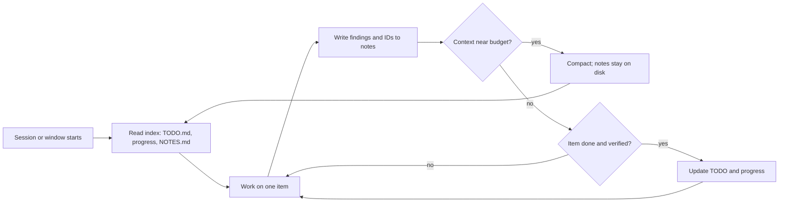

# Offloading Context to Files and Scratchpads: The Complete Guide

> 📚 **Before you start**
>
> - [Compaction and Summarisation](compaction-and-summarisation.md), for why anything that must survive compaction should live outside the conversation.
> - [Retrieval vs Agentic Search](retrieval-vs-agentic-search.md), for references (paths, IDs) instead of content.
> - [What are Multi-Agent Systems?](../../agentic-ai-fundamentals/06-multi-agent-systems-and-the-ecosystem/what-are-multi-agent-systems.md), for orchestrators and sub-agents.

## Introduction

Watch a cricket scorer during a five-day Test match. They don't try to remember every ball. They keep a scorebook: runs, wickets, extras, bowler figures, all written down as the match happens. When a commentator asks "How many has Bumrah bowled today?", the scorer doesn't replay the day in their head; they look it up. And if the scorer changes at lunch, the new one picks up the book and carries on without missing a ball.

Agents need a scorebook too. The context window is the agent's working memory: precious, limited and, as you saw in the last lesson, periodically compacted. So the information that must last, or that is too big to keep in view, should be **written down outside the window**: in notes, to-do lists, progress files and saved results that the agent can read back when it needs them. And when a job needs a lot of reading, it can be handed to a **sub-agent**, a fresh worker with its own window, that returns only its conclusions.

This lesson covers the patterns for offloading context, how to make them reliable, and how they combine with compaction to let an agent work for hours.

> 💡 **Key Insight**
>
> **Write it down, keep a pointer.** The window should hold what the next step needs, plus short references (a file path, a note name) to everything else. Structured notes outside the window survive compaction, context resets and even a change of agent, and cost tokens only when they're read.

---

## Core Explanation

### 1. What can be offloaded


*The four moves of just-in-time context. This lesson is about the two on the right: write it down, and isolate.*

| What | Where it goes | Read back when |
|---|---|---|
| **Working notes** (findings, hypotheses, things tried) | A scratchpad file such as `NOTES.md` | Before deciding the next step; after compaction |
| **The plan** (steps, status) | A to-do list or `plan.md` | Every few steps, to stay on track |
| **Progress across sessions** | A progress file and a feature or task list | At the start of each new session |
| **Large tool results** | A file on disk, with a path and summary returned | Only the parts needed, by range or search |
| **Knowledge that outlives the task** | A memory store (Module 4) | When relevant to a new task |
| **Heavy exploration** | A sub-agent's own context window | Only its short final report comes back |

Anthropic's context-engineering guide calls the first three **structured note-taking**. Its memorable example is a Claude agent playing Pokémon over thousands of game steps: it kept precise tallies in its notes ("for the last 1,234 steps I've been training my Pokémon in Route 1, Pikachu has gained 8 levels toward the target of 10"), plus maps of explored regions and notes on which strategies worked against which opponents. After context resets, it read its own notes and carried on, something no single context window could have held.

### 2. A scratchpad the agent controls

The simplest offload is a pair of tools: write a note, read notes. Here's one backed by a real folder, so notes survive anything that happens to the conversation:

```python
import json, math, os, tempfile

def approx_tokens(text):
    return math.ceil(len(text) / 4)

WORKDIR = tempfile.mkdtemp(prefix="railsathi-agent-")

def write_note(name, text):
    """Create or replace a note. Keep notes short and structured."""
    path = os.path.join(WORKDIR, name)
    with open(path, "w") as f:
        f.write(text)
    return f"saved {name} ({approx_tokens(text)} tokens)"

def append_note(name, line):
    with open(os.path.join(WORKDIR, name), "a") as f:
        f.write(line + "\n")
    return f"appended to {name}"

def read_note(name):
    path = os.path.join(WORKDIR, name)
    return open(path).read() if os.path.exists(path) else f"{name} does not exist yet"

def list_notes():
    return "\n".join(f"{n} ({os.path.getsize(os.path.join(WORKDIR, n))} bytes)" for n in sorted(os.listdir(WORKDIR)))

print(write_note("NOTES.md", "# Task: find the cheapest Pune-Kochi option for 4 people on 20 Oct\n"))
print(append_note("NOTES.md", "- 16381 3A: Rs 2,140 pp, 9 seats left"))
print(append_note("NOTES.md", "- 22149 3A: Rs 2,390 pp, pantry, 2 seats left (not enough for 4)"))
print(read_note("NOTES.md"))
print(list_notes())
```

Output:

```
saved NOTES.md (17 tokens)
appended to NOTES.md
appended to NOTES.md
# Task: find the cheapest Pune-Kochi option for 4 people on 20 Oct
- 16381 3A: Rs 2,140 pp, 9 seats left
- 22149 3A: Rs 2,390 pp, pantry, 2 seats left (not enough for 4)

NOTES.md (170 bytes)
```

The model decides what to write. Your job is to give it good tools and clear guidance about **what** is worth writing (decisions, findings, exact identifiers, open questions) and **when** to read it back (at the start, after compaction, before a big decision).

### 3. A to-do list: plans that stay in front of the model

Long tasks drift. A to-do list helps in two ways: it's offloaded (survives compaction), and when the agent re-writes it each step it lands **near the end of the context**, where recency makes the model pay attention to it. LangChain's Deep Agents harness ships a `write_todos` tool for exactly this reason, and coding agents show a live to-do list as they work.

```python
def write_todos(todos):
    """Replace the whole to-do list. Each item: {'task': str, 'status': 'pending'|'in_progress'|'done'}."""
    mark = {"pending": "[ ]", "in_progress": "[~]", "done": "[x]"}
    text = "\n".join(f"{mark[t['status']]} {t['task']}" for t in todos)
    write_note("TODO.md", text + "\n")
    return text

print(write_todos([
    {"task": "Search trains Pune-Kochi on 20 Oct with 4 seats in 3A", "status": "done"},
    {"task": "Compare fares and pantry for candidates", "status": "in_progress"},
    {"task": "Confirm choice with user", "status": "pending"},
    {"task": "Book and send PNR", "status": "pending"},
]))
```

Output:

```
[x] Search trains Pune-Kochi on 20 Oct with 4 seats in 3A
[~] Compare fares and pantry for candidates
[ ] Confirm choice with user
[ ] Book and send PNR
```

Notice the tool **replaces** the whole list each time. That keeps one current version, instead of a trail of stale lists in the history competing with each other.

### 4. Save big results to disk and return a handle

When a tool produces something large (a CSV export, a web page, a long log), write it to a file and return a **handle**: the path, the size and a short summary. The agent reads only what it needs, by range or search:

```python
def export_bookings(month):
    """Pretend export: 500 booking rows. Saved to disk; only a handle is returned to the model."""
    rows = [{"pnr": f"88{i:08d}", "route": ["PUNE-CSMT", "PUNE-ERS", "PUNE-SBC"][i % 3],
             "fare": 400 + (i * 37) % 2600, "status": "CNF" if i % 7 else "CAN"} for i in range(500)]
    path = os.path.join(WORKDIR, f"bookings-{month}.jsonl")
    with open(path, "w") as f:
        f.writelines(json.dumps(r) + "\n" for r in rows)
    cancelled = sum(r["status"] == "CAN" for r in rows)
    full_tokens = approx_tokens(open(path).read())
    return (f"Saved 500 bookings to {os.path.basename(path)} ({full_tokens:,} tokens if read in full). "
            f"{cancelled} cancelled. Columns: pnr, route, fare, status. "
            "Use read_lines(file, start, end) or grep_file(file, pattern) to inspect.")

def read_lines(name, start, end):
    with open(os.path.join(WORKDIR, name)) as f:
        return "".join(f.readlines()[start - 1:end])

handle = export_bookings("2026-10")
print(handle)
print("handle costs", approx_tokens(handle), "tokens")
print(read_lines("bookings-2026-10.jsonl", 1, 2))
```

Output:

```
Saved 500 bookings to bookings-2026-10.jsonl (9,262 tokens if read in full). 72 cancelled. Columns: pnr, route, fare, status. Use read_lines(file, start, end) or grep_file(file, pattern) to inspect.
handle costs 50 tokens
{"pnr": "8800000000", "route": "PUNE-CSMT", "fare": 400, "status": "CAN"}
{"pnr": "8800000001", "route": "PUNE-ERS", "fare": 437, "status": "CNF"}
```

The model gets everything it needs to decide its next step (the size, the shape, a key statistic and how to look further) for a tiny fraction of the full cost. Anthropic's write-up of its multi-agent research system describes the same idea between agents: sub-agents store their outputs externally and pass **lightweight references** back to the coordinator, avoiding both the token cost and the information loss of copying everything through messages.

### 5. Progress files: picking up after a reset

For work that spans multiple context windows or sessions, notes become a **recovery mechanism**. Anthropic's guidance for long-running agents (and its memory tool documentation) describes a pattern:

1. An **initialiser** session sets up a progress log, a task or feature checklist, and a note of how to start the environment.
2. Each later session **starts by reading** those files, so it knows what's done and what's next without re-exploring.
3. Before ending, the session **updates the progress log** with what it completed and what remains.
4. Work on **one item at a time**, and mark it done only after it's verified.

Here's a session that gets cut off, and a new one that resumes from the file alone:

```python
def run_session(session_id, tasks, steps_allowed):
    progress = json.loads(read_note("progress.json")) if os.path.exists(os.path.join(WORKDIR, "progress.json")) \
        else {"done": [], "log": []}
    for task in tasks:
        if task in progress["done"]:
            continue
        if steps_allowed == 0:
            progress["log"].append(f"session {session_id}: stopped (context full) before '{task}'")
            break
        progress["done"].append(task)               # pretend the work was done and verified
        progress["log"].append(f"session {session_id}: finished '{task}'")
        steps_allowed -= 1
    write_note("progress.json", json.dumps(progress, indent=1))
    return progress

TASKS = ["search trains", "compare fares", "confirm with user", "book", "send PNR by SMS"]
run_session(1, TASKS, steps_allowed=2)        # runs out of room after two tasks
state = run_session(2, TASKS, steps_allowed=10)  # a fresh window, knowing only what the file says
print("\n".join(state["log"]))
```

Output:

```
session 1: finished 'search trains'
session 1: finished 'compare fares'
session 1: stopped (context full) before 'confirm with user'
session 2: finished 'confirm with user'
session 2: finished 'book'
session 2: finished 'send PNR by SMS'
```

Session 2 never saw session 1's conversation. It didn't need to.

### 6. The Anthropic memory tool

Anthropic provides a ready-made, client-side **memory tool** for this pattern. You declare it, and Claude issues file operations against a `/memories` directory that **your code** implements (on disk, in a database, wherever you like):

```python
# not-run: needs the anthropic package and an API key
import anthropic

client = anthropic.Anthropic()
response = client.messages.create(
    model="claude-opus-5-5",
    max_tokens=2048,
    tools=[{"type": "memory_20250818", "name": "memory"}],
    messages=[{"role": "user", "content": "Continue the Kochi trip booking."}],
)
for block in response.content:
    if block.type == "tool_use":
        print(block.input)
```

Example output:

```
{'command': 'view', 'path': '/memories'}
```

The commands are `view`, `create`, `str_replace`, `insert`, `delete` and `rename`. When the tool is present, the API adds an instruction telling Claude to check its memory directory before starting and to record progress as it goes, because its context might be reset at any time. Two responsibilities stay with you: **validate every path** so that something like `/memories/../../secrets.env` can't escape the directory, and keep secrets out of memory files. The Python SDK includes helpers for implementing the backend.

### 7. Sub-agents: isolate the heavy reading

Notes help one agent remember. **Sub-agents** help one agent *not have to read everything*. The lead agent delegates a focused task ("find every refund rule that mentions Tatkal and summarise them with section numbers"); the sub-agent explores in its own fresh context window, perhaps reading tens of thousands of tokens, and returns a condensed result. Anthropic notes that such summaries are often around 1,000 to 2,000 tokens.

```python
POLICY_PAGES = {f"policy/page-{i:02d}.md": ("General conditions of carriage. " * 60) +
                (" Tatkal: confirmed Tatkal tickets are not refunded on cancellation (section 4.5)." if i == 17 else "")
                for i in range(1, 31)}

def sub_agent(task, pages):
    """Reads everything in its OWN context, returns only a short report."""
    own_context_tokens = approx_tokens(task) + sum(approx_tokens(t) for t in pages.values())
    findings = [f"{p}: {t.split('Tatkal:')[1].strip()}" for p, t in pages.items() if "Tatkal:" in t]
    report = "Findings:\n" + "\n".join(f"- {f}" for f in findings) + f"\nPages read: {len(pages)}."
    return report, own_context_tokens

report, sub_tokens = sub_agent("Find all Tatkal refund rules with section numbers.", POLICY_PAGES)
print(report)
print(f"\nsub-agent read {sub_tokens:,} tokens in its own window;"
      f" the lead agent receives {approx_tokens(report)} tokens")
```

Output:

```
Findings:
- policy/page-17.md: confirmed Tatkal tickets are not refunded on cancellation (section 4.5).
Pages read: 30.

sub-agent read 14,434 tokens in its own window; the lead agent receives 30 tokens
```

The lead agent's window grows by a few dozen tokens instead of tens of thousands, and it receives a clean answer with a citation. The trade-off is total cost: Anthropic reported that in its research system, agents used about 4 times as many tokens as chat interactions, and multi-agent systems about 15 times as many. Sub-agents buy focus and parallelism, not savings; use them when the task is big enough to need them.

### 8. Making notes reliable

Offloaded context is still context: when it's read back, it enters the window and shapes decisions. Treat it with the same care:

| Practice | Why |
|---|---|
| **Structure notes** (headings, bullets, one fact per line) | Easy to scan, update and read partially |
| **Replace, don't pile up** (one current plan, one current status) | Stale versions become conflicting context |
| **Copy identifiers exactly** from tool results | Notes are the ground truth after compaction |
| **Mark status and dates** ("verified 14 Oct") | Later readers know what to trust |
| **Read back at fixed moments** (start, after compaction, before irreversible steps) | Notes only help if they're consulted |
| **Keep them small**; move detail into separate files and keep an index | The index is cheap to load every time |
| **Validate paths and treat contents as data** | A file written from a web page can carry a prompt injection |



---

## Try It Yourself

1. **An index note.** Write a function `rebuild_index()` that writes `INDEX.md` listing every note in `WORKDIR` with its size in approximate tokens, and returns the text. Why is an index useful to load at the start of every session?
2. **Search the saved export.** Write `grep_file(name, pattern, limit=3)` that returns the first `limit` matching lines from a saved file. Use it to find cancelled bookings in the export.
3. **Which pattern?** For each, choose scratchpad, to-do list, progress file, saved result, memory store or sub-agent: (a) a 2-hour coding task that will be compacted several times; (b) reading 60 PDFs to find every mention of a supplier; (c) remembering that a user always books lower berths for their mother, next month.

<details>
<summary>Show answers</summary>

**1.**

```python
def rebuild_index():
    lines = [f"- {n}: ~{approx_tokens(open(os.path.join(WORKDIR, n)).read()):,} tokens"
             for n in sorted(os.listdir(WORKDIR)) if n != "INDEX.md"]
    text = "# Notes index\n" + "\n".join(lines) + "\n"
    write_note("INDEX.md", text)
    return text

print(rebuild_index())
```

Output:

```
# Notes index
- NOTES.md: ~43 tokens
- TODO.md: ~39 tokens
- bookings-2026-10.jsonl: ~9,262 tokens
- progress.json: ~98 tokens
```

The index is tiny, so it's cheap to load every time, and it tells the agent what exists and how expensive each file is to read, so it can open only what it needs.

**2.**

```python
def grep_file(name, pattern, limit=3):
    with open(os.path.join(WORKDIR, name)) as f:
        hits = [line.strip() for line in f if pattern in line]
    return "\n".join(hits[:limit]) + (f"\n... {len(hits) - limit} more" if len(hits) > limit else "")

print(grep_file("bookings-2026-10.jsonl", '"CAN"'))
```

Output:

```
{"pnr": "8800000000", "route": "PUNE-CSMT", "fare": 400, "status": "CAN"}
{"pnr": "8800000007", "route": "PUNE-ERS", "fare": 659, "status": "CAN"}
{"pnr": "8800000014", "route": "PUNE-SBC", "fare": 918, "status": "CAN"}
... 69 more
```

**3.** (a) To-do list plus a progress file (and a scratchpad for findings), so each compaction resumes cleanly. (b) A sub-agent (or several in parallel), returning short findings with citations, possibly saving full extracts to files. (c) A memory store: it's knowledge about the user that outlives this task, which is Module 4.

</details>

---

## Real-World Examples

- **Coding agents** keep live to-do lists, write plans to files in plan mode, and re-read those files after compaction; long-running coding harnesses use a progress file plus a feature list so each new session resumes where the last stopped.
- **LangChain's Deep Agents** harness gives agents planning (`write_todos`), a virtual filesystem for offloading large content, and a `task` tool to spawn sub-agents with isolated context.
- **Research systems** have sub-agents save their findings externally and pass references back, so the lead agent coordinates conclusions rather than raw pages.

---

## Common Misconceptions

### "Notes are just another form of history"

History is everything that happened, in order, and gets compacted. Notes are curated, structured, current and stored outside the window, so they survive compaction and resets.

### "The model will take good notes on its own"

It takes better notes when told what to record (decisions, IDs, status), in what shape, and when to read them back.

### "Sub-agents save tokens"

They save the *lead agent's* context. Total token use usually goes up. Use them for big or parallel jobs where focus matters more than cost.

### "Anything in my own files is safe to trust"

Files written from tool results can contain untrusted text, including instructions planted in a web page. Treat note contents as data, validate paths, and keep secrets out.

---

## Interview Relevance

*"How do agents work on tasks longer than one context window?"* A strong answer combines compaction with offloading: structured notes and a to-do list the agent updates and re-reads; a progress file and task list that let a new session resume (initialiser session, read-on-start, update-on-end, one verified item at a time); large tool outputs saved to files with a handle returned; and sub-agents that explore in their own windows and return short summaries or references. Mention the Anthropic memory tool (client-side `/memories` directory with view, create, str_replace, insert, delete and rename, where you implement storage and must validate paths), and the trade-off that multi-agent setups improve focus but raise total token use.

---

## Key Takeaways

- **Write it down, keep a pointer**: the window holds the next step's needs plus references.
- **Scratchpads, to-do lists and progress files** survive compaction and let a fresh session resume.
- **Save big results to disk** and return a handle with size, summary and how to read further.
- **Sub-agents isolate heavy reading** and return short summaries, at the cost of more total tokens.
- **Notes are context too**: keep them structured, current, small, read back at fixed moments, and treated as data.

---

**Up next:** [Lab: Keep a 200-step agent inside its budget](lab-keep-a-200-step-agent-inside-its-budget.md)
