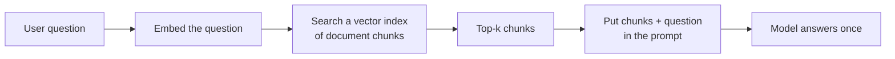
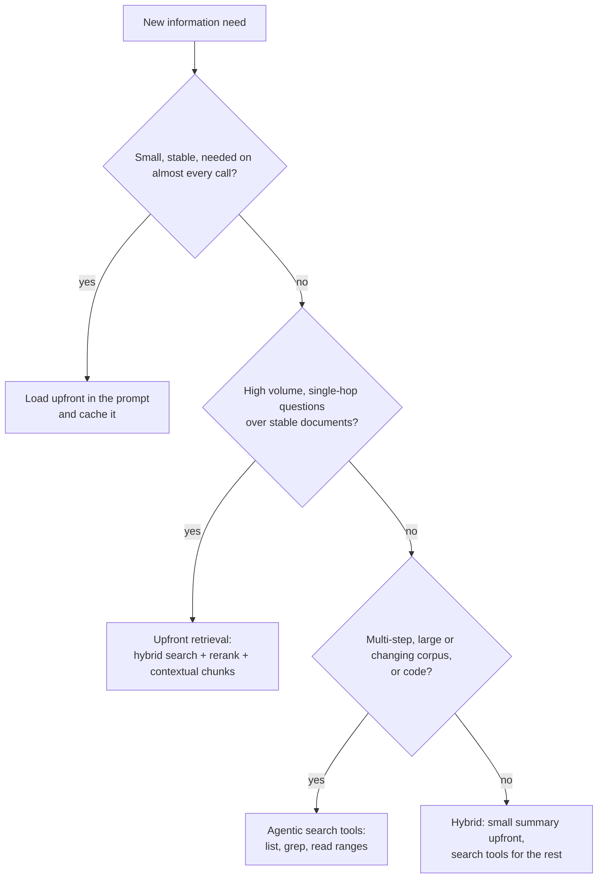

# Retrieval vs Agentic Search: The Complete Guide

> 📚 **Before you start**
>
> - [From Prompt Engineering to Context Engineering](../02-the-context-window-as-a-budget/from-prompt-engineering-to-context-engineering.md), for the "select" move and the context budget.
> - [Context Rot and Lost in the Middle](../02-the-context-window-as-a-budget/context-rot-and-lost-in-the-middle.md), for why loading less is often better.
> - [The RAG Pipeline End to End](../../retrieval-augmented-generation-rag/course.md#m2), for how classic retrieval-augmented generation works.
> - [Designing Good Tools](../../agentic-ai-fundamentals/04-tools-and-function-calling/designing-good-tools.md), for what makes a tool easy for a model to use.

## Introduction

There are two ways to get a hungry office worker their lunch. One: a dabbawala collects a tiffin from home in the morning, packed with whatever the family guessed they'd want, and delivers it before noon. It's ready the moment they're hungry, but if they wanted rice and got rotis, too bad. Two: they walk to the canteen at 1 pm, look at the board, and order exactly what they feel like. It takes a few minutes longer, but it's exactly right, and nothing is wasted.

Agents get information the same two ways. **Upfront retrieval** (the classic RAG pattern) packs the context before the model starts: embed the question, find the most similar chunks, put them in the prompt. **Agentic search** (also called just-in-time retrieval) lets the model go and get what it needs during the run: it lists files, searches for a keyword, opens the one that looks right, reads only the relevant lines, and decides whether it needs more.

Both are useful, and the best systems often combine them. This lesson explains how each works, what each costs in tokens, when to choose which, and how to make each one better.

> 💡 **Key Insight**
>
> Instead of loading everything that *might* be relevant, give the agent **lightweight references** (file paths, document IDs, search tools) and let it **load what it needs, when it needs it**. Load upfront only what is small, stable and almost always needed.

---

## Core Explanation

### 1. Upfront retrieval: how classic RAG fills the window

In a classic RAG pipeline, retrieval happens **before** the model call, in your code:



Its strengths are real: one model call, predictable latency, and it works well when questions map neatly onto passages ("What is the fee for cancelling a 3A ticket?"). Its weaknesses show up in agents:

- **You guess before the model has thought.** The chunks are chosen from the raw question, not from what the model figures out it needs.
- **Similar is not the same as relevant.** Embedding search returns passages that *sound* like the question, which includes look-alike distractors.
- **Chunks lose context.** A chunk that says "the fee is Rs 180" may not say *which* fee.
- **It's all or nothing.** Top-k chunks are loaded whether or not they help.

### 2. Agentic search: the model fetches what it needs

In agentic search, retrieval happens **inside** the agent loop, chosen by the model, through tools:

```mermaid
flowchart LR
    Q["User question"] --> M1["Model: what do I need?"]
    M1 -->|"list_files('policies/*')"| T1["File names only"]
    T1 --> M2["Model: refund-policy.md looks right"]
    M2 -->|"grep('3A', 'refund-policy.md')"| T2["Matching lines with line numbers"]
    T2 --> M3["Model: read lines 40 to 52"]
    M3 -->|"read_file(..., 40, 52)"| T3["Just those lines"]
    T3 --> A["Answer with a citation"]
```



The model starts with **references**, not content: file names, folder structure, document titles. Those references are cheap and surprisingly informative. A file called `policies/refund-policy.md` modified last month says a lot before it is opened. Then the model narrows down step by step.

Anthropic describes Claude Code as a **hybrid**: project memory files such as `CLAUDE.md` are loaded upfront (small, always useful), and everything else is found just in time with tools like `glob` and `grep`, rather than through a pre-built embedding index of the codebase. The same pattern works for policy manuals, wikis, tickets and data.

### 3. Build both and compare

We'll use a tiny "knowledge base" of RailSathi documents and answer one question both ways, counting how many tokens each approach puts into the model's context.

```python
import fnmatch, math, re

DOCS = {
    "policies/refund-policy.md": """# Refund policy
## 4.1 Scope
Applies to reserved e-tickets booked through the app.
## 4.2 Confirmed tickets, 48 hours or more before departure
Flat cancellation charge per passenger: AC First Rs 240, AC 2-tier Rs 200, AC 3-tier Rs 180, Sleeper Rs 120, plus GST.
## 4.3 Confirmed tickets, 48 to 12 hours before departure
25% of the fare, subject to the minimum flat charge in 4.2.
## 4.4 Less than 4 hours, or after chart preparation
No refund on confirmed tickets, except through a TDR claim.
## 4.5 Tatkal
Confirmed Tatkal tickets are not refunded on cancellation.""",
    "policies/luggage.md": """# Luggage
Free allowance: AC First 70 kg, AC 2-tier 50 kg, AC 3-tier 40 kg, Sleeper 40 kg.
Excess luggage must be booked at the parcel office.""",
    "policies/concessions.md": """# Concessions
Senior citizen concessions are currently not offered on most trains.
Persons with disabilities: concession certificate required at booking.""",
    "faq/refund-timing.md": """# When will my refund arrive?
Refunds are processed within 2 working days and reach the bank in 5 to 7 days.
Cancelled tickets show refund status in My Bookings > Refunds.""",
    "faq/tdr.md": """# TDR (Ticket Deposit Receipt)
File a TDR when the train is late by more than 3 hours, AC failed, or you travelled in a lower class.
TDR refunds are decided by the railway, not by the app.""",
}

def approx_tokens(text):
    return math.ceil(len(text) / 4)

def chunks(docs):
    """Split each document into one chunk per non-empty paragraph-sized line."""
    out = []
    for path, text in docs.items():
        for line in text.splitlines():
            if line.strip() and not line.startswith("#"):
                out.append((path, line.strip()))
    return out

CHUNKS = chunks(DOCS)
print(len(DOCS), "documents,", len(CHUNKS), "chunks,", approx_tokens("".join(DOCS.values())), "tokens in total")
```

Output:

```
5 documents, 13 chunks, 305 tokens in total
```

**Approach A, upfront retrieval.** Score every chunk against the question by word overlap (a stand-in for embedding similarity) and load the top 5:

```python
def words(text):
    return set(re.findall(r"[a-z0-9]+", text.lower()))

def top_k(question, k=5):
    q = words(question)
    scored = sorted(CHUNKS, key=lambda c: -len(q & words(c[1])))
    return scored[:k]

question = "How much is deducted if I cancel my AC 3-tier ticket 3 days before the journey?"
loaded = top_k(question)
for path, text in loaded:
    print(f"{path:<28} {text[:70]}")
print("tokens loaded:", sum(approx_tokens(t) for _, t in loaded))
```

Output:

```
faq/tdr.md                   File a TDR when the train is late by more than 3 hours, AC failed, or 
policies/refund-policy.md    Flat cancellation charge per passenger: AC First Rs 240, AC 2-tier Rs 
policies/luggage.md          Free allowance: AC First 70 kg, AC 2-tier 50 kg, AC 3-tier 40 kg, Slee
faq/refund-timing.md         Refunds are processed within 2 working days and reach the bank in 5 to
policies/refund-policy.md    Applies to reserved e-tickets booked through the app.
tokens loaded: 110
```

The right chunk is in there, but so are look-alikes: the luggage line mentions AC 3-tier too, and the TDR, refund-timing and scope lines share words like "AC" and "refund" without answering the question. The model must sort it out, and every chunk costs tokens.

**Approach B, agentic search.** Give the "agent" three small tools and let a scripted pretend model use them the way a real model would:

```python
def list_files(pattern="*"):
    return "\n".join(p for p in sorted(DOCS) if fnmatch.fnmatch(p, pattern))

def grep(pattern, path_glob="*"):
    hits = []
    for path in sorted(DOCS):
        if fnmatch.fnmatch(path, path_glob):
            for n, line in enumerate(DOCS[path].splitlines(), start=1):
                if re.search(pattern, line, re.IGNORECASE):
                    hits.append(f"{path}:{n}: {line[:60]}")
    return "\n".join(hits) or "no matches"

def read_file(path, start, end):
    lines = DOCS[path].splitlines()[start - 1:end]
    return "\n".join(f"{n}\t{l}" for n, l in enumerate(lines, start=start))

TOOLS = {"list_files": list_files, "grep": grep, "read_file": read_file}

# The steps a capable model would choose for this question.
plan = [
    ("list_files", {"pattern": "policies/*"}),
    ("grep", {"pattern": "48 hours", "path_glob": "policies/*"}),
    ("read_file", {"path": "policies/refund-policy.md", "start": 4, "end": 5}),
]

context_tokens = 0
for name, args in plan:
    result = TOOLS[name](**args)
    context_tokens += approx_tokens(result)
    print(f"--> {name}({args})\n{result}\n")
print("tokens loaded:", context_tokens)
```

Output:

```
--> list_files({'pattern': 'policies/*'})
policies/concessions.md
policies/luggage.md
policies/refund-policy.md

--> grep({'pattern': '48 hours', 'path_glob': 'policies/*'})
policies/refund-policy.md:4: ## 4.2 Confirmed tickets, 48 hours or more before departure

--> read_file({'path': 'policies/refund-policy.md', 'start': 4, 'end': 5})
4	## 4.2 Confirmed tickets, 48 hours or more before departure
5	Flat cancellation charge per passenger: AC First Rs 240, AC 2-tier Rs 200, AC 3-tier Rs 180, Sleeper Rs 120, plus GST.

tokens loaded: 86
```

The agent loaded fewer tokens, and **everything it loaded is relevant**: file names (cheap), two matching lines with locations, and exactly the rule it needed, with a line number it can cite. The price is three tool round-trips instead of zero.

### 4. The trade-offs, side by side

| | Upfront retrieval (classic RAG) | Agentic search (just in time) |
|---|---|---|
| **Who chooses what to load** | Your code, from the raw question | The model, as it learns what it needs |
| **Model calls** | One | Several (each search is a step) |
| **Latency** | Low and predictable | Higher, varies with the task |
| **Tokens in context** | Fixed top-k, relevant or not | Usually fewer, mostly relevant |
| **Handles multi-step questions** | Poorly (one shot) | Well (can follow leads) |
| **Freshness** | Needs re-indexing when content changes | Reads the live source |
| **Infrastructure** | Embedding model, vector index, sync jobs | Good tools: list, search, read |
| **Failure mode** | Misses the right chunk or drowns in look-alikes | Wanders, over-searches or gives up early |
| **Best for** | High-volume, single-hop Q&A over stable documents | Codebases, large or changing corpora, multi-hop investigation |

They are not rivals. A common production design is **hybrid**: load a small, always-useful summary upfront (a project memory file, a table of contents, the user's profile), and give the agent search tools for everything else. A vector search can itself be one of the agent's tools.

### 5. Making agentic search work well

Agentic search is only as good as the tools and the guidance. The practical rules:

- **Return references first, content second.** `list_files` and `grep` should return paths and short matching lines, not whole documents. Let the model choose what to open.
- **Support ranges.** `read_file(path, start, end)` lets the model read 12 lines instead of 1,200.
- **Make names meaningful.** `policies/refund-policy.md` is a free hint; `doc_0042.txt` is not. Folder structure and file names are metadata the model uses.
- **Cap and explain.** If a search returns 400 matches, return the first 20 and say so, suggesting a narrower query (next lesson).
- **Give a search budget in the prompt.** "Search until you find the governing rule; stop after about five searches and say what you found." This prevents both rabbit holes and premature answers.

### 6. Making upfront retrieval work well

When you do retrieve upfront, a few improvements matter most:

- **Retrieve fewer, better chunks.** Rerank a larger candidate set and keep only the top few.
- **Hybrid search.** Combine keyword search (BM25, good for exact terms like "TDR" or a train number) with embedding search (good for paraphrases). You'll find details in [Hybrid Search](../../retrieval-augmented-generation-rag/course.md#m6).
- **Contextual retrieval.** Before indexing, prepend a short note to each chunk explaining where it comes from and what it's about. In Anthropic's September 2024 write-up, adding about 50 to 100 tokens of context per chunk cut failed retrievals by 35% with contextual embeddings, by 49% when combined with contextual BM25, and by 67% when reranking was added.
- **Skip retrieval for small corpora.** The same write-up suggests that if the whole knowledge base is under about 200,000 tokens, you can often include all of it in the prompt and rely on prompt caching to keep it affordable.

Here's why contextual chunks help, using our word-overlap scorer:

```python
bare = "25% of the fare, subject to the minimum flat charge in 4.2."
contextual = ("Refund policy, section 4.3: cancellation charge for confirmed tickets cancelled "
              "between 48 and 12 hours before departure. " + bare)
q = "What is the cancellation charge if I cancel 24 hours before departure?"
for name, chunk in [("bare chunk", bare), ("contextual chunk", contextual)]:
    print(f"{name:<17} overlap with question: {len(words(q) & words(chunk))} words")
```

Output:

```
bare chunk        overlap with question: 2 words
contextual chunk  overlap with question: 6 words
```

The bare chunk is the right answer but shares almost no words with the question, so a retriever (and a skimming model) can easily miss it. With its context attached, it is easy to find.

### 7. Choosing between them



---

## Try It Yourself

1. **A multi-hop question.** "My AC failed all night on a 3A ticket. Can I get money back, and when?" Which documents does the agent need? Write the `plan` (list of tool calls) a good agent would follow and run it.
2. **Break upfront retrieval.** Find a question where `top_k(question, k=2)` misses the right chunk entirely. What does that tell you about choosing `k`?
3. **Cap the grep.** Change `grep` so that it returns at most 3 matches and appends a line like `... 5 more matches; narrow your pattern or path_glob`. Test it with the pattern `"ac"`.

<details>
<summary>Show answers</summary>

**1.** It needs the TDR FAQ (AC failure is a TDR case) and the refund timing FAQ.

```python
plan2 = [
    ("grep", {"pattern": "AC failed|TDR", "path_glob": "faq/*"}),
    ("read_file", {"path": "faq/tdr.md", "start": 2, "end": 3}),
    ("read_file", {"path": "faq/refund-timing.md", "start": 2, "end": 2}),
]
for name, args in plan2:
    print(TOOLS[name](**args))
```

Output:

```
faq/tdr.md:1: # TDR (Ticket Deposit Receipt)
faq/tdr.md:2: File a TDR when the train is late by more than 3 hours, AC f
faq/tdr.md:3: TDR refunds are decided by the railway, not by the app.
2	File a TDR when the train is late by more than 3 hours, AC failed, or you travelled in a lower class.
3	TDR refunds are decided by the railway, not by the app.
2	Refunds are processed within 2 working days and reach the bank in 5 to 7 days.
```

Upfront retrieval would struggle here: the question mentions "AC" and "3A", which pull in luggage and refund-fee chunks, while the governing document is about TDR.

**2.**

```python
for path, text in top_k("Do I lose everything if I cancel 2 hours before the train leaves?", k=2):
    print(path, "|", text)
```

Output:

```
faq/tdr.md | File a TDR when the train is late by more than 3 hours, AC failed, or you travelled in a lower class.
policies/refund-policy.md | 25% of the fare, subject to the minimum flat charge in 4.2.
```

The governing rule (section 4.4: less than 4 hours before departure, no refund on confirmed tickets) is missing from the top 2: the question says "2 hours" and "lose everything", the rule says "less than 4 hours" and "no refund". The retriever returned a TDR line and the wrong time band instead. Small `k` misses; large `k` floods. That tension is why reranking and agentic search exist.

**3.**

```python
def grep_capped(pattern, path_glob="*", limit=3):
    hits = grep(pattern, path_glob).splitlines()
    if len(hits) <= limit:
        return "\n".join(hits)
    return "\n".join(hits[:limit] + [f"... {len(hits) - limit} more matches; narrow your pattern or path_glob"])

print(grep_capped("ac"))
```

Output:

```
faq/refund-timing.md:2: Refunds are processed within 2 working days and reach the ba
faq/tdr.md:2: File a TDR when the train is late by more than 3 hours, AC f
policies/luggage.md:2: Free allowance: AC First 70 kg, AC 2-tier 50 kg, AC 3-tier 4
... 1 more matches; narrow your pattern or path_glob
```

</details>

---

## Real-World Examples

- **Coding agents** such as Claude Code navigate repositories with file listing, glob and grep tools and read files by range, while loading project instruction files upfront.
- **Enterprise assistants** often expose the company's vector search as *one tool among several* (alongside keyword search and a document reader), letting the model decide when semantic search is the right move.
- **Research agents** search the web step by step, reading a page, extracting a lead and searching again, which is agentic search over the open internet.

---

## Common Misconceptions

### "Agentic search replaces RAG"

It replaces *one-shot, upfront* retrieval in some situations. Retrieval itself remains, often as a tool the agent calls.

### "Embeddings understand meaning, so they always find the right chunk"

They find chunks that are *similar* to the question, which includes look-alikes. Context-free chunks and paraphrases still cause misses.

### "More tool calls means a worse agent"

A few targeted calls that load exactly the right 200 tokens usually beat one call that loads 5,000 tokens of maybe-relevant text. Watch for wandering, not for the number of calls alone.

### "Just-in-time means nothing is loaded upfront"

Good systems load a small, stable core upfront (instructions, project memory, a map of what exists) and fetch the rest on demand.

---

## Interview Relevance

*"RAG or agentic search: how would you give an agent access to a large knowledge base?"* A strong answer contrasts upfront retrieval (your code embeds the question and loads top-k chunks once; fast and predictable, but guesses before the model thinks and loads look-alikes) with agentic search (the model starts from references such as paths and titles and uses list, grep and ranged-read tools to load what it needs; fewer, more relevant tokens and better multi-hop behaviour, at the cost of more steps). Then it proposes a hybrid: small always-needed context upfront and cached, search tools for the rest, vector search available as a tool. Mention improvements for upfront retrieval (hybrid BM25 plus embeddings, reranking, contextual chunks) and tool design rules for agentic search (references first, ranges, meaningful names, capped results with guidance).

---

## Key Takeaways

- **Upfront retrieval** packs the context before the model thinks; **agentic search** lets the model fetch what it needs during the run.
- **Start from references** (paths, titles, IDs) and load content in small, targeted pieces.
- **Hybrid is common**: small, stable context upfront and cached; search tools for everything else.
- **Upfront retrieval improves with** reranking, hybrid keyword plus embedding search, and contextual chunks.
- **Agentic search depends on good tools**: meaningful names, ranged reads, capped results and a sensible search budget.

---

**Up next:** [Tool Results that Don't Flood the Window](tool-results-that-don-t-flood-the-window.md)
