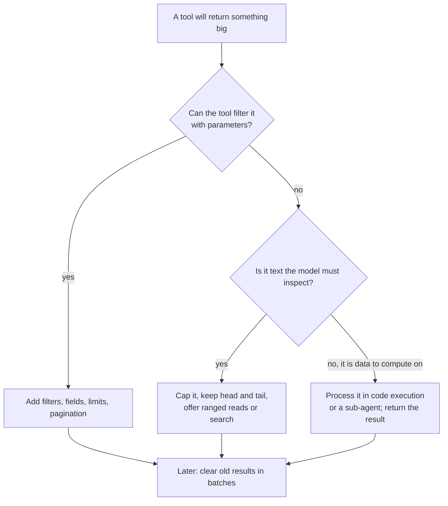

# Tool Results that Don't Flood the Window: The Complete Guide

> 📚 **Before you start**
>
> - [Retrieval vs Agentic Search](retrieval-vs-agentic-search.md), for tools that return references first and content second.
> - [Prompt Caching](../02-the-context-window-as-a-budget/prompt-caching.md), for why editing old messages has a cost.
> - [Designing Good Tools](../../agentic-ai-fundamentals/04-tools-and-function-calling/designing-good-tools.md), for tool names, descriptions and schemas.

## Introduction

You ask the enquiry counter at Pune station, "Any AC trains to Mumbai after 6 pm?" and the clerk hands you the entire 900-page all-India timetable. Technically, the answer is in there. In practice you've lost ten minutes, your bag is heavier, and you might misread a line and board the wrong train.

That is what many tools do to agents. A database query returns 500 rows. A web page comes back with its navigation menus and cookie banners. A test run dumps 3,000 lines of logs. A ticketing API returns every field, including internal IDs and audit timestamps nobody asked for. Each result lands in the context window, stays there for the rest of the run, and is re-sent on every following call. In the RailSathi example from Module 2, tool results were already the single biggest item by turn 9, at 39% of the input.

This lesson covers two kinds of fix. **At the source**: design tools that return just enough. **After the fact**: clear old results once they've done their job. By the end you'll be able to cut a tool's output by an order of magnitude without losing what the agent needs.

> 💡 **Key Insight**
>
> A tool result is not a log; it's a message to the model. Return **the smallest result that lets the model take its next step**: the relevant fields, a few items with a way to get more, human-readable names, and clear guidance when something was cut. Once a result has been used, it rarely needs to stay in full.

---

## Core Explanation

### 1. Why tool results are the biggest threat to your budget

Three properties make tool results dangerous:

- **You don't control their size at write time.** The system prompt is the size you wrote. A search result is the size the world happened to be today.
- **They accumulate.** Every result stays in the history and is re-sent on every subsequent call.
- **Most of each result is used once.** The agent reads a PNR lookup, extracts the seat number, and never needs the other 40 fields again.

Let's build a realistic over-sharing tool: a train search that returns everything the backend has.

```python
import json, math

def approx_tokens(text):
    return math.ceil(len(text) / 4)

def backend_search(src, dst):
    """Pretend backend: every field for every train on the route."""
    trains = []
    for i in range(40):
        dep_h = 5 + (i * 37) % 19
        trains.append({
            "train_uuid": f"7f3c9a1e-{i:04d}-4b2d-9e1f-0c2a6b8d{i:04d}",
            "train_no": f"{12100 + i * 7}",
            "train_name": f"{['Deccan', 'Indrayani', 'Pragati', 'Sinhagad', 'Intercity'][i % 5]} Express",
            "src": src, "dst": dst,
            "dep": f"{dep_h:02d}:{(i * 13) % 60:02d}", "arr": f"{(dep_h + 3) % 24:02d}:{(i * 29) % 60:02d}",
            "classes": {"2S": 140 + i, "CC": 520 + 3 * i, "3A": 0 if i % 4 else 760 + i},
            "days_of_run": "MTWTFSS", "pantry": i % 3 == 0, "rake_type": "LHB" if i % 2 else "ICF",
            "zone": "CR", "last_updated": "2026-10-10T02:00:00Z", "internal_route_id": 99000 + i,
        })
    return trains

raw = json.dumps(backend_search("PUNE", "CSMT"))
print("raw result:", approx_tokens(raw), "tokens")
```

Output:

```
raw result: 3620 tokens
```

Several thousand tokens for a question whose answer is "three trains". And this result will be re-sent on every call for the rest of the conversation.

### 2. Fix at the source: shape the result

Anthropic's guidance on writing tools for agents gives a short list of habits. Applied to our train search:

| Habit | What it means here |
|---|---|
| **Filter in the tool** | Accept the constraints (after 18:00, class 3A or CC) as parameters, so the backend filters instead of the model |
| **Return relevant fields** | Number, name, times, fare for the requested class. Drop UUIDs, zone codes, audit timestamps |
| **Prefer names over IDs** | "Deccan Express (12107)" is meaningful; `7f3c9a1e-0001-...` is noise the model may copy wrongly |
| **Limit and paginate** | Return a few results and a way to get the next page |
| **Say what was cut** | "Showing 3 of 9; call again with page=2 for more" |
| **Offer a verbosity switch** | A `response_format` of `"concise"` or `"detailed"`, so the model asks for IDs only when it needs to chain another call |

Anthropic's example of the last habit, a Slack thread lookup, came to 206 tokens in detailed form and 72 in concise form, about a third.

Here's the redesigned tool:

```python
def search_trains(src, dst, after="00:00", travel_class="3A", response_format="concise", page=1, page_size=3):
    """Find trains with seats in a class, departing after a time. Returns a short list and a way to see more."""
    rows = [t for t in backend_search(src, dst)
            if t["dep"] >= after and t["classes"].get(travel_class, 0) > 0]
    rows.sort(key=lambda t: t["dep"])
    total = len(rows)
    start = (page - 1) * page_size
    shown = rows[start:start + page_size]
    if response_format == "concise":
        lines = [f"{t['train_name']} ({t['train_no']}) dep {t['dep']} arr {t['arr']}, {travel_class} Rs {t['classes'][travel_class]}"
                 for t in shown]
    else:
        lines = [json.dumps({k: t[k] for k in ("train_no", "train_name", "dep", "arr", "classes", "pantry")})
                 for t in shown]
    if not shown:
        return f"No {travel_class} trains from {src} to {dst} after {after}. Try another class or an earlier time."
    footer = f"Showing {start + 1}-{start + len(shown)} of {total}."
    if start + len(shown) < total:
        footer += f" Call again with page={page + 1} for more."
    return "\n".join(lines + [footer])

shaped = search_trains("PUNE", "CSMT", after="18:00", travel_class="CC")
print(shaped)
print("\nshaped result:", approx_tokens(shaped), "tokens vs raw", approx_tokens(raw))
```

Output:

```
Indrayani Express (12142) dep 18:18 arr 21:54, CC Rs 538
Deccan Express (12275) dep 18:25 arr 21:05, CC Rs 595
Deccan Express (12135) dep 19:05 arr 22:25, CC Rs 535
Showing 1-3 of 13. Call again with page=2 for more.

shaped result: 54 tokens vs raw 3620
```

Same question answered, a tiny fraction of the tokens, and the model knows exactly how to get more if it needs to.

### 3. Truncation that teaches

Some outputs can't be fully shaped in advance: file contents, logs, web pages, command output. For those, apply a **hard cap** and make the truncation message useful. Claude Code, for example, caps tool responses at 25,000 tokens by default. A good truncation keeps the start and the end (where headers and final errors usually are) and tells the model how to see the middle:

```python
def truncate_middle(text, max_tokens=60, label="output"):
    if approx_tokens(text) <= max_tokens:
        return text
    keep = max_tokens * 4 // 2
    cut_tokens = approx_tokens(text) - max_tokens
    return (text[:keep] + f"\n[... {cut_tokens} tokens of {label} omitted. "
            "Use read_log(start_line, end_line) or grep_log(pattern) to see specific parts ...]\n" + text[-keep:])

log = "\n".join([f"test_case_{i:03d} PASSED" for i in range(1, 120)] +
                ["test_refund_tatkal FAILED: expected Rs 0, got Rs 380", "119 passed, 1 failed in 4.2s"])
print(truncate_middle(log, label="test log"))
```

Output:

```
test_case_001 PASSED
test_case_002 PASSED
test_case_003 PASSED
test_case_004 PASSED
test_case_005 PASSED
test_case_006 P
[... 585 tokens of test log omitted. Use read_log(start_line, end_line) or grep_log(pattern) to see specific parts ...]
t_case_118 PASSED
test_case_119 PASSED
test_refund_tatkal FAILED: expected Rs 0, got Rs 380
119 passed, 1 failed in 4.2s
```

Even better, when you control the tool: **summarise in the tool**. A test-runner tool that returns "119 passed, 1 failed" plus the failure details is more useful than any truncated log.

### 4. Errors that teach

Error messages are tool results too. An opaque error wastes a turn; a helpful one fixes the next call:

| Unhelpful | Helpful |
|---|---|
| `Error 422` | `PNR must be 10 digits; got "45218733" (8 digits). Ask the passenger to check their SMS.` |
| `Traceback (most recent call last): ...` (60 lines) | `calculate_refund failed: booking is already cancelled (refund ref RF-88123). Use get_refund_status instead.` |
| `Invalid date` | `travel_date must be YYYY-MM-DD, for example 2026-10-14.` |

```python
def get_pnr(pnr):
    digits = "".join(ch for ch in pnr if ch.isdigit())
    if len(digits) != 10:
        return (f"Error: a PNR has 10 digits; got {len(digits)} ('{pnr}'). "
                "Ask the passenger to copy it from the booking SMS or My Bookings.")
    return f"PNR {digits}: 12677 ERS-SBC, 14 Oct, Priya Nair, CNF B2 34"

print(get_pnr("4521-8733"))
print(get_pnr("4521873390"))
```

Output:

```
Error: a PNR has 10 digits; got 8 ('4521-8733'). Ask the passenger to copy it from the booking SMS or My Bookings.
PNR 4521873390: 12677 ERS-SBC, 14 Oct, Priya Nair, CNF B2 34
```

### 5. Fix after the fact: clear results once they've been used

Even well-shaped results add up over a long run. The lightest form of compaction is **tool-result clearing**: once a tool result is deep in the history and has been acted on, replace its content with a short placeholder. The tool call itself stays, so the model still knows *what* it did; only the bulky output goes.

Here's a client-side version over an Anthropic-style message list:

```python
def make_history(n_calls, result_tokens=800):
    msgs = [{"role": "user", "content": "Plan my Pune to Mumbai trip and book the best option."}]
    for i in range(n_calls):
        msgs.append({"role": "assistant", "content": [
            {"type": "tool_use", "id": f"t{i}", "name": "search_trains", "input": {"page": i + 1}}]})
        msgs.append({"role": "user", "content": [
            {"type": "tool_result", "tool_use_id": f"t{i}", "content": "x" * (result_tokens * 4)}]})
    return msgs

def clear_old_tool_results(messages, keep=2, placeholder="[result cleared to save space; call the tool again if needed]"):
    result_positions = [(mi, bi) for mi, m in enumerate(messages) if isinstance(m["content"], list)
                        for bi, b in enumerate(m["content"]) if b["type"] == "tool_result"]
    cleared = 0
    for mi, bi in result_positions[:-keep] if keep else result_positions:
        block = messages[mi]["content"][bi]
        if block["content"] != placeholder:
            block["content"] = placeholder
            cleared += 1
    return cleared

def context_tokens(messages):
    return approx_tokens(json.dumps(messages))

history = make_history(10)
before = context_tokens(history)
n = clear_old_tool_results(history, keep=2)
print(f"before: {before:,} tokens; cleared {n} results; after: {context_tokens(history):,} tokens")
```

Output:

```
before: 8,545 tokens; cleared 8 results; after: 2,267 tokens
```

Two design choices matter:

- **Keep the most recent few results.** The model is probably still using them.
- **Clear in batches, not every turn.** Every clear rewrites earlier messages, which breaks the prompt cache from that point. Clearing a big batch occasionally costs one cache rewrite; clearing one result every turn costs one every turn.

### 6. Server-side clearing with the Anthropic API

The Anthropic API can do this for you with **context editing** (a beta feature). You declare a strategy and the API clears old tool results before the model sees the request:

```python
# not-run: needs the anthropic package and an API key
import anthropic

client = anthropic.Anthropic()
response = client.beta.messages.create(
    model="claude-opus-5-5",
    max_tokens=4096,
    betas=["context-management-2025-06-27"],
    tools=TOOLS,
    messages=messages,
    context_management={"edits": [{
        "type": "clear_tool_uses_20250919",
        "trigger": {"type": "input_tokens", "value": 30000},    # start clearing above this size
        "keep": {"type": "tool_uses", "value": 3},               # always keep the 3 most recent
        "clear_at_least": {"type": "input_tokens", "value": 5000},  # skip clears too small to be worth a cache rewrite
        "exclude_tools": ["get_user_profile"],                   # never clear these
    }]},
)
print(response.context_management.applied_edits)
```

Example output:

```
[{'type': 'clear_tool_uses_20250919', 'cleared_tool_uses': 8, 'cleared_input_tokens': 21400}]
```

| Setting | Default | Purpose |
|---|---|---|
| `trigger` | 100,000 input tokens | When clearing starts |
| `keep` | 3 tool uses | How many recent tool uses to leave intact |
| `clear_at_least` | none | Minimum tokens a clear must remove, so small clears don't waste a cache rewrite |
| `exclude_tools` | none | Tools whose results must never be cleared |
| `clear_tool_inputs` | `false` | Also clear the tool call parameters, not just results |

A companion strategy, `clear_thinking_20251015`, clears old thinking blocks. Server-side clearing has one more advantage on newer models that check the integrity of their earlier reasoning: edits made by the server don't count as you rewriting history.

### 7. Move the processing out of the context altogether

The most powerful fix is to make sure big intermediate data **never enters the context**:

- **Programmatic tool calling and code execution.** The model writes a short script that calls tools, filters and joins their results, and returns only the final answer. Thousands of rows are processed in the sandbox; a few lines reach the context. See [Code Execution: Agents that Write Code against Tools](../../tools-agent-skills-and-code-execution/course.md#m3).
- **Sub-agents.** A sub-agent reads the big results in its own window and returns a summary (lesson after next).
- **Files and handles.** The tool saves the full result to a file and returns a path and a summary; the agent reads specific parts later (lesson after next).



---

## Try It Yourself

1. **Detailed when needed.** Call `search_trains` with `response_format="detailed"` for the same route and compare its token count with the concise version. When would the agent legitimately need the detailed form?
2. **Second page.** Get page 2 of the concise CC results after 18:00. What does the footer say?
3. **Clear with exclusions.** Extend `clear_old_tool_results` with an `exclude` parameter: a set of tool names whose results must never be cleared. (Hint: you'll need to find the tool name by matching `tool_use_id` to the earlier `tool_use` block.)

<details>
<summary>Show answers</summary>

**1.**

```python
detailed = search_trains("PUNE", "CSMT", after="18:00", travel_class="CC", response_format="detailed")
print(approx_tokens(detailed), "tokens detailed vs", approx_tokens(shaped), "concise")
```

Output:

```
124 tokens detailed vs 54 concise
```

The detailed form includes fields like `classes` and `pantry` that a follow-up call might need (for example, comparing classes or booking with a specific train number). Ask for it only then.

**2.**

```python
print(search_trains("PUNE", "CSMT", after="18:00", travel_class="CC", page=2))
```

Output:

```
Intercity Express (12268) dep 19:12 arr 22:36, CC Rs 592
Intercity Express (12128) dep 20:52 arr 23:56, CC Rs 532
Sinhagad Express (12261) dep 20:59 arr 23:07, CC Rs 589
Showing 4-6 of 13. Call again with page=3 for more.
```

**3.**

```python
def clear_old_tool_results_except(messages, keep=2, exclude=frozenset(),
                                  placeholder="[result cleared to save space; call the tool again if needed]"):
    names = {b["id"]: b["name"] for m in messages if isinstance(m["content"], list)
             for b in m["content"] if b["type"] == "tool_use"}
    positions = [(mi, bi) for mi, m in enumerate(messages) if isinstance(m["content"], list)
                 for bi, b in enumerate(m["content"])
                 if b["type"] == "tool_result" and names[b["tool_use_id"]] not in exclude]
    for mi, bi in positions[:-keep] if keep else positions:
        messages[mi]["content"][bi]["content"] = placeholder
    return len(positions[:-keep] if keep else positions)

h = make_history(5)
h[1]["content"][0]["name"] = "get_user_profile"   # make the first call a profile lookup
print("cleared:", clear_old_tool_results_except(h, keep=1, exclude={"get_user_profile"}))
print("profile kept:", h[2]["content"][0]["content"] != "[result cleared to save space; call the tool again if needed]")
```

Output:

```
cleared: 3
profile kept: True
```

</details>

---

## Real-World Examples

- **Coding agents** cap tool output, show the head and tail of long command output, and read files by line range rather than whole.
- **Search tools built for agents** return titles, URLs and short snippets first, with a separate fetch tool to read one page.
- **Long-running API agents** turn on server-side tool-result clearing so that hours-long sessions don't fill up with stale search results.

---

## Common Misconceptions

### "Just return everything and let the model pick"

The model can pick, but you pay for every token on every later call, and look-alike rows become distractors.

### "Truncation loses information, so never truncate"

Untruncated floods lose information too: the model misses things in the middle. Truncate deliberately, keep the head and tail, and offer a way to see the rest.

### "UUIDs are more precise than names"

For the model, readable names and short IDs are easier to use correctly. Return opaque IDs only when a follow-up call needs them.

### "Clearing old results makes the agent forget what it did"

The tool *call* stays in the history, so the model still knows what it did and can call again. Only the bulky output goes.

---

## Interview Relevance

*"Your agent's context keeps filling up with tool output. What do you do?"* A strong answer starts at the source: filter with parameters, return only relevant fields, prefer readable names to UUIDs, paginate with a clear "showing X of Y" footer, offer concise and detailed formats, cap and truncate with guidance, and write errors that say how to fix the call. Then it covers after-the-fact clearing of old tool results (keep the last few, clear in batches because each clear breaks the cache; server-side context editing with trigger, keep, clear_at_least and exclude_tools), and moving bulk processing out of the context with code execution, sub-agents or files.

---

## Key Takeaways

- **Tool results are the fastest-growing part of an agent's context**, so design them to be small.
- **Shape at the source**: filters, relevant fields, readable names, pagination, verbosity switch.
- **Truncate and error helpfully**: say what was cut and how to get it, say how to fix a bad call.
- **Clear used results in batches**, keeping the most recent; server-side context editing can do it for you.
- **Keep bulk data out entirely** with code execution, sub-agents or files where possible.

---

**Up next:** [Compaction and Summarisation](compaction-and-summarisation.md)
