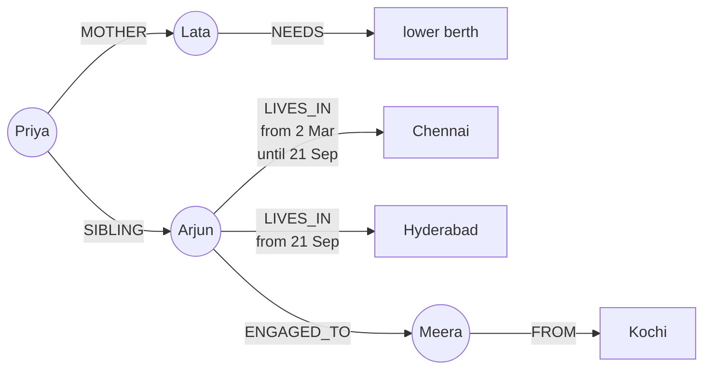
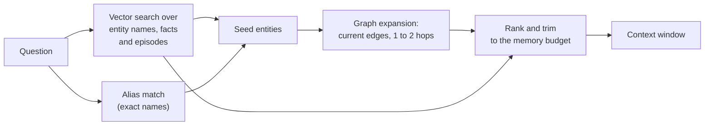

# Knowledge Graphs as Agent Memory: The Complete Guide

> 📚 **Before you start**
>
> - [Writing, Updating and Forgetting Memories](writing-updating-and-forgetting-memories.md), for extraction, consolidation and keeping history instead of erasing it.
> - [Semantic, Episodic and Procedural Memory](semantic-episodic-and-procedural-memory.md), for the difference between facts and episodes.
> - [Knowledge Graphs, Ontologies and Unstructured Data › Entities and Relationships](../../knowledge-graphs-ontologies-and-unstructured-data/course.md#m2) and [› Neo4j and Cypher](../../knowledge-graphs-ontologies-and-unstructured-data/course.md#m4), for nodes, edges, properties and `MERGE`. This lesson recaps what it needs.
> - [› Building a Knowledge Graph from Text with an LLM](../../knowledge-graphs-ontologies-and-unstructured-data/course.md#m6), for extracting triples from text.

## Introduction

Ask an experienced family friend, Sharma uncle, about your family and he doesn't recite a list of sentences. He knows a **web**: your mother's sister is married to the doctor in Indore, whose son just moved to Bengaluru, which is why your cousin can't come for Diwali this year. Each fact is useful mostly because of how it connects to the others. And he knows how things *changed*: "Arjun used to be in Chennai, but he moved last month."

The memory stores in this module so far keep memories as **separate pieces of text**, searched by similarity. That works well for "what does this user prefer?". It struggles with two kinds of question that agents meet all the time:

- **Connected questions**: "Book tickets for my mother and me to visit my brother." Answering needs three facts that never appeared in the same sentence: who the mother is, what she needs, and where the brother lives.
- **Questions about change**: "Where does Arjun live?" when the store holds both "lives in Chennai" (from March) and "moved to Hyderabad" (from September). Similarity search returns whichever sentence is closer in wording, not whichever is true now.

A **knowledge graph** stores memory as entities and the relationships between them, and can record *when* each relationship was true. This lesson builds a small temporal knowledge-graph memory from conversations, uses it to answer connected and time-based questions, and shows when it's worth the extra machinery.

> 💡 **Key Insight**
>
> Text memories answer "what did the user say that sounds like this question?". A knowledge graph answers "what is true, now, about the things in this question, and what are they connected to?". Store facts as **edges with validity dates**, never delete a fact that changed (close it with an end date), and retrieve by finding the entities in the question and walking their current edges.

---

## Core Explanation

### 1. From sentences to a graph

A quick recap from the Knowledge Graphs course. A knowledge graph has **nodes** (entities: people, places, things) and **edges** (relationships between two nodes), and both can carry **properties**. One fact is a **triple**: subject, relationship, object.

| As text memory | As triples |
|---|---|
| "User's mother Lata needs a lower berth." | (Priya) -[MOTHER]-> (Lata); (Lata) -[NEEDS]-> (lower berth) |
| "User's brother Arjun lives in Chennai." | (Priya) -[SIBLING]-> (Arjun); (Arjun) -[LIVES_IN]-> (Chennai) |



Two things the picture shows that a list of sentences can't:

- **Each entity exists once.** "Mom", "my mother" and "Lata" are one node. Every fact about her hangs off that node, so finding her finds all of them.
- **Edges have time.** The old `LIVES_IN Chennai` edge isn't deleted; it's closed with an end date. The graph knows both where Arjun lives and where he used to live.

Here's how the whole system fits together:

![A temporal knowledge graph memory. Conversations arrive as episodes with a date. An LLM extracts entities and relationship triples; entity resolution maps mom, my mother and Lata to one node. Each new fact is upserted as an edge: if it contradicts a current edge of the same kind, the old edge is closed with an invalid_at date instead of being deleted. At question time, the agent finds the entities named in the question, walks their current edges one or two hops, and writes the facts with their dates into the context window](/img/diagrams/context-engineering-and-agent-memory/kg-agent-memory.svg)
*Write path on top, read path below. Every fact remembers which episode it came from and when it was true.*

### 2. The storage: three small tables

Production systems use a graph database such as Neo4j. To keep this lesson runnable anywhere, we'll store the graph in SQLite (the database built into Python), with the same shape a graph database would have:

```python
import json, sqlite3
from langchain_core.language_models.fake_chat_models import FakeListChatModel

db = sqlite3.connect(":memory:")
db.executescript("""
CREATE TABLE entities (id INTEGER PRIMARY KEY, name TEXT UNIQUE, kind TEXT);
CREATE TABLE aliases  (alias TEXT PRIMARY KEY, entity_id INTEGER REFERENCES entities(id));
CREATE TABLE episodes (id TEXT PRIMARY KEY, said_on TEXT, text TEXT);
CREATE TABLE edges (
    id INTEGER PRIMARY KEY,
    src INTEGER REFERENCES entities(id), rel TEXT, dst INTEGER REFERENCES entities(id),
    valid_from TEXT, invalid_at TEXT,          -- when the fact was true in the world
    episode TEXT REFERENCES episodes(id)        -- where we learned it
);
""")
print([row[0] for row in db.execute("SELECT name FROM sqlite_master WHERE type='table'")])
```

Output:

```
['entities', 'aliases', 'episodes', 'edges']
```

- `episodes` keeps the **raw source**: what was said and when. This is episodic memory, and it means every fact can be traced back to the conversation it came from.
- `entities` and `aliases` hold the nodes, plus every name a node has been called.
- `edges` hold the facts, each with `valid_from`, `invalid_at` (empty while still true) and the episode it came from.

### 3. Entity resolution: one node per real thing

The hardest part of building a graph from conversation isn't extracting triples, it's knowing that two names mean the same thing. This step is called **entity resolution** (the Knowledge Graphs course covers it in depth). For a personal assistant, many aliases are relative to the user ("my mother", "mom", "amma"), so they can be resolved per user.

```python
def entity(name, kind="thing"):
    """Return the id for a name, creating the entity if nobody has used this name before."""
    row = db.execute("SELECT entity_id FROM aliases WHERE alias = ?", (name.lower(),)).fetchone()
    if row:
        return row[0]
    db.execute("INSERT INTO entities (name, kind) VALUES (?, ?)", (name, kind))
    new_id = db.execute("SELECT last_insert_rowid()").fetchone()[0]
    db.execute("INSERT INTO aliases VALUES (?, ?)", (name.lower(), new_id))
    return new_id

def add_alias(alias, name):
    db.execute("INSERT OR IGNORE INTO aliases VALUES (?, ?)", (alias.lower(), entity(name)))

def name_of(entity_id):
    return db.execute("SELECT name FROM entities WHERE id = ?", (entity_id,)).fetchone()[0]

entity("Priya", "person")
for alias in ["me", "i", "user"]:
    add_alias(alias, "Priya")
print(name_of(entity("me")), name_of(entity("Priya")), entity("me") == entity("Priya"))
```

Output:

```
Priya Priya True
```

Real systems resolve harder cases with a mix of string similarity, embeddings and an LLM check ("Is 'Arjun bhaiya' the same person as 'Arjun'?"), and they're careful about false merges: two different Rahuls merged into one node is worse than a duplicate.

### 4. Writing: extract, resolve, upsert with time

Each conversation becomes an **episode**. An extractor model reads it and returns entities, aliases and triples. As in the last lesson, we use a pretend model that returns what a good real model would for each episode; the code around it is the real pipeline.

```python
EPISODES = [
    ("ep1", "2026-03-02", "My mother Lata needs a lower berth. My brother Arjun lives in Chennai."),
    ("ep2", "2026-06-10", "Mom and I are going to Arjun's engagement. His fiancee Meera is from Kochi."),
    ("ep3", "2026-09-21", "Arjun moved to Hyderabad this month for his new job at Infosys."),
]
EXTRACTIONS = {
    "ep1": {"aliases": {"my mother": "Lata", "mom": "Lata", "my brother": "Arjun"},
            "triples": [["Priya", "MOTHER", "Lata"], ["Lata", "NEEDS", "lower berth"],
                        ["Priya", "SIBLING", "Arjun"], ["Arjun", "LIVES_IN", "Chennai"]]},
    "ep2": {"aliases": {"his fiancee": "Meera"},
            "triples": [["Mom", "MOTHER_OF", "Arjun"], ["Arjun", "ENGAGED_TO", "Meera"], ["Meera", "FROM", "Kochi"]]},
    "ep3": {"aliases": {},
            "triples": [["Arjun", "LIVES_IN", "Hyderabad"], ["Arjun", "WORKS_AT", "Infosys"]]},
}
extractor = FakeListChatModel(responses=[json.dumps(EXTRACTIONS[ep_id]) for ep_id, _, _ in EPISODES])

# Relationships where a subject can have only ONE current value. A new value closes the old edge.
SINGLE_VALUED = {"LIVES_IN", "WORKS_AT", "MOTHER", "NEEDS"}

def upsert_fact(src, rel, dst, said_on, episode):
    s, d = entity(src), entity(dst)
    same = db.execute("SELECT id FROM edges WHERE src=? AND rel=? AND dst=? AND invalid_at IS NULL",
                      (s, rel, d)).fetchone()
    if same:
        return "NOOP"
    action = "ADD"
    if rel in SINGLE_VALUED:
        closed = db.execute("UPDATE edges SET invalid_at=? WHERE src=? AND rel=? AND dst!=? AND invalid_at IS NULL",
                            (said_on, s, rel, d)).rowcount
        if closed:
            action = f"ADD, closed {closed} old edge"
    db.execute("INSERT INTO edges (src, rel, dst, valid_from, invalid_at, episode) VALUES (?, ?, ?, ?, NULL, ?)",
               (s, rel, d, said_on, episode))
    return action

def ingest(ep_id, said_on, text):
    db.execute("INSERT INTO episodes VALUES (?, ?, ?)", (ep_id, said_on, text))
    extraction = json.loads(extractor.invoke(f"Date: {said_on}\n{text}").content)
    for alias, name in extraction["aliases"].items():
        add_alias(alias, name)
    for src, rel, dst in extraction["triples"]:
        print(f"  {ep_id}: ({src})-[{rel}]->({dst})  {upsert_fact(src, rel, dst, said_on, ep_id)}")

for episode in EPISODES:
    ingest(*episode)
```

Output:

```
  ep1: (Priya)-[MOTHER]->(Lata)  ADD
  ep1: (Lata)-[NEEDS]->(lower berth)  ADD
  ep1: (Priya)-[SIBLING]->(Arjun)  ADD
  ep1: (Arjun)-[LIVES_IN]->(Chennai)  ADD
  ep2: (Mom)-[MOTHER_OF]->(Arjun)  ADD
  ep2: (Arjun)-[ENGAGED_TO]->(Meera)  ADD
  ep2: (Meera)-[FROM]->(Kochi)  ADD
  ep3: (Arjun)-[LIVES_IN]->(Hyderabad)  ADD, closed 1 old edge
  ep3: (Arjun)-[WORKS_AT]->(Infosys)  ADD
```

Three details are doing the real work:

- **"Mom" in episode 2 landed on Lata's node**, because episode 1 registered the alias. Without resolution, the graph would have a separate "Mom" node with no berth requirement attached.
- **The move closed the old edge instead of deleting it.** This is the graph version of "history, not erasure" from the last lesson. Which relationships are single-valued (one current home, one employer) is a modelling decision, which is where the ontology ideas from the Knowledge Graphs course pay off.
- **Every edge points to its episode.** If someone asks "how do you know Arjun moved?", the agent can quote the conversation.

A note on dates: we used the conversation date as `valid_from`. "Moved this month" really means some day in September. Graph memory systems such as Zep's Graphiti go further and track **two timelines**: when a fact was true in the world (resolving phrases like "last month" against the episode's date) and when the system learned it. That's called a **bi-temporal** model, and it lets you ask both "where did Arjun live in August?" and "what did we *believe* in August?".

Here is the same write in Cypher for Neo4j. `MERGE` finds or creates, so running it twice doesn't duplicate anything:

```python
# not-run: needs a running Neo4j database and the neo4j driver
UPSERT_LIVES_IN = """
MERGE (p:Person {name: $person})
MERGE (c:City {name: $city})
WITH p, c
OPTIONAL MATCH (p)-[old:LIVES_IN]->(other:City)
WHERE old.invalid_at IS NULL AND other <> c
SET old.invalid_at = date($said_on)
WITH p, c
MERGE (p)-[r:LIVES_IN {valid_from: date($said_on)}]->(c)
SET r.episode = $episode
"""
session.run(UPSERT_LIVES_IN, person="Arjun", city="Hyderabad", said_on="2026-09-21", episode="ep3")
```

### 5. Reading: find the entities, walk the edges

Retrieval from a graph has a different shape from vector search:

1. **Find seed entities** in the question ("mother", "brother"), using the same alias table.
2. **Expand**: collect the current edges around each seed, one or two hops out.
3. **Format** the facts, with their dates, into a compact block for the context window.

```python
def seeds_in(question):
    q = question.lower()
    rows = db.execute("SELECT alias, entity_id FROM aliases").fetchall()
    return sorted({eid for alias, eid in rows if f" {alias} " in f" {q} " and alias not in {"me", "i"}})

def current_edges(entity_ids, hops=2):
    seen, frontier, facts = set(entity_ids), set(entity_ids), []
    for _ in range(hops):
        marks = ",".join("?" * len(frontier))
        rows = db.execute(f"SELECT src, rel, dst, valid_from FROM edges WHERE invalid_at IS NULL "
                          f"AND (src IN ({marks}) OR dst IN ({marks})) ORDER BY id",
                          [*frontier, *frontier]).fetchall()
        nxt = set()
        for src, rel, dst, since in rows:
            fact = f"{name_of(src)} {rel} {name_of(dst)} (since {since})"
            if fact not in facts:
                facts.append(fact)
            nxt |= {src, dst} - seen
        seen |= nxt
        frontier = nxt
        if not frontier:
            break
    return facts

question = "Book tickets for my mother and me to visit my brother next month."
seeds = seeds_in(question)
print("seed entities:", [name_of(s) for s in seeds])
for fact in current_edges(seeds, hops=1):
    print(" ", fact)
```

Output:

```
seed entities: ['Lata', 'Arjun']
  Priya MOTHER Lata (since 2026-03-02)
  Lata NEEDS lower berth (since 2026-03-02)
  Priya SIBLING Arjun (since 2026-03-02)
  Lata MOTHER_OF Arjun (since 2026-06-10)
  Arjun ENGAGED_TO Meera (since 2026-06-10)
  Arjun LIVES_IN Hyderabad (since 2026-09-21)
  Arjun WORKS_AT Infosys (since 2026-09-21)
```

Everything the booking needs is there: two passengers, one of whom needs a lower berth, travelling to **Hyderabad**, not Chennai, because the Chennai edge is closed and the query only follows current edges. One hop was enough here; going to two hops would also bring in Meera's home town, Kochi, which isn't needed. **Hop count is a budget knob**: each hop can multiply the number of facts.

### 6. The same question against text memory

Let's put the same three conversations into a plain text-memory store, as earlier lessons did, and search it with the same question:

```python
import hashlib
import numpy as np
from langgraph.store.memory import InMemoryStore

STOP = {"a", "the", "for", "my", "and", "me", "to", "is", "in", "of", "his", "i", "are", "this", "next", "at"}

def toy_embed(texts):
    vectors = []
    for text in texts:
        v = np.zeros(256)
        for word in "".join(c if c.isalnum() else " " for c in text.lower()).split():
            if word not in STOP:
                v[int(hashlib.md5(word.encode()).hexdigest(), 16) % 256] += 1
        n = np.linalg.norm(v)
        vectors.append((v / n if n else v).tolist())
    return vectors

text_memory = InMemoryStore(index={"dims": 256, "embed": toy_embed, "fields": ["text"]})
for ep_id, said_on, text in EPISODES:
    for i, sentence in enumerate(s.strip() for s in text.split(".") if s.strip()):
        text_memory.put(("users", "u-104"), f"{ep_id}-{i}", {"text": sentence + ".", "said_on": said_on})

for item in text_memory.search(("users", "u-104"), query=question, limit=3):
    print(f"{item.score:.2f}  [{item.value['said_on']}] {item.value['text']}")
```

Output:

```
0.32  [2026-03-02] My mother Lata needs a lower berth.
0.18  [2026-03-02] My brother Arjun lives in Chennai.
0.13  [2026-09-21] Arjun moved to Hyderabad this month for his new job at Infosys.
```

Text memory found the berth fact, and it found **both** cities, with the **stale** one ranked higher, because "my brother" appears in the Chennai sentence and not in the Hyderabad one. Each sentence was stored on its own: nothing in the results says that the Hyderabad sentence is about the user's brother except the shared name, and nothing says which city is current except the dates, if you remembered to inject them. A careful model might work it out; a model in a hurry, or one given a tighter memory budget, would not:

```python
for item in text_memory.search(("users", "u-104"), query=question, limit=2):
    print(f"{item.score:.2f}  [{item.value['said_on']}] {item.value['text']}")
```

Output:

```
0.32  [2026-03-02] My mother Lata needs a lower berth.
0.18  [2026-03-02] My brother Arjun lives in Chennai.
```

With the top two only, the move to Hyderabad is cut and a booking agent would book the wrong city, confidently.

Better embeddings and the consolidation step from the last lesson would reduce this problem; they wouldn't remove it. The graph removes it structurally: there is one Arjun, with one current `LIVES_IN`.

### 7. Time travel: what was true on a given date

Because no fact was ever deleted, the graph can answer questions about the past, which matters for audits ("why did the agent book Chennai in May?") and for questions like "where was Arjun living when he got engaged?":

```python
def lives_in_on(person, day):
    row = db.execute("""SELECT e2.name FROM edges JOIN entities e2 ON e2.id = edges.dst
                        WHERE src = ? AND rel = 'LIVES_IN' AND valid_from <= ?
                        AND (invalid_at IS NULL OR invalid_at > ?)""", (entity(person), day, day)).fetchone()
    return row[0] if row else "unknown"

for day in ["2026-01-15", "2026-06-10", "2026-10-14"]:
    print(day, "->", lives_in_on("Arjun", day))

print()
for rel, dst, since, until, ep in db.execute("""
        SELECT rel, e2.name, valid_from, invalid_at, episode FROM edges
        JOIN entities e2 ON e2.id = edges.dst WHERE src = ? AND rel = 'LIVES_IN'""", (entity("Arjun"),)):
    print(f"{rel} {dst:<10} from {since} until {until or 'now':<10} (learned in {ep})")
```

Output:

```
2026-01-15 -> unknown
2026-06-10 -> Chennai
2026-10-14 -> Hyderabad

LIVES_IN Chennai    from 2026-03-02 until 2026-09-21 (learned in ep1)
LIVES_IN Hyderabad  from 2026-09-21 until now        (learned in ep3)
```

"Unknown" for January is honest: the memory has no information before March, and the agent shouldn't pretend otherwise.

### 8. Putting graph facts into the context window

The last step is formatting. Facts go in as short lines, with dates, inside a labelled block, alongside the other memory types:

```python
def graph_context(question, hops=1, max_facts=8):
    facts = current_edges(seeds_in(question), hops=hops)[:max_facts]
    return "<known_facts source=\"memory graph\">\n" + "\n".join(f"- {f}" for f in facts) + "\n</known_facts>"

block = graph_context(question)
print(block)
print("\n~tokens:", len(block) // 4)
```

Output:

```
<known_facts source="memory graph">
- Priya MOTHER Lata (since 2026-03-02)
- Lata NEEDS lower berth (since 2026-03-02)
- Priya SIBLING Arjun (since 2026-03-02)
- Lata MOTHER_OF Arjun (since 2026-06-10)
- Arjun ENGAGED_TO Meera (since 2026-06-10)
- Arjun LIVES_IN Hyderabad (since 2026-09-21)
- Arjun WORKS_AT Infosys (since 2026-09-21)
</known_facts>

~tokens: 87
```

About 80 tokens, every fact current, every fact relevant to someone named in the question. Some systems also include closed edges, marked as past ("Arjun LIVES_IN Chennai, until 2026-09-21"), when the question is about history or when the user might be relying on old information.

### 9. Hybrid memory: graph plus vectors

Graphs and vectors are not rivals. Mature memory systems combine them:



- **Vectors find the way in.** The question may not name an entity exactly ("my sibling's new city"), so similarity search over entity names, fact text and episodes finds the seeds.
- **The graph supplies the structure.** From the seeds, edges give connected, current, dated facts.
- **Episodes give the detail.** The raw conversation behind a fact can be fetched when the summary isn't enough.

Zep's 2025 paper describes this kind of design for its Graphiti engine: an episode layer holding the raw messages, an entity layer of extracted entities and dated facts (with contradicted facts invalidated rather than deleted), and a community layer that summarises clusters of related entities, searched with a mix of embedding similarity, keyword (BM25) search and graph traversal. Mem0 also offers a graph-based variant of its memory alongside the plain vector one.

### 10. When a graph is worth it

| Use plain text memories when | Use a knowledge graph when |
|---|---|
| Memories are independent preferences ("likes window seats") | Facts are about **related entities** (family, colleagues, accounts, projects) |
| Questions are "what does the user like?" | Questions combine facts: "my brother's city", "everyone on Project X who reports to Asha" |
| Facts rarely change, or a profile handles the ones that do | Facts **change over time** and you need the current value and the history |
| You want the simplest thing that works | You need provenance and audit: which conversation each fact came from |
| A small team, few users, quick iteration | Many entities shared across users or agents (an organisation's memory) |

The costs are real: an extraction step that must output clean triples, entity resolution that must avoid wrong merges, a schema of relationship types to maintain (which ones are single-valued?), and a graph database to run. Start with a profile and a text collection; move the parts of memory that are *about connected, changing things* into a graph when you see the failures from section 6.

---

## Try It Yourself

1. **Arjun changes jobs.** Ingest an episode on 2026-12-01 saying Arjun now works at TCS. Which edges change, and what does `current_edges` return for "my brother" now?
2. **Two hops.** Run `current_edges(seeds_in(question), hops=2)`. Which new fact appears, and would you include it for a booking question?
3. **A multi-valued relationship.** Why must `SIBLING` not be in `SINGLE_VALUED`? Show what would go wrong if Priya mentioned a second brother.

<details>
<summary>Show answers</summary>

**1.**

```python
EXTRACTIONS["ep4"] = {"aliases": {}, "triples": [["Arjun", "WORKS_AT", "TCS"]]}
extractor = FakeListChatModel(responses=[json.dumps(EXTRACTIONS["ep4"])])   # the pretend model's next answer
ingest("ep4", "2026-12-01", "Arjun quit Infosys and joined TCS.")
print([f for f in current_edges(seeds_in("my brother"), hops=1) if "WORKS_AT" in f])
```

Output:

```
  ep4: (Arjun)-[WORKS_AT]->(TCS)  ADD, closed 1 old edge
['Arjun WORKS_AT TCS (since 2026-12-01)']
```

The Infosys edge gets `invalid_at = 2026-12-01`, a new TCS edge is added, and only the current employer is returned. The Infosys history is still in the table.

**2.**

```python
for fact in current_edges(seeds_in(question), hops=2):
    if fact not in current_edges(seeds_in(question), hops=1):
        print(fact)
```

Output:

```
Meera FROM Kochi (since 2026-06-10)
```

The second hop reaches Meera's home town. For booking a trip to Arjun, it's noise; for "plan a trip to meet my brother's in-laws" it's exactly what's needed. That's why the hop count is best chosen per task, or by the agent itself through a "look up more about X" tool.

**3.** `SINGLE_VALUED` means "adding a new value closes the old one". A person can have several siblings, so a second `SIBLING` edge must sit alongside the first:

```python
SINGLE_VALUED.add("SIBLING")                     # the mistake
print(upsert_fact("Priya", "SIBLING", "Rohan", "2026-10-14", "ep5"))
SINGLE_VALUED.discard("SIBLING")
print(db.execute("SELECT COUNT(*) FROM edges WHERE rel='SIBLING' AND invalid_at IS NULL").fetchone()[0],
      "current SIBLING edge(s)")
```

Output:

```
ADD, closed 1 old edge
1 current SIBLING edge(s)
```

Adding Rohan "ended" Arjun being Priya's brother, which is nonsense. Which relationships are single-valued is a schema decision, and getting it wrong silently corrupts memory. In an ontology you'd declare it explicitly (in OWL, a functional property).

</details>

---

## Real-World Examples

- **Zep** builds agent memory on Graphiti, an open-source temporal knowledge-graph engine: conversations become episodes, extracted facts become dated edges, and contradicted facts are invalidated rather than deleted.
- **Mem0** offers a graph memory option that stores entities and relationships in a graph database alongside its vector memories.
- **Enterprise assistants** use an organisation's knowledge graph (people, teams, projects, customers) as shared memory, so "who owns the Kochi depot account?" is a graph lookup, not a document search.
- **GraphRAG systems** (covered in the Knowledge Graphs course) use the same structures for documents; agent memory applies them to what users and agents say over time.

---

## Common Misconceptions

### "A graph replaces vector memory"

They solve different problems. Vectors find things by meaning; graphs connect and date them. The strongest systems use vectors to find seed entities and the graph to expand from them.

### "Updating a graph means deleting the old edge"

Closing it with an end date keeps history, supports time-based questions and audits, and makes mistaken updates reversible. Delete only when a user asks for their data to be erased.

### "LLM extraction gives you a clean graph for free"

Extraction produces candidate triples. Entity resolution, a defined set of relationship types and rules such as "single-valued" are what keep the graph clean, and they need design and testing.

### "More hops means better answers"

Each hop can multiply the facts returned. Pick the hop count per task, cap the number of facts, and let the agent ask for more with a tool when it needs to.

---

## Interview Relevance

*"When would you use a knowledge graph for agent memory instead of a vector store?"* A strong answer says: when memories are about related entities and change over time, and questions combine facts across them. It describes the write path (episodes stored raw; an LLM extracts entities and triples; entity resolution maps aliases to one node; facts are upserted as edges with validity dates, and contradictions close old edges rather than delete them), the read path (find seed entities by alias or vector search, expand current edges one or two hops, format dated facts under a token budget), and the payoffs (current answers, history and time-travel queries, provenance to the source episode). Good answers name the costs (extraction quality, resolution errors, schema maintenance) and mention hybrid designs such as Zep's Graphiti, which combine episodes, a temporal entity graph, and search by embeddings, keywords and traversal.

---

## Key Takeaways

- **Text memories are isolated sentences**; a graph stores **one node per real thing** with every fact attached to it.
- **Facts are edges with time**: `valid_from`, `invalid_at` and the episode they came from; a change closes the old edge.
- **Retrieval walks the graph**: find seed entities in the question, expand current edges a hop or two, format dated facts.
- **Graphs fix stale and disconnected answers** that similarity search produces, and allow time-travel queries and audits.
- **Use a graph where it pays**: connected, changing facts; keep simple preferences in a profile or text store, and combine both.

---

**Up next:** [Lab: An assistant that remembers your preferences](lab-an-assistant-that-remembers-your-preferences.md)
