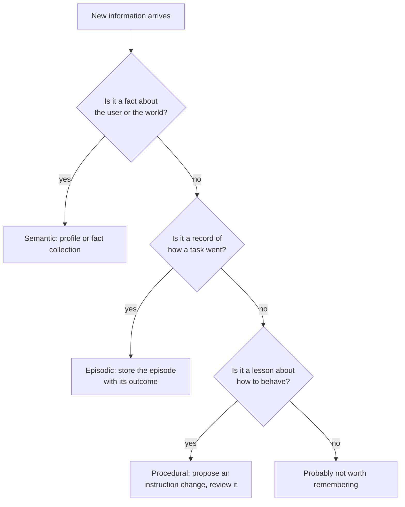
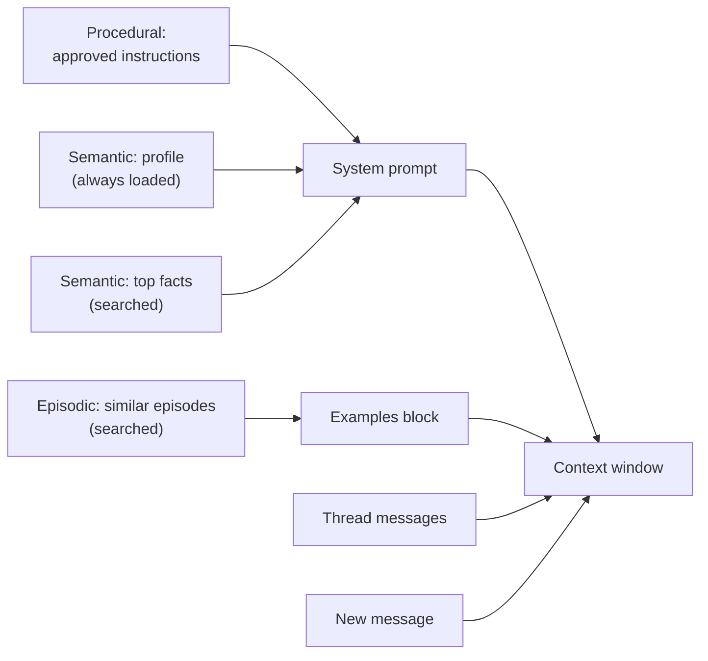

# Semantic, Episodic and Procedural Memory: The Complete Guide

> 📚 **Before you start**
>
> - [Short-Term vs Long-Term Memory](short-term-vs-long-term-memory.md), for the store, namespaces and the memory budget.
> - [Examples vs Rules](../02-the-context-window-as-a-budget/examples-vs-rules.md), for choosing examples per request and showing trajectories.
> - [System Prompts at the Right Altitude](../02-the-context-window-as-a-budget/system-prompts-at-the-right-altitude.md), for what belongs in instructions.
> - [Schema-Guided Extraction with Pydantic](../../knowledge-graphs-ontologies-and-unstructured-data/course.md#m5) is helpful but optional; this lesson uses a small Pydantic model and explains it.

## Introduction

Meet Kavya, three years into her job at a chartered accountant's office in Chennai. In tax season, three different kinds of memory make her fast:

- She **knows things** about clients: Mr. Iyer is a senior citizen, has capital gains from mutual funds, and files ITR-2.
- She **remembers what happened**: last year Mr. Iyer's refund was stuck for two months because his bank account wasn't pre-validated on the e-filing portal. She fixed it by validating the account and raising a refund reissue request.
- She **knows how to work**: always reconcile Form 26AS and the AIS before filing; never file on the client's word alone.

A new intern has none of the three. Facts can be read from the client file in ten minutes. The other two take years.

Psychologists separate human long-term memory along the same lines: **semantic** memory (facts), **episodic** memory (experiences) and **procedural** memory (skills). In 2023 the CoALA paper (Cognitive Architectures for Language Agents, Sumers and colleagues) applied this split to LLM agents, and it has become the standard vocabulary for designing agent memory. The split matters because each kind is **written, stored, retrieved and put into the context differently**. This lesson builds all three and assembles them into one prompt.

> 💡 **Key Insight**
>
> Ask *what the memory will be used for*. **Semantic** memory holds facts and is injected as background ("what you know about this user"). **Episodic** memory holds past experiences and is injected as **examples** of how a similar case went. **Procedural** memory holds how to behave and is injected as **instructions**, which means changing it changes every future conversation.

---

## Core Explanation

### 1. Three kinds, three jobs

| | Semantic | Episodic | Procedural |
|---|---|---|---|
| **Human analogy** | Knowing that Mr. Iyer files ITR-2 | Remembering last year's stuck refund | Knowing to check 26AS first |
| **Answers** | "What is true?" | "What happened when we did this before?" | "How should I do this?" |
| **Agent example** | User profile, preferences, facts about their world | Past conversations or task runs, with outcome | System prompt rules, learned instructions, skills |
| **Stored as** | A profile document or a collection of facts | Episode records: situation, actions, outcome, lesson | Versioned instructions |
| **Retrieved by** | Always load the profile; search the collection | Similarity to the current situation | Loaded every call (or by task type) |
| **Injected as** | Background in the system prompt | Few-shot examples | Instructions |
| **Main risk** | Stale or wrong facts | Copying a bad past example | One bad update affects every user |



We'll build all three for RailSathi in one store, using the namespaces from the last lesson.

```python
import hashlib, json, math
import numpy as np
from langgraph.store.memory import InMemoryStore

def approx_tokens(text):
    return math.ceil(len(text) / 4)

STOP_WORDS = {"a", "an", "the", "for", "i", "my", "should", "which", "on", "with", "to", "of", "and",
              "her", "she", "in", "is", "was", "it", "we", "be", "can", "you", "me", "this", "that"}

def toy_embed(texts):
    """Bag-of-words hashed into 256 numbers. A stand-in for a real embedding model."""
    vectors = []
    for text in texts:
        v = np.zeros(256)
        for word in "".join(c if c.isalnum() else " " for c in text.lower()).split():
            if word not in STOP_WORDS:
                v[int(hashlib.md5(word.encode()).hexdigest(), 16) % 256] += 1
        norm = np.linalg.norm(v)
        vectors.append((v / norm if norm else v).tolist())
    return vectors

store = InMemoryStore(index={"dims": 256, "embed": toy_embed, "fields": ["text"]})
USER = "u-104"
```

### 2. Semantic memory, shape 1: a profile

A **profile** is one document per user with a fixed set of fields. It's small, always loaded, and updated in place. Defining it with a Pydantic model (a Python class that validates data against declared field types) keeps it tidy: every update must produce a valid profile, so a model can't invent random fields.

```python
from pydantic import BaseModel, Field

class TravellerProfile(BaseModel):
    name: str | None = None
    home_station: str | None = None
    usual_class: str | None = None
    payment: str | None = None
    dietary: str | None = None
    companions: list[str] = Field(default_factory=list)

def update_profile(user_id, changes):
    """Merge new facts into the stored profile. Unknown fields are rejected by the model class."""
    item = store.get(("users", user_id, "profile"), "main")
    current = TravellerProfile(**item.value) if item else TravellerProfile()
    merged = TravellerProfile(**{**current.model_dump(), **changes})
    store.put(("users", user_id, "profile"), "main", merged.model_dump(), index=False)
    return merged

update_profile(USER, {"name": "Priya Nair", "home_station": "PUNE", "payment": "UPI"})
profile = update_profile(USER, {"usual_class": "3A", "companions": ["mother Lata, 68, needs lower berth"]})
print(json.dumps(profile.model_dump(), indent=1))
print("profile tokens:", approx_tokens(json.dumps(profile.model_dump(exclude_none=True))))
```

Output:

```
{
 "name": "Priya Nair",
 "home_station": "PUNE",
 "usual_class": "3A",
 "payment": "UPI",
 "dietary": null,
 "companions": [
  "mother Lata, 68, needs lower berth"
 ]
}
profile tokens: 35
```

Notice `index=False` in `put`: the profile is always loaded whole, so it doesn't need to be searchable. A profile is easy to read, easy for a user to view and correct, and it can't fill up with duplicates. Its weakness is that it only holds what you planned for. Where does "dislikes the Udyan Express because it's always late" go?

### 3. Semantic memory, shape 2: a collection

A **collection** is an open-ended set of small facts, each its own item, searched when needed. It holds anything, but it grows, it needs search, and it needs a policy for duplicates and contradictions (lesson 4).

```python
facts = {
    "udyan": "Dislikes Udyan Express because it is usually late.",
    "rac": "Prefers RAC over a waitlisted ticket.",
    "diwali": "Travels Pune to Kochi every Diwali with her mother.",
    "brother": "Brother Arjun lives in Chennai; visits him in summer.",
    "window": "Likes a window seat on day trains.",
}
for key, text in facts.items():
    store.put(("users", USER, "facts"), key, {"text": text})

for item in store.search(("users", USER, "facts"), query="Book Diwali trip to Kochi", limit=2):
    print(f"{item.score:.2f}  {item.value['text']}")
```

Output:

```
0.41  Travels Pune to Kochi every Diwali with her mother.
0.00  Dislikes Udyan Express because it is usually late.
```

| | Profile | Collection |
|---|---|---|
| **Holds** | A fixed set of fields | Anything |
| **Retrieval** | Load whole, every time | Search per request |
| **Updates** | Overwrite a field | Insert, update or delete items |
| **Duplicates** | Impossible | Likely, without a policy |
| **Best for** | Key facts used in most conversations | The long tail of occasionally useful facts |

Most products use both: a small profile always in the window, and a collection searched for the rest.

### 4. Episodic memory: what happened last time

Episodic memory stores **experiences**: a situation, what the agent did, how it turned out, and the lesson. It's how an agent gets better at a *kind* of task without anyone rewriting its prompt. When a similar situation comes up, the closest episodes are retrieved and shown as examples, the dynamic examples idea from [Examples vs Rules](../02-the-context-window-as-a-budget/examples-vs-rules.md), now drawn from the agent's own history.

Episodes are worth storing when the outcome is known. A successful case is a good example; a failed one is a warning.

```python
episodes = [
    {"situation": "Tatkal ticket cancelled by passenger, asks for refund",
     "actions": "Checked rules section 4.5; explained confirmed Tatkal is not refundable; offered TDR route if train was late.",
     "outcome": "success", "lesson": "Quote section 4.5 and offer the TDR option before the user argues."},
    {"situation": "Train cancelled by railways, passenger wants refund",
     "actions": "Confirmed cancellation from status API; full refund is automatic; gave timeline of 5 to 7 days.",
     "outcome": "success", "lesson": "Check the cancellation status first; no TDR is needed."},
    {"situation": "Refund for money debited but ticket not booked",
     "actions": "Asked for UPI reference; found failed booking; refund auto-reversed within 3 days.",
     "outcome": "success", "lesson": "Ask for the UPI reference number up front."},
    {"situation": "Passenger asked to change name on confirmed ticket",
     "actions": "Said name change is impossible and suggested cancelling.",
     "outcome": "failure", "lesson": "Name change IS allowed for family members with a request at the station; check before refusing."},
]
for i, ep in enumerate(episodes):
    store.put(("agent", "refund-desk", "episodes"), f"ep-{i}", {**ep, "text": ep["situation"]})

def similar_episodes(situation, k=2):
    return store.search(("agent", "refund-desk", "episodes"), query=situation, limit=k)

def render_episode(ep):
    tag = "WORKED" if ep["outcome"] == "success" else "DID NOT WORK"
    return (f"<example outcome=\"{tag}\">\nSituation: {ep['situation']}\nWhat was done: {ep['actions']}\n"
            f"Lesson: {ep['lesson']}\n</example>")

for item in similar_episodes("My train was cancelled, I want my money back"):
    print(f"{item.score:.2f}", render_episode(item.value), sep="\n")
```

Output:

```
0.34
<example outcome="WORKED">
Situation: Train cancelled by railways, passenger wants refund
What was done: Confirmed cancellation from status API; full refund is automatic; gave timeline of 5 to 7 days.
Lesson: Check the cancellation status first; no TDR is needed.
</example>
0.17
<example outcome="WORKED">
Situation: Tatkal ticket cancelled by passenger, asks for refund
What was done: Checked rules section 4.5; explained confirmed Tatkal is not refundable; offered TDR route if train was late.
Lesson: Quote section 4.5 and offer the TDR option before the user argues.
</example>
```

Three choices are worth copying:

- **The search key is the situation**, not the whole episode. You want episodes whose *problem* resembles the current one; the actions and lesson come along for the ride. That's why only `text` (the situation) is indexed.
- **Failures are kept and labelled.** "This did not work" is valuable, as long as the label is unmistakable, or the model may copy the bad behaviour.
- **The lesson is explicit.** A short lesson line is easier for the model to apply than a long transcript. Some systems store the full trajectory too (as a file or reference) for debugging.

Notice where episodic memory lives: under an **agent** namespace, not a user one. Episodes about how refund cases go are useful across users, as long as they contain no personal details. If they do, scrub them before storing, or keep episodes per user.

### 5. Procedural memory: how to behave

Procedural memory is **how** the agent works: its instructions. The simplest version is the system prompt you wrote. The interesting version **learns**: after feedback, a model reflects on what went wrong and proposes a change to the instructions, which is stored as a new version.

That failed name-change episode is exactly such a lesson. Here a pretend reflection model turns it into a proposed instruction; in a real system this is an LLM call with a prompt like "Given these instructions and this feedback, propose the smallest change that would have prevented the mistake."

```python
from langchain_core.language_models.fake_chat_models import FakeListChatModel

store.put(("agent", "refund-desk", "instructions"), "v1", {
    "text": "You are RailSathi's refund assistant. Be accurate about refund rules and quote the rule section.",
    "version": 1})

reflector = FakeListChatModel(responses=[json.dumps({
    "add": "Before refusing any change to a booking, check whether the rules allow it (for example, name "
           "changes for family members are allowed with a request at the station).",
    "reason": "The agent refused a name change that the rules permit."})])

def learn_from_feedback(feedback):
    versions = store.search(("agent", "refund-desk", "instructions"))
    current = max(versions, key=lambda i: i.value["version"]).value
    proposal = json.loads(reflector.invoke(
        f"Instructions:\n{current['text']}\n\nFeedback:\n{feedback}\n\nPropose the smallest change as JSON.").content)
    new = {"text": current["text"] + "\n" + proposal["add"], "version": current["version"] + 1,
           "reason": proposal["reason"], "status": "proposed"}
    store.put(("agent", "refund-desk", "instructions"), f"v{new['version']}", new)
    return new

proposed = learn_from_feedback("User complained: you told me I can't change my father's name on the ticket, "
                               "but the station did it in five minutes.")
print(f"v{proposed['version']} ({proposed['status']}): {proposed['reason']}\n{proposed['text']}")
```

Output:

```
v2 (proposed): The agent refused a name change that the rules permit.
You are RailSathi's refund assistant. Be accurate about refund rules and quote the rule section.
Before refusing any change to a booking, check whether the rules allow it (for example, name changes for family members are allowed with a request at the station).
```

The new version is stored as **proposed**, not live. That's deliberate. A semantic memory error affects one user; a procedural memory error affects **every** conversation from now on. Treat learned instructions like code changes:

- **Version every change** and keep the reason, so you can see why the prompt says what it says, and roll back.
- **Review or test before promoting.** Run your evaluation set against the new version (or have a human approve it) before it goes live.
- **Watch the altitude.** Reflection loves to add narrow rules ("for name changes, do X"). Prefer the general lesson ("check the rules before refusing"), as in [System Prompts at the Right Altitude](../02-the-context-window-as-a-budget/system-prompts-at-the-right-altitude.md).
- **Watch the size.** Instructions are loaded on every call. A prompt that grows by a line after every complaint will rot.

Procedural memory also comes in a packaged form: **skills**, folders of instructions and scripts that an agent loads only when a task needs them. They're covered in [Tools, Agent Skills and Code Execution](../../tools-agent-skills-and-code-execution/course.md).

### 6. Assembling all three into one context

Each kind of memory goes into its own part of the prompt. Order matters for the reasons from Module 2: stable things first (so they can be cached), and the current request last.

```python
def build_context(user_id, message, approved_version=1):
    instructions = store.get(("agent", "refund-desk", "instructions"), f"v{approved_version}").value["text"]
    profile = store.get(("users", user_id, "profile"), "main").value
    facts = store.search(("users", user_id, "facts"), query=message, limit=2)
    examples = similar_episodes(message, k=2)

    system = (f"{instructions}\n\n<user_profile>\n{json.dumps({k: v for k, v in profile.items() if v})}\n</user_profile>"
              f"\n\n<relevant_facts>\n" + "\n".join(f"- {f.value['text']}" for f in facts) + "\n</relevant_facts>")
    shots = "\n".join(render_episode(e.value) for e in examples)
    parts = {"procedural (instructions)": instructions, "semantic (profile + facts)": system[len(instructions):],
             "episodic (examples)": shots, "user message": message}
    for name, text in parts.items():
        print(f"{name:<28} {approx_tokens(text):>4} tokens")
    return system, shots, message

system, shots, message = build_context(USER, "Our train to Kochi was cancelled, can we get a refund?")
print()
print(system)
```

Output:

```
procedural (instructions)      24 tokens
semantic (profile + facts)     79 tokens
episodic (examples)           145 tokens
user message                   14 tokens

You are RailSathi's refund assistant. Be accurate about refund rules and quote the rule section.

<user_profile>
{"name": "Priya Nair", "home_station": "PUNE", "usual_class": "3A", "payment": "UPI", "companions": ["mother Lata, 68, needs lower berth"]}
</user_profile>

<relevant_facts>
- Travels Pune to Kochi every Diwali with her mother.
- Dislikes Udyan Express because it is usually late.
</relevant_facts>
```



The window gets a few hundred tokens of memory, each piece chosen for this request and placed where its kind of information belongs.

### 7. Choosing the type

| Information | Type | Why |
|---|---|---|
| "My mother needs a lower berth" | Semantic (profile) | A lasting fact used in most bookings |
| "I visited Chennai in May 2025" | Semantic (collection) or nothing | Useful only occasionally; maybe not worth keeping |
| "Last time we rebooked via RAC and it confirmed at chart time" | Episodic | An experience with an outcome, useful for similar cases |
| "When the user is angry, first acknowledge, then give the rule" | Procedural | How to behave, for everyone |
| "The user's OTP is 482913" | None | Secret and short-lived; never store it |

---

## Try It Yourself

1. **Reject a bad field.** Call `update_profile(USER, {"favourite_colour": "blue"})`. What happens, and why is that a feature?
2. **A failure as a warning.** Retrieve the single most similar episode for "Can I change the passenger name on my ticket?" Does the rendered example make the right behaviour clear?
3. **Classify.** Which type of memory (or none) is each: (a) "Prefers Hindi replies"; (b) "On 3 Oct, the agent booked the wrong date because it read 03/10 as 10 March"; (c) "Always confirm dates in words, like 3 October, before booking"; (d) "Card ending 4417, CVV 123".

<details>
<summary>Show answers</summary>

**1.**

```python
from pydantic import ValidationError

try:
    checked = TravellerProfile(**{**profile.model_dump(), "favourite_colour": "blue"})
    print("accepted; favourite_colour kept?", "favourite_colour" in checked.model_dump())
except ValidationError:
    print("rejected")
```

Output:

```
accepted; favourite_colour kept? False
```

By default Pydantic **ignores** unknown fields, so the profile stays clean but the information is silently dropped. If you'd rather catch it (so it can go to the fact collection instead), set `model_config = {"extra": "forbid"}` on the class, and the update raises a `ValidationError`. Either way the profile can't grow fields you didn't design.

**2.**

```python
best = similar_episodes("Can I change the passenger name on my ticket?", k=1)[0]
print(render_episode(best.value))
```

Output:

```
<example outcome="DID NOT WORK">
Situation: Passenger asked to change name on confirmed ticket
What was done: Said name change is impossible and suggested cancelling.
Lesson: Name change IS allowed for family members with a request at the station; check before refusing.
</example>
```

Yes: the outcome label says it did not work, and the lesson states the correct behaviour. Without the label and lesson, the example would teach the model to refuse.

**3.** (a) Semantic, profile (a lasting preference used every time). (b) Episodic (a specific event with an outcome, useful for similar cases). (c) Procedural (a rule for how to behave, likely learned from (b)). (d) None: payment secrets must never be stored in memory.

</details>

---

## Real-World Examples

- **Chat assistants with memory** keep semantic memories about users (preferences, background) that users can view and delete, and use them as background in new chats.
- **Coding agents** keep procedural memory in instruction files (`CLAUDE.md`, `AGENTS.md`, next lesson) and in skills; some also save notes about corrections the user gave, so the same mistake isn't repeated.
- **Support and sales agents** retrieve similar past tickets or calls (episodic) as examples, and keep a CRM profile per customer (semantic).
- **LangChain's LangMem** library is organised around these same three types, with tools for extracting semantic memories, storing episodes and optimising prompts from feedback.

---

## Common Misconceptions

### "Memory types are just labels"

They change the design: how you store each kind, how you search it, where it goes in the prompt and how careful you must be when updating it.

### "Procedural memory should update itself automatically"

Learned instructions affect every future conversation. Version them and evaluate or review before they go live.

### "Episodic memory means saving whole transcripts"

Raw transcripts are long and noisy. Useful episodes are distilled: the situation, what was done, the outcome and the lesson, with a pointer to the full record if needed.

### "Everything about the user belongs in the profile"

Profiles should hold the few facts used in most conversations. The long tail belongs in a searchable collection, and secrets belong nowhere.

---

## Interview Relevance

*"What kinds of memory does an agent need?"* A strong answer uses the semantic, episodic and procedural split (from cognitive science, applied to agents by the CoALA paper) and explains the consequences: semantic facts stored as a profile (fixed schema, always loaded, updated in place) or a collection (open-ended, searched, needs deduplication); episodic memories stored as situation, actions, outcome and lesson, retrieved by similarity and injected as few-shot examples, with failures clearly labelled; procedural memory as versioned instructions, possibly learned by reflection on feedback, but reviewed or evaluated before promotion because it affects every user. Bonus points for placing each kind in the prompt (instructions and profile first, examples next, the request last) and for keeping secrets out.

---

## Key Takeaways

- **Semantic memory is facts**: a small, always-loaded profile plus a searchable collection.
- **Episodic memory is experience**: distilled episodes with outcomes, retrieved by situation and shown as examples.
- **Procedural memory is behaviour**: versioned instructions, changed carefully because they affect everyone.
- **Each type has its place in the prompt**: instructions and profile in the system prompt, episodes as examples, the request last.
- **Not everything deserves memory**: secrets and one-off trivia should be left out.

---

**Up next:** [Memory Files: CLAUDE.md and AGENTS.md](memory-files-claude-md-and-agents-md.md)
