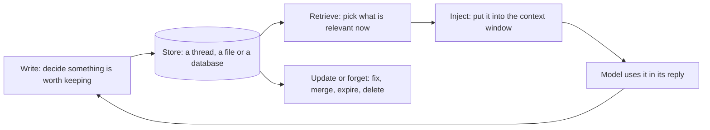

# Short-Term vs Long-Term Memory: The Complete Guide

> 📚 **Before you start**
>
> - [Agents with Memory](../../langgraph-complete-guide/05-workflows-and-agents/agents-with-memory.md) and [Persistence and Checkpointers](../../langgraph-complete-guide/06-chatbots-and-persistence/persistence-and-checkpointers.md), for checkpointers and `thread_id`.
> - [Offloading Context to Files and Scratchpads](../03-just-in-time-context/offloading-context-to-files-and-scratchpads.md), for notes that live outside the window.
> - [Lab: Keep a 200-step agent inside its budget](../03-just-in-time-context/lab-keep-a-200-step-agent-inside-its-budget.md), for managing a long thread.
> - Helpful but optional: [Long-Term Memory with Stores](../../langgraph-complete-guide/course.md#m7) in the LangGraph course. This lesson explains the store from scratch.

## Introduction

Think about your family doctor. During one appointment, she keeps track of everything you've said: the cough started on Monday, it's worse at night, you already tried the syrup. That's one conversation, and she holds it all in her head while you're in the room. When you walk out, most of that detail fades. But some things are written into your file: "allergic to penicillin", "BP borderline, recheck in 3 months", "father had diabetes". Next year, a different visit, possibly a different doctor at the same clinic, opens the file and knows those things in the first minute.

Agents need both kinds of memory. **Short-term memory** is everything about *this* conversation: the messages, tool results, the plan, the scratchpad. Module 3 was all about keeping it inside the budget. **Long-term memory** is what should still be known *next time*: the user's preferences, facts about their world, lessons from past tasks. It lives outside any one conversation and is brought back when it's relevant.

This lesson draws the line between the two, shows how each is built in LangGraph (a checkpointer for short-term, a **store** for long-term), wires them into one agent, and covers the question that turns memory into a context-engineering problem: how much of what you remember should go into the window?

> 💡 **Key Insight**
>
> The model never remembers anything itself; its weights don't change between calls. **Short-term memory** is the thread's own history, saved by a checkpointer and gone when a new thread starts. **Long-term memory** is text your code stores under a key such as the user's ID, and puts back into the context of future threads. Both end up as tokens in the window, so both are spent from the same budget.

---

## Core Explanation

### 1. Memory is context you saved

Every kind of agent memory follows the same loop:



The difference between short-term and long-term memory is **where the store is** and **how long it lives**:

![Three columns. Short-term memory on the left: thread state with messages, tool results, plan and scratchpad, saved after every step by a checkpointer under a thread ID, and ending with the thread. The context window in the middle holds instructions and memory files, retrieved memories, this thread's messages, the new message, and the model's reply. Long-term memory on the right holds semantic facts, episodic past episodes and procedural how-to knowledge; the window searches it for memories and the model writes new ones back](/img/diagrams/context-engineering-and-agent-memory/memory-systems.svg)
*Short-term memory is loaded whole for one thread. Long-term memory is searched, and only the relevant pieces enter the window.*

### 2. Short-term memory: the thread

You met short-term memory in the LangGraph course: compile a graph with a **checkpointer**, pass a `thread_id`, and every call on that thread starts from the saved state. Let's rebuild a tiny version so we can see exactly where it stops.

Our assistant is RailSathi again. A pretend model answers one kind of question, "which berth does my mother need?", by looking for the answer in whatever context it is given. Like a real model, it can only use what is in front of it.

```python
from langchain_core.messages import AIMessage, HumanMessage, SystemMessage
from langgraph.checkpoint.memory import InMemorySaver
from langgraph.graph import END, START, MessagesState, StateGraph

def pretend_model(messages):
    """Answers from whatever context it is given, nothing else."""
    question = messages[-1].content.lower()
    context = " ".join(m.content.lower() for m in messages[:-1])
    if "which berth" in question:
        for berth in ["lower", "middle", "upper", "side lower"]:
            if f"{berth} berth" in context:
                return AIMessage(f"Your mother needs a {berth} berth.")
        return AIMessage("I don't know yet. Which berth does your mother prefer?")
    return AIMessage("Noted.")

def assistant(state: MessagesState):
    return {"messages": [pretend_model(state["messages"])]}

builder = StateGraph(MessagesState)
builder.add_node("assistant", assistant)
builder.add_edge(START, "assistant")
builder.add_edge("assistant", END)
chat = builder.compile(checkpointer=InMemorySaver())

def say(graph, text, thread, **kwargs):
    out = graph.invoke({"messages": [HumanMessage(text)]}, {"configurable": {"thread_id": thread}}, **kwargs)
    print(f"[{thread}] user: {text}\n[{thread}] bot:  {out['messages'][-1].content}")

say(chat, "My mother is 68, she always needs a lower berth.", "monday-chat")
say(chat, "Which berth should I book for her?", "monday-chat")
say(chat, "Which berth should I book for my mother?", "friday-chat")
```

Output:

```
[monday-chat] user: My mother is 68, she always needs a lower berth.
[monday-chat] bot:  Noted.
[monday-chat] user: Which berth should I book for her?
[monday-chat] bot:  Your mother needs a lower berth.
[friday-chat] user: Which berth should I book for my mother?
[friday-chat] bot:  I don't know yet. Which berth does your mother prefer?
```

On Monday's thread, the fact is in the history, so the model uses it. On Friday the user opens a **new chat**, a new `thread_id`, and the fact is gone. Nothing is broken: the checkpointer did exactly its job, which is to remember *this thread*.

Short-term memory has three properties worth naming:

| Property | What it means |
|---|---|
| **Scoped to one thread** | A new conversation starts empty |
| **Complete and ordered** | Everything that happened, in sequence, which is why it grows (Module 3) |
| **Loaded whole** | The thread's messages go into the window together; you trim, clear or compact them, but you don't search them |

### 3. Long-term memory: a store with namespaces

Long-term memory needs a place that isn't tied to a thread. LangGraph calls it a **store**: a key-value database where each item lives under a **namespace** (a tuple of strings, like a folder path) and a **key** (like a file name), and holds a JSON-style dictionary. `InMemoryStore` keeps it in RAM, which is perfect for learning; production systems use a database-backed store with the same interface.

```python
from langgraph.store.memory import InMemoryStore

store = InMemoryStore()
priya = ("users", "u-104", "facts")         # namespace: whose memory, and what kind

store.put(priya, "mother-berth", {"text": "Mother (Lata, 68) needs a lower berth."})
store.put(priya, "payment", {"text": "Pays with UPI; never wants card payments."})
store.put(("users", "u-221", "facts"), "home-station", {"text": "Lives near Pune; usually boards at PUNE."})

print(store.get(priya, "mother-berth").value)
for item in store.search(("users", "u-104")):          # everything under a namespace prefix
    print(item.namespace, item.key, "->", item.value["text"])
print(sorted(store.list_namespaces()))
```

Output:

```
{'text': 'Mother (Lata, 68) needs a lower berth.'}
('users', 'u-104', 'facts') mother-berth -> Mother (Lata, 68) needs a lower berth.
('users', 'u-104', 'facts') payment -> Pays with UPI; never wants card payments.
[('users', 'u-104', 'facts'), ('users', 'u-221', 'facts')]
```

Three ideas carry over to any memory store you'll ever use:

- **Namespaces scope memory.** `("users", "u-104", ...)` keeps Priya's memories away from every other user's. Getting this wrong is not a quality bug, it's a privacy incident: one user's facts showing up in another user's chat.
- **Keys let you update in place.** Writing to `"mother-berth"` again replaces the old fact instead of piling up a second, conflicting one.
- **Search returns items, not context.** Your code still decides which items to put into the window, and how.

### 4. Both together: one agent, two memories

Now let's give the assistant both. A graph node can receive the store through LangGraph's `Runtime` object, along with a **context** object that carries per-call settings such as the user's ID. Two new nodes do the memory work around the model:

- `recall` searches the user's namespace and saves what it finds in a `memories` field of the state.
- `remember` stores a fact when the user explicitly says "remember". (Lesson 4 replaces this crude rule with a model that decides what to keep.)

The assistant node then builds the prompt: a system message with the memories, followed by the thread's messages. It also keeps a copy of the last prompt in `last_prompt`, so we can look at exactly what the model saw.

```python
from dataclasses import dataclass
from langgraph.runtime import Runtime

@dataclass
class UserContext:
    user_id: str

class State(MessagesState):
    memories: str

def recall(state: State, runtime: Runtime[UserContext]):
    items = runtime.store.search(("users", runtime.context.user_id, "facts"))
    return {"memories": "\n".join(f"- {item.value['text']}" for item in items)}

last_prompt = []

def assistant_with_memory(state: State):
    prompt = list(state["messages"])
    if state.get("memories"):
        prompt = [SystemMessage("What you remember about this user:\n" + state["memories"])] + prompt
    last_prompt[:] = prompt
    return {"messages": [pretend_model(prompt)]}

def remember(state: State, runtime: Runtime[UserContext]):
    last_user = [m for m in state["messages"] if isinstance(m, HumanMessage)][-1].content
    if last_user.lower().startswith("remember"):
        namespace = ("users", runtime.context.user_id, "facts")
        key = f"fact-{len(runtime.store.search(namespace)) + 1}"
        runtime.store.put(namespace, key, {"text": last_user.split(":", 1)[1].strip()})
    return {}

builder = StateGraph(State, context_schema=UserContext)
builder.add_node("recall", recall)
builder.add_node("assistant", assistant_with_memory)
builder.add_node("remember", remember)
builder.add_edge(START, "recall")
builder.add_edge("recall", "assistant")
builder.add_edge("assistant", "remember")
builder.add_edge("remember", END)

memory_store = InMemoryStore()
agent = builder.compile(checkpointer=InMemorySaver(), store=memory_store)

say(agent, "Remember: my mother always needs a lower berth.", "monday-chat", context=UserContext("u-104"))
say(agent, "Which berth should I book for my mother?", "friday-chat", context=UserContext("u-104"))
say(agent, "Which berth should I book for my mother?", "another-user-chat", context=UserContext("u-221"))
```

Output:

```
[monday-chat] user: Remember: my mother always needs a lower berth.
[monday-chat] bot:  Noted.
[friday-chat] user: Which berth should I book for my mother?
[friday-chat] bot:  Your mother needs a lower berth.
[another-user-chat] user: Which berth should I book for my mother?
[another-user-chat] bot:  I don't know yet. Which berth does your mother prefer?
```

Friday's chat is a brand-new thread, yet the answer is right, because `recall` found the stored fact and the assistant put it into the window before the model ran. And user `u-221`, on their own thread, gets nothing from Priya's memories: the namespace did its job.

Here's exactly what the model saw on the last call (user u-221), and then on another Friday question from Priya. Always look:

```python
for m in last_prompt:
    print(f"{m.type:>6}: {m.content}")
print("---")
say(agent, "Which berth again?", "friday-chat", context=UserContext("u-104"))
for m in last_prompt:
    print(f"{m.type:>6}: {m.content}")
```

Output:

```
 human: Which berth should I book for my mother?
---
[friday-chat] user: Which berth again?
[friday-chat] bot:  Your mother needs a lower berth.
system: What you remember about this user:
- my mother always needs a lower berth.
 human: Which berth should I book for my mother?
    ai: Your mother needs a lower berth.
 human: Which berth again?
```

Notice two design choices. The memories are put **at the top**, as a system message, where instructions and background belong. And they are **not saved into the thread's messages**: `recall` refreshes `memories` on every turn, so a long conversation doesn't pile up copies, and if a memory changes mid-thread, the next turn sees the new version.

### 5. Side by side

| | Short-term memory | Long-term memory |
|---|---|---|
| **Scope** | One thread | Across threads: a user, a team, an organisation, an agent |
| **Lives in** | Thread state, saved by a checkpointer | A store, database, files or a graph |
| **Lifetime** | Until the thread ends (or is compacted) | Until updated, expired or deleted |
| **Written by** | Happens automatically as the conversation runs | A deliberate decision: the model, a rule, or a background process |
| **Read by** | Loaded whole, then trimmed or compacted | Searched; only relevant items are injected |
| **Typical content** | Messages, tool results, plan, scratchpad | Preferences, facts, past episodes, learned instructions |
| **Main risk** | Overflowing the budget (Module 3) | Stale, wrong, leaked or poisoned memories (lesson 4) |
| **LangGraph** | `checkpointer` + `thread_id` | `store` + namespace |

Module 3's tools sit on the boundary. A notes file written during one task is short-term in purpose (it helps this task survive compaction), but it lives outside the window, and a **progress file** that a new session reads is already a simple form of long-term memory.

### 6. The memory budget

Long-term memory grows without limit: every week of use adds more facts. If `recall` injects *everything*, memory becomes the biggest item in the window, and most of it is irrelevant to the current question. That is context rot from Module 2, self-inflicted.

The fix is the same as for documents: **retrieve, don't dump**. Give the store an embedding index and search with the user's message as the query. Here we use a deliberately simple embedding function (word counts hashed into 256 slots, ignoring common words) so it runs offline; a real system would call an embedding model.

```python
import hashlib, math
import numpy as np

STOP_WORDS = {"a", "an", "the", "for", "i", "my", "should", "which", "on", "with", "to", "of", "and",
              "her", "she", "in", "is", "over", "never", "wants", "sometimes", "often", "every", "has", "usually"}

def toy_embed(texts):
    """Bag-of-words hashed into 256 numbers. A stand-in for a real embedding model."""
    vectors = []
    for text in texts:
        v = np.zeros(256)
        for word in "".join(c if c.isalnum() else " " for c in text.lower()).split():
            if word not in STOP_WORDS:
                v[int(hashlib.md5(word.encode()).hexdigest(), 16) % 256] += 1
        norm = np.linalg.norm(v)
        vectors.append((v / norm if norm else v).tolist())
    return vectors

def approx_tokens(text):
    return math.ceil(len(text) / 4)

facts = ["Mother (Lata, 68) needs a lower berth.", "Pays with UPI; never wants card payments.",
         "Prefers window seats on day trains.", "Vegetarian; orders Jain food on Rajdhani trains.",
         "Travels Pune to Kochi every Diwali.", "Works in Bengaluru; often books Udyan Express.",
         "Has a senior citizen concession card for her mother.", "Dislikes waitlisted tickets; prefers RAC over WL.",
         "Brother Arjun lives in Chennai.", "Usually books 3A, sometimes 2A for long trips."] * 4

indexed = InMemoryStore(index={"dims": 256, "embed": toy_embed, "fields": ["text"]})
for i, fact in enumerate(facts):
    indexed.put(("users", "u-104", "facts"), f"f{i:02d}", {"text": fact})

question = "Which berth should I book for my mother?"
everything = "\n".join(facts)
top = indexed.search(("users", "u-104", "facts"), query=question, limit=3)
print(f"inject everything: {len(facts)} memories, ~{approx_tokens(everything)} tokens")
print(f"inject top 3:      ~{approx_tokens(' '.join(i.value['text'] for i in top))} tokens")
for item in top:
    print(f"  {item.score:.2f}  {item.value['text']}")
```

Output:

```
inject everything: 40 memories, ~431 tokens
inject top 3:      ~29 tokens
  0.47  Mother (Lata, 68) needs a lower berth.
  0.47  Mother (Lata, 68) needs a lower berth.
  0.47  Mother (Lata, 68) needs a lower berth.
```

Two things to notice. First, the saving: a handful of relevant memories instead of all of them. Second, **the duplicates**: the same fact appears several times, because this toy store was filled carelessly (we repeated the list four times). Real memory stores fill up with near-duplicates in just this way when every conversation re-saves what it heard. Deciding when to *update* instead of *insert* is the subject of lesson 4.

A practical pattern is to give memory its own line in the budget, just like the system prompt and tool definitions in Module 2: for example, "at most 5 memories or 400 tokens, whichever comes first", plus a small always-loaded profile (name, language, key constraints) that doesn't need searching.

### 7. The design questions every memory system answers

| Question | Options | Covered in |
|---|---|---|
| **What kinds of things do we remember?** | Facts, past episodes, how-to knowledge | Next lesson |
| **Where does it live, and who can edit it?** | A store, memory files a human can edit, a graph | Lessons 3 and 5 |
| **When and how do we write?** | During the conversation, or in the background afterwards; insert or update | Lesson 4 |
| **How do we retrieve?** | Load a profile always, search the rest, filter by namespace | This lesson and lesson 4 |
| **How do we forget?** | Overwrite, expire, decay, delete on request | Lesson 4 |
| **How do we keep it safe?** | Namespaces per user, provenance, treat memories as data | Lesson 4 |

---

## Try It Yourself

1. **Two facts, one key.** Using `store` from section 3, put a new value under Priya's `"payment"` key saying she now also uses a credit card for 1A. How many items are in her namespace afterwards, and what does `"payment"` hold?
2. **Count the cost of dumping.** Suppose each memory is about 12 tokens and a heavy user accumulates 3 new memories per week. How many tokens would "inject everything" cost after one year, and on every call?
3. **Scope check.** In section 4, `recall` uses `runtime.context.user_id`. What would go wrong if it used a fixed namespace `("users", "facts")` instead? Show it by searching such a namespace after two different users have written to it.

<details>
<summary>Show answers</summary>

**1.**

```python
store.put(priya, "payment", {"text": "Pays with UPI; uses a credit card only for 1A bookings."})
print(len(store.search(priya)), "items")
print(store.get(priya, "payment").value["text"])
```

Output:

```
2 items
Pays with UPI; uses a credit card only for 1A bookings.
```

Still two items: writing to an existing key replaces the old value, so there is one current fact instead of two that contradict each other.

**2.**

```python
memories = 3 * 52
print(memories, "memories,", memories * 12, "tokens on every call")
```

Output:

```
156 memories, 1872 tokens on every call
```

About 1,900 tokens on every call, nearly all irrelevant to any one question, and it keeps growing. Searching for the top few keeps it at a few dozen.

**3.**

```python
shared = InMemoryStore()
shared.put(("users", "facts"), "a", {"text": "Mother needs a lower berth."})        # written for u-104
shared.put(("users", "facts"), "b", {"text": "Allergic to peanuts."})               # written for u-221
print([i.value["text"] for i in shared.search(("users", "facts"))])
```

Output:

```
['Mother needs a lower berth.', 'Allergic to peanuts.']
```

Both users' facts come back for everyone. User u-221 would be offered a lower berth for a mother they never mentioned, and worse, u-104 might see u-221's health detail. Always put the user (or tenant) ID in the namespace, and take it from the authenticated request, never from something the model writes.

</details>

---

## Real-World Examples

- **Chat assistants** such as ChatGPT and Claude keep each conversation as short-term context and offer separate, user-visible memory features that carry preferences and facts across chats, which users can view and delete.
- **Coding agents** keep the session in their context window and use memory files (`CLAUDE.md`, `AGENTS.md`) and auto-written notes for what should be known in every session (lesson 3).
- **Customer-support agents** load a customer profile at the start of every ticket (long-term) while the ticket's conversation is the short-term memory.

---

## Common Misconceptions

### "The agent learns from our conversations"

Not in the sense of training. Long-term memory is stored text that is put back into the prompt. That makes it inspectable, editable and deletable, which you'll need for both debugging and privacy.

### "A long context window is a long-term memory"

A window holds one thread. When the thread ends, it's gone, and while it lasts, packing it full makes the model worse (context rot). Long-term memory is a separate store you search.

### "Long-term memory means storing every conversation"

Raw transcripts are a log, not a memory. Useful long-term memory is distilled: the facts, preferences and lessons, written so they can be found and used later.

### "Short-term memory is solved by the checkpointer"

The checkpointer saves the thread; it doesn't keep it small. Everything from Module 3, clearing, compaction and notes, is still needed for long threads.

---

## Interview Relevance

*"How would you add memory to an agent?"* A strong answer separates the two scopes. Short-term memory is the thread's state, persisted by a checkpointer keyed by thread ID, and kept inside the budget with trimming, clearing and compaction. Long-term memory is a store keyed by namespace (user or tenant ID, then memory type), written deliberately and retrieved by search, with only the relevant items injected under a token limit. Good answers mention that memory is just context (the model's weights don't change), that namespaces are a privacy boundary, that keys allow updates instead of duplicates, and that memory needs policies for writing, updating and forgetting.

---

## Key Takeaways

- **Memory is saved context**: write, store, retrieve, inject, then update or forget.
- **Short-term memory is the thread**: complete, ordered, loaded whole, and gone in a new thread.
- **Long-term memory is a store**: namespaced per user, keyed for updates, searched rather than dumped.
- **Both spend the same budget**, so give memory its own limit and inject only what is relevant.
- **Namespaces are a privacy boundary**: take the user ID from the authenticated request, never from the model.

---

**Up next:** [Semantic, Episodic and Procedural Memory](semantic-episodic-and-procedural-memory.md)
