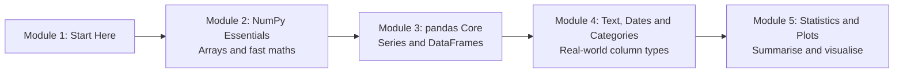

# How This Course Works

## Introduction

Think about the last time you looked at your UPI history and wondered how much you actually spent on chai and snacks last month. With a few hundred transactions you could scroll and add them up by hand. With a few hundred thousand rows (a shop's yearly sales, a city's train ticket bookings, every ball bowled in ten IPL seasons) you need tools that can crunch numbers in bulk and answer questions in one line of code.

Those tools are **NumPy** and **pandas**. Almost every data science, machine learning and data engineering library in Python is built on top of them or speaks their language. scikit-learn takes NumPy arrays. PyTorch tensors convert to and from them. Matplotlib and Seaborn plot them. Spark has a pandas API. Learn these two libraries properly and the rest of the data world becomes much easier to read.

This first article is short. It tells you what you will learn, how the lessons are built, which versions this course targets, and how to set up your machine so every example runs exactly as printed.

> 💡 **Key Insight**
>
> NumPy and pandas are fast because they make you **describe what to do to a whole column at once** instead of looping over values one by one. The single most important habit this course builds is thinking in whole arrays and whole columns.

---

## What You Will Learn

By the end of this course you will be able to:

- **Explain what a NumPy array is** and why it is much faster than a Python list for numbers.
- **Create, index, slice, reshape and combine arrays**, and use broadcasting to do arithmetic between arrays of different shapes without writing loops.
- **Choose the right data type** (`int8`, `float64`, `bool`, strings and more) and predict when NumPy will copy your data and when it will share it.
- **Summarise, sort, search and count** with NumPy's statistical functions.
- **Build and explore pandas Series and DataFrames**, select rows and columns with `.loc` and `.iloc`, sort, filter, reindex and iterate correctly.
- **Clean text, parse dates and use categorical data**, the three column types that cause the most trouble in real datasets.
- **Describe a dataset in numbers and quick charts** using pandas' statistics and plotting methods.
- **Write modern code for NumPy 2 and pandas 3**, and recognise outdated code (such as `df.append`, `np.float_` or the old `Panel`) when you find it in older tutorials.

### The course at a glance



Module 2 gives you NumPy, the engine. Module 3 builds pandas on top of it: labelled rows and columns around NumPy-style data. Module 4 handles the messy column types every real dataset has. Module 5 turns tables into summaries and charts, and ends with a lab where you clean a messy CSV from start to finish.

---

## Which Versions This Course Uses

Both libraries changed a lot recently, and a large share of the tutorials online still show older behaviour. This course is written for, and every example is tested against:

| Library | Version | What changed that matters to you |
|---|---|---|
| **NumPy** | 2.5 | NumPy 2 removed many old aliases (`np.float_`, `np.NaN`, `np.Inf`), changed how mixed types are promoted, added the `np.strings` module and a variable-length string dtype, and prints scalars as `np.float64(3.0)` in the REPL. |
| **pandas** | 3.0 | pandas 3 makes **Copy-on-Write** the only behaviour, uses a real **string dtype** (`str`) for text columns by default, parses dates at microsecond resolution by default, and removed long-deprecated methods such as `DataFrame.append` and `applymap`. |
| **matplotlib** | 3.11 | Used only for quick charts in module 5. |

Whenever a lesson touches one of these changes, it says so and shows the old way next to the new one, so you can read older code without being confused by it.

### Set up your machine

You need **Python 3.12 or newer** (NumPy 2.5 requires it) and a code editor such as VS Code (or a Jupyter notebook, which suits data work well). Then install the libraries:

```bash
python -m pip install "numpy>=2.5" "pandas>=3.0" matplotlib
```

pandas 3 works without the optional `pyarrow` package, but installing it (`pip install pyarrow`) makes text columns faster and lower in memory. Everything in this course works either way, and the output looks the same.

Check that everything is installed:

```python
import numpy as np
import pandas as pd
import matplotlib

print("NumPy major version:", np.__version__.split(".")[0])
print("pandas major version:", pd.__version__.split(".")[0])
print("matplotlib imported:", matplotlib.__name__)
```

Output:

```
NumPy major version: 2
pandas major version: 3
matplotlib imported: matplotlib
```

If you see `1` for NumPy or `2` for pandas, upgrade before going further. Many examples will behave differently on the old versions.

### The import names everyone uses

The whole Python data community imports these libraries under the same short names. Use them too; every answer on the internet assumes them.

```python
import numpy as np
import pandas as pd
import matplotlib.pyplot as plt
```

---

## How the Lessons Work

Every article follows the same shape as the rest of the site (Before you start, Key Insight, Core Explanation, Try It Yourself, Real-World Examples, Common Misconceptions, Interview Relevance, Key Takeaways). This course also has three **labs**: editing an image as a NumPy array, exploring a sales dataset, and cleaning a messy CSV. Please don't skip them; they are where the methods turn into skills.

### How the code works

- **Every code block runs.** Within one lesson, the blocks build on each other, so run them in order in one file or one notebook.
- **Every output is real.** The text under `Output:` is exactly what the code printed when the lesson was tested with the versions above.
- **No downloads.** Every dataset is created inside the code, usually a small table of rupee prices, train journeys, cricket scores or shop sales. You can see all the data, so you can check every answer by eye.
- **Random numbers are seeded.** When an example uses random data, it creates a generator with a fixed seed (`np.random.default_rng(42)`), so you get the same numbers we did.

---

## What You Need Before Starting

You do **not** need any maths beyond school arithmetic and averages. You do need comfortable basic Python:

- **Lists, tuples, dictionaries and slicing.** Arrays and DataFrames reuse the same ideas. See [Python Programming › Strings and Data Structures](../../python-programming/course.md#m5).
- **Loops and `if` statements.** You will learn to replace many loops, so you need to know what they do. See [Python Programming › Control Flow](../../python-programming/course.md#m4).
- **Functions and lambdas.** pandas uses them for custom transformations. See [Python Programming › Functions and Iterators](../../python-programming/course.md#m6).

If any of those feel shaky, work through [Python Programming](../../python-programming/course.md) first. It will make this course much smoother.

---

## How to Get the Most Out of It

1. **Type the code, don't paste it.** Typing makes you read every argument.
2. **Predict the shape before you run.** For arrays and tables, say out loud what shape and dtype you expect. Most bugs in data code are shape or dtype surprises.
3. **Print small things.** Every dataset here is tiny on purpose. When something confuses you, print the intermediate result.
4. **Do the Try It Yourself exercises.** They are short and they target the exact spots where people go wrong.
5. **Keep the docs open.** The NumPy and pandas documentation is excellent. When a lesson mentions a function, glance at its page to see the other parameters it accepts.

---

## Key Takeaways

- **NumPy** gives you fast arrays and maths; **pandas** gives you labelled tables built on the same ideas. You learn them in that order.
- The course targets **NumPy 2.5 and pandas 3.0**, and calls out every important change from older versions.
- Every code example **runs as shown** and every output is **real**, with no downloads needed.
- You need **basic Python**: data structures, loops and functions.
- Think in **whole arrays and whole columns**, not loops. That habit is the point of the course.

---

**Up next:** [What is a NumPy Array?](../02-numpy-essentials/what-is-a-numpy-array.md)
