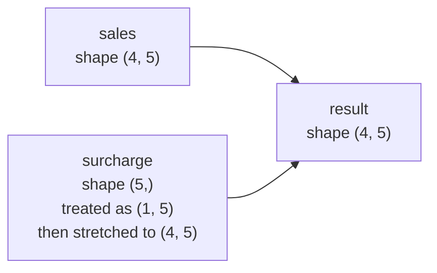
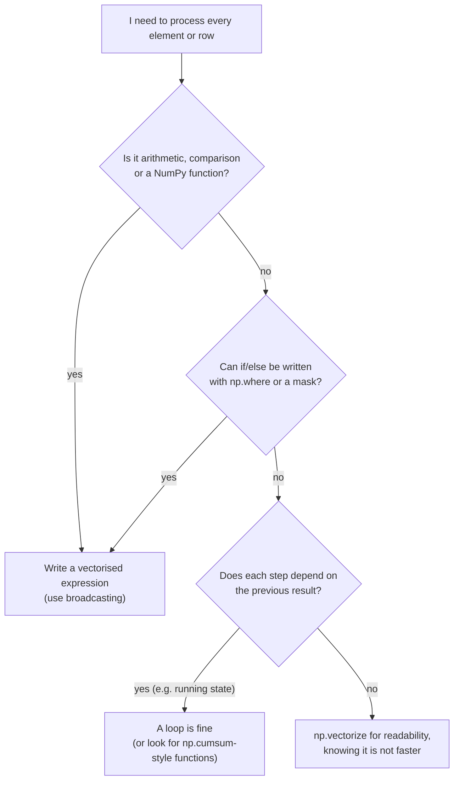

# Broadcasting and Iterating over Arrays: The Complete Guide

> 📚 **Before you start**
>
> - [What is a NumPy Array?](what-is-a-numpy-array.md), for shapes, axes and element-wise operations
> - [Creating, Indexing and Slicing Arrays](creating-indexing-and-slicing-arrays.md), for `np.newaxis` and slicing
> - [Python Programming › Control Flow](../../python-programming/course.md#m4), for `for` loops

## Introduction

A school canteen sells five items, and the prices of all of them go up by ₹2. Easy: add 2 to every price. Next month the canteen adds a different surcharge per item (₹1 on chai, ₹3 on samosa, and so on), applied to every one of its 30 days of sales. Then the manager wants a quick table of what every item would cost at three different discount levels. Each of these is "combine two collections of numbers that are not the same size", and with plain Python each needs its own nested loop.

NumPy handles all three with the same tool: **broadcasting**. Broadcasting is the set of rules that lets arrays of different shapes take part in one element-wise operation, by "stretching" the smaller one across the larger one without actually copying it. It is why `prices + 2` works, and it is also what makes many powerful one-liners possible: subtracting each column's average from a table, computing a distance between every pair of points, or building a multiplication table.

The second half of this article covers **iterating**: looping over arrays when you genuinely need to, the tools NumPy provides for it (`flat`, `ndenumerate`, `nditer`, `ndindex`), and why you should usually avoid it. By the end you will be able to predict whether two shapes broadcast, fix them when they do not, and choose between a loop and a vectorised expression.

> 💡 **Key Insight**
>
> Broadcasting compares shapes **from the right**. Two axes are compatible when they are **equal** or **one of them is 1**. An axis of length 1 is stretched to match the other, virtually, without copying memory.

---

## Core Explanation

### 1. The simplest case: an array and a single number

You have been broadcasting since the first lesson. When you add a number to an array, NumPy behaves as if the number were an array of the same shape filled with that value:

```python
import numpy as np

prices = np.array([10, 15, 20, 12, 25])     # chai, samosa, vada pav, poha, lassi
print(prices + 2)
print(prices * 0.9)                          # 10% discount
```

Output:

```
[12 17 22 14 27]
[ 9.  13.5 18.  10.8 22.5]
```

No array of 2s is ever created. NumPy reuses the same single value for every element. The same idea generalises to arrays.

### 2. A row across every row of a table

Sales for 4 days (rows) of 5 items (columns), and a per-item surcharge:

```python
sales = np.array([
    [40, 22, 15, 10, 8],
    [38, 25, 18, 12, 9],
    [45, 30, 20, 11, 12],
    [50, 28, 17, 14, 10],
])
surcharge = np.array([1, 3, 2, 1, 2])      # rupees per item

print(sales.shape, surcharge.shape)
print(sales * surcharge)                   # surcharge collected per day per item
```

Output:

```
(4, 5) (5,)
[[40 66 30 10 16]
 [38 75 36 12 18]
 [45 90 40 11 24]
 [50 84 34 14 20]]
```

The 1-D `surcharge` was applied to **every row**. Conceptually, NumPy stretched it down to a `(4, 5)` array.



### 3. The broadcasting rules

NumPy decides whether two shapes work together like this:

1. **Line up the shapes from the right** (the last axes first).
2. If one shape has fewer axes, **pad it on the left with 1s**.
3. For each axis, the lengths must be **equal**, or **one of them must be 1**. A length-1 axis is stretched to match.
4. If any axis fails rule 3, NumPy raises `ValueError: operands could not be broadcast together`.

Some worked examples:

| Shape A | Shape B | Line up (padded) | Result |
|---|---|---|---|
| `(4, 5)` | `()` (a number) | `(4, 5)` vs `(1, 1)` | `(4, 5)` |
| `(4, 5)` | `(5,)` | `(4, 5)` vs `(1, 5)` | `(4, 5)` |
| `(4, 5)` | `(4, 1)` | `(4, 5)` vs `(4, 1)` | `(4, 5)` |
| `(3, 1)` | `(1, 4)` | both stretched | `(3, 4)` |
| `(8, 1, 6, 1)` | `(7, 1, 5)` | `(8, 1, 6, 1)` vs `(1, 7, 1, 5)` | `(8, 7, 6, 5)` |
| `(4, 5)` | `(4,)` | `(4, 5)` vs `(1, 4)`: 5 vs 4 | **error** |

You can ask NumPy to apply the rules for you without doing any maths:

```python
print(np.broadcast_shapes((4, 5), (5,)))
print(np.broadcast_shapes((3, 1), (1, 4)))
print(np.broadcast_shapes((8, 1, 6, 1), (7, 1, 5)))
```

Output:

```
(4, 5)
(3, 4)
(8, 7, 6, 5)
```

### 4. When it fails, and how to fix it

The last row of the table is the most common broadcasting error. Suppose you have a **per-day** discount (4 values) and want to apply it to every item on that day:

```python
day_discount = np.array([0, 0, 5, 10])     # percent, one per day (row)
try:
    sales * (1 - day_discount / 100)
except ValueError as err:
    print("ValueError:", err)
```

Output:

```
ValueError: operands could not be broadcast together with shapes (4,5) (4,)
```

Lined up from the right, `5` meets `4`, which fails. The fix is to make the discount a **column** of shape `(4, 1)`, so it lines up with the rows. Use `np.newaxis` (or `None`, or `.reshape(-1, 1)`):

```python
factor = (1 - day_discount / 100)[:, np.newaxis]   # shape (4, 1)
print(factor.shape)
print((sales * factor).round(1))
```

Output:

```
(4, 1)
[[40.  22.  15.  10.   8. ]
 [38.  25.  18.  12.   9. ]
 [42.8 28.5 19.  10.4 11.4]
 [45.  25.2 15.3 12.6  9. ]]
```

The rule of thumb: **a 1-D array broadcasts as a row**. When you want it to act per row (down axis 0), turn it into a column first.

### 5. Classic broadcasting patterns

**Centering columns (subtract each column's mean).** This is the first step of many statistics and machine learning methods. Reductions with `keepdims=True` keep the reduced axis as length 1, so the result broadcasts back cleanly:

```python
col_mean = sales.mean(axis=0)                 # shape (5,): broadcasts as a row
print(col_mean)
print(sales - col_mean)

row_total = sales.sum(axis=1, keepdims=True)  # shape (4, 1): a column
print(row_total.ravel())
print((sales / row_total).round(2))           # each day's share per item
```

Output:

```
[43.25 26.25 17.5  11.75  9.75]
[[-3.25 -4.25 -2.5  -1.75 -1.75]
 [-5.25 -1.25  0.5   0.25 -0.75]
 [ 1.75  3.75  2.5  -0.75  2.25]
 [ 6.75  1.75 -0.5   2.25  0.25]]
[ 95 102 118 119]
[[0.42 0.23 0.16 0.11 0.08]
 [0.37 0.25 0.18 0.12 0.09]
 [0.38 0.25 0.17 0.09 0.1 ]
 [0.42 0.24 0.14 0.12 0.08]]
```

**Outer operations (every value with every value).** A column of shape `(n, 1)` combined with a row of shape `(1, m)` produces an `(n, m)` table. Here is every price at every discount level:

```python
discounts = np.array([0, 10, 25])                     # percent
price_table = prices[:, np.newaxis] * (1 - discounts / 100)
print(price_table)
print(price_table.shape)
```

Output:

```
[[10.    9.    7.5 ]
 [15.   13.5  11.25]
 [20.   18.   15.  ]
 [12.   10.8   9.  ]
 [25.   22.5  18.75]]
(5, 3)
```

And the times table from primary school in one line:

```python
n = np.arange(1, 6)
print(n[:, None] * n[None, :])
```

Output:

```
[[ 1  2  3  4  5]
 [ 2  4  6  8 10]
 [ 3  6  9 12 15]
 [ 4  8 12 16 20]
 [ 5 10 15 20 25]]
```

**Pairwise distances.** Given the (x, y) positions of four metro stations in km, compute the distance between every pair. Inserting a new axis makes the arrays `(4, 1, 2)` and `(1, 4, 2)`, which broadcast to `(4, 4, 2)`:

```python
stations = np.array([[0, 0], [3, 4], [6, 8], [0, 5]])     # shape (4, 2)
diff = stations[:, np.newaxis, :] - stations[np.newaxis, :, :]
print(diff.shape)
dist = np.sqrt((diff ** 2).sum(axis=-1))
print(dist.round(2))
```

Output:

```
(4, 4, 2)
[[ 0.    5.   10.    5.  ]
 [ 5.    0.    5.    3.16]
 [10.    5.    0.    6.71]
 [ 5.    3.16  6.71  0.  ]]
```

This exact pattern sits inside k-nearest-neighbours, clustering and recommendation algorithms. It is fast, but note that the intermediate array has n × n × 2 elements, so for very large n you would compute it in chunks.

### 6. Broadcasting does not copy (and `broadcast_to`)

The stretching is virtual. `np.broadcast_to` lets you see it: it returns a read-only view whose stride along the stretched axis is **0**, meaning "move zero bytes to get to the next row", so every row reads the same memory.

```python
row = np.array([1, 3, 2, 1, 2])
stretched = np.broadcast_to(row, (4, 5))
print(stretched)
print("strides:", stretched.strides, "writeable:", stretched.flags.writeable)
print("bytes actually used:", row.nbytes)
```

Output:

```
[[1 3 2 1 2]
 [1 3 2 1 2]
 [1 3 2 1 2]
 [1 3 2 1 2]]
strides: (0, 8) writeable: False
bytes actually used: 40
```

`np.broadcast_arrays(a, b)` returns both inputs stretched to the common shape, which is handy when a function needs explicit same-shape arrays.

Broadcasting also works in **assignment**: `sales[:, 0] = 0` broadcasts one number into a column, and `sales[1:3] = surcharge` would write the same row into rows 1 and 2.

### 7. Iterating over arrays

Sometimes you do need a loop: printing a report, calling an API per row, or running logic too complicated to vectorise. A `for` loop over an array walks along **axis 0**:

```python
for value in prices[:3]:
    print(value, type(value).__name__)

for day, row in enumerate(sales[:2]):
    print("day", day, "->", row)
```

Output:

```
10 int64
15 int64
20 int64
day 0 -> [40 22 15 10  8]
day 1 -> [38 25 18 12  9]
```

So looping over a 2-D array gives you its **rows**. To loop over **columns**, loop over the transpose, `sales.T`. To reach every single element, you have several options:

```python
small = np.array([[1, 2, 3], [4, 5, 6]])

print([int(x) for x in small.flat])          # flat: a 1-D iterator over all elements

for idx, x in np.ndenumerate(small):          # positions and values together
    if x % 2 == 0:
        print(idx, x)

print(list(np.ndindex(2, 2)))                 # every index tuple for a shape
```

Output:

```
[1, 2, 3, 4, 5, 6]
(0, 1) 2
(1, 0) 4
(1, 2) 6
[(0, 0), (0, 1), (1, 0), (1, 1)]
```

The most flexible tool is **`np.nditer`**, NumPy's general iterator. It can track positions, choose memory order, iterate several broadcast arrays together and write values back:

```python
it = np.nditer(small, flags=["multi_index"])
for x in it:
    print(it.multi_index, int(x), end="  ")
print()

a = np.array([1, 2, 3])
b = np.array([[10], [20]])                      # broadcasts with a to (2, 3)
print([(int(x), int(y)) for x, y in np.nditer([a, b])])

doubled = small.copy()
with np.nditer(doubled, op_flags=["readwrite"]) as it:
    for x in it:
        x[...] = x * 2                          # x[...] writes into the array
print(doubled)
```

Output:

```
(0, 0) 1  (0, 1) 2  (0, 2) 3  (1, 0) 4  (1, 1) 5  (1, 2) 6  
[(1, 10), (2, 10), (3, 10), (1, 20), (2, 20), (3, 20)]
[[ 2  4  6]
 [ 8 10 12]]
```

Inside an `nditer` loop each `x` is a 0-dimensional array, so you must write `x[...] = value` (not `x = value`, which just rebinds the name). The `with` block makes sure the written values are flushed back to the array.

You should know `nditer` exists and be able to read it, but in practice `doubled = small * 2` is clearer and much faster.

### 8. `np.vectorize` and `apply_along_axis`: convenience, not speed

If you have a plain Python function that works on one number, `np.vectorize` wraps it so it accepts arrays and broadcasts:

```python
def fare(km):
    """Auto-rickshaw fare: ₹26 for the first 1.5 km, then ₹17 per km."""
    if km <= 1.5:
        return 26.0
    return 26.0 + (km - 1.5) * 17

fare_v = np.vectorize(fare)
trips = np.array([1.0, 2.5, 4.0, 7.2])
print(fare_v(trips))
```

Output:

```
[ 26.   43.   68.5 122.9]
```

The NumPy docs are explicit that `np.vectorize` is a convenience: it still calls your Python function once per element, so it is no faster than a loop. The genuinely fast version replaces the `if` with `np.where`:

```python
print(np.where(trips <= 1.5, 26.0, 26.0 + (trips - 1.5) * 17))
```

Output:

```
[ 26.   43.   68.5 122.9]
```

`np.apply_along_axis(func, axis, arr)` calls `func` on each 1-D slice along an axis. It is useful for functions that take a whole row, but again it is a loop in disguise:

```python
def spread(row):
    return row.max() - row.min()

print(np.apply_along_axis(spread, 1, sales))     # per day
print(sales.max(axis=1) - sales.min(axis=1))     # the vectorised equivalent
```

Output:

```
[32 29 34 40]
[32 29 34 40]
```

### 9. Loop or vectorise? A decision guide



---

## Try It Yourself

1. Will these broadcast? If yes, what is the result shape? `(5, 3)` with `(3,)`; `(5, 3)` with `(5,)`; `(2, 1, 4)` with `(3, 1)`; `(6,)` with `(6, 1)`.
2. Marks for 3 students (rows) in 4 subjects (columns) are `[[78, 85, 62, 90], [55, 70, 68, 74], [92, 88, 95, 81]]`. Each subject is scaled by a different factor `[1.0, 1.1, 1.05, 1.0]`, then capped at 100. Compute the scaled marks without a loop.
3. Using the same marks, express every mark as a difference from **that student's own average** (a column operation). Round to one decimal.
4. Rewrite this loop as one vectorised line: `out = []; for x in arr: out.append(x * 2 if x > 0 else 0)`.

<details>
<summary>Show answers</summary>

```python
for a, b in [((5, 3), (3,)), ((2, 1, 4), (3, 1)), ((6,), (6, 1))]:
    print(a, b, "->", np.broadcast_shapes(a, b))
try:
    np.broadcast_shapes((5, 3), (5,))
except ValueError:
    print((5, 3), (5,), "-> error")

marks = np.array([[78, 85, 62, 90], [55, 70, 68, 74], [92, 88, 95, 81]])
scaled = np.minimum(marks * np.array([1.0, 1.1, 1.05, 1.0]), 100)
print(scaled.round(1))

print((marks - marks.mean(axis=1, keepdims=True)).round(1))

arr = np.array([3, -1, 0, 5, -4])
print(np.where(arr > 0, arr * 2, 0))
```

Output:

```
(5, 3) (3,) -> (5, 3)
(2, 1, 4) (3, 1) -> (2, 3, 4)
(6,) (6, 1) -> (6, 6)
(5, 3) (5,) -> error
[[78.  93.5 65.1 90. ]
 [55.  77.  71.4 74. ]
 [92.  96.8 99.8 81. ]]
[[ -0.8   6.2 -16.8  11.2]
 [-11.8   3.2   1.2   7.2]
 [  3.   -1.    6.   -8. ]]
[ 6  0  0 10  0]
```

**1.** `(6,)` with `(6, 1)` gives `(6, 6)`, which is often a bug: someone meant to combine two lists of 6 values element by element but one was a column. Watch for unexpectedly square results.

</details>

---

## Real-World Examples

### Example 1: Standardising features for machine learning

Before training many models, each feature column is standardised: `(X - X.mean(axis=0)) / X.std(axis=0)`. That is two row-shaped arrays broadcast across an `(n_samples, n_features)` matrix. scikit-learn's `StandardScaler` does exactly this internally.

### Example 2: Image adjustments per channel

A colour image has shape `(height, width, 3)`. Multiplying by `np.array([1.1, 1.0, 0.9])` warms it up by boosting red and reducing blue, because the length-3 array lines up with the last axis and broadcasts across every pixel.

### Example 3: Nearest store lookup

A delivery app holds customer locations `(n, 2)` and store locations `(m, 2)`. Broadcasting them to `(n, m, 2)`, computing distances and calling `argmin(axis=1)` gives every customer's nearest store in a few lines.

---

## Common Misconceptions

### Misconception 1: "Broadcasting copies the smaller array"

It does not. The stretched axis has stride 0, so the same memory is read repeatedly. Only the **result** is a new array.

### Misconception 2: "Shapes are compared from the left"

They are aligned from the **right**. That is why `(4, 5)` works with `(5,)` but not with `(4,)`.

### Misconception 3: "np.vectorize makes my function fast"

It makes the function accept arrays. Speed comes only from expressing the logic with NumPy operations such as `np.where`.

### Misconception 4: "A silent broadcast means my code is right"

Combining `(n,)` with `(n, 1)` quietly produces an `(n, n)` result. Check the result shape whenever you mix 1-D and 2-D arrays.

---

## Interview Relevance

- *"Explain NumPy broadcasting."* Align shapes from the right; axes must be equal or 1; length-1 axes stretch virtually; result shape is the per-axis maximum.
- *"How do you subtract the row means from a matrix?"* `X - X.mean(axis=1, keepdims=True)`, or reshape the means to a column.
- *"Compute pairwise distances without loops."* `np.sqrt(((A[:, None, :] - B[None, :, :]) ** 2).sum(-1))`, and mention the memory cost of the intermediate.
- *"Is np.vectorize faster than a for loop?"* No; it is a convenience wrapper.
- *"When is a loop unavoidable?"* When each step depends on the previous result and no built-in (like `cumsum`) captures it.

---

## Key Takeaways

- **Broadcasting** lets arrays of different shapes combine element-wise by stretching length-1 axes, without copying.
- **The rules**: align shapes from the right, pad missing axes with 1, and each axis must be equal or 1.
- **A 1-D array acts like a row**; reshape it to a column with `[:, np.newaxis]` or use `keepdims=True` to act per row.
- **Outer patterns** (`a[:, None] op b[None, :]`) build tables and pairwise comparisons in one line.
- **Iterate** with `for` (rows), `.flat`, `ndenumerate`, `ndindex` or `nditer` when you must, but prefer vectorised expressions.
- **`np.vectorize` and `apply_along_axis` are for convenience**, not speed.

---

**Up next:** [Array Manipulation and Arithmetic](array-manipulation-and-arithmetic.md)
