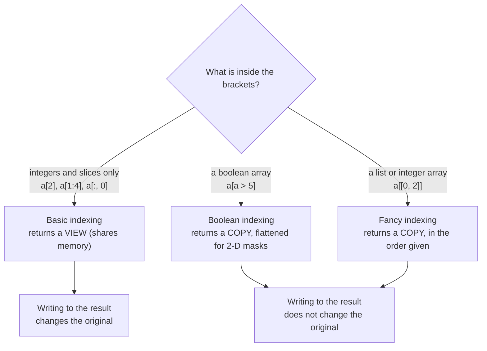

# Creating, Indexing and Slicing Arrays: The Complete Guide

> 📚 **Before you start**
>
> - [What is a NumPy Array?](what-is-a-numpy-array.md), for shape, axes and dtype
> - [Python Programming › Strings and Data Structures](../../python-programming/course.md#m5), for list indexing and slicing (`a[1:4]`, `a[::-1]`)

## Introduction

Indian Railways publishes a timetable for every train: stations down the side, days across the top. When you plan a trip you never read the whole thing. You look up one cell (the departure from Pune on Friday), one row (every stop on the route), every second column (alternate days), or only the cells that match a rule (stops longer than ten minutes). Working with arrays is the same. Most of the code you write is about **making** an array of the right shape and then **pulling out** exactly the part you need.

This article covers both halves. First, every common way to create an array: from Python data, filled with a constant, as a range of numbers, or with random values. Then every way to select from one: single elements, slices, rows and columns, boolean masks and lists of positions (called fancy indexing). By the end you will be able to build test data in one line and select any part of a 1-D, 2-D or 3-D array, and you will know which selections share memory with the original and which make a copy.

> 💡 **Key Insight**
>
> There are three kinds of selection, and they behave differently. **Basic indexing** (integers and slices) returns a **view** that shares memory with the original. **Boolean masks** and **fancy indexing** (lists or arrays of positions) always return a **copy**. Knowing which one you used tells you whether changing the result changes the original.

---

## Core Explanation

### 1. Creating arrays from existing data

You met `np.array()` in the previous lesson. It accepts lists, tuples and nested combinations, and an optional `dtype` to force a type:

```python
import numpy as np

fares = np.array([45, 60, 75])                 # ints
fares_f = np.array([45, 60, 75], dtype=float)  # forced to float64
grid = np.array([(1, 2, 3), (4, 5, 6)])        # tuples work too
print(fares, fares.dtype)
print(fares_f, fares_f.dtype)
print(grid.shape)
```

Output:

```
[45 60 75] int64
[45. 60. 75.] float64
(2, 3)
```

Two more builders take data from other Python sources:

- `np.fromiter(iterable, dtype)` builds a 1-D array from any iterator, such as a generator, without making a list first.
- `np.loadtxt` and `np.genfromtxt` read numbers from text. They accept a file path or any file-like object; here we use `io.StringIO` so the "file" lives in the code.

```python
squares = np.fromiter((n * n for n in range(6)), dtype=np.int64)
print(squares)

import io
csv_text = io.StringIO("""day,cups,price
1,52,15
2,61,15
3,47,18
""")
table = np.loadtxt(csv_text, delimiter=",", skiprows=1)
print(table)
```

Output:

```
[ 0  1  4  9 16 25]
[[ 1. 52. 15.]
 [ 2. 61. 15.]
 [ 3. 47. 18.]]
```

`loadtxt` needs every value to be a number. For files with missing values use `np.genfromtxt`, which fills gaps with `nan` (Not a Number). For real tabular files with mixed column types, use pandas' `read_csv`, covered in module 3.

```python
messy = io.StringIO("1,52\n2,\n3,47\n")
print(np.genfromtxt(messy, delimiter=","))
```

Output:

```
[[ 1. 52.]
 [ 2. nan]
 [ 3. 47.]]
```

### 2. Creating arrays of a given shape

Often you know the shape you want but not the values yet. These functions take a shape (an int for 1-D, a tuple for more dimensions):

| Function | Fills with | Example |
|---|---|---|
| `np.zeros(shape)` | 0.0 | running totals that start at zero |
| `np.ones(shape)` | 1.0 | weights that start equal |
| `np.full(shape, value)` | any value | a seating chart filled with `-1` for "empty" |
| `np.empty(shape)` | whatever bytes were in memory | fastest, only if you will overwrite every value |
| `np.eye(n)` / `np.identity(n)` | 1 on the diagonal, 0 elsewhere | identity matrices in linear algebra |
| `np.zeros_like(a)`, `np.ones_like(a)`, `np.full_like(a, v)` | same shape and dtype as `a` | a result array matching an input |

```python
print(np.zeros(4))
print(np.ones((2, 3), dtype=int))
print(np.full((2, 2), -1))
print(np.eye(3, dtype=int))
print(np.zeros_like(grid))
```

Output:

```
[0. 0. 0. 0.]
[[1 1 1]
 [1 1 1]]
[[-1 -1]
 [-1 -1]]
[[1 0 0]
 [0 1 0]
 [0 0 1]]
[[0 0 0]
 [0 0 0]]
```

Notice that `zeros` and `ones` default to `float64`. Pass `dtype=int` when you want integers. And never print or use an `np.empty` array before filling it: its contents are leftover memory and can be anything.

### 3. Creating ranges of numbers

**`np.arange(start, stop, step)`** works like Python's `range()` but returns an array and accepts float steps. The stop value is **excluded**.

```python
print(np.arange(5))
print(np.arange(10, 30, 5))
print(np.arange(0, 1, 0.25))
```

Output:

```
[0 1 2 3 4]
[10 15 20 25]
[0.   0.25 0.5  0.75]
```

With float steps, rounding can make `arange` return one element more or fewer than you expect, because the number of steps is computed as `ceil((stop - start) / step)` in floating point. When you care about the exact count, use **`np.linspace(start, stop, num)`**, which returns exactly `num` evenly spaced values and **includes** the stop value by default:

```python
print(np.linspace(0, 1, 5))
print(np.linspace(0, 1, 5, endpoint=False))
values, step = np.linspace(100, 200, 5, retstep=True)
print(values, step)
print(len(np.arange(1, 1.3, 0.1)))      # surprise: 4, not 3
```

Output:

```
[0.   0.25 0.5  0.75 1.  ]
[0.  0.2 0.4 0.6 0.8]
[100. 125. 150. 175. 200.] 25.0
4
```

The last line is the classic `arange` trap: `1.3` is not exactly representable in binary, so a value just below 1.3 sneaks in.

For multiplicative steps (1, 10, 100, ...) use `np.logspace` (exponents of 10) or `np.geomspace` (actual start and stop values):

```python
print(np.logspace(0, 3, 4))          # 10**0 .. 10**3
print(np.geomspace(1, 1000, 4))      # same thing, written as values
```

Output:

```
[   1.   10.  100. 1000.]
[   1.   10.  100. 1000.]
```

### 4. Random arrays the modern way

For test data and simulations you need random numbers. The modern API is a **Generator** object made by `np.random.default_rng(seed)`. Passing a **seed** (any integer) makes the "random" numbers the same every run, which is essential for reproducible results.

```python
rng = np.random.default_rng(42)

print(rng.integers(1, 7, size=10))             # dice rolls: 1..6 (high is excluded)
print(rng.random(3).round(3))                  # uniform floats in [0, 1)
print(rng.normal(loc=170, scale=8, size=4).round(1))   # heights in cm
print(rng.choice(["chai", "coffee", "lassi"], size=5))
print(rng.uniform(10, 20, size=(2, 3)).round(2))
```

Output:

```
[1 5 4 3 3 6 1 5 2 1]
[0.976 0.761 0.786]
[169.9 163.2 177.  176.2]
['lassi' 'coffee' 'coffee' 'lassi' 'coffee']
[[12.27 15.55 10.64]
 [18.28 16.32 17.58]]
```

Older code uses `np.random.seed(0)` followed by `np.random.rand(...)`, `np.random.randint(...)` and so on. Those functions still work but share one hidden global state, which makes results depend on what ran before. The NumPy documentation recommends `default_rng` for all new code, and this course uses it throughout.

`rng.permutation(a)` returns a shuffled copy and `rng.shuffle(a)` shuffles in place, both useful for splitting data into training and test sets later.

### 5. Indexing and slicing 1-D arrays

One-dimensional arrays index exactly like Python lists. Positions start at 0, and negative positions count from the end.

```python
stations = np.array([0, 18, 42, 95, 160, 210, 268])   # km from Mumbai CSMT
print(stations[0], stations[3], stations[-1])
```

Output:

```
0 95 268
```

A **slice** `a[start:stop:step]` selects a range. Any part can be left out: `start` defaults to 0, `stop` to the end, `step` to 1. The stop position is excluded.

```python
print(stations[1:4])      # positions 1, 2, 3
print(stations[:3])       # first three
print(stations[4:])       # from position 4 to the end
print(stations[::2])      # every second station
print(stations[::-1])     # reversed
print(stations[-3:])      # last three
```

Output:

```
[18 42 95]
[ 0 18 42]
[160 210 268]
[  0  42 160 268]
[268 210 160  95  42  18   0]
[160 210 268]
```

You can also **assign** to an index or slice. Assigning one value to a slice sets every element in it:

```python
seats = np.zeros(8, dtype=int)
seats[2] = 1
seats[5:] = 1
print(seats)
```

Output:

```
[0 0 1 0 0 1 1 1]
```

That last trick does not work with lists (`my_list[5:] = 1` is an error), and it is the first hint that arrays treat a single value specially. The [broadcasting lesson](broadcasting-and-iterating-over-arrays.md) explains why.

### 6. Indexing 2-D and higher arrays

For a 2-D array, put the row index and the column index in **one pair of square brackets**, separated by a comma: `a[row, col]`.

```python
# chai cups sold: 4 stalls (rows) x 5 days (columns)
cups = np.array([
    [52, 61, 47, 70, 66],
    [33, 29, 41, 38, 35],
    [80, 85, 79, 92, 88],
    [12, 15, 11, 19, 14],
])
print(cups[2, 3])        # stall 2, day 3
print(cups[-1, -1])      # last stall, last day
```

Output:

```
92
14
```

`cups[2][3]` gives the same answer, but it is slower and less clear: it first builds the whole row `cups[2]`, then indexes into it. With slices the two forms even give different results, so get used to the comma form.

Each position in the brackets can be an integer or a slice. A bare `:` means "everything along this axis".

```python
print(cups[0])           # first row (all days for stall 0)
print(cups[:, 0])        # first column (day 0 for every stall)
print(cups[1:3, :2])     # stalls 1-2, days 0-1
print(cups[:, -2:])      # last two days for every stall
print(cups[::2, ::2])    # every other stall, every other day
```

Output:

```
[52 61 47 70 66]
[52 33 80 12]
[[33 29]
 [80 85]]
[[70 66]
 [38 35]
 [92 88]
 [19 14]]
[[52 47 66]
 [80 79 88]]
```

Watch the shapes. An integer index **removes** that axis; a slice **keeps** it, even when the slice has length 1:

```python
print(cups[0].shape)        # integer for the row -> 1-D
print(cups[0:1].shape)      # slice for the row -> still 2-D
print(cups[:, 2].shape)     # one column as 1-D
print(cups[:, 2:3].shape)   # one column as a 2-D column
```

Output:

```
(5,)
(1, 5)
(4,)
(4, 1)
```

Two special index values help with higher dimensions:

- **`...` (Ellipsis)** means "as many `:` as needed". For a 3-D image array, `img[..., 0]` selects channel 0 of every pixel, the same as `img[:, :, 0]`.
- **`np.newaxis`** (an alias for `None`) inserts a new axis of length 1. It turns a 1-D array into a row or a column, which broadcasting needs.

```python
cube = np.arange(24).reshape(2, 3, 4)    # reshape is covered in a later lesson
print(cube[..., 0])              # first element of every innermost row
print(cube[1, ..., -1])          # block 1, last column

v = np.array([1, 2, 3])
print(v[np.newaxis, :].shape)    # (1, 3): a row
print(v[:, np.newaxis].shape)    # (3, 1): a column
```

Output:

```
[[ 0  4  8]
 [12 16 20]]
[15 19 23]
(1, 3)
(3, 1)
```

### 7. Slices are views

Basic slicing does **not** copy data. The result is a **view**: a new array header that looks at the same memory. Changing the view changes the original.

```python
week = np.array([10, 20, 30, 40, 50, 60, 70])
weekend = week[5:]
weekend[:] = 0                 # write through the view
print(week)
print(np.shares_memory(week, weekend))
```

Output:

```
[10 20 30 40 50  0  0]
True
```

This is a deliberate design choice: slicing a 10 GB array is instant and costs no memory. When you need an independent copy, say so with `.copy()`:

```python
week = np.array([10, 20, 30, 40, 50, 60, 70])
weekend = week[5:].copy()
weekend[:] = 0
print(week)
```

Output:

```
[10 20 30 40 50 60 70]
```

The [Matrix Library, Copies and Views](the-matrix-library-copies-and-views.md) lesson goes deeper into exactly when NumPy copies.

### 8. Boolean indexing (masks)

A comparison on an array returns an array of `True`/`False` values, called a **mask**. Indexing with a mask keeps only the positions where it is `True`.

```python
temps = np.array([31, 36, 29, 41, 38, 27, 44])     # a week in Nagpur, °C
hot = temps > 37
print(hot)
print(temps[hot])
print(temps[temps < 30])
```

Output:

```
[False False False  True  True False  True]
[41 38 44]
[29 27]
```

To combine conditions, use the element-wise operators **`&`** (and), **`|`** (or) and **`~`** (not), and **wrap each condition in parentheses**. Python's `and`, `or` and `not` do not work on arrays, because they need one single `True` or `False`.

```python
print(temps[(temps > 30) & (temps < 40)])
print(temps[(temps < 30) | (temps > 40)])
print(temps[~hot])

try:
    temps[(temps > 30) and (temps < 40)]
except ValueError as err:
    print("ValueError:", err)
```

Output:

```
[31 36 38]
[29 41 27 44]
[31 36 29 27]
ValueError: The truth value of an array with more than one element is ambiguous. Use a.any() or a.all()
```

The parentheses matter because `&` binds more tightly than `>` in Python: `temps > 30 & temps < 40` is read as `temps > (30 & temps) < 40` and fails.

Masks are also the cleanest way to **replace values by condition**:

```python
capped = temps.copy()
capped[capped > 40] = 40          # cap extreme readings
print(capped)
print(np.where(temps > 37, "hot", "ok"))    # pick between two values
```

Output:

```
[31 36 29 40 38 27 40]
['ok' 'ok' 'ok' 'hot' 'hot' 'ok' 'hot']
```

`np.where(condition, a, b)` builds a new array taking `a` where the condition is true and `b` elsewhere. With only a condition, `np.where(mask)` returns the **positions** that are true, covered in the searching lesson.

On a 2-D array, a mask of the same shape returns a flat 1-D array of the matching values (the shape cannot be kept, because each row may match a different number of cells). A 1-D mask used on one axis selects whole rows or columns:

```python
print(cups[cups > 80])                     # all cells above 80, flattened
busy_stall = cups.sum(axis=1) > 250        # one True/False per stall
print(busy_stall)
print(cups[busy_stall])                    # whole rows of busy stalls
```

Output:

```
[85 92 88]
[ True False  True False]
[[52 61 47 70 66]
 [80 85 79 92 88]]
```

### 9. Fancy indexing (integer arrays)

**Fancy indexing** means indexing with a list or array of positions. It picks those positions in that order, repeats allowed:

```python
menu = np.array(["chai", "samosa", "vada pav", "poha", "lassi"])
print(menu[[0, 2, 4]])
print(menu[[4, 4, 0]])

order_ids = np.array([3, 1, 1, 0])
print(menu[order_ids])            # look up names for a list of ids
```

Output:

```
['chai' 'vada pav' 'lassi']
['lassi' 'lassi' 'chai']
['poha' 'samosa' 'samosa' 'chai']
```

That last pattern (turning codes into labels with `labels[codes]`) is used everywhere, including inside pandas' categorical data.

On 2-D arrays, a list in each position pairs up element by element. This often surprises people:

```python
print(cups[[0, 2], [1, 3]])           # cells (0,1) and (2,3), NOT a 2x2 block
print(cups[np.ix_([0, 2], [1, 3])])   # the 2x2 block of rows 0,2 and cols 1,3
print(cups[[0, 2]][:, [1, 3]])        # same block, in two steps
```

Output:

```
[61 92]
[[61 70]
 [85 92]]
[[61 70]
 [85 92]]
```

`np.ix_` builds an "open mesh" so that the row list and column list combine as every-row-with-every-column.

Fancy indexing (and boolean indexing) always returns a **copy**. But **assigning** through them writes into the original array, because NumPy turns `a[idx] = value` into a direct write:

```python
picked = temps[[0, 1]]
picked[:] = 0
print(temps[:2])              # unchanged: picked was a copy

temps2 = temps.copy()
temps2[[0, 1]] = 0            # assignment writes into temps2 directly
print(temps2[:2])
```

Output:

```
[31 36]
[0 0]
```

### 10. Choosing the right kind of index



| Goal | Expression |
|---|---|
| One element | `a[i]`, `a[r, c]` |
| A range | `a[start:stop]`, `a[r1:r2, c1:c2]` |
| A whole row / column | `a[r]` or `a[r, :]` / `a[:, c]` |
| Every n-th element | `a[::n]` |
| Reverse | `a[::-1]` |
| Values matching a rule | `a[(a > x) & (a < y)]` |
| Specific positions in order | `a[[i, j, k]]` |
| A block of chosen rows and columns | `a[np.ix_(rows, cols)]` |
| Replace by rule | `a[mask] = value` or `np.where(mask, x, y)` |

---

## Try It Yourself

1. Create a 5 × 5 array holding the numbers 1 to 25 (use `np.arange` and `.reshape(5, 5)`). Select (a) the centre 3 × 3 block, (b) the four corners as a 2 × 2 array, (c) the main diagonal using fancy indexing.
2. With `rng = np.random.default_rng(7)`, generate 12 monthly electricity bills between ₹800 and ₹2,500 (integers). Print the months (1 to 12) where the bill was above ₹2,000.
3. Given `marks = np.array([35, 88, 42, 91, 67, 29, 76])`, replace every mark below 40 with 40 (grace marks) **without** changing `marks`, and show both arrays.
4. Explain why `a = np.arange(10); b = a[a > 5]; b[0] = 100` leaves `a` unchanged, but `a[a > 5] = 100` does not.

<details>
<summary>Show answers</summary>

```python
board = np.arange(1, 26).reshape(5, 5)
print(board[1:4, 1:4])
print(board[np.ix_([0, -1], [0, -1])])
print(board[[0, 1, 2, 3, 4], [0, 1, 2, 3, 4]])

rng = np.random.default_rng(7)
bills = rng.integers(800, 2501, size=12)
months = np.arange(1, 13)
print(bills)
print(months[bills > 2000])

marks = np.array([35, 88, 42, 91, 67, 29, 76])
graced = np.where(marks < 40, 40, marks)
print(marks)
print(graced)
```

Output:

```
[[ 7  8  9]
 [12 13 14]
 [17 18 19]]
[[ 1  5]
 [21 25]]
[ 1  7 13 19 25]
[2407 1863 1963 2326 1783 2119 2218 1183  894 1310 1284 2285]
[ 1  4  6  7 12]
[35 88 42 91 67 29 76]
[40 88 42 91 67 40 76]
```

**2.** `rng.integers(low, high)` excludes `high`, so we pass 2501 to allow ₹2,500.

**4.** `a[a > 5]` used as a value makes a new array (boolean indexing copies), so changing `b` cannot reach `a`. Used on the left of `=`, the same expression is an instruction to write into `a` at those positions.

</details>

---

## Real-World Examples

### Example 1: Train/test splits

Machine learning code shuffles row positions and slices them: `idx = rng.permutation(len(X)); train, test = X[idx[:800]], X[idx[800:]]`. That is a random permutation plus fancy indexing, exactly what you learned here.

### Example 2: Cropping and channels in images

A photo array of shape `(height, width, 3)` is cropped with a 2-D slice, `img[100:300, 50:250]`, and its red channel is `img[..., 0]`. Because slices are views, cropping a huge image is instant.

### Example 3: Cleaning sensor data

IoT temperature sensors sometimes report impossible values such as -999. A single masked assignment, `readings[readings < -50] = np.nan`, marks them all as missing, ready for averaging with `np.nanmean`.

---

## Common Misconceptions

### Misconception 1: "`a[1:3]` gives me a separate array"

Basic slices are views. Writing to them writes to the original. Use `.copy()` when you need independence.

### Misconception 2: "`a[[0, 2], [1, 3]]` selects a 2 × 2 block"

It selects the two cells `(0, 1)` and `(2, 3)`. For a block, use `np.ix_` or slice in two steps.

### Misconception 3: "`and` and `or` work on arrays"

They need a single truth value and raise `ValueError` on arrays. Use `&`, `|` and `~` with parentheses around each comparison.

### Misconception 4: "`np.arange(0, 1, 0.1)` always has 10 elements"

Floating-point rounding can add or drop an element. Use `np.linspace` when the count matters.

### Misconception 5: "`np.random.seed` is the right way to get reproducible numbers"

It still works, but it controls a global state that any library can disturb. Create a generator with `np.random.default_rng(seed)` and pass it where it is needed.

---

## Interview Relevance

- *"What is the difference between a view and a copy, and which indexing operations produce each?"* Integers and slices give views; boolean and integer-array indexing give copies; assignment through any index writes into the original.
- *"How do you select rows of a 2-D array where some column meets a condition?"* `X[X[:, col] > threshold]`, a 1-D mask on axis 0.
- *"What is the difference between `np.arange` and `np.linspace`?"* Step size versus number of points; `arange` excludes the stop and can be off by one with float steps; `linspace` includes the stop by default.
- *"How would you make random results reproducible?"* `np.random.default_rng(seed)`, and why it is preferred over the global `np.random.seed`.
- *"Why does `a[a > 2 and a < 5]` fail?"* Python's `and` needs a single boolean; use `(a > 2) & (a < 5)`.

---

## Key Takeaways

- **Create from data** with `np.array`, `np.fromiter` and `np.loadtxt`/`np.genfromtxt`; **from a shape** with `zeros`, `ones`, `full`, `eye` and the `_like` variants; **ranges** with `arange` (step) and `linspace` (count).
- **Use `np.random.default_rng(seed)`** for random data you can reproduce.
- **Index multi-dimensional arrays with one bracket and commas**: `a[r, c]`, `a[:, c]`, `a[r1:r2, ::2]`. Integers drop an axis; slices keep it.
- **Slices are views**; boolean and fancy indexing return **copies**; assignment always writes into the original.
- **Combine masks with `&`, `|`, `~`** and parentheses, and use `np.where` to choose values by condition.
- **Fancy indexing pairs positions element by element**; use `np.ix_` for blocks.

---

**Up next:** [Data Types and Array Attributes](data-types-and-array-attributes.md)
